# 科特勒《市场营销》读书笔记

> 来源：[https://my.feishu.cn/docx/doxcnDnXB6A2Y1SmtTPkMefm9ff](https://my.feishu.cn/docx/doxcnDnXB6A2Y1SmtTPkMefm9ff)

- 第一章：`https://mubucm.com/doc/3DGzKxTNEdy`
- 第二章：`https://mubucm.com/doc/Y5IGpSnv-4`
- 第三章：`https://mubucm.com/doc/0MuynG1gPm`
- 第四章：`https://mubucm.com/doc/2w_pvFHRcos`
- 第五章：`https://mubucm.com/doc/2w_pvFHRcos`
- 第六章：`https://mubucm.com/doc/1hlg-dZFy7C`
- 第七章：`https://mubucm.com/doc/15eLKLOO7IM`
- 第八章：`https://mubucm.com/doc/e88uf5ttrO`
- 第九章：`https://mubucm.com/doc/3SEQhy7BW0Q`
- 第十章：`https://mubucm.com/doc/2PQ0T37Vs_K`
- 第十一章：`https://mubucm.com/doc/3gfq1P-0Ire`
- 第十二章：`https://mubucm.com/doc/3gAl6XODp0o`
- 第十三章：`https://mubucm.com/doc/2Vzib-glswI`
- 第十四章：`https://mubucm.com/doc/2gU44GgNVDq`
- 第十五章：`https://mubucm.com/doc/1GC64uaQ_go`
- 第十六章：`https://mubucm.com/doc/N0a-6q1dzi`
- 第十七章：`https://mubucm.com/doc/3IxBsY9D7Ty`
- 第十八章：`https://mubucm.com/doc/e2gVHdg2Gy`
- 第十九章：`https://mubucm.com/doc/0ZixLdIUVn2`
- 第二十章：`https://mubucm.com/doc/xmG-Xg-aQA`

## 第一章

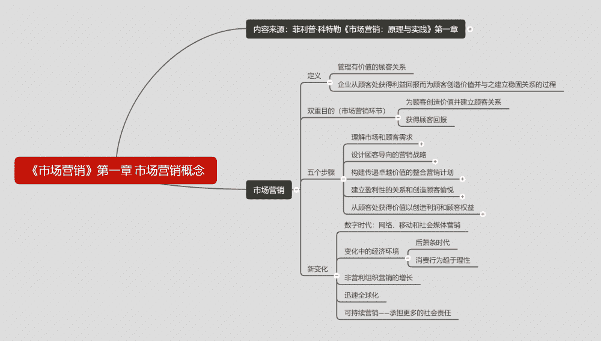

### 1. 市场营销的定义

简单地说，市场营销就是管理有价值的顾客关系

### 2. 市场营销的目的

通过为顾客创造价值来建立顾客关系，从而获得顾客回报

### 3. 市场营销主要包括五个步骤

### 4. 需要欲望需求

需要：needs，是一种感到缺乏的状态。是基本生理需要，社会需要，个人需要；它们是人之所以为人的固有部分

欲望：wants，人类需要的表现形式，受到文化和个性的影响，由一个人的社会背景所决定

需求：demands，得到购买力支持的欲望。欲望既定+资源条件有限=选择最大价值和满意的产品

### 5. 市场提供物

市场提供物是产品、服务、信息、体验的集合。

### 6. 市场营销近视症

过于关注特定产品本身而忽视了这些产品产生的利益和体验。

“钻头制造商可能认为自己的顾客需要钻头，但顾客真正需要的是洞。”

这启示我们不能被自己的产品一叶障目不见泰山，把自己的视野局限到自己的产品上，而应该时刻去关注消费者的需求的变化，理解消费者的本质需求，只要这样，才能够跟上市场的变化，理解市场动向。

### 7. “交换与关系”的概念可以引申出“市场”的概念。

### 8. 营销管理是一门为了选择目标市场并且与之建立有价值的关系的艺术和科学。

营销管理的目的是通过创造、递送和沟通卓越的顾客价值来吸引、保持和增加目标顾客。

### 9. 建立有价值的客户关系是市场营销五个步骤中最重要的步骤。

### 10. 建立顾客忠诚与维持意义极大，具有很高的经济价值，因为获取一个新顾客的成本远远比保留住一个旧顾客的成本高；同时，它也能帮助顾客与公司之间建立情感联系，而不仅仅是理性偏好，这种情感联系，能够让顾客长期购买使用。

这一点和我之前了解到的观点不谋而合，作为一个运营或者说产品经理，在用户运营的过程中，一定要重视沉默用户和流失用户的召回，因为一旦丢失一个用户，再获取新用户的成本就会高出很多。

## 第二章

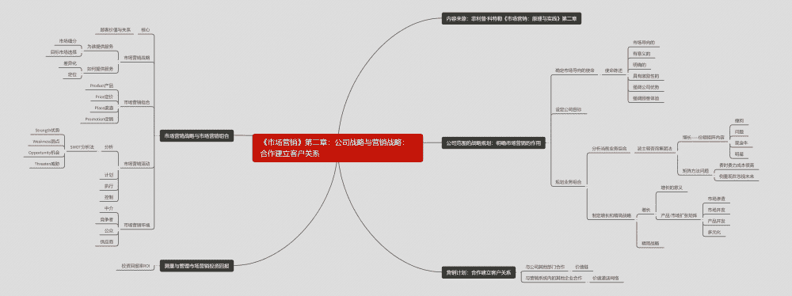

2020年1月2日

市场营销第二章读书笔记

### 1. 确定市场导向的使命

组织成4立都具有一定使命，这一使命和目的应该被清晰陈述，通过不断提问来形成优秀使命。

使命陈述mission statement，清晰的使命陈述犹如看不见的手引导着组织中的每一个人。

使命陈述应该是市场导向的，根据所满足的顾客的基本需求来定义。

我个人的理解是，市场导向刚好是应对“市场营销近视症”的策略，市场营销近视症使得营销人员过度关注产品自身而忽视顾客的真正需求以及需求的动态变化。市场导向与产品导向的区别在于，产品导向只关注具体的产品；持续的产品导向极易导致市场营销近视症；市场导向不仅关注具体的物、服务、产品本身，它更关注的是服务、物、产品背后蕴含的价值观，蕴含的需求变动方向，隐含着的消费者的具体消费心理。

市场导向所关注的话题比产品导向关注的事物，往往表现的虚无缥缈或者难以捉摸，正像是“钻头”与“洞”的区别，钻头看得见摸得着而且就在公司手中、随时存在着实物，但在消费之前，顾客需要的洞确实不存在的，它只存在于顾客的脑海、内心，而且顾客不会用语言表达出来它真正的需求。

市场导向关注的就是这一事物，它无形，但它更延伸到本质，因此它更能精准地把握消费需求。

但比别人多看到一点，多具备一种思考和视野，往往能够促成公司的健康发展，提前抓住这些看不到的东西，是为了确定具体的方向，不在之后迷失自我或者被急剧变化的时代抛弃。

使命陈述如何做？

a.有意义的，明确的，具有激励性的

b.强调公司在市场中的优势，有力地阐述公司希望如何获胜

c.不应该过多地关注销售或者利润，而应该强调顾客以及公司力求创造的顾客体验

### 2. 制定增长和精简战略

增长对公司的意义极大，“增长就好比公司的氧气”“增长使得公司充满活力和激情，让每个人看到真正的发展机会。”，因此公司必须制定自己的增长和精简战略。

结合实际，在现在的互联网公司中，出现了一个新的岗位，叫做“增长运营”“增长经理”“增长总监”就是最具体的体现，在现在流量难寻，流量越来越贵的时代，互联网公司再也不能靠着收割流量躺着赚钱，因此增长就极为重要，对增长的渴求也促成了互联网公司增长类岗位的诞生，增长成为越来越重要的目标。

### 3. 营销计划：合作建立客户关系

与公司其他部门合作

顾客价值是市场营销者成功秘诀中最关键的部分，但是市场营销者无法单独地为顾客创造卓越的价值。

市场营销人员必须使所有部门都“为顾客着想”，并建立一条能够顺畅地完成各项职能的价值链。

真正的营销导向并不意味着以营销为中心，而意味着整个公司都致力于为顾客创造价值，并将自己视为盈利性地确定、创造、沟通和递送价值给目标顾客的一系列过程的综合，不论职能或者部门，每一个人都必须从事营销。

如今吸引顾客需要整个公司的投入，我们都是市场营销者。

这一观点我是这么去理解的

1.首先这个观点解打破了一直以来的误区——市场营销只是市场部门的事情。现在再也不是了，市场营销需要公司各个部门一同努力，向同一个目标服务，也就是“为顾客着想并为顾客创造价值”

2.“价值链”条上的职能分工以及目标的一致，实际上是要求公司各个部门要具有统一的价值观、统一的理念。

公司文化、理念、价值观要优于具体的职能，职能是为了服务价值观，服务公司的目标，服务整个公司价值链条的顺畅运行的。

因此，尽管职能有分工，但目标却应该共享一致，共同合作服务于市场营销整个过程。

这也就要求公司每个部门都要或多或少了解和理解市场营销的理念，所以，即使不是市场部门，学习市场营销也并不是毫无意义的。

### 4. 营销计划：合作建立客户关系

与营销系统内的其他企业合作

如今，越来越多的公司与供应链中的其他成员——供应商、分销商以及最终顾客紧密合作，来改善顾客价值递送网络的业绩。当今的市场竞争已经不再发生在单独的竞争者之间，相反，它发生在由这些竞争者创造的整个价值递送网络之间。

如果说价值链是公司内部的价值观、文化和目标的共享，那么当公司要与其他公司和企业合作时，这个价值链就会多点铺开，成为一张价值递送网络。网络的效率、密集度、节点、服务质量，才是竞争的关键和竞争力的核心。

价值递送网络也就意味着平台的合作。

个人认为，价值递送网络上，各个平台可能不像公司内部的价值链条一样，需要高度的共享文化目标和价观念，但在一定程度上，价值递送网络的各个平台的理念和目标却是一致的，或者说只有保持一致，才不会让自己的价值递送网络被淘汰，这个理念和目标就是“一切行动都要服务于网络的效率和质量的提升，并且最终为顾客创造价值”

日常生活中就有鲜明的例子，不同的电商平台、不同的外卖平台，他们提供服务就是要依靠价值递送网络进行的，商家+地图导航平台+信息算法推荐工具+支付手段+网络流量引导平台+物流输送，等等，每一个环节的差异都会影响整个网络的质量和效率。

而想要提升质量，就意味着每个环节的质量都应该提升，同时，还要提升整个网络的协作能力和配合度。

### 5. 市场营销战略与市场营销组合

这一节阐述了市场营销的内在逻辑，从核心出发，层层递进，向外拓展的关系。

先有核心，在核心基础上制定战略，在战略指导下设计组合，有了组合之后则开展活动，在活动过程中观察并且适应环境以及环境中的组织者和力量。

核心是顾客价值与关系

市场营销战略：

（1）目标市场选择、细分市场（给谁提供服务）

（2）差异化、定位（如何提供服务）

市场营销组合：4P（Product产品、Price定价、Place渠道、Promotion促销）

市场营销活动：分析、计划、执行控制

市场营销环境：中介、竞争者、供应商、公众

## 第三章

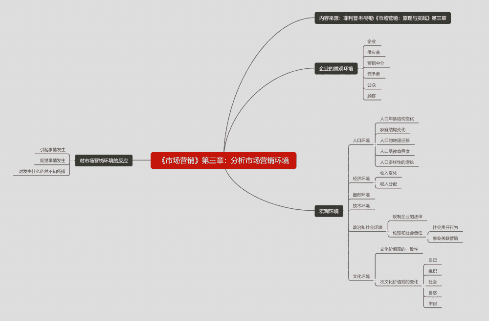

第三章开始讨论市场营销过程的第一步了解市场，了解顾客需求和欲望

### 1. 市场营销的运行环境：复杂多变微软方向的转变：方向：从提供个人电脑软件到全面提供数码设备和服务使命陈述：1.打造使人们在沟通、工作和娱乐时彼此联系的“令人愉悦、无线对接的科技体验”2.帮助人们与企业认识他们全部的专业和个人潜能这一使命就抓住了消费者需求的变化，而且开始把视野放的更加长远，从具体的产品开始扩散到消费者真正需要的服务和体验，真正体现了顾客导向的市场影响战略，体现了对顾客关系的重视。

### 2. 市场营销者的专长：市场调研和市场营销情报

### 3. 市场的营销环境主要由微观环境和宏观环境构成

微观环境：市场营销者只有和微观环境中的主要行动者合作，才能实现自己的目标。市场营销者需要分析不同行动者的特点，根据他们的特性，选择正确的对应态度和应对方式

企业：共同合作、共同理解、共享价值观

供应商：尊敬的合作伙伴

营销中介：合理选择、紧密合作、伙伴关系

竞争者：适合自身的竞争战略、建立更加强势的优势

公众：重视公众的影响力，为公众准备营销计划

顾客：最重要行为者、是整个价值递送网络的最终目的

宏观环境：宏观环境对公司的影响在于，宏观环境既能给公司带来机会，也能给公司带来威胁，而宏观环境的力量足够强大，它的变化使得即使最优秀的公司在宏观环境的力量面前也不堪一击。因此，尽管宏观环境难以预测和控制，但不去理解和分析宏观环境，只会导致公司运行举步维艰，时刻可能遭受灭顶之灾。

人口：

人口的年龄结构

a. 美国人口三个最大的群体是生育高峰一代，特点：经济繁荣时期出生、消费习惯自由、储蓄较少、最直观地体会了经历了经济衰退的过程，经济衰退为他们带来了压力，因此开始反思消费习惯以及工作责任，但仍然是最富有的一代，定位：潜在的巨大市场

b. X一代，特点：规模较小。缺乏明显的特征。在互联网时代成长着，享受着新技术的利益。开始成为世界的主宰，成为主导力量。面临着不断加重的经济压力，定位：主要的目标市场

c. Y一代——千禧一代，特点：数量庞大。经济最为窘迫。面临着越来越高的失业率和债务压力。极端喜爱数字和互联网技术。愿意分享自己的品牌体验。定位：未来市场＆在细分领域潜力大

d. Z一代，特点：更加热衷于数字网络技术、线上线下活动完美融合。

个人思考：1.本书对美国的主要人口划分，可以结合相应的发展水平，对应的迁移到我们国家的人群之中。70后80后90后00后各自具有什么特征？出生于怎样的生育政策之下？经济形势发展变化？对互联网和新技术的接受程度？面临着怎样的经济压力？它们的消费习惯和消费行为如何？伴随他们从小到大成长的是哪些品牌？哪些属于我们需要向下深入的下沉市场？在哪些人群里有着可以根据消费需求和欲望而细分的消费领域？一个优秀的运营者，需要提出这些问题，并通过用户需求调查来解答这些问题，从而针对我们的用户，制定相应的运营策略。

2.对人口进行区分和划分，其实就是第二章中提到过的目标市场选择和市场细分需要进行的操作，你需要了解你的用户的年龄，了解他们的消费心理、消费习惯、消费能力，再在此基础上，选择你的市场营销的目标对象和市场，进行市场细分，从而确定好自己的定位和使命。迁移到互联网运营上，这一步其实就是用户画像的关键一步，只不过，对现在的互联网运营而言，精细化运营的要求越来越高，单单的按照年龄和经历划分用户群体，远远达不到用户画像的要求。用户画像的要求，用通俗的话来讲就是，生动、栩栩如生、看到画像描述之后仿佛能够看到一个个具体的人的神态。一般需要包括年龄、性别、城市、收入水平、消费意愿、消费频次、付费意愿、付费能力、对产品的使用习惯、使用场景、平时的娱乐活动、它使用我们的产品是为了获得什么样的体验、它还有哪些需求是隐藏在背后的我们看不到的、它是我们的忠实用户还是单纯的路人粉。可以说，细节越丰富越好，而同时，不能是无用的细节，市场营销者或者运营人，需要从用户画像中寻找并且深入挖掘用户和自己的产品、自己的服务、自己的公司定位之间的联系，从而进行顾客导向的运营和市场营销。

3.中国和美国的人口变化尽管不尽相同，但也呈现出多样的特点。例如在家庭结构上，二胎政策的放开导致家庭人数开始增多，但值得玩味的是二胎政策的放开并没有导致人口数量的急剧上升，很多家庭依然选择一孩或者不生孩子，社会家庭结构正渐渐与传统的“三口之家”相分离。

4.人口的地理迁移方面，美国作为发达国家，已经走完了完整的城市化进程，开始经历去城市化过程。而中国目前仍然呈现出乡村向城市迁移的趋势，并且整个国家内的人口流动量极大，流动方式和路线多样，在这一过程中，应该是蕴藏着商机及提供服务和改善效率的空间的。比方说可以从以下角度思考，从乡村迁移到城市工作的人，是如何利用城市的服务和基础设施的？频繁变动工作地点的人，需要哪些服务来帮他提高工作效率和工作体验？（交通路线规划？居住地点？工作协同工具？信息储存工具？）

5.人口多样性的不断增长，会产生和分割出很多细分的消费领域。而把握和挖掘细分领域的机会，则是非常有价值的工作。

6.政治和社会环境的变化、社会公众文化观念、公共舆论事件等多方面因素影响下，产生了一种要求公司做“正确的事情”的推动力和驱动力。市场营销人员必须主动拥抱和迎接、顺应这个变化，才能满足社会舆论的要求，否则随时会被卷入舆论漩涡之中，影响公司品牌形象，阻碍与顾客关系的建立。公司需要把自己的市场营销战略和公司的价值观以及社会“做正确的事情”的要求结合起来，把握好自己的社会责任，树立自己的定位，这对公司挖掘用户真正的需要也是有帮助的。

7.对市场营销环境的反应，直接决定了公司在应对营销环境变化时能不能把握主动权、能否有效应对。现在随着数字网络技术的发达，一个个的营销事件再也无法作为孤例存在，再也无法被掩盖或者消失于公众视野之中，纸包不住火。因此，市场营销者再也不应该被动地应对环境的变化，即使面临着再大的压力和阻力，也要主动去迎接挑战，采取灵活的态度，时刻绷紧神经去分析环境的变化，硬着头皮也要上。一个好的市场营销者，在应对市场营销环境时，应该具备如下的态度：态度要积极主动、先发制人。沟通和公关要心平气和、共情共鸣、平易近人、以理服人、方式灵活，对待事件要抱着如履薄冰的心情，对顾客要有敬畏之心和服务精神。面对困难不退缩，硬着头皮也要上。

8.公司对营销事件和营销环境的应对，是一门科学更是一门艺术，优秀的应对能够化危机为机遇。

## 第四章

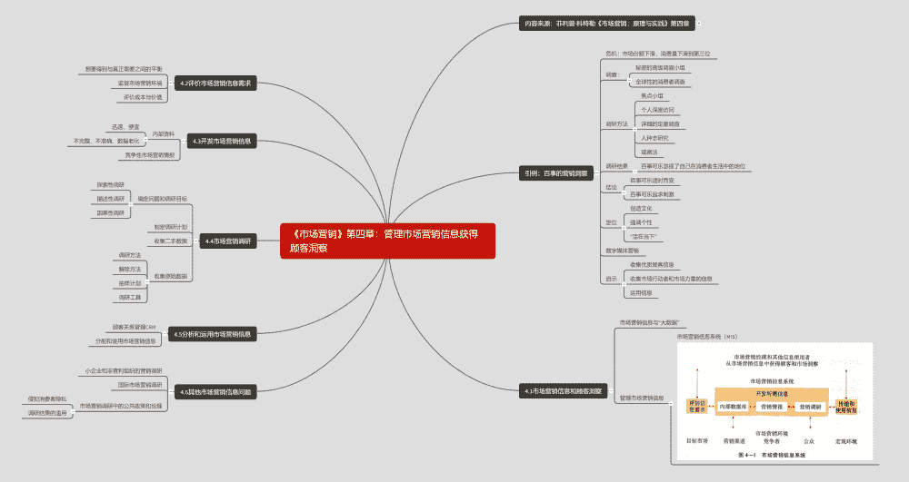

第四章 管理市场营销信息获得顾客洞察

### 0. 本章内容属于市场营销五个步骤的第二步，设计顾客导向的市场营销战略

本章的学习目标

（1）解释信息在获得市场和顾客洞察中的重要性

（2）市场营销信息系统

（3）市场营销调研过程

（4）公司如何分析和运用市场营销信息

（5）营销调研人员面对的特殊环境和公共政策、伦理问题

### 1. 案例：

百事可乐

面临危机——开展调查——采用详尽的深度的调查方法——调研结果——得出结论——品牌定位——保持特色——开展定位运动——展开数字媒体营销

启示：收集信息+运用信息

### 2. 第四章第一节 市场营销信息和顾客洞察

（1）

关于顾客洞察的两点重要事实：

a.顾客洞察的重要性：

顾客洞察指的是对于顾客需要和欲望的新鲜的深入的了解，为了为顾客创造价值并于顾客建立可盈利的关系，市场营销者必须获得顾客洞察，运用顾客洞察建立竞争优势。

b.顾客洞察的困难：

获得顾客洞察十分困难，因为顾客需求和顾客动机往往并不明显，消费者往往无法准确地表达出自己的需要。

因此，为了获得优质的顾客洞察，市场营销者必须有效地管理来自各种渠道的市场营销信息。

体会：

1.用户画像必须精准、丰富、鲜活、生动、多维度。

2.获取用户画像是有目的的，是为了服务于更好地为顾客创造价值和建立顾客关系。

3.顾客自身往往并不清楚自己的需求或者并不能够精准表达自己的需求，因此市场营销者需要做的比顾客更多，了解比顾客知道的更多的信息，走在顾客前面，甚至是预测和引领顾客的需求。

（2）

市场营销信息与“大数据”

市场营销者面临的问题不是信息不足，而是信息过载，大数据时代导致数据过于庞杂繁复。

大数据为市场营销者带来机会，同时也提出严峻挑战。

市场营销者需要的是更好的、更优质的信息，需要更好地利用已有的信息。

### 3. 第四章第二节 评价市场营销信息需求

（1）想要得到的信息与需要得到的信息之间的平衡

（2）真正需要的信息

（3）监督市场营销环境

（4）平衡获取信息成本与信息价值

### 4. 第四章第三节 开发市场营销信息

竞争性市场营销情报类似于互联网公司所做的竞品分析

但是区别在于

（1）竞品分析只是产品报告内容的一部分，它往往是从某一个时间点向前回溯的、事后的分析，功能性的对比的分析。

（2）竞争性市场营销情报则是一种主动的姿态，强调时刻抓取和了解市场信息的变动，是即时的、实时的、最终服务于战略性的。

### （3）竞品分析可能最后目的是服务于产品的功能改善，而竞争性市场营销情报最终目的可能侧重于在营销策略上把握主动。

### （4）但是其实完善的竞品分析报告其实也涉及的非常全面，现在的完善的竞品分析报告也在关注诸如运营事件等等的营销成果。

### （5）总的来说，互联网时代的竞品分析报告可能重产品，竞争性市场营销情报可能重营销，如果能把两者的优点结合，应该能做出一份非常精彩的报告。

### 5. 第四章第四节 市场营销调研

市场营销调研：与一般市场营销情报信息的获取不同，市场营销调研服务于特定目的、特定任务的，有具体针对目标的正式调研。

### 6. 第五章第五节 分析和运用市场营销信息

两个认知：

（1）收集信息不是为了储存信息，而是为了使用信息。

因此与数据收集系统相匹配的，必须有强大的数据挖掘技术，必须有高效的信息筛选手段，过滤出有价值的信息。

（2）

一切信息管理技术，都是为了最终建立“有价值的顾客关系”，因此，在改善技术的同时，不能犯“唯技术论”的错误，技术系统的应用不会立竿见影的见效，市场营销始终都不能忘记自己的出发点，就是“顾客价值＆顾客关系”，一切行为都应该从这个核心理念出发，然后应用合适的技术去提供解决方案，技术只是一个管理工具，只有与营销人员的主动的、能动的、目标导向的营销努力搭配，才能够见效。

### 7. 第四章第六节 其他市场营销信息问题

总结下来就是

（1）小企业和非营利组织的营销调研：

即使不大张旗鼓、一掷千金，只要能够脚踏实地、观察生活、有效检索，也可以有效获得营销信息。

（2）国际市场营销调研：

困难多多，但是仍然得硬着头皮上，因为有其相应的价值；如果错失了国际市场的营销信息，造成的损失可能更多

### 8. 本章学习目标的回答

（1）

信息在顾客中的重要性：

信息，是为了让顾客沉默的无法出声的需求开口说话，是为了让营销人员未闻其声、未见其人，也能够精准地描绘顾客的消费心理和用户画像；

信息，产生于营销人员更好地创造顾客价值的需求，最终是为了建立有价值的顾客关系。

（2）市场营销信息系统

（3）市场营销调研过程

（4）公司如何分析和应用市场营销信息

公司分析和应用市场营销信息采用的系统是客户关系管理CRM，分析和应用时，要始终牢记自己收集这些信息的初心——建立有价值的客户关系

（5）营销人员面对的特殊环境和公共政策伦理问题

消费者隐私问题、调研结果的滥用问题

# 第五章 消费者市场与消费者购买行为

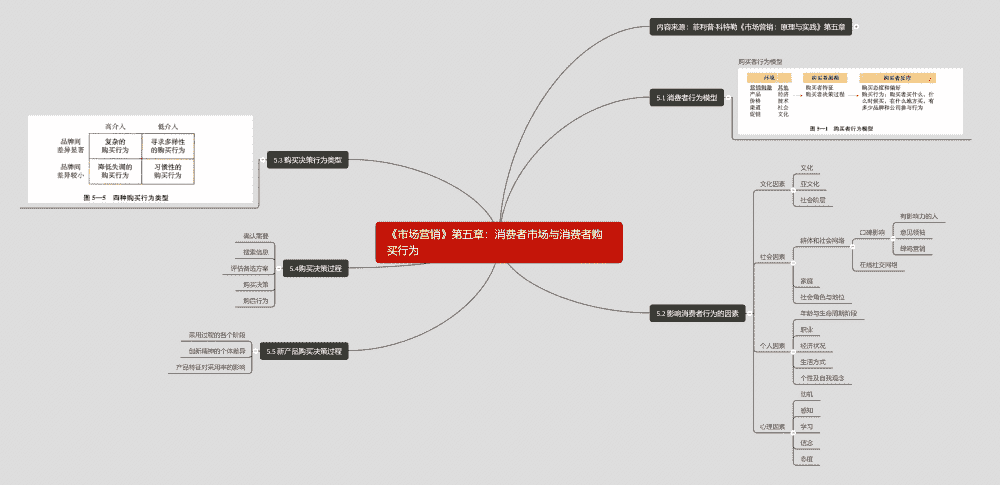

引例：Gopro的故事的启示是：成功从理解消费者的需要和动机开始。

购买行为从来就不简单，但理解它是市场营销管理者的首要任务。

## 第五章第一节 消费者行为模型

购买者行为模型：刺激——反应模型

## 第五章第二节 影响消费者行为的因素

各种因素都会影响消费者的行为，营销人员难以控制这些因素，但是必须考虑。

## 第五章第三节 购买决策行为类型

根据消费者的介入程度的不同以及品牌间的差异程度的不同，消费者的购买决策行为也呈现出不同的特点，因此，市场营销者需要分析自己产品的特点和消费者决策的类型，来决定不同的营销策略。

## 第五章第四节 购买决策过程

两个认知：

（1）对消费者最有效的信息来源就是个人信息，也就是“邻居的篱笆”，你的邻居趴在篱笆上告诉你“这个产品很棒”，比任何商业广告和信息都要更加有效。

这一点其实体现了第二节中讲到过的社会因素对于消费者的购买行为的重要影响力。

人是社会动物，我们一直在社会、群体中生存，演化的经验让我们依赖社群，而对社群、群体的信任也让我们更加相信身边人的信息甚于相信商业广告和营销信息。

但是，对于营销人员而言，去直接影响目标消费者身边的微观个体是不可能的。

“邻居的篱笆”效应，对市场营销人员的启示在于，要注重人与人之间的联系、注重人与人的对接、注重社会社交网络关系，或者说，注重在特定群体中为产品打造良好的口碑，借由社会网络的影响力，传播和提升产品形象。

而实施的方法，可以是利用关键意见领袖KOL，也可以是利用有影响力的人influentials，也可以是蜂鸣营销buzz marketing。

同时，随着信息网络技术的发展，“邻居的篱笆”已经更多地建在了网上，这是一件好事，因为它提高了连接和信息共享的效率，消费者的邻居越来越多，消费者和邻居之间信息对接的效率越来越高，但它也在一定程度上使得真实性打了折扣。

对于市场营销者而言，应该去拥抱这一变化，主动去创造让消费者之间成为邻居，互相分享和交流产品体验的契机，例如建立自己的社群、自己的消费者网站、开放消费者的评论和使用体验分享等等。

在这一过程中，市场营销者必须重视与人的对接，重视人与人之间的反馈，重视顾客的价值体验，同时也必须牢记的，就是不能造假和刷虚假数据，虚假流量，这毫无意义；人与人的对接，最关键的就是要保证口碑的传播是依靠一个又一个的鲜活的真实的人，只有真实鲜活的口碑，才有效，才经久不衰，虚假的宣传和利益驱动下的违心营销，毫无灵魂，而且起不到任何裨益，甚至往往适得其反，造成负面效应。

（2）真正决定购买者是否对所购买的产品满意的因素是：

消费者预期和产品感知绩效之间的关系。

一个很简单的道理，消费者在购买产品和体验产品时，他的眼里不会像科幻电影里那样，自动的显示一个对该产品的精准的评分“这个产品多少分，那个产品多少分”，不会这样。

事实上，消费者对产品的体验，是极其模糊的，是难以捉摸的，它与产品本身的技术水平和技术价值往往不一定成正比，因为在评价体验时人的心理发挥了很大作用。

换句话说，消费者评价产品体验时，没有一把绝对公正的上帝之尺去帮他评价，因此，他总是用自己的心灵尺度来评价体验。

而消费者衡量消费者价值体验的心灵尺度就是消费者对产品的预期和他实际感知到的产品绩效之间的落差。

值得玩味的是，这里的产品绩效，是消费者实际感知到的产品绩效，也就是说，只有让消费者感知到了这个产品为他带来了什么，这些绩效才真正发挥了它的价值，这就是所谓的认知失调的现象。

因此，市场营销者必须意识到认知失调现象的存在，时刻去让顾客感到满意，只有顾客满意了，顾客才会承认自己这次购买为自己带来了良好的体验，才会持续购买，才能够建立有利可图的顾客关系，才能够吸引和保留顾客，获得顾客终身价值。

因此，重视购后行为的用户服务和售后服务，对市场营销是极为重要的。

同时，重视购后行为的市场营销，也是为了规避风险和避免负面事件，因为“好事不出门，坏事传千里”，而且实际购买了商品的用户的评价，更容易引起舆论讨论，对公司的打击也是最大的。

## 第五章第五节 新产品购买决策过程

对于新产品的采用过程的差异，可以将消费者分为五种类型：创新者、早期采用者、早期大众、晚期大众、落伍者。

而对采用者的分类表明，一家不断创新的公司应该侧重于研究创新者和早期采用者的特点，制定直接针对她们的营销活动。

## 学完本章需要确立的几个认知

（1）消费者的需求复杂，往往消费者自身都无法准确表达。

（2）影响消费者行为的因素众多，市场营销者无法控制，但分析这些因素能够让市场营销者发现机会，了解顾客需求，更好地为顾客创造价值。

（3）对于消费者而言，它最信任的信息，是来自人的信息，尤其是身边人、家人、群体中的人、社区中的人的信息。因此，对于市场营销者而言，应该重视人与人之间的联系和对接，借由社交活动去传播品牌口碑，重要的是，必须是真实的人、鲜活的人。

（4）不同的消费者对新产品的态度不同，市场营销者应该去分析消费者采用新产品的态度，进而针对自己的目标群体去制定营销计划。

# 第六章

市场营销第六章

第五章讲的是消费者购买行为，第六章讲的是组织市场与组织购买者行为，可以说，如果第五章是To C,那么第六章就属于To B

## To B销售和营销的本质：

在To B的销售之中，最关键的竞争力不是某项产品或者服务，而是“提供完备的方法和系统去帮助顾客解决其所需要的问题”。

To C的销售是为了建立有价值的顾客关系，而To B的销售之中，则是要与顾客建立深度的合作关系，做顾客的伙伴，为顾客提供完备的系统的服务。

例子1：就像UPS一样，UPS能够为企业提供建议和咨询服务，帮助企业改善自身的总体物流运营，帮助客户重新设计物流系统，以促进商品资金信息在供应链中的更有效更畅通地流通；甚至在更深的层次，UPS可以接受和管理企业部分或者全部的物流运营。

UPS把自己作为企业的战略物流伙伴，了解企业的需求，与企业进行深入的合作。

例子2：IBM与六旗娱乐公司

IBM提供的不仅仅是软件这一产品，还通过提供软件运行需要的整套服务，紧密合作、为六旗定制应用，提供培训和研讨服务，来最终为“解决六旗的资产管理问题”提供整套的解决方案。

To B卖的不是产品，而是完整的解决问题的方案。

## 重视感情因素

一个认知：组织购买者并不是如机械般精明冷血的，组织也是人与人的集合体，只要是人，就有七情六欲和情感需求，因此把握组织需求时，也需要在某种程度上把组织人格化，去透视组织所代表的的利益团体，去拆解服务的使用场景，照顾和考虑到组织购买者的感情需求。

# 第七章

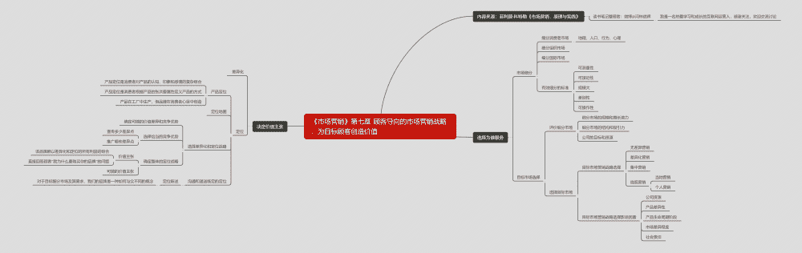

市场营销第七章

顾客导向的市场营销战略：为目标顾客创造价值

第七章讨论的是市场营销步骤的第二步，顾客导向的市场营销战略

## 从大众营销转向目标市场营销

目前，许多公司已经意识到

（1）自己根本不可能吸引到市场中的所有的购买者，或者自己吸引购买者的方式不可能相同；

（2）购买者的数量众多而且分布广泛，他们的需求和购买行为有很大差异；

（3）公司自身在不同细分市场中的服务能力也很不相同

因此，一家公司必须确定自己所能够提供的最好的服务，以得到最大盈利的市场部分，所以市场营销者必须设计顾客导向的市场营销战略，与合适的顾客建立良好的关系。

## 差异化与定位

在产品定位这一部分，有一本经典著作就是《定位》，由它创立的理论也被成为定位理论，讲述了企业对公司自身及产品的重要性。前段时间是定位理论创立的50周年，定位理论至今仍然闪耀着光辉，在营销实践中发挥着重要的作用。

有机会之后希望可以读一读《定位》这本书。

## 价值主张

品牌的价值主张是品牌的整体定位，是品牌赖以差异化和定位的所有利益的组合。

价值主张需要直接回答顾客的问题“我为什么要购买你的品牌。”

能够成功的、获得竞争优势的价值主张主要包括优质优价、优质同价、优质低价、同质低价、优质更低价五种可能的价值主张。

这一套的价值主张，如果从我们文化的基因和底蕴中去阐释，也可以说是“人无我有，人有我优，人优我特。”

这一类价值主张，不仅是公司品牌营销需要确立的价值主张，还是个人建立个人品牌、确立个人定位、明确自身竞争力的关键性认知。

在与他人竞争的过程中，你有哪些“人无我有、人有我优、人优我特”的技能和素质？

了解这些，能够让人更加清晰的认识自我，摆正自己在社会中的定位。

就像品牌的价值主张是差异化和定位的所有利益的组合一样，个人的价值主张也考验的是个人全方位的、多维度的综合素质和能力，毕竟，个人层面的竞争，始终是综合能力和综合素质的竞争。

# 第八章

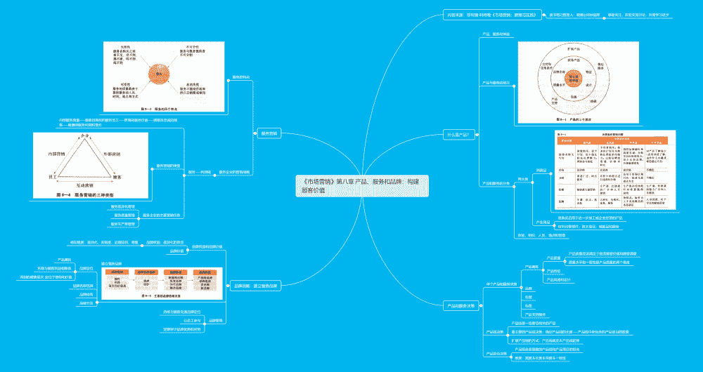

市场营销第八章

产品、服务和品牌：构建顾客价值

## 引例：

ESPN的例子，显示了ESPN对用户对不同产品的使用场景的精细划分和精准把握，从用户的需求出发，去针对性地提供自己的产品和服务，把握了顾客的核心需求。

## 产品的三个层次

产品的层次之中，最核心的层次就是核心顾客价值，要明白顾客真正购买的是什么，也就是要首先确定顾客所追求的旨在解决问题的和心理和或服务。

如果最开始就能够深入挖掘透彻顾客的真正需求，就能够在很大程度上避免“市场营销近视综合症“

买钻头的顾客真正需要的是钻头吗？不，他需要的是一个洞，一个用于连接的空间。

买唇膏的顾客需要的是唇膏的色彩吗？不，她需要的是容貌的美化。

买ipad是为了购买平板电脑吗？不，购买的是娱乐、自我表达、效率以及与亲朋好友的关系，是面向世界的个人的移动窗口。

从顾客真正的需求的角度去分析问题，就能够更加清晰地看到产品的发展方向和真正所需要、真正应该改善的功能。

这也是作为一个产品经理而言的必要的素质。

## 产品和服务的分类

产品和服务可以分为两大类——消费品和产业用品

消费品与产业用品的区别不在于产品本身，而在于被购买的目的和使用用途。

而消费品也可以根据购买频次、需求刚性、需求程度、需求特点（个性化程度、兴趣程度）等划分为四个类型，每一种类型，都应该制定不同的营销策略。

## 质量

质量的狭义的最低层次的定义应该就是没有缺陷。但是以顾客为中心的公司和企业，应该时刻以顾客价值和顾客体验为标准去定义产品的质量。

顾客的满意程度是质量的试金石和评价标准。

## 服务的四大特点

由于服务的这四个特点，需要市场营销者在服务时采取一些与传统营销方式不同的营销方法；为了让服务有效、优质的进行，企业不仅需要关注顾客，也需要关注员工，创造顾客和服务人员的良好互动机制，保证这一机制实施的，就是“服务——利润链”，它是一种将企业利润与员工和顾客的满意度联系捆绑的情感——利益链条，核心是建立一种在服务质量、顾客满意和员工激励之间的正反馈机制。

## 品牌战略

强有力的品牌是与顾客建立可获利的牢固关系的基础。构成品牌权益的基本资产是顾客权益——品牌所创造的顾客关系的价值。强势品牌非常重要，但是它真正代表的是可盈利的忠诚顾客。营销的正确焦点应当是运用品牌管理作为主要的营销工具，来建立顾客资产。企业应当把自己视为顾客的组合，而不是产品的组合。

本章的企业品牌、产品品牌的开发战略，对于建立个人品牌也有很大的启发和指导作用。

（1）个人品牌应该是营销自己的主要工具，用来建立顾客资产，和自己的顾客、用户建立牢固的有价值的情感关系，个人不能脱离自己的用户和受众，而应该始终把自己作为用户的一部分，重视与顾客的关系。

（2）个人对自己的品牌开发，也可以遵循企业的品牌开发战略。

产品线延伸：你已有的产品中，哪些可以继续细分，应用到新的样式？

品牌延伸：你在你的品牌之后，还能推出哪些新的产品？

多品牌：在同一个产品类别中，你能否引入新的品牌？

新品牌：你现有的品牌的影响力是否在衰减？如果是，需不需要引入新的品牌？

但个人能够提供的产品类别往往是有限的，差异不大的，这方面的限制可能会导致企业的品牌开发战略不能完全地应用于个人品牌的开发之中，范围要适当缩小。

（3）个人品牌管理

个人品牌管理与企业品牌管理互通的，首先是持续与顾客沟通品牌定位。

与铁粉、与读者、与观众时刻进行沟通，看一看顾客对自己的看法是如何的，看一看自己提供的内容是否保持了清晰的定位，分析自己在顾客心中是否确立了一个清晰而明确的人物形象。

其次，个人品牌需要定期重新审视自己的品牌的优势劣势。

在这一方面，可以采用SWOT分析，对个人的优势、劣势、机会、威胁进行重新分析。

# 第九章 新产品开发与产品生命周期战略

谷歌的混乱式创新进程也带来了两个挑战，一是企业必须善于开发新产品来替代过时的产品，即新产品开发的挑战，二是企业必须擅长在产品生命周期的各个阶段，根据不断变化的消费者品味、技术及竞争压力来相应地调整营销战略，即产品生命周期的挑战。

这两个挑战，正是本章研究的主题。

## 新产品开发战略

企业获得新产品的两种途径

（1）直接获取——购买企业、专利或者生产许可

（2）通过企业自身的研发努力进行的新产品开发

创新伴随着昂贵成本和高风险，因此企业面临着两难，企业必须开发新产品，但是开发新产品又需要耗费高成本和面临高失败率。

为了创造成功的新产品，企业必须理解它的消费者、市场、竞争对手，并且开发能够向消费者传递优异价值的产品。

## 新产品开发过程

构思产生的其中一个方法就叫做众包，我看到这个名词时，立刻想到了众筹，众包就好像是公司发起的针对社会各界人士的一场创意和构思的众筹活动，集思广益、群策群力，拆除禁锢创新的围墙，才能让促进创新的源泉充分涌流，为创新注入源源不断的活力。

而众包如果希望取得成功，则必须具备几个关键因素：开放包容、接纳各类创意和各界人士的心态、便捷高效的信息交流平台、细心的创意收集工作、创意筛选评比机制、执行力与实践力。

## 管理新产品开发

成功的新产品

（1）能够解决顾客的主要问题，并且提出一个引人注目的独特的价值主张

（2）顾客直接参与新产品的创新过程

## 产品生命周期战略

产品的生命周期可以区分为开发前和开发后

开发前是产品开发期

开发后可以分为初创期（介绍期）、成长期、成熟期、衰退期

随着产品所处的开发周期的不同，产品的运营策略和产品的功能也需要相应作出变化。

互联网领域做竞品分析时，分析产品的生命周期发展历程和其所处的生命周期发展阶段是必备环节。

以互联网领域推出的APP产品为例，判断产品所处的生命周期阶段，可以参考以下几个标准

（1）公司融资情况

（2）app下载量、用户数量

（3）app日活

（4）app上线时间

（5）app版本更新迭代：更新次数是否频繁，更新内容是小范围的功能优化还是大范围的功能迭代，更新频率是否稳定

（6）市场上存在的竞争对手的数量

而本书中则提出，产品生命周期的概念也可以运用于所谓的风格、时尚和热潮，该观点揭示的现象也值得关注。

# 第十章 定价：理解和获得消费者价值

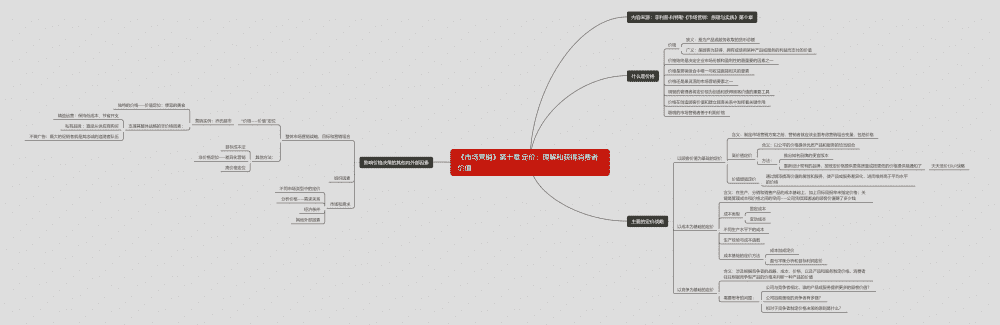

JC彭尼定价案例，可能是本书至今为止第一次以失败案例作引例。

JC彭尼的定价历程，解释了零售商们普遍面临的两难处境——既不能靠促销维持生存，但又离不开促销。

而何种定价方案才是正确的呢？

最终还是应该交给消费者，根据市场表现来决定。

## 对定价的核心认知：

无论经济状况如何，企业都应该销售价值，而不是价格。

企业应该说服顾客，让顾客相信，为了获得公司品牌提供的特殊利益，支付更高的价格是值得的。

## 如何理解价格？

价格始终是决定企业市场份额和盈利性的最重要的因素之一，价格是营销组合中唯一与收益直接相关的要素，价格还是最灵活的市场营销要素之一。

明智的管理者应该将定价视为创造和获得顾客价值的重要工具；价格在创造顾客价值和建立顾客关系中发挥着关键作用。

聪明的市场营销者，应该善于利用价格。

## 以制定竞争为基础的定价策略时，公司需要考虑几个问题

（1）公司与竞争者相比，谁的产品或者服务提供更多的顾客价值？

（2）公司面临的竞争者有多强？它们的定价战略是什么？

（3）相对于竞争者制定价格决策的原则是什么？

这一定价策略，同样适用于现在的互联网app产品，也适用于内容生产商，同样也可以迁移到个人自媒体的定位上。

以个人的自媒体经营为例，个人的自媒体经验很难采用按照产品定价的方式，因为个人自媒体的成本往往是无形的，价格也是无形的。

以竞争为基础的定价策略进行分析个人自媒体、👸号或者🧣账号的经营的话，可以思考以下几方面问题

（1）你的内容与别的内容作者相比，谁能够提供更多的用户价值（情绪价值、经济价值、干货）？

（2）与你生产的内容处于相同领域的博主、作者有哪些？他们有多强？他们的内容生产策略是什么？他们针对的用户群体是怎样的？

（3）你如何在你所耕耘的领域之中脱颖而出？你如何找到与他人不同的闪光点？你能带来怎样的价值差异？

5.

以价格定位设计其他市场营销组合策略的一种方法——目标成本法

目标成本法先确定一个以顾客感知价值为基础的理想售价，然后以与价格相匹配为目标确定成本。

# 第十一章

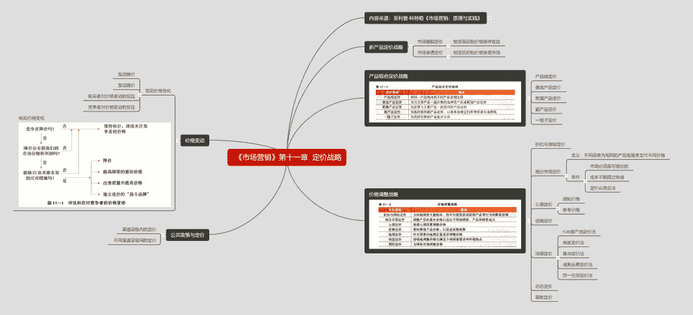

## 1. 引例：沃尔玛vs亚马逊：争夺网上统治权的价格战

网络购买/线上销售的争夺，对于沃尔玛和亚马逊而言是关于未来的争夺。

沃尔玛和亚马逊在网上统治权的争夺之中，都利用了低价格这一武器，双方在低价格的争夺上平分秋色，陷入胶着；

但是，定价策略并不是只关注价格，而是价格与非价格等等因素的复杂组合；

亚马逊在非价格因素具有独特优势，呀么寻的网络系统可以迅速、高效地完成订单和送货上门服务，甚至在某些地区可以做到当天送达；亚马逊还不断丰富自己的产品种类，拥有着多样的产品搭配；亚马逊的顾客交互界面由大数据驱动，为顾客创造了无与伦比的个性化的购物体验，得到了顾客的高度满意；

沃尔玛的优势在于，沃尔玛有实力去整合线上购买和自身庞大的实体店网络；沃尔玛可通过协同线上和线下运营，提供独特的服务，进行线上线下的服务协同。

在这场网上统治权的争夺之中，价格是重要因素，但要想赢得争夺，需要依靠的绝对不仅仅只有价格，还需要以顾客为导向，为顾客递送选择性、便利以及一流的网上购物体验。

## 2. 新产品推向市场时，可以采用两种定价策略

### （1）市场撇脂定价

新产品推向市场时，制定很高的初始价格，在市场上一层一层地掠夺收益。

这一种定价策略也解答了我一直以来的疑问：

国内很多小众的手机厂商推出新品手机时，为什么一上来就定价于8999，9999等高价格？

国内某些主打智能家居旗号的物联网家电企业，推出的新产品为何动辄就要十万、二十万元？

原来是因为新产品推向市场时，这些公司采取了市场撇脂的定价策略。

当然，市场撇脂定价策略也有其自身的使用条件，只能在特定情况下使用，否则就会反噬自身、自食恶果。

条件就是：a.产品质量和形象要符合其高定价的定位，并且有特定的消费人群有购买意愿 b.收益可以抵消小批量生产的成本 c.竞争对手没有轻易进入该市场的条件

### （2）市场渗透定价

制定较低的初始价格，迅速地、深入地渗透市场，短时间内吸引大量购买者，赢得较高的市场份额。

市场渗透定价的使用条件是：

a.市场必须对价格高度敏感 b.产品的生产和分销成本必须随着销售量的增加而降低 c.低价可以帮助排斥竞争者 d.采取渗透定价的公司必须保持其低价的定位

11章第二节第三节主要讲的是产品的定价策略

十一章第二节和第三节的产品组合定价战略和价格调整方案中的有些方法，让我想到了经济学理论中的价格歧视理论，一级二级三级价格歧视各有不同的表现形式，价格歧视理论也可以用来分析定价策略。

# 第十二章

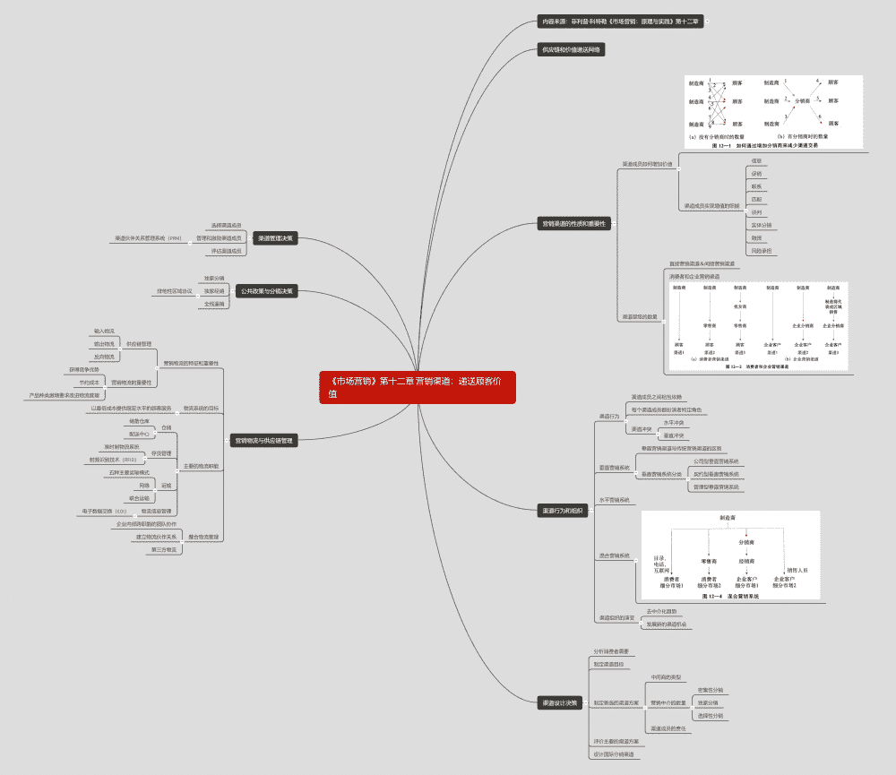

## 第十二章 营销渠道：递送顾客价值

### 1. 引例：网飞公司的创新之路

a. 网飞成功创新的举措：

（1）在DVD邮寄服务中采取创新的分销模型

（2）推动数字流媒体的发展，在改善技术和建立庞大的视频库方面倾注大量资源

（3）转变战略重心：从DVD服务到数字流

（4）在内容竞赛中赢得主动：开发自己的原创节目

b. 网飞创新之路的启示：

在这一瞬息万变的行业，要想保持领先，就必须主动改变，主动创新。

“否定过去，才能找到未来。”

### 2.

从供应链观点，到需求链观点，是从企业视角向市场视角、消费者视角的转变；从需求链观点到价值递送网络观点，是从单纯的交易关系向合作伙伴关系的转变。

供应链到需求链再到价值递送网络，每一步都是观念的进步。

### 3.

企业应该重视维护和中间商的关系，与中间商并肩作战，要把中间商视作合作伙伴，并管理伙伴关系。

就像用顾客关系管理CRM软件系统管理顾客关系一样，企业也可以运用渠道伙伴关系管理系统PRM和供应链管理SCM软件来招募、组织、培训、管理、激励、评估公司与渠道伙伴关系。

### 4.

一个反常识但合乎逻辑的认知：

企业营销物流的目标不是以最低成本最大化地提供顾客服务，而应该是以最低成本提供既定水平的顾客服务

# 第十三章

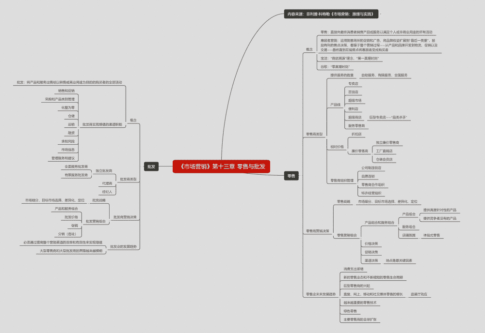

## 1.

这一章对零售的介绍非常详细和鲜活，也十分贴近日常生活，能够看出来作者做了非常多的资料考证，十分关注细节和注重观察生活。

## 2.

零售商和批发商的主要营销决策中营销战略的四个环节：市场细分、目标市场选择、差异化和定位。

这正是前几章中介绍的，顾客导向的市场营销战略的四个步骤。

## 3.

以顾客导向的市场营销战略告诉我们，零售商必须进行市场细分并定义自己的目标市场，然后决定在这些目标市场中如何差异化和定位。

有很多的零售商，甚至包括很多大型零售商，都没能够清晰地定义自己的目标市场，这导致他们的增长陷入瓶颈，发展失去方向。

而相对的，成功的零售商都是能够很好地定义它的目标市场并准确定位的零售商。

精细的市场细分和目标市场选择，能够为独立的小规模零售商提供与最大最强的零售巨头们抗衡的能力。

威驰三明治通过创造个性化的服务，努力将个性化服务的可能开发到极致，并通过自己“在我们店里获得的是情感，是正能量”的定位，使自己的定位与其巨头竞争对手保持差异，实现了自己的快速腾飞，确立了自己的独特存在感，目前已经成为美国成长最快的休闲快餐连锁餐厅之一。

威驰三明治的例子告诉我们，

精细的市场细分和目标市场的选择以及差异化的服务和定位，能够在市场营销中发挥杠杆作用，起到四两拨千斤的作用。

核心秘诀就是因为，市场营销始终应该是以顾客为导向的，应该致力于与顾客建立可持续的有利可图的关系。

谁掌握了顾客的需求和与顾客的关系，谁就掌握了打开财富之门的金钥匙。

在目前的经济发展趋势中，顾客营销导向的市场营销战略的四步骤（市场细分、目标市场选择、差异化、定位），或者说细分市场+差异化服务的组合拳将是冲击固有经济格局的一股不可忽视的力量。

原因是多方面的，一方面，顾客价值本身就一直是市场营销的导向和核心；另一方面，经济下行导致大家的消费决策越来越趋于理性决策和感性回归，回归自己的真实需求，更加注重实惠、对轰炸式广告和巨头效应的依赖越来越小；社会人的消费偏好和需求越来越趋于个性化；当代人越来越重视自己的尊重需求、情感需求被满足。

## 4.

“体验式零售”的概念与最近互联网领域炒的很热的“沉浸式消费”“体验式消费”“全场景营销”概念拥有相同的本质。

都是要强调零售和消费过程，不仅仅只是购买商品的过程，更是一种参与和体验价值、情感、文化的过程。

这一过程直接影响顾客的体验和对商品、企业、公司的观感和评价。

## 5.

目前的零售业存在着多种未来的发展趋势，正如这一节中的营销实例的标题“展厅效应：不要对抗，试着接纳”写到的，未来发展趋势是不可逆转的，有机遇也有挑战，只有接纳和理解，主动拥抱，制定对策，才能够跟上时代发展的浪潮。

直复、网上、移动和社交媒体零售的增长，是零售业未来发展的趋势之一。

逛展厅效应，就是能够体现这一趋势的新兴购物现象，这一现象为传统的店铺零售模式带来了挑战和机遇。

许多实体店零售商正在制定更广泛和更好的战略来应对展厅效应：

（1）“反向逛展厅”效应

（2）不拘泥于价格，而是通过帮助顾客、为顾客提供有价值的服务、提供人际接触，将顾客从访客变成购物者。

（3）经营实体店的同时发展自己的网点和数字业务，开发逛展厅效应的红利。力求将电子购物的优势与实体店购物的独特优势（例如即刻的购买喜悦、便利的退货以及销售人员的服务支持）融合起来。力求成功融合虚拟世界和实体世界，打造“鼠标加水泥（click-and-brick）”企业。

对于展厅效应带来的冲击，必须认识到，真正的挑战并非是店内购物与网上购物的对抗，如何利用两者提供最佳的购物体验和价值才是关键。网上购物与实体店购物都具有无可比拟的、无法替代的独特优势，因此，它们的最佳战略不是与“逛展厅效应”对抗，而是应该接纳，利用它吸引消费者和展示自己随时随地提供顾客所青睐的购物体验的优势。

消费者决定通过店铺还是网络购物已经不再重要，因为他们的购物过程正在越来越多地将店铺、网络、移动应用、社交媒体融合在一起。

## 6.

零售技术越来越重要，也成为零售业未来发展的趋势之一。

对于这一趋势，我们也必须认识到，零售技术的未来在于融合线上线下的购物体验，线上线下零售并不是零和博弈，不是你死我活的斗争，而是两者都不可偏废，两者都十分重要，必须整合。

## 7.

批发商存在的空间，或者说批发商存在的价值和意义就在于通过提高整个营销渠道的效率和有效性来实现增值。

批发商本质是营销渠道的一环，发挥着中介作用，因此它必须发挥增值作用，充当渠道的润滑剂，提高整个渠道交易的效率，否则，它就将失去存在意义和发展的空间。

批发商现在面临着极其严峻的挑战，这一挑战的来源就在于行业持久而坚挺的趋势“不断追求更高的效率”对批发商提出的要求。

因此，随着经济状况的下行和服务需求的增加，不能找到有效途径向客户让渡价值的批发商将迅速被淘汰。

## 8.

西尔斯的失败原因：

失去了自己的聚焦点，也就是定位的迷失；

缺乏明确的价值主张和使命陈述，失去了方向；

行动力缓慢，购物体验差；

分权结构导致业务混乱，定价战略乏力。

# 第十四章

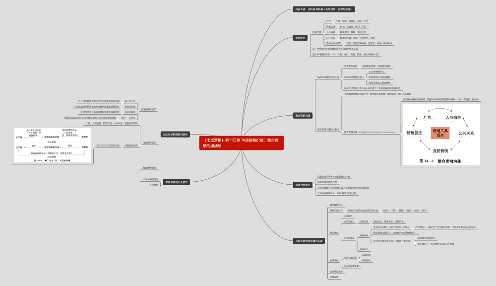

## 1. 【从广告走向内容营销】

随着营销沟通环境的改变，过去的“广告”的投放方式和思维模式已经在发生变化，市场营销者开始用更广阔的眼光看待自己的工作，把自己视为“内容营销”管理者。

内容营销管理者采用一种新的分类方法划分媒体类型：

POES分类法

a. 付费媒体（paid media）

b. 自有媒体（owned media)

c. 赢得媒体（earned media)

d. 分享媒体（shared media）

POES媒体是内容营销者进行整合营销的工具和渠道。

在新的视野和新的思维模式下，今天的市场营销者必须做营销内容战略家、创意者、联系者和分析者，他们管理品牌与顾客之间以及顾客与顾客之间的对话，并推动这些对话在各种沟通媒体间协同发展。

## 2. 沟通过程中的要素

沟通过程模型指出

（1）市场营销沟通人员必须理解消费者的社会经历

（2）市场营销者必须认识到沟通模型中指出的关键要素，重视每一环节过程，重视每一个要素的反应。

（3）在今天的互动媒体环境下，市场营销者也必须做好准备，应对沟通过程的“翻转”。

## 3.

营销沟通者在沟通时，需要选择媒体，也就是选择沟通渠道，沟通渠道可以分为两类：人际沟通渠道和非人际沟通渠道

研究表明，人际沟通渠道在消费者的购买行为中发挥着重要作用，亲戚朋友等熟人的推荐在促进消费者购买行为上有着不容忽视的影响力。

我认为，这种现象的原因在于：

（1）人类本质上是社会动物、群居动物，自古演化而来的基因，驱使着我们/人类/消费者依赖和相信与自己处于同一社群和族群内的伙伴，也就是熟人。这是自然演变的生理诉求。

（2）一个人的熟人、朋友、亲友往往与他本人分享和拥有着相似的价值观、品味、追求，因此更容易让消费者产生信任感，相信亲友的选择在满足个人的消费需求上有更高的效率。

在利用人际沟通渠道时，正如BzzAgent采取的蜂鸣营销方式所示，最重要的不是以说服、推荐和推销的方式促成当下的购买行为的增长，而是展示真实的信息，建立顾客交流，在这一过程中，只要信息真实，那么对商品的好的反馈和坏的反馈都有其价值和意义，好的反馈会让口碑迅速传播开来，坏的反馈也值得让公司立刻知晓，以便及时作出应对和调整。

# 第十五章

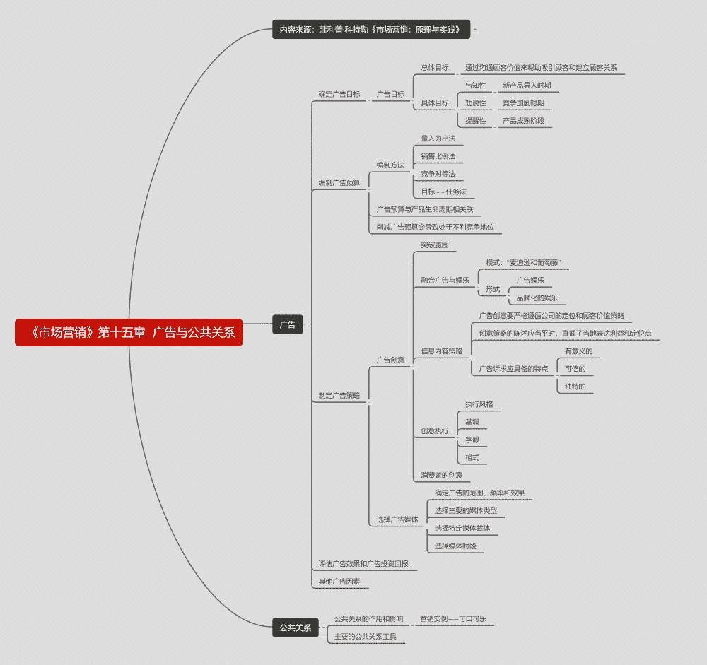

## 1.

制定广告方案时的四个重要决策：

确定广告目标、编制广告预算、制定广告策略、评估广告运动

## 2.

广告方案重要决策的第一步——确定广告目标

广告的总体目标都是通过沟通顾客价值来帮助吸引顾客和建立顾客关系

而在具体的营销计划中，则有着当下的具体目标，因此，广告目标也可以定义为是在一定期限内针对特定目标对象而设定的一项具体的沟通任务，可以分为告知性广告、劝说性广告、提醒性广告。

告知性广告适用于新产品导入时期，劝说性广告适用于竞争加剧之后，提醒性广告适用于产品成熟阶段。

## 3. 可口可乐的营销实例分析

（1）因为高度参与的观众更有可能接受品牌信息，所有可口可乐不是简单地计算消费者印象，而是追踪消费者表达。

（2）可口可乐通过经营公共关系，创造顾客参与，激发顾客的自我表达，引导顾客参与和扩展品牌故事，最终增加购买。

（3）可口可乐通过公共关系经营活动，阐释并且传播了可口可乐品牌的畅爽开怀和乐观积极的主题，可口可乐坚信“快乐是会传染的”，因此可口可乐重视消费者对其品牌价值的表达， 因为消费者的自发的表达能够迅速感染到更多消费者的内心，进而营造出可口可乐的公共定位。

（4）可口可乐的公共关系经营模式可以概括为“印象——表达——交易”

# 第十六章

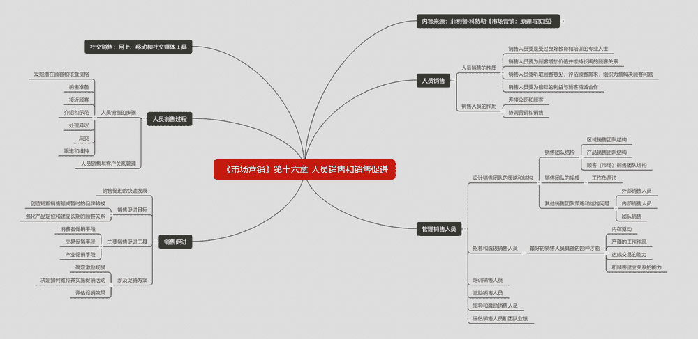

## 1. 引例分析 宝洁：不是销售，而是客户业务发展

（1）宝洁以顾客为中心的销售团队是让他受到人们高度尊敬的原因之一。

（2）宝洁销售工作的核心就在于，把销售不称之为销售，而是称呼为“客户业务发展（customer business development,CBD）”.

（3）宝洁的销售理念在于，为了实现业务增长，必须首先帮助那些将宝洁品牌出售给最终消费者的零售商提升业绩。宝洁的销售团队的首要责任是帮助客户公司提高销售。宝洁致力于通过与最终将宝洁的产品出售给消费者的“战略合作伙伴”合作，来谋求宝洁自身的发展。宝洁致力于与其客户建立一种双赢的关系，来实现彼此的共同繁荣。

（4）宝洁会为复杂的大型客户专门配备完成的CBD团队，团队内包括销售人员、客户业务发展部门经理、负责特定产品类别的若干业务经理、在零售环节出售宝洁消费品牌有关的各方面专家、市场营销策略、产品开发、信息系统、物流、财务、人力等方面的专家。

（5）宝洁的客户业务发展部与客户合作，共同制定战略，以期在零售网点创造顾客价值、提高满意度和促进销售。CBD团队经常帮助宝洁合作伙伴管理货架上陈列的产品类别。

（6）宝洁致力于通过开诚布公的交易行为建立长期的客户关系。

（7）宝洁与客户的合作是双向的，宝洁为顾客提供服务，顾客则给予回报，达成合作共赢的局面。

（8）宝洁的特色销售方法和理念：让宝洁的客户业务发展部门成为客户的战略合作伙伴，专注于寻找互利共赢的商机，帮助客户找到能够改善其业务的机会，与客户合作解决其遇到的问题，通过让客户成功，来实现宝洁的成功。

最好的销售人员应该是什么样的？最好的销售人员，是受过良好教育和培训的专业人士，他们为顾客增加价值并维持长期的顾客关系；他们听取顾客意见，评估顾客需求，组织力量解决顾客问题，他们是那些为了相互的利益与顾客精诚合作的人。（个人认为，这一定义下的销售者，更接近于To B领域的销售者、与大客户进行合作的销售者）

盖洛普管理咨询公司：最好的销售人员应该具备的素质

（1）内在驱动追求取胜、认可的满足感；被更好的服务和建立关系的渴望所驱动；被强大使命感所激励。

（2）严谨的工作作风制定详细的、有组织的计划，并能够按时完成

（3）达成交易的能力注重培养完成工作所必需的的技巧和知识

（4）和顾客建立关系的能力从顾客角度看问题，设身处地为顾客着想，希望为顾客创造价值

数字和社交媒体时代，B2B销售人员将何去何从？问题：互联网时代，B2B人员销售真的会走向向往吗？销售是否真的在走向衰败，并且终将消亡？《销售力》（Selling power）杂志组建了一个销售专家小组，试图探求B2B销售行业的未来。

（1）科技将彻底改变销售职业，人类交流模式的改变正在对企业的方方面面造成革命性的影响，当然也包括销售。

（2）B2B人员销售模式会在互联网时代消亡吗？当然不会。科技网络和社交媒体无法取代人际互动的买卖关系，技术无法取代销售人员的许多作用。互联网可以接受订单和传播信息，但是它不能发掘客户的需求，它不能建立关系，也不能甄别潜在客户。能够定义公司的价值定位和独特信息并将其传达给市场的，必须得是人，这个人就是销售代表。

（3）客户维护人员将会在技术的冲击下消失。

（4）在科技的进步之下，顾客不再依赖销售人员来获取基本信息和产品教育，顾客需要的是解决方案和新的洞察，因此，新时代的销售人员需要“进入到探索和建立关系的阶段，揭露痛点并且聚焦于潜在客户的业务。”

（5）科技也在提升销售人员的能力，借助高科技的数字工具和应用程序，销售人员进行客户研究和建立社交网络的工作将更加高效、顺利。

结论：B2B人员销售模式并没有濒临消亡，而是正在改变，互联网时代将改变销售人员采用的工具和技术。B2B营销永远不能离开强大的销售团队，无论时代如何改变，能够有效发掘客户需要、解决顾客问题并且与顾客建立关系的销售人员都是受欢迎和成功的，这些是销售人员的核心能力和核心竞争力。

# 第十七章

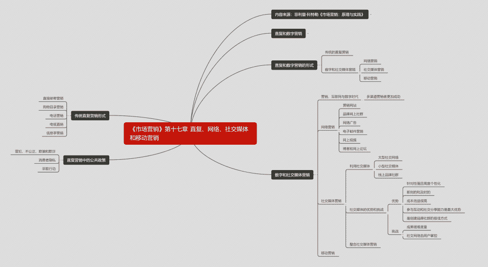

## 1.

直复和数字营销为实时营销提供了条件和机会。

实时营销（real-time marketing）的秘诀：

（1）实时营销必须作为品牌与消费者的生活紧密联系的、更全面和更成熟的战略的组成部分。

（2）智能手机的普及、社交媒体的发展使得顾客不是在第二屏幕前被动观看的观众，而是在第二屏幕中生活的住民。明智的品牌创建灵敏而持续的实时营销计划，密切关注和蜻蜓社交空间中的顾客言论，并用与顾客实时社交分享完美契合的重要营销内容做出及时反应。

（3）实时营销成功的秘诀在于，发现或者创建品牌与消费者所关心的重要事件之间的联系，然后在第一时间吸引消费者参与互动，要尽力找到消费者的共同的兴趣点。

## 2. 直复和数字营销的形式

## 3. 营销实例分析

Pinterest：又一次网络革命

## Pinterest：消除网络设计的局限

Pinterest创始人在思考万能互联网的作用时，认识到了现阶段的互联网的两个局限性：

### （1）

虽然互联网看上去有着探索、表达、创造的无限可能，但是互联网的组织形式却很容易将人们框限其中。网络的搜索功能实际上阻碍了信息传递。

网络建立了一种框定的结构，像是一系列特别详细的菜单，这和人脑的工作方式截然不同，这种结构阻碍了思维跳跃的自由连接。

### （2）

大多数网站都围绕“时效”建立，以时间方式组织文字和图片。

Pinterest致力于消除网络设计的局限，坚信它的网站的核心始终应该是社交网络：

### （1）

Pinterest构建了一个图片网格，不使用目录、时间和网站加页码。

Pinterest不希望网站的用户只是看客和浅层参与者，它的目标是创造与逛商场和逛博物馆近似的互动体验。

### （2）

Pinterest图片网格设计的核心要素在于图片以相同宽度、不同高度排列，只要有新的图片发布，布局就会重新调整。

Pinterest不显示任何竞争元素。

Pinterest摒弃了页码浏览。

Pinterest希望它的网站能够成为一幢充满素材的大楼，而且完全符合用户的兴趣，所有的东西都是为网站的用户精心挑选的。

### （3）

Pinterest将优雅的设计和智能的社交活动巧妙地结合，达成了极高的访客转化率和用户平均花费额度。

Pinterest独特的网站设计，使得网站的图片内容具有极高的真实感，这是十分稀缺的品质。

# 第十八章 创造竞争优势

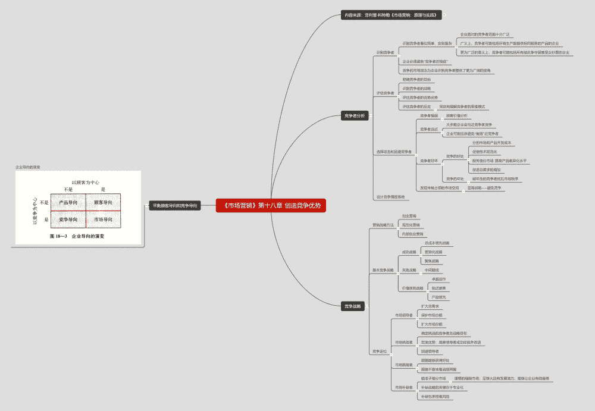

## SodaStream：成功的竞争性营销战略

### （1）独特的定位

把自己定位为市场拾遗补缺者，避免与巨头的正面冲突，而是把自己定位为其强劲竞争对手（瓶装和罐装饮料）的聪明和可靠的替代选择。

### （2）清晰明确的价值陈述

“SodaStream：明智、简单、泡泡丰富”

### （3）极具特色的竞争营销策略

#### a. 销售独特的商品。

它不销售碳酸饮料和水，而是向顾客提供可以在家自制苏打水的机器。

#### b. 为顾客带来别致的、个性化的消费体验。

SodaStream自主且有趣，它邀请顾客发挥创造力尽情地“释放气泡”，它的系统允许顾客定制自己的口味和控制气泡的数量。

它的机器及瓶子本身的设计样式现代感十足，提供的糖浆口味种类丰富（多达100多种不同口味），这本身就是一种很好的自我表达方式，能够激发消费者的创造欲和表达欲，建立和顾客的情感联系。

#### c. 经济实用。

SodaStream台面饮料制作及使用非常简单方便，只需几秒钟就可以变自来水为碳酸饮料，宛如魔法；而且用SodaStream制作的饮料比从商店购买要便宜50%。

#### d. 健康环保。

SodaStream的配方中所含的碳水化合物和热量只有市场上出售的碳酸饮料的三分之一左右。

而且消费者可以自主添加一下果汁、柠檬汁、酸橙汁，得到的混合饮料甚至比苏打水更加健康。

同时，SodaStream极大地减少了饮料生产、灌装、运输和回收塑料或者铝罐包装物过程中的能耗和有害物质的排放；它生产饮料的碳足迹比瓶装饮料的碳足迹少80%；它的瓶子可以重复使用。

### （4）取得的成果

#### a. 在巨头们的夹缝之中存活下来并且茁壮成长，稳步发展，盈利状况良好。

#### b. 瓶装碳酸饮料市场每年下降1%到2%的情况下，其销售额在过去4年增长了4倍。

#### c. 品牌发展方兴未艾，市场远远没有饱和，发展潜力和空间巨大。

# 第十九章 全球市场

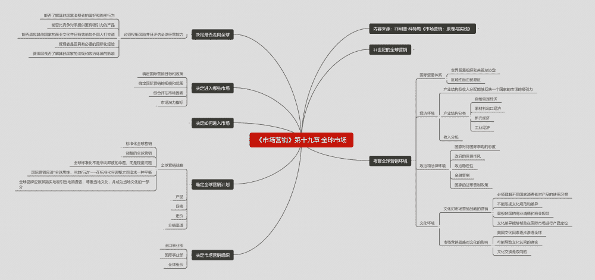

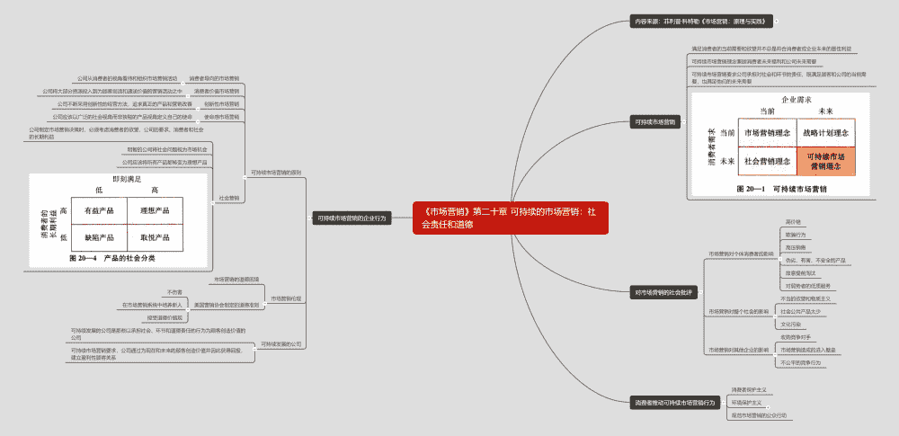

## 十九章和二十章

### 可口可乐在非洲：一切就绪，静待奇迹

——可口可乐在非洲市场的营销实例分析

## 1. 非洲市场的重要性

### （1）全球营销战略

可口可乐是一个真正的全球标志性品牌，它的12年计划希望达成在2020年之前使其全球系统收益翻番。

### （2）成熟市场上销售不景气

软饮料在可口可乐最大、盈利最高的两个市场——北美和欧洲地区，已经失去增长动力。

美国的软饮料市场已经连续5年萎缩。

### （3）非洲有大量机会，值得冒险

非洲人口持续增长，目前已经超过10亿，新兴的中产阶级正在形成和壮大；非洲是一个巨大的市场，有1.6万亿美元的GDP，甚至超过俄罗斯和印度，中产阶级家庭以及年轻人有着巨大的可任意支配的收入；非洲对可口可乐的消费仍然有巨大的增长空间。

## 2. 可口可乐的营销策略

### （1）采用草根战术深入小型社区，开展“巷战”来争取消费者。

### （2）管理和激励零售商，授予销售业绩良好的零售商“金牌卖主”奖项。

### （3）因地制宜。通过各种当地社区小店销售可口可乐，推出符合当地特色的组合套餐。

### （4）采取有效的分销网络，以人工配送的方式形成微型配送中心，支撑着可口可乐在非洲的配送网络。

## 2. 品牌名称的中国本地化案例

- Coca-cola 可口可乐
- Tide 汰渍
- Lay's 乐事
- Reebok 锐步
- Colgate 高露洁
- Clear：清扬
- Subway：赛百味
- Mercedes-Benz：奔驰
