# 🎶河林的运营资料箱

> 来源：[https://my.feishu.cn/docx/I5XndDeLGowKTOxUkGScU2Xnnfe](https://my.feishu.cn/docx/I5XndDeLGowKTOxUkGScU2Xnnfe)

> 资料库整理人

> 👸号：河林成长说

> vx：nanruihu

> 欢迎交流链接

> [🚩河林的个人说明书2025](https://ai.feishu.cn/wiki/wikcnWNsxWnlGFWJkKZS6kmTPfc?from=from_copylink)

## 🚄各平台运营资料

### 视频号运营知识库

[河林的视频号运营知识库](https://jid6vvjfdm.feishu.cn/wiki/PBm5wQAGqi4GRnkj9m1cEr7fnXg)

### 抖音运营

[🎁2026蝉妈妈年度大会【干货大礼包】](https://chanmamagroup.feishu.cn/wiki/Sr1AwP9wai3dcKk4L8Nc5PVcn8f?from=from_copylink)

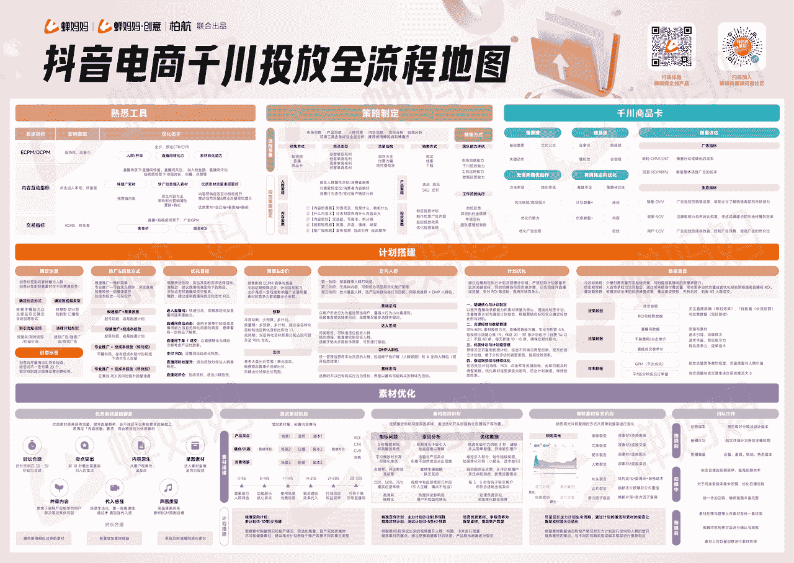

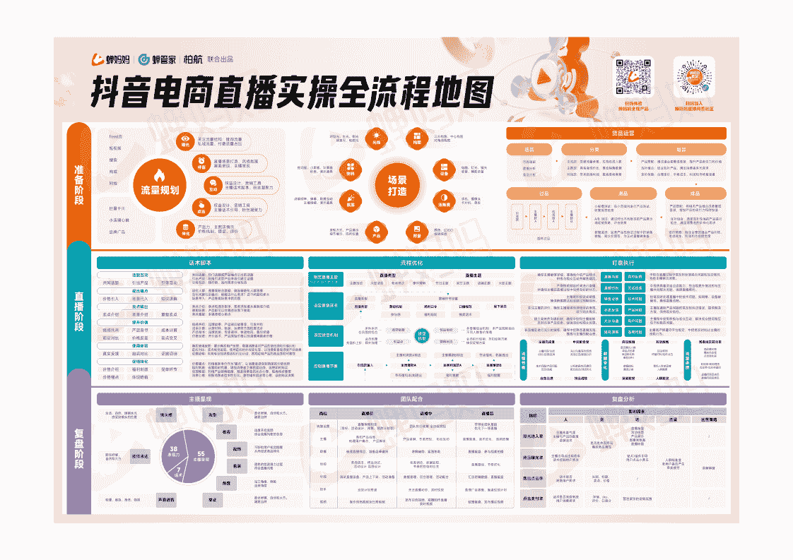

[抖音电商直播全流程实操地图.pdf](https://internal-api-drive-stream.feishu.cn/space/api/box/stream/download/all/TOBXbB1uqooo0fx5Dinct6djnxc)

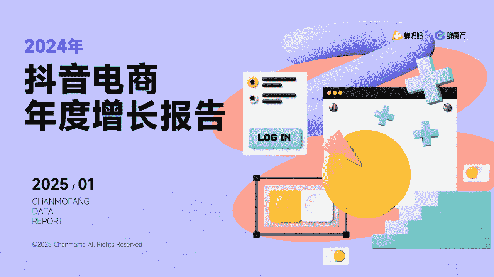

[2024年抖音电商年度高增长报告.pdf](https://internal-api-drive-stream.feishu.cn/space/api/box/stream/download/all/I1q5bWDT6o2TChxLzz6cR0SrnQe)

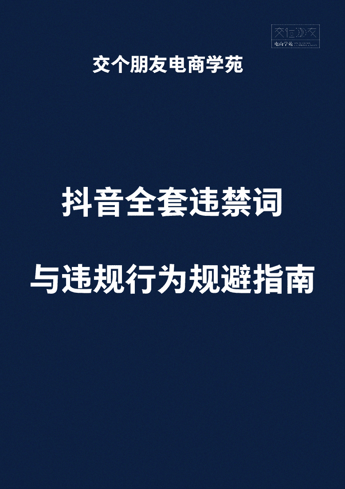

[《抖音全套违禁词与违规行为规避指南》.pdf](https://internal-api-drive-stream.feishu.cn/space/api/box/stream/download/all/YVRhbnqOooflwmxRvIncPSxlnUb)

[抖音直播运营一本通](https://bytedance.feishu.cn/docx/doxcn7wLFAW7Ytq8b8Ok6x9VXEW)

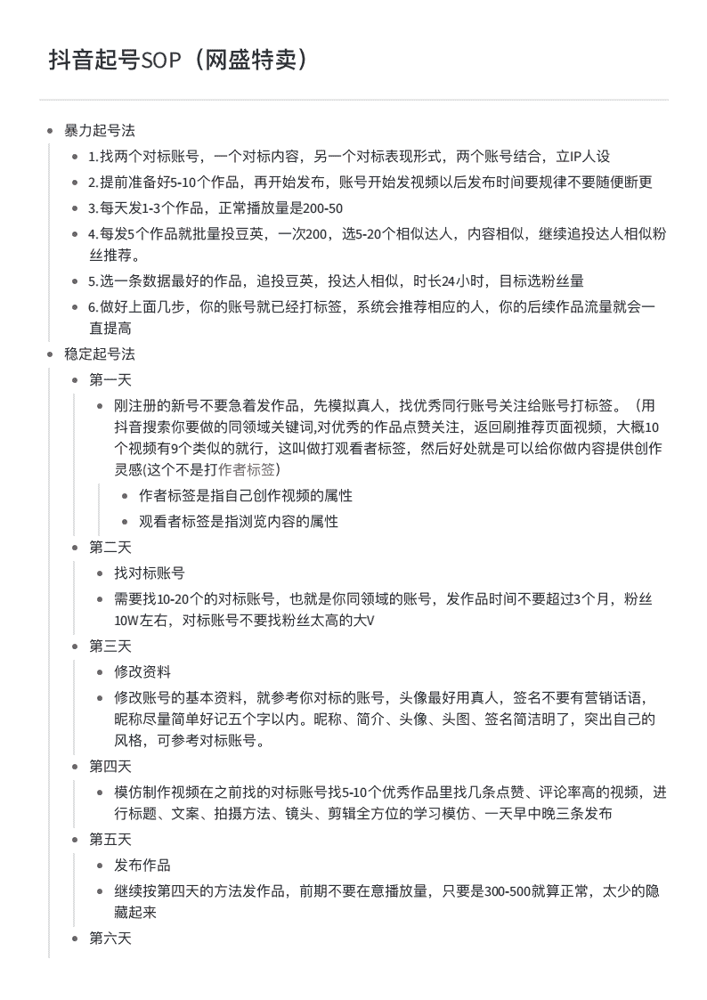

[抖音起号SOP.pdf](https://internal-api-drive-stream.feishu.cn/space/api/box/stream/download/all/B3AJbde6IopjHIxTxE0cd9DLnmq)

[2024抖音个人IP的打造计划培训课件.pdf](https://internal-api-drive-stream.feishu.cn/space/api/box/stream/download/all/SNsWbiThUoiQEbxSQ0RcWFWUnzd)

[抖音官方文档合集，2023年持续更新~](https://hdfkqe25yg.feishu.cn/wiki/WeNTwiXT1iuq9jkKn54c76RtnRe?from=from_copylink)

[2023抖音直播带货常用资料合集(更新中)](https://ez7ld9vcb3.feishu.cn/docs/doccntqB414BikRngWteNbvojMd)

[教育行业优化手册｜投放提升四步走-对外版（持续更新）](https://bytedance.larkoffice.com/docx/GoY9d03VLoPOqYxYn2ucvS05nk0?from=from_copylink)

[教育电商化网课｜矩阵号起步运营攻略3/19 ](https://bytedance.larkoffice.com/docx/WWHEdHxJToLAloxxaftcP5UdnAd)

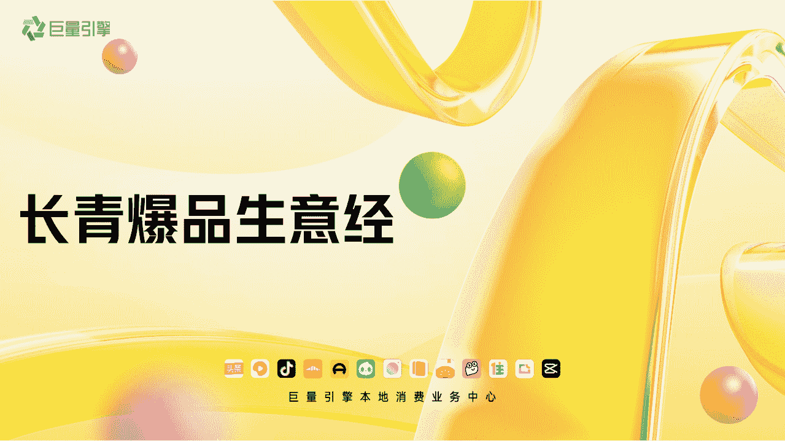

[巨量-长青爆品生意经.pdf](https://internal-api-drive-stream.feishu.cn/space/api/box/stream/download/all/JUqjbecAMo3EAsxZTDVcUwjBn6e)

[2024抖音服饰行业趋势报告.pdf](https://internal-api-drive-stream.feishu.cn/space/api/box/stream/download/all/SiIYbiqYYog7qox42UBcrzzTnyc)

[蝉妈妈智库：2023年抖音电商年报.pdf](https://xm2sdxx3ep.feishu.cn/file/LBx2b0ohAo8Wblx4t7KcF0xindg?staff_ext_id=None)

[「蝉妈妈」2024抖音商城好物年货节作战全景图](https://vpakerg80x.feishu.cn/sheets/WhBvsyvgnhTUi0tCnI7cwbOGn3c?staff_ext_id=None)

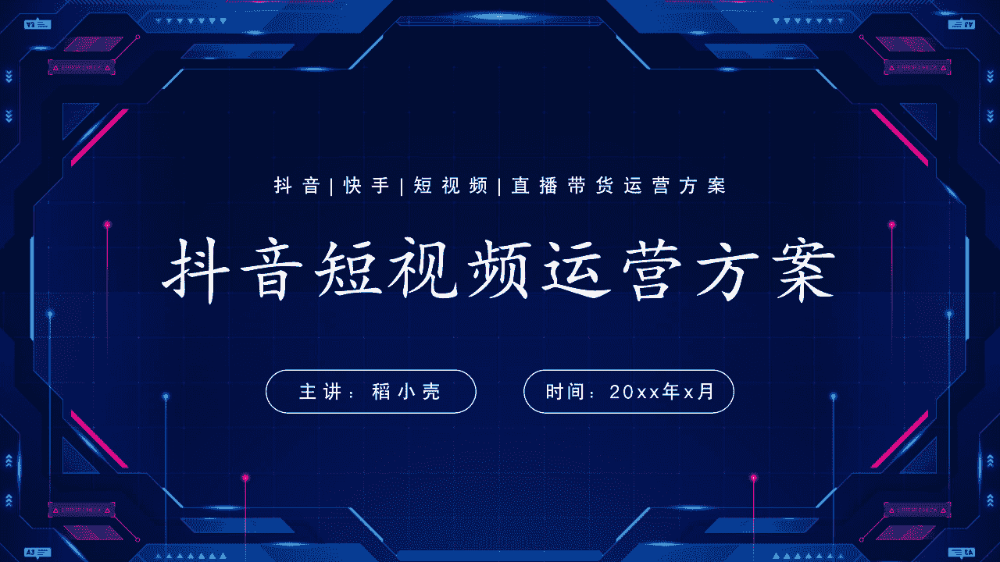

[抖音短视频运营方案.pptx](https://internal-api-drive-stream.feishu.cn/space/api/box/stream/download/all/EO3Cbh90yoETBlxvuZfcYeKpnYm)

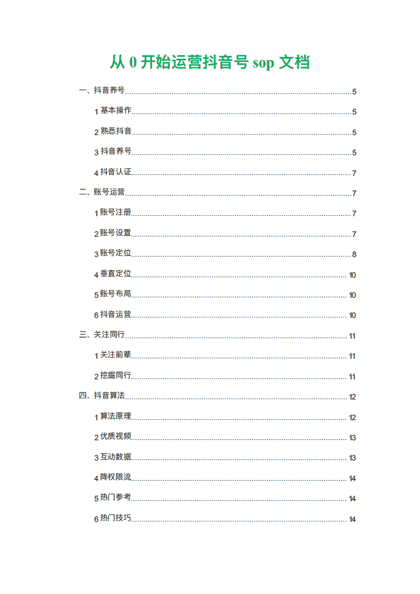

[【SOP】从0开始运营抖音号.pdf](https://internal-api-drive-stream.feishu.cn/space/api/box/stream/download/all/QW3ibrMBEoEhANxH3ROcHkQun4d)

[《抖音生活服务综合进场零售行业商家运营手册》](https://bytedance.feishu.cn/docx/ZV1MdRgetoxuNBxFD8Qc4ZtonAc?from=from_copylink)

[《抖音生活服务直播运营手册》](https://bytedance.feishu.cn/docx/NY86dWXVPoa5FGxvjrocjnLvnLs)

[抖音店播思路.rar](https://internal-api-drive-stream.feishu.cn/space/api/box/stream/download/all/FnUVbOGicod5ifx8vmMcXHbKnih)

[2025巨量千川投放实操白皮书.pdf](https://internal-api-drive-stream.feishu.cn/space/api/box/stream/download/all/Q7Ddbnd1Xo8HwdxQ2GvcWTPMnbk)

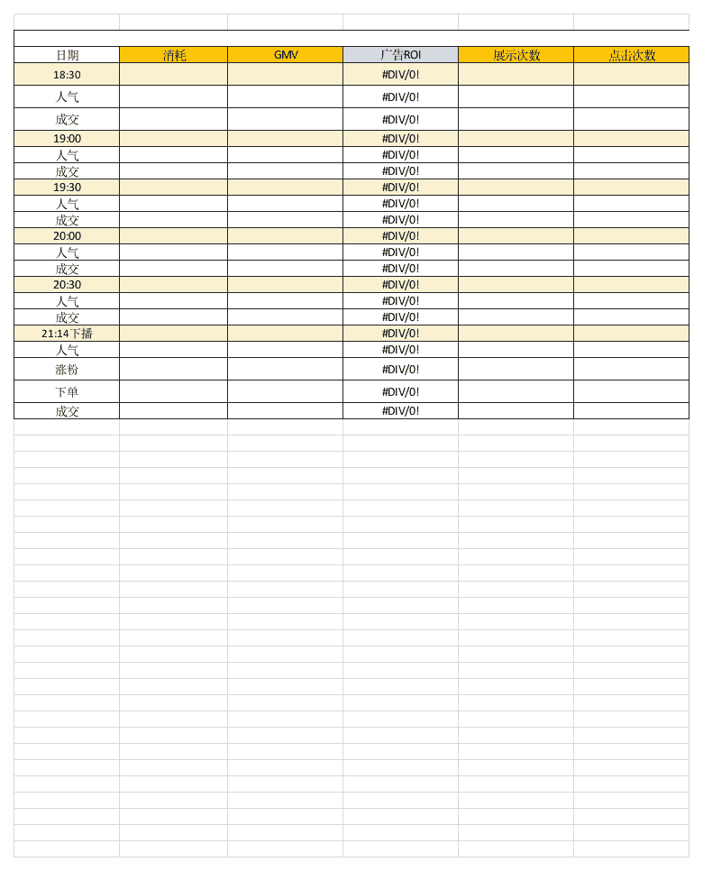

[千川数据记录及素材复盘.xlsm](https://internal-api-drive-stream.feishu.cn/space/api/box/stream/download/all/UnCJbmzSOoRiBlxj11EcQx9Unah)

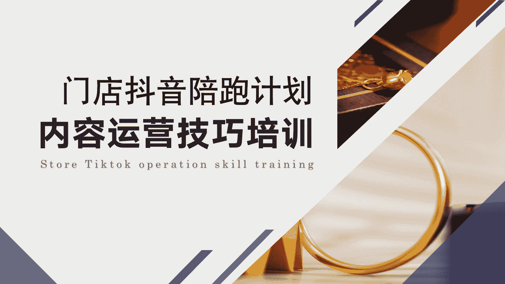

[门店抖音陪跑计划培训手册.pptx](https://internal-api-drive-stream.feishu.cn/space/api/box/stream/download/all/DVLSbJygcoioX5xaMu7cc8zTnzg)

[【营销科学】巨量引擎方法论手册.pdf](https://bytedance.feishu.cn/file/JRNobERswoC8IGxf6uJcqV0mnng)

[天下没有BD不到的达人 学习资料库](https://yeytb3ky3q.feishu.cn/sheets/shtcn0WoUsMjRkaRNjRoDusMGPg)

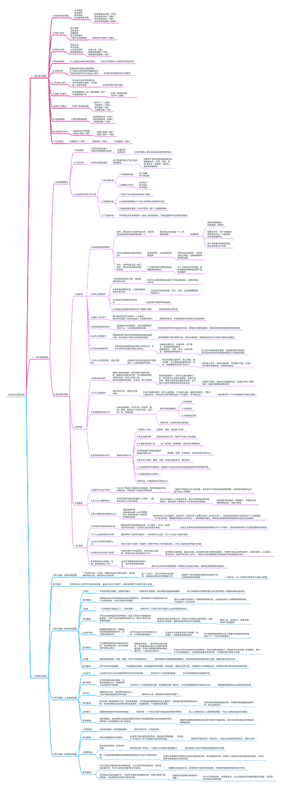

[抖音官方运营手册：思维导图.pdf](https://internal-api-drive-stream.feishu.cn/space/api/box/stream/download/all/FyVPbDJMboyoPHxPMQAcIWTtnlh)

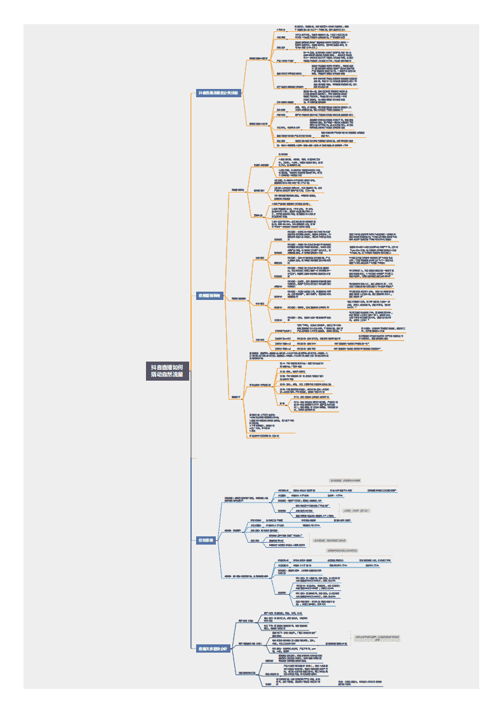

[抖音直播如何撬动自然流量：思维导图.pdf](https://internal-api-drive-stream.feishu.cn/space/api/box/stream/download/all/EZPvbtM7Ror5Wjx6KvLcezJ5n8o)

[📓 巨量千川投放“树”V1.0【官方接地气版】 ](https://bytedance.feishu.cn/docx/doxcnTvcu1tKPTgnzoEG1X60Oob)

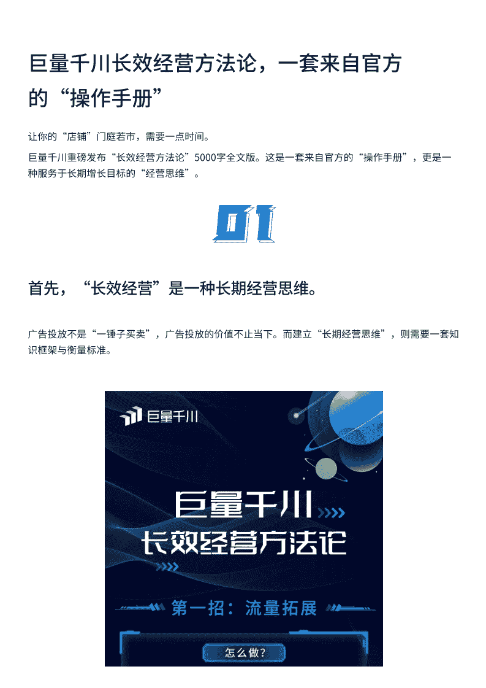

[巨量千川长效经营方法论，一套来自官方的“操作手册”.pdf](https://internal-api-drive-stream.feishu.cn/space/api/box/stream/download/all/TXrVbdbTFoQoqsxgV0Ecjbuxnnb)

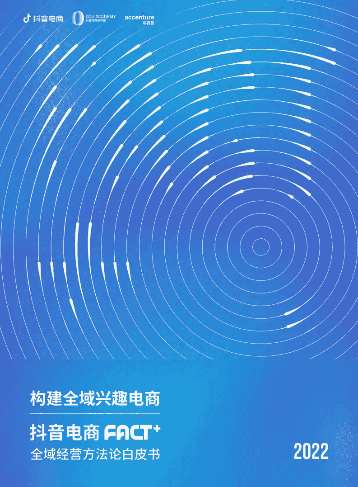

[抖音电商“FACT”全域经营方法论白皮书.pdf](https://internal-api-drive-stream.feishu.cn/space/api/box/stream/download/all/FGHTb5nIOo5kJGxqF5ScFIkAnRf)

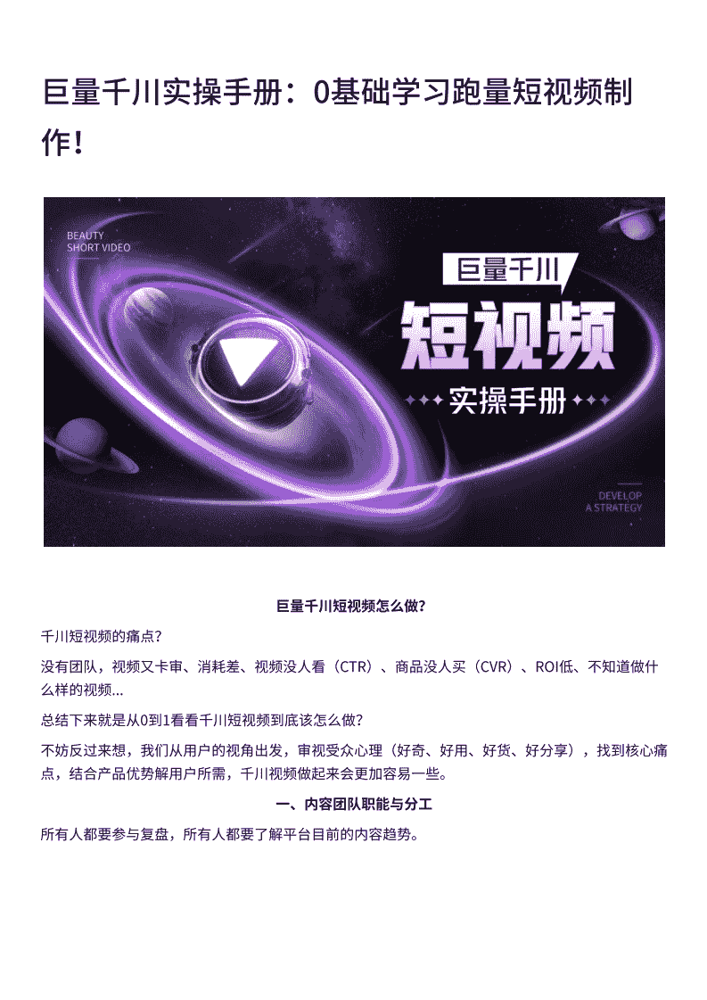

[巨量千川实操手册：0基础学习跑量短视频制作！.pdf](https://internal-api-drive-stream.feishu.cn/space/api/box/stream/download/all/IrfSbS3fDoG63kxcLL9c8LeDn6e)

[巨量千川小店随心推产品手册2022版_14366333.pdf](https://internal-api-drive-stream.feishu.cn/space/api/box/stream/download/all/QxXxbFQ8AoB5NfxuPBNcMgsMnSU)

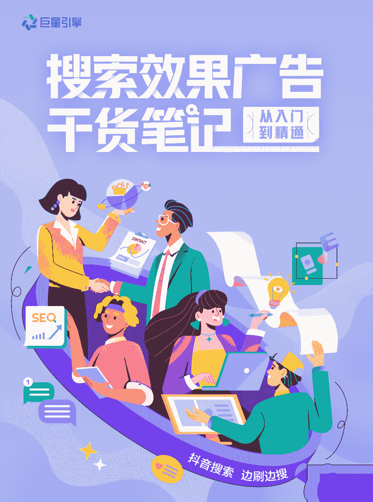

[搜索效果广告干货笔记从入门到精通.pdf](https://internal-api-drive-stream.feishu.cn/space/api/box/stream/download/all/KQIbbuLlqoTtLxx6adAca8JBnQd)

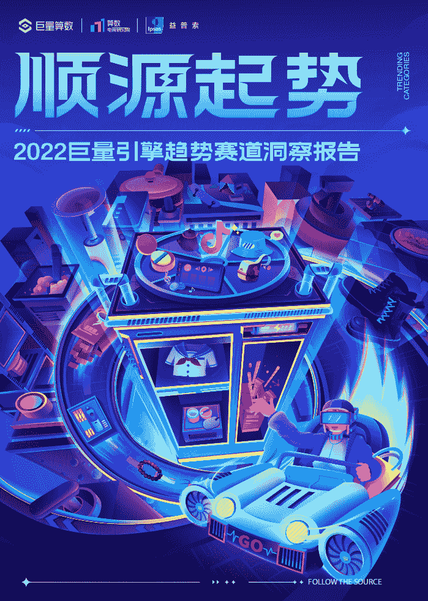

[2022巨量引擎趋势赛道洞察报告.pdf](https://internal-api-drive-stream.feishu.cn/space/api/box/stream/download/all/CVFBbzwzHoXELFxJ3VFcQsm6nBf)

[蝉妈妈电商智库：《2022抖音电商年度报告：全域电商新征程》.pdf](https://xm2sdxx3ep.feishu.cn/file/boxcnPR0nWltLArVh0jfqNUMPDh)

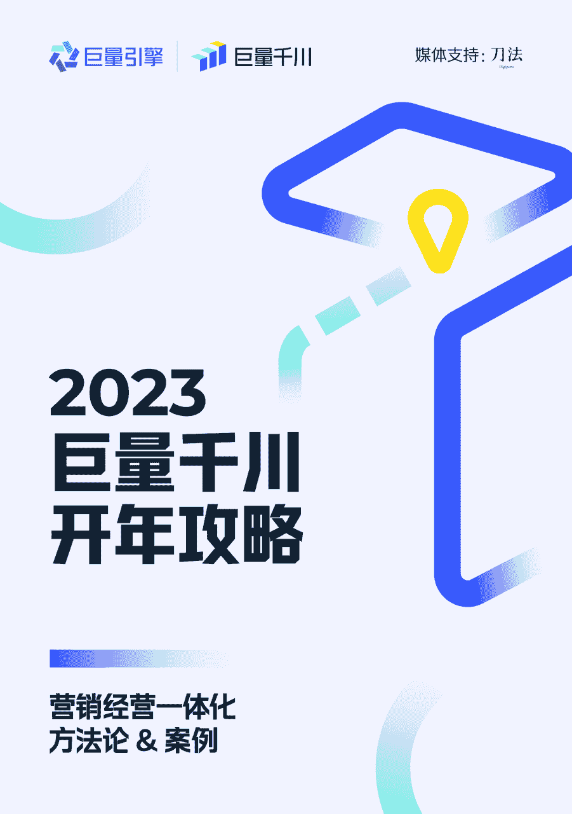

[《2023巨量千川开年攻略——营销经营一体化方法论&案例》.pdf](https://internal-api-drive-stream.feishu.cn/space/api/box/stream/download/all/KEiHbFTJMou80xxKYoBcZ53BnCd)

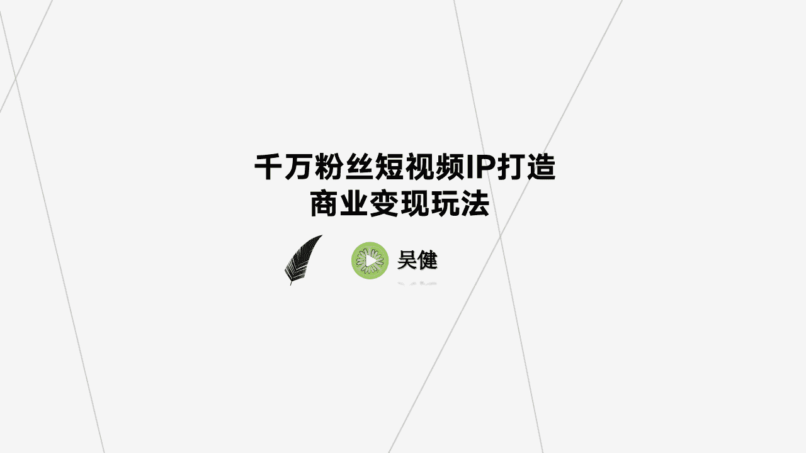

[千万粉丝短视频IP打造及商业变现玩法--青瓜视频@吴健.pptx](https://internal-api-drive-stream.feishu.cn/space/api/box/stream/download/all/U4jLbF0TAoewiQxiohlcXWBpn0d)

[2024抖音电商女性消费趋势数据报告.pdf](https://internal-api-drive-stream.feishu.cn/space/api/box/stream/download/all/NHq7bvBHaoLWCMxOUumcnp5snUV)

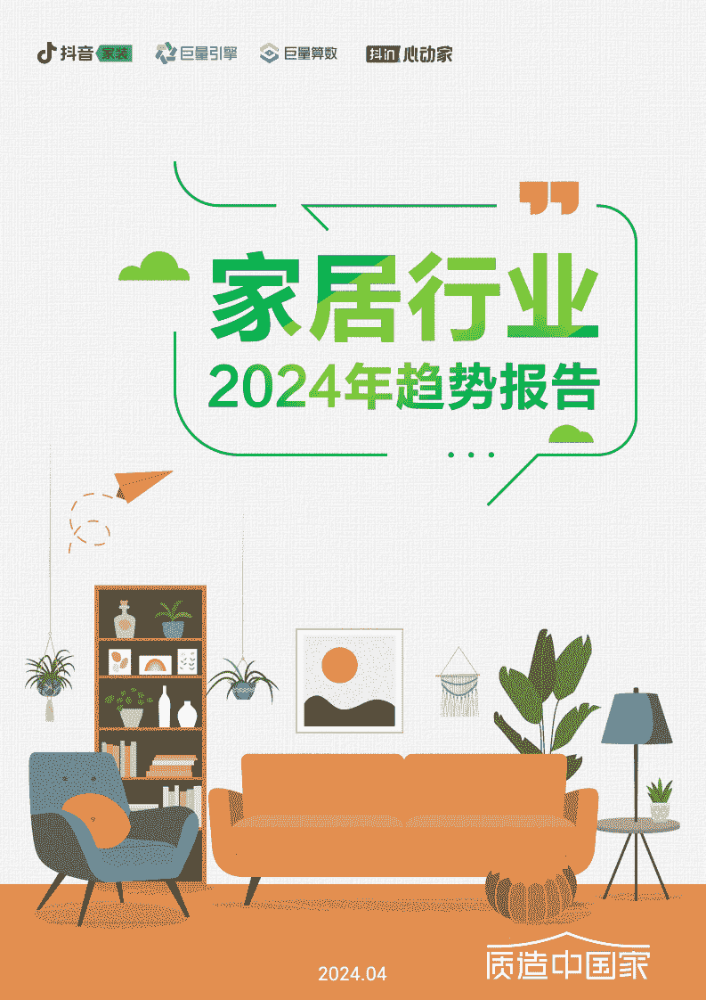

[2024家居行业趋势报告-巨量算数.pdf](https://internal-api-drive-stream.feishu.cn/space/api/box/stream/download/all/ETeRbjw5aodCDtxv1IDcThJqnhd)

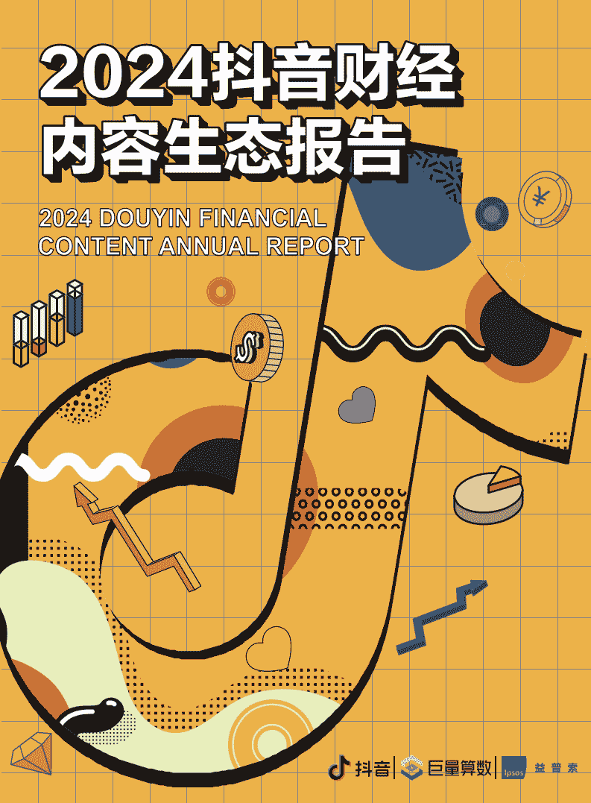

[2024抖音财经内容生态报告-巨量算数.pdf](https://internal-api-drive-stream.feishu.cn/space/api/box/stream/download/all/ECGobTPMhoKm8oxGkg6c6qsJnug)

[2024长青爆品生意经-巨量引擎.pdf](https://internal-api-drive-stream.feishu.cn/space/api/box/stream/download/all/GXcubikcloiMwbxmWKJct4ybne5)

[2024抖音体育运动潮流趋势报告-巨量引擎.pdf](https://internal-api-drive-stream.feishu.cn/space/api/box/stream/download/all/E0O1bfoJponweVxeHVlc0YXJnGh)

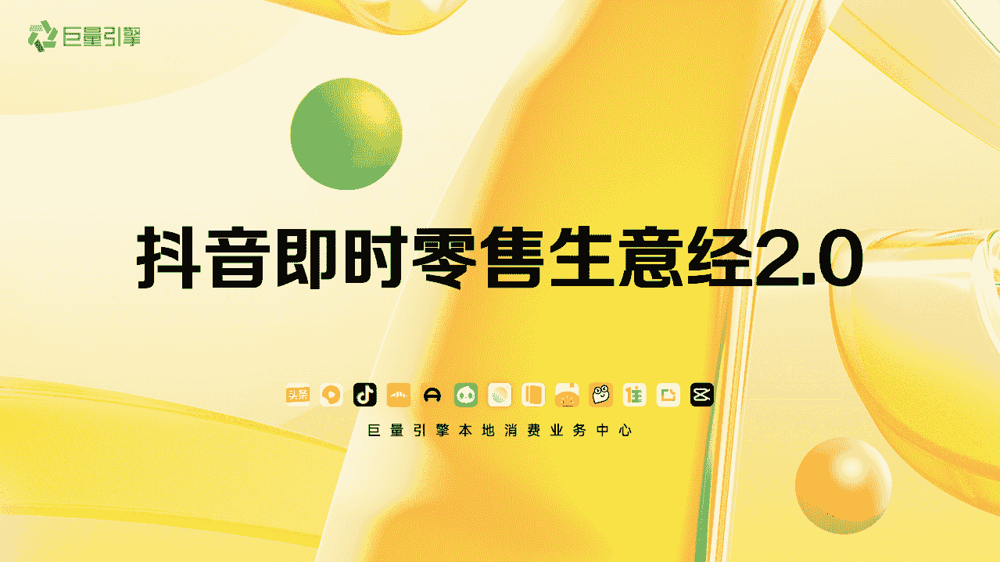

[抖音即时零售生意经2.0-巨量引擎.pdf](https://internal-api-drive-stream.feishu.cn/space/api/box/stream/download/all/YKA2bkKkbowLDlxY2LccjqGfnRd)

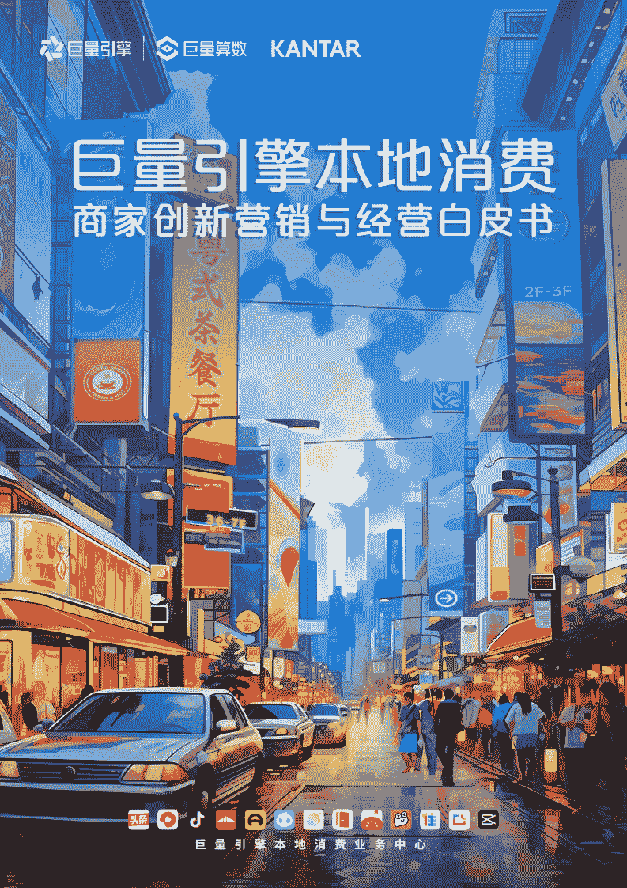

[抖音巨量引擎本地消费商家创新营销与经营白皮书.pdf](https://internal-api-drive-stream.feishu.cn/space/api/box/stream/download/all/Ogy7bpFw4oBEnbxM0MTcv8kknch)

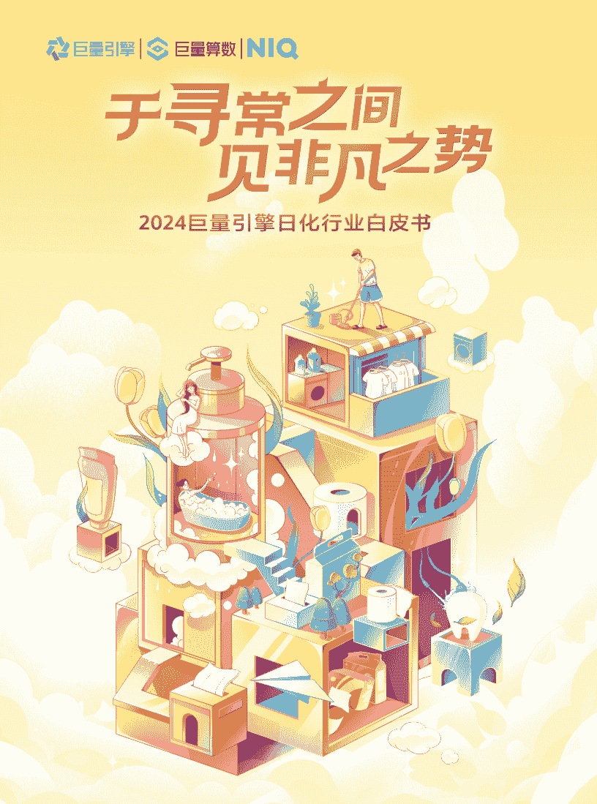

[2024巨量引擎日化行业白皮书.pdf](https://internal-api-drive-stream.feishu.cn/space/api/box/stream/download/all/HNzsb7PAhoH9mVxFENqcd1n1n4V)

[抖音短视频带货投流运营手册.pdf](https://internal-api-drive-stream.feishu.cn/space/api/box/stream/download/all/RK7obNF0no9pbDxzh4Wcstn7nJh)

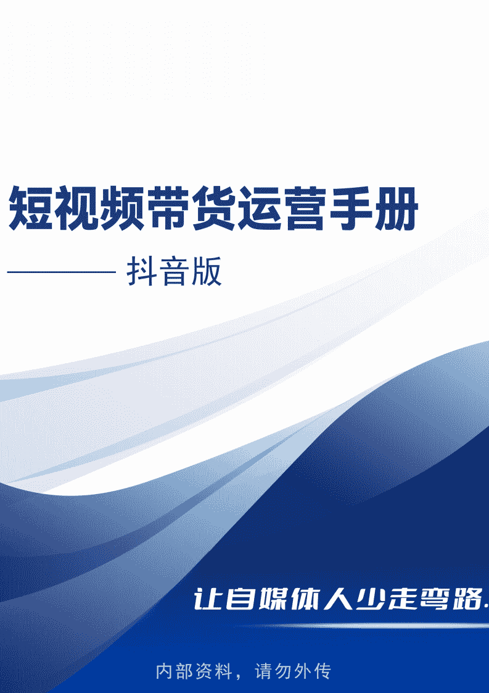

[短视频带货运营手册丨抖音版.pdf](https://internal-api-drive-stream.feishu.cn/space/api/box/stream/download/all/YVbjb4MtSoIQIcxcc2FcrlJknTg)

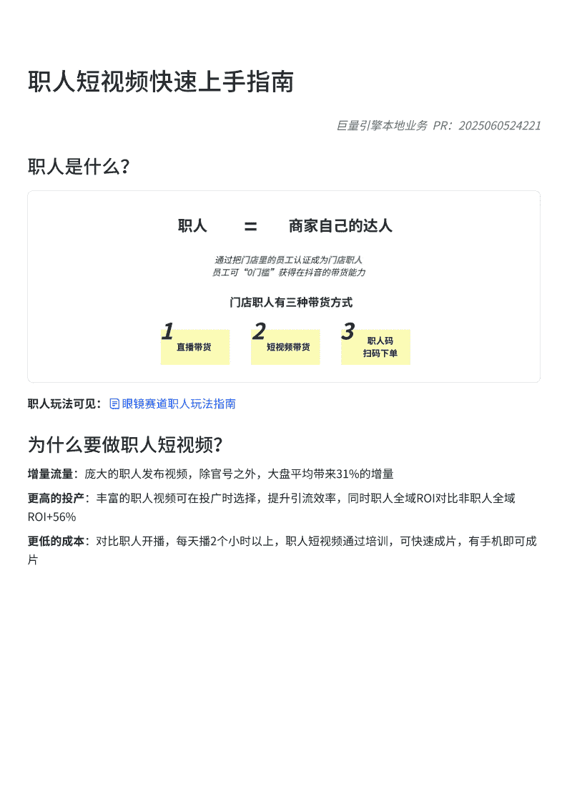

[职人短视频快速上手指南.pdf](https://internal-api-drive-stream.feishu.cn/space/api/box/stream/download/all/Odaqb0MQkoIGfUxrNw5cke8lnAe)

[2025服饰类目抖音电商上新短视频&直播运营模式与案例.pdf](https://internal-api-drive-stream.feishu.cn/space/api/box/stream/download/all/XC9xbOhMOoGoAox3fPdcZlV1noc)

[《抖音生活服务直播话术大全》.pdf](https://internal-api-drive-stream.feishu.cn/space/api/box/stream/download/all/H5Fob3RKwo5MjFxQNVrcD44jnHe)

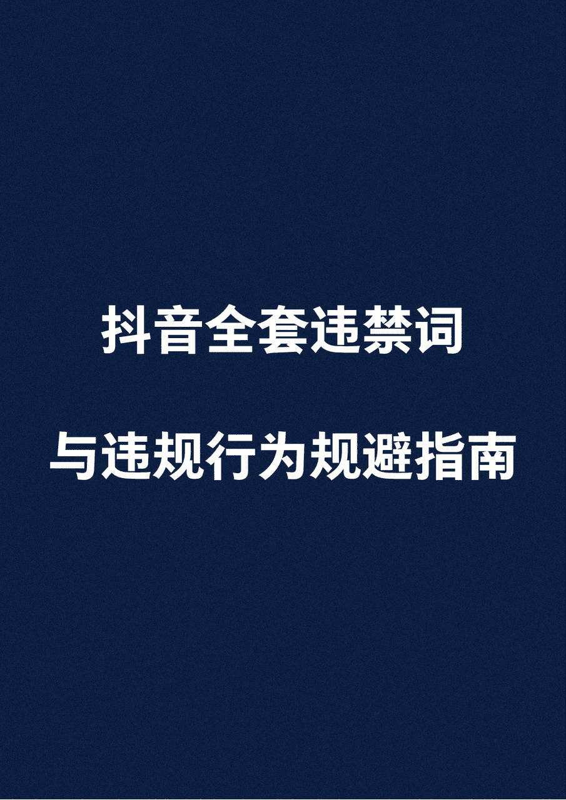

[抖音全套违禁词与违规行为规避指南.pdf](https://internal-api-drive-stream.feishu.cn/space/api/box/stream/download/all/O7Jqbca3uoYmv4xHmV9cqGjinte)

## 📕运营

### 官方教程

[📕店铺关联教程](https://school.xiaohongshu.com/lesson/normal/c2c6b9410e694102a87571d162b92935?viewSource=LESSON&fromPage=LessonList&uba_pre=8.school_course_list..1743580033741&uba_index=2&jumpFrom=school&from=ark-login)

群聊产品能力 & 商家经营案例（可对外）

📕新锐品牌618抢量指南（可对外）

【对外版】KOS（企业员工号）产品使用手册

【企微文档】【专业号-企业认证】产品说明手册（2025年对客）

【企微文档】私信获客工具_整体产品说明及操作手册

📕小清单playbook2.0（对外版）

📕新手商家入门指南（商业产品all in one）

【企微文档】【聚光】-笔记「合作码」产品使用说明

### 笔记创作

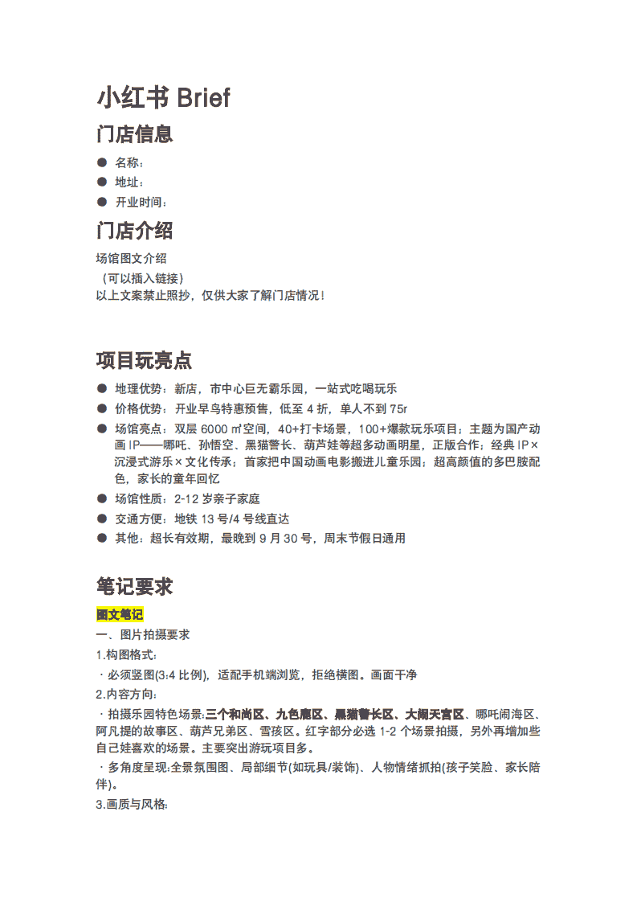

[📕达人Brief模版.pdf](https://internal-api-drive-stream.feishu.cn/space/api/box/stream/download/all/Kss5buLFvo594GxMugicFmrqnyb)

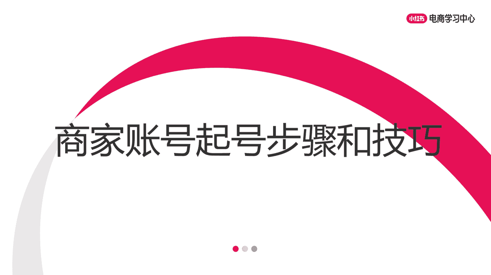

[📕商家账号起号步骤和技巧.pdf](https://internal-api-drive-stream.feishu.cn/space/api/box/stream/download/all/NbZSbUksqoEd6pxALlacScwnnwc)

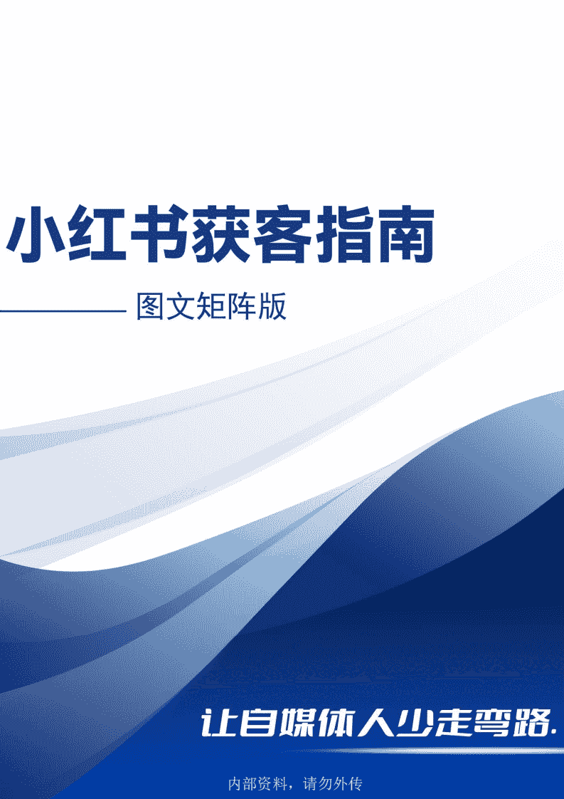

[📕获客运营手册丨图文矩阵版.pdf](https://internal-api-drive-stream.feishu.cn/space/api/box/stream/download/all/CvgSbeZSzo7tHnxQ9Ndc1JtVnfd)

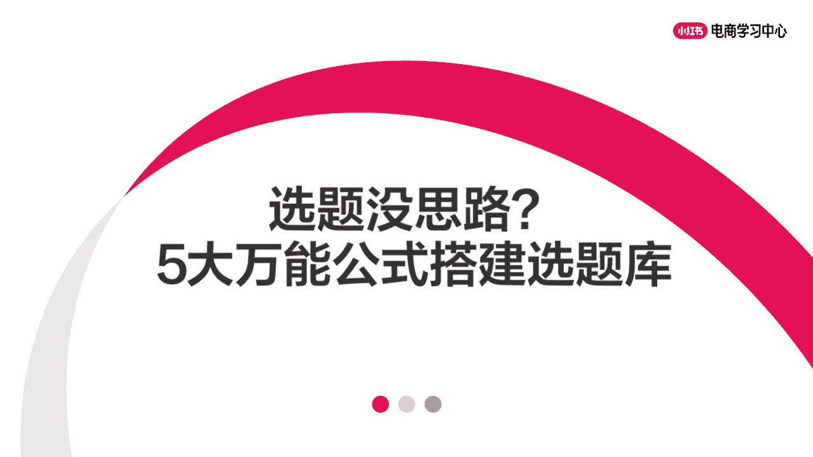

[📕选题没思路？5大万能公式搭建选题库【📕运营】.pdf](https://internal-api-drive-stream.feishu.cn/space/api/box/stream/download/all/JT4MbUpJCorj3lxmMb1c9fETnoe)

[📕2025📕必看运营攻略](https://ycnkryrzlftr.feishu.cn/wiki/T6kxwYGQBi108Wkv93wcw3jinmd?from=from_copylink)

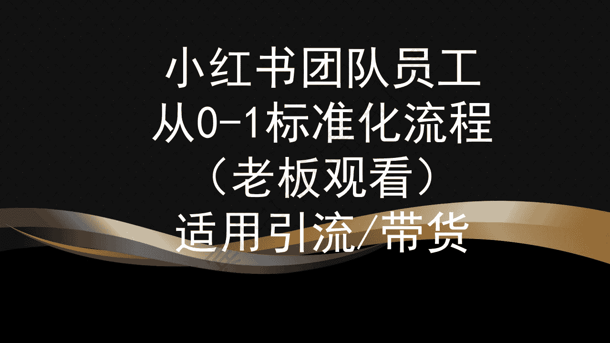

[📕0-1落地玩法（引流 带货详细最终最新版本）_202406.pdf](https://internal-api-drive-stream.feishu.cn/space/api/box/stream/download/all/QrwkbPu9PogNgrxR6iyc4ol4n1d)

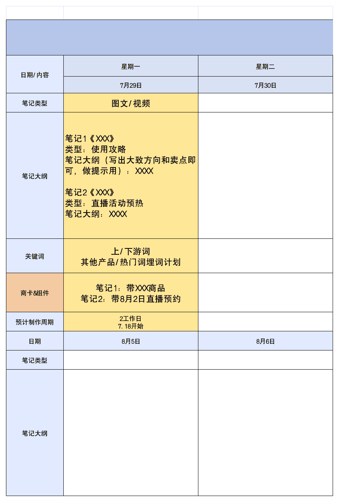

[📕笔记及直播高效运营表.xlsx](https://internal-api-drive-stream.feishu.cn/space/api/box/stream/download/all/RSGRbVR9eosjNjxpdq8c2JPbnWb)

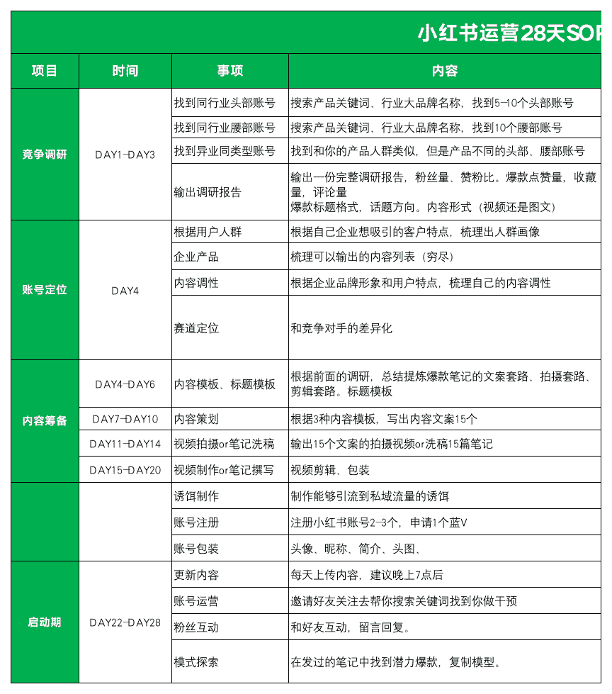

[📕运营28天落地SOP-.xlsx](https://internal-api-drive-stream.feishu.cn/space/api/box/stream/download/all/Y6c3bLk3WoZOPoxToykcnu6MnAg)

📕新锐头客-4月优质闭环笔记分享【对外版】

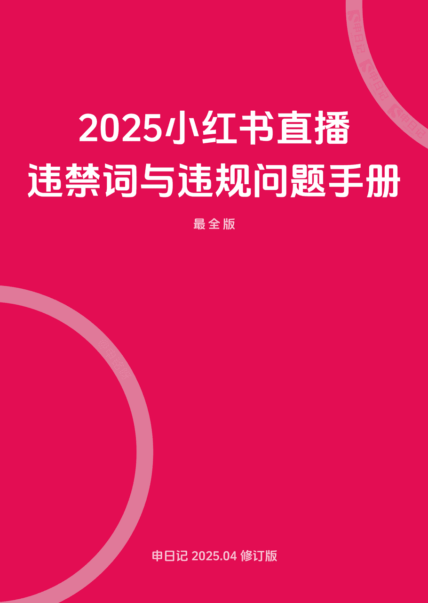

[2025📕直播违禁词与违规问题手册.pdf](https://internal-api-drive-stream.feishu.cn/space/api/box/stream/download/all/YJohbOxrEozLPdxMA4dcpn6OnYg)

[2025📕平台营销通案.pdf](https://internal-api-drive-stream.feishu.cn/space/api/box/stream/download/all/S4Ejbkb27owg2BxucLwcSzvRn9v)

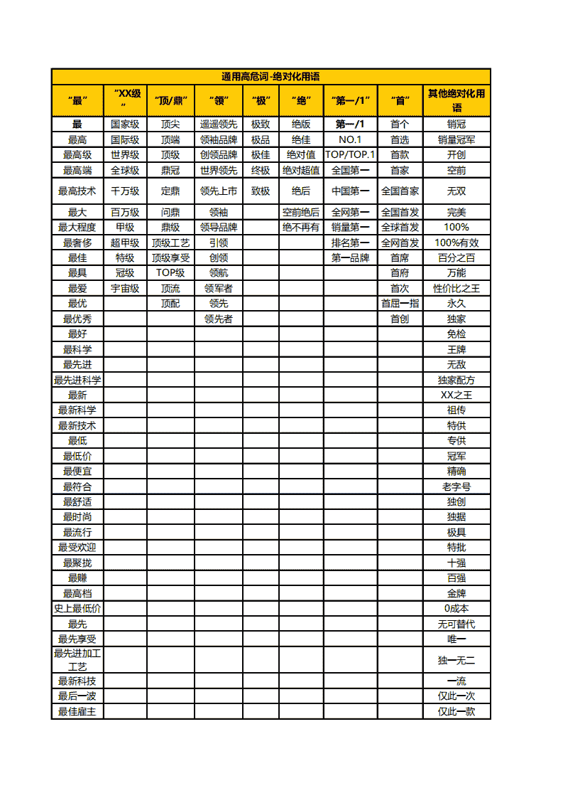

[📕社区高危词表.pdf](https://internal-api-drive-stream.feishu.cn/space/api/box/stream/download/all/JhBxbk4gUoP4HHxeO8eckYB4nOb)

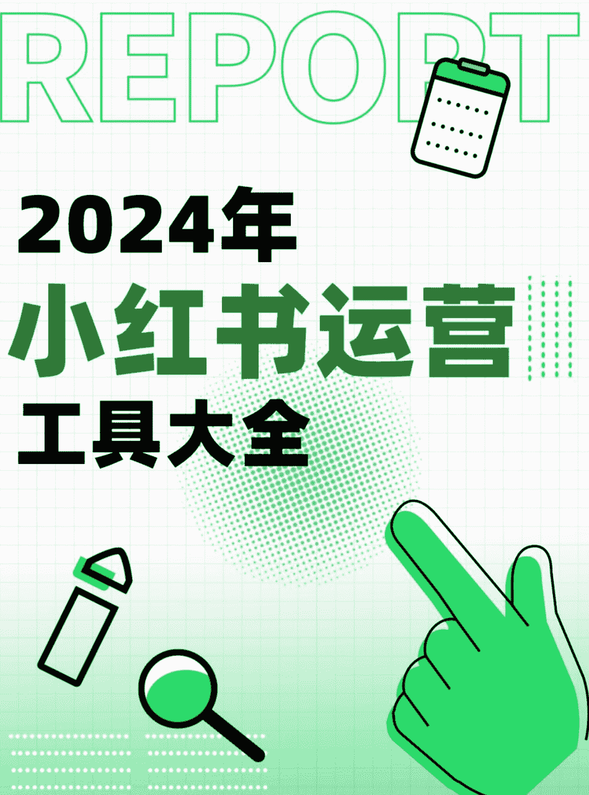

[2024📕运营工具大全【运营干货】.pdf](https://internal-api-drive-stream.feishu.cn/space/api/box/stream/download/all/P0X5b75PNoiqc6xteMYcN7N8n4c)

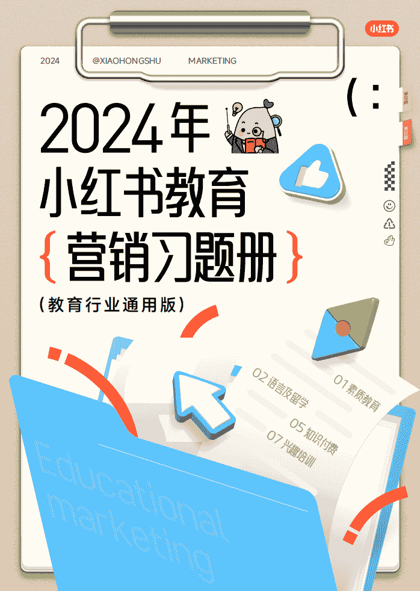

[2024📕教育营销习题册.pdf](https://internal-api-drive-stream.feishu.cn/space/api/box/stream/download/all/KNnJbBo8PovdTGxQCjIcuQa4nPb)

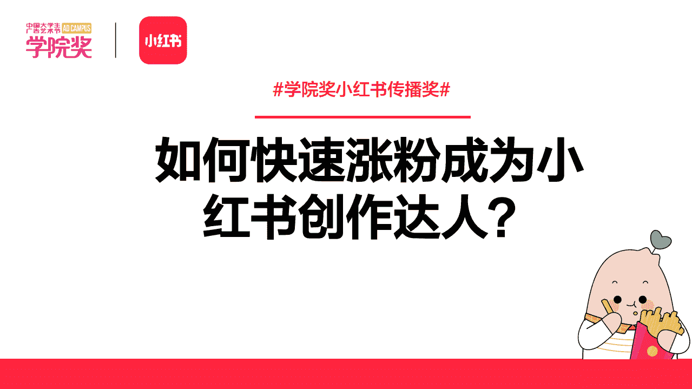

[「📕」如何快速涨粉成为📕创作达人？.pdf](https://internal-api-drive-stream.feishu.cn/space/api/box/stream/download/all/IAnpbvL1josNQexA7nIcxkLinhb)

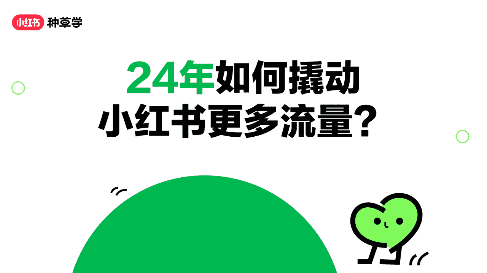

[24年如何撬动📕更多流量？.pdf](https://internal-api-drive-stream.feishu.cn/space/api/box/stream/download/all/RXR6bTrGcoQknkxtAFwcdIgAnkd)

[📕X科特勒《营销的第三种范式》.pdf](https://internal-api-drive-stream.feishu.cn/space/api/box/stream/download/all/Rw0Tb2FohouXx3xRzzcc4Uexnzb)

[📕商业圈最全知识库（持续更新中）](https://qwdqp1xy5k3.feishu.cn/wiki/O0auwWm4siCqrmkaL21cCJpWnFb?from=from_copylink)

[狂扒84个官方薯账号，包教包会的📕运营指南](https://idht1d7o1m.feishu.cn/docx/Oms8dlBbZobhTKxH4XEcdq5FnOe)

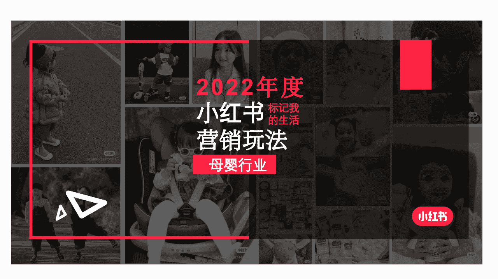

[母婴品牌如何玩转📕.pptx](https://internal-api-drive-stream.feishu.cn/space/api/box/stream/download/all/DFUjb2qWeolStxxvo4Zcf5OVnCl)

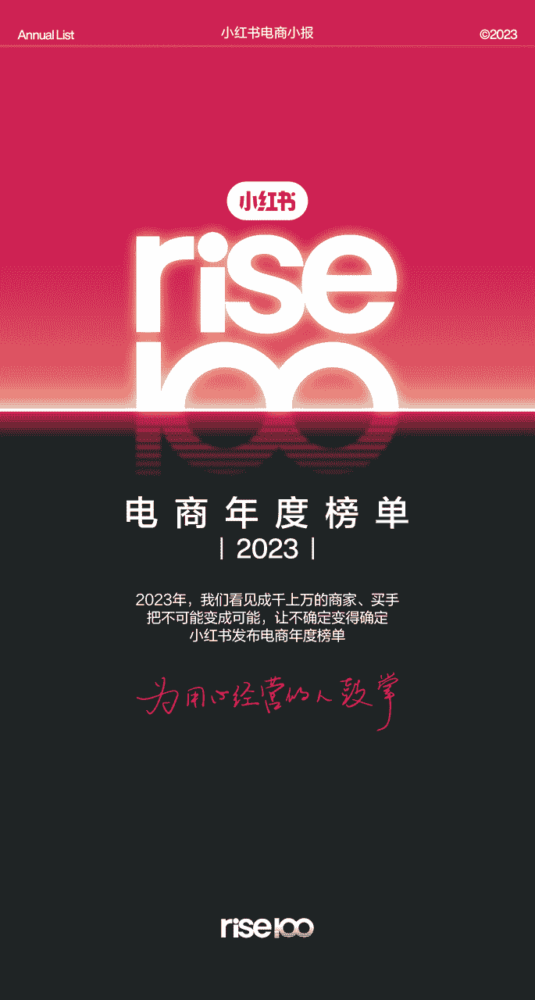

[rise100📕电商小报.pdf](https://internal-api-drive-stream.feishu.cn/space/api/box/stream/download/all/NXyVbPaNdoEU7MxScjIcwyzinNe)

[📕爆文攻略【互联网】【新媒体运营】.pdf](https://internal-api-drive-stream.feishu.cn/space/api/box/stream/download/all/GHp9bSwI8oikZTxMqvBcOQ5OnAc)

[📕养号发文SOP.pdf](https://internal-api-drive-stream.feishu.cn/space/api/box/stream/download/all/C4jabu9z0oMAlYxWvldcpCSUnfh)

[评论区和私信的互动指引的方法论.pdf](https://internal-api-drive-stream.feishu.cn/space/api/box/stream/download/all/LHsobmeqTo0lumxqiaycFZosnPf)

[怎样写出📕最受欢迎标题.pdf](https://internal-api-drive-stream.feishu.cn/space/api/box/stream/download/all/JraAbbqaGoVENBxcc9scfhrQnWg)

[📕爆款封面的底层逻辑.pdf](https://internal-api-drive-stream.feishu.cn/space/api/box/stream/download/all/S4n4bmmyEoMZiFx5hqMciQc9nfe)

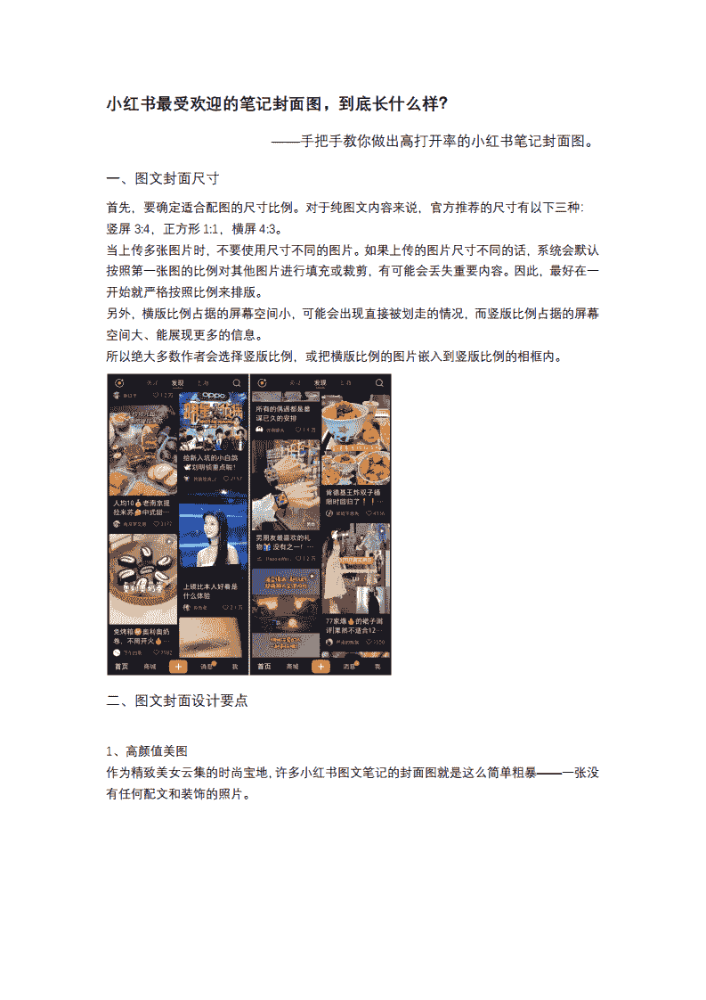

[📕最受欢迎的封面图，到底长什么样？.pdf](https://internal-api-drive-stream.feishu.cn/space/api/box/stream/download/all/ZZKNbXCIFofq6lxieRkcxVPsnEd)

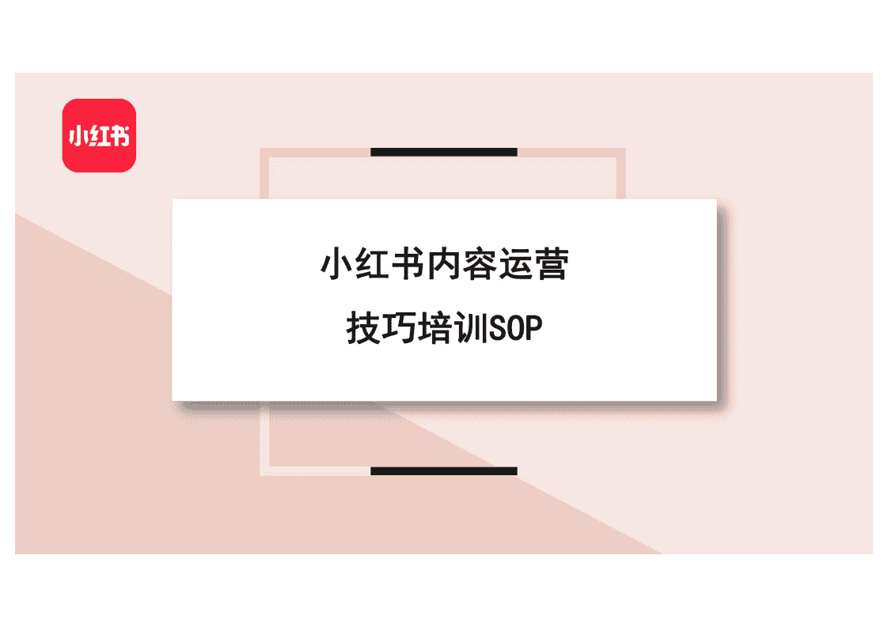

[《📕内容运营技巧》内部培训文件.pdf](https://internal-api-drive-stream.feishu.cn/space/api/box/stream/download/all/N40gbBDq9oZjlQxmyCxcpbqjnMh)

[【📕】2022如何做好内容爆文进阶指南.pdf](https://internal-api-drive-stream.feishu.cn/space/api/box/stream/download/all/IJTUbkVHKo86UFx5vXYcParNnof)

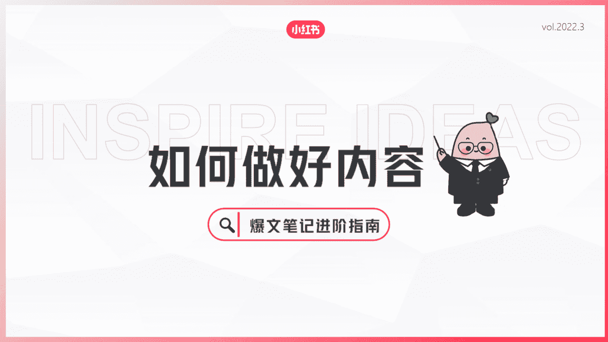

[【📕】（精品）内容爆文进阶指南.pdf](https://internal-api-drive-stream.feishu.cn/space/api/box/stream/download/all/Nwe1bgxiPo5BndxCz5scKeBfnWc)

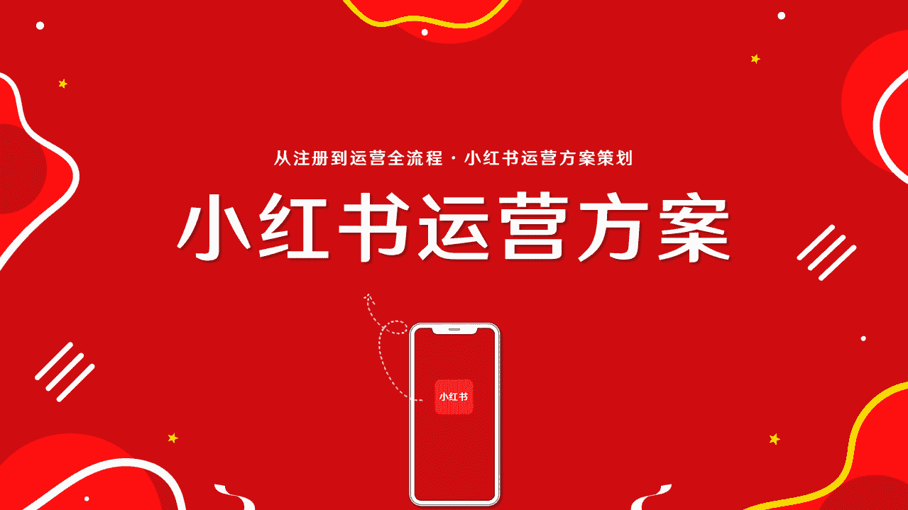

[📕从注册到运营全流程-📕运营方案.pdf](https://internal-api-drive-stream.feishu.cn/space/api/box/stream/download/all/ZEu7b9PxCoDj4bx4Y3rcaweGnIc)

[📕运营全流程&爆文创作攻略.pdf](https://internal-api-drive-stream.feishu.cn/space/api/box/stream/download/all/GLocblNFfo7BbPxLGibcLb8NnAb)

[【📕官方】📕商业笔记避坑指南.pdf](https://internal-api-drive-stream.feishu.cn/space/api/box/stream/download/all/KJ9Pb7zS0o8HGaxyAr6cMSQHncc)

[【📕官方】📕大促期间爆文打造攻略.pdf](https://internal-api-drive-stream.feishu.cn/space/api/box/stream/download/all/Khzib9T57oHt8IxdbMEcIoXqnOe)

[【📕官方】📕笔记内容指导.pdf](https://internal-api-drive-stream.feishu.cn/space/api/box/stream/download/all/Bf3Mb0oHIo791Kxt74ncBhwrnvc)

[【📕官方】如何在📕打造优质种草笔记？.pdf](https://internal-api-drive-stream.feishu.cn/space/api/box/stream/download/all/MYzabJpG8oS3fRxOAXXc73Jlnod)

[【📕官方】如何做好内容爆文进阶指南.pdf](https://internal-api-drive-stream.feishu.cn/space/api/box/stream/download/all/NUmQbtCEEokDWYx5ZaocWYlLnwd)

[如何通过📕快速打爆新品牌.pdf](https://internal-api-drive-stream.feishu.cn/space/api/box/stream/download/all/LnoXbj5N3oLiOpxaUfjcD5Uun2g)

[📕企业新账号学起来手把手教你早期运营思路.pdf](https://internal-api-drive-stream.feishu.cn/space/api/box/stream/download/all/B0bhb3XA3ox8TqxFW15cvkJFnEd)

[📕：📕内容运营技巧培训SOP.pdf](https://internal-api-drive-stream.feishu.cn/space/api/box/stream/download/all/JyZsbZspyorZEOxanficjpXrnpc)

[四步打造📕优质专业号.pdf](https://internal-api-drive-stream.feishu.cn/space/api/box/stream/download/all/IlhBbe16boDhOWxicsecl0snned)

[学好这五步-入局📕.pdf](https://internal-api-drive-stream.feishu.cn/space/api/box/stream/download/all/X5hYb4OWroXFbgx6tfbceHQCnFc)

[📕合规运营.pdf](https://internal-api-drive-stream.feishu.cn/space/api/box/stream/download/all/L9qjb2DfJoUFa8xbxLdcI3CKnde)

### 直播运营

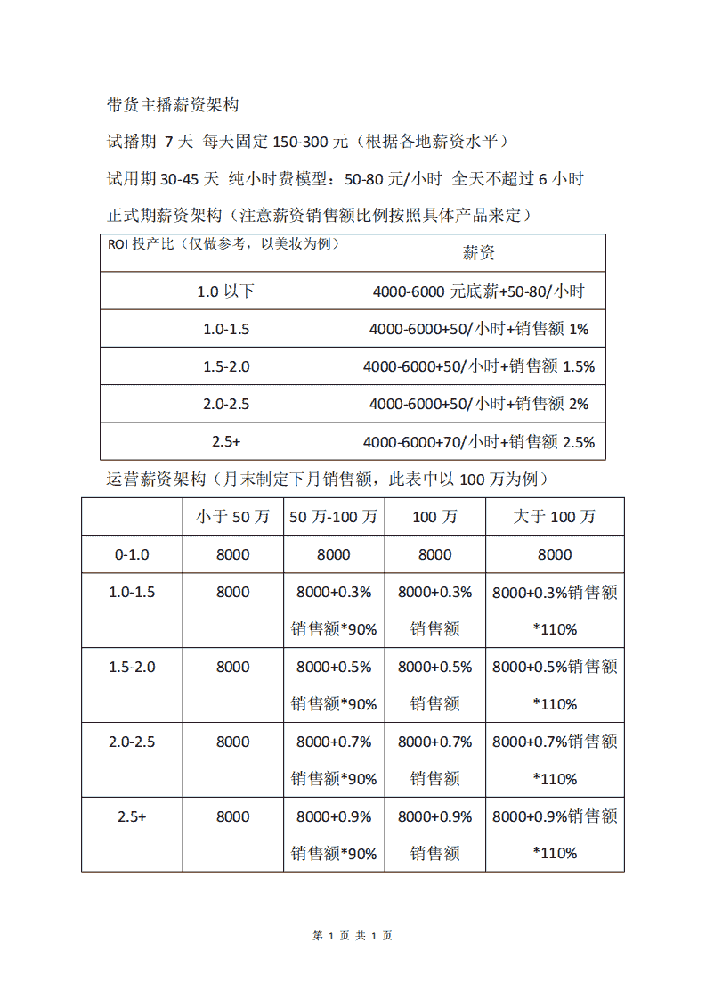

[直播DP服务机构-主播中控运营薪资体系.pdf](https://internal-api-drive-stream.feishu.cn/space/api/box/stream/download/all/SeFWbmBrooncULxMi18cb9zunTg)

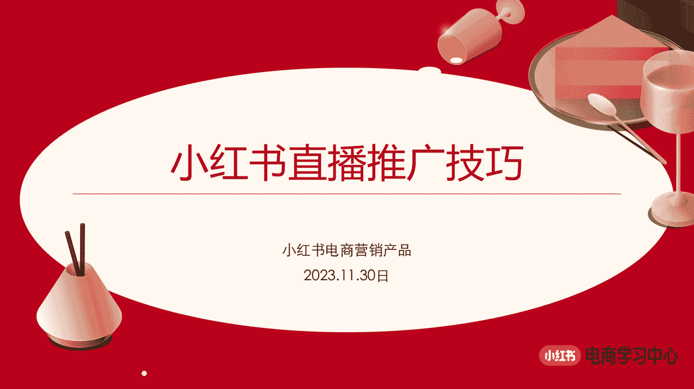

[📕直播推广技巧.pdf](https://internal-api-drive-stream.feishu.cn/space/api/box/stream/download/all/OaAwb1Nu5oXraWxxo3JcSHoJn7e)

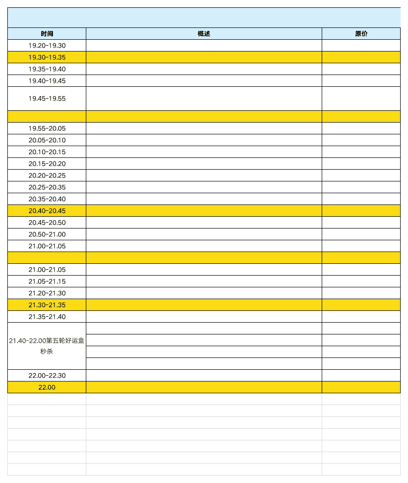

[📕直播策划模板表.xlsx](https://internal-api-drive-stream.feishu.cn/space/api/box/stream/download/all/ZoCFbxmGGoOOMYx3zKUcNMe2njc)

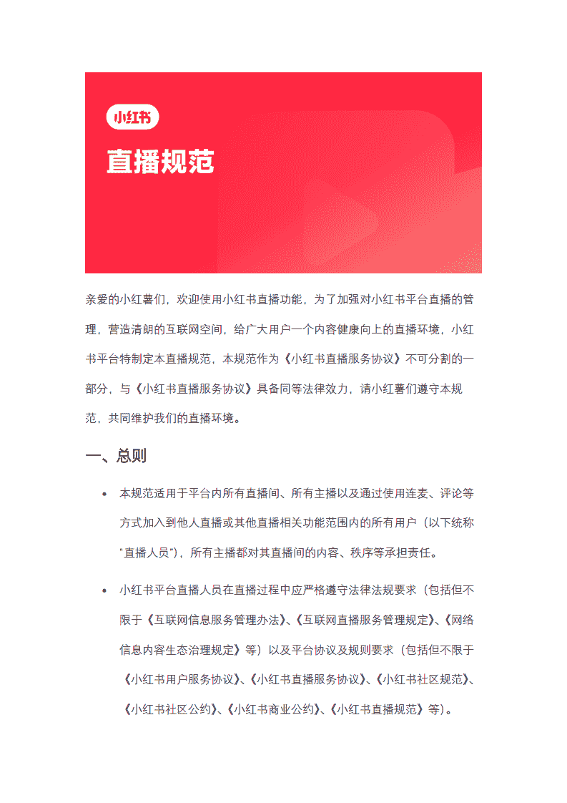

[📕直播间直播规范.pdf](https://internal-api-drive-stream.feishu.cn/space/api/box/stream/download/all/TPqobAJM6o2vGkx6eDmcJAsInyg)

### 品牌种草

# 聚光种草直达产品手册与资料汇总

## 快速入口与官方手册

[星伴计划](https://alidocs.dingtalk.com/i/nodes/gvNG4YZ7Jnxop15OCRYEXEdvW2LD0oRE)

[UID-聚光种草直达产品手册](https://doc.weixin.qq.com/doc/w3_AXwAmwY9AOgVZdVxczKRjqWImhke1?scode=ANAAyQcbAAgwNIvLf0AXwAmwY9AOg)

[红猫计划-种草直达产品手册：](https://doc.weixin.qq.com/doc/w3_AXwAmwY9AOgCNNzjbjMKbQLuVOxZ1?dver=)

聚光种草直达（阿里代投-UD）产品操作手册

📕官方营销学习平台——📕种草学

[📕平台电商中心](https://school.xiaohongshu.com)

[📕电商系列细节篇](https://hi428l7bh89.feishu.cn/docx/AtczdJ2Ttog6slx61MTcyMsnnLd?from=from_copylink)

[📕直播推广手册](https://doc.weixin.qq.com/doc/w3_Ac0ArQYCAEQl50cUvcuSTaSLTa8oh?scode=ANAAyQcbAAgeA9mQgnAc0ArQYCAEQ)

[📕品牌投放考核表.xlsx](https://internal-api-drive-stream.feishu.cn/space/api/box/stream/download/all/UEwdb96VOoXZ62x7qZGc22UXnBb)

[2026📕全年热点规划表.xlsx](https://internal-api-drive-stream.feishu.cn/space/api/box/stream/download/all/TqK1b7L36osmhDxRvU5coxDlnWh)

[品牌工作推进：品牌月度规划表（5张）.xlsx](https://internal-api-drive-stream.feishu.cn/space/api/box/stream/download/all/OCZRbMxLVolTu2xzyoWcr7c6nbh)

[📕电商行为人群定向产品手册](https://doc.weixin.qq.com/doc/w3_Ac0ArQYCAEQcbeo2wgMTwWUV8z8jS?scode=ANAAyQcbAAg72D0x6qAc0ArQYCAEQ)

[电商卖家做📕的八大案例.pdf](https://internal-api-drive-stream.feishu.cn/space/api/box/stream/download/all/IRRgbO28IoAGzZxShSlcBhbTnFc)

[2024行业高质量笔记四步走.pdf](https://internal-api-drive-stream.feishu.cn/space/api/box/stream/download/all/Fkv9bmTSOoVGrhxXhtlcmWeInxg)

[📕医疗健康行业KOS账号玩法指南.pdf](https://internal-api-drive-stream.feishu.cn/space/api/box/stream/download/all/OzKibEsulowh66xTXdJcNCE5njg)

[2024📕营销通案-美妆IP版图.pdf](https://internal-api-drive-stream.feishu.cn/space/api/box/stream/download/all/GeR8b6oVqolRx0xhOQeciaI5nGe)

[2024📕搜索推广白皮书.pdf](https://internal-api-drive-stream.feishu.cn/space/api/box/stream/download/all/MRcPbv39XoUc5hxRPKbcprwFnRh)

[2024📕平台营销通案.pdf](https://internal-api-drive-stream.feishu.cn/space/api/box/stream/download/all/TxUhbzkLro13tnx8LqkcQVdrnqe)

[📕龙年营销划重点.pdf](https://internal-api-drive-stream.feishu.cn/space/api/box/stream/download/all/CHFNbEuACoytj0xPIO9cojVSnbf)

[📕种草值 - 产品手册.pdf](https://internal-api-drive-stream.feishu.cn/space/api/box/stream/download/all/XqXgbkX3Rosef5x5G3ScBbA2ngb)

[📕不同行业下的用户有哪些差异化偏好？.pdf](https://internal-api-drive-stream.feishu.cn/space/api/box/stream/download/all/UTr0bkiwcouPPQxhRNRcSqkTnbg)

[2023📕企业号笔记创作指南.pdf](https://internal-api-drive-stream.feishu.cn/space/api/box/stream/download/all/JTDIb8Ov2oQvHPxBigVclwL6nBe)

[📕-达人营销四步法.pdf](https://internal-api-drive-stream.feishu.cn/space/api/box/stream/download/all/XkFvbilCWoJmjwxfFbXcgfcUnqe)

[【📕】从0-1运营企业号.pdf](https://internal-api-drive-stream.feishu.cn/space/api/box/stream/download/all/X6AnbVHRzo8WC2xdfTOcNmBUnLc)

[📕低粉高变现起号指南.pdf](https://internal-api-drive-stream.feishu.cn/space/api/box/stream/download/all/Ut21bx6geoklNjxkO96c8V13njc)

[📕教育品牌营销方法拆解.pdf](https://internal-api-drive-stream.feishu.cn/space/api/box/stream/download/all/GE1nbkVR5oiq4oxKQFccOBDnnhe)

[【📕官方】📕整体框架及玩法.pdf](https://internal-api-drive-stream.feishu.cn/space/api/box/stream/download/all/AJ2ebXumSoD7gXxdukZc0JqWnMc)

[【📕官方】📕运营知识地图.pdf](https://internal-api-drive-stream.feishu.cn/space/api/box/stream/download/all/UbgzbRK1FoowJFxekCkcHAv9njc)

[【📕官方】📕KOL养成方法论.pdf](https://internal-api-drive-stream.feishu.cn/space/api/box/stream/download/all/GDD9bAxQpod5NCxi6EYc2SZrnmd)

[新商家入局📕的4x4方法论.pdf](https://internal-api-drive-stream.feishu.cn/space/api/box/stream/download/all/O6nMb8wRHoGYvzxFlnNcfnEJn2I)

[📕商业产品全景介绍.pdf](https://internal-api-drive-stream.feishu.cn/space/api/box/stream/download/all/DWBfbbbZ8o4eX7x94vhcpYrCnnc)

[📕新商家指南.pdf](https://internal-api-drive-stream.feishu.cn/space/api/box/stream/download/all/TuZjbyIcWolSW5xoDPuckj3lnAf)

[📕品牌号运营地图.pdf](https://internal-api-drive-stream.feishu.cn/space/api/box/stream/download/all/AAZwbWKYFoEr8cxkzP7czIb7nQt)

[珍珠品牌📕推广方案【珠宝KOL营销】.pdf](https://internal-api-drive-stream.feishu.cn/space/api/box/stream/download/all/OFHZb07RLoBLeIxstLzcjc9Infe)

## 行业趋势

[2024📕职业教育行业营销通案.pdf](https://internal-api-drive-stream.feishu.cn/space/api/box/stream/download/all/Cos6b1fgPokAmnxKG3sct1cTnEb)

[2023年📕9大行业趋势分析报告.pdf](https://internal-api-drive-stream.feishu.cn/space/api/box/stream/download/all/SQF5bQXmko11nexhv0rcYwc7nph)

[【增长黑盒】📕增长策略研究：潮流时尚行业.pdf](https://internal-api-drive-stream.feishu.cn/space/api/box/stream/download/all/Bfc9bx00kos8Krx0enkcyBSWnad)

[《📕本地行业整合解决方案》.pdf](https://internal-api-drive-stream.feishu.cn/space/api/box/stream/download/all/DAcxb972AoUjPpxjR84cyJPenzc)

[📕：2023📕年度生活趋势报告.pdf](https://internal-api-drive-stream.feishu.cn/space/api/box/stream/download/all/H5QebKL89o42xRxQmu2cEI0An5g)

[📕：2024📕父母观察报告.pdf](https://internal-api-drive-stream.feishu.cn/space/api/box/stream/download/all/DZJzbaosqoAqUQxxnqScu837n2f)

📕食品饮料行业洞察报告2024

## 投放推广

[📕聚光投放红宝书](https://poho6ch9zt.feishu.cn/docx/UB1vdG4DkovS18xw8FacggdJngb)

[📕聚光平台](https://doc.weixin.qq.com/doc/w3_Ad0AnwamAGsr05edYt0SvmdFMNvan?dver=)

聚光「商品推广」投放策略完全手册

[📕私信营销手册](https://doc.weixin.qq.com/doc/w3_ACwAJQbSACQg935I3jxRkeQH7nqqp?scode=ANAAyQcbAAgnRXFhjuACwAJQbSACQ&sojumpparm=520866&from=%E7%AB%99%E5%86%85banner)

📕 KOB3.0 使用指南及开通流程

[📕 私信通产品使用手册](https://doc.weixin.qq.com/doc/w3_ACwAJQbSACQ6rLW1mGrRTmz4PUltA?scode=ANAAyQcbAAgUWHJfnrACwAJQbSACQ)

【企微文档】【客资｜企微】投放操作具体流程（对外）

[【知识共享】📕聚光投放知识库](https://stbi33audx.feishu.cn/docx/RCUEdrpcNo1FzXxr1qAc7PnSnhS?from=from_copylink)

[📕竞价广告资源介绍.pdf](https://internal-api-drive-stream.feishu.cn/space/api/box/stream/download/all/FPwubJnz2ooL83x37X2cMfPungP)

[1.📕聚光平台营销玩法.pdf](https://internal-api-drive-stream.feishu.cn/space/api/box/stream/download/all/DNoob1PhPoJY6txkra5c5dwZnhd)

[【📕】效果投放分阶段精细化运营.pdf](https://internal-api-drive-stream.feishu.cn/space/api/box/stream/download/all/AQSQbaOihowuHsxhRZKcSJRlnCh)

[《📕运营投放指南》.pdf](https://internal-api-drive-stream.feishu.cn/space/api/box/stream/download/all/TsmGb1z8wohv1FxFxNhcYFbOnEd)

[📕蒲公英笔记投放复盘方法论.pdf](https://internal-api-drive-stream.feishu.cn/space/api/box/stream/download/all/Uew4budALonXQZx2BZycII7cn1g)

[📕薯条操作指南-企业号.pdf](https://internal-api-drive-stream.feishu.cn/space/api/box/stream/download/all/AdnNbfKptojcsxxN3YXcFqTon4g)

[📕效果营销运营手册-信息流优化四大抓手.pdf](https://internal-api-drive-stream.feishu.cn/space/api/box/stream/download/all/P8f1bZJDlooCNJxLUyhcfpoInWg)

[📕搜索词布局实战手册-📕.pdf](https://internal-api-drive-stream.feishu.cn/space/api/box/stream/download/all/YyhqbailWoIrpHxJ2PJcgKNnnic)

## 活动案例

[华与华-蜜雪冰城首次提案.pdf](https://internal-api-drive-stream.feishu.cn/space/api/box/stream/download/all/Xi0fboSYYopAHvxBoiYc9Ytjndd)

[📕项目复盘（适合广告公司种草引流天猫.pptx](https://internal-api-drive-stream.feishu.cn/space/api/box/stream/download/all/M54NbUa4UoqqZ1xRNCcctwpunvc)

[如何做好📕项目复盘 ？.pptx](https://internal-api-drive-stream.feishu.cn/space/api/box/stream/download/all/BYpdbKNN6omA8gxfqbscZdjFnFh)

[2024📕平台营销通案.pdf](https://internal-api-drive-stream.feishu.cn/space/api/box/stream/download/all/MzPsbmMMmo52i2xypIQcDtJoneh)

[2023在📕解锁品牌经营新风潮【互联网】【通案】.pdf](https://internal-api-drive-stream.feishu.cn/space/api/box/stream/download/all/ReqjbVyoooZPi3xQYTYcgsInntd)

[Adam男士凉感内裤七夕📕营销方案2023.06.pdf](https://internal-api-drive-stream.feishu.cn/space/api/box/stream/download/all/O9Y1bkdChoi7zzxYRymcSjhinTb)

[EM📕灵感出游指南-正文.pptx](https://internal-api-drive-stream.feishu.cn/space/api/box/stream/download/all/CF1zbEqnro3jUVxa5ALcAgy6nWb)

[2023📕S+级外人节IP招商方案.pdf](https://internal-api-drive-stream.feishu.cn/space/api/box/stream/download/all/UxfkbHsHHowVQDxQCrWcasebnlb)

[2023📕商业化营销IP招商通案-89页.pdf](https://internal-api-drive-stream.feishu.cn/space/api/box/stream/download/all/UlXPbbsi0oXgsmxaJAgcz4wtnEd)

[2024📕营销IP新版图【美护行业】.pdf](https://internal-api-drive-stream.feishu.cn/space/api/box/stream/download/all/Zli7b7Seso0L4gxVa9fcfOeXnEc)

## 私域运营

[2025私域风控自检手册培训课件分享【私域运营】.pdf](https://internal-api-drive-stream.feishu.cn/space/api/box/stream/download/all/POiabUGego0hktxkVE0cBvpBn6g)

[私域流量全链路运营实操SOP方案.xlsx](https://internal-api-drive-stream.feishu.cn/space/api/box/stream/download/all/DifdbDPR2o86q0xpxtccv6pjnce)

[裂变增长的黄金公式——私域直播电商x腾讯云直播产品实战拆解.pdf](https://internal-api-drive-stream.feishu.cn/space/api/box/stream/download/all/OziBbt5bCoCjk2xleEtcaJ71nGe)

233全域用户运营手边书5.0（红皮书）

[私域增长模型](https://uwgpph9qu4.feishu.cn/docx/ZPued3iy1oX9CwxFMNxcvn94nUI)

[2024🛰️朋友圈用户研究报告.pdf](https://internal-api-drive-stream.feishu.cn/space/api/box/stream/download/all/SiVWbOQxVow1NOxWO5kchd7QnOd)

企业🛰️全套裂变方案-星耀裂变出品 · Yuque

[【小裂变出品】企业🛰️对外信息展示页配置.pdf](https://internal-api-drive-stream.feishu.cn/space/api/box/stream/download/all/B5NebscwCoABLbxKBdjceEX3nrd)

[4月私域营销建议.pdf](https://internal-api-drive-stream.feishu.cn/space/api/box/stream/download/all/Nzg1bQU1BoBBZdxOYMncM8zSnih)

[25年5月私域营销建议.pdf](https://internal-api-drive-stream.feishu.cn/space/api/box/stream/download/all/Bp9HbKTjJomxHXxeJs2cKBmunEb)

[25年6月私域营销建议.pdf](https://internal-api-drive-stream.feishu.cn/space/api/box/stream/download/all/CWYsbNzuRo6Cw4xsziNcj5TLnAb)

[全域电商 – 公转私落地实践.pptx](https://internal-api-drive-stream.feishu.cn/space/api/box/stream/download/all/Hc12beIYQoHOc6xYcglcuvZ2nlc)

[私域运营手册-腾讯广告出品.pdf](https://internal-api-drive-stream.feishu.cn/space/api/box/stream/download/all/YjCRbpxEXowBjtxFN5FctRBpnzd)

[私域招聘标准&团队绩效考核.pdf](https://internal-api-drive-stream.feishu.cn/space/api/box/stream/download/all/WxPJbed3tovG3LxXEnrc0bGqnle)

[《私域流量解决全案》.pdf](https://internal-api-drive-stream.feishu.cn/space/api/box/stream/download/all/FJGHbwE1CovfHnxV6XzcvroxnEf)

[私域运营地图.pdf](https://internal-api-drive-stream.feishu.cn/space/api/box/stream/download/all/H4hUbczqno7eWVxxsTecPwZOnre)

[从0到1搭建私域流量池全攻略(40页).pdf](https://internal-api-drive-stream.feishu.cn/space/api/box/stream/download/all/NpDVbJIWkoW2XgxbcLiclo7DnDb)

[全网最详细的社群运营全攻略.pdf](https://internal-api-drive-stream.feishu.cn/space/api/box/stream/download/all/EvMibrsmCoIq3SxprYAcRFiVn7c)

[100+超全超落地私域运营sop.zip](https://internal-api-drive-stream.feishu.cn/space/api/box/stream/download/all/TW6jb8R44oW5UXx9DVgcXl6Mnig)

[25套品牌私域流量体系运营SOP表.xlsx](https://internal-api-drive-stream.feishu.cn/space/api/box/stream/download/all/RxcBbQnI8ov0gYx3OstcXDZ7nie)

[教育行业社群运营sop.xlsx](https://internal-api-drive-stream.feishu.cn/space/api/box/stream/download/all/GbkzbwPbUoESV5xYBv4cB0Bun5g)

[美的私域全方案SOP.xls](https://internal-api-drive-stream.feishu.cn/space/api/box/stream/download/all/Oyi7batVKoxFqRxsZxjcTzM0nnd)

[私域标签搭建.xlsm](https://internal-api-drive-stream.feishu.cn/space/api/box/stream/download/all/KDD0b1PlDoi4gRx3oCrcquDin9f)

[私域用户标签搭建SOP（20个行业标签参考）.xlsx](https://internal-api-drive-stream.feishu.cn/space/api/box/stream/download/all/DpNBb9jfGoGJJLx7fOXcsfqXn9o)

[社群活动运营模板.xlsx](https://internal-api-drive-stream.feishu.cn/space/api/box/stream/download/all/SDnTbNYncoumoHxrrDsc1pr7nac)

[社群活动排期解决方案.xlsx](https://internal-api-drive-stream.feishu.cn/space/api/box/stream/download/all/EnYObHL51ocOAsxJc1fcff88n95)

[电商私域运营一表全.xlsx](https://internal-api-drive-stream.feishu.cn/space/api/box/stream/download/all/ZInybbMxCois36xz3UgcbCern4g)

[电商零售私域运营SOP.xlsx](https://internal-api-drive-stream.feishu.cn/space/api/box/stream/download/all/SQrLbr17hotOa6xGtpacqEO2n6Z)

[长期社群规划全流程SOP.xls](https://internal-api-drive-stream.feishu.cn/space/api/box/stream/download/all/QAd5b08kqooCmxxMtj0cPyCWnPg)

[私域流量运营规划全流程（ 引流 裂变 执行）.xlsx](https://internal-api-drive-stream.feishu.cn/space/api/box/stream/download/all/TMclbsoFEol5TlxIxTtcsO8bnxf)

[私域运营用户需求调研表.xlsm](https://internal-api-drive-stream.feishu.cn/space/api/box/stream/download/all/DoRabMALkoJv9UxWyAzchju1nmb)

[有棵树超级用户运营SOP.xlsm](https://internal-api-drive-stream.feishu.cn/space/api/box/stream/download/all/AzWkbeOydoDUcOxOEfpc4uM5nyh)

[瑞幸咖啡企业🛰️引流及引导下单话术SOP.xlsx](https://internal-api-drive-stream.feishu.cn/space/api/box/stream/download/all/YntJbPk8ko66wfxaSRucymdknve)

[企业🛰️敏感词&敏感行为&养号手册.xlsx](https://internal-api-drive-stream.feishu.cn/space/api/box/stream/download/all/OcLGbeOElovZl2xRqPFckyFWnlg)

[【教育督学社群】SOP框架样例.xlsx](https://internal-api-drive-stream.feishu.cn/space/api/box/stream/download/all/M1Q8bcnHvowMLixt3utcCC2dnYc)

[能量轻食＆美妆护肤社群内容运营规划.xlsx](https://internal-api-drive-stream.feishu.cn/space/api/box/stream/download/all/UuZVbDlNWo27ioxZbqdc0l7Snia)

[个人号养号sop表.xlsx](https://internal-api-drive-stream.feishu.cn/space/api/box/stream/download/all/P84mbP9snoXUY1xq4O5c7ismnQe)

# 私域运营与短视频运营资源索引

[增长黑客工具箱.xlsx](https://internal-api-drive-stream.feishu.cn/space/api/box/stream/download/all/N2XobHWXDolXnwxxKvMcKgnGn27)

[知识付费低转高直播运营SOP.xlsx](https://internal-api-drive-stream.feishu.cn/space/api/box/stream/download/all/BzwmbcFihoHl8exv2kRcAmoSnUf)

[《私域运营攻略1》最新电子版.pdf](https://internal-api-drive-stream.feishu.cn/space/api/box/stream/download/all/Ke20bQ52Yogw4tx1fc4c0tKqnNN)

[私域电商崛起：2021见实私域流量白皮书.pdf](https://internal-api-drive-stream.feishu.cn/space/api/box/stream/download/all/FaZubK9VzoHPucxoLSyc3bcwntg)

[微伴助手私域运营知识地图-线上版.pdf](https://internal-api-drive-stream.feishu.cn/space/api/box/stream/download/all/PTLYb66fWo0UoNxPEbiclrGXnlb)

[《私域运营招式手册2.0》见实白皮书2022.pdf](https://internal-api-drive-stream.feishu.cn/space/api/box/stream/download/all/LgGsb6JhUo8XIzxH8LNcDp9Unph)

[见实《私域工具手册》白皮书 2021.8.pdf](https://internal-api-drive-stream.feishu.cn/space/api/box/stream/download/all/JNZibWYRkoE7sRxPwuccmdocneg)

[见实《私域×游戏化：新玩法如何打开加粉、留存和订单转化的想象空间》202204.pdf](https://internal-api-drive-stream.feishu.cn/space/api/box/stream/download/all/QmTFbyZDtooTjRxiqcHcdZS7nce)

[见实【新版】《私域加粉手册》.pdf](https://internal-api-drive-stream.feishu.cn/space/api/box/stream/download/all/H3TnbU91CoNEnvxF1KXcTm3jnHe)

[见实《私域代运营爆发》白皮书.pdf](https://internal-api-drive-stream.feishu.cn/space/api/box/stream/download/all/WWSEb70ijoAPgVxDcM9cCFkMnpc)

[见实《私域用户分层运营》白皮书完整版.pdf](https://internal-api-drive-stream.feishu.cn/space/api/box/stream/download/all/XxXobg27doq1gqxxgpkc6zf6nZZ)

[易观用户运营手册.pdf](https://internal-api-drive-stream.feishu.cn/space/api/box/stream/download/all/WgJxbtrAhoPmUJxe32EcfzQRnkc)

[见实【零一裂变】私域运营项目SOP表格(全系列)水印版(1).pdf](https://internal-api-drive-stream.feishu.cn/space/api/box/stream/download/all/WtaSbGV7volck7xMzcVcLJ5HnUu)

[见实-【瑞莱帮】私域运营项目SOP表格.7z](https://internal-api-drive-stream.feishu.cn/space/api/box/stream/download/all/BGXKbgLjPoDnIbxTPUxcZXJUnng)

[见实×小裂变-社群裂变SOP.pdf](https://internal-api-drive-stream.feishu.cn/space/api/box/stream/download/all/RtDvbdgfCorBLlx5jawcxg8vnWl)

[《2022年中国服装行业私域指南》.pdf](https://internal-api-drive-stream.feishu.cn/space/api/box/stream/download/all/S5QKbllgCoUiKuxR24fcQpImnEc)

[增长黑客如何玩转私域流量-范冰.pdf](https://internal-api-drive-stream.feishu.cn/space/api/box/stream/download/all/AnH1bZWdhoi1FoxIUpoc7oLUnQd)

[勿传！群响企业🛰️最新又全的养号流程.pdf](https://internal-api-drive-stream.feishu.cn/space/api/box/stream/download/all/A0n9bQT85oz8IBxKPulcZA33nJe)

[勿传！群响最新🛰️养号和防封全教程.pdf](https://internal-api-drive-stream.feishu.cn/space/api/box/stream/download/all/StD9bD9kMoVcNZxbImIcdSBgnbf)

[群响私域养号操作手册.pdf](https://internal-api-drive-stream.feishu.cn/space/api/box/stream/download/all/Lhv0bJPKCon9Jjxb9RGcGUmMnZf)

[群响：🛰️助手群发小技巧.pdf](https://internal-api-drive-stream.feishu.cn/space/api/box/stream/download/all/FGJIbUqo1ocrstxg4xacchsAnYe)

[私域养号SOP合集.pdf](https://internal-api-drive-stream.feishu.cn/space/api/box/stream/download/all/QDlGbqlPdo5GU6x8J0scOEMUnzf)

[私域团队建议&考核标准.pdf](https://internal-api-drive-stream.feishu.cn/space/api/box/stream/download/all/KCoybxHkpodX6GxtJY3co8EqnFb)

[绝密！！🛰️养号细则及其他规则.pdf](https://internal-api-drive-stream.feishu.cn/space/api/box/stream/download/all/F8s1btfOSo🐧0mxtJ1tczGjTnDh)

[私域玩家生存手册2024v1.1.9.pdf](https://internal-api-drive-stream.feishu.cn/space/api/box/stream/download/all/PbGpbMr7DoVhJpx2hQBcxbgjntf)

[企微封号限制&解封&养号方法.pdf](https://internal-api-drive-stream.feishu.cn/space/api/box/stream/download/all/G0K2bkgf9oXMnEx8mBfc59g0n2d)

[私域用户标签体系搭建.pdf](https://internal-api-drive-stream.feishu.cn/space/api/box/stream/download/all/IqxobgQYsoOincxR5wicFeZ8nqh)

[小鹅通大健康行业解决方案0407.pdf](https://internal-api-drive-stream.feishu.cn/space/api/box/stream/download/all/VFLJbCy0FoIvCXxMtgCc0MW8npf)

[32天朋友圈剧本参考.pdf](https://internal-api-drive-stream.feishu.cn/space/api/box/stream/download/all/Gv3wb9cEIoZt5ExDVKVc7YTfnub)

[企业🛰️使用指南.pdf](https://internal-api-drive-stream.feishu.cn/space/api/box/stream/download/all/XaHsbgVFooiJbrxMPX6ckvwcnXN)

[2023年度私域电商快团团行业洞察报告-呱呱爆品.pdf](https://internal-api-drive-stream.feishu.cn/space/api/box/stream/download/all/KCKRbndbnoafiUxo5CocL7RVnye)

[2021京东超市私域流量运营方案【电商】【社群运营】【私域流量】.pdf](https://internal-api-drive-stream.feishu.cn/space/api/box/stream/download/all/TJHkb5rgCosCS1x5CxXc4XbXnVe)

[2025私域直播对接指南（商家必看）.pdf](https://internal-api-drive-stream.feishu.cn/space/api/box/stream/download/all/XgNwbv5dCoDxd4xc6UlcqopMnlh)

[品牌私域运营工具书.pdf](https://internal-api-drive-stream.feishu.cn/space/api/box/stream/download/all/M3H7b40xuos26qxbH2vcvhPjn4c)

## 快手运营

快手电商直播准备check list

[直播间流量核心逻辑](https://docs.qq.com/doc/DRGNsY2FrVGlWdk9N)

[如何提升品牌直播效果](https://docs.qingque.cn/d/home/eZQCkRkfro2ujwF5sYCbWyDtn?identityId=FK4thR9KKv)

[快手商家必用营销工具速览](https://docs.qq.com/sheet/DRUpXdkFiSnZLVXpU?tab=BB08J2)

[快手大服饰行业违规避坑指南](https://docs.qq.com/doc/DWkdhQ1hWaXBIdG1K)

[快手女装商家短视频指南](https://docs.qq.com/doc/DU2FRS0VCenFVT3lv?u=95c7db80a5de4b59baf40bc05411792b)

[快手短视频内容输出建议](https://docs.qq.com/doc/DZFZiY2JzZXBzTHlL)

[如何制作一个有吸引力的封面](https://docs.qq.com/doc/DV2Z6YklXT3NpUGZD)

[如何打造黄金30秒](https://docs.qq.com/doc/DV1ZLam1pQktoVnhr)

[快手短视频模板](https://docs.qq.com/pdf/DZnhNUGFKckNVZnRX)

[短视频内容提升攻略](https://docs.qingque.cn/d/hom)

磁力金牛：快手服饰鞋靴& 母婴品牌自播白皮书1.0

[2022快手电商数据价值报告-快手电商x磁力引擎-202207.pdf](https://internal-api-drive-stream.feishu.cn/space/api/box/stream/download/all/MBbMbFw1Wogp4rxiwLycauI2nkf)

[2022📕笔记内容特征分析报告-千瓜数据-202209.pdf](https://internal-api-drive-stream.feishu.cn/space/api/box/stream/download/all/DwFwbmAuqov2o7xQMN2cRA2Anpg)

[快手-食品饮料优质直播间拆解.pdf](https://internal-api-drive-stream.feishu.cn/space/api/box/stream/download/all/Maibbj82eowWc6xyFLWcszHqndf)

## B站运营

[B站精细化操作变现指南](https://ivqd5pmg5of.feishu.cn/docx/RLzQdx7Tsol0H1x7S4YcYrW6nce?from=from_copylink)

[bilibili：2024B站花火UP主营销指南.pdf](https://internal-api-drive-stream.feishu.cn/space/api/box/stream/download/all/GwpSbkIZVoOQRyxMPKdc0YmcnQg)

[2024年Q2B站奢侈品行业营销指南-拥抱新世代引领新审美-B站营销中心.pdf](https://internal-api-drive-stream.feishu.cn/space/api/box/stream/download/all/CAt6brRZ6o9pz1xknDEcvy86nIe)

[果集行研：2024年B站交易生态趋势报告.pdf](https://internal-api-drive-stream.feishu.cn/space/api/box/stream/download/all/GMBWbtf62oMsLEx1hUec8RpAnkb)

[B站精享内容起飞业务介绍.pdf](https://internal-api-drive-stream.feishu.cn/space/api/box/stream/download/all/JqjVbkzkJoRshjxW0H6cDE2dnlS)

[短视频运营：快手、抖音、B站营销策略异同研究.pdf](https://internal-api-drive-stream.feishu.cn/space/api/box/stream/download/all/IKhGbHyWbocVCixeQDVcaR9onPd)

[2024年B站交易生态趋势报告.pdf](https://internal-api-drive-stream.feishu.cn/space/api/box/stream/download/all/Es5ubdoHAoFjx2xChFxcNeYfnOe)

## 天猫运营

[财务明细模板.xlsm](https://internal-api-drive-stream.feishu.cn/space/api/box/stream/download/all/P4l5bE2EsoBfnoxuSi1crJs0noF)

[TUNEMAKERS年全年运营规划.xlsm](https://internal-api-drive-stream.feishu.cn/space/api/box/stream/download/all/SxkIbw24WoBZb1xPwjfcFVEmnIo)

[天猫爆款打造执行清单.xlsm](https://internal-api-drive-stream.feishu.cn/space/api/box/stream/download/all/MJgJbF6dVox8KZxHglKcUw3nnWl)

[2024天猫年度规划模版_.xlsm](https://internal-api-drive-stream.feishu.cn/space/api/box/stream/download/all/SLRNbRoQBoQW1FxL6L8cLWXensL)

## ⭐️运营岗位

### 运营复盘

[运营新人入行手册（内含24个PDF）.7z](https://internal-api-drive-stream.feishu.cn/space/api/box/stream/download/all/QRzLbHCrbo48g6x7QoacFmXCn3I)

[复盘超级模板 （组织&个人都适用.xlsm](https://internal-api-drive-stream.feishu.cn/space/api/box/stream/download/all/Secnb9aiWopduVxjSGOccqLQn0c)

[年终总结、工作汇报、述职报告PPT模板.pptx](https://internal-api-drive-stream.feishu.cn/space/api/box/stream/download/all/MdACb3HSKoKLYex5NqQc7Ku0n2b)

[瑞幸2023-2024年终总结述职报告.pptx](https://internal-api-drive-stream.feishu.cn/space/api/box/stream/download/all/Xr0Nb7qeeonOxlxfbpOcDwtDnig)

[📕项目复盘（适合广告公司种草引流天猫.pptx](https://internal-api-drive-stream.feishu.cn/space/api/box/stream/download/all/EuUdb7V8HoK3vKxsDXScRRwbnuf)

[运营必看-活动复盘模板.xlsm](https://internal-api-drive-stream.feishu.cn/space/api/box/stream/download/all/NFVTbwXSjokltfx1T23c67Yyngh)

### 商务BD

[2023年BD绩效考核表.xlsm](https://internal-api-drive-stream.feishu.cn/space/api/box/stream/download/all/DyZPbh4Syoel00xNmE7c8t48nlb)

[天下没有BD不到的达人 学习资料库](https://yeytb3ky3q.feishu.cn/sheets/shtcn0WoUsMjRkaRNjRoDusMGPg)

[FBIF小蓝书 压缩版.pdf](https://internal-api-drive-stream.feishu.cn/space/api/box/stream/download/all/HuvJbOkNIovcP3xgtpecWoAfnMe)

[网红运营：2024腰部达人成长研究.pdf](https://internal-api-drive-stream.feishu.cn/space/api/box/stream/download/all/O2mgbkKsvoumvjxiOOhcqdfenKK)

### 直播运营

[【交个朋友】直播间标准化执行流程（示例）.pdf](https://internal-api-drive-stream.feishu.cn/space/api/box/stream/download/all/PLV9b0mEIo7rrsxYvgdcplLFndg)

[【交个朋友】成功直播间经验分享&直播间标准化执行流程.pdf](https://internal-api-drive-stream.feishu.cn/space/api/box/stream/download/all/TlGcbOC1IoFk7AxXL0Lc5JmOnaf)

[直播团队岗位职责.xlsm](https://internal-api-drive-stream.feishu.cn/space/api/box/stream/download/all/WjJFbW7FCog3mkxeG9dcsOhjno7)

[直播带货助播岗位工作流程（小型团队）.pdf](https://internal-api-drive-stream.feishu.cn/space/api/box/stream/download/all/PKI7bysIsoaItZxNDK3cuAEVnEd)

[直播带货从入门到精通的8个流程.rar](https://internal-api-drive-stream.feishu.cn/space/api/box/stream/download/all/YGdqbFz60on8f4x9JRncwNYQnnb)

[话术进阶2.0-主播话术模版.pdf](https://internal-api-drive-stream.feishu.cn/space/api/box/stream/download/all/YcoZbJ4tko8qP6xI12Ec2PAXnhd)

[尹晨俱乐部40万字直播带货雄文.pdf](https://internal-api-drive-stream.feishu.cn/space/api/box/stream/download/all/RX5cb2GQOogiE9xR5rocPyElnYg)

[【首次入局】直播的“必备锦囊”](https://bytedance.larkoffice.com/docs/doccn425ZahYy9GIX3MIMqLxXO1?from=from_copylink)

[年末氛围大赏：保姆级直播间装修攻略来了](https://bytedance.larkoffice.com/docx/XwjGdOCIJoOrZ7xo5UmcEoM8njg)

[抖音生活服务直播话术大全-抖音运营.pdf](https://internal-api-drive-stream.feishu.cn/space/api/box/stream/download/all/ZP4ebKfDkolMLPxExO3cHpsPnGh)

[《抖音生活服务直播话术大全》](https://bytedance.larkoffice.com/docs/doccnqvyQV5zvYF90GdWCpDMWeg)

[《抖音生活服务直播运营手册》](https://bytedance.larkoffice.com/docx/NY86dWXVPoa5FGxvjrocjnLvnLs?from=from_copylink)

[【生活服务】到综行业直播手册（PR版）](https://bytedance.larkoffice.com/docx/doxcnMrpcye4FyN6GdYSspScSGf?from=from_copylink)

[交个朋友电商学苑-直播间标准化执行流程.pdf](https://internal-api-drive-stream.feishu.cn/space/api/box/stream/download/all/JoBqbRdjso8yrYxY8aUc9tNLnKg)

[淘系直播间统计库（活动+标题+通用特点）.xlsx](https://internal-api-drive-stream.feishu.cn/space/api/box/stream/download/all/IuhQbDWGRoJhqgxB5ZZced93nDh)

[2024微憋单直播话术拆解.xlsx](https://internal-api-drive-stream.feishu.cn/space/api/box/stream/download/all/SdSvbRNKeoia0cxVFEecjvXvnNf)

[H话术脚本框架.xlsx](https://internal-api-drive-stream.feishu.cn/space/api/box/stream/download/all/Oe71blhCRoN7xixdjR8c1CL3nDc)

[知识博主直播间卖课的话术模板.xlsx](https://internal-api-drive-stream.feishu.cn/space/api/box/stream/download/all/UDHvbZFVhoz8cVxxPZ0cG4KJnfc)

[食品类目直播带货脚本2.pdf](https://internal-api-drive-stream.feishu.cn/space/api/box/stream/download/all/Wt3ubcze4oq0tcxjHw9cSU5Onke)

[食品类目直播带货脚本1.pdf](https://internal-api-drive-stream.feishu.cn/space/api/box/stream/download/all/Fj11b6SnpoLEKKxtgLEcNi2sntm)

[食品类-蓝莓蜜直播话术.pdf](https://internal-api-drive-stream.feishu.cn/space/api/box/stream/download/all/HYuybs95boJPWdxPehMcCdronld)

[【食品类】【V5】麦当劳xAW黑金潮趴直播Rundown-1220.pdf](https://internal-api-drive-stream.feishu.cn/space/api/box/stream/download/all/P1KVbefUhop8qLxO2yMcZbhVnAf)

[直播间专业设备清单.xlsx](https://internal-api-drive-stream.feishu.cn/space/api/box/stream/download/all/DgM7bhCARourSlx3fU9cC2LFnwg)

[VOL.1  阿服的发财日记：直播设备搭建](https://bytedance.larkoffice.com/docs/doccnEhD9MXfmT3SZpj8D3q2Qbg)

[高清直播间设备清单.pdf](https://internal-api-drive-stream.feishu.cn/space/api/box/stream/download/all/ZtnKbwtKxo36ovxxt3HcIukPntf)

[同行直播场景记录表.xlsx](https://internal-api-drive-stream.feishu.cn/space/api/box/stream/download/all/NaGDboEAloj3tyxJtNXcJkCinwh)

[绿幕直播间设备清单.pdf](https://internal-api-drive-stream.feishu.cn/space/api/box/stream/download/all/Jc4xbWdwKovCKZxnPU6cF5b8ned)

[手机直播设备清单.pdf](https://internal-api-drive-stream.feishu.cn/space/api/box/stream/download/all/TwH7bJsyMoxKCmxwp5vcplJWn9g)

[【最全违禁词】直播高频违规行为规范.pdf](https://internal-api-drive-stream.feishu.cn/space/api/box/stream/download/all/O6dYbeamqoacAnxD2FxcuNdjnpc)

[直播伴侣使用全流程指导](https://streamingtool.douyin.com/docs/guide/guideindex/)

[OBS下载地址](https://obsproject.com/)

[OBS直播入门教程-操作手册](https://bytedance.feishu.cn/docs/doccnQGEUocKjNmXZpZS3tbHidb)

[【直播伴侣】 X 【OBS】 功能对比](https://bytedance.feishu.cn/docs/doccncQNVg2fV9RG7wnxvjcFocN)

[直播间中控绩效考核指标表.xlsx](https://internal-api-drive-stream.feishu.cn/space/api/box/stream/download/all/MmsYbE4tQoWDQGx2DGxcu80nnug)

[选品维度细节和打分表.xlsx](https://internal-api-drive-stream.feishu.cn/space/api/box/stream/download/all/Ww0Qbnn92ofxA5x012WcG0Idn1d)

[带货直播间管理方案(参考表).pdf](https://internal-api-drive-stream.feishu.cn/space/api/box/stream/download/all/DvXUbj0t4o0JbYxzTlQclvU3nff)

# 运营资料合集

## 直播运营

[直播复盘表.xlsx](https://internal-api-drive-stream.feishu.cn/space/api/box/stream/download/all/SwcGbQ4gOoZhtWxiqPIcgaPGndc)

[抖音短视频30天暴力起号玩法.pdf](https://internal-api-drive-stream.feishu.cn/space/api/box/stream/download/all/EMcob2ZH9o6Avixjad3cNIw5nXe)

[电商带货主播培训手册.pdf](https://internal-api-drive-stream.feishu.cn/space/api/box/stream/download/all/Gzc9beErgot4GzxRkmgchkXdnXd)

[直播资料1：直播流程设计脚本.pdf](https://internal-api-drive-stream.feishu.cn/space/api/box/stream/download/all/MX0bb9SlmoDxvdxTlBrct4hZneh)

[直播资料2：主播培训技巧全集.pdf](https://internal-api-drive-stream.feishu.cn/space/api/box/stream/download/all/LVDnblT5YoYdGkxEb4hcOv1HnYz)

[直播资料3：违规词全集，轻松避坑.pdf](https://internal-api-drive-stream.feishu.cn/space/api/box/stream/download/all/KYcfb9Z6foNCwIxFt1FcJ3M2nYf)

[各行业直播话术.rar](https://internal-api-drive-stream.feishu.cn/space/api/box/stream/download/all/DkBSbkIXAowG5ExukgDc7IF6nrS)

[滋补养生品牌账号直播运营方案【药食同源】【养生】【直播运营】.pdf](https://internal-api-drive-stream.feishu.cn/space/api/box/stream/download/all/J8H1b1nipoxoZ0xiTVycbTjcnYK)

## 私域运营

[2025年中国私域电商行业趋势白皮书.pdf](https://internal-api-drive-stream.feishu.cn/space/api/box/stream/download/all/LJsXbRP9Doao4bxzJHXckUGon5d)

[在线教育如何低成本获客.pdf](https://internal-api-drive-stream.feishu.cn/space/api/box/stream/download/all/THo9b1QWJosjiDxzFjfcQ9FUnbg)

[消费品及零售行业会员管理解决方案白皮书-普华永道-202207.pdf](https://internal-api-drive-stream.feishu.cn/space/api/box/stream/download/all/HQ7fbmQ7Morjy0xDa4zchspWnJu)

[2022会员营销指南：敏接触点管理创造增量收入-增长黑盒.pdf](https://internal-api-drive-stream.feishu.cn/space/api/box/stream/download/all/QmGAbKVwJoVoIsxM9WScOpA8nHd)

[解码蔚来汽车的社群运营.pdf](https://internal-api-drive-stream.feishu.cn/space/api/box/stream/download/all/JN6Bb95wvo2sxZxrDW4ckWecnwc)

[胖东来服务思维100个细节.pdf](https://internal-api-drive-stream.feishu.cn/space/api/box/stream/download/all/ADVzbzFxhoLN7KxXLVNc90Isnvc)

[蔚来汽车用户积分会员体系研究及数字定制化平台用户体系搭建.pdf](https://internal-api-drive-stream.feishu.cn/space/api/box/stream/download/all/MJlQbM8BXogLlxxVSH6cnNFZnqe)

[💻魔方｜客服超级知识库](https://f5jh3xdqny.feishu.cn/docs/doccnQsvgLHwagtLX2vTnHpNJzg)

[CRM会员运营规划SOP.xlsx](https://internal-api-drive-stream.feishu.cn/space/api/box/stream/download/all/SYxabm3uZo6gnDxqjOzc8GEtnUg)

[市面SCRM软件功能清单 2022.10.xlsx](https://internal-api-drive-stream.feishu.cn/space/api/box/stream/download/all/SOtObGABuoYiY6xcAxQcMSn6nDG)

玩赚会员运营：客户运营平台会员运营百科全书

[周大生-徐陈晨：会员私域运营及异业赋能.pdf](https://internal-api-drive-stream.feishu.cn/space/api/box/stream/download/all/VnjobRLeuotO0XxbOjNcsk3vnPe)

## 内容运营

[超级个人IP 赛道选择策略表.pdf](https://internal-api-drive-stream.feishu.cn/space/api/box/stream/download/all/MSRNbUEPkoixDUxWnbEcbSn2nMb)

[短视频投流人员职责 绩效考核.xlsx](https://internal-api-drive-stream.feishu.cn/space/api/box/stream/download/all/A4z7b4jUAoQprsxyROnc8ksunxV)

[商业IP👸号定位诊断表.xlsx](https://internal-api-drive-stream.feishu.cn/space/api/box/stream/download/all/DYDIb76txo1CuExyIYzctEh6nfd)

[短视频自检清单.xlsx](https://internal-api-drive-stream.feishu.cn/space/api/box/stream/download/all/Vd2cbdKjzo27z7xQ1CQc03wVnkb)

[2024 新榜大会——内容好生意（万能表单） ](https://q2fszeyg8a.feishu.cn/docx/BxC2dGSqIoBbzmxL4OHcmbPZnsd) [【新榜】2024内容产业年度报告.pdf](https://www.feishu.cn/file/XN9obcrUxo41sbx1GdLcD85mn3d?from=from_copylink)

[短视频运营面试问题.pdf](https://internal-api-drive-stream.feishu.cn/space/api/box/stream/download/all/EoDKbcYcQotFFHxTSVFcGcaLnT4)

[各行业短视频运营规划及案例.xlsx](https://internal-api-drive-stream.feishu.cn/space/api/box/stream/download/all/Kpxabuwpkov0bbxdbL3c4qkcn9g)

[知识付费内容自检表.pdf](https://internal-api-drive-stream.feishu.cn/space/api/box/stream/download/all/Oo5lbF8qno5XVyxWsyNc5Okvnpg)

[专业文案工作手册.pdf](https://internal-api-drive-stream.feishu.cn/space/api/box/stream/download/all/IKSVbEEMloAML4xmh1ucI3LgnBg)

[500款新媒体运营工具大全.pdf](https://internal-api-drive-stream.feishu.cn/space/api/box/stream/download/all/VcRUb6nGuowbrBxLTbKcrnVqnpJ)

[【奥美】52个创意工具.pdf](https://internal-api-drive-stream.feishu.cn/space/api/box/stream/download/all/JIVkbhayLoAYI0xlfKJc8L1fnLb)

[知乎营销全家桶（持续更新）](https://xmaqnyf424.feishu.cn/docs/doccnhhn3iXJOlbCuGKwIaG8oRc)

[「美妆行业」图文内容增量法宝](https://bytedance.feishu.cn/docx/doxcnAR96TN0TsiHjbzxis32xLn)

[无版权图片网站.xlsx](https://internal-api-drive-stream.feishu.cn/space/api/box/stream/download/all/TQKCb7wQkoqBQLxAAILcn2WhnYg)

[26个引导用户分享裂变海报的方法.pdf](https://internal-api-drive-stream.feishu.cn/space/api/box/stream/download/all/D3iRbxx9WoPVuXxmTeAczjCgned)

## 活动运营

[活动策划执行手册.pdf](https://internal-api-drive-stream.feishu.cn/space/api/box/stream/download/all/QwALbShvJokBDQxOkKDcf9FFnwd)

[游戏化实战.pdf](https://internal-api-drive-stream.feishu.cn/space/api/box/stream/download/all/SjRibYLSoouhaTx7hh9cUNtJnud)

[活动甘特图.xlsx](https://internal-api-drive-stream.feishu.cn/space/api/box/stream/download/all/CKJGby0qbo7b1axdA9vcBc28nqg)

[22张活动执行全套表格.xlsx](https://internal-api-drive-stream.feishu.cn/space/api/box/stream/download/all/ReqOb7mLAomQ8GxAx33crNmNnRh)

[运营必看-活动复盘模板.xlsx](https://internal-api-drive-stream.feishu.cn/space/api/box/stream/download/all/ZEiVbYCWfo3zdzxF3DkcOIFXnje)

[活动策划详细流程.xlsx](https://internal-api-drive-stream.feishu.cn/space/api/box/stream/download/all/C4PDbbRRno6M2hxheWlcR8pRn9b)

[美妆护肤快闪店搭建及宣传方案.pptx](https://internal-api-drive-stream.feishu.cn/space/api/box/stream/download/all/MY3TbO5i8oE2XrxrqCzcqtqzngE)

[13种APP推广手段与渠道.pdf](https://internal-api-drive-stream.feishu.cn/space/api/box/stream/download/all/XbaLb3PSMoq2orxrbMVcctE7nWf)

[2023营销活动日历｜含各节点活动创意推荐.pdf](https://internal-api-drive-stream.feishu.cn/space/api/box/stream/download/all/OxJpbI1oJo9VFTxtlncciGssnIf)

[【SocialBeta出品】2023节日营.pdf](https://internal-api-drive-stream.feishu.cn/space/api/box/stream/download/all/Fo93b4eVToBH7gxpH4uc1ORznZX)

[【有赞官方】2023年618营销活动方案.pdf](https://internal-api-drive-stream.feishu.cn/space/api/box/stream/download/all/Q4C9bVxIYo17JBxtrcwcMWfHnhb)

[20000+字丨73个营销模型（7.0版）](https://ejf7073wzo.feishu.cn/docx/UIPIdlzvzoexExxepgtchbNWnrg)

## 电商运营

[「新刚需」重塑双十一，2025消费洞察报告-知乎-202511(3).pdf](https://internal-api-drive-stream.feishu.cn/space/api/box/stream/download/all/MBirbUek8ohBSnxiIS0cZ7pcnQc)

[爆品利润计算器.xlsx](https://internal-api-drive-stream.feishu.cn/space/api/box/stream/download/all/XhT2b5zPOovNHPxEZJbcnhQ1nMe)

# 电商运营与品牌营销资源汇总

## 电商运营

[【电商运营】8种常用的详情页内容布局模型.xlsx](https://internal-api-drive-stream.feishu.cn/space/api/box/stream/download/all/RvbnbCGnko5LRNxJVuAcTsPTnqe)

[2024年618全网销售数据解读报告.pdf](https://internal-api-drive-stream.feishu.cn/space/api/box/stream/download/all/O8awbWCZoopWNkxFYx3cRdM0nTb)

[中国化妆品行业：披荆斩棘，国产化妆品如何再创辉煌？.pdf](https://internal-api-drive-stream.feishu.cn/space/api/box/stream/download/all/Fveobhf45og661xtfyEclxWjnr7)

[2024品牌营销日历.pdf](https://internal-api-drive-stream.feishu.cn/space/api/box/stream/download/all/FLdCblfAgoKi5Rxokp8ctpXTn1b)

[2023高档护肤品牌面膜产品上市方案【新品上市】【种草带货】.pdf](https://internal-api-drive-stream.feishu.cn/space/api/box/stream/download/all/AlE4byRAioNOBWxbTK6c0855nMf)

淘宝教育 - 阿里巴巴旗下网络营销培训机构，权威、专业的电商知识库

[我以前在阿里巴巴的流量方法论（后续篇）.pdf](https://internal-api-drive-stream.feishu.cn/space/api/box/stream/download/all/LYHXbnGMHozZmCxRtFJc7ukunse)

巨量学官网｜短视频运营_直播运营_电商直播运营培训课程

[社媒电商直播间货盘运营方法论-集瓜-202207.pdf](https://internal-api-drive-stream.feishu.cn/space/api/box/stream/download/all/Jwywb2tUqompmdx0EEEc🐧NIn7e)

[电商数据分析的8种数据指标.pdf](https://internal-api-drive-stream.feishu.cn/space/api/box/stream/download/all/J8yFbAfTjoNj4dxS7AGceqetncg)

[「🛰️广告」效果广告投放指南.pdf](https://internal-api-drive-stream.feishu.cn/space/api/box/stream/download/all/EKD3bsy6noNw6Nxsj4CcOn5vn5j)

[2022电商大促核心趋势洞察及“双11”科学备战锦囊.pdf](https://internal-api-drive-stream.feishu.cn/space/api/box/stream/download/all/RKPgbF1kAoZ8jDxuzLVc1tSSn2f)

[零一裂变·电商零售项目SOP表格.xlsx](https://internal-api-drive-stream.feishu.cn/space/api/box/stream/download/all/GF9mbluYCoMfpRxBCj8cyc9dnFf)

[数据赢家——2022年D11crm短信计划指导方案&短信模板.xlsx](https://internal-api-drive-stream.feishu.cn/space/api/box/stream/download/all/Yu28b3k9nomSROxmwafcr1P5n2n)

[店铺年度运营销售数据规划.xlsx](https://internal-api-drive-stream.feishu.cn/space/api/box/stream/download/all/BJHqb8U13o7FKZxid0Hc8u47nvR)

[店铺年度电商销售规划.xls](https://internal-api-drive-stream.feishu.cn/space/api/box/stream/download/all/TpFxbxW1io3c4kxmQ69clRhKnde)

[年度活动运营目标规划表.xls](https://internal-api-drive-stream.feishu.cn/space/api/box/stream/download/all/Uh2eb9hfmo5YHGxbzxocwLdVn4b)

[2022年双十一淘宝直播白皮书](https://www.yuque.com/tbzb/help/hp8eew)

[电商包裹卡资料合集](https://docs.qq.com/doc/DY1pMak94WXpZWFJt?dver=)

[天诺老吴年终总结2025年版本（电商人必看）.docx.docx](https://internal-api-drive-stream.feishu.cn/space/api/box/stream/download/all/EGIebJQqloDhqyxwcC2cKNf5nye)

## 产品运营

[得到品控手册9.0](https://dedao.feishu.cn/wiki/wikcnclPHCsD8UjJYVTzN6eArce?from=from_copylink)

[完整版-产品规划模版.pdf](https://internal-api-drive-stream.feishu.cn/space/api/box/stream/download/all/TAmpbGFAhoXxVxxJsGvc5OHtnne)

[用超级符号建立全度家居品牌存钱罐.pdf](https://internal-api-drive-stream.feishu.cn/space/api/box/stream/download/all/JSbmbJo45ozjoTxT3O3cY5tKnvd)

## 品牌营销

[巨量x凯度：2025品牌心智营销白皮书.pdf](https://internal-api-drive-stream.feishu.cn/space/api/box/stream/download/all/U7HSbU5iHowHcVxj3yoc25PAnmc)

[确定性：数字时代的品牌营销.pdf](https://internal-api-drive-stream.feishu.cn/space/api/box/stream/download/all/WLQPbrI6SoLrwNxomA0cDAl6nZd)

[品牌IP营销解决方案.pdf](https://internal-api-drive-stream.feishu.cn/space/api/box/stream/download/all/ANMzbSWaqoS5SrxzihvcCZI7nnb)

[小马宋《营销实战工具手册》.pdf](https://internal-api-drive-stream.feishu.cn/space/api/box/stream/download/all/RmcMbiejDotCYJxJfZNca556nub)

[洽洽X葵珍溯源季整合营销方案.pdf](https://internal-api-drive-stream.feishu.cn/space/api/box/stream/download/all/HzShbqVH5oPQpPxrySecK0KUnxe)

[知乎2023年度品牌营销案例集.pdf](https://internal-api-drive-stream.feishu.cn/space/api/box/stream/download/all/VHYGb6B8solEusx9AUwc0l2Mnmc)

[2024奢品趋势白皮书&人群灵感图鉴-VOGUE Business×📕.pdf](https://internal-api-drive-stream.feishu.cn/space/api/box/stream/download/all/RBMGbvMyzoYd1bxruLPcSRtfnRc)

[【密】刀姐doris：动势能理论4.0：全域经营下的品效协同方法论-2023刀法生机峰会.pdf](https://internal-api-drive-stream.feishu.cn/space/api/box/stream/download/all/M1ekbsvxeo4FG3x35JDcKde1noc)

[【密】刀法轻分享第86期 浴见：核心4问，找到真正支撑品牌和生意的「明星单品」 .pdf](https://internal-api-drive-stream.feishu.cn/space/api/box/stream/download/all/Ol7kbsLLuolJY1x8ODtcDPuUnSb)

[策略词汇大全_市场品牌传播渠道.pdf](https://internal-api-drive-stream.feishu.cn/space/api/box/stream/download/all/Yh51bTp3eoE7tIxUeg1cQVPyneb)

[运营策略岗专业词汇大全.pdf](https://internal-api-drive-stream.feishu.cn/space/api/box/stream/download/all/NtuCbI2RHo2bfoxBGMscBSETnvh)

[飞鹤品牌营销案例复盘.pdf](https://internal-api-drive-stream.feishu.cn/space/api/box/stream/download/all/Lq6UbEmMloYIKAxTVKscIAB6ncc)

[周黑鸭5周年店庆传播方案.pdf](https://internal-api-drive-stream.feishu.cn/space/api/box/stream/download/all/IuZrbM3gOoBmMoxoM0Qcjku4n1p)

[巴啦啦小魔仙2024「魔仙节」营销计划.pdf](https://internal-api-drive-stream.feishu.cn/space/api/box/stream/download/all/QGRebrJlvoIHbnxQXLccgKhAnIg)

[维生素品牌种草传播、圈层营销方案&预算-87P.pdf](https://internal-api-drive-stream.feishu.cn/space/api/box/stream/download/all/JcZzbN8i6oqL4cxgwdZciGuVn6d)

[蕉内品牌手册（仅供学习欣赏，版权属于蕉内公司）.pdf](https://internal-api-drive-stream.feishu.cn/space/api/box/stream/download/all/I7X4bhzFPoig2gxvsNocGJXpnnc)

[丸美天猫双十一整合营销方案.pdf](https://internal-api-drive-stream.feishu.cn/space/api/box/stream/download/all/P9zjbRi5CoNuefxImTHcWlq1nsc)

[2023广禾堂早燕晚胶营销种草方案.pdf](https://internal-api-drive-stream.feishu.cn/space/api/box/stream/download/all/RhU9b74NWoY3RCxAvbDcrgUWnSc)

[霸王茶姬品牌手册.pdf](https://internal-api-drive-stream.feishu.cn/space/api/box/stream/download/all/Lkbnb0b5OoIAP4xYM1lcdcxwnsb)

[女裤品牌策划全案.pdf](https://internal-api-drive-stream.feishu.cn/space/api/box/stream/download/all/OD0mblwCuovogOxvZmucaHpOnOf)

[2020 Skechers 品牌号运营方案.pdf](https://internal-api-drive-stream.feishu.cn/space/api/box/stream/download/all/VhQjbGrhTo0dbKxyIf8cgpKrnsy)

[2020滴滴出行🧣营销结案.pdf](https://internal-api-drive-stream.feishu.cn/space/api/box/stream/download/all/DYLdbTbVLoUkfzxLHdQcCCuAnfg)

[2020保利全国线上促销方案（疫情期间）【房地产】【线上售楼】.pdf](https://internal-api-drive-stream.feishu.cn/space/api/box/stream/download/all/Xe9VbSUeyombbZxw7pXc9Rpjn9h)

[2020大众点评黑珍珠餐厅指南创意传播方案【餐饮】【创意营销】.pdf](https://internal-api-drive-stream.feishu.cn/space/api/box/stream/download/all/LpH1bVPuooS8NmxPQIdcV7rbn9d)

[2020海尔热水器自媒体运营方案.pdf](https://internal-api-drive-stream.feishu.cn/space/api/box/stream/download/all/FP69bWZUkoixKFxHJNXcvEUwnqc)

# 文档资源目录

## 营销传播方案

[`2020娇韵诗弹簧霜社交平台传播方案【种草】.pdf`](https://internal-api-drive-stream.feishu.cn/space/api/box/stream/download/all/CvvjbrZzZogGs5xqiFec8Z6snUe)

[`2020可口可乐MTC项目X知乎合作规划.pdf`](https://internal-api-drive-stream.feishu.cn/space/api/box/stream/download/all/C7xEbbXR5o58epxsyMMcGCJYnth)

[`2020穗宝新媒体营销传播方案.pptx`](https://internal-api-drive-stream.feishu.cn/space/api/box/stream/download/all/OdMHb6n2ToRZKZxXGlmcB6SEnzd)

[`2020年人民日报新媒体重磅规划方案.pdf`](https://internal-api-drive-stream.feishu.cn/space/api/box/stream/download/all/IJ68bTwgKoDqm2xGwJ2cAYSInHg)

[`林清轩品牌手册最终版（可对外）.pdf`](https://internal-api-drive-stream.feishu.cn/space/api/box/stream/download/all/BpoTbMjyKooxd5xfjchcJCw0nWe)

## 全域经营

[`腾讯《全域经营GMV提升策略拆解》.pdf`](https://internal-api-drive-stream.feishu.cn/space/api/box/stream/download/all/ObYxbk8mboo3enxU6cfc3XABnSc)

[`巨量云图营销通案2021.pdf`](https://internal-api-drive-stream.feishu.cn/space/api/box/stream/download/all/JWKHb2fPuoNVsrx8W3YcnXJyntg)

[`全域经营年度案例精选-腾讯广告.pdf`](https://internal-api-drive-stream.feishu.cn/space/api/box/stream/download/all/UE9mbLaGWozhMaxXM14cySdpn7g)

[`腾讯《全域经营策略落地动作拆解》.pdf`](https://internal-api-drive-stream.feishu.cn/space/api/box/stream/download/all/JcDZbePTVoJaHjxUPx8cGBDYnTe)

[`巨量引擎O-5A人群资产经营方法论.pdf`](https://internal-api-drive-stream.feishu.cn/space/api/box/stream/download/all/O0zQbwz3sok6eSxay7Qc5ssjnvN)

[`《2023全域数字化运营实战手册》-89页.pdf`](https://internal-api-drive-stream.feishu.cn/space/api/box/stream/download/all/FuIpbAs4oodxMCxndYpcqPVlnFb)

## AI实操

[`家居品牌GEO与AI搜索优化方案.pdf`](https://internal-api-drive-stream.feishu.cn/space/api/box/stream/download/all/Eq6obiTYLoWYgmxUBK0czhVwnCd)

[`生成式引擎优化 GEO服务案例.pptx`](https://internal-api-drive-stream.feishu.cn/space/api/box/stream/download/all/HFHcbDT8hon7YIxXjiLchvpqnMb)

## 数据分析

[`数据埋点框架.xlsx`](https://internal-api-drive-stream.feishu.cn/space/api/box/stream/download/all/SdUUb2OSXojVaQxjxCPc5TgbnA8)

[CSM商务能力指南](https://h9v8ibz4lt.feishu.cn/wiki/wikcnVHbhhQ30r74Pp7DQruNCtg)

[`2022竞品分析方法大全.pdf`](https://internal-api-drive-stream.feishu.cn/space/api/box/stream/download/all/I0I6bBdjtow2Juxxzo8cLq8tnCb)

## 合同模板

[`主播竞业限制协议.pdf`](https://internal-api-drive-stream.feishu.cn/space/api/box/stream/download/all/LE7ybl3mUor0jsxLEskcGP2pnMc)

[`店铺代播直播合同.doc`](https://internal-api-drive-stream.feishu.cn/space/api/box/stream/download/all/NBIVbKGqnoYqMqxB6jScMRaYnqb)

[`抖音代运营合同.pdf`](https://internal-api-drive-stream.feishu.cn/space/api/box/stream/download/all/MzkabFS3Xo5EJnxOL6acZPaJnDg)

[`抖音直播营销运营服务合同.pdf`](https://internal-api-drive-stream.feishu.cn/space/api/box/stream/download/all/FlTEbVuSjomROBxwSRWcZEtLnCw)

[`短视频达人经纪合同.doc`](https://internal-api-drive-stream.feishu.cn/space/api/box/stream/download/all/MxsWbnByUomoYXxwwuBcaeaonqg)

[`演艺经纪合同（法务版）.doc`](https://internal-api-drive-stream.feishu.cn/space/api/box/stream/download/all/Re3cbjIiyoTTrWxlmwscJ1VHnsc)

[`艺人合同.doc`](https://internal-api-drive-stream.feishu.cn/space/api/box/stream/download/all/REcTbv1Y9oRxflxVBnFcO6Mhnvb)

[`动画IP项目合伙协议.docx`](https://internal-api-drive-stream.feishu.cn/space/api/box/stream/download/all/DzJzbnMIEoNXdqxudlpcvuwnnvb)

[`抖音短视频年度打包服务合作协议.docx`](https://internal-api-drive-stream.feishu.cn/space/api/box/stream/download/all/XVmAbp5T1ocTgpxY9SNc7FVgn9c)

[`短视频达人经纪合同.doc`](https://internal-api-drive-stream.feishu.cn/space/api/box/stream/download/all/AOD8bRviZo2Mh2xfPMrcmXk3ncd)

[`短视频拍摄项目服务合同(正式).docx`](https://internal-api-drive-stream.feishu.cn/space/api/box/stream/download/all/CHpGbQniPoB51NxmK5ecVfU5nJg)

[`个人微电影制作合同.docx`](https://internal-api-drive-stream.feishu.cn/space/api/box/stream/download/all/QtTAbWUvvoUTJJxPWH5c6Ekdndh)

[`视频制作合同.docx`](https://internal-api-drive-stream.feishu.cn/space/api/box/stream/download/all/ZGyibSM0nodfY3x238UcdlE9nIO)

[`（完整）2021抖音达人(短视频植入广告)服务合同.doc`](https://internal-api-drive-stream.feishu.cn/space/api/box/stream/download/all/B6nfbbFkooxSwyx0UD6cg2z7n2e)

[`达人签约协议.docx`](https://internal-api-drive-stream.feishu.cn/space/api/box/stream/download/all/QeTubJhjto5KzDxCGl0cmXhKnLh)

[`独家主播经纪合同(网红经纪公司专用)[10页].doc`](https://internal-api-drive-stream.feishu.cn/space/api/box/stream/download/all/LEeGbFR6JodQpyxB6kVc1Iy5nkb)

[`短视频制作运营合作协议.docx`](https://internal-api-drive-stream.feishu.cn/space/api/box/stream/download/all/Muy0bgsB9oQFa4xbWYAcOtfsnMg)

[`视频短片制作合同.docx`](https://internal-api-drive-stream.feishu.cn/space/api/box/stream/download/all/DzO7bfgn7oPY15xUFdjcXZphnnE)

[`网红合作协议.docx`](https://internal-api-drive-stream.feishu.cn/space/api/box/stream/download/all/WtDdbvH9oo8VuixAirpcHaalnog)

[`网红及艺人经纪代理合同(全约)[11页].doc`](https://internal-api-drive-stream.feishu.cn/space/api/box/stream/download/all/LMZHb3UIsoD0zLx6zZjcpDsjnot)

[`FLSH全职经纪合约.doc`](https://internal-api-drive-stream.feishu.cn/space/api/box/stream/download/all/HfqvbHEEYoxa3axgx7Bc7VH3nme)

[`MCN短视频广告委托制作合同模板.docx`](https://internal-api-drive-stream.feishu.cn/space/api/box/stream/download/all/UWe9b9Jfno9SMXxsEyacvQJinrg)

[`传媒公司保密及竞业限制协议.docx`](https://internal-api-drive-stream.feishu.cn/space/api/box/stream/download/all/KhKobd5pMoDX7fxp9G8cZrBdnDc)

[`短视频委托创作合同.docx`](https://internal-api-drive-stream.feishu.cn/space/api/box/stream/download/all/XbpibT3xYoKyayxQkZucn26enVh)

[`官方抖音政务号拍摄运营合同.docx`](https://internal-api-drive-stream.feishu.cn/space/api/box/stream/download/all/PckjbjkPGoSTOMxGlQScL048neh)

[`实用视频拍摄及制作合作协议.docx`](https://internal-api-drive-stream.feishu.cn/space/api/box/stream/download/all/XkoAbaw2RojTDYxCUMBcNTKvnxe)

[`微视网红达人合作协议.docx`](https://internal-api-drive-stream.feishu.cn/space/api/box/stream/download/all/A1QYbQJ8woESbmxANjncz1hjndd)

[`直播营销服务协议-单品营销.docx`](https://internal-api-drive-stream.feishu.cn/space/api/box/stream/download/all/FUO6bpxTIofBNDxXsYlcsZSznDf)

[`XX-MCN-自媒体达人独家战略合作协议-.doc`](https://internal-api-drive-stream.feishu.cn/space/api/box/stream/download/all/Dy8vbqnhgopExkxSYAScMR9Yndg)

[`版权授权协议书(短视频项目)(需修改).docx`](https://internal-api-drive-stream.feishu.cn/space/api/box/stream/download/all/C9SAbkXtWo4HKMxkHZScHWXkn0e)

# 合同协议模板

[达人机构经济约合同.docx](https://internal-api-drive-stream.feishu.cn/space/api/box/stream/download/all/FeKUbNjepo9RHCxB66cc60NFnLb)

[短视频微电影合作协议合同.docx](https://internal-api-drive-stream.feishu.cn/space/api/box/stream/download/all/KMJXbAO1lo8eqXxISwVcssDVn9b)

[京东产品短视频委托拍摄制作协议.docx](https://internal-api-drive-stream.feishu.cn/space/api/box/stream/download/all/JQOEbjFXFo5zgixYVTocdGwVnUd)

[网红达人视频独家合作协议范本.docx](https://internal-api-drive-stream.feishu.cn/space/api/box/stream/download/all/BVREbFBIHoc1kpxx6pocTnd2nbe)

[信息流短视频制作合同书.docx](https://internal-api-drive-stream.feishu.cn/space/api/box/stream/download/all/PmCjbUK5ZoHHOZxIjTKcgYRrndi)

[演艺合作协议书.doc](https://internal-api-drive-stream.feishu.cn/space/api/box/stream/download/all/UJP3bJ357oFcbtxxoazctO7EnCc)

[达人签约合同(📕).docx](https://internal-api-drive-stream.feishu.cn/space/api/box/stream/download/all/Q9xzbAioeoFAN5xMGiUcBsUgnZb)

[B端经销商合同.docx](https://internal-api-drive-stream.feishu.cn/space/api/box/stream/download/all/FCIEbmPAmo2LrVxnxR7c5Rk0nHd)

[直播合作协议书.docx](https://internal-api-drive-stream.feishu.cn/space/api/box/stream/download/all/XnAvbB5kFowBflxipgrcYtYynjd)

[直播样品寄样协议.docx](https://internal-api-drive-stream.feishu.cn/space/api/box/stream/download/all/WWDKbjeMFoKlzhxeEphcCCyJnOe)

[视频制作合同.docx](https://internal-api-drive-stream.feishu.cn/space/api/box/stream/download/all/OR9Obe5WTotbEcxMN8JcjoNJnob)

[直播陪跑协议(简单版).docx](https://internal-api-drive-stream.feishu.cn/space/api/box/stream/download/all/XtKfbfXGQoTfKrxNkGocVGTGnxb)

[主播独家经纪合作协议.docx](https://internal-api-drive-stream.feishu.cn/space/api/box/stream/download/all/B5rrbOueAonUrfxOHHDcsttZnQf)

[达人商务合同.docx](https://internal-api-drive-stream.feishu.cn/space/api/box/stream/download/all/HYyIbdXbgo47zHxy57WcOhp3n3e)

[抖音企业号代运营合同.docx](https://internal-api-drive-stream.feishu.cn/space/api/box/stream/download/all/LyHGbqn5yod7d8xWCyDc41c5nid)

[抖音视频代运营合同标准版.docx](https://internal-api-drive-stream.feishu.cn/space/api/box/stream/download/all/I6aXbFhASoZEvKxB9tKcPMMtn9f)

[媒体合作服务合同.docx](https://internal-api-drive-stream.feishu.cn/space/api/box/stream/download/all/RJHqbyAaUodFXXxpBLGceF7gnse)

[📕代运营合同模板.docx](https://internal-api-drive-stream.feishu.cn/space/api/box/stream/download/all/OdUCbFATQoK7tqxijcKcqWLKn5f)

[抖音店播DP服务协议.docx](https://internal-api-drive-stream.feishu.cn/space/api/box/stream/download/all/F5o5bEuMJox7jqxlib4cxXXJnKg)

# 🚅行业研究

[果集云报告空间](https://guojipro.feishu.cn/wiki/KTFdwQIOti3KzQkpQ9CcaPLDnuc?from=from_copylink)

## 电商消费

[2025洞见全球高价值客群.pdf](https://internal-api-drive-stream.feishu.cn/space/api/box/stream/download/all/JcfEb3qiZoQG34xokWPcSulGnEb)

[2025即时零售品牌增长实战指南.pdf](https://internal-api-drive-stream.feishu.cn/space/api/box/stream/download/all/Eq5DbllTooNdDgxSutwcLBqbnBb)

["中女时代"品牌营销观察-艺恩-202511.pdf](https://internal-api-drive-stream.feishu.cn/space/api/box/stream/download/all/Pz5NbJXIEoDsTLxIWSTclavfnSh)

[中女时代：女性生活方式及消费洞察.pdf](https://internal-api-drive-stream.feishu.cn/space/api/box/stream/download/all/ZtvqbC3ilo00kMxW9adcHTfOnVc)

[(完整版)2024-2025年科技行业主要变化趋势梳理与总结.pdf](https://internal-api-drive-stream.feishu.cn/space/api/box/stream/download/all/DlUZb9WbQoBPnExVww5cq2MonHd)

[2025年宠物行业消费趋势洞察 .pdf](https://internal-api-drive-stream.feishu.cn/space/api/box/stream/download/all/HlOebtfFrot2MExlJ1McnFlGnMc)

[【魔镜洞察】2024护肤成分趋势报告直播.pdf](https://internal-api-drive-stream.feishu.cn/space/api/box/stream/download/all/X7YnbQsiVo9CA5xR6vdcdzR3nB7)

[2024年爆款功效成分榜单及趋势预测.pdf](https://internal-api-drive-stream.feishu.cn/space/api/box/stream/download/all/C57MbceEaokwGbxGXGvcELCYnid)

[2023潮玩产业发展报告.pdf](https://internal-api-drive-stream.feishu.cn/space/api/box/stream/download/all/CPlnbjIZnoeM6exOSoJc1x5VnXg)

[2023抖音电商滋补品行业洞察报告-蝉妈妈.pdf](https://internal-api-drive-stream.feishu.cn/space/api/box/stream/download/all/ZyBIb3xPuo9OTFxRd9mczCqfnMf)

[2023年中国户外运动鞋服行业研究报告：静待黎明-艾瑞咨询.pdf](https://internal-api-drive-stream.feishu.cn/space/api/box/stream/download/all/Bk92b7L8GoeyFux🐧Z1cTa6bnGe)

[2022年消费行业投资策略报告.pdf](https://internal-api-drive-stream.feishu.cn/space/api/box/stream/download/all/HBWSbHr3Toee8bxZDCJcT0i4nIe)

[2022年中国兴趣消费趋势洞察白皮书.pdf](https://internal-api-drive-stream.feishu.cn/space/api/box/stream/download/all/FVtEbBnUNo8RAnx6kF8cvSbfn5c)

[天猫国际跨境保健品消费者洞察报告.pdf](https://internal-api-drive-stream.feishu.cn/space/api/box/stream/download/all/KqQwbQc8lo3DEgx3jincFuMmnof)

[远瞩咨询：2022年中国跨境电商行业分析.pdf](https://internal-api-drive-stream.feishu.cn/space/api/box/stream/download/all/NUGlb7RLwoh0R9xyjRWcsE4RnHh)

[2022年网络零售行业top100报告：创新、社交、绿色，网络零售制胜之道-德勤.pdf](https://internal-api-drive-stream.feishu.cn/space/api/box/stream/download/all/Xq5ub3EBooCSE0xyDYuccoWvnee)

[2022私域电商平台趋势报告-浪潮新消费.pdf](https://internal-api-drive-stream.feishu.cn/space/api/box/stream/download/all/KPPdbVcATocK5Fxv6dtcAyW3nqh)

[2023年宠物保健品消费趋势报告-果集行研.pdf](https://internal-api-drive-stream.feishu.cn/space/api/box/stream/download/all/DO6RbB0kUogFUUxWJ7hcx0Sbn2f)

[2022年电商发展分析报告.pdf](https://internal-api-drive-stream.feishu.cn/space/api/box/stream/download/all/RCLmbUVqHoYcLyx5NE4cUvxjnmh)

[2022未来消费趋势报告-阿里-202204.pdf](https://internal-api-drive-stream.feishu.cn/space/api/box/stream/download/all/XGaObJScEolk16x9cD2cCyrRnhg)

[2022年中国零售业会员运营报告.pdf](https://internal-api-drive-stream.feishu.cn/space/api/box/stream/download/all/T6b6bLoznoTeblxKelscIE1KnJd)

[CCFA&毕马威：2022年中国便利店发展报告.pdf](https://internal-api-drive-stream.feishu.cn/space/api/box/stream/download/all/W0mubYnJ4oG8hVxs8lvcTqeknWc)

[后浪研究所：2022年轻人潮流电器新品报告.pdf](https://internal-api-drive-stream.feishu.cn/space/api/box/stream/download/all/Vr3HbkRrionFJtxaSGJcEHE6n2K)

[星图数据：《2023年双十一全网销售数据解读报告》.pdf](https://internal-api-drive-stream.feishu.cn/space/api/box/stream/download/all/Puflbytnoo7aSCxi1I8c4K7znGf)

[双11购物节消费观察报告-克劳锐出品.pdf](https://internal-api-drive-stream.feishu.cn/space/api/box/stream/download/all/XEQGbA2xFoK71uxzxdWc9fpYnAi)

## 实体经营

[2025黄碧云：实体生意最新 5 大获客方法课件分享【实体店获客】.pdf](https://internal-api-drive-stream.feishu.cn/space/api/box/stream/download/all/SMyXbOa2doBkEoxBc5Fcg7WdndZ)

# 文档资源索引

## 内容营销

[以实体商家为例，如何通过低成本短视频拍摄，提高客户到店率？.pdf](https://internal-api-drive-stream.feishu.cn/space/api/box/stream/download/all/PtbKbzivZotaYtx3QpPc1KVtnRe)

[勿传！把自己做成产品，📕IP+2个助理年营收300W.pdf](https://internal-api-drive-stream.feishu.cn/space/api/box/stream/download/all/DmdKbcHSbomddRxj3Ivc5Zzsn7y)

[起号：给自媒体人的60条实操干货.pdf](https://internal-api-drive-stream.feishu.cn/space/api/box/stream/download/all/BTmGb4XFeooK29xhklUctylwn3b)

[《社媒营销年度特刊2024》_果集出品.pdf](https://internal-api-drive-stream.feishu.cn/space/api/box/stream/download/all/WIXIbKdPdoLei6xoxs5csONOnPg)

[《青年志》在视频生态中与年轻人同行小册子 final.pdf](https://internal-api-drive-stream.feishu.cn/space/api/box/stream/download/all/LRU7b9tbgovHW7xgAuPc8Sb6nsb)

[艾瑞咨询：2022年中国品牌广告营销策略白皮书.pdf](https://internal-api-drive-stream.feishu.cn/space/api/box/stream/download/all/P6gNbUsgKoe4WlxYXj6cLDWsn9f)

[AppGrowing：抖音快手B站知乎📕，广告媒体投放增长洞察.pdf](https://internal-api-drive-stream.feishu.cn/space/api/box/stream/download/all/R7YQb7FGPogNzjxL1rRcyrBVnKh)

[抗老护肤品牌内容营销研究.pdf](https://internal-api-drive-stream.feishu.cn/space/api/box/stream/download/all/GFCnb3MmcoURZdxVSAFcLhD8nnh)

[【艾瑞咨询】2022年移动应用运营增长洞察白皮书【发现报告 fxbaogao.com】.pdf](https://internal-api-drive-stream.feishu.cn/space/api/box/stream/download/all/XaKcbK5szoZLgrx0q2bc7GW9nRg)

[2023年唇妆品类及品牌珂拉琪社媒聆听分析-艺恩.pdf](https://internal-api-drive-stream.feishu.cn/space/api/box/stream/download/all/ETEvbceqDo0pNHxFwTrcrfXinnd)

[2023企业直播营销白皮书—数字化直播营销-Focussend.pdf](https://internal-api-drive-stream.feishu.cn/space/api/box/stream/download/all/A8W0bWncvoYppvxSZYtcNiGinjc)

[2022中国百大兴趣族群图鉴.pdf](https://internal-api-drive-stream.feishu.cn/space/api/box/stream/download/all/A0QCbr0MZozwUUxwkricfk3wn3e)

[2022年互联网创作者经济白皮书-艾瑞咨询.pdf](https://internal-api-drive-stream.feishu.cn/space/api/box/stream/download/all/QeXwbMxTWoTb8yxDK9DcgpSTn7b)

[2023出海营销洞察报告—角逐品牌力把握出海营销新范式-创业邦.pdf](https://internal-api-drive-stream.feishu.cn/space/api/box/stream/download/all/PWB2bRV7dofZa2xWBPqcuHpgnRh)

[2022下沉市场洞察报告.pdf](https://internal-api-drive-stream.feishu.cn/space/api/box/stream/download/all/DtC4bkD33okGdRx7DfmcPXZtnqb)

[2022年移动应用运营增长洞察白皮书.pdf](https://internal-api-drive-stream.feishu.cn/space/api/box/stream/download/all/NCkFb6ZxtomduxxxTRpcsTNFn9g)

[2022中国二次元内容行业白皮书.pdf](https://internal-api-drive-stream.feishu.cn/space/api/box/stream/download/all/KyCWbaVIxoDT8hxXhyuc7lnunGb)

[中国社交电商出海指南.pdf](https://internal-api-drive-stream.feishu.cn/space/api/box/stream/download/all/Eo1nbaNsYoUOMpxXYjhcoal8nEh)

[2023大社交趋势观察报告.pdf](https://internal-api-drive-stream.feishu.cn/space/api/box/stream/download/all/Wbqob9L0boRINtxFtCLcA48Qnpc)

[艾瑞咨询：2022年中国红人新经济行业发展报告.pdf](https://internal-api-drive-stream.feishu.cn/space/api/box/stream/download/all/Ws5FbajFKowdRnxIt7DcVObbnYI)

[TikTok-2023年全球流行趋势报告-2022-44页.pdf](https://internal-api-drive-stream.feishu.cn/space/api/box/stream/download/all/CihGbKVjGoJTPcx15VLciUTUn2X)

2022大社交趋势观察报告-袤则咨询

## 大健康行业

[Flywheel飞未2024保健品增长趋势报告28页.pdf](https://internal-api-drive-stream.feishu.cn/space/api/box/stream/download/all/IfGybs7YMoS3kJxtGKtcQNEqnRf)

[【果集·行研】2024年社媒电商大健康行业趋势洞察白皮书.0426V1.pdf](https://internal-api-drive-stream.feishu.cn/space/api/box/stream/download/all/YxvKbFJU6osFBXxFFnxclENsnWd)

[大健康私域与全域调研报告：营收增长与三大破局方向.pdf](https://internal-api-drive-stream.feishu.cn/space/api/box/stream/download/all/QXEFb4qCWoAWy6xirl7c5GI6nEg)

## 母婴行业

[《2025母婴品牌抖音内容增长策略》-白泽.pdf](https://internal-api-drive-stream.feishu.cn/space/api/box/stream/download/all/OuifbGwzvofOLSxsYnkcn948n1e)

[《2025母婴市场最新趋势与消费洞察》- 仙仙.pdf](https://internal-api-drive-stream.feishu.cn/space/api/box/stream/download/all/HpQCbC3LkocVfBx4I23c37gsnlg)

## AI行业

[2025年AI商业趋势白皮书.pdf](https://internal-api-drive-stream.feishu.cn/space/api/box/stream/download/all/MWuobGSu5oz8VrxZq3fcZqUEnSe)

[2023年AIGC场景应用展望研究报告-艾瑞咨询.pdf](https://internal-api-drive-stream.feishu.cn/space/api/box/stream/download/all/VoqdbtgyDoSlgRxSmEhc5TwXnce)

## 职场观察

[2022年互联行业薪酬趋势报告.pdf](https://internal-api-drive-stream.feishu.cn/space/api/box/stream/download/all/MpyCbWJDtoCN1KxrdcJcNUxOnSh)

[2022新职业教育洞察白皮书.pdf](https://internal-api-drive-stream.feishu.cn/space/api/box/stream/download/all/L1qhbxwXvonf8ax6XDgctIRjn0g)

[2022中国女性职场现状调查报告-智联招聘-2022-22页.pdf](https://internal-api-drive-stream.feishu.cn/space/api/box/stream/download/all/VG0sbuNcyocphfxB9ctcjhS2nKg)

[2022青年求职行为洞察报告-哔哩哔哩 智联招聘-20220413.pdf](https://internal-api-drive-stream.feishu.cn/space/api/box/stream/download/all/Pi2eb8Avzos2ylxCY2xcx1nonkc)

## 🎆 商业模型

[商业分析常用35套思维方法.pptx](https://internal-api-drive-stream.feishu.cn/space/api/box/stream/download/all/YDE2b15Lxoze9UxqOJVcOdTInbf)

[经典麦肯锡模型工具集(158页).ppt](https://internal-api-drive-stream.feishu.cn/space/api/box/stream/download/all/PEzHbFFL1oWRlqxbfdPcDcYlnsf)

[认知偏差知识手册.pdf](https://internal-api-drive-stream.feishu.cn/space/api/box/stream/download/all/ESWXbpEGLotGXyxjpGZckcIwnDc)

[没业绩怎样写年终总结.ppt](https://internal-api-drive-stream.feishu.cn/space/api/box/stream/download/all/VdBHb9bn3oCHtIxxF4zc1CVonog)

[刘润的12个商业模型.pdf](https://internal-api-drive-stream.feishu.cn/space/api/box/stream/download/all/AtIwbkq5go67roxhjEZcRpMrnfh)

[65个思维模型地图.pdf](https://internal-api-drive-stream.feishu.cn/space/api/box/stream/download/all/IUztbg3t2oSndTxoWEYcSkSGnqg)

[52个思维模型图.pdf](https://internal-api-drive-stream.feishu.cn/space/api/box/stream/download/all/C8kvb2ysaoGr0pxSnxGcJxnznil)

[商业框架图鉴：七大类工作场景×七十款框架.pptx](https://internal-api-drive-stream.feishu.cn/space/api/box/stream/download/all/Wu2ObZRy0o3fnXxVKXcctKpdnCb)

## ⛳ 能力提升

[王川宝典.pdf](https://internal-api-drive-stream.feishu.cn/space/api/box/stream/download/all/WZCGbuEK1oiMSexmrTecPgItnjN)

[张潇雨🧣精选（2023日历版）v1.1.pdf](https://internal-api-drive-stream.feishu.cn/space/api/box/stream/download/all/WGI4bcpSHocH3yxWH4ScUneGnVb)

[张潇雨100问v1.0.pdf](https://internal-api-drive-stream.feishu.cn/space/api/box/stream/download/all/Gc6hbAr1UoGmOzxsPpscIEcUnq2)

[个人能力知识地图.pdf](https://internal-api-drive-stream.feishu.cn/space/api/box/stream/download/all/U5GtbtqUNotla9xUow8cBU9Qncg)

[年度计划手册2023版.pdf](https://internal-api-drive-stream.feishu.cn/space/api/box/stream/download/all/TbKMbtvd3oIAe7xM8dAcGCDsnSd)

[得到《软技能》.pdf](https://internal-api-drive-stream.feishu.cn/space/api/box/stream/download/all/JK81bNk4eokj12xiDbqcuhjMnxg)

[👋十年创业者 万字长文分享 我是怎么招人的](https://presence.feishu.cn/docs/doccn71hTTKbaRGF8RvD2XzLJEK)

[🧧青年打工人升职加薪打怪指南 职场必读](https://presence.feishu.cn/docs/doccnUGilY7fYK4Sygb23l8n3Jf)

[🌟《运营之光3.0》共读纪念册](https://j6do2700cg.feishu.cn/docx/doxcnP4mvTZf9UtiiiNfcB5rMCg)

[什么是网感？---暨互联网创业劝退宝典，](https://hbxrsr8b55.feishu.cn/docx/doxcnJ9aMIuDztJamMrtkz349Ab)

[💼 飞书资源合集（持续更新）](https://sudo.feishu.cn/wiki/wikcnTGckC2OBrqZQAhN6JLidff)

[29个心理效应在运营中的运用.pdf](https://internal-api-drive-stream.feishu.cn/space/api/box/stream/download/all/JKrHb9EgVoSVUcxVnUTcuY4Jnrg)

[查理·芒格的100个思维模型.pdf](https://internal-api-drive-stream.feishu.cn/space/api/box/stream/download/all/Hll7bOt3ToIPqGxuQzjc4OtGnqd)

[万物皆模型-100个思维模型1.0.pdf](https://internal-api-drive-stream.feishu.cn/space/api/box/stream/download/all/Ytd9brrM0oFaXNxH9xjcwTO9nWd)

蚂蚁、阿里、腾讯、京东等大厂复盘

[《有赞SaaS工作手册》暨 SaaS创业十年的一些教训和经验总结](https://qima.feishu.cn/docs/doccnX2YXEjp4P9pvFtBgiWBOpd)

[KA产品知识库](https://www.yuque.com/kas/pm)

[92种营销策略方法.pdf](https://internal-api-drive-stream.feishu.cn/space/api/box/stream/download/all/N8Jrb6bEyogaMvxE7tecgT4NnGg)

[认知偏差知识手册](https://s75w5y7vut.feishu.cn/docs/doccn3BatnScBJe7wD7K3S5poFf?from=from_copylink)

[个人职业选择的双因素决策模型.xlsm](https://internal-api-drive-stream.feishu.cn/space/api/box/stream/download/all/NI60blOMAoIyPMxLCKucunfWnah)

`/`
