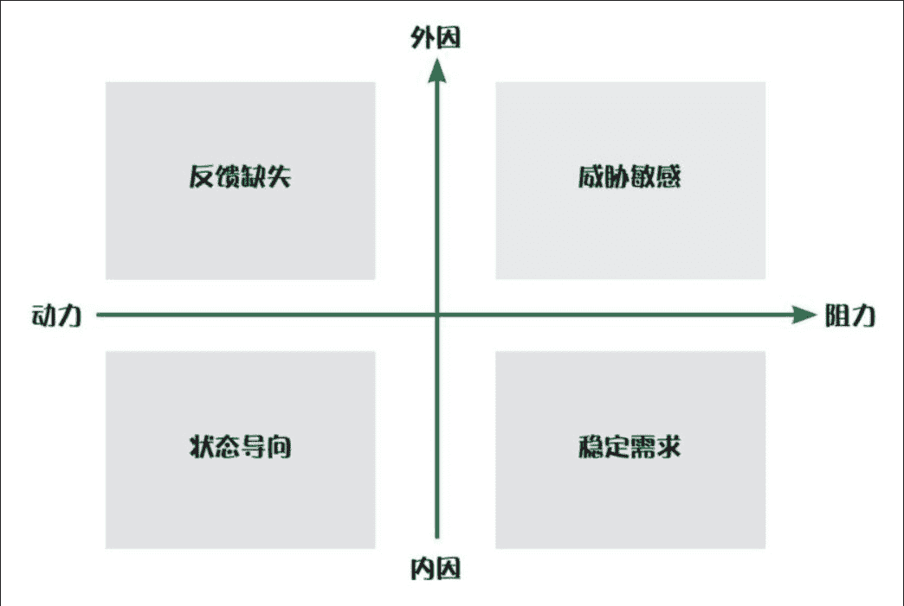
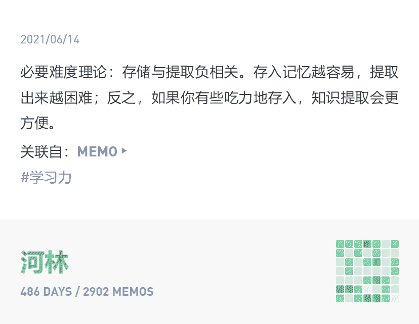
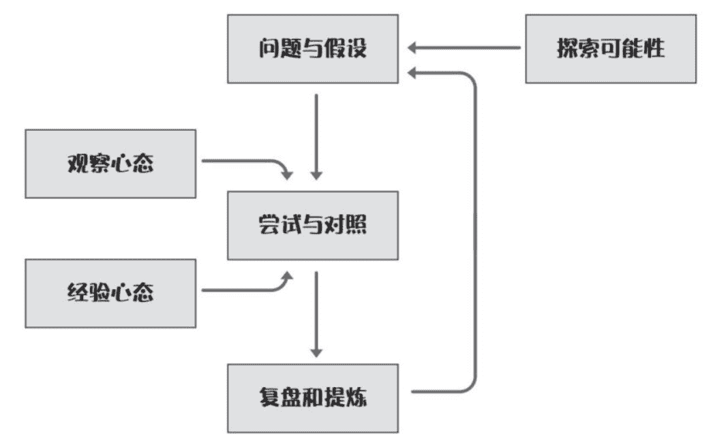

# L先生说《打开心智》读书笔记

> 来源：[https://my.feishu.cn/docx/doxcntbGpawhTY60QqBGuNGmvqd](https://my.feishu.cn/docx/doxcntbGpawhTY60QqBGuNGmvqd)

阅读书目：L先生说《打开心智》

阅读时间：2022/10/1~2022/11/19

# 序言

# 大脑的底层原理：心智模式四大支柱

## 节能：为了不思考，人类什么都做得出来

## 稳定：拖累成长脚步的元凶

## 预测：喂给大脑什么，它就变成什么

> 大脑的预测功能：预测不仅仅是大脑对于节能的一种辅助功能，更是大脑非常底层、非常重要的一种信息加工方式。

> **预测加工理论**：

> 第一部分：大脑通过每一天、每一分、每一秒的信息输入，不断微调大脑内部的心智模型，以便更好地符合和反映外部世界；

> 第二部分：通过这个心智世界，大脑对我们每天会遭遇到的情况、做出的反应和结果进行预测，通过预测和对比来检验心智模型的有效性。

> 大脑工作模式的本质：通过这两部分所构成的回路，不断地让自己更加理解外部世界，更加适应外部世界。

> ：大脑通过预测来理解世界，预测是大脑的非常底层、重要的信息加工模式；预测加工理论认为，大脑通过2部分构成的回路，来让自己不断理解外部世界并适应外部世界。

> 大脑预测的素材，来自大约前15秒内我们所看到的信息的整合。也就是说，大脑每一瞬间，都在不断分析我们在15秒内看到的信息，通过这些信息预测我们在第16秒会看到什么，并把这个预测的结果呈现给我们，让我们以为这是我们实际所看到的。这说明我们以为自己看到的世界，实际上并不是真实的世界，而是大脑所预测出来的结果，是大脑“播放”给我们看的一个幻象。只不过这个幻象，跟真实的世界几乎毫无差别，所以我们平时觉察不到罢了。

> 预测加工的模式贯穿生活方方面面。如果没有这个功能，我们将生活在一个全然不同的世界里。它告诉我们：我们所感受到的世界，实际是一个幻象，是大脑根据过往经验所想象和模拟出来的“未来”。

> 💡 大脑通过预测加工模式，把根据过往经验和想象模拟出的“高概率的未来现实”补足并播放给我们看，让我们感觉不到大脑接受的信号与实际现实间的差别和延迟。

> 大脑采取预测加工模式的好处：

> **微观角度，高效且节能。**

> 首先是高效，通过预测加工的模式，大脑可以最大限度地压缩信息处理的时间，帮助我们更快速地对外界刺激做出反应。

> 另一个好处就是节能。研究发现，当大脑工作在预测模式下时，大脑的脑电波是平缓、稳定的，这时，我们采取的是快速、直觉、自动化的加工处理方式；而当大脑监测到一个不符合预测的信号时，大脑会产生一个尖锐、剧烈的波峰，这个波峰会令大脑进入警觉状态，转而使用更加审慎的方式去加工信息。

> 自动化加工和控制加工，系统一和系统二，这些在心理学研究中非常常见的双路径模型背后的机制，就是大脑在“预测模式”和“修正模式”两种不同模式下的工作方式。

> 换句话说：预测加工的处理方式，可以使得大脑在符合预测的情形下消耗更少的资源，只在不符合预测的情况下消耗较多的资源。这样一来，大脑就可以实现资源的更优化配置，减少资源的浪费，把资源集中使用在更重要的地方。

> 从宏观来看，预测加工模式揭示了大脑非常重要的一个特性：可塑性。

> 大脑由860亿个神经元及神经元之间的连接构成。神经元之间的连接所构成的神经网络反映了大脑对外部世界的建模。而这个建模并不是固定的，每一分、每一秒，它都在根据外部世界输入进来的信息，产生变化，不断地自我完善和自我修补，以便更接近它所认为的外部世界。

> “贝叶斯大脑”的核心特征：你“喂”给大脑什么样的信息，大脑就会认为世界是什么样的，从而向着对应的方向演变。简单来说，就是用进废退。日常生活中，我们每天一切行为和信息输入都是在训练大脑。你希望你的大脑变成什么样子，就可以往对应的方向训练它。

> 大脑就是一个借由过往经验来预测未来的机器。你喂给它过于简单、无须动脑的信息，大脑就会变得懒惰、懈怠，因为它发现这样就足以应对每一天的生活；你喂给它高度复杂、需要反复咀嚼的信息，大脑就会努力改变自己、调整自己，来适应信息的难度，直到得心应手为止。

> 成长的本质：成长就是不断地把“费力”的事情，变得不再费力。这背后的机制，就是大脑调整了自己的心智模型，把更多的资源集中在对应的功能上，让我们能够更好地去适应环境、处理环境。

> 大脑采取预测加工模式的好处是，微观上，更加高效而且节能；宏观上，能够让我们通过行为和信息的输入，训练我们的大脑，把大脑的心智模型塑造成我们想要它成为的样子。

> 我们的大脑是一个贝叶斯机器，它根据过往经验来预测未来，通过划分优先级来决定资源的分配；如果我们想要改变自己，那就需要提供相应的信息去喂养大脑。

> 大脑对预判的预判

> 大**脑喜欢稳定，但大脑又排斥一成不变的生活，会**觉得无聊，是因为大脑在心智模型里面，会建立起一条非常重要的规则：我们不能局限在一成不变的环境里，必须时不时有一些新的刺激，有一些陌生的探索和反馈。

> 换言之，大脑对环境的预测是生活的环境不会完全符合预测，这其中必须有一部分是不符合预测的。因此，如果一切符合预测，大脑反而会觉得不舒服，因为这违背了更高层级的预测。

> 如何保持平衡？

> 2019年一项关于学习的研究发现：当我们对新知识进行测试的错误率在15%左右时，我们的学习效率是最佳的。

> 在生活管理中，我设置了一个“15%可能性”的项目，也就是抽出大约15%的时间去尝试和探索自己没有做过的事情，为生活引进一些新鲜感。

> 大脑通过预测加工模式来处理信息，建立、调整、修补自己的心智模型；但是，当生活完全符合预测，当生活一成不变、完全符合大脑所追求的稳定性的时候，大脑又会本能排斥；这是因为大脑需要一些新刺激，需要陌生的信息带来的探索和反馈；所以我们可以设置15%可能性，让自己去抽出一部分时间，去探索和尝试自己没做过的事情，为生活引进一些新鲜感。通过这种喂养新信息的方式，也让大脑不再无论，也能够调整我们的心智模型。

## 反馈：让你停不下来的甜蜜陷阱

> 大脑的底层原理四：多巴胺的学习和强化机制。

> 多巴胺是一种神经递质，用来在神经元之间传递信息。在大脑中，多巴胺的分泌和信息传递有多条不同的路径，每条路径叫作一种“通路”，把不同的脑区连接起来，起到不同的作用。多巴胺产生作用的通路主要有四条。第一条叫作“黑质-纹状体通路”，主要涉及运动的控制和调节；第二条叫作“中脑-皮质通路”，主要涉及决策功能；第三条叫作“结节-漏斗通路”，主要涉及生殖。

> 重点是第四条通路：“中脑——边缘通路”。它有一个更为人知的名字：奖赏回路。

> 当这条通路被多巴胺激活时，它就会带给我们强大的动力，让我们充满激情，特别想立刻行动。这也是多巴胺最核心的作用：为我们提供动机，激励我们行动。大脑有趋利避害的天性，趋利的天性就主要是由奖赏回路控制。当我们采取某种行动，获得某种对生存有利的回报时，大脑就会给这种行为一个奖励，告诉我们：这种行为是对生存有利的，可以更多地去践行它。

> 多巴胺的作用是在探索这个世界的过程中，帮我们找到那些对生存有利的行为，然后给它们打上一个标记，让我们拥有更强的动力去做它们，从而能够更好地“趋利”，摄取到更多的能量和竞争优势。

> 💡 多巴胺能够通过奖赏回路，为我们带来强大的动力，激励我们的行动，这是多巴胺最核心的作用。

> 快感与动机间的关系

1.  多巴胺调控的是动机，而非快乐。

1.  当我们获得正反馈时，大脑就会分泌多巴胺，从而激活奖赏回路，激发我们的动机。

1.  在奖赏回路中，多巴胺的浓度越高，我们的动机也就越强。

1.  快乐由享乐热点调控，受另一套机制影响，跟多巴胺无关。

> 什么东西能给我们带来快乐？

> 一个理论是，它与我们的认知目标密切相关。**当你从认知上认为一个东西是重要的，并且你得到了它，或者离它更进一步，你就更容易感到快乐。**而我们会以为多巴胺提供了快乐，一个可能的原因是在进化过程中，对我们生存有利的事物，往往也能同时带来快乐，即它们能够同时激活奖赏回路和享乐热点。所以这两种感受往往伴随而来。

> **上瘾：高动机低快感的甜蜜陷阱**

> “上瘾”就是一个典型的高动机低快感的现象。**当我们沉迷于某一事物时，我们可能并不感到快乐，但就是控制不住自己，原因就在于这些奖励刺激的是我们的奖赏回路，而不是享乐热点。**我们内心深处知道它们并不重要，只是在浪费时间，但就是控制不了大脑的天性。

> 进一步，这又会导致一个结果。一旦我们习惯了这种“不劳而获”的多巴胺获取模式，就更加难以适应需要付出努力才能获取多巴胺的模式了。因为相比之下，后者能够为我们提供的奖励变得更少，能够激发的多巴胺浓度也相对来说变低了。一边是你什么都不用做就可以获得稳定的多巴胺，另一边是你必须先付出努力，经过一定的时间，才能获得的并不确定的多巴胺，大脑自然会更倾向于选择前者。

> **多巴胺浓度高时，我们会浑身充满干劲，精力充沛，对什么事情都抱有充分的激情和好奇心；反之，多巴胺浓度低时，哪怕很开心，我们也会觉得疲惫、怠惰，什么都不想干。**心理学家约翰·萨拉蒙（John Salamon）的实验发现，面对一份唾手可得的小份食物，以及需要跨越障碍才能得到的大份食物，低多巴胺水平的小鼠往往会选择前者，而高多巴胺水平的小鼠往往会选择后者，而后者又进一步为小鼠提供了更高额的奖励，从而形成一个良性循环。

> 如果你经常觉得自己缺乏动力，对什么事情都提不起兴趣，觉得什么都无所谓，那么可能意味着你的奖赏回路系统过于依赖外在奖励，缺乏足够的锻炼和刺激，进而使它自主产生多巴胺的能力变低了。这就是外在世界为我们设下的“甜蜜陷阱”。正是它们让我们感到越来越无聊、空虚，变得越来越短视，只想满足眼前的利益和娱乐，不想考虑长远的事情。

> 💡多巴胺调控的是我们的动机，当我们获得正反馈时，大脑就会分泌多巴胺，激活奖赏回路，激励我们的行为动机；多巴胺浓度与行为动机正相关；快乐由享乐热点调控，与多巴胺无关；

> 能给我们带来快乐的，是在我们认为重要的东西上取得的进步；

> 当我们的奖赏回路，开始习惯于外界的被精心设计的并不真正重要、但是唾手可得的信息刺激带来的正反馈后，就会变得对外在奖励产生依赖，从而使得它自主产生多巴胺的能力变低了，也就是主动做事情去创造多巴胺的动机会降低；我们会变得更加空虚、无聊、短视、享乐。

> **奖赏来源于超出期望的部分**

> 多巴**胺有一个非常重要的特征叫作****“奖赏预测误差效应”。**它指的是刺激多巴胺分泌的并不是我们得到的结果本身，而是结果跟期望之间的差距。只有超出期望的那部分，才会带来巨大的多巴胺水平提升。奖赏的本质，就是预测误差。

> “内驱力”的来源：大脑会提前“兑现”做一件事预期可能会带来的反馈，从而去提高多巴胺水平，产生推动我们去做各种各样行动的原初动力。它的本质就是大脑提前“预支”的奖赏反馈。

> 当我们完成了更多的项目，获得更高的奖励，那么我们的预期就会被继续推高。当我们的预期与得到的奖励一致的时候，多巴胺的水平是不会提高的。它并不会强化我们的动力，而是反过来，让我们感到不满足，让我们产生“想得到更多”的渴望。这就是推动我们去实现更高目标的力量。长时间停留在同样的状态，我们的奖赏阈值会被推高，从而会希望付出更多的行动、更大的努力，去实现更可观的成果和收获。

> 一个良性的成长过程是什么呢？

> 是先给自己设置一个小目标，通过行动去完成它，获得奖励；然后再稍微提高目标，让自己付出更多的行动去攻克它……在这个过程中，“不知不觉”地提高自己的能力，让自己获得成长。

> 同样，想要克服我们短视的天性，去做一些更长远的事情，最关键的一点就是试一试，动手去做一些事情，从动手的过程里获得奖赏和反馈。

> 不妨试一试，有意识地远离短期反馈，避免自己的阈值被无限拉高；然后，在生活中给自己设置一些小挑战、小任务，可以是上手一个新技能，入门一个新领域，解决一个实际问题……它最好是你感兴趣的，有足够动力去尝试的。试着动手去做一做。

> 每一次通过付出行动获取奖励，大脑就会把“付诸行动”这件事情打上一个标记，并在下一次行动之前，提升我们的多巴胺水平，为我们预支动力，让我们能面对更大的困难。通过这种方式，一步步地积累内驱力和成就感，慢慢地，让自己积累更多的自信和动力，能够追求更长远的目标，应对更复杂的困难。这就是一个成长的过程，也是一个不断突破自我的过程。

> 多巴胺的奖赏预测误差效应的作用机制是：超出预期的部分才会带来奖赏。我们对一件事物的本身的反馈预期，会被我们的大脑提前兑现，用于激发起做这件事情本身的多巴胺水平，从而产生推动我们做事情的原初动力，也就是我们所说的内驱力。当获得的反馈，超过预期的时候，超过预期的部分机会成为对我们的奖赏，从而为我们建立更高的奖赏阈值；而当预期与反馈一致的时候，多巴胺的水平并不会提高，而是会感到不满足，从而推动我们去实现更多。

> 良性的成长过程是，给自己设置目标，用行动去完成并获得奖励；之后每次都稍微提高目标，并付出更多的努力去实现它，从而让自己的多巴胺阈值在可控的范围内渐变提高，也让自己的能力在这个过程中得到提升。

> 想要克服短视，最好的方式是动手试一试做一些事情，在一些小挑战、小任务、新问题的过程中，通过行动去获得奖励；让多巴胺给“付诸行动”这件事情打上标签，为我们后续的行动培养动力，让自己敢于去克服一些眼前的困难，预支动力去做事情；去克服我们的短视心理。

# 掌控情绪：如何与情绪做朋友

## 情绪的本质是什么

> 情绪的本质是什么？从进化的角度讲，情绪相当于大脑的一个报警器。它不间断地扫描着周围的环境，一旦监测到环境中存在异常信息，就会立即给身体发送信号，让身体切换到对应的状态。

> 情绪的一个功能，正是大脑通过外部刺激，让自己进入一种“不稳定”的状态之中，从而迫使我们尽快采取行动来应对这种不稳定，回到稳定的状态里。

> 情绪最原始的作用，就是对不同情境做出应答，以快速判断这些情境是否对我们有益（对应正面和负面），以及需要我们投入多少资源去对待。

> 情绪这个警报器，在现代更加稳定、安全的环境里显得过于敏感。因此面对情绪不要拒绝它、排斥它，而是要试着理解它、接纳它，并在这个基础上去引导它、安抚它，让它顺着自己想要的方向发展，避免自己受到它的摆布和操纵——这是一个更好的心态。

> 基本情绪理论：并非所有情绪都是与生俱来的，许多情绪是在我们成长的过程中，由多种情绪原料糅合，再与社会认知和文化环境逐步结合所形成并巩固下来的。通过这种方式，我们形成了数十种不同的情绪，来更好地适应自然和社会。

> 情绪的本质是大脑的报警器。情绪的功能就是大脑通过对不同情境做出应答，来判断这些情境是否对我们有益，从而迫使我们尽快投入资源、付诸行动去应对这种不稳定的状态。

## 愤怒、恐惧、焦虑来源于哪里？

> **“情绪大脑”模型**把我们的情绪系统分为两个网络：一个叫作腹侧网络，包括杏仁核、脑岛、腹侧纹状体和腹侧前额叶等，主要负责情绪的产生、识别和自动调节；另一个叫作背侧网络，包含海马体、前扣带回和背侧前额叶等，主要负责情绪的主动调控。

> 在这个模型中，最重要的通路，就是“杏仁核-前额叶”通路。它是跟恐惧、愤怒和焦虑，关系最为密切的通路。

> 杏仁核在大脑中却有着举足轻重的作用，它是我们的“情绪中心”，是许多情绪相关通路的核心。

> 杏仁核的具体作用，概括起来就是**情境记忆”和“威胁识别”。**

> 愤怒和恐惧：当我们在生活中遭遇到不好的事情，尤其是对我们造成伤害的刺激时，杏仁核就会被激活。它会忠实地记录下当时的情境、线索和感受，把这些信息打包到一起，储存起来，并给它赋予一个名字，叫作威胁信息。然后，杏仁核会驱使大脑不断去扫描周围的环境，获取环境中的信息。一旦它发现环境中存在着跟“威胁信息”相似的线索时，它就会立刻活跃起来，向大脑发送一个信号：危险！当心！接下来，杏仁核会接管我们的大脑，调控身体快速分泌激素，进入“战或逃”的反应状态——要么鼓起勇气去战胜威胁（愤怒），要么立即逃跑（恐惧）。人脑正是以此更高效地应对环境的威胁和挑战。

> 焦虑：焦虑的本质是对不确定性的担忧。当我们面对一个可能但尚未到来的危险时，它的不确定性就会占据我们大脑的思考空间。这种不确定性所导致的负荷感，以及不稳定所带来的未完成感，萦绕在脑海中，就形成了焦虑。焦虑的本质是我们感受到了威胁，但不知道这个威胁有多严重，也不知道我们是否有能力去解决它。于是它就成了一个悬而未决的问题，持续不断地占用大脑资源，让大脑无暇处理更重要的事情。因此大脑才给我们发送“焦虑”的信号，希望我们能快速解决问题，赶紧去消除这个不确定性。焦虑与恐惧是同源的，它本质上是一种低度的、持续的、弥散的恐惧。恐惧是由某个具体对象所诱发的应激反应，而焦虑是由这个对象的可能性和不确定性所诱发的反应。

> **杏仁核过于活跃的威胁识别**会带来副作用：削弱行动力、灾难性想象。

> 如何平衡和改善这种情况呢？这涉及“杏仁核-前额叶”通路的另一个部分：前额叶皮质。

> 前额叶皮质是大脑皮质中至关重要的一部分，顾名思义，它位于额叶的最前部，大致在额头的位置，主要负责决策、计划、抽象思考、推理和策略等高级功能。在这些功能中，有一个非常基础、重要的功能：抑制。前额叶皮质相当于整个大脑的调度中心，它能够抑制我们各种各样的念头、冲动和行为，让我们冷静下来，为理性思考留出空间，避免被自己的冲动和天性所支配。

> 在“杏仁核-前额叶”通路中，前额叶与杏仁核是互相抑制、动态平衡的关系。

> 应对杏仁核的过于活跃的问题的方法就是锻炼我们的前额叶，让它具备更高的优先级，能够在需要的时候优先被激活，进而抑制杏仁核的活动，让我们从情绪主导切换成理性主导，为大脑腾出思考的空间。

> **大**脑是用进废退的。要锻炼前额叶，最好的方法就是多去使用它。多去面对新的场景，思考新的问题，充分调动前额叶的功能，去计算、筹划、分析，让大脑养成习惯，遇到问题首先激活前额叶，让前额叶主导判断和行为。

> **一个方法是不要停留在自己熟悉的生活模式里，而是多走出去，获取更丰富的**经历。新鲜的场景和经历是激活前额叶的有效方式，可以强化大脑做出判断和计划的能力；

> **另一个方法是多去进行深度阅读和思考，这同样**可以激活前额叶，锻炼综合处理信息的能力。

> 愤怒、恐惧、焦虑三种情绪的生理基础都与“杏仁核-前额叶”通路密切相关；这3种情绪的本质，就是杏仁核出于“威胁识别”功能，对我们的一种警告和提醒。在“杏仁核-前额叶”通路中，杏仁核和前额叶是互相抑制、此消彼长的关系。遵循用进废退的原则，锻炼我们的前额叶，可以有效抑制杏仁核的活跃，从而减少负面情绪的困扰。

## 掌控情绪的四种武器

### 情绪不是事实

### 认知重构

### 表达性写作

> 表达性写作就是记录下自己的心情、感受和想法。不需要非常富有逻辑，也不需要思考文字、修辞、遣词造句，只要把心里想说的话吐露出来就可以。有非常多的研究发现，它在减轻焦虑和压力、为大脑“卸下重负”方面，有着举足轻重的作用。

> 表达性写作的书写的内容可以分为这三类：

> • 书写让自己感到焦虑和烦躁的事情，真实地抒发对它们的感受和想法。这有利于摆脱这种负面情绪。

> • 记录下“今天我最感恩的事”。这可以非常有效地减少压力、改善情绪状态、提升幸福感。

> • 做情绪日记，分析自己产生的情绪，思考面对情绪时自己的应对方式，这可以帮助我们掌控情绪。

> 情绪日记的模板：

1.  我产生了一种什么样的情绪？它有多强烈？试着给它命名和分类。

> 比如：悲伤，焦虑，紧张，沮丧，烦躁……然后给它从1-10打分。注意，要尽量回忆起当时的感受，用产生情绪时的剧烈程度来打分。

1.  是什么使得我产生这样的情绪？

1.  我有什么样的感觉？我想做什么？试着描述我身体上所感受到的变化，以及我做出或想做的行为。比如：心跳加速，手心出汗，精神无法集中，脑海里总是闪过不好的后果，一遍遍地反复去相对应的画面……

1.  有哪些支持我想法的证据？有哪些反驳我想法的证据？分别列出支持和反驳自己第一反应的证据。可以是你观察、注意到的细节，可以是你事后去确认的信息，也可以是你脑海中能够想到的其他可能性和迹象。

1.  如果是我的好朋友遇到这件事，我会对他说什么？试着给你幻想中的朋友写一段简短的安慰语。这可以帮助你改变视角，从心理上拉开跟负面情绪的距离，从而更客观地审视你的反应。

1.  经过了这段时间和思考，如果让我重新给当时的情绪程度打分，我会打几分？

> 如果你的打分和第1步里面的打分有所不同，那么就可以问问自己：为什么会存在这样的不同？我当时的第一反应是不是有点过于敏感了？让自己意识到：绝大多数时候，其实都是自己把问题想严重了。

1.  下次遇到类似的事情时，我可以做些什么？

> 这里可以填上你给自己的小提示，比如：询问对方自己是否正确理解了他的意思；在心里默念“这只是一个误会”……诸如此类。

> 这一点主要是方便给大脑一个“脚手架”，当下一次遇到类似的场景时，大脑可以有一个能够依赖的反应，而不是按照原本的直觉反应去应对。

> 这就是一个比较完整的情绪日记流程。一开始可以简单一点，用一两句话，甚至几个词去记录，这样一次下来只需要几分钟。慢慢地等熟练了，可以再做得详细一些。重点在于通过这种方式，培养起用理性去思考和分析情绪的习惯，让情绪成为一种可控的因素，而不是任由它成为主宰你思维的主人。

> 💡 表达性写作，就是真实地记录下自己的心情、想法的写作，它对减轻焦虑和压力有重要的作用。可以通过记录情绪日记的方式，来让自己培养起用理性去思考和分析情绪的习惯。

### 内隐自我

> 我们之所以容易受到情绪的侵袭，除了对未知的威胁和挑战过度夸大，造成不必要的担忧和恐惧之外，另一方面原因在于对自己的能力不够自信。生活中的威胁容易唤起自己失败和挫折的回忆，从而难以鼓起勇气去克服困难。

> 内隐自我简单来说就是针对某一类场景，“我”过往的种种感受、记忆和经验共同构成的“我能做什么”“我擅长什么”的内在暗示和体验。如果你的内隐自我里面充斥着失败和挫折的感受，那么，当你面对新的、相似的场景时，它们就会唤起你不愉快的记忆，从而调动起你的情绪反应，让你下意识地选择排斥、逃避和恐惧。

> 一个好的方式是在平时的生活中不断地去丰富、充实和强化内隐自我，让它充满更多的正面信息。

> 强化内隐自我的方式：

> 一个简单易行的做法是定期记录下一段时间里面，我“做对了什么”。记录的过程要尽量详细，最好能够把自己面对的场景、采取的行动，以及良好的反馈都记录下来。在生活中不断积累细节，告诉自己“我在某方面是有专长的”“我是可以取得理想结果的”，久而久之，你就可以积累下大量的、应对不同情境的正面信息。

> 另一个做法是在生活中多去主动地、有意识地寻求问题，并自己做出选择，把它解决掉。

> 💡 很多时候我们之所以容易被负面情绪影响，也是因为我们不够自信，内隐自我不够强大。我们可以通过2种方式来强化自己的内隐自我：1.记录自己做对了什么，积累自己在不同情境中的正面信息；2.在生活中多去主动地、有意识地寻求问题，并自己做出决定去解决它。

## 七个提高情绪免疫力的日常练习

> 焦虑箱：每天选择一个时间段，安排大约15~30分钟来处理一切令你焦虑的问题。这个时间段就是你的“焦虑箱”。你可以把它安排到一天中任意一个时段，比如午休或傍晚，只要不会影响你的工作和休息即可。选定之后就固定下来，不要改动。在这个时间段之外，当你产生任何焦虑和担忧时，都先不要去想它们，而是把它们快速记下来，并告诉自己：“现在不是该焦虑的时候，我先记下来，等到点再去考虑。”

> 后花园：想办法为自己找到一个心灵的“后花园”。也就是培养一个兴趣爱好，把它作为一种休息和放松的方式。这个爱好最好是你感兴趣，愿意投入时间去动手创作的。要与主业区分开来，同时也是你做得不错的。满足越多条件越好。

> 社交：人是社会性的动物。我们总是可以从社会关系中汲取力量，获得疗愈。许多研究表明：长时间的社交隔离会对大脑造成不可逆的损害；反之，建立正向的、积极的社交联系，可以有效抵消个体的负面情绪和压力，为生活提供动力。如果有条件，进行线下的社交是最好的，因为它可以充分调动你的前额叶皮质，让它始终保持活跃，使它变得更发达。

> 阳光：如果有机会，不妨离开房间，走出去，到阳光下散散步、看看风景。这可以非常有效地促进血清素的分泌。而血清素是与情绪关联最密切的神经递质。稳定、充足的血清素水平，可以令我们心情平和、安详，不容易受到外界影响。

> 睡眠：如果你容易受到负面情绪的侵扰，那最需要避免的就是熬夜。

> 锻炼：关注自己的身体状态，每天通过适当的饮食、作息和锻炼来不断优化它，与此同时，多开启你的感官，去感受自己身体的变化，感受自己变得更加轻盈、更加敏捷、更加强壮。这可以不断提高你的自信，让你有更充足的勇气去对抗负面情绪。

> 阅读和思考：去培养阅读的习惯，多去摄入更复杂、更系统化的信息，并动脑去思考。

# 自我驱动：如何长期坚持做一件事情

## 延迟满足与自我损耗

> **做不到自律，不是你自己的问题**

> 如果一件事情必须让你逼着自己才能去做，那为什么要做呢？一件事情，大脑从中感受到乐趣，就会倾向于去做；从中感受到痛苦，就会倾向于逃避——这是我们的本能。从这个角度上讲，自律其实是一个伪概念。因为与自己的大脑相对抗，凡事都逆着它的本能来，其实是没有用的，这只会使你不断停留在内耗中，不断陷入自我怀疑和自我否定。

> 强迫大脑去做它不习惯、不适应、感到痛苦的事，本来就是一种低效的行为。如果做不到，绝不意味着你不够好，而是因为这个方法错了。

> 能够长期坚持良好习惯的人，绝大多数都不是通过逼迫自己来做到自律，而是因势利导，引导自己的大脑按照正确的计划和方向去行动。推动他们的不是“我必须如何”的自律，而是“我可以做到什么”的自驱。好的习惯永远都不需要刻意去坚持，更不需要虚无缥缈的自律——我们应该让习惯来适应我们，而不是我们去适应它。

> 意志力的自我损耗假说：

> 1. 意志力是一种心理资源，你每使用一点，它就会消耗一点；

> 2. 它的生理基础是糖分，喝一杯加了糖的柠檬水，就能快速有效补充意志力；

> 3. 它就像肌肉一样，可以通过锻炼来加强。经常训练它，就可以提高你的意志力。

> 对意志力的自我损耗假说的挑战——意志力无限模型

> 1.只要你相信意志力是无限的，那么对你而言，意志力就是无限的。这说明什么呢？所谓的意志力，很可能并不真实存在——只是你对自己的心理暗示而已。正因为我们相信“意志力是有限的”，才会表现出“有限的意志力”。

> 2.意志力确实是有限的，只不过在大多数情况下，并不是因为意志力的耗竭让我们感到疲惫，而是因为我们认为“意志力即将耗尽”从而感到疲惫。只要我们不这样想，就可以一直使用意志力，去获得更佳的表现，直到它真正地被耗尽。

> **重**点不是我们实际还有多少意志力，而是大脑对这一点的预测。正是因为大脑预测自己还有意志力，才不会表现出“自我损耗”。

> 对“延迟满足”的批判

> 被普遍认可的“延迟满足可以让一个人变得更优秀”的观点很可能是错的，延迟满足并不是一个人成功的原因。

> **个人成长是两方面因素共同作用的结果，一是对环境和外部世界的信任，二是良好的认知能力。**也就是说，一个人表现出更强的延迟满足能力与拥有更杰出的成就，这两者都是那个人成长环境良好且得到足够关爱的结果。它们本身并没有因果关系，只是二者常常同时出现，所以一直被误认为它们存在因果关系罢了。

> 我们不能，也不应当靠逼迫自己，让自己实现自律。自律也不是意志力的问题。我们之所以无法坚持自律，并不是因为我们的意志力有限，也不是因为我们的延迟满足能力差，而是因为我们产生了意志力即将耗尽的念头和预测，所以让我们产生了自我损耗。

## 如何看待意志力

> 既然比起认定意志力有限，相信意志力无限对我们更有用，并且也得到了更多研究的支撑，那么为何不相信它呢？我建议你试着告诉自己：我的意志力是无限的，只要我想去做，就能够做到。

> 如果一个人认为意志力是无限的，表现普遍更佳，也会有更强的幸福感。甚至，当一个人完成一个艰难的任务后，再面对一个新任务，如果坚信意志力是“越用越多”，就会有更好的表现，这被称为“反向自我损耗”效应。

> 如果一个人认为意志力是有限的，那么他就更容易有放弃的理由——他会把放弃这件事归咎于自己缺乏意志力，进而因为寻找到一个解释而顺理成章地给自己的放弃一个台阶。

> 人是喜欢寻求解释的动物，总是倾向于把许多不足和缺陷，解释为自己缺乏某种特质，从而令这种不足和缺陷变得更容易被接受，避免产生认知失调。但这样做对于弥补不足和缺陷并没有实质性的帮助。

> 当我们用一个虚假的理由去获得解释和安慰时，往往就很容易忽略真正的问题，以及真正能够解决它的方法。反过来，如果你相信意志力无限，那么至少意味着：你对自己的自主性和自主能力，是有信心的。不论遇到什么样的困难和问题，你就不容易把它当成一种压力、一种不得不完成的任务；你会把它当成一种挑战，让自己兴奋起来：又有新的挑战可以让我大展身手，来帮我提升“经验值”了。你会把每一次困难都当作一次提升自我的机会，从而充满激情。

> 我们应该相信意志力是无限的，这对我们才能有帮助。如果认为意志力是有限的，我们很容易陷入自证预言，因为认知失调而导致的自我解释对帮助我们做事情并没有实际帮助，反而会让我们习惯放弃，总给自己找借口，从而没办法把事情真正做好。

## 系统优化法：动力——阻力模型

> **真正的自律其实很简单，就是让动力超过阻力，使得自己可以始终充满**激情，去做想做的事情。这也就是“自驱”。

> 如何才能变得“更自律”？最本质的方式，就是去挖掘和提高自己的动力，同时想办法减少面对的阻力。这才是有效的思维方式。

> 动力：无视一切的自驱力，才是一个人制胜的秘诀。

> 那些做事情又快又好，还能保持长期热情的人，并不是靠意志力在逼迫自己，而是享受一次又一次“突破自己”的感觉，喜欢这种不断迎接一个又一个挑战的过程。

> 很多人之所以能够自律，并不是他们喜欢苦行、喜欢逼迫自己，而是因为他们从中获得了乐趣。

> 你笃信这件事情对你将来有好处，会带来确切的回报和收获，能帮你更好地解决未来的某些问题，这也是一种动力，是一种长期的反馈；

> 你清楚地知道，这件事情如果不去做，一定会有不好的后果。为了规避这种恶果，必须全力以赴地把它做好——这也可以是一种动力。

> 阻力：

> 在阻碍着我们去改变的是大脑的惯性。大脑总是希望按照既往的路径、既往的模式去行动。任何对既往路径的改变，都是对稳定性的打破，会引起排斥和不适。

> 💡 可以从动力-阻力模型的角度，让自己变得真正自律；要挖掘动力，就是要培养一种无视一切的自驱力，能够从要做的事情中得到乐趣、快感；要减少阻力，想方设法化解大脑的惯性带来的阻抗。

> 系统论中有一条很经典的原则，叫作盖尔定律（Gall’s Law）：

> 一个运转正常的复杂系统，总是从一个运转正常的简单系统演化而来，反之亦然。

> 一个从零开始设计的复杂系统很难发挥作用，你必须从一个简单且可行的系统开始构建。

> 因此，**有**效的自驱，既不是一蹴而就，也不是拆分目标，而是找到一个行之有效的、最简单的模式，再在这个基础上进行优化，最终让它变成你想要的样子。

> 要实现这一点，就需要把自己看作一个系统，把你身上的每一个特征、因素、性格，都看作构成这个系统的有机要素。接纳它们的存在，去直面和理解它们。然后从中寻找薄弱点和瓶颈，给它们施加相应的“力”，让整个系统慢慢地做出调整，向着你所期望的方向运转。

> 可以参照下面三个步骤来行动：

1.  设定框架：我做这件事情的目标是什么？我想通过它达到什么效果？通过做这件事情，我希望我的生活可以发生什么样的改变？

1.  建立系统：如果要开始做一件事情，让自己离第一步里的理想状态更近一点，这件事情是什么？

1.  优化完善：一旦通过第二步，把这件事变成一项日常习惯，你就可以再进一步去复盘和思考：现在我是不是离目标近了一步？如果想再靠近一点，我还可以再做一件什么事情？以此类推。总而言之，先设定框架，再建立一个最简单的系统，最后不断去优化它，直到实现想要的愿景。这个方法可以在最大化动力的同时，最小化我们的阻力。

> 重要的不是你刻意去做什么，而是一点一滴改变整个生活模式，整体地、系统地，让自己进入一个更好的状态。理解了这一点，很多问题也许就迎刃而解了。

> 好的习惯一定不是凭空生成、刻意坚持的。而是先采取最小的必要性步骤，整体地改善自己的行为模式，等到大脑适应了，再推动一步，进一步改善，再适应……在这个过程中，慢慢地接近自己想要的结果。而一旦你的生活模式发生了改变，新的习惯也就不需要“坚持”了——它就会成为一个自然而然的事情。限制我们的，很多时候不是我们缺乏所谓的意志力，而是整个生活模式和价值观念本身。只有从生活模式入手，一步步去推动它，去获得反馈，进行微调，才能更好地驱动行为改变。我们要追求的，从来不是“自律”，而是“自驱”。

> 有效的自驱，是找到一个行之有效的最简单的模式，也就是最小可行单位MVP，然后在此基础上优化迭代，发展成自己想要的模样。重要的不是我们要去刻意去做什么，而是要能够懂得采取最小可行的必要性步骤，一点一滴改变整个生活模式，整体地、系统地，让自己进入一个更好的状态。

## 避免计数器陷阱

> **量**化目标，实质上是一种“降维”的做法。它并没有真正解决问题，而是通过把问题简单化、平面化，让你产生了一种“解决问题”的错觉。

> 不论多么理性的人，只要有指标的驱动，都难免产生一种心态：我先想办法去完成指标，别的都可以先缓一缓。

> 任何事情都是如此。每件事都是有多个衡量标准的。而当你把其中某个标准强调、凸显出来时，就很容易忽略其他的标准。从而把一个完整的“体”，简化成只剩一个“面”。

> 在这种心态的驱动下，就会很容易出现下列现象。把“更健康的体态”简化成“我要减重30斤”，结果辛辛苦苦通过运动和节食降低了体重，但生活习惯没有真正改变，没过多久就又反弹了回去；把“掌握英语”简化成“每天背10个单词”，结果辛辛苦苦背了几千个单词，但仍然记不住、用不上，没办法把它们真正用到现实生活中；把“拓展知识面”简化成“每年读50本书”，结果一年下来，书单有浩浩荡荡一列，但问自己从中得到了什么？学到了什么？有什么收获和提升？则是脑子里一片空白，付之阙如……

> 这种“给自己设定一个数值，再努力去达到这个数值”的思维，只是看起来很美好，但实际上用处不大。因为你的生活不是计数器，我们要做的，是对自己的生活负责，而不是简单粗暴地去规范它。

> 要摆脱计数器陷阱，一个重要的思维方式，就是去分析问题背后的系统。先建立一个最简单的系统，然后想办法优化它。

> 系统性的思维方式：一个问题的出现，其根源往往不在于它本身，而在于它背后所存在的系统。它往往只是这个系统的一种表现，我们要做的，是去优化这个系统，从根源解决问题，而不是仅仅着眼于问题的表象。

> 持续行动的技巧：

> 我们必须从最基础的行动开始改变，尽可能减少大脑的抗拒和阻力，减少对其他活动的扰动，见缝插针，把这个新的习惯“插入”到日程里面。

> 福格模型的技巧：把新习惯放到旧习惯后面，让旧习惯成为新习惯的“触发器”。

> 在自律的过程中，我们需要摆脱计数器陷阱，也就是只关注量化的指标，被量化的指标所驱动的现象。量化的指标无法衡量我们真正做事的能力，是一种降维的行动策略，不能直接与我们想要达到的结果产生关联，反而还会阻碍。我们应该去建立一个最简单可行的系统，然后优化它。可以采取福格模型的行动策略：把旧习惯当做新习惯的提示，让旧习惯去触发新习惯，从而把新习惯插入到旧习惯之后，并渐渐替代掉。

# 果断行动：如何摆脱懒惰、拖延和畏难

## 缺乏行动力的四个模式

> 为什么有的人行动力强？

> 一些人行动力强的一个重要原因是他们大脑中自主产生多巴胺的能力较强，且对多巴胺的适应性足够高，因此很容易从外部的反馈中得到激励，并且不容易对激励感到“疲劳”或“过载”。甚至如果一段时间不从外部反馈得到激励，他们会感到无聊、烦躁、打不起精神……

> 缺乏行动力的4种模式

## 稳定需求

内容同上一章节的自我驱动的系统优化法

## 威胁敏感：精神内耗和它的解决方案

> 精神内耗：总是想很多，但经常困在自己的思绪里面，真正落实到行动中的非常少。这是制约着我们行动力的一个重要因素。

> 为什么我们会有精神内耗？

> DMN默认模式网络（Default Mode Network）：在日常生活中，我们的大脑在什么也不干的情况下，其实也是在运转的。这时大脑的运转模式叫作默认模式网络；

> DMN的作用是把大脑后台零碎的信息进行梳理，把那些可能被遗忘的信息进行重新激活。用计算机术语来说，就是对大脑进行“索引”。

> CEN：当我们专注在某个任务上面时，这时激发的大脑模式，叫作中央执行网络（Central Executive Network，以下简称CEN）。它会高度激活与当前任务相关的区域，抑制其他区域。

> DMN与CEN的作用机制：

> 我们可以把大脑中的一个念头想象成一颗星星，当它被激活时，星星就会亮起。那么DMN就像一片闪烁着星光的夜空。每一颗星星仿佛都在呼吸，整片星空就像一片海洋，在均匀地、微微地起伏。许许多多的念头不断被激活，此起彼伏，占据我们的思维和意识，这就是大脑的默认模式。而CEN就像月亮，当它出现时，它的光芒就会遮挡住星光，占据我们的视野。只有当它被云层遮住（我们的注意力从手头的工作上移开）时，才能再次看见星光。

> DMN是大脑正常情况下的默认模式，CEN是非常规模式。也就是说，只要我们没有专注在某件事情上，大脑就会一直“走神”，一直应付脑中跃出的念头和想法，不断地咀嚼它们。研究表示，人们每天清醒的时候，大约有50%的时间是在“走神”，也就是由DMN主导。剩下的时间才分配给各种各样的任务，切换到CEN。

> 这就导致你看起来在休息，实际上并没有真正休息。因为大脑依然需要消耗能量去抑制这些“反刍”所产生的担忧、杂念和负面情绪，从而让你陷入精神内耗之中。这就是阻碍我们去行动的最大力量。

> 威胁敏感：

> 大脑的预警能力：大脑有一个能力，可以敏锐地识别并凸显环境中的威胁。在进化的过程中，它非常有用，因为它总是能很好地帮助我们及时发现可能存在的威胁，应对环境的变化和危险。

> 但这个功能变得越来越敏感。一旦你面临一个陌生的情境，它就会启动。然后，它会着重注意到那些危险的、困难的、陌生的细节，并把它们放大；同时把那些简单的、可行的、和缓的细节尽可能缩小，来尽可能对大脑“示警”。它就像一个喜欢夸大其词的信使，会对前方的危险添油加醋一番，夸大和扭曲威胁程度，把“最坏情况”呈现出来，再传达给大脑的决策中枢。

> **大脑出于趋利避害的天性，很容易产生“威胁敏****感”**的特性。这一特性有两个特征：一是容易夸大和放大外部的危险；二是对损失比收益更敏感。

> 威胁敏感的存在，会使大脑在DMN时蒙蔽我们的眼睛，使得我们看不到事情的全貌，扭曲对结果的判断，放大风险、缩小收益，并不断地输送负面信息，增加阻力。

> 除了削弱我们的行动力，DMN过度活跃，还会降低幸福感，让我们感到更不快乐。

> 我们的大脑有2种作用模式，默认模式网络DMN和中央执行网络CEN。只要我们没有为某件事情而专注，那么DMN就会一直在后台执行，去处理脑海中不断踊跃浮现的念头和想法， 持续带来能量的消耗，从而让我们陷入精神内耗之中，阻碍我们行动。除此以外，DMN过度活跃，还会降低幸福感，让我们感到更不快乐。

> 大脑出于趋利避害的天性，很容易产生“威胁敏感”的特性。这一特性有两个特征：一是容易夸大和放大外部的危险；二是对损失比收益更敏感。这就会使得我们大脑在DMN模式下的时候，放大风险，缩小收益，不断为大脑输送负面信息，增加我们行动的阻力。

> **提升大脑掌控力的方法：**

> **1.掌控自己的想法**

> 当我们产生负面想法时，应该接受它，同时对它说：我知道了，我会等有空的时候去处理的，现在你退下吧。随即把注意力转移到别的事情面，避免自己不由自主地陷进去。随后，把负面想法记录在一个专门的笔记本上。

> 抽出固定的时间，打开这个笔记本，一个个检视这些负面想法，逐条去问。

> • 它是真实的吗？• 它发生的可能性大吗？• 我有没有方法可以应对它？

> **2.锻炼专注和感知能力**

> DMN的本质是什么呢？是大脑的信马由缰。亦即当我们不去刻意使用大脑，不去把注意力放在某个对象上面时，DMN就会开始活跃。那么，要降低DMN的活跃性，你要做的就是锻炼自己“把注意力保持在某个对象”上面的能力。

> 有2种常见的练习做法：一是正念练习、二是先停下手头在做的一切事情，深呼吸一到两次，然后按顺序问自己：我现在看到了什么东西？听到了什么声音？嗅到了什么味道？我的手和脚触碰到了什么，感觉是什么样的？也可以闭上眼睛，依靠自己的其他的感官去行走，在这个过程中专注感受各个感官传来的信息。

> **3.主动引导DMN**

> DMN往往在我们无所事事的时候出现，那么不妨利用这些时间，去有意识地思考平时积累起来的问题，回想这段时间接收的信息，变被动为主动。

> 对碎片时间最好的利用方式，不是阅读，不是学习，是思考。思考什么呢？其实非常简单，把你之前看到的信息，在脑子里过一遍，重新去回忆、提取和梳理。

> 这样做，一方面可以激活这些信息，让它们更容易被提取；另一方面，又可以锻炼、强化自己的工作记忆（Working Memory），让它能同时调用更多的信息块。

> **4.培养行动的习惯**

> 要克服精神内耗，最有效的做法，其实就是培养自己“去行动”的习惯。

> 如果一件事情，你想不到特别有力的“不去做”的理由，那么就优先选择去做。不妨把这句话当成一个信条，用来指导自己的决策和判断。可以把它记在便签上，通过反复阅读，提醒自己去行动。

> 只有去行动了，才能把未知变成已知，把不确定变成确定，让它们得到安置，不再干扰你的思考。另外，行动，也是开启自己正反馈循环的第一步。很多时候，只有行动了你才会发现：原来我所恐惧的东西，其实并没有那么可怕，我先前对它的猜测、担忧和焦虑，很多都是不必要的。这就是你开始克服自我怀疑和恐惧的第一步，也是摆脱精神内耗的第一步。

> **5.最小行动法**

> （1）想一想：解决这个问题，第一步是什么？别的什么都不要想，哪怕这个第一步只是一件事的1%，也只先想清楚这一步就好。（2）去做。

> 记住一个简单的道理：当你真正去做事的时候，是感觉不到恐惧的。你会全身心地投入一件事，拆解它，应对它，消除它，最终获得反馈和成长。恐惧只存在于你的身后。它就像影子，牢牢地抓住你、束缚住你。不要被影子吞没，你要做的是往前走。并没有什么东西在阻碍你，除了你自己。

## 反馈缺失：如何战胜短期诱惑

> 为什么我们会拖延？

> 拖延方程式”：行动力=（期望·价值）/（分心·延迟）。

> 行动力越高，一个人就越不容易拖延。

> 期望指的是对做成一件事情的信心，价值指的是这件事情能够给我们带来的回报，它们共同构成了我们去做这件事情的动力。

> 分心指的是你保持专注的能力，以及周围环境中吸引我们注意力的因素，延迟指的是做完这件事情需要多久，需要多长时间才能兑现它给你的回报，它们共同构成了阻力。

> 可以看出，在什么情况下，我们才会充满行动力去做一件事情呢？要么，这件事情非常简单，立刻就能做完（延迟小）；要么，这件事情的价值非常高，高到可以克服分心和延迟。换句话说，也就是低投入、高回报的事情。

> ddl才是生产力的原理：

> 因为你知道再不去做会有惩罚，还因为，临近截止期限，实质上相当于变相地缩短了“延迟”的时间，你不再需要度过它那漫长的行动周期，而是可以在一个极短的时间窗口里去完成，以此减少直面它的时间。

> 它并不是一个很好的状态：当你最终不得不去做的时候，往往已经失去了最佳的时机，也失去了从中获取反馈、感受成长的机会，只是赶着把它做完。做完后，它给你带来的往往也不是成就感、满足感，而是一种乏力的疲惫感：我终于把它做完了，实在不希望有下次了。这样的做法相当于你一直被逼着去“救火”，一直在疲于奔命。你从未真正掌控自己的生活，而是在被外力推着动。

> 拖延的根本原因

> **反馈缺失：**归根结底，**产生**拖延的原因在于过长的反馈路径，使我们几乎无法从行动的过程中获得强大动力，进而难以产生开始行动的动力，加上周围环境中存在各种各样的短期诱惑，进一步阻碍了我们的行动。这种现象就是“反馈缺失”。

> **延迟折扣：**人们去做一件事情的动力，基本是由多巴胺来调控的。多巴胺的水平取决于我们对未来能获得的奖励的预期。我们预期能够得到奖励，多巴胺水平上升，激活奖赏回路，刺激我们产生动力，但是，当完成一件事情需要很长的时间，大脑就会调低它的价值。原本它能带来100%的奖励，但随着时间延长，这种奖励就会被大脑“打折扣”，变成70%、50%、30%……我们去做这件事情的动力也被同步调低，更加不愿意采取行动。

> 当我们需要间隔一段时间才能得到回报时，大脑会随着时间的延长，降低对回报的主观价值判断。时间越长，降低的幅度越大。

> 行动力=（期望×价值）/（分心×延迟）；行动力原理决定了，我们做高回报、低投入的事情的时候，行动力会很强。

> 但是现实是我们的行动，有反馈缺失的特点：我们做事情的反馈路径过长，我们几乎没办法通过行动立刻收获即时反馈，所以很难获得强大的动力；而且由于周围环境等各种各样的分心因素，还会增加我们做事的阻力；

> 而且由于我们做事的动力是需要多巴胺唤醒的，但是我们多巴胺给我们的奖励又存在延迟折扣的特点：当我们的回报需要间隔一段时间才能收到时，大脑对它的主观价值判断会降低，所以又会对我们的行动力大打折扣。

> 这就是我们拖延的原因，可以说，拖延存在于每个人身上。

> 持续的动力系统：

> 如何增强自己的反馈和动力？

> 关注过程和收获反馈：你如果只把目光放在结果上，那一定会遭遇到许多痛苦、压力、焦虑……但如果你把目光放在过程中，去关注在这个过程里你可以得到的收获，那么你的感受可能会完全不一样。一个人为什么能持续、长期地做一件事情？一定是因为你“乐在其中”，你从过程中找到了乐趣、收获乃至意义，这些才是推动你继续把它做下

> 乐在其中：我们需要把一件长期的事情拆分，变成由多个短期反馈组成的结构，通过每一个短期反馈持续获得动力。就像接力跑一样，当你的动力快衰竭的时候，立刻就能够从新的乐趣、新的回报里面获得奖励和刺激，继续前行。如何让自己耐得住寂寞，去做一件需要长期耕耘的事情呢？光凭意志力一定是不行的，你需要把这件事情“变得好玩”。

> 把思考变成乐趣：当你专注、投入地去做一件事情的时候，会很容易进入心流的状态。它可以带给你快乐、充实感和满足感，可以成为你从长期反馈里获得动力的不竭来源。

> 如何进入心流状态？

> 1.抛出一个自己感兴趣的、有一定难度的问题，试着想办法去解答。2. 给自己设定一个高一点的目标，试着付出更多的努力去实现。3. 对比自己上一次完成类似任务的速度和效果，试着做得比上一次更好一点。

> **经验值心态：**

> 当人们遇到一些艰巨的任务和挑战时，大多会退缩，或许是觉得麻烦，或许是觉得它们打破了平稳的生活，又或许是因为害怕付出努力。

> 但经验值心态的思路是：“又有一个机会，可以挑战一下自己，刷一刷经验值了！”因此，不论遇到什么事情，我都能够保持充足的激情和行动力去应对，因为它们对我来说都是一种有趣的挑战。无论成功还是失败，我都能够从中获取经验值，得到长久的提升。一旦你开始用这种视角去看待生活中的一切，你就会发现，没有什么困难能够吓倒你。因为越困难的事情，就意味着能够带来越多的经验值，帮助你提升更高的“等级”。

> 它最大的价值在于，它为生活中大大小小的事情，都赋予了意义。

> 生活中发生的任何事情都不会让你虚度时光，都是有价值的。同样，不论你遇到什么困难，都不会轻易被它吓倒。因为你知道，自己为了克服困难所付出的每一点努力都不会白费，它们都会成为你的经验值，帮助你提升各方面的技能等级。你永远会对生活抱有希望。因为你知道：现在所经历的一切，所收获的一切，都会成为养分，帮助更好地面对下一个关卡的“BOSS”。

> 想要增强自己从行动中获得反馈和动力的能力，就需要让自己更多的关注过程中能给自己的带来的收获，带着游戏化的心态去做事情，让自己乐在其中，觉得好玩。想让自己乐在其中，就要懂得把思考变成乐趣。当我们能从思考中获得乐趣的时候，就更容易进入沉浸式的心流状态。心流状态能够给我们带来沉浸感和更高级的快乐；除了把思考变成乐趣以外，还可以利用“经验值心态”，让自己为自己遇到的每一件事赋予意义，当做是给自己积累经验值和提高等级的关卡，让自己能时刻保持充足的激情和行动力去应对。

> 游戏化的心态能让自己充满激情和动力，进而提高行动力。游戏化心态的2个重要原则：乐在其中，能从思考和动脑中找到乐趣；经验值心态，把每一次挑战当做积累经验的机会。

## 状态导向：别等准备好了再行动

> **后悔的时间模型**：从短期来看，人们更容易为“做错”的事情感到后悔，并会想办法去补救、纠正；但一旦把时间拉长，不论程度上还是数量上，“没做”的后悔程度，都会远远超过“做错”。“做错”的后悔可能持续几周、几个月，但“没做”的后悔，可能持续许多年，乃至于成为记忆里一个永久的遗憾。

> 因为一件事情做完了，它所带来的影响就终止了，哪怕结果不够好，你也可以不断去调整它、优化它。但一件事情没有做，并且也没机会再去做，我们就会对它存在“不确定的损失厌恶”。也就是说，我们知道自己损失了，但又不确定损失了什么，于是我们会不断地给这种损失加码，不断地把各种可能的后果往这个“篮子”里装。

> 与其因为不做而后悔，不如做了再后悔；永远不要等所谓的“等我XXX了，就XXXX”，不要抱着等我准备好了就行动的心态。

> 2种不同的行动策略：

> 行动导向：这个问题不好办，我要赶紧行动起来，改变它，让自己摆脱困境；

> 状态导向：这个问题不好办，我要调整自己的状态，等到状态更好时，再一口气把它解决掉。

> 这两者最核心的区别是信念不同。前者认为要跳出困境，只能通过行动。因此，要快速行动，通过行动来减少不确定性，减少对未来的担忧和焦虑，降低负面情绪感受，攻克这个挑战。后者则认为要跳出困境，只能通过“良好的表现”。但良好的表现又需要良好的状态，如果现在状态不好，那么就不适合行动。应该等到状态更好时，再去做出“良好的表现”。

> 过度依赖状态导向，会让我们陷入负面循环之中，无法自拔，它会大大地削弱你的行动力，让你更加难以真正去解决问题；同时，还会成为慢性压力的来源，让你生活在压力和焦虑之中。它让我们永远处于准备之中，迟迟未能行动，不断地把问题转化为压力。久而久之，积少成多，就会对我们的身心健康造成严重的负面影响。

> 三阶段模型

> 行动导向的人大多都有一个特征：**自我调节能力较强****。**他们往往有一个明确想要的结果，也知道应该做些什么才能达到这个结果。因此，他们能够主动地掌控信息，知道应该聚焦什么、忽略什么，从而能够具备强有力的行动意图，用这种意图去压过怀疑、犹豫等负面情绪，不被它们所影响。

> 把“没有挑战，面对挑战，解决挑战”这三个阶段，按照大脑对它们的预判和感受，分别标示为，①舒服；②不舒服；③舒服。

> 行动导向的人来说，他们会更关注②到③的阶段。他们会这样想：我只要解决了②，后面就是康庄大道了。并且，他们有足够的自信和行动意图来支撑自己跨过②阶段。

> 状态导向的人，则更容易关注 ①到②的阶段。他们想的是：我要尽量减少自己的能量损耗，因此要尽量避免进入②阶段。

> 状态导向者和行动导向者的心路历程：

> 当一个状态导向者面临挑战和问题时，他的心路历程往往是这样的：1. 烦恼。我现在生活得好好的，为什么会发生这样的事情来打破我的生活状态？2. 恐惧。这个问题看起来很棘手，它会不会很难办？会不会占用很多时间精力？如果处理不好，是不是会很麻烦？3. 回避。我能不能先做点别的，先拖着它？等到实在拖不下去了再去面对。也许拖着拖着，它就不见了呢。对他们而言，维持现状是最好的。他们不喜欢变化，也不喜欢风险。除了采取必要措施来防止产生不好的后果，一般不喜欢行动。不去做就不会错，但做错了就可能很麻烦。

> 当一个行动导向者面临挑战时，他的心路历程则是这样的：1. 兴奋。有新的东西出现了，打破了我固有的认知，我可以观察一下，它有哪些点比较吸引我？2. 试探。它看起来很有意思，我能不能先采取什么简单的行动来尝试一下，增进对它的了解？3. 改变。看来这个方向似乎不太行，那么我能不能改变一下，换一种思路和做法来试试？

> 对行动导向的人而言，去做可能会出错，但不去做就永远不知道深浅。要成为一个行动导向的人，就要把行动作为默认选项，通过行动去改变现在所处的状态，而不是等状态更好了，再去行动。

> 如何改变状态导向？：

> **1.强化内隐自我**

> 内隐自我是一个人在过往的经历中的种种经验、信念、反馈和知识加在一起构成的一个庞大的自我系统。我们不会意识到它，但当我们面临相似的情境时，这个内隐自我系统就会被激活。

> 当一个人的内隐自我系统被正向激活时，会带来积极情绪，从而冲淡负面情绪，帮助行动的意图在博弈中胜出。

> 行动导向的人，内隐自我往往伴随着外界的困境和威胁同时被激活，从而为他们提供充分的行动力来攻克眼前的难关。

> 在生活中，我们可以主动地、有意识地强化内隐自我，让它在被需要的时候，能够更有效地被激活，为我们提供充足的动力和能量。

> 强化内隐自我的方法（第二章掌控情绪里提到的方法）

> a.一个简单易行的做法是定期记录下一段时间里面，我“做对了什么”。记录的过程要尽量详细，最好能够把自己面对的场景、采取的行动，以及良好的反馈都记录下来。在生活中不断积累细节，告诉自己“我在某方面是有专长的”“我是可以取得理想结果的”，久而久之，你就可以积累下大量的、应对不同情境的正面信息。

> b.另一个做法是在生活中多去主动地、有意识地寻求问题，并自己做出选择，把它解决掉。

> 小练习：多去做决定

> 行动导向的人，在成长的过程中，经常需要“自主地”做出决定。久而久之，他们就会把外界的威胁跟自主性建立起联系，建立起一种强大的自我效能感，即我是能够独立自主地做出决定，来应对这个威胁的。这种自我效能感，会驱使他们在面对挑战时，能够更多地关注自己的内心，更习惯于考虑“我要什么”“我想做什么”“我认为该怎么做”。

> 当**你下一**次遇到需要做决策的情境时，不妨试一试不要再说“随便”“都行”，也不要告诉别人“你来决定吧”，果断一点，自己做出决策。大脑会忠实地记录下你每一次行动，并根据它来进行自我调整。因此，你每一次做出决策，并从结果中获得反馈，都是一种对大脑的锻炼和肯定。它可以不断刺激和丰富内隐自我，并提高我们激发它的可能性和频率。你希望成为什么样的人，就在每一次遇到抉择时，去做对应的事情。

> **2.做困难的事情**

> 先做最困难的事情，不需要完全攻克它，但至少要让自己“有进展”。

> 可以带来两个结果。（1）通过去接触困难的事情，大脑可以大幅降低对它的不确定性，从而把它从大脑后台中清除出去，避免“蔡加尼克效应”。（2）通过采取行动，并从中获得反馈，可以让大脑更多地感受到“①舒服；②不舒服；③舒服。”中的阶段③。从而，引导大脑的关注点，从①到②，转移到②到③。

> 经典的时间管理技巧“吃青蛙法则”：“吃青蛙法则”。操作方法是每一天都优先把那件最重要、最困难、最艰巨的事情给做了。它不一定是耗时最长的，但一定是你最排斥、最不想去触碰的。做完了，哪怕只是开始了一步，你也会感到神清气爽。再去做别的事情会更加充满动力。

> **3.改变思考者视角**

> 把分析视角从事物本身转移到“我跟它的关系”上面。亦即从考虑“它会有多糟”，转变成我可以如何影响它？有什么对完成事情有帮助的做法，是我可以去做的？

> 举个例子。你要向客户、领导、合作伙伴讲一个坏消息，你可能会很担忧，在心里不断想象他们勃然大怒或者失望的样子。但这种想象只会进一步加剧你的担忧，让你困在内耗之中，对解决问题是毫无帮助的。更好的做法是：想象他们可能会有什么样的反应，会提出什么问题，会说出什么样的话。再针对他们可能的反应思考我可以做些什么来应对，尽可能缓和场面，减少负面的后果。

> 通过思考“我能做什么”，并在心里预演，当你去行动的时候，就可以无须再动脑思考，直接调用预设好的框架来回应，从而减轻心理负担和认知负荷、实现“积极拖延”。

> 积极拖延则是很清楚“这件事情该怎么做”，但先不现在做，只是到临近截止期限时再做。这样，一方面可以最大限度缩短在这件事情上花费的时间精力，另一方面可以给大脑适当的压力，让大脑在压力下“动力全开”，并且慢慢适应这种快节奏。

> **最关键的点是要把你的思考角度从沉浸、忧虑、想象中及时抽离出来，转移到行动**上，专注地去思考：有哪些是我能控制的？我可以做些什么？我应当采取哪些步骤去行动？唯有行动，才是改变一切的良方。

> 改变状态导向的方法：

> 1.强化内隐自我：不放弃任何一个能让自己做决定的机会；多去做出自主决定，给自己建立自我效能感；

> 2.做困难的事：先做困难的事，让自己在这件事情上有进展；遵循吃青蛙法则，每天都把最重要、最困难的事情做了，减少大脑的不确定性，让自己主动地获得舒服的反馈；

> 3.改变思考者视角：把思考从事物本身及其后果转移到思考自己的对策，自己可以如何影响它方面，并朝着自己期待的方向去努力行动，设法控制事物的影响，达到自己想要的目标。

# 高效学习：如何打造终身受用的学习体系

## 学习的原则：以我为主、为我所用

> 学习的原则：以我为主，为我所用

> 不要把手段误当成目的，否则就会落入“计数器陷阱”，追逐那些流于表面、没有意义的数值。

> 我们追求的是在阅读、学习的过程中，把多少知识内化进大脑里，变成自己的东西。

> **从作者本位到以我为主：**作者的看法重要吗？不重要。你自己的看法才更重要。作者的看法只是“我的看法”的养料。更有效的阅读，应当从作者本位转换到读者本位。

> **以我为主、为我所用的学习方法：**你今天接触到某个概念，对它很感兴趣，那么就不妨试着用各种渠道、各种方式（包括但不限于读书、讲座、课程、与人交流和提问等），去弄清楚来龙去脉。你很关心一个话题，读了一本专门讲这个话题的书，这样就够吗？不是的。你应当去多读一些和它相关的书，从中找出与这个话题相关的信息和内容，把它们整合到一起，提炼出一个更加全面的理解——这也就是“我的看法”。基于“我的看法”，再去广泛拓展自己的认知边界，了解其他人关于这个话题的看法。其中有些看法可能跟你的看法相悖、有些跟你的一致，没关系，一起把它们熔为一炉，博采众长，最终提炼出一个更新、更全面、更高层级的“我的看法2.0”版。

> **一切我们所学到的知识，最终都是为了更好地增进对这个世界的理解，指导我们的行动。只有能够落实到实践中，能够用起来的知识，才是有意义的。**无法用起来的知识，囤积在笔记里、记忆里，最终都会慢慢蒙尘，成为被遗忘在仓库里的陈旧累赘。

> **运用、思维、知识学习体系**

> 思维：从运用中获取经验，以及从知识中提炼出思想，把它们进行浓缩、融合，形成“我的看法”，成为自己的思维模型和方法论。

> 运用：用“我的看法”去试着解释现实生活中的现象，指导行动，解决生活中的实际问题。

> 知识：再通过主动的、有针对性的学习，拓展自己的认知边界，引入新的知识，弥补自己思维的缺口，以及对我们的运用进行支撑和完善，进一步让它们更成体系。

> **你必须非常清楚，自己遇到了什么问题，产生了什么需求，在这个基础上需要补充什么、摄入什么，再有意识地主动摄取和整合，以自己的实践为导向，最终形成一套适合自己的世界观和方法论——这才是行之有效的学习之道。**实践中遇到的问题，为你的思维成长提供了原料。通过思考和总结，扩充自己的思维工具箱，得以应对更复杂的问题。在这个过程中，学习又为你提供了强有力的支持，让你能够少走许多弯路，更有效地整合自己的经验。

> 建立高效学习体系的原则：以我为主，为我所用；

1.  不要做题式阅读，不要把手段当目的；

1.  放弃作者本位，转而以我为主；

1.  只有能落实到实践中，能用起来的知识，才是有意义的。我们应该追求的是把阅读到的知识内化为自己的东西。

1.  建立思维-运用-知识的循环流动的知识体系； </aside>

## 记忆是思考的痕迹：想记住就不要走捷径

> 我们学习的效果和省力的程度基本是成反比的。

> 读书的关键永远不在于“读”，而是在于“想”。也就是说：**你花费多少脑力，能够获得和巩固的知识就有多少。**费尽心思去省时间、省脑力，结果就是，节省了多少脑力，收获也就减少了多少。

link：记忆的必要难度理论

> 认知心理学的**测试效应**：当我们复习学到的知识时，有些人会直接反复阅读学习材料及做下的笔记；**有些人会去测试自己，比如读标题回忆正文，读上一句话回忆下一句话……那么，哪种效果更好呢？答案是后者。**前者只能在短时间内给你一个“我会了”的错觉，后者才能帮助你把知识点记得更久、记得更牢。

> **进一****步，我们可以把**测**试大致分为两类，分**别是再认和回忆。后者又可以进一步细分为两种，基于线索的回忆和不带线索的自由回忆。

> 读完文章之后，让你做选择题，问你这几个选项，哪一个在文章里面出现过？这就是再认。依据脉络图，把其余部分补充完整，就是一个线索回忆。而关掉页面，不依靠任何信息，回忆“我刚才看到了什么？”，就是一个自由回忆。

> 长期记忆的效果最佳的是自由回忆，然后是线索回忆，最后才是再认。它们的麻烦程度也是依次递减的。最省力的做法，效果最差；最麻烦的做法，效果最好。

> **原因在**于，我们对知识的记忆和理解取决于大脑认为“它是否重要”。如何才能让大脑觉得一个知识重要呢？最简单的办法就是去“想”，绞尽脑汁，千方百计，从不同角度、不同层面去“想”，去围攻它，把它拆散了，再重新组装起来。正是这个“拆散了再组装”的过程，把我们学到的知识点，牢牢地“嵌入”大脑里。

> 记忆是思考的痕迹。我们不是因为强行让自己去记住一个知识点而把它记住，而是因为对它进行了思考，通过这种思考的过程，才能够真正把它牢牢记在脑海中。

> 记忆是思考的痕迹，当大脑认为一个知识越重要，就越能把知识记忆并理解住。把知识拆散再组装的过程，才是真正的加深记忆的学习方法，只有这样才能够把知识点牢牢地嵌入在脑海里。

> 心理认知学的测试效应，把测试分为三类：自由回忆、线索回忆、再认。耗费的脑力程度递减，记忆的效果也递减。

## 重塑知识：在脑海里画一张知识地图

> 我们如何理解新知识？

> 任何知识的获取都是如此：我们为什么能够从“不知道”到“知道”？关键就在于，**我们把已知的知识当做“路标”，为我们指明了新知识的具体位置。**在认知心理学上，这些旧知识所构成的路标和网络，就叫作“图式”。

> **这些图式通过“联系”成为路标。**作者将新信息和旧的图式联系到了一起，而这些图式又跟我们大脑中更具体的细节（源流、争论等）联系到了一起。通过这种联系的传递，我们就将一个全新的知识点嵌入了知识网络里面。

> **学**习的本质：是将概念节点，通过彼此间的联系，编织成一张新的知识网络。由旧知识所延伸出来的“联系”越丰富，我们对新知识的了解也就越多。

>

> **如何在脑海里构建知识地图？**

> 当你获取到任何新信息的时候，要思考的永远都是一个问题：我可以如何把它跟我已知的其他知识点联系起来？

> 你脑海中已有的图式，就相当于一个个锚点和路标，帮助你定位这个新信息的位置。你能够创建的连接越多，这个新信息在地图上的位置就越稳定、越精确。

> 当你能够清晰地想到可以从哪几个起点开始，通过什么样的路径，最终抵达这个目的地，当你在脑海中勾勒出整条路线图时，才是真正地内化、掌握了这个知识。

>

> 知识管理的DIKW模型：

> Data（数据），Information（信息），Knowledge（知识），以及Wisdom（智慧）。

>

> 简单化：

> 简单化的做法本质上是什么呢？就是把它降维，用与之相似的概念来大致地把它模拟和描述出来，避开那些我们不具备的图式，用我们熟悉的图式来替代。

> 但是简单化的过程会让我们丢失信息；过度摄入简单化的信息会导致一个结果：对于许多知识，我们只是“认识”，并不能真正地“理解”。

> 这种现象叫作“字典式认知”，字典式认知就是表示你对这个事物的认知仍然停留在信息层面，而并没有成为知识。

>

> 努力追求**讲清楚**：

> 我如果需要用到一个陌生的概念，会想办法去向你讲述它的来龙去脉、内在逻辑、原理和场景，让你尽可能增进对它的理解。

> 在学习一个新知识的时候，不要只是追求简单化，追求用日常的、简便的方式去理解它。因为这样做知识量是没有任何增长的，只会带来“熟悉的幻觉”。我们要追求的，是想办法拆解它的逻辑，把它进一步分解成更加基础的概念，然后把它与我们脑海中已有的图式建立联系，绘制出一张知识地图。

> ：学习的本质就是在获取知识的过程中，通过把我们已有的知识当做路标，来建立和新知识之间的联系。

> 旧知识构成了路标和网络，就是图式，它延伸出来的联系，引导我们去了解新知识，就构成了我们脑海里的的知识地图。

> 旧知识延伸出来的联系越丰富，我们对新知识也就越了解。

> 我们获取新的知识，就要利用这张知识地图，依靠脑海中已有的图式和锚点去定位，让我们在新知识和旧知识之间建立更多、更丰富的联系，勾勒出更加清晰的路径和链接。

> 联系、路径越丰富，地图就越清晰可用，也就代表着我们掌握的知识更加丰富。

## 核心方法：INKP知识管理法

> INKP知识管理法基本框架

> 收集（Inbox）、记录（Note）、主题（Knowledge）、项目（Project）

>

> 最核心的方法和原则

> **以主题为核心，让知识流动起来。**

> 建立主题笔记的方法：建立一页主题笔记，叫作“拖延”（K）。然后，把所有跟“拖延”相关的文章笔记内容引用进来，笔记A如何支撑起笔记C，笔记C的某个步骤如何跟笔记B挂钩起来，笔记B跟笔记A之间又有什么样的逻辑关系，诸如此类。主题笔记就像你大脑的一张工作台，你可以随心所欲地把相关的笔记拆散、排布、组合，组装出属于你自己的看法——这就是你对知识的思考和加工过程。

> INKP的目标是尽可能地控制笔记的数量，避免过多的笔记囤积。

>

> INKP的四大理念

1.  链接和引用

1.  知识消化五步法：总结、联系、举例子、写启发、记出处

1.  自下而上和自上而下

1.  概念化

# 深度思考：如何成为更聪明的人

### 心智拟合度：人是如何成长的

> **成长，就是心智世界对现实的拟合**

> 成长，就是不断用新的认知，打破旧的认知，重建自己的思考方式。

> 一个人成长、变强的过程，其实就是“心智世界”对“现实世界”的拟合。

>

> 什么是心智世界？

> 心智世界分为三部分：概念、规则，框架。

> 概念，可以被理解为我们对外部世界一切事物的命名。

> 规则：在现实世界中，不同事物会通过各种各样的关系联系起来，进行互动，这种联系的方式，就叫作规则。

> 框架指的是我们的心智世界，由“已知”的部分，向“未知”的部分进行探索、尝试时，所遵循的一套思考方式。

> **为什么说心智世界是成长的本质呢？因为，一切外部信息的流入，都必须经过心智世界的解读；**同样，一切我们对外的行为，也都必须经由心智世界向外传播。所以，如果心智世界跟现实世界不一致，就会使我们陷入困境。

>

> “智慧”的特征是：能够更有效地更新自己的心智世界，去适应外在环境的变化。

> 一个有智慧的人，并不在于记忆力多好、脑子转得多快，而在于他能否时刻保持心态的开放性，快速地理解新的情境，并及时调整自己的状态，让自己始终做好准备。

>

> 中心化效应：

> 大脑的本质是一台贝叶斯机器，我们获取到的概念、规则和框架，既拓展了心智世界的边界，同时也是束缚我们的牢笼。

> 因为心智世界是会被“强化”和“固化”的。你在同样的位置停留得越久，你对它就会越熟悉。那么，它在你的心智世界里面，就会居于更靠近中心的地位，使你愈加倾向于从它出发，以它为中心去看待别的事物，让别的事物来适应它。

>

> 让心智世界保持活力的三条原则：

1.  不一致

> 当我们接收到跟我们心智世界的基本信念不一致的新信息时，尽量接受这个新信息，把它跟旧的信念做对比，找到一个能够使得它们兼容的方式共同存在。

1.  整体化

> 从更高的层次，从整体去看待自己所在的系统。

1.  多样化

> 只有提高多样性，才能同步提升自己的稳健性和反脆弱性。

### 变“任务心态”为“实验心态”

> **实验**心态：让大脑从习惯稳定变成习惯变化，让大脑接受一个事实：生活是充满未知和不确定性的。以“让自己变强”为目的，把生活中一切问题和挑战，都视为一个实验的机会，从中获得经验，作为大脑成长的养料，不断充实大脑。

> 实验心态的6个模块：

>

### 四个思维模型，看透事物本质

>

> 思维模型就是每个人认知世界、思考问题的基本模式和习惯。

> 什么叫模型？简单来说，就是从一系列元素里面，找出背后的共性，把它们总结、归纳起来，浓缩成一个简单的、可复用和迁移的结构。再把这个结构适配和应用到不同的场景里面，提高我们行动的效率。

> 为什么思维模型能够帮你洞悉事物本质？就是因为，有效的思维模型，都是对这个世界运行规律的一些总结。它本身就蕴含着关于“事物本质”的信息。它未必能帮助你解决问题，但透过思维模型，你能够更好地去观察事物、思考问题。也许，能够帮你打破一些以往一直存在着的盲区和障碍。

>

> **个体-整体模型**

> 它基于两条假设。（1）一切事物在底层上都是互相联系的。（2）整体能提供比个体本身更多的信息。

> **我们永远不能孤立地去考虑问题和事物，而应该不断地追问自己，它的背景和场景是什么？它为什么会出现？它的出现带**来了什么、导致了什么？也就是把我们研究的对象本身，通过深入挖掘，将它与我们已知的系统、体系，联系起来，从整体去看待问题。

> 启示：无论你做何种工作，未来的发展趋势，一定是更加往整体化靠拢。从分工、细化的时代，走向多面、立体的时代。你必须把自己的工作与团队、项目、业务连接起来，从整体的维度去思考，重新审视过往的经验，重新优化、组合，发现新的创新点。

>

> 输入-输出模型

> 输入-输出模型是一种非常有效的**系统思维模型**。

> 系统就是“元素”和“结构”的组合。把一定的元素，通过不同的结构组合起来，使它们具备整体性，这就构成了一个系统。它最关键的一点为系统包含一个“转换”的过程。

> 系统的存在，一定是因为它达成了一种转换：**将某些不够好的、无序的状态，转变成更优的、有序的状态。**前者，就叫作输入；后者，就叫作输出。一个系统、一个结构是否高效，是否有存在的价值，就在于它能否更好地将前者，转换为后者。

> 系统的意义，就是通过一个转换，将元素彼此间的结构打破、重组，以达成从输入向输出的转变。

> 它的本质，就是帮助你，从更高的维度，用整体的视角，摒弃掉纷繁复杂的干扰，去专注于它的“输入”和“输出”。这就是系统的本质，也是世界上许许多多事物存在、持续发展的本质。

>

> 供给-需求模型

> （1）我有什么？（2）谁需要这些东西？（3）我如何能把我已有的东西，转变为别人需要的东西？

> 进一步，我们可以给供给-需求模型，再加上一个环节“约束”，使之成为“供给-需求-约束”模型。什么是约束呢？它问的是：你的行为会受到什么条件约束？你需要遵从哪些限制、假设和框架？这可以更进一步细化我们的思考。

>

> 动力-阻力模型

> 很多问题的本质，其实都是动力与阻力的博弈。动力超过阻力，改变就会发生，行为就会成立，反之，就会停滞。

> 从动力-阻力模型思考习惯的养成：不要去强迫自己坚持某个习惯，而是要去发现，我不这样做会有什么危害？我这样做了会有什么好处？我可以采取什么简单的步骤，一步步逼近目标？

> 例如改变晚睡：

> 能不能给自己一个充分的理由结束这一天，让自己可以安心休息？能不能给明天安排一点小惊喜、小挑战，让自己有兴趣迎接新的一天？前者，比如写日志，记录待办事项，清空大脑，采取一些仪式性的行为；后者，比如给自己设置一些小任务，一些新奇的尝试，一些能调动兴趣的行为，比如“明天起床之后，我要……”。这些都是很简单的方法，但往往能奏效。

> 例如学习：

> 要想坚持学习，最好的方法是应用。只有从应用中获得满足感和成就感，它们才会反过来成为你坚持学习的动力。而不是靠“学习有用”“学习是好的”这些别人灌输的理念，去强迫自己每天读1小时、2小时的书。

### 群体偏见：警惕这个思维的陷阱

>

> 人为什么容易立场先行：

> “社会直觉主义”理论，认为：我们是如何判断一件事情“好不好”和“应不应该”的呢？答案是：先通过直觉做出一个判断，

> 很多时候，我们并不是依赖理性思考去得出一个更好的结果，而是把理性当成工具，去为我们早就得出的结果辩护，维护我们的立场而已。

>

> **思考的最困难的是什么？就是对自我的**颠覆。那意味着，你要否定你自己的一部分。

> 社会认同理论：个体为了更好地生存和发展，会倾向于依附群体，获得群体的庇护。从而，人们天生会把其他人划分成“我们”和“他们”。这种划分一旦完成，一个人就必然会更加维护同类，更加排斥异类。

> 群体偏见：人们之所以会产生冲突，最本质的原因在于：我们总是在内心深处，把不同的人划分成“我们”和“他们”，然后，不断去寻求理由，来证明“我们”比“他们”更优秀、更出色。

> 群体偏见可能发展成群体极化。

>

> 当人们进行小组讨论之后，比起单独思考，他们的态度往往会变得更极端，倾向于采取风险更大的选择。这被他称为“风险转移”。

> 不仅仅是风险偏好，几乎在任何一个领域，一群意见相似的人聚在一起之后，所形成的群体态度和决策，往往都会显得更极端、更强烈。

> 当相似的个体形成群体，整体的观点和态度，都会滑向更极端的方向。

> 它的成因是：极端观点，群体认同，以及群体偏见。

>

> 如何破除群体偏见和群体极化？

> 去极化：如果一群人并没有达成一致，有着不同的立场，经过充分的讨论、沟通后，结果往往是每个人会更倾向于从双面考虑自己的观点，整体会呈现出更中立、更温和的趋势，。

> 不妨试着打破自己熟悉的圈子，不要只和认同自己、肯定自己的人沟通，多跟不同的人交流，把自己的观点放到一个公共场域中去讨论，让它去接受检验，接受冲击，接受融合。我们可能无法决定环境，但我们可以让自己变得更好，一步步完善自身，再去影响身边的人。

> 能解释互联网上很多群体对立的原因，也应该作为对自己的警惕。

### 把思考变成乐趣

> L先生的方法：

> 我平时的娱乐很少，比较感兴趣的是看推理小说。我读书又比较快，大约半天就能读完一本。**但我不会**读完一本小说就把它抛诸脑后，而是会对每本书做一个档案。档案里有什么呢？我会简略记录下每本小说的剧情梗概和叙事诡计，再简要写上几句评析，分析它用了什么样的诡计，在哪些地方做铺垫、埋伏笔，如何误导读者，以及本身的逻辑链条是否严谨合理，等等。积累到一定时间，我就把它们整理到一个“推理小说诡计讲义”的项目里面，里面汇总了各种各样推理小说常用的诡计，以及它们的征兆、技巧和典型案例。假以时日，也许它能成为一本推理小说的写作参考书。

>

> 我们应该有的思考习惯：

> 不要把思考当成一件很严肃的事，也不要觉得只有“正经事”才值得去思考。生活中每一个细节，只要你去咀嚼、加工，让它跟你发生联系，都可以是一种思考。思考本来就应该是生活中的一种习惯。

> 很多时候，读一本书、一篇文章，你从中读到了什么，不一定很重要，你在这个过程中想到了什么，才是最重要的。为什么？因为你所读到、看到的事物，都是外在于你的，它们并不是你的一部分；反过来，只有当你跟它们产生共鸣，你在大脑里对它们进行深入的加工，它们才跟你的生活产生了联系。

>

> 生活的真谛：

> 生命其实就是一系列的事件，在时间之流中起伏、涌动。而我们每一个人，都驾着一叶小舟，漂流在时间之流上，不断地与这些事件碰触、发生联系。

> 什么样才算是“生活”呢？只有当你对这些事件进行筛选，把一部分容纳到自己内部，再用它们与新的事件互动、交换，再次容纳新的东西进来……如此循环往复。那些历经一路最终留在我们船上的，才构成了我们的人生

> **生**活的意义是什么呢？并不仅仅是快乐，也不只是体验，而是我们作为一个主体的成长。并且，通过这种成长，能够更好地跟这个世界交互，能够干预和影响这个世界的其他主体。

>

> 一套高效的思考工具箱

1.  复述：我获取到了什么信息？

1.  提炼：在这些东西里面，最核心的是什么？

1.  整合：我如何从一个更高的地方去鸟瞰它？

1.  分析：产生它的原因可能是什么？

1.  批判：我可以选择相信什么？

1.  代入：如果是我，我会怎么做？

1.  联系：它可以与什么东西联系起来？

1.  定向：对我来说，什么才是更重要的？

1.  复盘：我如何还可以做得更好？

1.  创造：我可以为别人提供什么？

# 积极创造：如何找到立身之本

## 意义和兴趣：怎样找到喜欢的事情

> 时间管理的目的，并不是“做更多的事情”；而是恰恰相反，我们学习时间管理，是为了能够做更少的事情。

> 我们学习时间管理，最本质的目的，是为了尽量减少自己在各种日常事务上的消耗，尽量不去做不必要的事情，从而抽出更多的时间，去陪伴我们的家人，追求自己的梦想，享受生命的美好，体验不同的景致，去做我们真正想做的事情。

>

> 我们如何找到自己生命的意义呢？

> 你必须找到一件高于个体的事情，把自己融入进去，让自己成为它的一部分，它才能够为你的存在提供意义。

> 数学体系里面的公理。整个数学体系都是由若干个公理所构建形成的，而公理本身是不需要证明的，也无法证明。你只是选择了它们。如果你选择了别的公理，那同样可以构建出一套新的、不同的数学体系。并没有哪一种更正确。

>

> **人**的超越性正是在于你可以自由地选择你的“公理”，寻找到那件高于个体的事业，让它成为一切关于意义的问题的终极答案。

>

> 如何找到属于我的高于个体的事业？

> 它唯一的解答是：扩大你对生活的接触面，不断去尝试更多的可能性。一旦你找到那种你愿意为之投入和付出的事业，你一定会知道，因为你的心灵会告诉你，你的激情会告诉你。

>

> 我们需要树立的认知是：我们只有先投入去行动，才能从行动中获得反馈，把这种反馈转化为动力和激情；而不是要先有了激情，再去行动。兴趣不是找到的，而是在接触和深入的过程中，慢慢习得和生成的。“兴趣”并不是一开始就摆在那儿，等着你去发现的，而是在你一步步探索这个世界的过程中，你逐渐建立自己跟这个世界的联系，逐渐形成自己对世界的干预和影响——这种影响反过来构成你的驱动力，这就是兴趣。

> **兴趣的本质是什么？是一种快乐。这种快乐来自你在做一件事情的过程中，恰好能够发挥自己的才能，攻克一个个小**的困难，取得成功。每一次“攻克难关-取得成功”，都会为你带来巨大的快乐和满足感。这种快乐和满足感累加起来，就形成了兴趣。

本节阅读笔记：

> 生活和生命的意义在于，找到一件能够高于自己个体的事情，让自己融入其中，从其中获取存在意义。

> 人的超越性就在于，没有人天生被分配某种存在意义并一定要被它束缚，我们有寻找并定义自己的人生意义的自由。

> 如何找到自己的生命意义？

> 我们最能够做的事情，就是扩大自己生活的接触面，尝试更多的可能性，聆听自己的心灵和热情的召唤。

> 兴趣不是与生俱来的，而是需要我们自己通过行动去开拓和发现的。

> 兴趣是在我们通过行动去探索世界的过程中，在我们和世界建立联系，并对世界产生影响的过程中，慢慢习得和生成的。

> 而在这个过程中，我们的行动为我们带来的正反馈，会成为滋养我们兴趣的动力源泉，我们从中体会到的正反馈，积累起来就成为了我们的兴趣。

> 我们管理自己的时间，不是为了做更多的事情，而是为了能在不重要的事情上，花更少的时间，而留出空间去让自己做重要的事情。

> 重要的事情，很难用投入的时间和达成的数目去衡量，也很难和那些不重要的事情去类比，它最大的特点就是珍贵，做多少件琐事都无法替代它的价值。

> 所以我们需要管理自己的时间和任务。

## 消费和创造：实现更高层级的快乐

>

> 创造与消费：我们获取快乐的方式，大体上分为两大类。一类是从动手做一件事情的过程里获得快乐，也就是创造；另一类是从使用一个东西的过程里获得快乐，也就是消费。

>

> 仅仅通过消费获取快乐，会不断拉高我们的阈值，从而让我们陷入更大的空虚之中。

>

> 因为通过消费获得的快乐，对我们大脑奖赏回路的刺激是平稳、缓和的。

>

> **如果**你需要付出努力、克服困难，才能获得快乐。那么，这种快乐会激励你不断去提高自己的能力，去克服更多的困难。并在这个过程中，让你的能力得到提升，心态得到磨炼，让你成为更好的自己。

>

> 一旦你的快乐阈值被调高了，你就很难适应创造性的快乐了。因为创造性的快乐，必须先付诸行动，经历困难，才能获得回报——但对于我们已经被廉价快乐所“训练”过的大脑而言，在没有兑现快乐的情况下，去付诸行动，换取并不高的回报，就是一件得不偿失的事情。这就是导致许多人陷入空虚感的原因之一。我们习惯于从外在世界通过消费去获得快乐，一旦这种快乐被抽走了，我们就会手足无措，停留在无聊和空虚之中。通过消费去获得快乐，另一个结果，就是容易使我们陷入消费主义陷阱里。

>

> 消费主义的本质：消费主义的实质，是一种对人的价值的异化。它会不断地向你灌输这样的观念：你的价值必须由外界来评判。你必须融入一个圈子，贴上一些标签，拥有一些故事，别人才能识别你、定义你，从而使得你具有价值。

>

> 检验自己是否陷入了消费主义陷阱的方法：当你获取和消费一样东西时，问一问自己：如果全世界除了我之外，没有人知道我拥有它，我还会想要它吗？如果答案是否定的，或者你犹豫了，那么你很可能就落入了陷阱。

本节阅读笔记：

> 通过消费去获得快乐的2个后果：

> 1.抬高自己的快乐阈值，让我们更难获得快乐，而更容易陷入空虚和虚无感志忠；

> 2.落入消费主义陷阱；

>

> 三种层级的快乐：

>

> 最低级的快乐，是短时间内给你快感和愉悦感，让你“爽”，但仅此而已。大部分消费性的娱乐，都属于这一级。

>

> 高一级的快乐，是给你长期稳定的满足和归属感。它会使你的幸福曲线平稳上升，让你感到每一天都有所收获，是充实的，没有虚度。学习，成长，一份满意的事业，有一个明确的目标并稳定前进，属于这一级。

>

> 最高层级的快乐，是给你意义、成就感和自我效能感。它不但会使你的幸福曲线平稳上升，更会不断“堆高”你的高度，帮你找到使命和方向，让你联系更多的个体，乃至于世界，为你的生命赋予更崇高的意义。创造，给予，帮助，连接，就属于这一级。

>

> 为什么说创造是最高级的快乐呢？**因为，**只有当你投入行动去创造一样东西，去通过你创造的东西连接、影响、帮助到其他人，你才会更真切地感受到自己存在的意义和价值。你才能更真切地感受到，你在这世界上，是有一个明确的、可感知的“位置”的。换言之，正是创造，为我们定位，让我们能够回答“我是谁”。

>

> 为什么说“去创造，不要停留在消费”？因为，创造是最能够体现和产生价值的活动。它跟消费恰好是对立的。它的本质，就是让我们把定义价值的权利，从消费主义的手里，重新夺回来。

> 与消费相反，创造作为一种需要通过付出努力、克服困难来获得快乐的方式，能够激励我们去提高自己的能力，磨炼自己的心态，让我们成为更好的自己。

> 通过创造获得的快乐，更持久，更新鲜，是对我们大脑的一种正向激励和训练，也是对抗虚无感的最重要的方式。

> 快乐的三种层级：消费、成长、创造。

> 创造是最高级的快乐，因为我们通过创造去连接、帮助、影响他人，对这个世界产生影响，我们更够更真切地感受到自己存在的价值个意义感。

> 创造能够帮我们定位自己在世界上的位置和存在价值。

>

> 创造的价值在于它能够让自己帮助更多的人，这是区别其他活动的最大特点，创造是最能够体现和产生价值的活动。

> 创造者的视角是怎样的？

> 当你不满足于最外层呈现给接收者的表象，试着开始从它的结构和底层原理去思考问题时，创造，便诞生了。因为，这就是一种创造者的视角。它的本质，是你脑海中的知识网络更加复杂的加工和构建，从而唤起你对这件事物更丰富、更细腻的审美感知和体验。在这个基础上，如果你能够通过输出，把你所看到的独特事物，传递给别人，点亮别人的盲区，那就是一种更有价值的创造产物了。

> 你会发现，你是完全没有办法“沉迷”的。因为你会习惯性地抽离出来，去审视它所呈现出来的效果，思考它背后的结构、原理、算法，等等。

> 创造者的视角是怎么样的？

> 身为一个创造者，是不会陷入无法控制的成瘾性“沉迷”之中的。

> 因为创作者能够习惯性地抽离出来，去审视、思考一件事物本身的原理、结构、设计、逻辑等等。

> 创造者不会满足于最肤浅的外层表象，而是会试图从一件事物的结构和底层原理的角度出发去思考这件事情本身。

> 创造者视角，意味是创造者本人对自己的知识网络更加复杂、综合的加工和构建，并唤起自己更丰富、细腻的审美感知和感受。

## 三个问题，帮你安排好这一天

### 我能腾出多少整段时间？

> 整段时间的重要性：

> 决定我们每一天的成果和产出的是什么？并不是你投入了多**少时间在工作上，而是**，在这些工作时间里，有多少“整段时间”。

>

> 什**么是整**段时间？它指的是至少有40分钟到一个小时的时间，能够不受打扰、心无旁骛、全神贯注在眼前事情上面。实际上，一个简单的结论是：每一天，你能够有多少留给自己的“整段时间”，你就能够做出多少有效成果。为什么？因为真正重要的、有价值的事情，必然是困难的，也必然是需要你在一段时间内集中精力、全神贯注去思考的。如果你不断被别的事情所打断、分心，那么你的思考只能停留在表面，难以深入。

>

> 如何创造更多的整段时间？

> 我们要做的是什么呢？是在每一天的时间里，先减去那些“固定事项”锁定的时间，再针对剩下的时间，尽可能去“化零为整”，把琐碎的事物安排到同一个时间段，尽可能腾出更多不受打扰的“整段时间”。

> 原则就是：把所有琐碎的事情合并起来，汇总到一起，一次性做完，避免它们打断我们的工作思路和状态。通过这种方式，腾出更多属于自己的“整段时间”，让自己能够全身心投入最重要的事情上。

> 决定我们每一天的成果和产出的，不是时间的总数，而是“整段时间”的数量。

> 因为真正有价值的事情，只能在整段时间中被创造。

> 只有整段时间才是真正属于自己的时间。

>

> 我们应该做的是

> 1.化零为整，把琐碎的事情合并汇总，一次性做完，避免突如其来地打断流程、占用精力。

> 2.节省固定时间的开支，对于自己无法改变的固定项目，提高效率，减少它占用我们的时间，避免重复消耗。

> 3.腾出更多的不被打扰的整段时间，去做重要的事情。

> 如何利用整段时间？

> 在这些“整段时间”里，尽可能减少噪声，屏蔽一切干扰，让自己全身心投入进去，做最重要的事情——也就是能够为你创造成长、创造价值、创造意义的事情。可能是工作上最重要的一个项目，也可能是让自己能够做出亮点和成绩的一项成果。一方面，你可以关闭外在的干扰。比如手机静音，戴上耳机，换一个安静的环境，或是请求别人不要打扰你，让自己有一段不被打扰的时间，可以专注工作。另一方面，就是保持注意力不被内在的刺激吸引。

### 我能避开哪些时间黑洞？

> 时间黑洞指的是，在你每一天的日常生活中，你无意识的、习惯性去做的事情，包括种种日常琐事，以及你各种无意识的不良习惯。时间黑洞分为2种：一种是日常琐事，比如吃饭，家务，事务性工作，等等。另一种是当我们感到无聊、感到无所事事时，会下意识去“打发时间”、填充生活间隙。

> 如何处理日常琐事？

1.  首先要考虑的是，能不能尽可能缩短它们的时间。

1.  把日常琐事转化为能量仓库，让我们从这些琐事之中获得能量、得到休息。一个有效的做法是把这些琐事转化为日常生活中的“仪式感”，让它们成为自己休息和疗愈的契机。

> 重复的行为能够带来一种奇妙的力量。它能增强我们的控制感，让我们感受到生活依然在掌控之中，降低我们的焦虑感，增强我们的精神集中程度。同时，它还能够为自己提供一种自律的满足感，从而提高我们去做其他事情的动力。

> 重复简单的日常仪式，可以帮助我们更清醒地思考问题，提高对任务的表现。只要它足够精确，经常重复，并且遵循严格的顺序就可以了。

> 如何应对打发时间？

> 为这些事情设定一个明确的边界，不要让它们越雷池一步。

### 我走在自己想要的方向上吗？

> 这个问题本质就是复盘

> 一方面，它可以时刻检验自己是否走在正确的道路上，是否犯了短视的毛病；

> 另一方面，它可以帮助我们，把经验、心得、教训归纳成方法论，不断提升下一次行动的效率。

>

> 它涉及的是两个问题。我“为什么”要做这些事情？这些事情长期来看，对我的价值在哪里？以及我“怎么做”才能把事情做得更好？如何才能令我朝着自己设定的目标再进一步？

1.  针对“为什么”，做成果清单。

1.  针对“怎么做”，做KPT复盘法。

> K（Keep，保持）：在这次项目中，有哪些地方做得很好，需要保持？P（Problem，问题）：这次项目执行中出现了什么问题？T（Try，尝试）：针对P里面的问题，下一次项目中可以考虑做些什么尝试？

## 五个技巧，让你效率爆表

#### 1. 高效并不是多任务，而是懂得区分优先级

> 大脑是无法同时处理多项任务的

> 原因很简单：大脑的注意力与工作记忆本质上是一个东西，而工作记忆的容量是极其有限的。这就导致了我们在同一段短暂的时间内，只能把极少数的信息储存在工作记忆里，让大脑对其进行处理。一旦超出这个负荷，我们就不得不把先前的信息清除出去，再重新写入。

>

> 不但无法提高我们的效率，还会造成负面效果。

> 研究表明：即使是最简单的多任务处理，比如一边工作一边听音乐，也是有害的。这个研究测试了多种不同的音乐，包括有歌词的音乐和纯音乐，结果发现：不管有没有歌词、参与者喜不喜欢，当他们一边听音乐一边工作时，他们的创造力、记忆力和理解能力，都出现了不同程度的下降。

>

> 更好的做法是把你要做的所有事情列出来，简单排一个优先级，然后在一个时间阶段里，只做一件事情。等把它做完了，或者告一段落，再从清单上划掉，把它彻底抽离出我们的脑海。然后再把注意力投向下一项任务。

#### 2.专注不是长时间工作，而是少量多次的冲刺

> 心流也并不是持久的。原因很简单：我们的注意力会时刻不断地进行“扫描”，这种扫描包括对周围环境的监测，也包括对内在念头的激活。一旦激活到一些比较重要的念头，我们就会从CEN模式进入DMN模式，即进入分心的状态。心流状态虽然可以抑制这种效应，但并不能做到100%抑制。所以，随着时间推移，我们内在的某些杂念，被留意到、放大、关注、觉察到的概率，就会不断上升。

>

> 更直接、有效的做法是什么呢？是锻炼我们快速进入心流状态的能力。

>

> 如何让自己快速进入心流状态呢？**一个简单的技巧是：把工作过程中你的思路、想法和进展记下来，简单记录下关键词即可，让自己知道刚**才在处理些什么、进度到达了哪里。这样，当自己回来工作时，就可以第一时间进入状态。

>

> 心流的本质是什么？是需要思考的强度刚好能够填满你的注意力，不会太低，也不会太高。因此，如果工作比较简单的话，可以试一试给自己提升难度，尝试去做出一点不一样的东西出来，充分调动大脑的运转。

#### 3.状态不是等出来的，而是训练出来的

> 大脑有一个特性：喜欢把两样东西联系起来，建立起快速的反应。

> 如果你有在家里学习或工作的习惯，很重要的一点是做好分区：最好是能够把家里分成几个功能区域，在一个功能区域里面只做一种事情，需要切换时，就换一个功能区域。

> 如果你没有办法把家里分成太细致的功能区域，那么一个有效的办法就是：出门去咖啡馆工作。把咖啡馆变成你的工作场景。这样也可以让自己在工作时更专注。

>

> 同样，你可以用任何简单易行的行为，将它跟工作之间建立一个联系，从而帮助自己进入工作状态。把工作状态跟某个固定的场景和行为之间建立联系，帮助我们更容易进入工作状态，更不容易分心。

#### 4.节律不应该千人一面，而是要结合自己的实际

> 结合你自己的作息习惯和工作性质，找到你一天里面稳定的三种时间节奏，按照这个节律去安排自己的工作。

> 最琐碎的、最不重要的、不需要耗脑子的（一般是整理和操作性事务），以及可以快速得到反馈的，安排在“波谷时间”；

> 日常的事务，沟通，协作，信息回复，安排在“正常时间”；

> 最重要的工作，包括跟自己业绩目标紧密挂钩，需要做出亮点和成果的，又或者需要投入精力去学习的，安排在“波峰时间”。

#### 5.任务不要全都放在一起，而是分成3张清单

> 行动清单：记录在上面的内容，都是我可以立刻去执行的行动。任何一项工作，我都会先抽一点时间，对它进行分解，把它分解成最小、最直接的步骤，再记录到清单上。这样，当我需要行动的时候，就可以立刻去做，不需要再浪费时间去想。

>

> 问题清单：一切需要在脑海中构思、筹划，而不是通过行动去解决的任务，我都会放到这里。

>

> 甜品清单：它就像餐后甜品一样，我会在里面放一些非常简单、无需动脑、没有时间限制的小事，让自己在状态不佳的时候，可以打开来立刻去做，为自己快速“回血”。

## 如何有效地休息

> 被动休息：我们的精力已经严重透支了，不得不去休息，通过休息让精力的“债务”回归零点，继而开始新一天的工作。

>

> 主动休息：就是工作和休息交替，而不是专注长时间地去思考和工作。

> 主动休息的第一条原则：交替工作。也就是主动掌控工作和休息的节奏。

> 真正的专注，不是长时间地投入工作，而是先集中精力工作一段时间，休息，转换思绪，恢复精力，再继续集中精力工作。

>

> 主动休息的第二条原则：动脑休息。

> 采用中低耗能的模式，去做一些跟日常工作不同的事情，激活大脑不同的运转模式，给大脑足够的新鲜感和成就感。

>

> 主动休息的第三条原则：心灵空间。

> 学习，也是一种有效的休息。

> 每天抽出一段固定的时间，去做一些超出生活日常模式的事情。就是投入精力，动脑、动手去探索一些日常不会做的事情。比如：学习一门手艺、技能，接触一个新领域，培养一个兴趣爱好，等等。

> 其重点在于每天给自己一段固定的时间，排除其他信息的干扰，让自己能够充分地发挥好奇心、创造力，做一些自己感兴趣的、有一定门槛的、需要动脑思考或动手的事情。你可以把它当成生活的“后花园”，一片属于自己的“心灵空间”。

> 这种投入脑力去做事带来的充实感，以及创造的乐趣，就是对抗生活的烦琐、无聊和枯燥的最好的武器。

>

> 主动休息的第四条原则：设定边界

> 必须能够在一定程度上，掌控你工作的节奏。

> 你必须非常明确哪些是你应该做的，哪些是你可以选择做或不做的；哪些是非常重要、优先要做的，哪些是可以缓一缓、或可以转交给他人去做的。集零为整。

>

> 主动休息的第五条原则：良好作息，让身体保持健康

> 拥有充沛的精力和脑力，最关键的基础是健康的身体。

## 书单推荐

> 适合心理学入门学习的教材和专著

> 《心理学与生活》，理查德·格里格，菲利普·津巴多著。

> 《这才是心理学》，基思·斯坦诺维奇著。

> 《社会心理学》，托马斯·吉洛维奇等著。

> 《社会性动物》，艾略特·阿伦森，乔舒亚·阿伦森著。

> 《认知心理学：心智、研究与生活》，E. 布鲁斯·戈尔茨坦著。

> 《理性情绪》，阿尔伯特·埃利斯著。

> 《伯恩斯新情绪疗法》系列，戴维·伯恩斯著。

> 《认知神经科学：关于心智的生物学》葛詹尼加等著。

>

> 拓宽思维尺度的书：

> 《大问题：简明哲学导论》，罗伯特·所罗门，凯斯林·希金斯著。

> 《做哲学：88个思想实验中的哲学导论》，小西奥多·希克，刘易斯·沃恩著。

> 《语言学的邀请》，塞缪尔·早川，艾伦·早川著。

> 《社会学的邀请》，乔恩·威特著。

> 《生命与新物理学》，保罗·戴维斯著。《时间的秩序》，卡洛·罗韦利著。

> 《有序：关于心智效率的认知科学》，丹尼尔·列维汀著。

> 《情绪》，莉莎·费德曼·巴瑞特著。

> 《预测算法：具身智能如何应对不确定性》，安迪·克拉克著。