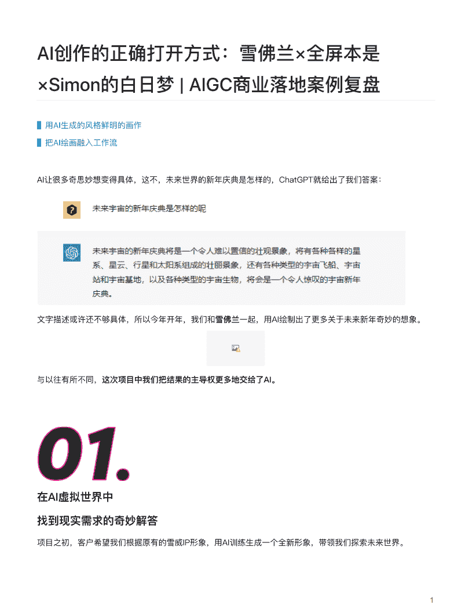
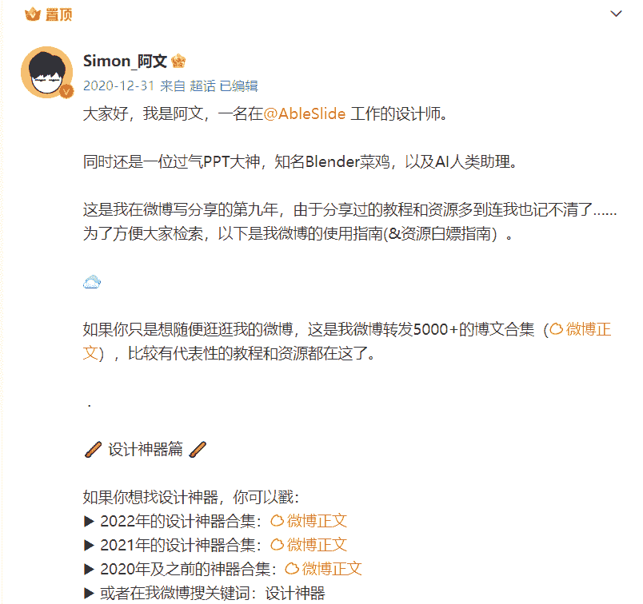
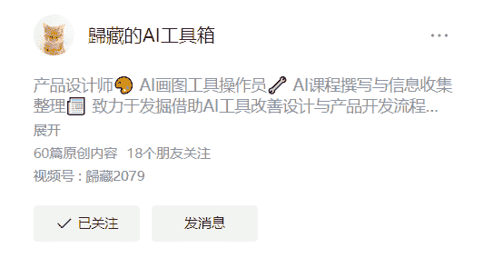
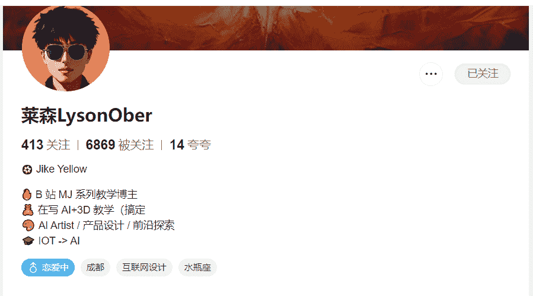
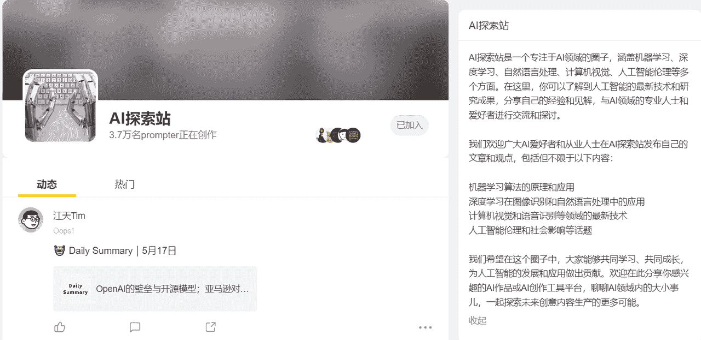
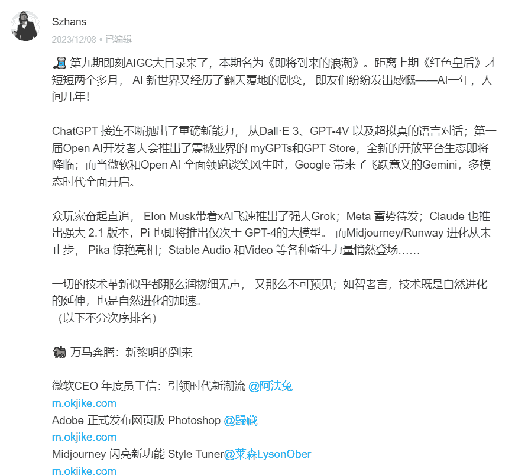
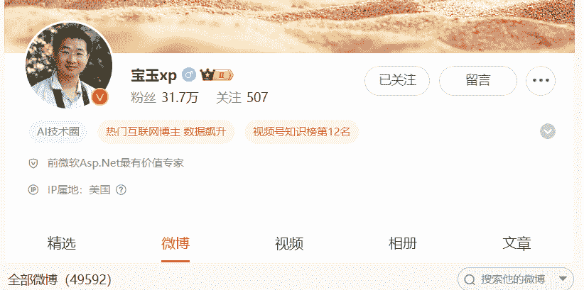

# AI资源库

> 来源：[https://my.feishu.cn/docx/FrocdBEYooyBqhxTiUncB1X5nXj](https://my.feishu.cn/docx/FrocdBEYooyBqhxTiUncB1X5nXj)

# Midjourney辅助网站

Midjourney 提示词生成（我用的最多的网站）：

https://promptomania.com/generic-prompt-builder/

Midjourney官方文档：

https://docs.midjourney.com/docs/quick-start

Midjourney官方社区展示：

https://www.midjourney.com/showcase/recent/

Midjourney 提示词助手：

https://prompt.noonshot.com/

艺术家风格列表大全：https://docs.google.com/spreadsheets/d/1cm6239gw1XvvDMRtazV6txa9pnejpKkM5z24wRhhFz0/htmlview#

[Midjourney提](https://github.com/willwulfken)示词大全 by willwulfken：

https://github.com/willwulfken/MidJourney-Styles-and-Keywords-Reference

Midjourney 艺术家风格词库：

https://lib.kalos.art/

AI反推图片描述词：

https://huggingface.co/spaces/pharma/CLIP-Interrogator

AI扩写描述词：

https://huggingface.co/spaces/daspartho/prompt-extend

根据描述词局部修改图片：

https://playgroundai.com/create

可能是最好的Midjoureny文字教程

https://learningprompt.wiki/docs/midjourney-learning-path

# AI工具导航

chatGPT学习导航：

https://gpt.candobear.com/

https://learningprompt.wiki/docs/chatgpt-learning-path

awesome-chatgpt-prompts：

https://github.com/f/awesome-chatgpt-prompts

chatGPT中文调教指南：

https://github.com/PlexPt/awesome-chatgpt-prompts-zh

openAI应用汇总指南：

https://www.mojidoc.com/05z7y-dd5pa7hu3zfmhnbngoeztyqcnq-00b

给自己的图片注入噪音：

https://github.com/MadryLab/photoguard

AI设计师灵感助手

https://www.aigenprompt.com/zh-CN

# chatGPT工具

AI阅读文档-chatDOC：

https://chatdoc.com/

chatEXCEL：

https://chatexcel.com/?continueFlag=cc734774b142837d5cb04bc1df00296d

chatGPT提示词优化工具（有额度限制，但优化效果明显）：

https://promptperfect.jinaai.cn/prompts

让chatGPT运行更稳定的插件-keep chatGPT：

https://github.com/xcanwin/KeepChatGPT#%E5%AE%89%E8%A3%85%E6%B8%A0%E9%81%93

chatGPT提示词网站

https://learnprompting.org/docs/intro

GPT分析pdf：

https://www.humata.ai/

chatGPT接入飞书教程：

https://github.com/whatwewant/chatgpt-for-chatbot-feishu

ChatGPT for Google浏览器扩展：

https://chatgpt4google.com/

chatGPT总结youtube视频内容：

https://chrome.google.com/webstore/detail/youtube-summary-with-chat/nmmicjeknamkfloonkhhcjmomieiodli/related

让chatGPT联网的插件：

https://github.com/qunash/chatgpt-advanced

chatGPT问答网站：

https://poe.com/

chatGPT内容检测工具

https://huggingface.co/spaces/Hello-SimpleAI/chatgpt-detector-qa

元乘象内容导航：

http://chatimg.aixiaoqingxu.com/pages/chatroom/chatroom

AI帮你写代码的工具：

https://www.cursor.so/

# 资料教程推荐

吴恩达chatGPT提示词工程-在线阅读：

吴恩达与openAI合作课程：用chatGPT API构建系统

[分享你的 Prompt 实战案例 （比赛已结束，但欢迎继续提交）](https://bytedance.feishu.cn/sheets/C9Fas0jnah8fPjtAuHocs941nCd?sheet=qA4Cjq)

[AI创作的正确打开方式：雪佛兰×全屏本是×Simon的白日梦 -【品牌万事屋-案例复盘】-5.11.pdf](https://internal-api-drive-stream.feishu.cn/space/api/box/stream/download/all/Hbq5b2BJjoPTcWx0Ogfc8N4Pnaf)

# AIGC信息渠道推荐

[Simon_阿文](https://weibo.com/u/1757693565)：知名设计师，经常在微博分享很多优质的设计、AI教程，非常推荐。

[歸藏](https://twitter.com/op7418)：一位一直在分享AIGC相关内容的产品设计师，推荐关**注****，这**是他的即刻主页。推荐关注他的公众号「歸藏的AI工具箱」，也可以订阅他每周更新的邮件「AIGC周刊」。

莱森LysonOber：一位非常优秀的AI作者，制作的AI教程专业度高，而且通俗易懂。

他的即刻主页：https://web.okjike.com/u/53EC6F8F-4FD9-4C30-8881-8B5FD9E95E52

他的B站主页：https://space.bilibili.com/630876766

即刻AI探索站圈子：应该是是中文互联网全网最活跃、最丰富、最前沿的AI领域交流圈，没有之一。

AI探索圈有一位非常优秀的主理人，会定期汇总圈子内的优质帖子，如果没有时间及时check圈子内的消息，也可以直接进入他的主页，查看每一期的优质内容目录。

第九期AIGC大目录（整理by Szhans）：https://web.okjike.com/originalPost/65725119979083134a390094

微博博主宝玉：经常分享一线前沿对提示词的研究，翻译了很多研究AIGC技术的论文，并且分享了很多改进提示词质量的方法。

https://weibo.com/u/1727858283

# AI知识库

[AI自媒体（对标账号） 副本](https://jcn3sfy9dhz6.feishu.cn/wiki/VUlswrxBgirQKJkxc5BcOUvbnuU?from=from_copylink)

[Sora 体系内容](https://langgptai.feishu.cn/wiki/I9Nhw0qLSiSfYEkXRmHcczFAn2c?from=from_copylink)

[AIGC【左边点开查看其他资源】](https://sakuraoxo.feishu.cn/wiki/wikcnzZHNTJorZYZuw59qldWZmc)

[极客时间 AIGC 知识库](https://gp477l8icq.feishu.cn/wiki/JUXnwzSuviL5E9kh6jUc8FRinHe)

[会读阅览室-AI](https://gptdaily.feishu.cn/wiki/QtPOwLSl1idw6LkmeFbcPJlZnNf)

[袁锐钦的AIGC知识](https://www.yuque.com/eatsoo/aicgk)

[语雀知识库——大厂AI实践](https://www.yuque.com/wikidesign/vngzgk)

[🌈 通往 AGI 之路 ](https://waytoagi.feishu.cn/wiki/QPe5w5g7UisbEkkow8XcDmOpn8e?from=from_copylink)