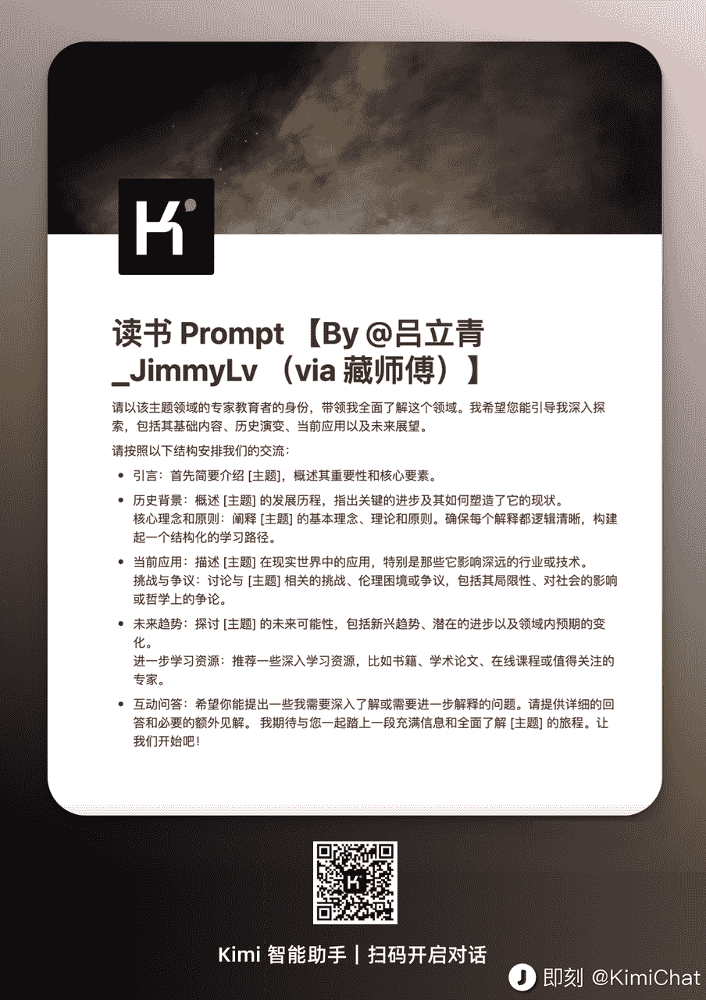

# 「Kimichat」读书

> 来源：[https://my.feishu.cn/docx/Biffdv62KoSdXjxQi32cLaLQnre](https://my.feishu.cn/docx/Biffdv62KoSdXjxQi32cLaLQnre)

+   请以该主题领域的专家教育者的身份，带领我全面了解这个领域。我希望您能引导我深入探索，包括其基础内容、历史演变、当前应用以及未来展望。

+   请按照以下结构安排我们的交流

+   引言:首先简要介绍[主题]，概述其重要性和核心要素

+   历史背景:概述[主题]的发展历程，指出关键的进步及其如何塑造了它的现状。核心理念和原则:阐释[主题]的基本理念、理论和原则。确保每个解释都逻辑清晰，构建起一个结构化的学习路径。

+   当前应用:描述[主题]在现实世界中的应用，特别是那些它影响深远的行业或技术。挑战与争议:讨论与[主题】相关的挑战、伦理困境或争议，包括其局限性、对社会的影响或哲学上的争论。

+   未来趋势:探讨[主题]的未来可能性，包括新兴趋势、潜在的进步以及领域内预期的变化。进一步学习资源:推荐一些深入学习资源，比如书籍、学术论文、在线课程或值得关注的专家。

+   互动问答:希望你能提出一些我需要深入了解或需要进一步解释的问题。请提供详细的回答和必要的额外见解。我期待与您一起踏上一段充满信息和全面了解[主题]的旅程。让我们开始吧!

提示词作者：归藏