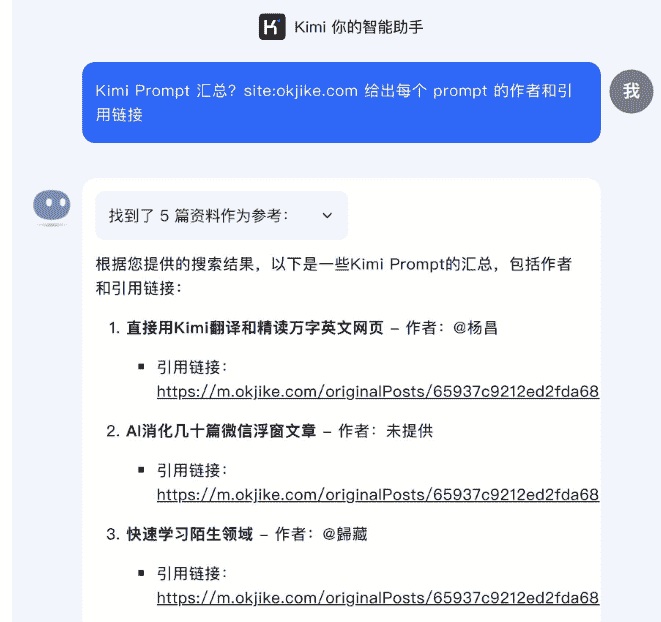

# 「Kimichat」site语法

> 来源：[https://my.feishu.cn/docx/ENw7dKHEpopOQvxn5OQc5ZGgnbd](https://my.feishu.cn/docx/ENw7dKHEpopOQvxn5OQc5ZGgnbd)

来源：Kimichat官方

「site语法」：

+   搜索引擎里可以使用site语法，其实Kimi中也可以哦！

+   比如，想知道即刻上的大家有哪些 Kimi Prompt 分享，就可以这样问：「Kimi Prompt 汇总？site:okjike.com 给出每个prompt的作者和引用链接」

