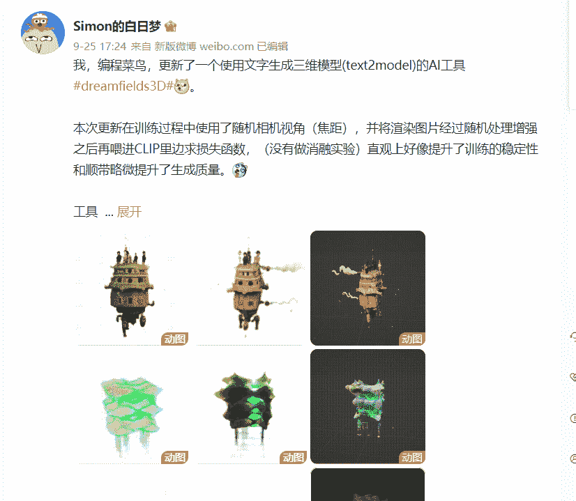
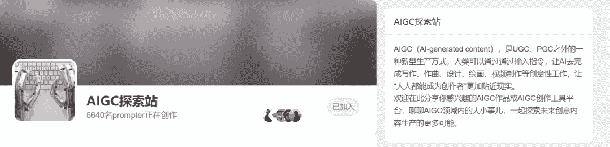
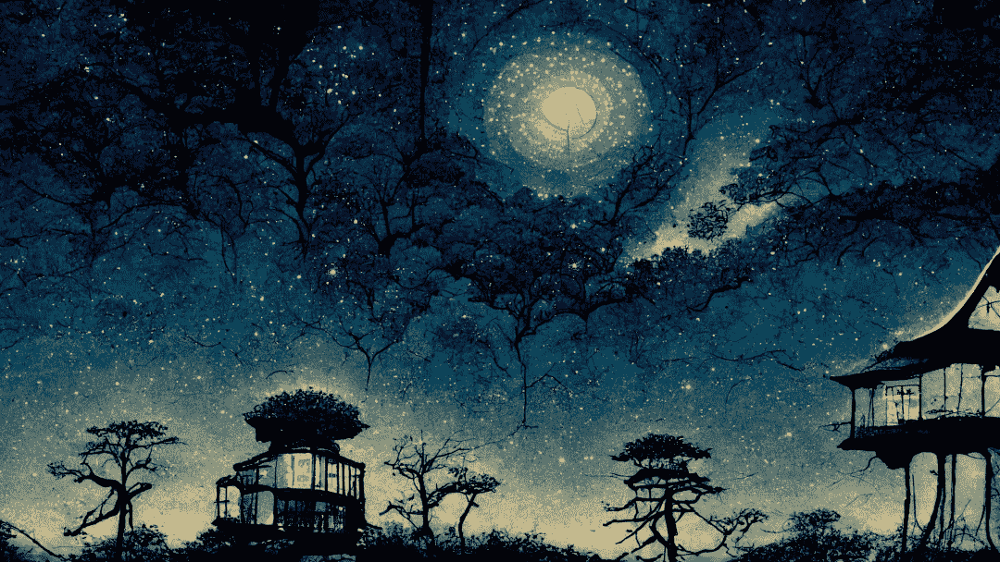
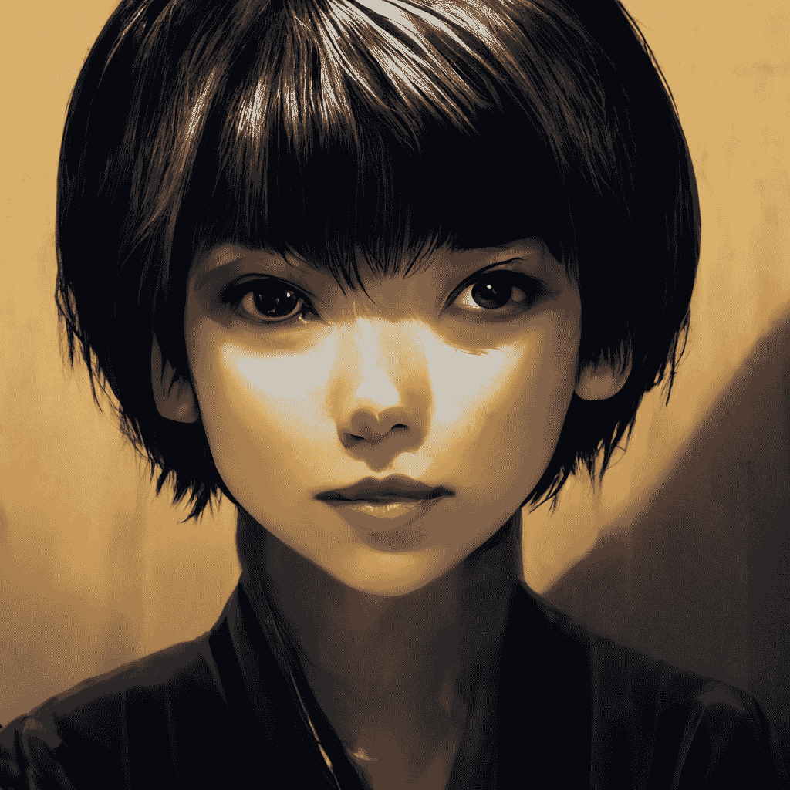
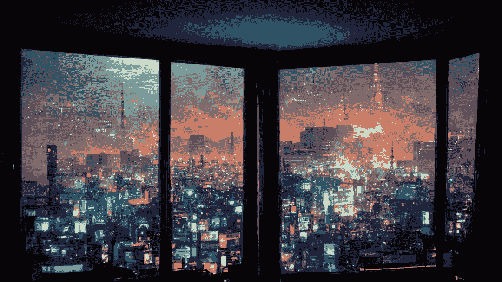
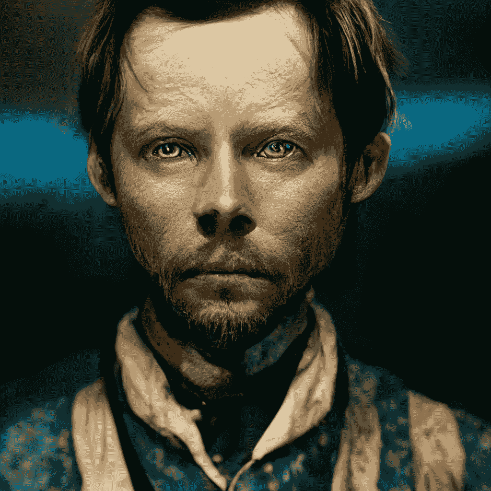
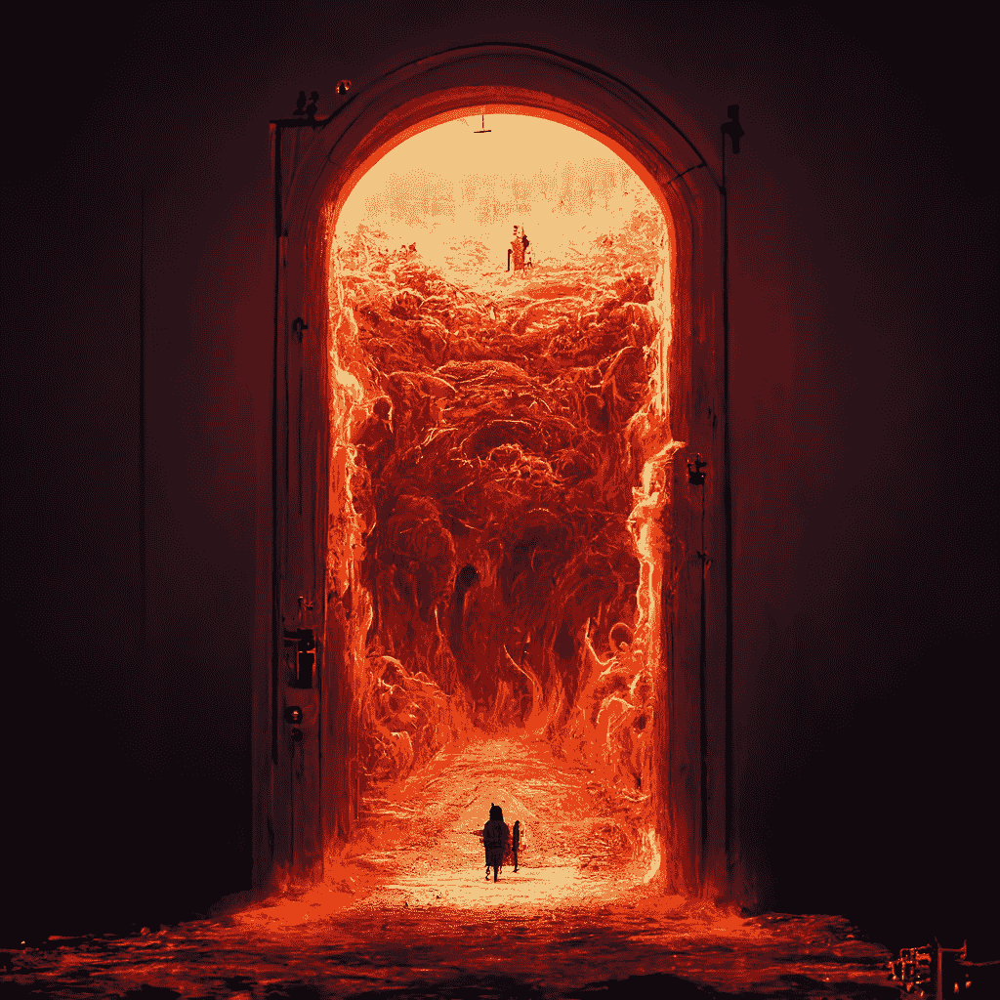
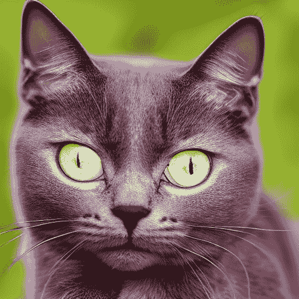
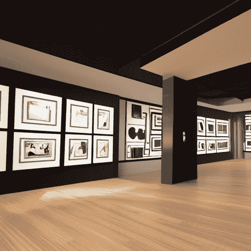
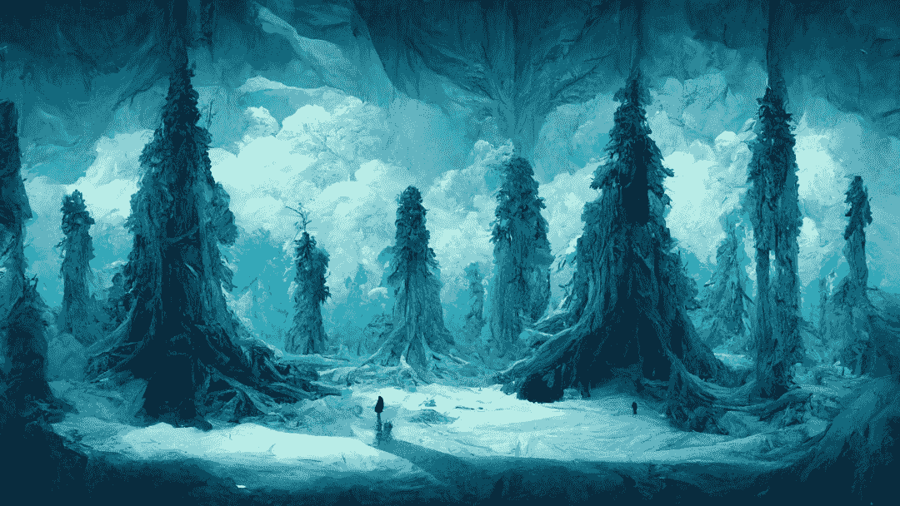

# 我眼中的AIGC：未来已来，但是我不在乎

> 来源：[https://my.feishu.cn/docx/Q3ZldgWhjo9gNTxWx5ucu28Bned](https://my.feishu.cn/docx/Q3ZldgWhjo9gNTxWx5ucu28Bned)

> 🔗 原文链接： h[ttps://mp.weixin.q](https://mp.weixin.qq.com/s/fdg3wyluQOFgmXScCW0UBw)q.com/s/fdg3wylu...

> ⏰ 剪存时间：2023-09-03 18:20:30 (UTC+8)

> ✂️ 本文档由 [飞书剪存 ](https://www.feishu.cn/hc/zh-CN/articles/606278856233?from=in_ccm_clip_doc)一键生成

原创 河林 河林成长说 2022-12-17 08:30 发表于 浙江

**这是河林的**第 32 篇👸号原创，内容分类为 成长心得 。

**你好，我是河林，我在这个👸号**记录自己的 成长心得、营销笔记、个人总结。

今天这一篇是最近对于 chatGPT 和 AI 作画的一些零碎思考，感谢你的阅读，欢迎交流讨论。

在沉迷一段时间的 AI 作画和 chatGPT 之后，也围观了一些关于AIGC的讨论，我想记录一些现阶段，我对 AIGC 的看法：

首先解释一下概念： AIGC 指的是由 AI 工具和技术创作内容的创作方式；chatGPT 是由 openAI 发布的一个全新聊天机器人模型。

# 1. AIGC为什么是未来？它带来了什么新变化？

AIGC

我的想法：

AIGC 能让在对应领域毫无能力积累的人，以极低门槛，“赤手空拳”地就能体验不同领域的创作体验。

这对普通人而言是前所未有的创造力飞跃，拓展了创作的边界，让很多因为技术原因而无法实现的想象力得以落地，以作品形式体现，这必然而且实际上已经启发了大量的有价值的创作。

# 2.现阶段，及未来可预见的一段时期内，AIGC 擅长什么，不擅长什么？

AIGC

AIGC 擅长将创意落地，但它没办法解决帮助你启发创意的问题，它确实有辅助作用，但帮助很有限。

我看少楠在产品沉思录里讲过类似的体验，我自己也有这样的感受：

当你持续用 AI 作画之后，你会发现自己被掏空了，不知道应该画什么，不**知道自己还**有什么创**意**，或者说，你的语言能力没办法表达清楚你的创意，这证明你自己也没有想清楚。

同时， AIGC 无法替代深度创作和高度复杂化的创作 ，现在如此，未来很长一段时间也如此。

从目前网络公开的大量 chatGPT 的对话记录中可以看出，对于很多问题，它回答得全面、自然，但依然 【空泛】 ，不够 【言之有物】，只对公开的资料做了梳理和整合，但是在很多问题上，回答的逻辑和思路依然比较脆弱，经不起推敲。 这不仅是它的问题，也是使用者的问题。

使用者自身也会存在着局限性，一是使用者本人对问题可能就无法描述得清楚、合理，那么 chatGPT 给出的回答自然就会有所偏重；二是使用者如果和 chatGPT 的磨合不够好，没有掌握 chatGPT 的一些语法规则以及它回答问题的逻辑，那么 chatGPT 自然也就只能给出低质量的回答。

AIGC 中，AI 工具扮演的是极大程度上提高生产力的工具。对于自身有技术的人，AIGC 是能帮助它们更高效地把自己的创意和想法落地的高阶工具。

而对于对应领域的非专业人士而言，AIGC 固**然**能极大提高创作门槛，但是没办法替代在 【复杂专业度】、【创意度】、【自由调整度】 上所付出的必要努力。

换句话说，对于一些需要实现逻辑、专业、定制化需求的作品， 纯粹依靠 AIGC 所要付出的努力并不比原有的专业人士所要付出的能力差，AIGC 最多也仅仅只是作为辅助作用 。

对于非专业人士的普通人，我的看法是，AIGC确实把普通和专业的界限大大地模糊了，但是它本身也是一个需要掌握的工具，你想要调教好它，依然要付出不亚于掌握其他任何工具所要付出的努力；如果没有对应领域的专业素养的储备，AIGC也没办法帮助创作者实现在对应领域的深度工作。

# 3. 大多数人，根本不需要担心 chatGPT 会让你失业

chatGPT

由上面这一条引导出，我想说，大多数人的工作和chatGPT根本没有替代关系。

**与****其整天恐惧和叫嚣 AI 要让我失业了， 不如**思考自己的工作为什么这么容易能被替代，你为什么这么担心一个机器人能够替代掉你的工作，你的工作的脆弱性到底在哪里。

虽然我这句话说着可能太爹味儿了，但我想说的是， 太多人在chatGPT上投入了过多的、毫无必要的注意力和情绪了，无论是兴奋还是恐惧。

chatGPT 可以帮助你更快地检索文献，可以基于海量数据和运算模型给予你有价值的决策思路。

但因为它不掌握你做出有价值的决策所需要考虑到的因素，永远不可能代入到你实际的工作场景和背景中，所以它没办法替代你去做【有价值的思考】，没办法替代你做出工作中的关键决策，所以chatGPT无法替代大多数【有价值的、与人高度相关的】工作，不会导致那么多失业。

一个检验方法：如果你因为chatGPT生产出来的内容而兴奋或者恐惧，那么试着把用它生产出来的工作成果发给你的主管和老板，看看你能不能经受住他们的考验：

——我为什么要用你的这套方案，而不用某某某的那套方案，你怎么证明呢？请向我介绍它的性价比和风险控制。

——你的这套方案实际执行的时候可能会遇到什么问题？你会如何解决？

——从公司的角度而言，它能满足公司的什么核心利益？你是怎么体现的？

——这套方案和我们的工作流程，大家的工作习惯匹配吗？是效率最高的方案吗？

除了工作上的有效性以外，还有一个要强调的就**是，cha**tGPT永远无法解决工作中的 信任问题 ，所以它很难真正地作为工作伙伴被引入到人类的日常工作中。

人类和 chatGPT 没有共同经历和经验的积累，也很少有人对它本质的工作原理和底层代码有深入的认识，所以对于一些开放性问题的实际应用，很多时候都会存在采信度低的问题，如果有人开始挑战或者怀疑 chatGPT 的可信度和有效性，大多数时候，从心理层面上都会倾向于认为它的回答是经不起考验的。

# 4.如果是我，我不会选择把 chatGPT 当成一个信息渠道

chatGPT

在内容生产上，也是一样的，chatGPT能非常好地满足我的检索需求，只能为我提供【公开的知识】，但不可能为我提供【信息】和【观点】，我也不会从任何chatGPT生产出来的看似传递观点和态度的内容中去获取信息。

当我平时出于获取信息的目的去看我关注的人的文章的时候，我更多地是去看那篇文章的【人】，去看他在什么背景和条件下，面临什么样的限制，基于什么样的决策逻辑去应对，然后收获了什么结果。

我不是单纯地为了【抄作业】或者【求一个答案】，而是为了去获取其中对我有价值的方法论沉淀，或者思维方式。

而chatGPT没有任何基于实践的经历和体验，它生产出的内容，即使采集了再优质的文章，也是【空虚】的、【不落地】的，没有参考意义。

# **5.AIGC的未来优势是什么？**

AIGC

AIGC 在 **标准化、结构化、逻辑闭环的 **内容的自动生成上有绝对的优势，比如自动生成一段符合要求的代码。

虽然我不懂代码，但就目前而言，能看出chatGPT已经能够实现得比较好了，我觉得对有代码需求的人而言，是一个比较好的辅助和参考。

所以我比较期待后续AIGC在通用办公软件上的发展。

比如AIGC帮助实现：

——生成不同场景和需求下的PPT、word模板；

——提供用excel实现不同需求的数据统计功能的操作建议，甚至自动生成excel模板；

——PS、PR等软件的操作建议指导，甚至按照要求生成固定模板的文件。

# 6. 我对目前出现的全网掀起的AI创作热潮的态度

AIGC

我敬佩 open AI 作为领军人做出的卓越贡献，以及那些持续优化模型和算法，持续探索AIGC的各种用法的人；

但我鄙视那些拿公开的模型和算法或者低劣的数据集，套皮包装成所谓的新的产品的人，以及拿来做二手贩卖，趁机圈钱的人。

作为一个喜欢探索、希望跟进时代变化趋势的营销人，以及一个内容创作者，我也不会拒绝 AIGC 这一新的趋势。它为我带来的极大便利性和灵感的启发，是我一个人闭门造车永远无法带来的。

我会在不违背创作者权益、版权保护以及基本道德的基础上，积极乐观地使用 AIGC 作为我营销探索、创作、娱乐的辅助工具。

# 7.AIGC 领域急需解决的关键问题

AIGC

**AIGC领域目前一个非常值**得所有人关注的问题是： 原创创作者的权益保护问题。

很多创作者是不希望自己的画作、设计被AI学习的，那么如何避免不当学习、如何保护创作者权益，就是非常重要的问题了。

已经有一些模型在未经允许的情况下，拿公开的受版权保护的画作去学习并生成画作了，这种情况是绝对是不合伦理、不合版权的，需要竭力避免，以及建立一种有效、透明公开的监督机制。

目前已经有看到有一些AI模型会主动做出一些探索，比如引导画师自主登记表示自己不希望/允许自己的画作被学习，但是这显然还远远不够。

# **8. 总结 **conclusion

我目前的个人观点的总结就是：

属于 AIGC 的未来已来，但是我们依然需要务实。

与其纠结那些不着边际的、空泛的、被他人设置和引导的热门议题，不如脚踏实地，务实地去思考和识别：

关于AIGC，哪些是和自己有关的问题，怎样用AIGC帮助自己的创作和工作；

哪些是和自己无关，自己真的没必要关注。

AIGC确实是创作力的巨大飞跃，但是更多时候，AIGC不能解决我们的创作瓶颈，对每一个普通人以及创作者而言，我们关注的焦点，始终应该是我们自己实际的工作和创作领域，那些底层的、关键的、没有被我们解决的问题，打造那些需要用深度工作积累的能力。

我觉得，真正有资格认为，并与能力迎接 AIGC 的未来的，是那些能够擅长应用它们带来新的创新、启发新的创作的匠人，或者说手艺人。

我所说的这些人，或许本身就是某一领域的内容创作者，他们能够通过AI工具，极大地提高自己的生产力，并且辅助灵感的激发，带来更多有想象力的创作作品，并且能够输出对应领域的创作工具，服务于和他们同频或者有共同创作需求的人。

还有另一类人，他们或许本身并不是创作者，并不是任何一个创意领域的工作者或者达人，并不掌握任何一门技能，但是他们擅长想象，有丰富的创意和想象力，也有丰富的感受力和自我认识能力，AIGC 的发展能够为他们赋予把它们的创意落地的能力，极大解放他们的创作欲，为他们的创意提供更多可以落地的途径和手段；这些人，也是 AIGC 的受益者，同时也会是 AIGC 的发展者。

# 9.推荐关注的 AIGC 信息源

AIGC

推荐几个我一直在关注的 AIGC 的信息源。

**🧣：Simon的白日梦**

海辛主理的👸号：全民熊猫计划

**即刻：AIGC探索站的圈子**

但是圈子内信息太多，需要仔细甄别和筛选

# **彩蛋：晒一晒自己的AI作画**

AIGC

**黑暗哥特风城堡**

**星空与树屋**

一个女孩（我现在用它作为我的🛰️头像）

**窗外的城市**

**吉米辛普森**

**时间死神**

**金色凤凰**

**通往地狱的门**

**女孩**

**猫**

**现代展览馆**

**冰冻的森林**

# **感谢阅读**

好啦，以上就是我今天更新的全部内容了，也是一篇个人化的观点分享，感谢阅读。

我是河林。 坐标杭州，一个 98 年出生的小运营，现在在一家互联网公司做商品运营。

我在这个👸号输出自己的 **成长心得、运营笔记、营销观察 **。 请多指教，感谢关注。