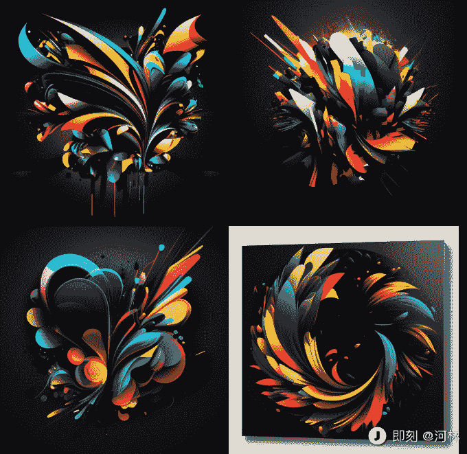
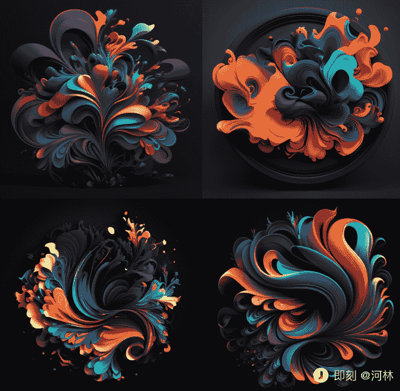
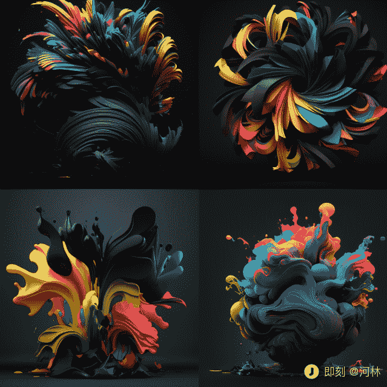
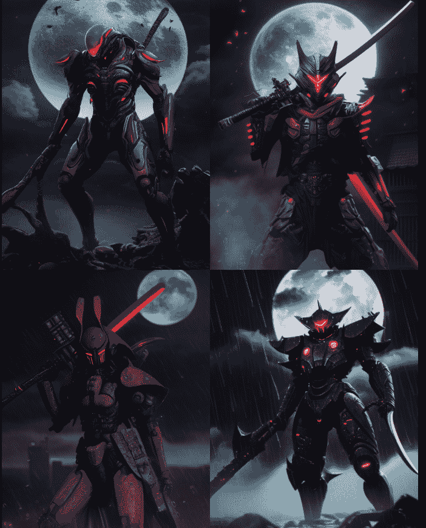
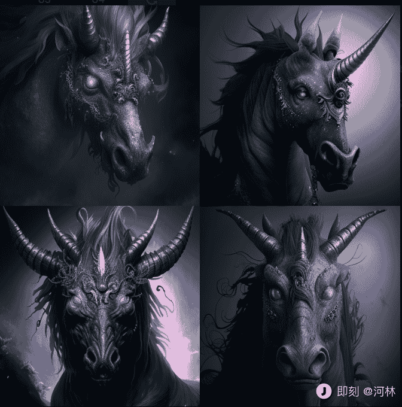
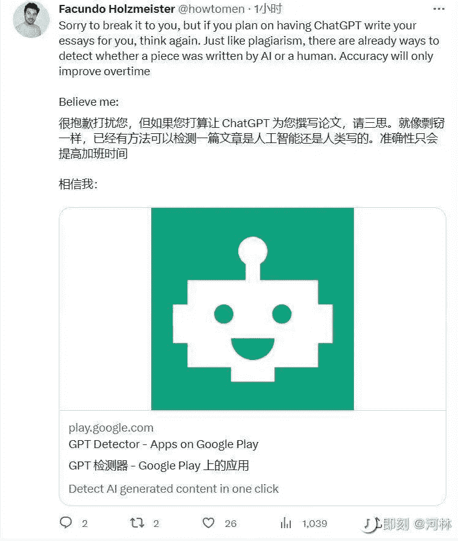
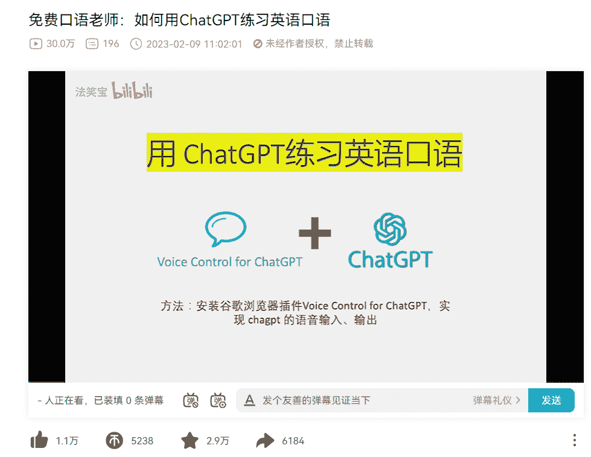
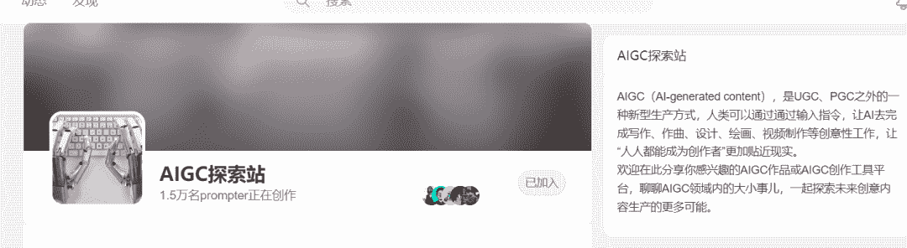
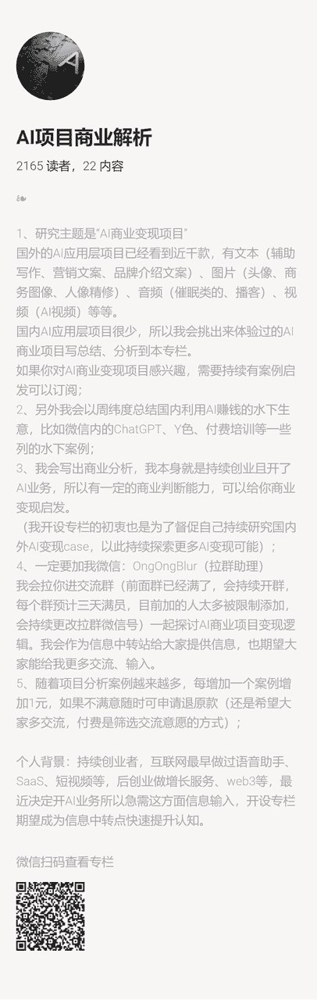

# 我对chatGPT和AIGC的阶段性看法（一）

> 来源：[https://my.feishu.cn/docx/KTw8dU7iuo0nj2xlA0ScAOspnce](https://my.feishu.cn/docx/KTw8dU7iuo0nj2xlA0ScAOspnce)

> 🔗 原文链接： h[ttps://mp.weixin.q](https://mp.weixin.qq.com/s/YEUclPiLyr7AorCaRPw-7g)q.com/s/YEUclPiL...

> ⏰ 剪存时间：2023-09-03 18:14:56 (UTC+8)

> ✂️ 本文档由 [飞书剪存 ](https://www.feishu.cn/hc/zh-CN/articles/606278856233?from=in_ccm_clip_doc)一键生成

原创 河林 河林成长说 2023-02-19 18:48 发表于 浙江

**这是河林的**第 35 篇公众号原创，内容分类为 成长心得 。

**你好，我是河林，我在这个公众号**记录自己的 成长心得、营销笔记、个人总结。

之前发过一篇对 AIGC 的探讨 我眼中的AIGC：未来已来，但是我不在乎 ；

没想到最近 chatGPT 又成为了全网级的大热点，围观了一些讨论，我也有一些自己的思考和想法，今天这一篇就作为阶段性的看法汇总，整理出来分享给大家，希望对你有帮助。

1.chatGPT不会颠覆人类的创造力。

2.对chatGPT引发的失业危机，大多数人反应过度了。

3.想要驾驭好chatGPT，也存在门槛

4.AIGC最实用的方法：快速生成灵感草稿

5.探索chatGPT对普通人自我提升的方法：练习口语

6.翻车的潜在风险

7.AIGC优质信息源分享

另外，最近发 AIGC 相关的内容有点多**，但接下来这段时间我**会把精力更多地放在 品牌营销、内容营销 领域，也会继续和大家分享我的收获和学习成果。

chatGPT不会颠覆人类的创造性

仿佛一夜之间全网又开始讨论chatGPT了，我之前对chatGPT＆AIGC信息的扑面而来感到焦虑的时候写了这一篇。

结合近期的一些新创造来看，感觉chatGPT和技术组成的能**落地的结合要比之前想的更快一些。

我个**[**人的态度还是:

**](http://mp.weixin.qq.com/s?__biz=Mzg4OTgzMzMxNA==&mid=2247483835&idx=1&sn=6a46a16c0ae088e4424b7e349538fb7e&chksm=cfe493b6f8931aa0cc185db86359fdb7eb2959f0e5692952b21677b6c31a7e1a0c731e148115&scene=21#wechat_redirect)**1.反感那些****跟风的、功利性的讨论和无意义的空虚提问。

比如什么职业**会下岗？有多少多少岗位要被替代？怎么用它暴富、搞钱？

都是我反感的话题。

2.自动筛选过滤掉与自己无关（不在自己能力圈和影响圈）的讨论。

3.关注自己作为一个个体，能用它来实现什么，提高什么，帮助自己解决什么问题。

比如我自己目前更关注它怎么帮助我学习语言、检索资料、辅助AI作画、辅助文章创作等等。

最后， 关于AI对人类创作的替代和威胁，我个人非常喜欢happyxiao最近一篇文章 创作者与 AI 里的观点:

创作从来不是与他人竞争，创作只是自我认识和自我表达。

AI 充其量只是另一个创作者而已。这世界上多了 AI 或 chatGPT，爱谁谁，都不重要。

因为，创作从来与他人无关，创作只与一个人有关，就是你自己。

**“失业危机论”，反应过度了**

最近对chatGPT的全网热议，尤其是在“替代岗位和职业危机”方面，很大程度上都是“泛滥且无用”的，所谓的chatGPT让你失业、如何用chatGPT赚钱的议题，让人一看到就反感。

现在刷屏chatGPT的 大部分都是猎奇心理 就瞅一眼“哇这个好厉害” 很大程度上是人造热点。

一堆人刷屏的chatGPT写的脚本和小红书 你认真看一眼就知道不行 最多做到59分，多一分都不够，工作场景是几乎不可能投入使用的。

chatGPT写出的文案确实有型、有风格、，但是上限仅仅只做到了“表述清楚、基本通顺”而已。

如果有人跟风觉得自己会因为它写的文案或者脚本而失业，那我真心觉得，这样的人对内容本身缺乏敬畏心和尊重，缺少基本的工作态度。

任何文案和内容，都是要结合每次的传播途径和目的，去在对应的沟通场景下做针对性的沟通。写文案，要融入作者的意图和思考，也要在一次次实践中去优化，不是靠模板生搬硬套出来的。

chatGPT可以成为创作者/脑力工作者非常好的辅助工具，帮助我们催化灵感、高效处理和分析信息，这也是我们值得探索并且加以积极利用的部分，我在这方面的态度非常积极。

但是，它不能也不应该代替我们对工作、对创作、对内容的思考，不能代替我们应该投入的情感和态度，更不能帮助我们去逃避我们应该付出的责任。

是这些构成了我们的核心竞争力的很大一部分，而不仅仅只是所谓的技术能力。

认为chatGPT创作的文案会让自己失业的人，有这时间不如多练练自己的文案能力，重新思考一下自己到底是怎么看待自己和自己的工作的。

chatGPT没有制造危机，它只是让很多人原本存在于自身的危机浮出了水面，扯下了很多人的遮羞布，然后被动地成为了某些人的发泄出口和替罪羊。

想要用好chatGPT，也有门槛

**观察最近chatGPT出圈后的一些讨论以及各大媒体跟风蹭热**点的内容以后，我的几个暂时的想法：

1.无论如何，chatGPT绝对是让人兴奋的技术，我也抱着非常乐观积极的态度看待它的出现和发展，期待它在不同领域的应用对效率提升的作用。

但是，我认为能通过chatGPT实现真正有益的技术创新的，是有技术创新基因、受统一价值观驱动的科技团队/产品团队/设计团队，而不是抱着跟风蹭热度目的的国内大厂。

2.很多人用chatGPT回答各自领域的问题，感叹它回答的水平之高，但是在我看来，大部分回答都是上不了台面的水话，逻辑清晰，但是无法结合到具体应用场景里，如果评分的话仅仅只达到了59分或者60分。

所以我看到很多人惊呼“要被替代了”等等chatGPT威胁论的时候，我是很意外和困惑的。

但后来想通了，那是因为对很多人而言生产出在自己领域里达到及格线的内容，本身就是一件很有门槛的事情。

3.很多试图驾驭chatGPT的人忽略了一个问题：

当你试图用它解决高于你的能力的问题的时候，你是无法辨别它给出的回答是否可靠、有效的。它只是基于它的语料库给到了回答，并不代表一定是准确、有效的答案。

**事实上，根据大家测试结果，chatGPT在很多它不擅长的问题**上往往漏洞百出，甚至一本正经地胡说八道。

想要驾驭并使用它，你自己本身必须掌握一定的专业水平，它无法帮你跨越你的能力层级，也无法让你省去你在专业领域必须付出的努力。

最基础的应用：快速生成60分的草稿

对**个体创作者而言，AIGC极大便利的应用方式之一，就是**帮助创作者快速生成60分的内容，为进一步创作打下基础。

以AI作画为例，一个实用方法就是：

想到一个点子或者灵感之后，马上用AI工具生成它的草稿，为自己的大脑提供几个具象化的参考。

比如插画设计或者角色设计，尤其是在涉及到和他人沟通的时候，双方都停留在语言描述就太虚，很容易驴唇不对马嘴；但想要立刻画一张示意图，或者找到一张恰当的参考图，又往往很难做到、还耗费精力。

这时候直接利用Midjourney或者stable diffusion，生成几个“差不多的例子”， 作 为沟通和讨论的素材，以此为基础倒逼大家更准确地描述自己的需求和想法，对节省沟通效率就很有用。

——甲方想要“五彩斑斓的黑”？

为了让他理解自己究竟在说什么，就先用Midjourney生成一下，告诉对方：你要的是不是这样的效果？在 对方的需求越来越离谱之前，先把主动权掌握在自己手里。

——做游戏设计，为了设计一些怪物NPC，想先找找灵感和画面？

也可以马上用它完成，输入“自己想要的风格”+“你想要的角色/怪物种类”，多替换几次关键词和主体，很快就能有一大堆素材作为参考。

【快速生成60分的草稿作品】，能帮助创作者中节省一部分脑力、体力、沟通精力，留给更精细和更深度的工作，也是一种解放生产力or自己精力的高效方法。

**关于gpt内容检测工具的出现**

终于出来了，GPT生成内容检测器，值得广泛推广应用，尤其是学术研究和新闻领域。

平台如果不想自己的内容被gpt生成充斥，也可以用它作为自己内容审核环节的辅助。

另外，很多人对gpt生成内容抱有偏见，认为它是“假的”，只有人类的创作内容才是“真的”。

首先，我觉得不论是gpt还是人的内容，都没有真假之分，带真假划分的态度就肯定是走入误区了。

然后，为什么我觉得 gpt 内容检测工具的迅速推出并应用很有必要？

可以从 2 个维度来看待这个问题：

1️⃣就学术和新闻领域而言，需要检测是否是AI生成的必要性在于，学术注重的是通过实验研究和探索得出结论，即使AI给出的逻辑论证是合理的，但如果不是研究者本身得出的，那就不能证明研究者本人有得出同等结论的学术能力，所以不能认可gpt内容；新闻则是应该经过查证，而不是搜集信息、自动生成，否则会污染；

2️⃣如果是纯内容、社交、问答等平台而言，检测是否是gpt生成反而没那么重要，因为更要紧的问题反而是粗制滥造的营销垃圾、灌水内容，这时候就是平台对内容管理的策略和能力问题了，gpt内容本身并不会动摇平台的内容质量。

其实还有另一个反向的判断标准就是，如果内容和AI生成内容高度重合，那 本质上就不符合学术界的一直以来的查重规范 ，甚至并不是针对gpt内容本身；

**另外，如果内容本身和gpt内容重合度高， 也反向说明了**作者本身并没有能力对内容做加工、处理、发展，没有办法在其中展示出自己的个性和特点。

对需要高度重视作者个人能力和水平的行业而言，确实是很可靠的一条检验标准。

**翻车的潜在风险**

现阶段掀起chatGPT热潮的媒体和弄潮儿，在追逐风口获得了近乎全网热议级别的流量之后，不能自欺欺人的一个问题就是：

你如果要把它包装成全民热点，来为自己牟利（流量收益or经济收益），那就无法回避必须要用到的处在灰色地带的上网工具的问题。

有些人甚至在为ta的推广推波助澜，仅仅是为了靠着蹭热点、赚信息差、买卖账号分一杯羹。

翻车是迟早的事。

**用chatGPT结合插件练口语**

我一直是对chatGPT带来的新技术变化一直持积极和开放态度的。

但是又反感那些基于宏大叙事的探讨（比如AI会不会取代人类，会让多少人失业），也反感功利化的跟风（比如用chatGPT引流赚钱、蹭热度操盘），不想掺和进它到底能带来多少变革、颠覆、行业升级或衰败的讨论中去。

作为一个普通人，我觉得对我个人更有意义的是更喜欢挖掘一些适合普通人自我提升，提高效率的应用方法。

一个很好的结合例子:

用chrome浏览器的Voice Control for ChatGPT插件让它具有语音朗读功能，自己用讯飞的语音输入，就可以实现和chatGPT的语音对话，一个人在家练习口语很不错。

后面我也会多多关注并且实践适合个人的、可操作性强的应用方法，如果找到好用的方法就分享出来。

**AIGC信息源分享**

对AIGC感兴趣的朋友， 建议多多关注即刻的“AIGC探索站 ”，这是目前中文互联网能接触到的最优质的AIGC信息渠道之一。

如果你对 AIGC 商业项目有兴趣，想要赶上这一波创业风口，或者想要寻找相关的岗位，再推荐一个解析 AI 项目的商业应用的信息源。

这是我从刘飞老师的即刻那里看到的，能帮你筛选很多噪音，并且快速找到优质的商前沿业信息。

如果你对AI作画感兴趣，推荐订阅刘飞老师的小报童《Midjourney进阶创意指南》，它的第一篇文章能教你手把手学会用 Midjourney 作画，后面会持续探讨更多进阶创意，非常实用。

**自我介绍**

以上就是我本次的分享啦，感谢你阅读到这里。

我是河林。 坐标杭州。 98 年出生，3 年工作经验， 目前是一名商品运营，

我在这个公众号输出自己的 **成长心得、营销笔记、个人总结 **。 请多指教，感谢关注。

▲ **点击卡片 **关注公众号

运营笔记 丨 个人成长 丨自我提升