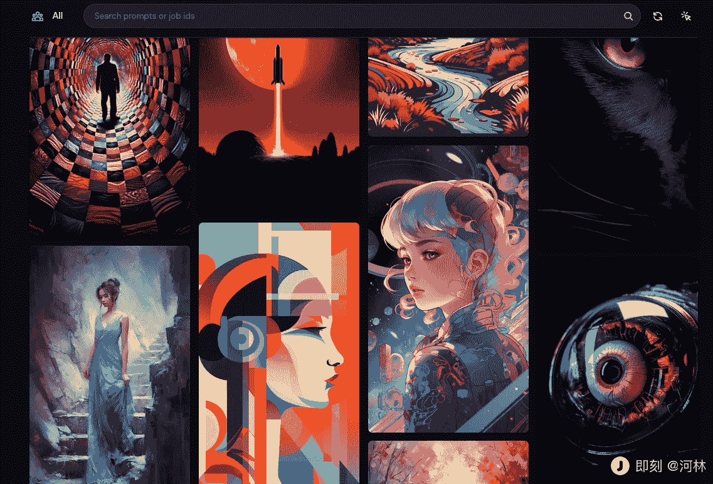
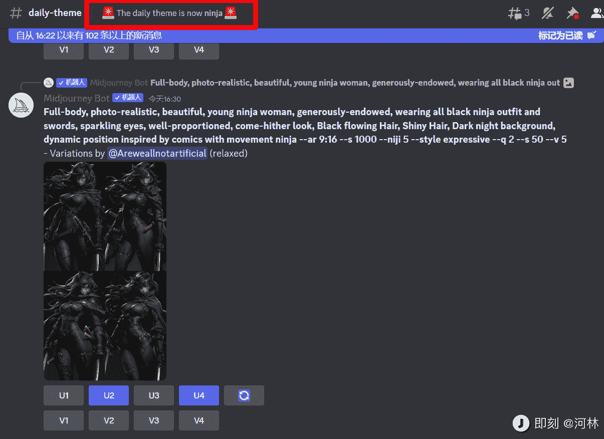
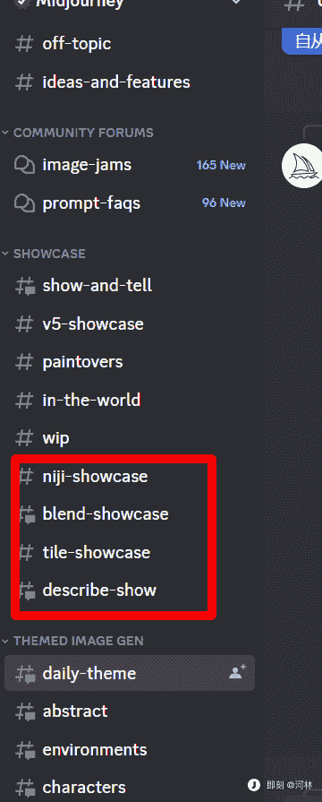

# 如何让自己找到持续的灵感来源，去绘制自己想画的作品？

> 来源：[https://my.feishu.cn/docx/Sgi2dM3XLovE3Zx6R2Mcv1LJngc](https://my.feishu.cn/docx/Sgi2dM3XLovE3Zx6R2Mcv1LJngc)

#

作为一个Midjourney新手，如何让自己找到持续的灵感来源，去绘制自己想画的作品？

或者说，充值了Midjourney的付费会员，怎么才能不浪费自己的额度，找到想画的主题，让自己不至于灵感枯竭？

作为一个无设计和绘画基础、并没有在工作中强应用Midjourney的需求，纯为了满足个人好奇心和探索欲的玩家，我的方法是：

1.用好官方功能和社区信息。

在官方社区的热门推荐页找灵感，看看别人都在画什么

www.midjourney.com

可以修改他们的描述词用来画自己想画的内容，也可以去关注自己感兴趣的作者，看看ta们平时都在创作什么。

还可以在discord频道里看看社区的每日创作主题，看看今天的主题是什么，大家在这个主题上都开了哪些脑洞。

官方的社区和频道简直是一座无穷无尽的宝藏，如果不会用它、不去看它，真的是“如入宝山空手回”。

2.找到一个自己有热情、有好奇心、有探索欲的领域和主题，持续在这个主题里拓展各类选题。

具体的方法就是“创作风格+N种主题”或者“创作主题+N种风格+N种场景”的无限延展、组合。

比如，你想画“阳光下的玫瑰”，可以用一套描述词，替换掉N种风格描述，让不同大师为你作画。

比如，你特别喜欢“幻想风格”，那也可以用一套风格描述词，描述各种不同的主体，比如角色、景观、场景、剧情，等等。

只要拆分出具体的、可复制的结构，那一定是可以无限延展的。

只有有足够的精力和意愿，完全可以在自己喜欢的领域上，通过持续输出，整理出一套符合自己审美的设定集、小世界。

3.生活点滴，皆可记录。

万物皆可记录。

当你没有创作灵感的时候，不如把Midjoureny当做速写本，找到一切可以记录的东西，就当做写日记一样，用Midjourney来记录自己的生活体验。

提供以下角度作为参考：

- 梦境

- 现实风景

- 作品

- 情绪感受

- 等等……

尝试把球抛给Midjourney，让它给你答案和惊喜。

最后说一点，上手Midjourney，包括任何AI绘画作品，最重要的不是找到prompt，而是找到自己想创作的主题，然后通过实践和学习，掌握应用一个工具的方法，让自己变得更加熟练。

这个过程中，一定要避免因为fomo心态而陷入对prompt、对辅助工具的囤积症。

因为如果找不到自己想要的创作主题，并且用创作欲望驱动自己带着目的去“玩”Midjourney，大概率最后都会吃灰弃用了。

[@莱森 ](https://web.okjike.com/u/53EC6F8F-4FD9-4C30-8881-8B5FD9E95E52)在刘飞老师小报童里写的这篇文章，把如何提高审美、探索画风、找到想画的风格讲得非常清晰、深度了。

[如果有这方面的困扰，现](https://xiaobot.net/p/MJ2023?refer=d5e70a85-4a01-42a2-9483-6c09d52d9ce8)阶段看这篇肯定够用了（但是需要付费订阅专栏）

xiaobot.net