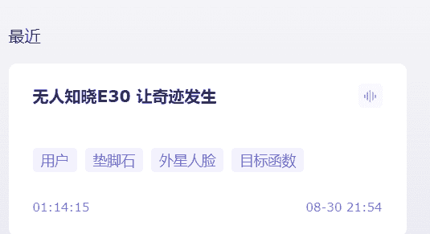
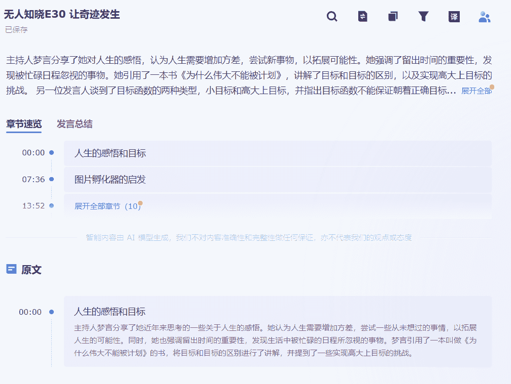
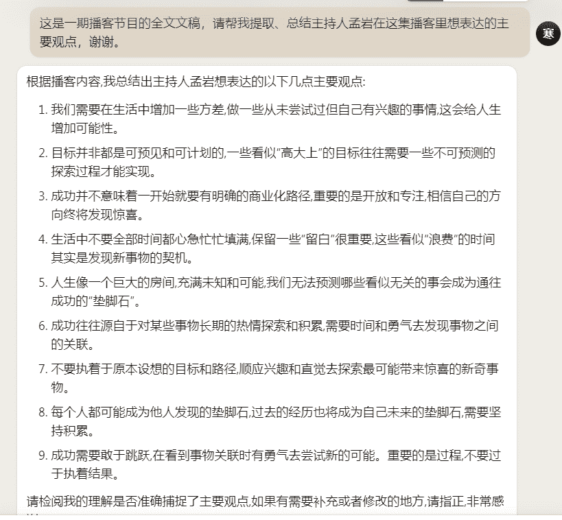
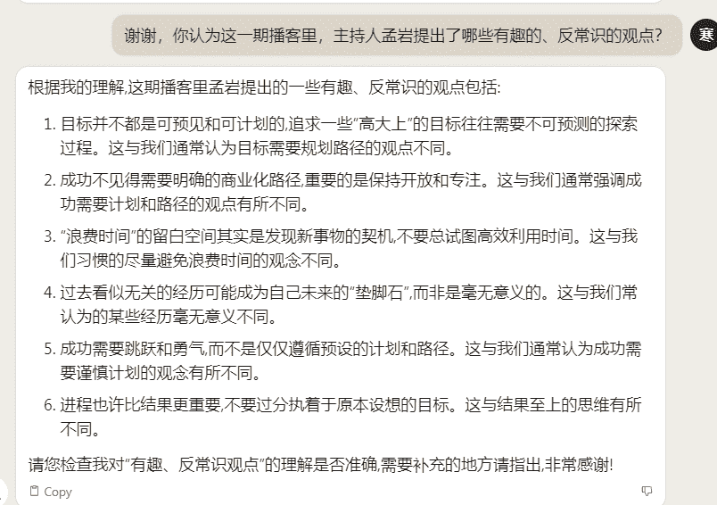
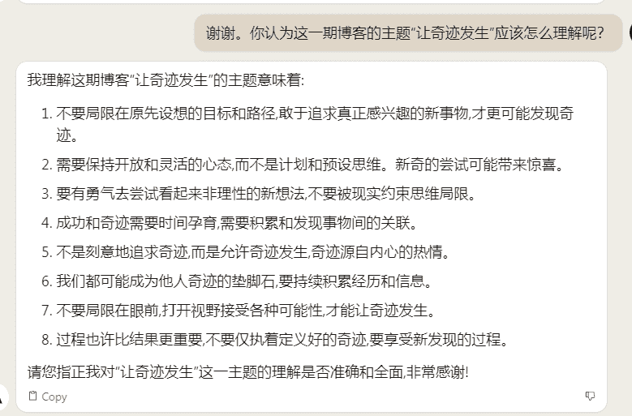
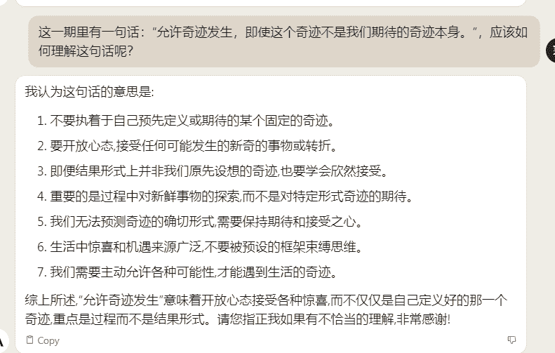
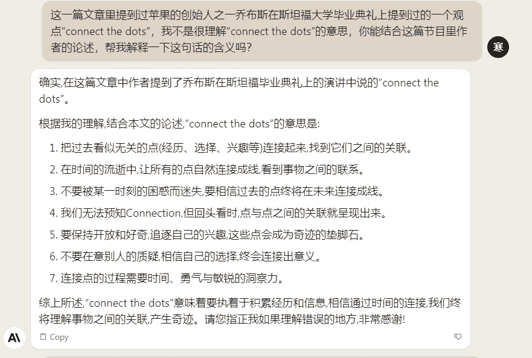
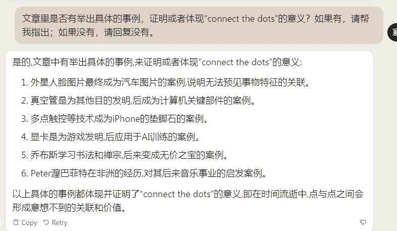
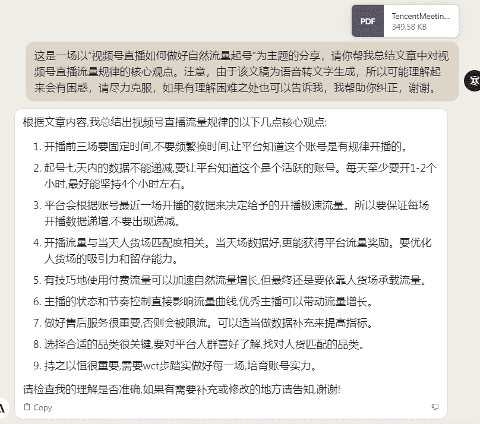

# 用claude2帮我听播客

> 来源：[https://my.feishu.cn/docx/ACsPdlIW8o3ZMCxAlFrcwXelnie](https://my.feishu.cn/docx/ACsPdlIW8o3ZMCxAlFrcwXelnie)

2023/9/6

我目前的做法也还没有很深，主要的方法就是用通义听悟+claude2，帮我识别播客文字稿，帮助我对想听的播客内容做更进一步的理解。

我非常喜欢《无人知晓E30》期，但是以我自己的个人理解能力，可能没办法理清这一期的全貌和想要表达的最核心的思想，这种时候我就选择和claude2交流。

1.  首先下载小宇宙的音频文档

复制链接到网页端打开→查找源文件→找到“m4a”或者其他音频格式的后缀→找到音频文件下载保存到本地

1.  打开“通义听悟”实现语音转写

https://tingwu.aliyun.com/home

打开通义听悟，上传播客音频文档给通义听悟实现转写，目前通义听悟的识别效果和体验也都是非常好的：支持跳转音频及文字、语音识别准确率比较高、自动生成章节速览等等。

我会大致浏览一遍全文文字稿，加深一遍自己的理解，找到自己觉得有意思的地方，作为和Claude2的沟通话题。

然后用通义听悟转写文字稿，生成word文档

1.  文档导入给Claude2，开始提问

一开始先介绍这是一篇什么内容，总结核心观点，然后概览核心观点之后，找到自己关心的话题深入讨论。

我还喜欢问一个问题是：“你认为这一期播客里，主持人提出了哪些有趣的、反常识的观点？”

这个方法我是从冰哥那里学的，冰哥用是否有反常识的观点作为衡量一期节目值不值得看的标准之一，我觉得也值得参考，能让我快速定位到一篇文章里的异常值，找到更值得我关注的新奇的想法。

帮助我更好地理解这一期节目的主题：

以及帮助我理清主播在论述一件事情的时候的核心观点和使用的例子。

诚然，我们不能期待Claude2作为一名睿智的导师替我答疑解惑，但是身为一名优秀的助手，我觉得它已经完成得足够出色了。

最后声明，我自己并不一味推崇用AI工具提高信息摄入的效率，我也并不认可“AI读了等于我读了”；

尤其是对一些真正有价值的播客而言，最好的理解方式肯定也是需要人自己听一遍，而且只要内容是优质的，无论听几遍也都是值得的。

但是我遇到的问题可能是：

+   对于一些信息密度大，价值高的深度内容，我想在现有基础上有更进一步的理解；

+   对于一些信息密度不大、我对话题很感兴趣、但我只需要提取关键信息的内容，我没有时间或者耐心听完全程，或者我不知道这篇内容是不是标题党；

根据我遇到的问题，引申出的我的需求和使用场景就是：

+   对于需要深度思考的内容，比如《无人知晓E30》，我会先自己听一遍全程，然后找到自己关心的问题，用这一套流程帮助我加深理解。

+   对于一些功利性的内容，或者错过的直播分享，我没有耐心听完的，我就用AI提取一遍信息，再总结一下要点，来节省时间，快速get我想要的信息。

比如一些之前错过的线上分享，我也会用Claude2帮我总结核心观点。

目前使用的最高频的需求就是这个了，