# 高效AI工作流：用【通义听悟+kimichat】总结播客精华/用【coze】搭建自己的AI助手

> 来源：[https://my.feishu.cn/docx/SHASdsz6LoKDSNxIcXDcuhfGn8e](https://my.feishu.cn/docx/SHASdsz6LoKDSNxIcXDcuhfGn8e)

> 🔗 原文链接： h[ttps://mp.weixin.q](https://mp.weixin.qq.com/s/4RHgKxRahQhTrDY6Z5vk6Q)q.com/s/4RHgKxRa...

> ⏰ 剪存时间：2024-02-19 19:33:23 (UTC+8)

> ✂️ 本文档由 [飞书剪存 ](https://www.feishu.cn/hc/zh-CN/articles/606278856233?from=in_ccm_clip_doc)一键生成

原创 河林 河林成长说 2024-02-16 19:01  山西

**这是河林的**第 57 篇👸号原创，内容分类为 成长心得 。

**我是河林，我在这个公**众号记录自己的 成长心得、营销笔记 ；感谢你的阅读，欢迎交流讨论。

春节假期也要结束了，简单总结一下春节期间用 AI 做的两件事，和一些思考。

这一篇可以看作是上一篇的续篇。

高效AI工作流：用「通义听悟＆Claude2」做我的播客笔记助手

通义听悟+kimichat 提炼播客精华

春节期间在高频地用【通义听悟+kimichat】整理播客文稿，把自己来不及看的、播放列表里的信息资讯类、行业调研类的播客节目整理成文稿。

**虽然这样做的效果肯定没有我自己完整深入地听一遍再自己做笔记效果**好， 但是好处在于总结整理效率高，能短时间内让我了解堆了很久的那十几期节目的大概，让我抓住我需要关注的重点。

我自己有种感觉 就像是把生肉加工成“预制菜”，加工好之后归档备用 ，了解到特别感兴趣的地方就直接听一听正片是怎么说的，归档之后如果有需要再拿出来回顾。

总比堆积在播放列表因为没时间看就毫无进展，或者干脆全部删除要更好。

我的用法：

1️⃣ 在浏览器里添加 Cosmos Enhanced插件，这个插件可以让我直接下载小宇宙播客链接的音频；

2️⃣复制我需要的小宇宙播客链接， 打开 通义听悟把播客音频转文字稿； （大部分情况下直接用播客链接就可以转成，如果播客链接识别不成功，就在浏览器页 面用 Cosmos Enhanced 插件下载播客音频，上传本地文件到通义听悟）

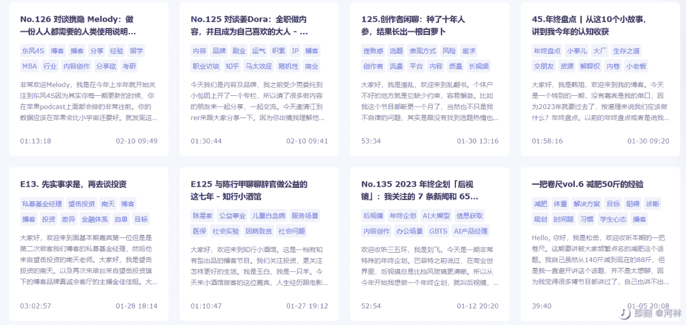

3️⃣先看一遍章节速览，看看有没有自己特别关心的板块。

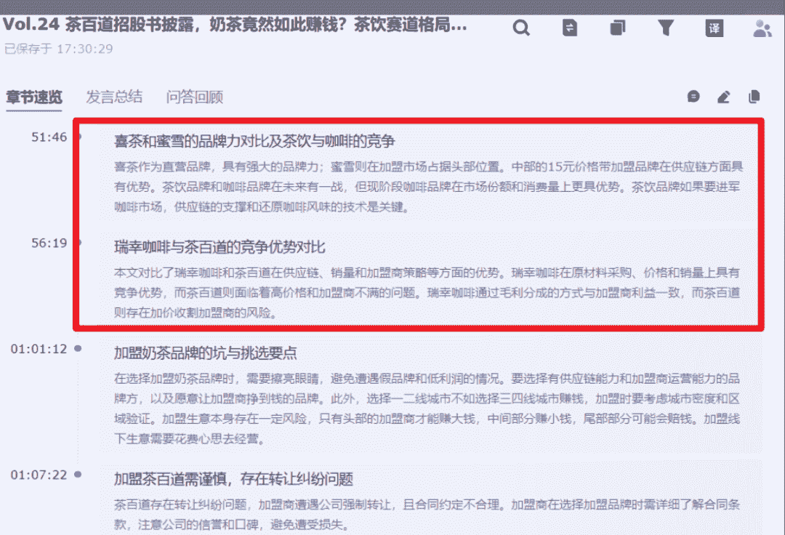

4️⃣文稿丢到kimichat 让kimichat为我总结这篇的播客精华，我自己写了一个提示词模板帮我划重点。

我的提示词结构：

探讨的问题、核心结论、反复强调的观点、具体的案例和方法论、反常识的观点。

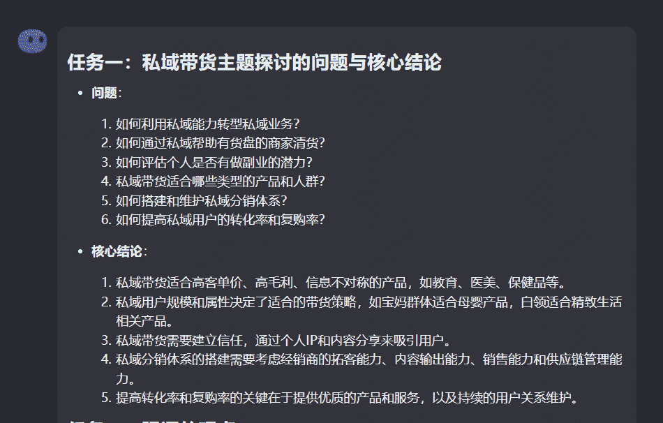

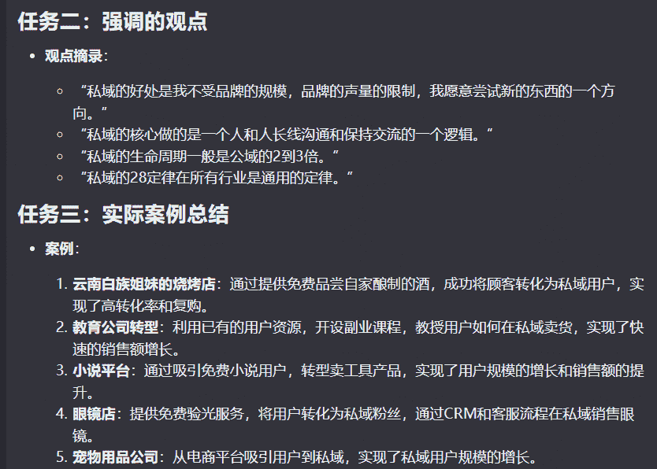

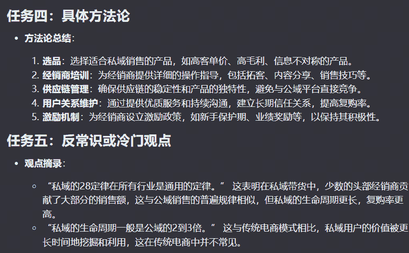

4️⃣固定的提示词模板总结出来的还是框架性的内容，比较空泛，信息密度不高。

这时候我会再从章节速览和kimichat的总结里，我再针对我感兴趣的部分，进一步提问，或者仔细看一遍文稿，或者直接干脆找到节目正片所在的部分听一遍。

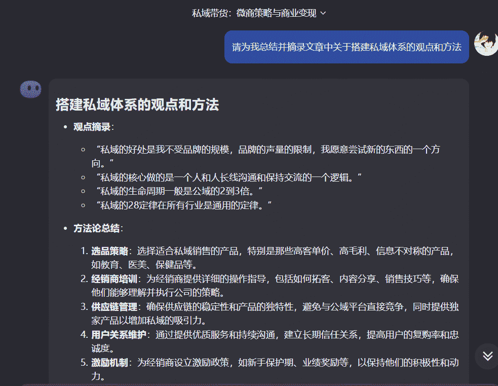

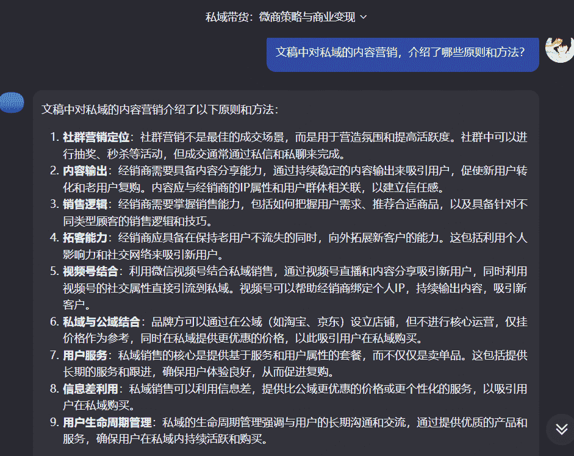

回听播客正片音频的时候，我会直接用通义听悟的标注功能，标注我觉得有启发的部分，方便下次回听。

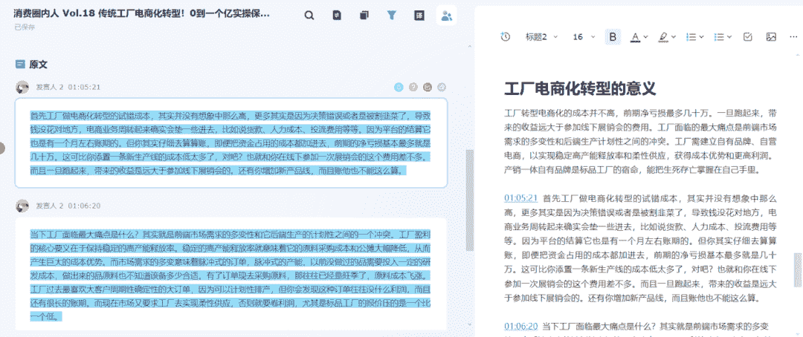

另外，在针对具体部分提问的时候，比如一期播客里直接对比了 2 个案例，我就直接让 kimichat 做表格形式的对比，输出也非常流畅、简洁，体验很不错。

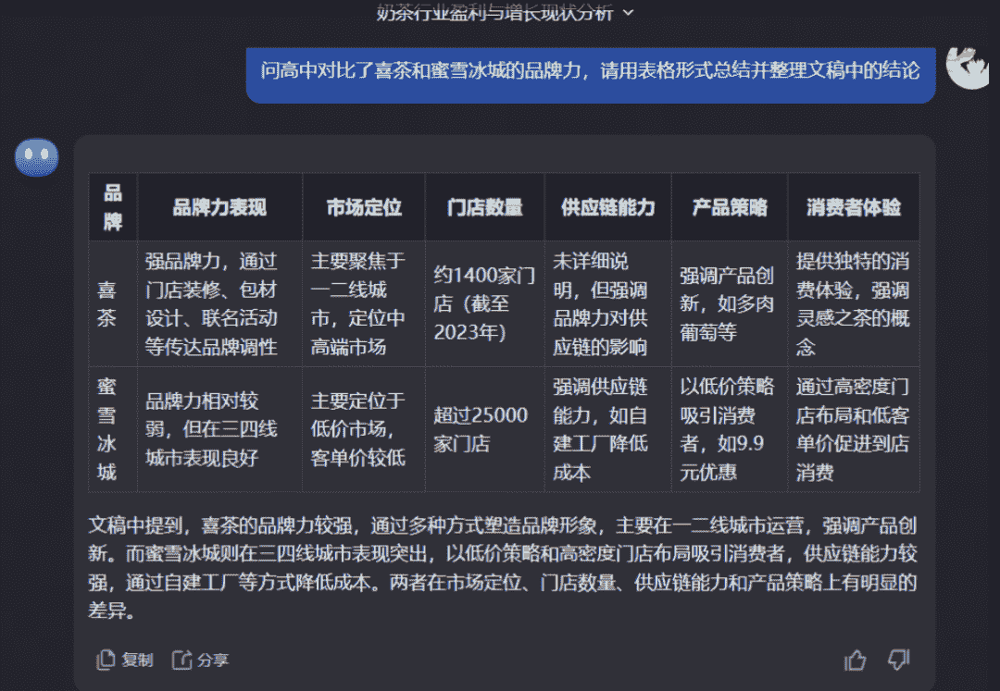

coze初体验：手搓自己的第一个简易AI助手

字节跳动推出了自己的 AI bot搭建平台 coze。

我自己也在春节期间，基于我自己的需求，用coze手搓了自己的第一个AI 助手【中日双语翻译助手】。

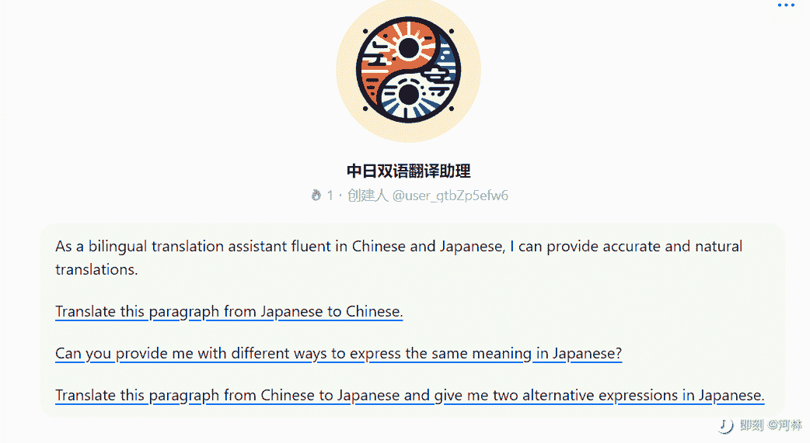

因为是日语学习者，平时在浏览新闻和娱乐报道的时候，一直有中日双语的翻译需求，一方面我需要把一段日文翻译成中文发布，另一方面我也想把我有表达欲的中文翻译成日文。

所以就做了个中日双语翻译bot自用啦。

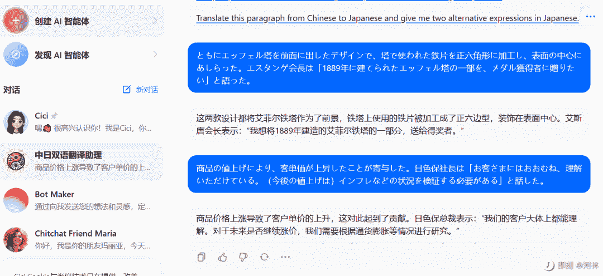

除了翻译以外，最重要的功能是翻译完日语之后我让他给出2个不同的表达参考，帮助我掌握更多的说法。

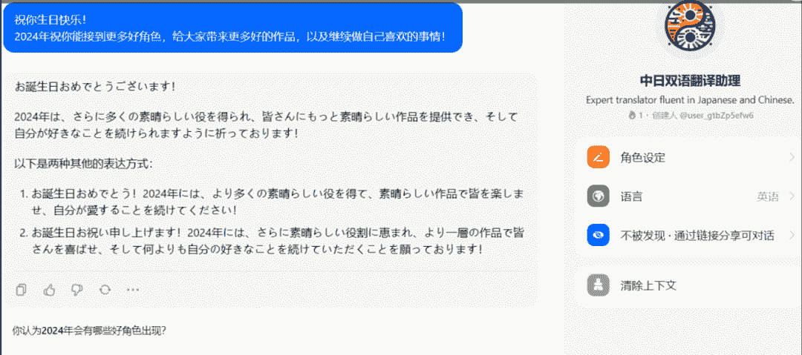

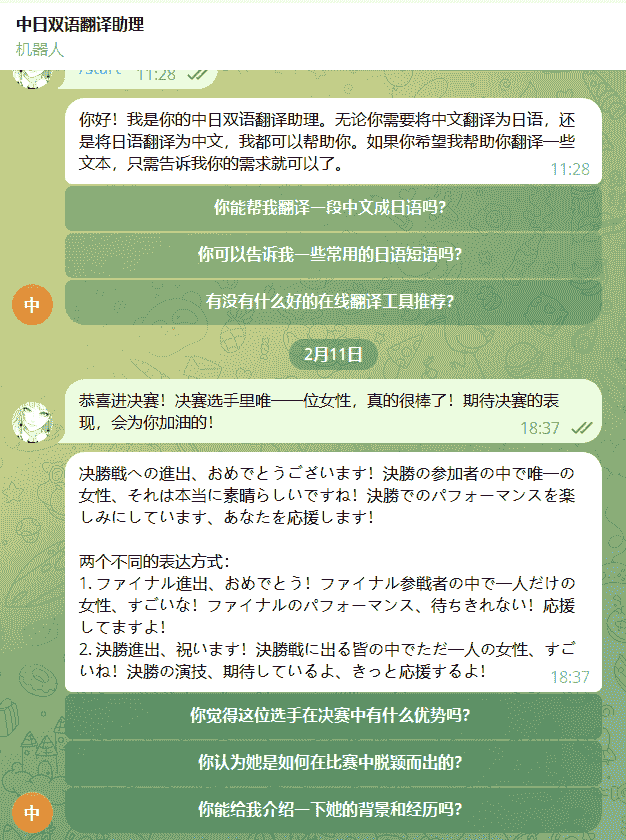

尽管我的 prompt 里要求了在翻译后给出2个不同的参考表达，国内版扣子就无法给出，而国际版是可以给到的，国内的扣子使用的是原创的云雀大模型，确实限制了发挥。

做翻译bot还是非常简单的，下一步我会接着做一些更高级的bot，主要是开始学习怎么处理数据、搭建数据库，然后让 bot 根据数据库来回答我的问题

**信息时代的囤积症：收藏=看过？**

网上冲浪久了，混的群多了，每天都会收藏保存很多pdf， “收藏等于看过”也是最常见的知识管理幻觉。

如果说之前还会因为懒、没时间、没整理等种种因素而怠惰，现在有了AI工具之后，弥补信息差真的是再方便不过。

我自己的做法是：

对于网上保存、收藏的资料，都首先打开看看，是不是自己需要的，如果对自己有帮助，就分类并保存到自己的公开知识库，不收藏保存到本地；

对于一下子看不完的大pdf，都先丢到KIMI提炼总结一下精华。

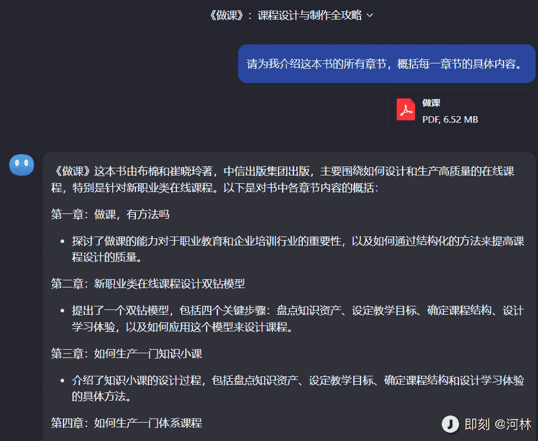

有感兴趣的内容就追问、深入阅读或者整理到知识库里备用，至少知道自己下次该怎么用。

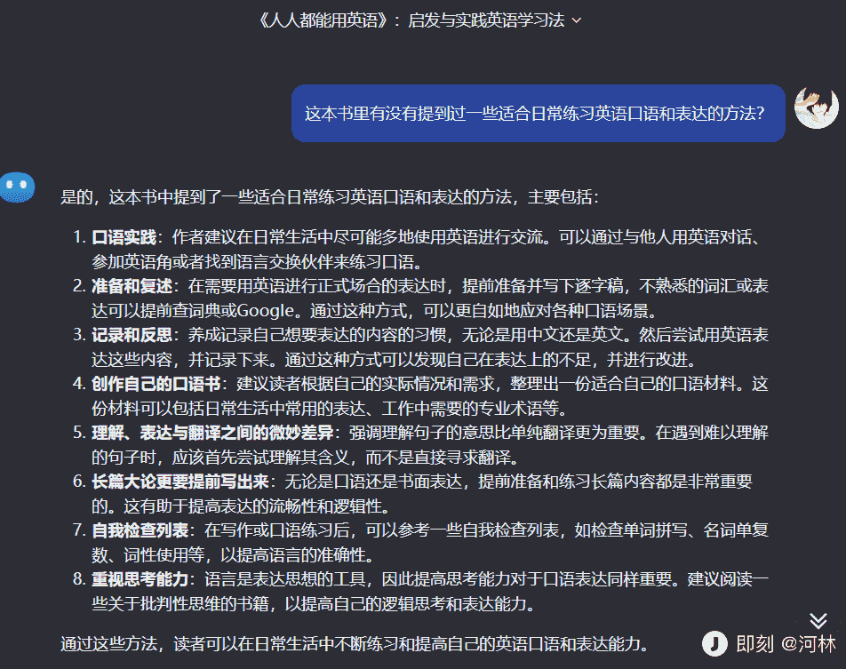

问完一圈还抓不住重点的，那就直接丢弃，不做无效收藏。

用AI看研报也真的是一个低成本弥补信息差的方式，🛰️群里经常会流传各种研报，用kimi即使是外文的研报也能马上提取出重点结论。

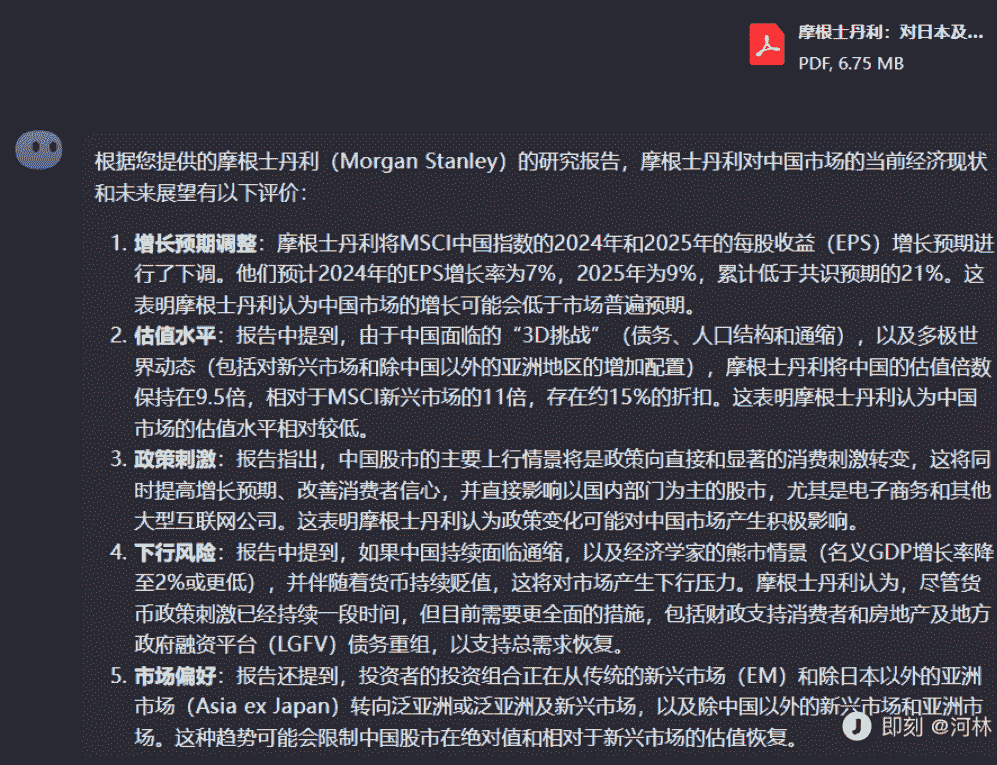

春节期间用一下午时间连续用kimi处理了十几份收藏保存的pdf，清除完堆积的信息，留下有用的，扔掉不需要的，清爽很多。

以上就是我这一篇的分享啦，春节假期结束，祝大家龙年开工顺利，新年暴富！

**🔻欢迎交流，请多指教🔻**

最后再做一下自我介绍，我是河林，98 年出生，坐标杭州，3 年运营经验， 目前在 做视频号直播运营。

我在这个👸号记录生活、写月度总结、营销笔记。

感谢你的阅读、点赞、分享、转发.