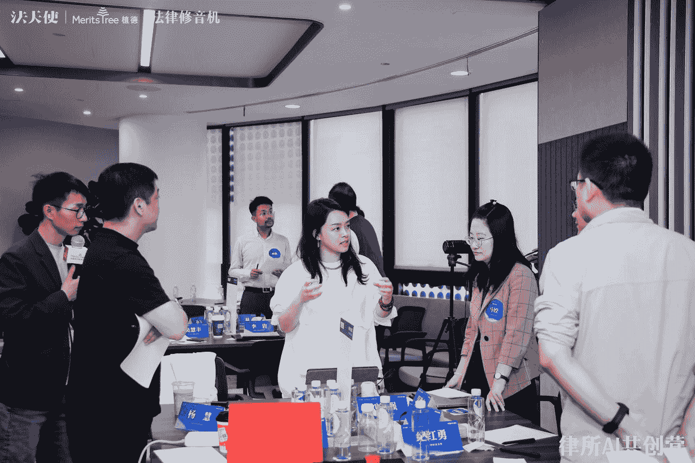

# 这一年，我们和一部分法律人先 AI 起来了

> 来源：[https://docs.feishu.cn/docx/Gp6PdptQ3odufsxbcd3cawBSnhg](https://docs.feishu.cn/docx/Gp6PdptQ3odufsxbcd3cawBSnhg)

---

2024 年 4、5 月，**法天使**、**植德律师事务所**、**法律修音机**联合举办的《律所共创营 —— 让一部分法律人先 AI 起来》线下活动，不知不觉间，已经走过两站了。

首站是 4 月 28 日，在上海：

点击图片查看活动报道👆

第二站是 5 月 24 日，在北京：

点击图片查看活动报道👆

每场活动都有 30 多位朋友参与，主要是头部律所中主管数字化、IT 相关的负责人，还有很多对数字化和 AI 感兴趣的律师、法务，以及来自司法行政部门、大模型厂商的朋友，背景非常多元，是业内少有的法律专业人士和技术人士交流碰撞的机会。

为什么要办这个活动呢？

**有机缘巧合，也是志同道合。**

法律修音机 Legal Studio 是一个专注于【法律科技】的自媒体，自成立第一天起就持续发布法律科技的相关内容。随着 AI 浪潮席卷这个世界，我们也希望帮助法律行业为这个 AI 即将随处可见的世界做好准备。

在我看来，AI 是一项革命性技术，所有行业都可以用 AI 重做一遍，法律行业也不例外[AI 如何在法律行业应用：以 INSSENT AI 为例](https://legalstudio.feishu.cn/wiki/AvPfw5KTuiPid1kwIbEc7rcHnqe)为此去年我做了一个法律 AI 产品，帮助律师获客，获得了很好的口碑，点击了解：

同时，作为一个创业者，我深信「创新传播理论」—— 新事物的采纳和传播遵循一定规律，通常表现为 S 型曲线：初期采用速度较慢，随着采用人数增加，速度逐渐加快。在这个过程中，大众传播在提供信息和知识方面起到重要作用，而人际传播则在说服人们接受和使用创新方面更为直接有效。

因此，为了发展潜在用户，同时让这款产品和用户一起迭代成长，我在这段创业之初，同步运营了若干个【法律 AI 交流群】，平时会分享交流 Al+法律、法律科技、大模型相关的前沿资讯和话题，而且是免费的。

但是，AI 的发展速度太快，可谓“AI 一天，人间一年”，其中的认知壁垒非常高。根据我对去年法律 AI Agent 创业的思考，我发现用户对 AI 的认知不足，是一个非常大的挑战，阻碍了新事物的普及和商业化。

这里有几个原因：一方面，市场上缺少优质的信息源 —— 大多数自媒体天天夸大其词，而且信息很冗杂，很多信息都不是我们需要知道的；另一方面，市场上少有的优质信息源，还没有破圈被法律人看到。

**在这个过程中，我认为及时跟进 AI 技术最新进展和 AI 在法律行业如何应用，去启**发大家思考，鼓励相互分享自己使用 AI 的方法，比直接教大家用现有工具更加重要。

因此，我做了一档《法律 AI 日报》，每天都会收集、整理与 AI+法律、法律科技、大模型相关的相关资讯，在社群集合放送。同时，我还对社群进行强管理，比如实名进群、倡导分享优质内容、对营销广告零容忍等。

一年后，这个社群聚集了超过 1000 位群友，包括法律科技从业者、律师、法务、法学院师生、公检法国企人员、非法律领域创业者和投资人等，背景非常多元。

比如**法务**，尤其是大企业的法务，他们每年可能需要处理几万份合**同，对于使**用**工具提效有**着**很大的****需求；还有大**模型厂商、互联网大厂、投资人朋友，大家都在寻找大模型的落地场景、投资标的；另外还有一些公检法和国企的朋友，大家其实也对 AI 很感兴趣，只是缺少学习和交流的渠道。

不同领域朋友，其实都有互相交流的需求。

同时，正是由于社群成员的背景非常多元，大家关注的方向不一样，也有着别人不了解的知识，所以这个社群慢慢形成了很互补的交流氛围，每天的活跃度都不错。

在这个过程中，越来越多朋友开始尝试 AI，在这里探讨 AI 应用层创业。这个社群陪伴着大家成长，有的朋友还对我表示感谢，说在这里学到很多，自己也改变了很多。

**这让我感到，「市场教育」是一件非**常值得做的事情，不论有没有商业上的收益。

**事实上，海外的法律行业开展 AI 市场**教育，已经渐成趋势，我们其实走得很前沿。

例如，就在今年 5 月 16、17 日，全球知名的法律科技公司 Wolters Kluwer 也和 Suffolk 法学院联合举办了一场“生成式 AI 提示挑战赛”，为法学院的学生提供生成式 AI 培训，并让学生们去探索 AI 的用例。

**而**在刚刚结束的 2024 年高考中，语文科目的作文题基本都与 AI 有关，说明这波 AI 市场教育加速了，更加坚定了我做市场教育的想法。

**因此，我退出易参和 INSSENT AI 两个项目之后，休息之余开始重点运营**「法律科技社区」和「法律科技智库」，致力于打造高质量的法律科技交流圈和学习站点。

当然，除了我以外，还有很多优秀的法律人也在践行法律科技相关的市场教育。

比如**「法天使」**和**「植德律师事务所」**。

在前段时间的一场「合同相对论」直播上，法天使创始人-常金光和植德律所首席运营官-潘扬，做了一场直播。在聊的过程中发现很多朋友对这个主题感兴趣，所以就说要不办一场线下活动，推广数字化和 AI。

与此同时，我也在计划更多社区运营动作，比如线上线下的活动。然后，机缘巧合，我又和常老师、潘帅分别私下交流过几次，说大家都在做类似的事情，不如就一起办吧！

**于是一拍即合，《律所 AI 共创营 —— **让一部分法律人先 AI 起来》就诞生了。

关于《律所 AI 共创营》的更多介绍，感兴趣的朋友可以点击以下文章了解👇

> [法天使 X 植德 X 法律修音机｜律所 AI](https://mp.weixin.qq.com/s/MNNm9LGfzLVTyPPnpjr6oQ) 共创营——让一部分法律人先 AI 起来

> [🔥30+ 先锋法律人共创 AI 应](https://mp.weixin.qq.com/s?__biz=MzUzOTcwMTE5OQ==&mid=2247487054&idx=1&sn=abaa11ed968fb1e4d36653a5f3f0a4a3&chksm=fac534eecdb2bdf88fd7f9c3ff2565e7fb91b4a2bd2af6086b3ab68b4185750775a021d6f140&scene=178&cur_album_id=3435805156338319364#rd)用！首届「法律 AI 创造营」成功举办

> 🔥顶级律所帝都共话法律科技！律所 AI 共创营，下一站深圳

> 当法律人开始手搓 AI 智能体——

> [法天使 X 植德 X 钉钉 X 法律](https://mp.weixin.qq.com/s?__biz=MzUzOTcwMTE5OQ==&mid=2247486942&idx=1&sn=cdd43d2f2a06c2c07f09c48bfcda49a5&chksm=fac5377ecdb2be685be7b54df76e07377fd32ddb6d21b7ba6dd21361364826bf1b211e1224ed&token=1308727134&lang=zh_CN#rd)修音机｜数字化浪潮下，律师如何拥抱 AI

每场活动，大家一起交个朋友，学点干货，再一起共创 AI 应用。

**其中，智能体共创比赛是最受欢迎的环节，因为大家要亲手实操，人**们天然会对自己创造的东西投入更多注意力。

目前两期活动下来，大家一共创造出 2**0 **多**个 **A**I **智能体，覆盖律师和律所的作业、管理、营销三大领域的多个具体场景。例如：

在**律师作业**领域，学员做出了投资并购、新能源、数据合规、股权、劳动法等多个专业领域的机器人。学员配置后台、上传自己的知识文档并调试，即可做出擅长特定领域的 AI 助手，提高自己的工作效率。

在**律所管理**领域，学员针对各自的管理提效需求，发掘出很多有价值的场景。除了回答律所内部常见的问题外，还有“如何有效地向客户催收律师费”，以及“给今天喝什么奶茶提建议”等场景，切实解决问题。

在**律师营销**领域，有的小组做出“律师获客助手”，针对青年律师如何获客提供建议，还有的小组做出“掼篮高手”，熟练掌握各种掼蛋技巧，可以为律师提供掼蛋出牌策略，辅助律师与客户社交并转化成交。

**对**于这些智能体，我们重点关注「技术性」和「策略性」，希望能启发大家思考如何将 AI 应用到自己的工作中。

在**技术性**层面，我们重点关注「提示词」的撰写，这主要体现在智能体的人设设**计上。**它们具体吗？对模型有指导意义吗？在策略性层面，重点关注这些智能体，是否真的可以给律师的实际工作提高价值。

**最让我印象深刻的是首期《律所 AI 共创营》冠军🏆—— 上海植德律所的李泽宇律**师，她创造的「投资并购助手」智能体，不论是「技术性」还是「策略性」都非常突出。

在**技术性**层面，李泽宇律师给自己的智能体设定为一个投资并购专家，可以回答投并的相关问题。并上传自己收集的几个文件，让智能体优先根据自己的知识库回复。

更亮眼的是在**策略性**层面，李泽宇律师在路演时重点分享了她是如何使用这个智能体的，比如上传一个医疗行业的案例，然后让投并智能体从这个文件提炼出特定的内容，也就是针对特定的业务场景提问。

**虽然这个场景看起来比较简单，但真真**正正地把 AI 应用到自己的工作流中了。

而不是上传一堆文件，但是提不出问题。

这时可能有人会说，做智能体太简单了吧。

确实，对于用过 AI 的人来说，搭建智能体这个“动作”，操作起来确实很简单。

**但是，搭建智能体就像面对一个“空白板”，没有明确的方向，非常考验大家**的创造力，是否能够找到真正需要解决的问题，或者说「场景」，是拥抱 AI 的关键。

所以，有的朋友一开始会不适应，尤其是那些经验较少的朋友。很多参加过这个活动的朋友都跟我说：“如果没有这个活动，我自己永远不会花时间自己做这些事情”。

**这就是问题所在。**

人们天然有畏难和从众的心理，而参加这种活动，除了可以获得关于 AI 的前沿实践经验外，更重要的是可以进入一个场域，有所谓的“老师”，有一起交流共创的同行者，这样我们通常才愿意迈向拥抱新事物的第一步。

**这才是价值所在。**

目前，整个法律行业都在积极拥抱 AI，尤其是头部律所，可谓是战略性重视。我最近经常被邀请去做一些关于法律科技的分享，比如近期在哲响、独行有邻、律渐直播，接下来还会去北京大学做一次分享。

**当下，法律科技产业很热，非常热，**而我们躬身入局，积极推动这一浪潮的进展。

总之，《律所 AI 共创营 —— 让一部分法律人先 AI 起来》，上海站和北京站圆满结束了，最后再放几张活动照片。

接下来，《律所 AI 共创营》将会进行全国巡回。

**让我们一起，推动法律科技 —— 尤**其是「AI+法律」这个生态不断发展壮大。

**让一部分法律人先 AI 起来。**

---

Created by Legal Studio