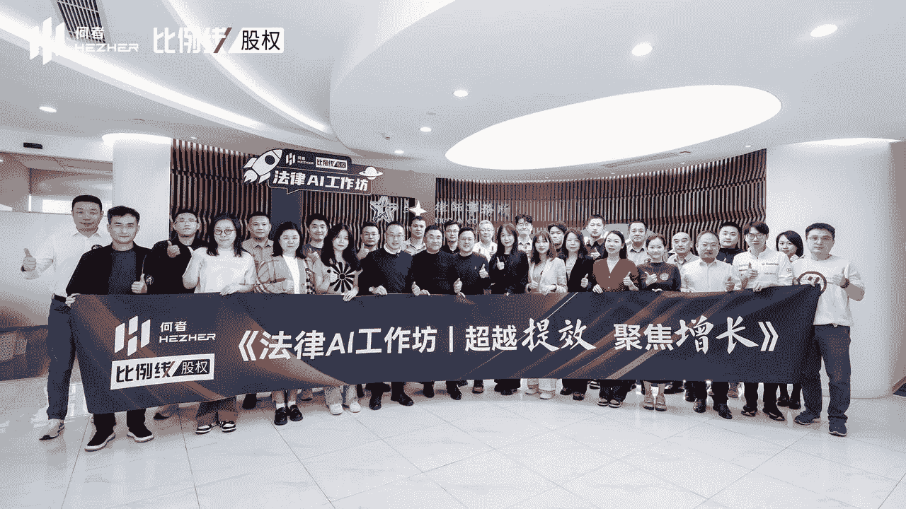
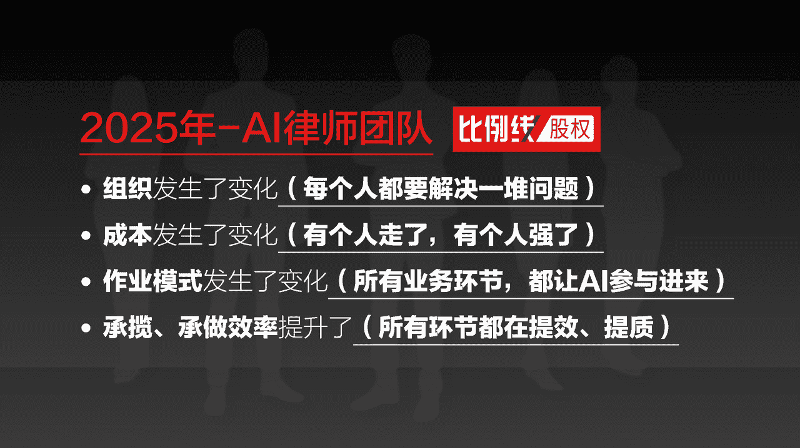
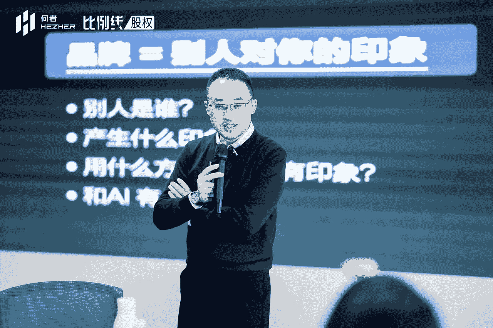
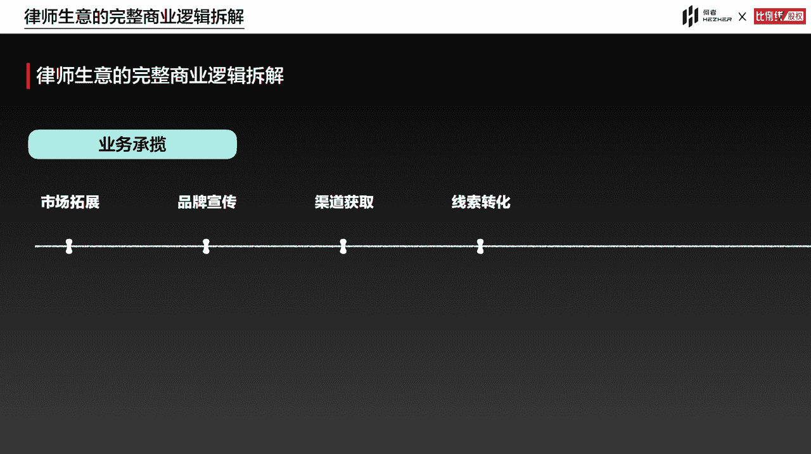
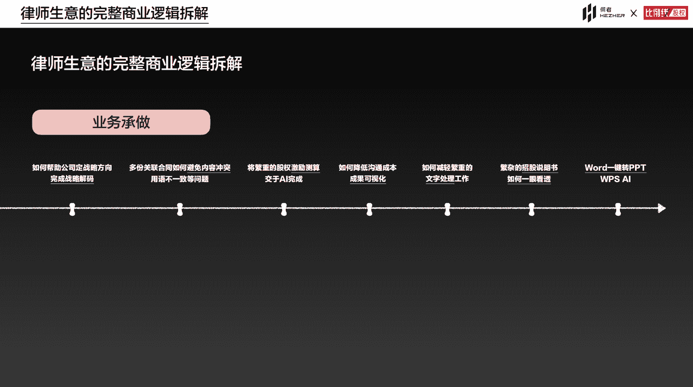
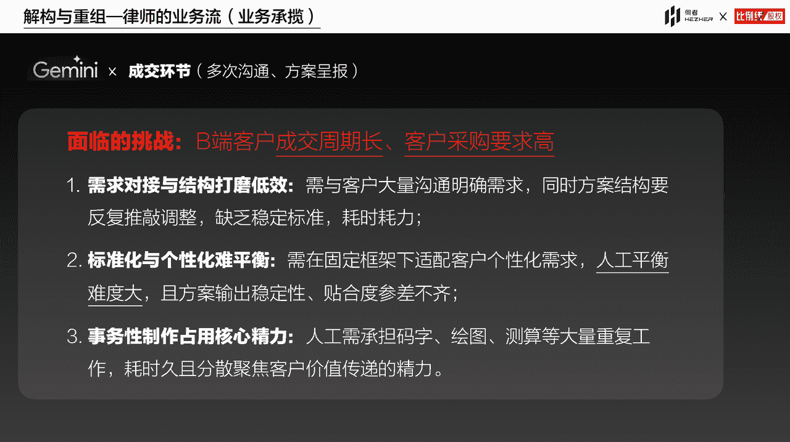
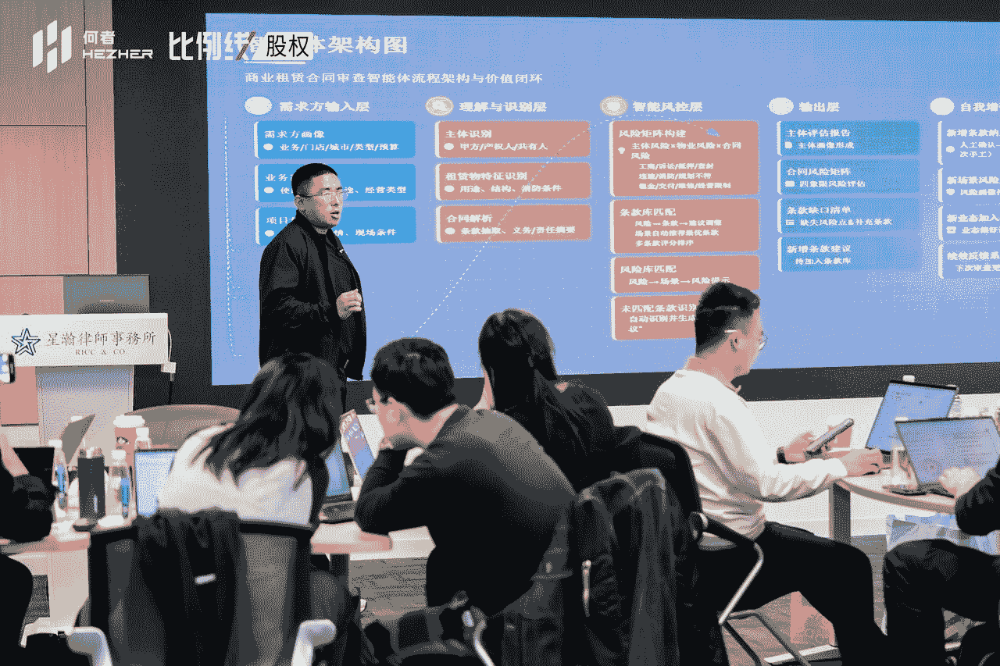
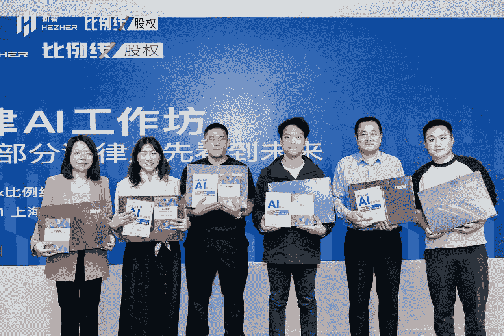
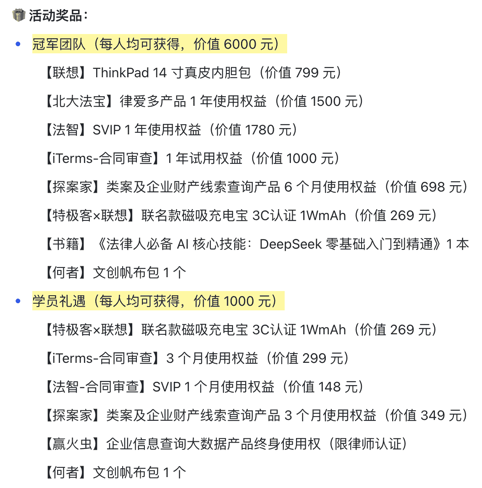

# 《法律 AI 工作坊》第 0 期圆满收官！出来“混”，关键是“出来”

> 来源：[https://docs.feishu.cn/docx/KDL2dFASMo1UTBxhIa2craFUn3d](https://docs.feishu.cn/docx/KDL2dFASMo1UTBxhIa2craFUn3d)

---

**2025 年 11 月 15 日至 16 日，何者社区与比例线股权共同举办的《法律 AI 工作坊 —— 超越提效 聚焦增长》**顺利举办，来自全国各地 30 多位法律+科技从业者齐聚上海，通过 2 天 1 夜，一同探讨「人工智能+法律」的最佳实践。

> 更多精彩照片：https://live.photoplus.cn/live/pc/58970707/#/live

**作为业内领先的法律科技社区，何者Hezher 长期研究 AI 在法律行业的落地现状、挑战和解决**方案。在 AI 飞速发展的当下，我们最应该关注的，就是拿到结果的「最佳实践」。

那么，“AI+法律”的最佳实践长啥样？

「比例线股权」是大成律所的一个专注于股权业务的专业化团队，2024 年以来比例线股权团队持续投入 AI，正在研发一个股权激励 Agent，同时全业务布局 AI，效果显著。

在**业务**层面，比例线团队定位经历了从万金油（常法+诉讼），到逐渐专业化（新三板+常法+诉讼+股权），再到完全专业化（专注股权）的持续进化。同时，比例线团队借助 AI 不断优化股权架构、股权激励服务，还开发出股权私董会、月度经营分析会等新型法律服务。

在**团队**层面，2024 年比例线的团队构成是「主办律师+律师助理」，2025 年变成了「主办律师+AI」，主办律师没有助理了，而是深度使用 AI 赋能，妥妥实现了降本增效。

可以说，比例线股权团队正是用 AI 赋能法律服务，并且拿到结果的一个「最佳实践」。

为此，何者社区与比例线合作推出了《法律 AI 工作坊 —— 超越提效 聚焦增长》，比例线团队的 @罗毅、@刘振宇、@张杰、@陈雁玲 均深度参与了本次工作坊的内容共创。

# 律师拥抱 AI 的第一性原理，不是钻研技术，而是「客户成功」

**工作**坊第一天，比例线股权团队负责人 @罗毅律师 详细拆解「律师这门生意」的完整商业逻辑，解构律师在“承揽”和“承做”的业务全流程中会面临的挑战，以及 AI 可以帮助我们解决什么问题、解决的思路、达到什么效果。

罗毅表示，律师“承揽”和“承做”每一个环节，都可以拆解成更加细分的步骤或场景，而当你把这些环节打开，看到局部的卡点（人工操作低效或成本高），也就是需要解决的一个一个具体的问题以后，AI 就开始发挥作用了。

## **AI 深度赋能律师业务全流程**

例如，在“承揽”环节：

+   **品牌**的本质什么？可以拆分成哪些环节？有什么好办法？AI 能做什么？

+   **渠道**的本质什么？可以拆分成哪些环节？有什么好办法？AI 能做什么？

+   **线索**的本质什么？可以拆分成哪些环节有什么好办法？AI 能做什么？

在“承做”环节，我们同样可以拆分成一个一个具体的步骤，每个业务领域都会有不同的流程节点，以“股权”业务举例——

当然，不同业务领域面临的卡点并不一样，这就要求我们解构自身业务流程，然后根据自身业务面临的挑战，选择合适的 AI 来解决。

有了 AI 之后，一方面可以提高工作效率，另一方面以前因为人力成本高、学习难度高而做不了的事，现在有了 AI 的加持都可以做了，让我们有机会在内卷的市场拿出更好的产品，解决更多的问题，从而拿到更高的客单价。

现实中，很多律师对 AI 有不切实际的期待，比如希望 AI 直接带来客户或者自动解决什么问题，还会诟病 AI 这有问题、那有毛病。

这背后涉及到律师使用 AI 的「第一性原理」——

**你是想钻研 AI 技术本身，还是想用 AI** 解决客户问题，服务效率更高、质量更好？

作为法律从业者，答案不言自明。因此，我们应该更加务实地看待和使用 AI。

**一方面，AI 不是倚天剑或屠龙刀，无法一招致胜**，不要期待随便用用 AI 就能带来客户。在小切口、小场景、局部解决问题，效率更高、效果更好，总想憋个大招，一上来就要做个什么 AI 工具，往往适得其反、不了了之。

**另一方面，现在的 AI，完全可以解决大多数律师的需求，如果你觉得 AI 表现不尽人意，大概率**是你不够会用 AI，或者你自己的业务流程没有梳理清楚，导致无法使用 AI 赋能。

AI 已经足够强大，最大的卡点其实是“人”。

总的来说，法律人要想用好 AI，最应该做的不是研究各种 AI** 工具和技术原理，而是打好基本功 —**— 梳理业务流程，然后用 AI 武装你的业务地图，将 AI 深度嵌入你的业务流。

从这个角度出发，你会对 AI 有不同的认知，而且可能会探索出很多创新的用法，工作习惯也会随之改变，包括但不限于认知思维、知识管理和经验沉淀、组织设计、产品开发等等。

而这，正是法律从业者的立身之本。

# **1v1 业务诊断 + 现场 vibe cod**ing，一起共创真正可用的 AI 智能体

罗毅老师分享结束后，@刘振宇律师 接着带领大家梳理和打磨自己的业务流程。

**这个环节看起来像是市面上常见的法律 AI Agent 大赛，但其实早在工作坊开始之前，**振宇就提前和早先报名的若干学员进行了业务诊断，相当于提前做了一场「小型私董会」。

因此，提前作为“案主”身份接受过前期私董会辅导的学员，往往可以更好地参与到工作坊的业务流程拆解和 AI 智能体的实操过程中。

**活动现场，振宇老师详细介绍了比例线团队的日常工作流程，强调了知识管理和经验沉淀的重要性** —— 虽然做起来非常困难，但这却是拥抱 AI 的“入场券”，而且是一劳永逸的。

在这个过程中，学员们与振宇老师就比例线团队的日常工作流程和常用工具进行热烈互动。

振宇手把手演示，大家在感受一个高效律师团队日常工作习惯的同时，也在思考如何在团队中进行落地。

从第一天晚上到第二天上午，各小组开始共创需求场景，然后一起练习手搓 AI 智能体。每个小组根据自身业务痛点，共创出多个切实解决现实问题的智能体。

**例如，**@黄吉日律师（组长）所在小组做出了一个「律师 IP 定位与爆款文案生成」智能体 —— 律师只需输入自己的身份信息，AI 即可帮你做好 IP 定位，并且给你生成相应的爆款文案，你只需要出镜，其他任务全部交给 AI，直接省下一大笔 MCN 服务费。

在场的律师朋友纷纷表示：可以直接卖钱了！

**又比**如，@杨夏鸣律师（组长）所在小组做了一个「连锁餐饮租赁合同审查」智能体，全面考虑了这项任务的核心痛点、核心条款、风险点分析以及工作流程等等，共创出非常契合该任务场景的 AI 赋能解决方案。

值得一提的是，这个需求场景是该小组的甲方朋友提出的，而且最终成果也令其相对满意。

这就涉及到一个引人深思问题：

当 AI 已经可以很好地解决客户问题，未来的律师服务形态应该如何演变？

我觉得该小组成员 @张辰浩律师 的说法非常精准：这是大家一起共创出来的“革命成果” —— 律师自我革命的成果。

每个小组都动手感受了智能体的 vibe coding 过程并运行成功，而且还用 AI 工具做了路演 PPT，AI 应用能力🆙🆙🆙

最终，@杨夏鸣律师（组长）所在小组获得了本次大赛的冠军🏆每位冠军成员都获得了价值 6000 元的法律 AI 工具大礼包，同时每位学员也获得价值 1000 元的学员礼遇🎁特别感谢何者社区厂商伙伴的支持！

经过 2 天 1 夜的学习和共创，我们每个人**都**对 AI 赋能法律服务有了更深的认知。AI 技术在不断发展，我们对 AI 的学习不停，期待在不久的将来，我们继续相聚线下，一起交流「人工智能+法律」的未来！