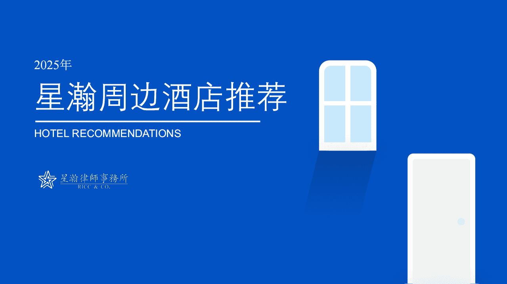
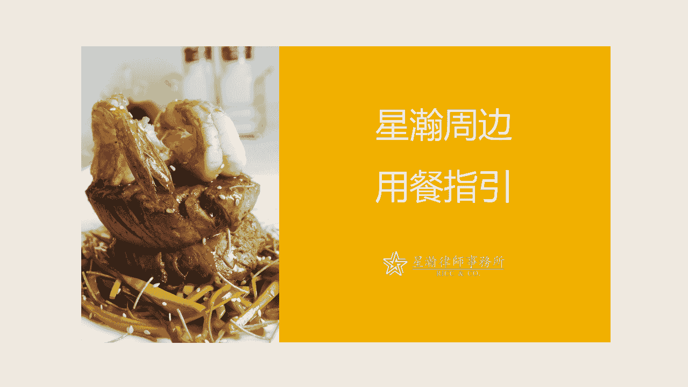

# 【指引文档】11月15-16日｜法律 AI 工作坊

> 来源：[https://docs.feishu.cn/docx/Nb1edNOxMo5XBLxBpHbcbhlznXd](https://docs.feishu.cn/docx/Nb1edNOxMo5XBLxBpHbcbhlznXd)

---

> 大家好，欢迎参与何者社区举办的《法律 AI 工作坊》。

> 本文档包含本次工作坊的时间、地点、具体安排、场地信息和交通指引等，建议收藏阅读。

# **一、基本信息**

**⭐️ 主题：**法律 AI 工作坊｜超越提效 聚焦增长

**📆 时间：1**1月15日-16日（周末），2 天 1 夜

**📍 地点：上**海市长宁区长宁路 1193 号来福士广场 T3 办公楼 7 层 - 星瀚律师事务所

**🏨 酒店推荐： **

[星瀚周边酒店推荐（含律所协议酒店信息）.pdf](https://internal-api-drive-stream.feishu.cn/space/api/box/stream/download/all/HyUlbA85AoF7SsxWL2ZcLrransh)

🥘 用**餐推荐： **

[星瀚周边用餐指引.pdf](https://internal-api-drive-stream.feishu.cn/space/api/box/stream/download/all/C5yYbR8UGoIgABx9Jm4csgIOnac)

**🎁 活动奖品：**

+   冠军团队（每人均可获得，价值 6000 元）

【联想】ThinkPad 14 寸真皮内胆包（价值 799 元）

【北大法宝-律爱多】1 年使用权益（价值 1500 元）

【法智】SVIP 1 年使用权益（价值 1780 元）

【iTerms】1 年使用权益（价值 1000 元）

【探案家】类案及企业财产线索查询产品 6 个月使用权益（价值 698 元）

【特极客×联想】联名款磁吸充电宝 3C认证 1WmAh（价值 269 元）

【书籍】《法律人必备 AI 核心技能：DeepSeek 零基础入门到精通》1 本

【何者】文创帆布包 1 个

+   学员礼遇（每人均可获得，价值 1000 元）

【特极客×联想】联名款磁吸充电宝 3C认证 1WmAh（价值 269 元）

【法智】SVIP 1 个月使用权益（价值 148 元）

【iTerms】3 个月使用权益（价值 299 元）

【探案家】类案及企业财产线索查询产品 3 个月使用权益（价值 349 元）

【赢火虫】企业信息查询大数据产品终身使用权（限律师认证）

【何者】文创帆布包 1 个

+   互动奖品：

《法律人必备 AI 核心技能：DeepSeek 零基础入门到精通》书籍

《动态股权：中国合伙人分钱分钱的新技术》书籍

# **二、活动议程**

| ## **第一天｜DAY 1** |  |  |
| --- | --- | --- |
| **时间与主题** | **分享内容** | **核心目标/交付物** |
| #### 上午｜9:00-12:30 |  |  |
| 9:00-10:00 AI 重塑法律服务趋势观察 | 趋势：全球 AI 及法律科技发展趋势洞察  应用：法律人应用 AI 的等级和工具推荐 | 系统性了解 AI 技术在法律行业落地应用的现状和趋势，洞察「AI+法律」的本质 |
| 共创官：吴世杰｜何者科技CEO |  |  |
| 10:00-12:30 重塑想象——律师究竟在卷什么？生意要怎么做？ | 律师的苦、卷与破局机会  律师生意的完整商业逻辑拆解（承揽篇） | 拉齐认知，构建律师业务的全局经营视图，搞清楚我们面临的挑战，在什么场景下用 AI 解决什么问题，拒绝做“工具党” |
| 共创官：罗毅｜大成律所合伙人、比例线股权CEO |  |  |
| #### 中午｜12:30-13:30  午餐、自由交流 |  |  |
| #### 下午｜13:30-17:30 |  |  |
| 13:30-17:30 洞察趋势——用 AI 武装我们的业务地图 | 律师生意的完整执行逻辑拆解（承做篇）  AI 改造法律业务的核心方法 | 掌握 AI 赋能业务的基本功，学会使用 AI 的各样功能，了解 AI 的特长及应用场景 |
| 共创官：罗毅｜大成律所合伙人&amp;比例线股权团队CEO |  |  |
| #### 晚上｜18:00-21:00 |  |  |
| 18:00-21:00 沙盘推演（一）· 业务诊断——画出你的“业务地图”与“痛点地图” | 各小组在课程导师带领下，拆解并可视化自己的业务流程，识别出核心痛点，以及用 AI 重塑业务的解决方案 | 各小组产出《业务流程与痛点分析图》 |
| 共创官：刘振宇｜大成律所律师&amp;比例线股权CMO |  |  |
| ## **第二天｜DAY 2** |  |  |
| **时间与主题** | **分享内容** | **核心目标/交付物** |
| #### 上午｜9:00-12:30 |  |  |
| 9:00-12:30 沙盘推演（二）· 方案共创——用 AI 武装“你”的业务地图 | 各小组基于 Day1 的业务诊断情况，利用 AI 工具，针对痛点环节现场生成 AI 解决方案内容，并形成路演初稿 | 各小组产出《AI 赋能业务解决方案》初稿 |
| 共创官：刘振宇｜大成律所律师&amp;比例线股权CMO |  |  |
| #### 中午｜12:30-13:30  午餐、自由交流 |  |  |
| #### 下午｜13:30-15:30 |  |  |
| 13:30-15:30 成果路演与竞赛 | 各小组代表上台路演，展示业务流、痛点及 AI 解决方案。共创官、同学现场进行点评，评选出优胜团队并颁奖 | 将课堂的练习与学员的实际工作场景紧密连接，确保学习成果能够被有效迁移 |
| 参与方：所有人 |  |  |
| 15:30-17:00 躬身入局——AI 2.0，我们的进化蓝图 | 1.  AI 的 2.0 阶段：智能体是什么？ | 看清 AI 的未来趋势和律师的进化方向 |
| 共创官：吴世杰｜何者科技CEO |  |  |
| #### 晚上｜聚餐：乘兴而来，兴尽而归 |  |  |
| *以上为大致安排，具体根据现场时间而定。 |  |  |

# **三、交通指引**

**🚄 高铁：上海虹桥火车站**

+   地铁：从虹桥火车站出发，乘坐地铁 2 号线（浦东 1 号 2 号航站楼方向），乘坐 6 站到「中山公园站-2 口」下车，步行 500 米到达会场，全程约 30 分钟

+   打车：13 公里，约 30 分钟

🛬 飞机：上海虹桥国际机场 T2

+   地铁：从 T2 航站楼出发，乘坐地铁 2 号线（浦东 1 号 2 号航站楼方向），乘坐 6 站到「中山公园站-2 口」下车，步行 500 米到达会场，全程约 30 分钟

+   打车：13 公里，约 30 分钟

🛬 飞机：上海虹桥国际机场 T1

+   打车：12 公里，约 30 分钟

+   地铁：从 T1 航站楼出发，乘坐地铁 10 号线（基隆路方向），乘坐 6 站到「虹桥路站」下车，换乘 4 号线内环（延安西路方向），乘坐 2 站到「中山公园站-2 口」下车，步行 500 米到达会场，全程约 45 分钟

**🛬 飞机：上海浦东国际机场**

+   地铁：从浦东国际机场出发，乘坐地铁 2 号线（蟠祥路·国家会计学院方向），乘坐 22 站到「中山公园站-2 口」下车，步行 500 米到达会场，全程约 1 小时 30 分钟

+   打车：52 公里，约 1 小时 30 分钟

**🅿️ 停车信息：如**开车前往，可就近停车，会场不提供免费车位

# **❤️ 温馨提示**

🌤 天**气：****上海 11 月 **15 日至 16 日，气温在 12℃~20℃ 左右， 天气转凉，可备一件薄外套

📷 照**片：**活动照片将于当天当天实时更新

### **何者社区介绍**

> 「何者 Hezher」是一个专注于法律科技领域的社区，通过搭建交流平台，分享 AI 在法律行业的应用实践和全球法律科技前沿资讯，致力于推动法律科技行业间的交流、教育和创新，以科技驱动法律行业高质量发展。不论是学习 AI 技能，还是了解法律 AI 前沿发展趋势，都可以在这里获得。

> 了解更多：[何者 HEZHER 法律科技社区](https://legalstudio.feishu.cn/wiki/NnAAw32YKiyitFkyBWqcPX2MnIE)

> 合作请加微信：18825075686，备注真实姓名+所在机构+职位。