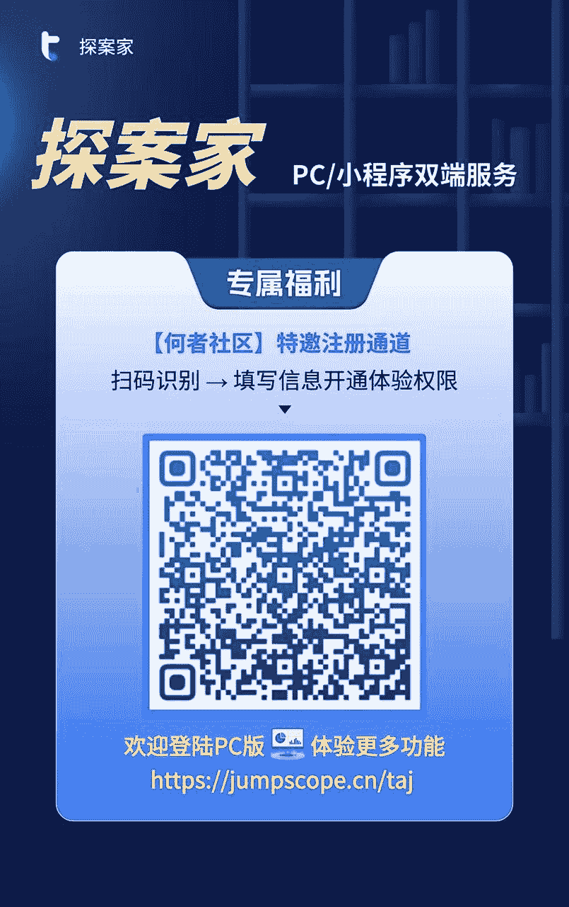

# 【领取指引】法律 AI 工具大礼包｜何者Hezher

> 来源：[https://docs.feishu.cn/docx/WNA0do4ijoj1Idx8gOZcq4nEned](https://docs.feishu.cn/docx/WNA0do4ijoj1Idx8gOZcq4nEned)

---

> 大家好！感谢您参加何者社区《法律 AI 工作坊》，我们为所有学员准备了“法律 AI 工具大礼包”，本文档为各个产品的领取指引，请大家按照指引领取～

# **工具类目**

**冠军团队（每人均可获得）**

【北大法宝-律爱多】1 年使用权益（价值 1500 元）

【法智】SVIP 1 年使用权益（价值 1780 元）

【iTerms】1 年使用权益（价值 1000 元）

【探案家】类案及企业财产线索查询产品 6 个月使用权益（价值 698 元）

**学员礼遇（每人均可获得）**

【法智】SVIP 1 个月使用权益（价值 148 元）

【iTerms】3 个月使用权益（价值 299 元）

【探案家】类案及企业财产线索查询产品 3 个月使用权益（价值 349 元）

【赢火虫】企业信息查询大数据产品终身使用权（限律师认证）

# **北大法宝**

冠军团队账号开通中，开通完成后私信通知。

# **法智**

**🙋🏻简介：法智**是同花顺旗下的法律 AI 产品，支持智能对话、法律检索、合同起草审查、文书起草等 AI 能力。

1.  **学员礼遇：**点击以下链接注册，即可领取**一个月**会员权益

1.  **冠军奖励：****点击**以下链接注册，注册完成后私信 @吴世杰，随后为您开通一年使用权限

+   **注册链接：****https://kuaicha.10jqka.com.cn/law/a**ctivity/323edc83b8381cbc71c0ef2057dafbb3

# **iTerms**

**🙋🏻简介：iT**erms 是法大大旗下的一站式智能合同审查分析平台，支持智能提取合同关键信息，进行风险审查、分级，支持多视角审查、多人协作审查，有精准文本比对和便捷智能归档功能，还可与主流业务系统对接。

1.  **学员礼遇：****点击以**下链接注册，注册完成后私信 @吴世杰，随后为您开通三个月使用权限

1.  **冠军奖励：****点击**以下链接注册，注册完成后私信 @吴世杰，随后为您开通一年使用权限

+   **注册链接：****ht**tps://ai.iterms.com/contract?utm_source=gongzhonghao&utm_medium=hz&utm_campaign=year_party

# **探案家**

**🙋🏻简介：“探**案家”是上海安硕信息技术股份有限公司（深交所上市公司， 股票代码：300380）旗下控股子公司安硕璋湃依托母公司丰富的软件服务经验及旗下征信牌照可信数据底座，专为执业律师打造的大数据科技赋能平台，通过领先的数据挖掘与大模型算法，整合海量司法案件信息与企业财产线索，赋能律师案件透视、类案检索、资产探查、数据尽调等多场景，助力律师高效获取关键信息。

1.  **学员礼遇：**扫码注册，即可领取**一个月****会员权**益，注册完成后私信 @吴世杰，随后为您开通三个月使用权限

1.  **冠军奖励：**扫码注册，即可领取**一个月****会员权**益，注册完成后私信 @吴世杰，随后为您开通六个月使用权限

1.  **社区优惠**

+   个人方案：专业版会员 698 元/人/年，加送 3 个月会员权益；

+   团购方案：个人组团购买可享更多优惠，10 人成团，价格优惠，可咨询何者社区。

# **赢火虫**

**🙋🏻简介：赢火**虫是以 AI、大数据为依托的一站式智慧法律服务平台，为律师、商务、法务和个人等供需侧用户提供海量真实案源、行业数据查询、法律咨询、律师匹配、法律风险预防、诉讼投资、不良资产处置等服务。

> **学员礼遇：**认证律师身份即可领取律师大数据终身 VIP 会员，查公司/老板、查案例/法规、类案检索、找财产线索、企业法眼、找债权等海量大数据功能免费享。

> **领取链接：****h**ttps://m.winhc.cn/wx-mobile/gratisVip/index.html?type=share&source=web