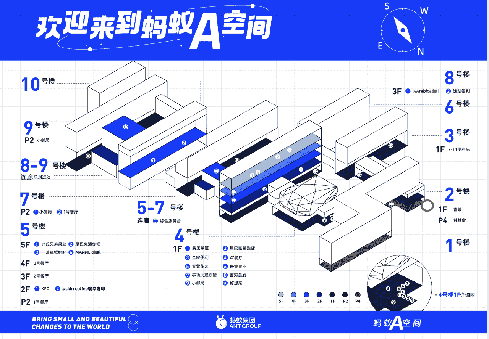
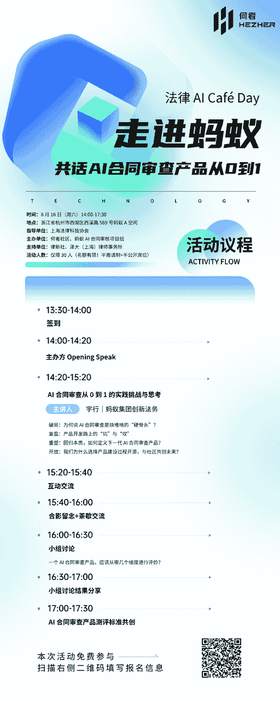

# 【已结束】法律 AI Café Day｜走进蚂蚁：共话 AI 合同审查产品从 0 到 1

> 来源：[https://docs.feishu.cn/docx/WbWMd83JkohXBfxiF33cCjjSnvg](https://docs.feishu.cn/docx/WbWMd83JkohXBfxiF33cCjjSnvg)

---

> **法律 AI Café Day**是由「何者Hezher 法律科技社区」定期举办的线下分享交流活动，我们会在这里探讨法律 AI 的最新趋势、落地实践、实操技能等当下最最热门的话题，帮助你迅速 get 到法律科技前沿认知，结识法律+科技的优质人脉圈，一起在新的科技浪潮中 surfing 🏄🏻

> **8 **月 16 日（周六），我们将走进蚂蚁集团，携手“蚂蚁 AI 合同审核项目组”，深入交流 AI 合同审查产品从 0 到 1 的挑战与思考，邀请您一同定义 AI 合同审查产品的评测机制。

> 以下是本期 Café Day 的具体流程——

# **一、基本信息**

**⭐️主题：**法律 AI Café Day｜走进蚂蚁：共话 AI 合同审查产品从 0 到 1

**📆时间：8** 月 16 日（周六）14:00-18:00

**📍地点：浙**江省杭州市西湖区西溪路 569 号蚂蚁 A 空间 2 号楼 505 会议室

+   路线指引：持访客短信码完成访客卡领取（活动前 1 天发送），进门上 5 楼

**🫡指导单位：上**海法律科技协会

**🤗主办单位：何**者社区、蚂蚁 AI 合同审核项目组

**🤝支持单位：律**新社、泽大（上海）律师事务所

**👥活动人数：仅**限 30 人（报名已结束）

# **二、活动议程**

13:30-14:00 签到入场

14:00-14:20 主办方 opening speak

**14:20-15:20 ****AI 合同审查从 0 到 1**** 的****实践挑战与思考**

> 主讲人：宇行｜蚂蚁集团创新法务

+   话题定位——应用层的创新

+   核心认知——创新需要什么？

+   张三的故事——听听张三的故事

+   张三的错误分析——聊聊张三犯的错

+   AI合同审查产品演化路径思考——往未来多看几步

+   为什么持续分享——初心和期待

15:20-15:40 互动交流

15:40-16:00 合影留念+茶歇交流

**16:00-16:30 小组讨论：一个 AI **合同审查产品，应该从哪几个维度进行评价？

+   大家用过哪些 AI 合同审查产品？觉得哪些好用？为什么？

+   一个好的 AI 合同审查产品，应该从哪几个维度进行评价？

16:30-17:30 每个小组分享讨论结果

17:30-18:00 开放麦分享

### **何者社区介绍**

> 「何者 Hezher」是一个专注于法律科技领域的社区，通过搭建交流平台，分享 AI 在法律行业的应用实践和全球法律科技前沿资讯，致力于推动法律科技行业间的交流、教育和创新，以科技驱动法律行业高质量发展。不论是学习 AI 技能，还是了解法律 AI 前沿发展趋势，都可以在这里获得。

> 了解更多：[何者 HEZHER 法律科技社区](https://legalstudio.feishu.cn/wiki/NnAAw32YKiyitFkyBWqcPX2MnIE)

> 合作请加🛰️：18825075686，备注真实姓名+所在机构+职位。