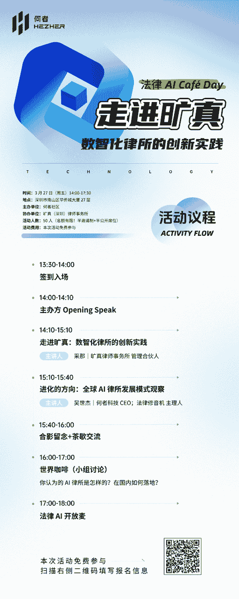
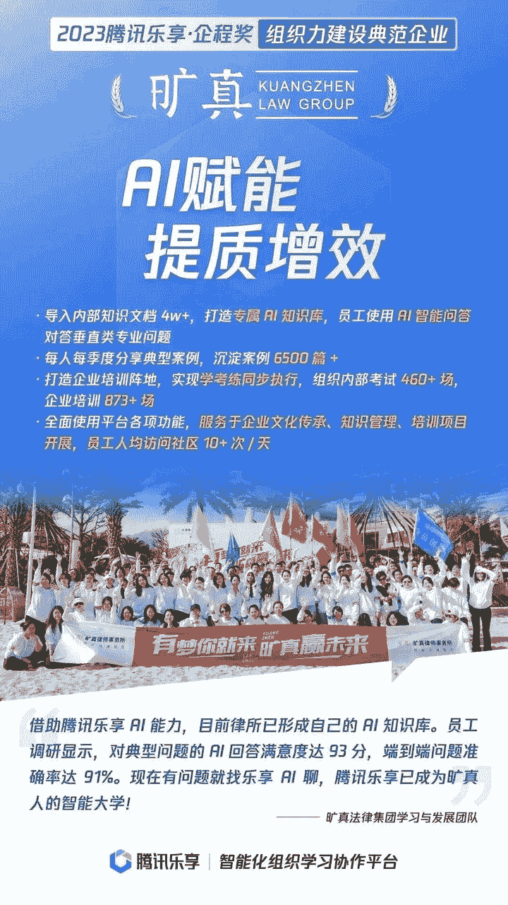

# 【已结束】法律 AI Café Day｜走进旷真：数智化律所创新实践

> 来源：[https://docs.feishu.cn/docx/CWGzd5rGtouSppxCHtCcW0ognjc](https://docs.feishu.cn/docx/CWGzd5rGtouSppxCHtCcW0ognjc)

---

> **法律 AI Café Day**是由「何者Hezher」法律科技社区举办的线下沙龙活动。

> 我们会在这里探讨法律 AI 最新趋势、落地实践、实操技能等当下最最热门的话题，帮助你迅速 get 到前[**沿认知，结**](https://mp.weixin.qq.com/s?__biz=MzE5MTY1MjA5OA==&mid=2247492822&idx=1&sn=491dce715b983604e3125387fcc1f521&scene=21#wechat_redirect)识[**优质人脉圈，一起在这个**](https://mp.weixin.qq.com/s?__biz=MzE5MTY1MjA5OA==&mid=2247490953&idx=1&sn=bd302777637d9b7f693ed1638c8ea880&scene=21#wechat_redirect)新[**的科技浪潮中 **](https://mp.weixin.qq.com/s?__biz=MzE5MTY1MjA5OA==&mid=2247491034&idx=1&sn=6137c2c9a621da515d50d160b24f51a6&scene=21#wechat_redirect)**s**urfing 🏄 2025 年以来，我们与数百位社区伙伴一起探讨了AI 律所、AI 对法律行业的影响、AI 合同审查 等前沿话题。

> 新一期「法律 AI Café Day」将于【3月27日（周五）】在【深圳】举办，走进深圳旷真律师事务所，共同探讨数智化律所创新实践，以及「AI 律所」在国内的落地路径。

> 以下是本期 Café Day 的具体流程——

# **一、活动背景**

当下，在市场需求、技术变革、监管放开等多重趋势融合的大背景下，法律行业正在发生深刻的结构性变革。

2025 年，国务院重磅发布《关于深入实施“人工智能+”行动的意见》，在国家层面对 AI 战略全面升级。其中，文件特别提到要「创新服务业发展新模式」，尤其在“法律”等领域探索「无人服务与 AI 相结合的新模式」。同时，以「AI 律所」为代表的新模式在全球范围内兴起，在技术和资本的加持下，致力于以更低的成本提供更好的法律服务。

这些“AI 律所”的集中出现，反映出市场活跃度大幅攀升，也标志着 AI 在律师行业的应用，正从浅层的 AI 工具应用，转向「深度内嵌 AI 的原生模式」，像科技公司一样运作。生成式 AI 正在以前所未有的深度和广度重塑律师行业，对行业从业者来说，向「AI 律所/团队」转型，既是一个挑战，也是一个新的机会。

对此，何者社区将举办以「AI 律所」相关的交流活动，并将推出「AI 律所」专题研究。

**3 **月 27 日（本周五），何者社区将在【深圳】举办一场线下沙龙，走进旷真（深圳）律师事务所，共同探讨数智化律所创新实践，以及「AI 律所」在国内的落地路径，欢迎感兴趣的朋友报名。

# **二、基本信息**

**⭐️主题：**法律 AI Café Day｜走进旷真：数智化律所的创新实践

**📆时间：3** 月 27 日（周五）14:00-18:00

**📍地点：深**圳市南山区华侨城大厦 27 层旷真律师事务所

**🤗主办单位：何**者社区

**🤝协办单位：旷**真（深圳）律师事务所

**👥活动人数：3**0 人（名额有限！半邀请制+半公开席位）

**💰活动费用：免**费

# **三、活动议程**

13:30-14:00  签到入场

14:00-14:10  主办方 opening speak

14:10-15:10  走进旷真：数智化律所的创新实践

> 主讲人：采那｜旷真律师事务所 管理合伙人

15:10-15:40  进化的方向：全球 AI 律所发展模式观察

> 主讲人：吴世杰｜何者科技 CEO；法律修音机主理人

15:40-16:00  合影留念+茶歇交流

16:00-17:00  世界咖啡（小组讨论）

+   你认为的 AI 律所是怎样的，有哪些构成要件？

17:00-17:30  法律 AI 开放麦

扫描下方二维码填写报名信息⬇️

> 报名后请添加何者社区团队，便于后续通知

> 📲微信：18825075686

# **旷真：数智化律所的先进实践**

「旷真律师事务所」成立于 2009 年，是一家以建材业务为核心的公司制律所，全国 31 城布局，拥有超千名律师，是中国律师行业规模化、产品化法律服务的标杆。

作为数字化转型的先行者，旷真以「精益法律服务」为核心，早于行业完成了数字化的前瞻性布局与场景化落地，走出了一条可复制、可落地的律所数智化升级之路。

## 前瞻布局：贯穿十余年的数字化长期主义

旷真的数智化之路，并非跟风式的工具应用，而是与律所发展深度绑定的长期战略。

旷真的使命是「精益法律服务」，核心内涵是减少资源浪费，比如提高律师工作效率，或者减少律师犯错后的返工，而随着律师效率的提高，就有可能让更多人享受到更便宜的法律服务，以实现精益法律服务的使命。

因此，早在 2017 年，行业尚未普遍意识到知识管理与数字化价值的阶段，旷真便引入了腾讯的乐享知识管理平台，开始沉淀大量律师实务案例和指引。这套数字化体系，支撑着旷真从 2017 年 300 人的规模，扩张至如今 1200 余人的团队，全国布局 31 家分所，实现了规模化发展与标准化服务的双向突破，成为公司制律所数字化运营的标杆。

## 硬核基建：全流程数字化系统与行业标杆知识库

旷真的数智化能力，核心在于构建强大的内部知识库，以及覆盖业务全链条的数字化系统，技术与业务深度融合：

+   自主研发 ERP 运营管理系统：打通客户管理、案件管理、对手管理、法院管理各大业务流程，通过系统对立案、排庭、开庭、执行等办案全流程节点进行严格管控，实现案件进度可视化、服务流程透明化，支撑全国分所协同办公与统一管理，成为律所规范化运营的核心支撑。

+   **行业领先的 AI 知识中台：**历经多年持续沉淀，旷真已构建起包含超过数万份知识文档的知识库，在 AI 的加持下可以实现法律知识问答、案例摘要、诉讼方案生成等能力，让内部文档转化成了可复用的组织资产。

## 深度落地：AI 全面嵌入业务与人才培养全场景

在旷真，AI 并非悬浮的概念，而是深度融入业务全流程、赋能每个律师的日常生产工具：

+   **业务全流程智能提效：**在接案环节，系统自动匹配历史案例与最优解决方案；办案环节，AI 分析对手与法院裁判数据，形成针对性诉讼战术建议；全流程通过数字化中台固化作业标准，大幅降低重复劳动，提升办案质量与服务的一致性，将律师从繁琐事务中解放出来，聚焦专业价值。

+   **破解行业人才培养痛点：**通过「AI+知识库+培训体系」的模式，旷真重构了律师的培养路径。AI 提供基础带教、知识检索、文书辅助等重复性带教工作，让年轻律师不再从零起步，不仅大幅提升了新人成长速度，还降低了人才培养成本，实现律师成长与律所发展的同频共振。

凭借领先的数智化实践，旷真曾多次受邀出席各大行业顶级峰会分享经验，其数字化成果被麻省理工科技评论等权威媒体深度报道，更获评“湖南省律师事务所规范化建设示范所”，成为国内律所数字化转型的标杆样本。

### **何者社区介绍**

> 「何者 Hezher」是一个专注于法律科技领域的社区，通过搭建交流平台，分享 AI 在法律行业的应用实践和全球法律科技前沿资讯，致力于推动法律科技行业间的交流、教育和创新，以科技驱动法律行业高质量发展。不论是学习 AI 技能，还是了解法律 AI 前沿发展趋势，都可以在这里获得。

> 了解更多：[何者 HEZHER 法律科技社区](https://legalstudio.feishu.cn/wiki/NnAAw32YKiyitFkyBWqcPX2MnIE)

> 合作请加微信：18825075686，备注真实姓名+所在机构+职位。