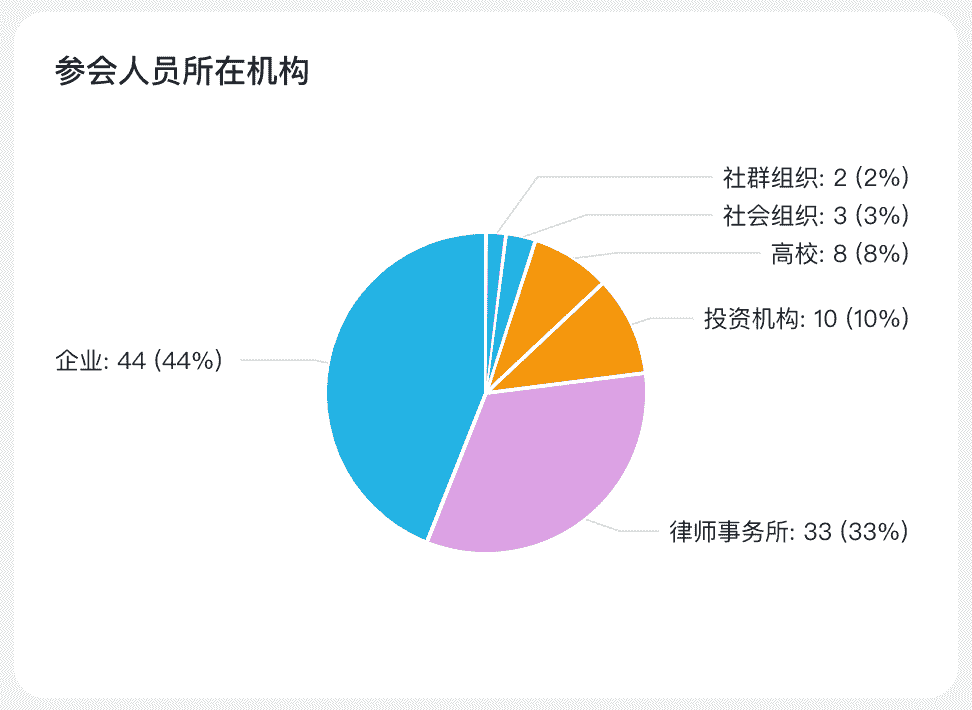
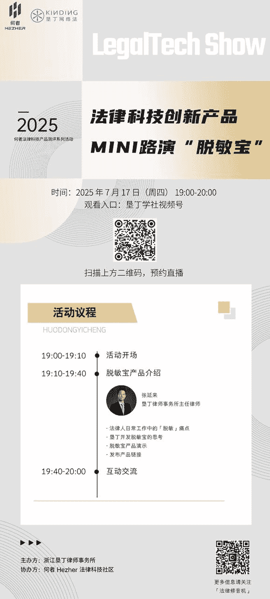

# 【产品路演日】LegalTech Show｜法律科技创新产品路演日

> 来源：[https://docs.feishu.cn/docx/BXjDdXTQtorKkZx3gGPc5GR3nzL](https://docs.feishu.cn/docx/BXjDdXTQtorKkZx3gGPc5GR3nzL)

---

# **🙋🏻「路演日」简介**

「Legal[Tech Show：法律科](https://legalstudio.feishu.cn/wiki/APCcwEU7DiKhQzkm2NlcjiQenVe)**技创新产品路**演**」是何者社区 Le**ga**lT**ech** Hub 法**律**科技产品测评**系列活动之一，我们将邀请法律科技公司、自研法律 AI 工具的达人/机构前来展示产品、分享产品研发背后的思考，并组织法律科技产品发烧友开展测评，形成用户甄选榜单和年度测评报告等，致力于搭建法律人和科技人的交流桥梁。

其中，法律科技创新产品路演分为“线下路演日”和“线上 MINI 路演”两个类型：

## 线下路演日

7 月 12 日，何者社区第一期「LegalTech Show：法律科技创新产品路演日」在上海·模速空间成功举办，“秘塔”和“iCourt”携最新产品前来路演展示，与用户面对面深度交流。

本次活动受到了创投圈和法律圈的广泛欢迎，吸引了 100 多位朋友报名参与，背景非常多元：

+   **44% 来自企业**，如字节跳动、腾讯、美团、商汤、阶跃星辰、申通快递、蔚来汽车、宝尊、英特集团、莉莉丝、Elementis、EATON、RAGFLOW 等

+   **33% 来自律所**，包括锦天城、大成、中伦、汉坤、观韬、兰迪、中联、功承瀛泰、隆安、清律、震亚等

+   **还有纪源资本**、国智投、广发证券等头部投资机构，以及来自高校、社会组织、创业社群的朋友们，不同背景的朋友在活动中充分交流

> 了解更多：[“品味”or“有用”？这是秘塔、iCourt 的答案｜何者Hezher法律科技路演日](https://legalstudio.feishu.cn/wiki/R6rbwQ5ryiI2AZkgbhBcEBJdnnf)

> **特别鸣谢：**张辰浩、谭莹娟、和珊、李泽辰、孙千喻、陈轩，参与路演活动的筹备、执行和支持。

## 线上 MINI 路演

为了帮助大家更好地了解法律科技新产品，何者社区特别推出「法律科技创新产品 MINI 路演」栏目，每期邀请 1 家/位法律科技开发者分享新产品或新功能，并分享产品研发背后的思考。

**7 月**** 17 日**，我们邀请到浙江垦丁律师事务所的张延来律师，带来垦丁最新研发的法律 AI 工具「脱敏宝」。

> 了解更多：[法律科技 MINI 路演｜AI 时代下，法律人的「脱敏」痛点怎么破？垦丁律所首发「脱敏宝」](https://legalstudio.feishu.cn/wiki/RkLRwNXCUi8wHwkNNIzcx3kDn4g?from=from_copylink)

# **📢 路演项目招募**

不论你是法律科技公司，还是法律 AI 工具的自研达人/机构，如果你**在开发法律 AI 应用**，欢迎把你们的产品推介给我们！何者社区将为你提供展示舞台：一场路演展示+社区传播，让更多人看到你的产品、想法和故事，与同行者们一起共创。如果你希望参与社区路演，可以联络何者社区发起人沟通你的产品👇

