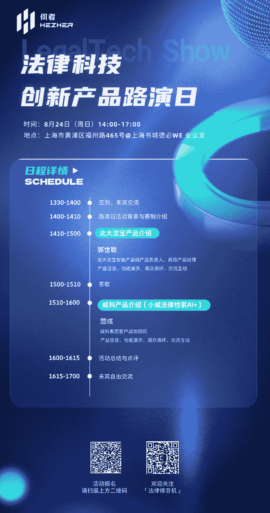
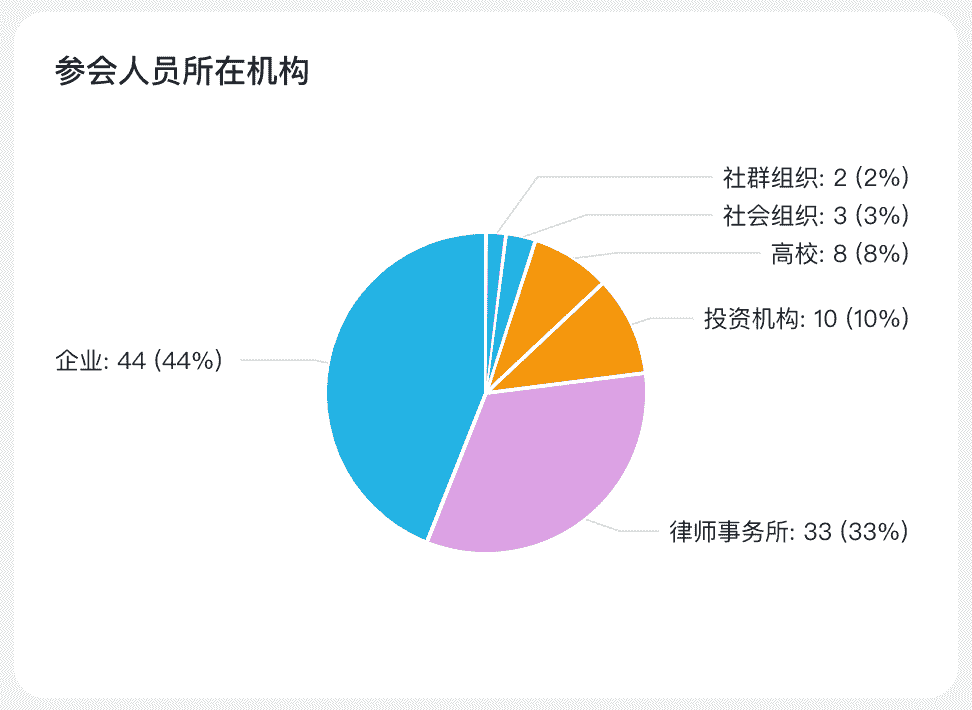

# 或许，1985 年才是中国法律科技元年

> 来源：[https://docs.feishu.cn/docx/FmPRdrjayo4dAWxb5lQclzbbnGs](https://docs.feishu.cn/docx/FmPRdrjayo4dAWxb5lQclzbbnGs)

---

> 随着 AI 席卷法律行业，法律科技正如火如荼地发展。但你可能不知道，发生于 1985 年的两件事，悄然开启了中国法律科技的序幕。

# 这一年，北大“老三教”教室里诞生了一个国产法律数据库。

1983 年，北京大学龚祥瑞、李克强撰写《法律工作的计算机化》，被视为中国法律信息化的发端。

1985 年，时任北京大学国际经济法教研室副主任张力行赴美留学归来，向时任经济法研究所和国际经济法研究所的所长芮沐先生提出了一个大胆的想法 —— 建立“法律数据库”。

什么是数据库？当时，这个概念还十分陌生，学生们一时不知所措。但芮沐敏锐地意识到，随着法律条文和案例的不断积累，传统的纸质书籍将难以承载，查找也将变得极为困难。他当即拍板：必须借助计算机的力量。

在芮沐的推动下，北京大学法律系从国务院经济法规研究中心筹集资金，促成张力行创办了“Chinalaw 计算机辅助法律研究中心”，开始研制中国自己的法律信息检索系统。

这是中国法律科技领域的一次重要尝试，也为后来的信息化建设打下了基础。

1995 年，北京大学法制信息中心和知识产权学院推出中国第一家综合性法律网站“北大法律信息网”和北大法宝的前身 ——《中国法律检索系统》。1999 年，时任北京大学法学院院长吴志攀主导创办了北京北大英华科技有限公司，随后《中国法律检索系统》使用“北大法宝”作为品牌名称，一语双关，寓意该产品在法治实践中的关键作用。

如今，北大法宝作为综合法律数据平台，已经成为国内司法、学术和实务界的必备利器。

# 也是在这一年，国际顶尖数据库远渡重洋登陆中国。

事实上，1985 年本就是中国经济转型的重要年份 —— 改革开放深化的关键节点：2 月，中共中央、国务院决定将长江三角洲、珠江三角洲和闽南厦漳泉三角地区，开辟为沿海经济开放区；4 月，我国开始实行出口退税制度，刺激外贸增长；6 月，厦门经济特区范围扩展至全岛，试行自由港政策......

纵观全年，外资政策逐步开放，跨国企业开始探索中国市场。其中，位于荷兰的威科集团捕捉到了神州大地上的这股新势头。他们发现，焕然一新的中国对专业信息服务需求旺盛，尤其是法律、财税等领域的合规指导。

于是，威科旗下专业财税品牌 CCH（Commerce Clearing House）在 1985 年率先进入中国，推出双语法规数据库。后来，作为首批进入中国的国际专业信息出版商之一，威科长期聚焦于服务在华的外资企业，为其提供中国投资法规、税务政策以及商业环境的双语解读，帮助外资企业应对复杂的中国本土合规挑战。

2007 年，威科集团启动中国本土法律产品的研发计划，组建本土技术和内容团队，并通过大量客户需求调研，为产品设计奠定基础，于 2011 年推出首个本土化法律信息库“威科先行®”，整合了法律法规、案例、新闻、国际条约及实务指南，引入相关技术，帮助法律从业者高效处理海量法规检索。

你一定知道，数据是 AI 时代的“石油”。作为训练模型、优化性能、驱动智能决策的关键生产力，其质量与规模直接决定 AI 的能力上限和产业价值。北大法宝与威科，在 40 年前就已经开始做“基层设施建设”了。

所以，1985 年的这段历史，或许是中国法律科技真正的起点。

那么，这些行业领先的数据库，又是如何在 AI 这个新战场上突破与创新呢？

**就在 8 月 24 日，“北大法宝”与“威科先行”，两大巨头重磅加入何者社区「LegalTec**h Show丨法律科技创新产品路演日」，将现场展示他们的新思路、新场景与新武器。

欢迎报名，现场观战！

# **一、基本信息**

**⭐️主题：**何者社区 Legaltech Show：法律科技创新产品路演日（2025 年第 2 期）

**📆时间：2**025 年 8 月 24 日（周日）13:30-16:30

**📍地点：上**海市黄浦区福州路 465 号（上海书城 德必WE 会议室）

**🤗主办方：何**者Hezher 法律科技社区

**👥活动人数：仅**限 50 人（名额有限！30%邀请制+70%公开席位）

**🙋🏻报名方式：本次**活动免费**报名**参与，扫码填写报名信息⬇️

> 报名后添加何者社区团队微信，便于后续通知。

现场参与的观众可获得以下权益：

1.  优先获得何者社区法律科技厂商合作伙伴提供的免费测评名额（需添加工作人员获取）

+   威科先行：小威 AI+｜法律检索（综合分析、类案检索、法规查询、专业解读）【5名】+ 伴手礼

+   北大法宝：律爱多（知识管理与检索平台，涵盖智能检索、写作、翻译、模拟法庭、合同审查等功能）+ 伴手礼

1.  参会观众将获得社区积分，累计到一定数量可[何者 HEZHER 社区建设方案（试运行）](https://legalstudio.feishu.cn/wiki/EB4owSVwPiIZRmkf0wHce0a4n0d)用于兑换多项奖品、权益，具体规则详见：

1.  参与活动现场的抽奖

# **二、活动议程**

13:00-13:30 签到入场、来宾交流

13:30-13:40 路演日活动背景与赛制介绍

13:40-14:30「北大法宝」路演展示

> 主讲人：郭世聪丨北大法宝智能产品线产品负责人、高级产品经理

+   产品介绍、功能演示、观众测评、交流互动

14:30-14:40 合影留念+茶歇交流

14:40-15:30「威科先行」路演展示

> 主讲人：范彧丨威科集团客户成功顾问

+   产品介绍、功能演示、观众测评、交流互动

15:30-15:45 活动总结与点评

15:45-16:30 来宾自由交流

根据往期数据，路演日来宾场均 50-100 人，以下为 7.12 首期路演日来宾的背景构成参考：

+   **44% 来自企业**，如字节跳动、腾讯、美团、商汤、阶跃星辰、申通快递、蔚来汽车、宝尊、莉莉丝、英特集团、Elementis、EATON、RAGFLOW 等

+   **33% 来自律所**，包括锦天城、大成、中伦、汉坤、观韬、兰迪、中联、功承瀛泰、隆安、震亚等

+   **还有纪源资本、国智投**、广发证券等头部的一二级投资机构，以及来自高校、社会组织、创业社群的朋友们，不同背景的朋友在活动中充分交流

> 了解更多：[“品味”or“有用”？这是秘塔、iCourt 的答案｜何者Hezher法律科技路演日](https://legalstudio.feishu.cn/wiki/R6rbwQ5ryiI2AZkgbhBcEBJdnnf)

# **三、机构共建**

**何者社区诚邀**各大机构作为本次活动的「支持单位」，为您的用户提供一场优质的活动机会。

我们将在活动宣传中展示合作伙伴的名称和 logo，包括但不限于公众号文章、海报、社群、飞书文档等，并在活动开场环节口播感谢。同时，我们还会为您提供 2 张活动门票，可以邀请客户、合作伙伴等一同参与。

本期活动的支持单位开放以下机构类型，具体需要做的是：

1.  **媒体/社群**

+   在公众号等社交媒体、自有社群转发本期活动的报名推文和后宣推文

1.  **律师事务所**

+   在公众号等社交媒体、自有社群转发本期活动的报名推文和后宣推文

+   组织至少 1 名专业律师参与本期活动及产品测评

测评流程：测试社区提供的 AI 合同审查产品，并基于社区提供的测评标准，撰写测评报告

1.  **法律科技公司**

+   在公众号等社交媒体、自有社群转发本期活动的报名推文和后宣推文

+   为何者社区提供贵司产品的测评权益

诚挚邀请各大机构参与共建！（申请须审核）

> 注：本次活动原则上不开放主题分享、资料宣传等合作方式，如您有相关需求，可联系何者社区团队进行沟通。

### **何者社区介绍**

> 「何者 Hezher」是一个专注于法律科技领域的社区，通过搭建交流平台，分享 AI 在法律行业的应用实践和全球法律科技前沿资讯，致力于推动法律科技行业间的交流、教育和创新，以科技驱动法律行业高质量发展。不论是学习 AI 技能，还是了解法律 AI 前沿发展趋势，都可以在这里获得。

> 了解更多：[何者 HEZHER 法律科技社区](https://legalstudio.feishu.cn/wiki/NnAAw32YKiyitFkyBWqcPX2MnIE)

> 合作请加微信：18825075686，备注真实姓名+所在机构+职位。