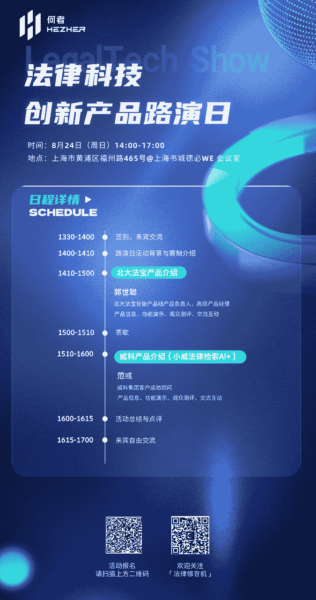

# 法律科技创新产品路演：北大法宝、威科先行来啦｜LegalTech Show

> 来源：[https://docs.feishu.cn/docx/PWnLdpTOGoS4bOxnnHDceGHWncb](https://docs.feishu.cn/docx/PWnLdpTOGoS4bOxnnHDceGHWncb)

---

> 「LegalTech Show｜法律科技创新产品路演日」是何者社区法律科技产品测评系列活动之一，每月举办一场，厂商现场展示产品，用户现场体验并评分，选出近期最好用的法律科技产品。

> [重磅：新品发布+测评反馈+年度榜单=何者社区 LegalTech Hub（内含共创机制与招募邀请）](https://legalstudio.feishu.cn/wiki/APCcwEU7DiKhQzkm2NlcjiQenVe)

> [【共创文档】法律科技工具测评｜何者 HEZEHR](https://legalstudio.feishu.cn/wiki/WOhTwCBXSi3Pw6klUrOcglKUn5c)

> 以下是 8 月场路演日活动的具体流程——

# **一、基本信息**

**⭐️主题：**何者社区 Legaltech Show：法律科技创新产品路演日（2025 年第 2 期）

**📆时间：2**025 年 8 月 24 日（周日）13:30-16:30

**📍地点：上**海市黄浦区福州路 465 号（上海书城 德必WE 会议室）

**🤗主办方：何**者Hezher 法律科技社区

**👥活动人数：仅**限 50 人（名额有限！30%邀请制+70%公开席位）

**🙋🏻报名方式：本次**活动免费**报名**参与，扫码填写报名信息⬇️

> 报名后添加何者社区团队🛰️，便于后续通知。

现场参与的观众可获得以下权益：

1.  优先获得何者社区法律科技厂商合作伙伴提供的免费测评名额（需添加工作人员获取）

+   威科先行：小威 AI+｜法律检索（综合分析、类案检索、法规查询、专业解读）【5名】+ 伴手礼

+   北大法宝：律爱多（知识管理与检索平台，涵盖智能检索、写作、翻译、模拟法庭、合同审查等功能）+ 伴手礼

1.  参会观众将获得社区积分，累计到一定数量可[何者 HEZHER 社区建设方案（试运行）](https://legalstudio.feishu.cn/wiki/EB4owSVwPiIZRmkf0wHce0a4n0d)用于兑换多项奖品、权益，具体规则详见：

1.  参与活动现场的抽奖

# **二、活动议程**

13:00-13:30 签到入场、来宾交流

13:30-13:40 路演日活动背景与赛制介绍

13:40-14:30「北大法宝」路演展示

> 主讲人：郭世聪丨北大法宝智能产品线产品负责人、高级产品经理

+   产品介绍、功能演示、观众测评、交流互动

14:30-14:40 合影留念+茶歇交流

14:40-15:30「威科先行」路演展示

> 主讲人：范彧丨威科集团客户成功顾问

+   产品介绍、功能演示、观众测评、交流互动

15:30-15:45 活动总结与点评

15:45-16:30 来宾自由交流

# **三、机构共建**

**何者社区诚邀**各大机构作为本次活动的「支持单位」，为您的用户提供一场优质的活动机会。

我们将在活动宣传中展示合作伙伴的名称和 logo，包括但不限于👸号文章、海报、社群、飞书文档等，并在活动开场环节口播感谢。同时，我们还会为您提供 2 张活动门票，可以邀请客户、合作伙伴等一同参与。

本期活动的支持单位开放以下机构类型，具体需要做的是：

1.  **媒体/社群**

+   在👸号等社交媒体、自有社群转发本期活动的报名推文和后宣推文

1.  **律师事务所**

+   在👸号等社交媒体、自有社群转发本期活动的报名推文和后宣推文

+   组织至少 1 名专业律师参与本期活动及产品测评

测评流程：测试社区提供的 AI 合同审查产品，并基于社区提供的测评标准，撰写测评报告

1.  **法律科技公司**

+   在👸号等社交媒体、自有社群转发本期活动的报名推文和后宣推文

+   为何者社区提供贵司产品的测评权益

诚挚邀请各大机构参与共建！（申请须审核）

> 注：本次活动原则上不开放主题分享、资料宣传等合作方式，如您有相关需求，可联系何者社区团队进行沟通。

### **何者社区介绍**

> 「何者 Hezher」是一个专注于法律科技领域的社区，通过搭建交流平台，分享 AI 在法律行业的应用实践和全球法律科技前沿资讯，致力于推动法律科技行业间的交流、教育和创新，以科技驱动法律行业高质量发展。不论是学习 AI 技能，还是了解法律 AI 前沿发展趋势，都可以在这里获得。

> 了解更多：[何者 HEZHER 法律科技社区](https://legalstudio.feishu.cn/wiki/NnAAw32YKiyitFkyBWqcPX2MnIE)

> 合作请加🛰️：18825075686，备注真实姓名+所在机构+职位。