# 【第一期】“品味”or“有用”？这是秘塔、iCourt 的答案｜何者Hezher法律科技路演日

> 来源：[https://docs.feishu.cn/docx/LiH4dH3C2oV1qtxsyUocCVCDn7e](https://docs.feishu.cn/docx/LiH4dH3C2oV1qtxsyUocCVCDn7e)

---

7 月 12 日，何者社区「LegalTech Show：法律科技创新产品路演日」在上海·模速空间成功举办，“秘塔”和“iCourt”携最新产品来路演展示，与用户面对面深度交流。

本次活动受到了创投圈和法律圈的广泛欢迎，吸引了 100 多位朋友报名参与。

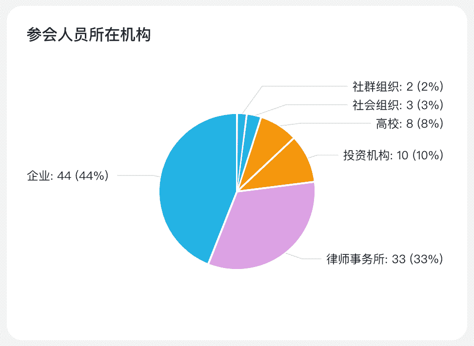

参与本次活动的朋友非常多元：

+   **46% 来自于企业**，如字节跳动、腾讯、美团、商汤、阶跃星辰、英特集团、申通快递、蔚来汽车、莉莉丝、RAGFLOW 等

+   **30% 来自于律所**，如锦天城、大成、中伦、汉坤、观韬、兰迪、中联、功承瀛泰、隆安、清律、震亚等，

+   **还有纪源资本、国**智投、广发证券等一/二级投资机构，不同背景的朋友在这里充分交流。

**特别鸣谢：**参与本次路演日的**方大玮**同学记录了详实的会议笔记，本文囿于篇幅所限内容较为精简[🔥0712 何者社区 法律科技创新产品路演日笔记](https://legalstudio.feishu.cn/wiki/C8iJwrpR8ikwLlkUQrzc32l3nWb)更多厂商分享和观众互动内容，点击阅读：

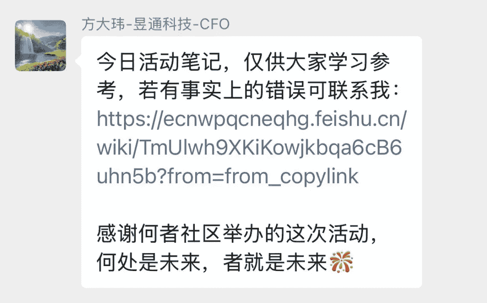

# **活动致辞**

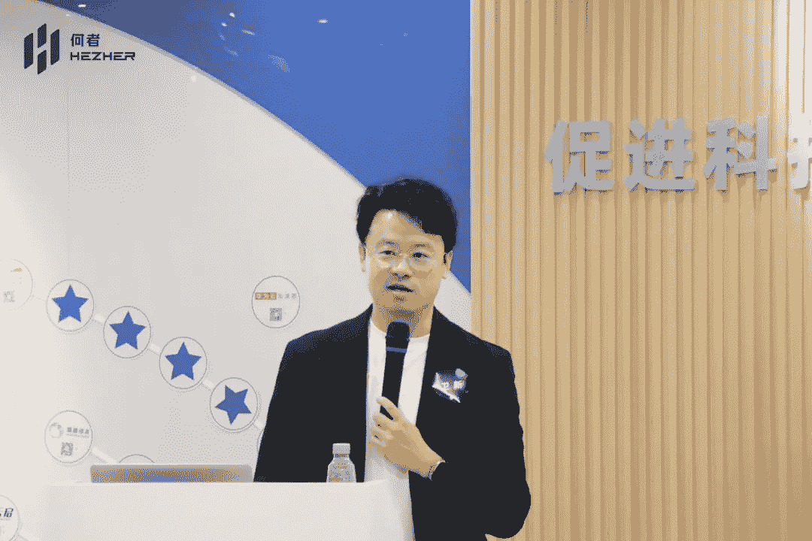

活动伊始，特别邀请了上海法律科技协会副会长、上海律协法律科技委主任卫新开场致辞。

卫新表示，何者社区组织的路演活动具有创新性，对比上海律协举办的法律科技产品大赛，从官方层面为产品提供复制和背书，何者社区的法律科技路演活动将用户、评委与科技公司汇集到同一现场，以用户体验为首要标准进行及时反馈和测评，形式独特且独立。

对于法律科技的发展，卫主任提出三点建议：以用户为老师、以场景为基石、以生态扩大价值。

同时，卫主任还预告在 2025 年 7 月底世界人工智能大会（WAIC）期间，上海法[律科技协会将组织法律科技专业分论坛，并面](https://mp.weixin.qq.com/s?__biz=MzUzOTcwMTE5OQ==&mid=2247492719&idx=1&sn=800ee1cdeed49eb80b564c3027e1542c&scene=21#wechat_redirect)向全国组织新一年的法律科技产品大赛（👉赛事报名：2025 WAIC 法律科技分论坛——法律 AI 咨询产品 PK 大赛）。同时，协会正着手建设法律科技人才库，推动法律科技专项扶持基金设立，出台应用发展扶持标准，推进产学研一体化评价机构建设，诚邀各方加入生态链，从单点突破到群体跃迁，实现协作共赢。

# **秘塔分享**

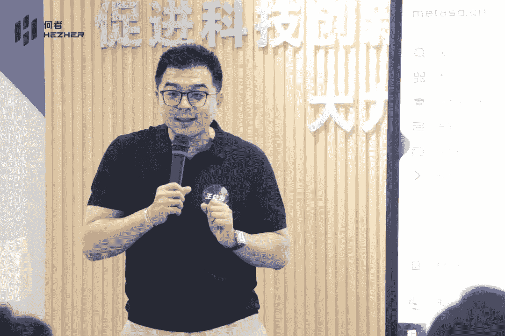

活动上半场，秘塔科技首席运营官王益为带来了「今天学点啥」和「MetaLaw」两个最新产品，从 AI 产品的“品味”和“有用”两个维度进行分享。

其中，“品类”体现厂商对新一代 AI 产品的理解，目前行业中存在跟风现象，而秘塔通过理解模型的能力，创新地匹配相应的产品形态。“有用”则通过收费验证，强调 AI 产品直接完成工作任务，且收费模式可以从传统的 SaaS 订阅向计件式收费转变。

其中，今天学点啥是秘塔对于 AI 产品“品味”理解的体现，这一产品曾被黑神话悟空制作人冯骥评价为“2025 年继 DeepSeek R1 之后最有创意的 AI 产品”。

基于秘塔 2 亿+篇文章书籍免费数据库，用户可搜索任意严肃话题（如法律、金刚经、小学数学等），AI 将自动分章节进行讲解，同时用户还可以设置 AI 的人格（如张爱玲、专家级别）、讲课风格（如暴躁老哥）、音色（如阳光女孩、智慧大爷）及输出语言（中/英文），30 秒到 1 分钟内即可生成带逐字稿的 PPT 课件和视频，并且支持导出。

今天学点啥的应用场景包括开车时听课、快速准备汇报材料等。例如，某跨国公司的法务曾使用该功能快速生成 GDPR 新规的中英双语培训视频、PPT 及逐字稿。目前，已有不少老师使用这一功能超过 100 小时。

🔗链接：https://metaso.cn/study?s=studyy

MetaLaw 则是秘塔对于 AI 产品“有用”理解的体现。2023 年 12 月，秘塔针对法律专业人士推出 MetaLaw 类案检索产品（Beta 版本），获得很多律师的认可。后来，随着裁判文书公开数量减少，传统依赖类案的检索模式受限，因此在 DeepSeek R1 等基础模型推理能力提升的情况下，MetaLaw 升级为基于大模型对案例法规的理解直接生成深度报告。MetaLaw 生成的深度研究报告内容详实，含核心法律责任分析、相关案例辨析、结论以及建议等内容，引用的案例均有真实案号可跳转验证。报告生成时间约 1 分钟，质量优于律师助理一天工作量，可以用于辅助律师谈案。

🔗链接：meta.law

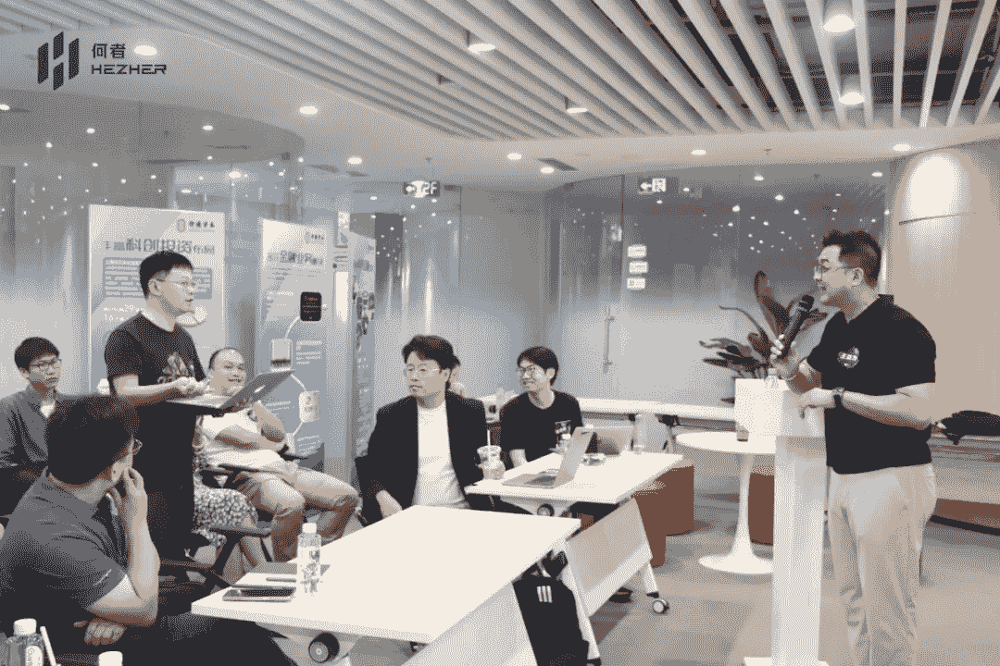

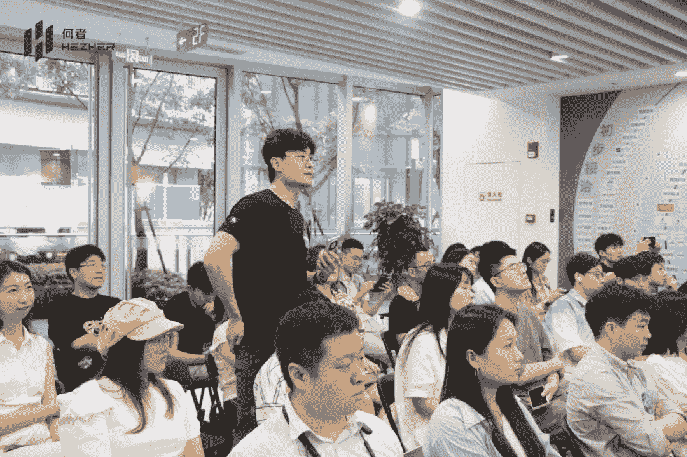

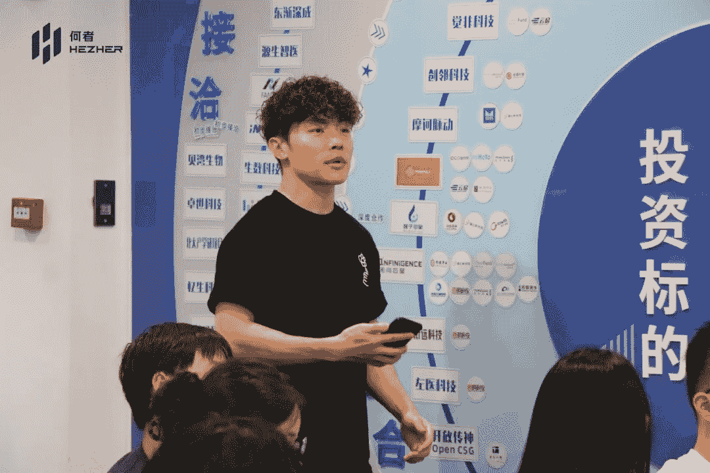

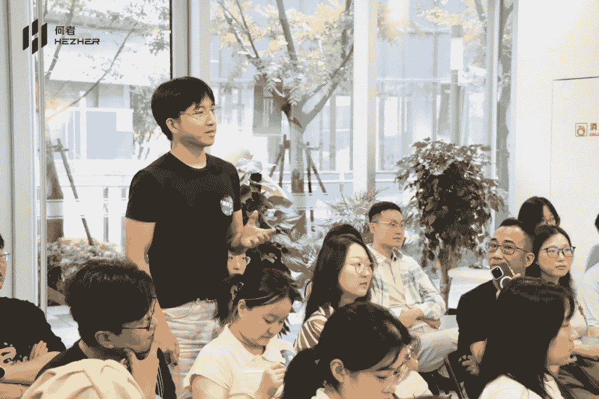

在互动环节，王益为就观众提出的法律问题，用 MetaLaw 实机展示了深度研究报告的生成过程，并与用户交流产品设计及迭代建议。

# **iCourt 分享**

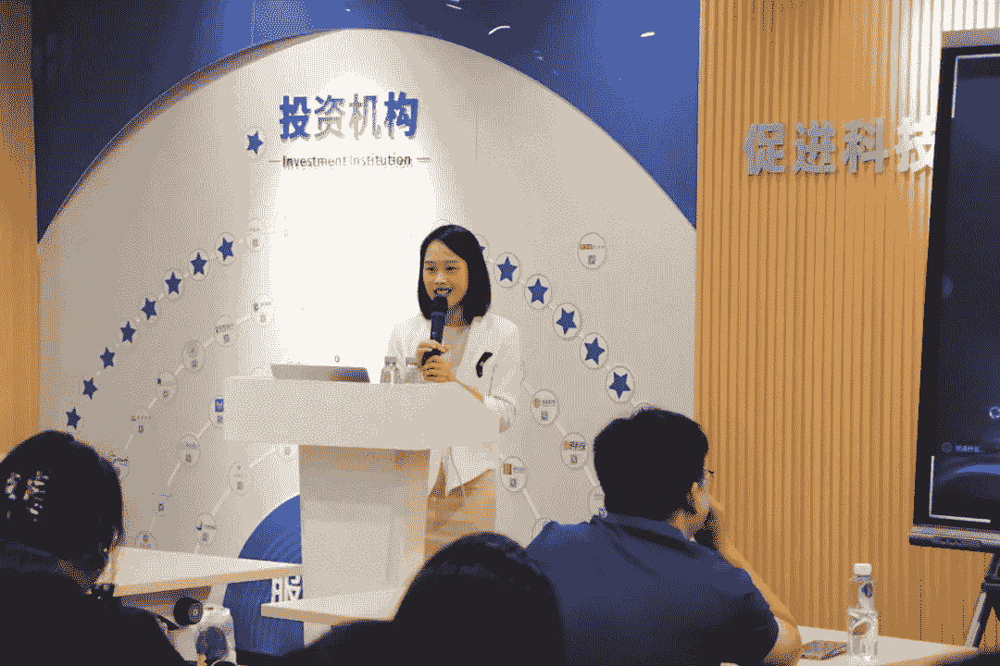

活动下半场，iCourt 华东区域负责人朱烨带来了 AlphaGPT 的分享。

朱烨从 AI 及大模型的相关知识切入，表示 AlphaGPT 是在通用大模型基础上，增加法律专业数据和法律应用场景专门技能训练形成的法律人专用工具，与通用大模型相比，在法律垂类领域数据和技能更有针对性。

AlphaGPT 拥有庞大的中文法律数据库，数据每日更新，涵盖案例、法规、裁判观点等，并通过工程师对模型的微调训练和法律专业团队的技能训练，可以有效提升专业性。

同时，朱烨详细介绍了 AlphaGPT 四大功能模块，如法律检索（含法律咨询、案例检索，法律咨询）、合同审查（支持单份合同审查、合同比对审查，可选择审查立场和尺度，提供多种导出版本）、文书起草（含特定类型文书和自由起草，未来还将会上线要素式文书撰写功能）、法律意见生成（主要针对民事案件，可以生成包含多板块内容的法律意见书，助力提升客户体验和报价），并进行实操演示。

**实**践中，多位律师反馈使用 AlphaGPT 节省了时间、提高谈案成功率，比如快速生成方案助力签约、节省人力成本、高效处理法律咨询和合同审查等，尤其有利于专注于常法业务等专业化路线的律所实现集约化服务。

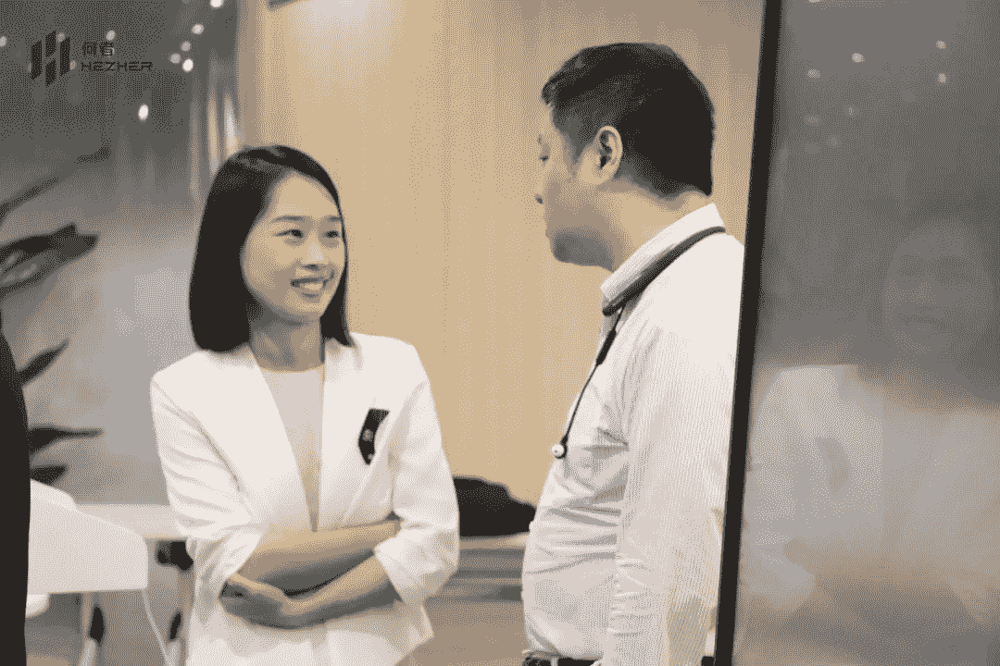

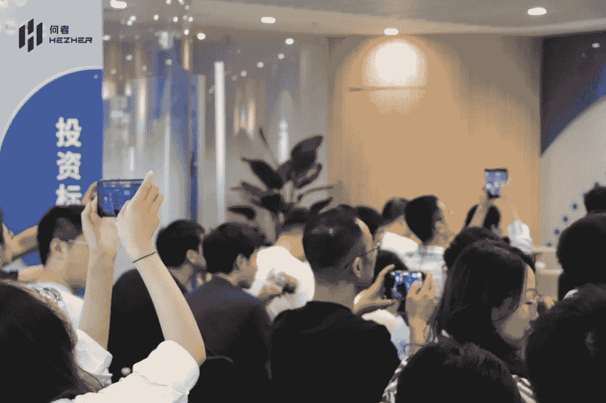

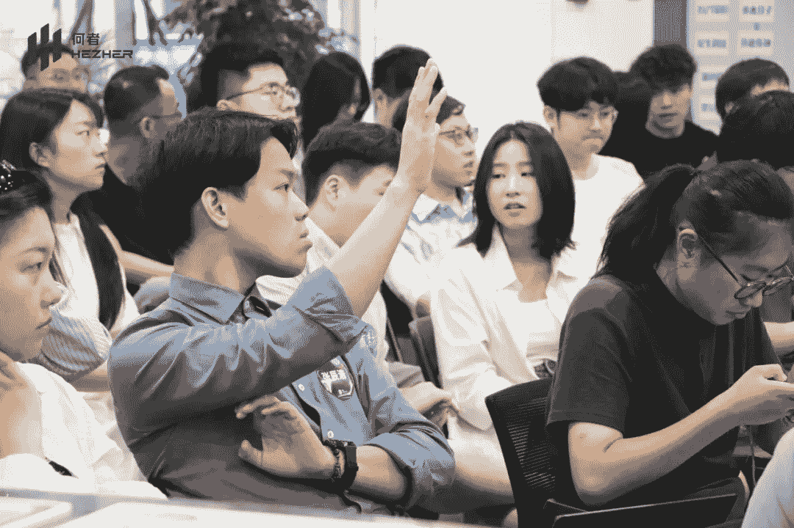

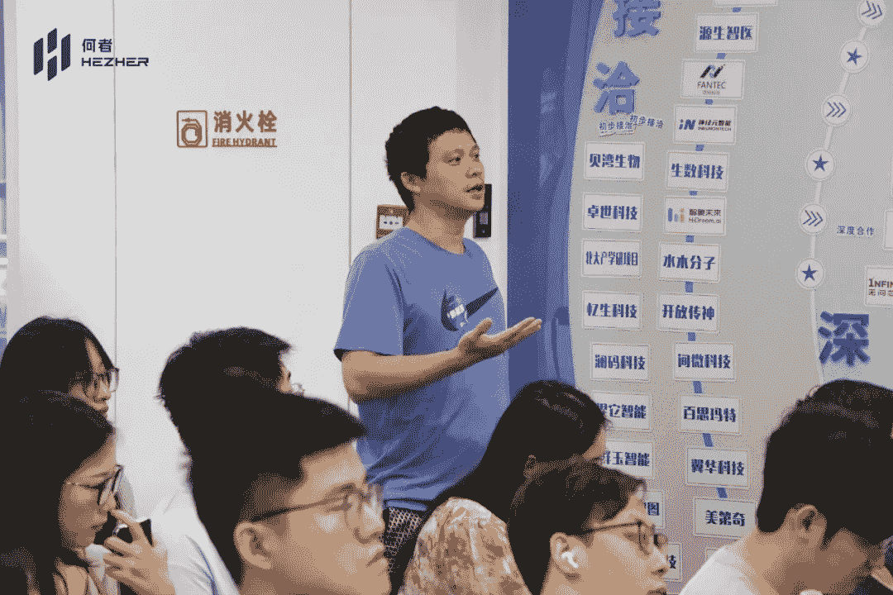

在互动环节，朱烨就 AlphaGPT 现有功能、应用场景和未来迭代计划与观众互动交流。

**注：如需体验 AlphaGPT，可联系何者社区团队**申请试用（🛰️：18825075686）

活动尾声，秘塔和 iCourt 分别为现场观众送出了 MetaLaw 和《法律人 AI 应用指南》，参会人员各自链接交流，活动圆满结束。

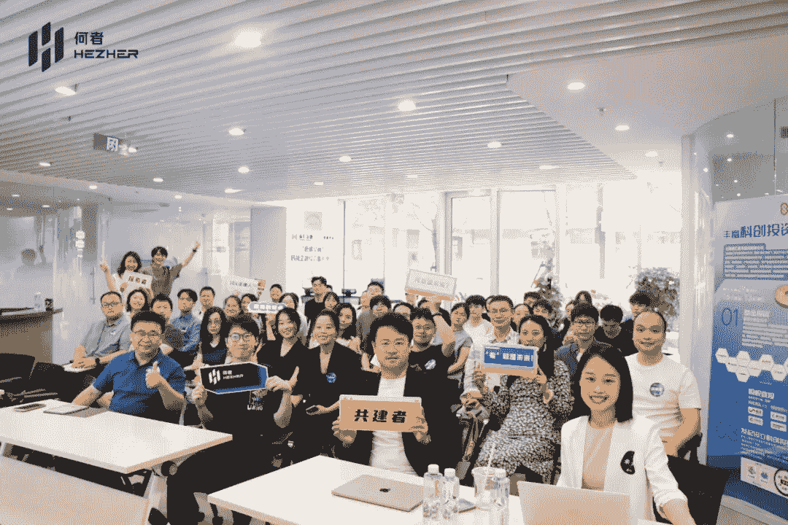

上海是法律科技发展的优质土壤，近年来大力扶持法律科技产业的发展。2023 年底，上海市政府等发布《关于推动上海法律科技应用和发展的工作方案》等政策鼓励法律科技发展；2024 年初，上海律协举办“2024 年最受上海律师欢迎的法律科技产品大赛”；2025 年 4 月，全国首家专业性法律科技协会 —— 上海法律科技协会正式成立，旨在深化科技在法律领域的应用，推动法律与科技良性互动、融合发展，提升法律服务智能化水平。

作为一个高质量的法律科技社区，何者Hezher 多年以来一直与时代同频共振，开展法律科技调查研究、标准制定、信息交流，致力于推动法律科技产品研发、提供业务培训与知识共享，为法律行业数智化转型贡献力量。

目前，何者社区正在创设 [《LegalTech Hub》](https://mp.weixin.qq.com/s?__biz=MzUzOTcwMTE5OQ==&mid=2247492268&idx=1&sn=c401d579f9bb4aefa87a72c3dbf87d26&scene=21#wechat_redirect)，邀请**法律科技公司**、**法律 AI 工具的自研达人**展示产品，并组织**法律科技产品应用达人**开展**测评**，形成**用户甄选榜单**和**年度测评报告**等，**搭建法律人和科技人的交流桥梁。**

首期「Legaltech Show：法律科技创新产品路演日」圆满结束，下一期敬请期待！

了解更多：

“法律科技创新产品路演日”来袭！@7.12 上海模速空间，欢迎来玩🤗

[【活动报名】@法律极客： 7月12日上海，](https://mp.weixin.qq.com/s?__biz=MzUzOTcwMTE5OQ==&mid=2247492633&idx=1&sn=d83e0ad6ce1ed54d14e490863b4edd99&scene=21#wechat_redirect)“法律科技创新产品路演日”，欢迎线下交流

🤗有奖互动：参与法律科技路演日，现场抽「秘塔 Metalaw」会员！

🤗有奖互动：参与法律科技路演日，现场抽《法律人 AI 应用指南》！