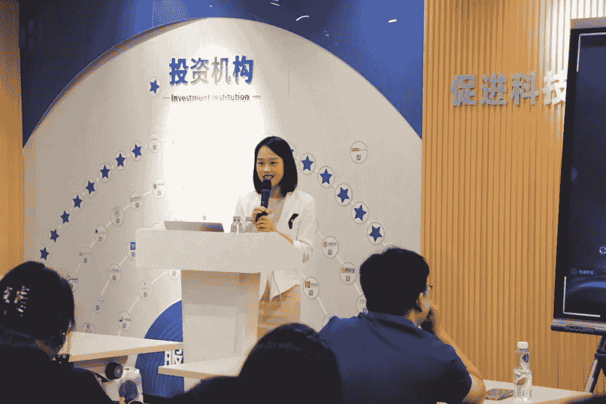
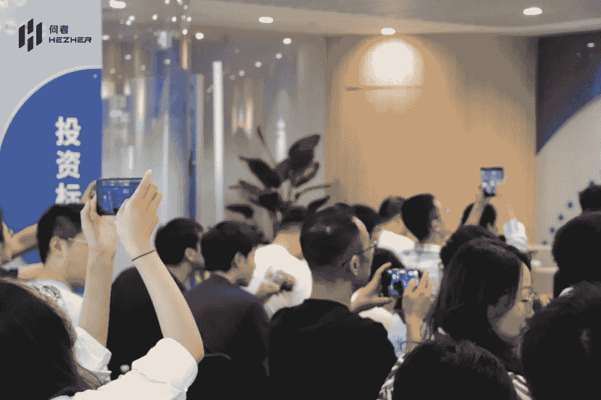
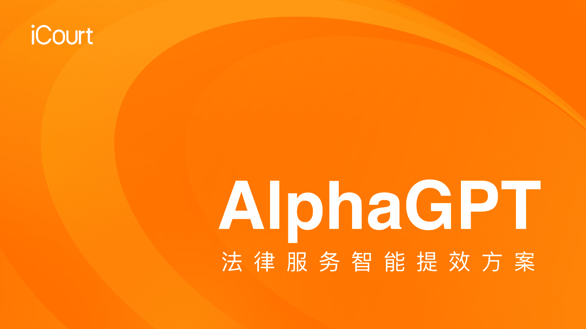
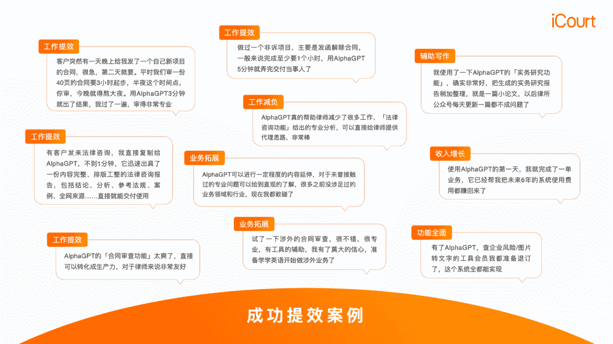
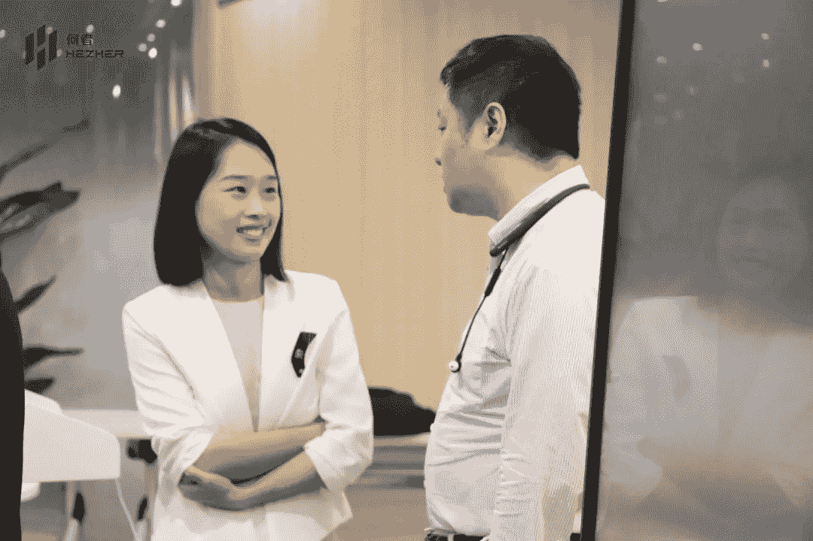
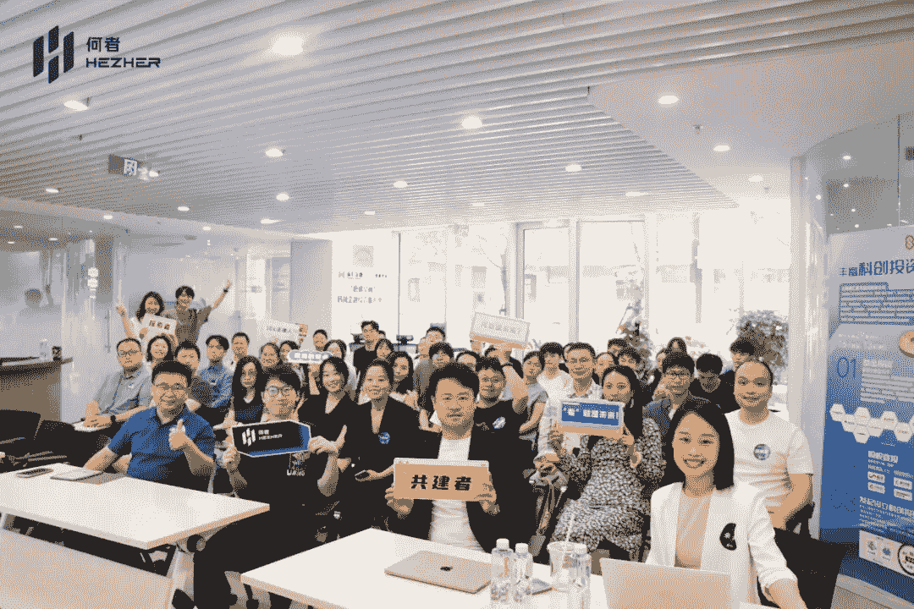

# 从 Alpha 到 AlphaGPT，iCourt 为法律人打造“六边形 AI 助手”｜何者Hezher法律科技路演日

> 来源：[https://docs.feishu.cn/docx/KG3idqPJEoK4KwxgzVpchrQCnRe](https://docs.feishu.cn/docx/KG3idqPJEoK4KwxgzVpchrQCnRe)

---

7 月 12 日，何者社区「LegalTech Sho**w：法律科技创新产品路演日」在上海举办。本次**路演，iCourt 华东区域负责人朱烨带来了 AlphaGPT 的最新能力分享。

2016 年，iCourt 推出法律检索工具 Alpha，经过多年发展已成为国内头部法律科技产品。生成式 AI 出现后，iCourt 在 Alpha 庞大的法律数据库基础上集成 AI 技术，推出新一代的法律 AI 产品 —— AlphaGPT。

# **AI 大模型相关知识与应用探讨**

活动中，朱烨从 AI 及大模型相关知识切入，探讨了用户在使用大模型时的提问技巧，指出在 DeepSeek 开启推理型大模型时代之后，用户无需专门学习提示词，正常提问即可得到专业答案，若问题不够全面可继续追问校正。

但是，DeepSeek 也不是万能的，其运作遵循“接收问题-调用数据-调用技能-输出答案”的公式，模型能力受数据和技能的影响，可能会出现“幻觉”，并解释了数据调用的公开性判断标准及技能分类与水平判断方式。

# AlphaGPT 产品介绍与实操演示

AlphaGPT 是在通用大模型基础上，增加法律专业数据和法律应用场景专门技能训练形成的法律人专用工具，与通用大模型相比，在法律垂类领域数据和技能更有针对性。

AlphaGPT 拥有庞大的中文法律数据库，数据每日更新，涵盖案例、法规、裁判观点等，并通过工程师对模型的微调训练和法律专业团队的技能训练，可以有效提升专业性。

[AlphaGPT产品手册2025.pdf](https://internal-api-drive-stream.feishu.cn/space/api/box/stream/download/all/BSjAbyCccoe97gx1GDucncYXnqe)

> 附：[AlphaGPT 使用指南](https://mp.weixin.qq.com/mp/appmsgalbum?action=getalbum&__biz=Mzk2NDE1ODY1Mg==&scene=1&album_id=3926658766577401857&count=3#wechat_redirect)

针对 AlphaGPT 的具体功能，朱烨针对以下四大功能模块进行了详细的实操演示：

+   法律检索（含法律咨询、案例检索，法律咨询）

+   合同审查（支持单份合同审查、合同比对审查，可选择审查立场和尺度，提供多种导出版本）

+   文书起草（含特定类型文书和自由起草，未来还将会上线要素式文书撰写功能）

+   法律意见生成（主要针对民事案件，可以生成包含多板块内容的法律意见书，助力提升客户体验和报价）

# **产品应用价值与行业赋能**

实践中，多位律师反馈使用 AlphaGPT 节省了时间、提高谈案成功率，比如快速生成方案助力签约、节省人力成本、高效处理法律咨询和合同审查等，尤其有利于专注于常法业务等专业化路线的律所实现集约化服务。

同时，iCourt 还通过公众号、视频号、线上线下活动等帮助律师打造个人影响力和专业度，欢迎律师分享专业内容。

在互动环节，朱烨就 AlphaGPT 现有功能、应用场景和未来迭代计划与观众互动交流，还为现场观众送出了《法律人 AI 应用指南》。

**注：如需体验 AlphaGPT，可联系何者社区团队**申请试用（微信：18825075686）

上海是法律科技发展的优质土壤，近年来大力扶持法律科技产业的发展。2023 年底，上海市政府等发布《关于推动上海法律科技应用和发展的工作方案》等政策鼓励法律科技发展；2024 年初，上海律协举办“2024 年最受上海律师欢迎的法律科技产品大赛”；2025 年 4 月，全国首家专业性法律科技协会 —— 上海法律科技协会正式成立，旨在深化科技在法律领域的应用，推动法律与科技良性互动、融合发展，提升法律服务智能化水平。

作为一个高质量的法律科技社区，何者Hezher 多年以来一直与时代同频共振，开展法律科技调查研究、标准制定、信息交流，致力于推动法律科技产品研发、提供业务培训与知识共享，为法律行业数智化转型贡献力量。

目前，何者社区正在创设 [《LegalTech Hub》](https://mp.weixin.qq.com/s?__biz=MzUzOTcwMTE5OQ==&mid=2247492268&idx=1&sn=c401d579f9bb4aefa87a72c3dbf87d26&scene=21#wechat_redirect)，邀请**法律科技公司**、**法律 AI 工具的自研达人**展示产品，并组织**法律科技产品应用达人**开展**测评**，形成**用户甄选榜单**和**年度测评报告**等，**搭建法律人和科技人的交流桥梁。**

首期「Legaltech Show：法律科技创新产品路演日」圆满结束，下一期敬请期待！

了解更多：

“法律科技创新产品路演日”来袭！@7.12 上海模速空间，欢迎来玩🤗

[【活动报名】@法律极客： 7月12日上海，](https://mp.weixin.qq.com/s?__biz=MzUzOTcwMTE5OQ==&mid=2247492633&idx=1&sn=d83e0ad6ce1ed54d14e490863b4edd99&scene=21#wechat_redirect)“法律科技创新产品路演日”，欢迎线下交流

🤗有奖互动：参与法律科技路演日，现场抽「秘塔 Metalaw」会员！

🤗有奖互动：参与法律科技路演日，现场抽《法律人 AI 应用指南》！