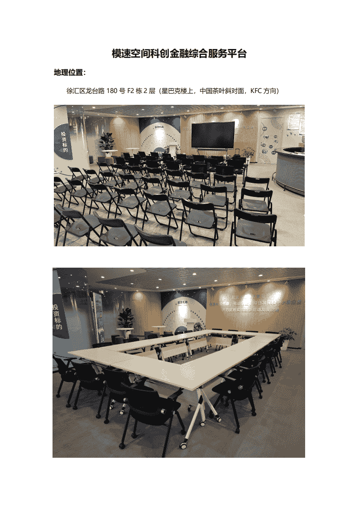
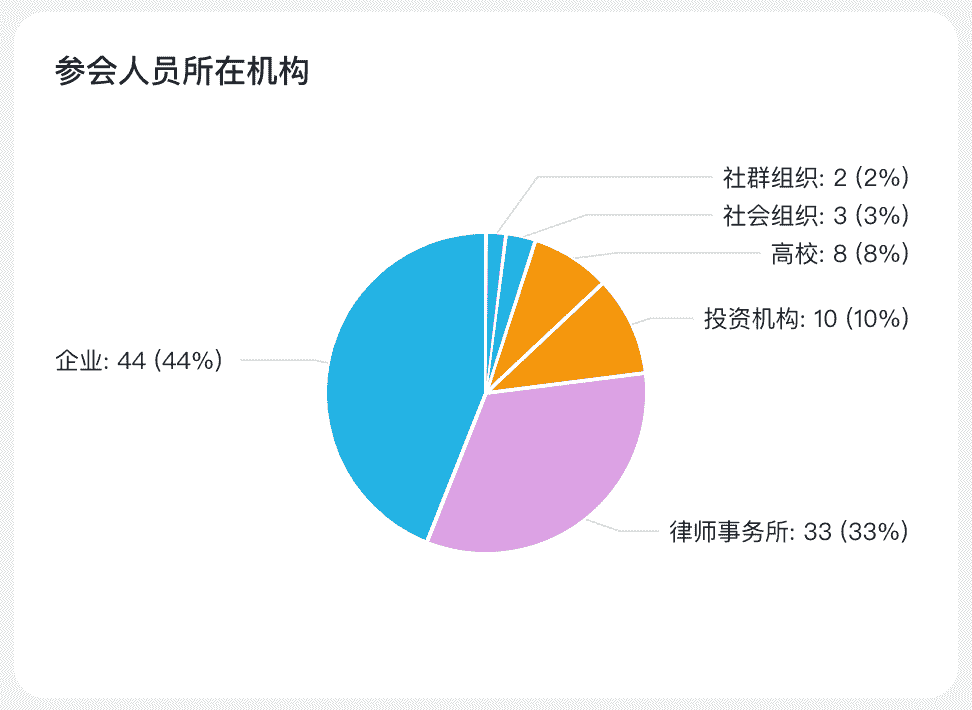
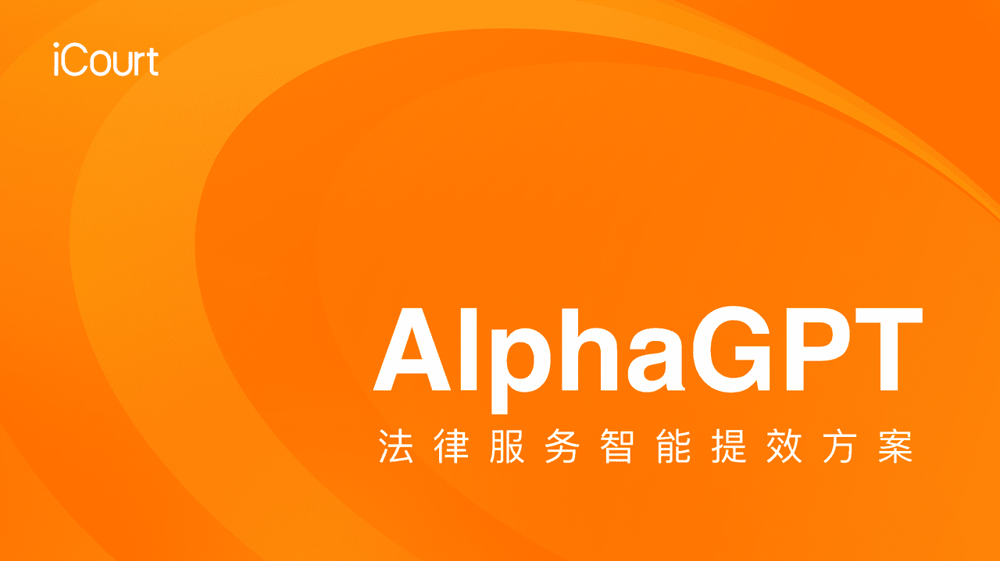
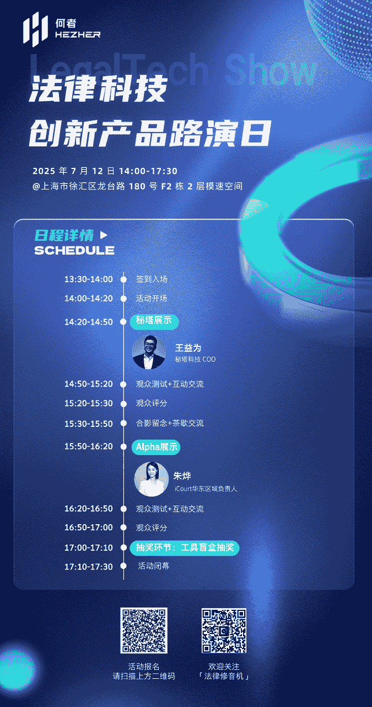
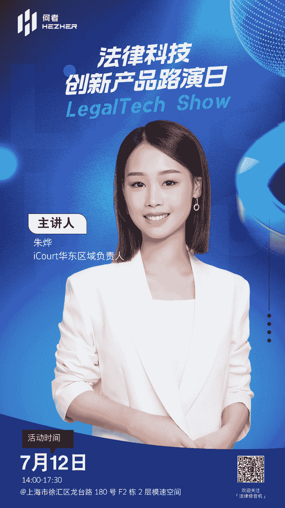

# LegalTech Show｜法律科技创新产品路演日（2507）

> 来源：[https://docs.feishu.cn/docx/AhAedRu14oBBHbxQxdLcVKk9n6X](https://docs.feishu.cn/docx/AhAedRu14oBBHbxQxdLcVKk9n6X)

---

> 「LegalTech Show：法律科技创新产品路演日」是何者社区法律科技产品测评系列活动之一，计划每月或每双月举办一场，厂商现场展示产品，用户现场体验并评分，选出近期最好用的法律科技产品。

> [重磅：新品发布+测评反馈+年度榜单=何者社区 LegalTech Hub（内含共创机制与招募邀请）](https://legalstudio.feishu.cn/wiki/APCcwEU7DiKhQzkm2NlcjiQenVe)

> [【共创文档】法律科技工具测评｜何者 HEZEHR](https://legalstudio.feishu.cn/wiki/WOhTwCBXSi3Pw6klUrOcglKUn5c)

> 以下是 7 月场路演日活动的具体流程——

# **一、基本信息**

**⭐️主题：**何者社区 Legaltech Show：法律科技创新产品路演日

**📆时间：2**025 年 7 月 12 日（周六）14:00-17:30

**📍地点：上**海市徐汇区龙台路 180 号 F2 栋 2 层模速空间-科创金融综合服务平台

> 路线指引：

[模速空间科创金融综合服务平台.pdf](https://internal-api-drive-stream.feishu.cn/space/api/box/stream/download/all/PCUnbp8GtotSnOxfvA6cWw46nvg)

**🤗主办方：何**者Hezher 法律科技社区

**🤝支持单位：律**新社、职得 Legal、这就是律师

**👥活动人数：仅**限 50 人（名额有限！30%邀请制+70%公开席位）

> 注：本期路演日活动最终报名人数超 100 人

**🎁有奖互动：观****众报名时可选择****参与产品测评，参与者可以获得额外的产品权益，现场还可以**参与抽奖。测评要求：用户须在活动现场的互动环节分享自己的使用感受，无法到现场的用户则须撰写测评文档并提交给何者社区。

|  | 秘塔 | iCourt |
| --- | --- | --- |
| **产品试用** | MetaLaw 深度报告：https://flxyj.meta.law/ | AlphaGPT 一周免费账号 |
| **现场抽奖** | 🥇一等奖：MetaLaw 3 个月会员 + 20 份深度分析报告 | 《法律人 AI 应用指南》应用书籍 |

[AlphaGPT产品手册2025.pdf](https://internal-api-drive-stream.feishu.cn/space/api/box/stream/download/all/NVLVbBhjkoRupWxgjb1csTDxnsh)

# **二、活动议程**

13:30-14:00 签到入场

14:00-14:20 活动开场

+   主办方致辞，介绍本次活动的背景、目的及意义，以及评委团组成（法律专家、技术专家），并公布测评标准（如实用性 50% + 技术创新性 30% + 用户体验 20%）

14:20-14:50「秘塔」展示（上半场）

+   厂商展示产品，突出产品创新点和近期更新功能，并实际演示产品能力

+   厂商演示过程中，观众可同步测试厂商展示的产品功能

14:50-15:20 观众测试+互动交流

+   展示结束后，观众就产品问题与厂商提问交流、提出需求

15:20-15:30 观众评分

+   用户根据现场体验，从技术创新性、功能实用性、市场潜力等维度进行打分

15:30-15:50 合影留念+茶歇交流

15:50-16:20「Alpha」展示（下半场）

+   厂商展示产品，突出产品创新点和近期更新功能，并实际演示产品能力

+   厂商演示过程中，观众可同步测试厂商展示的产品功能

16:20-16:50 观众测试+互动交流

+   展示结束后，观众就产品问题与厂商提问交流、提出需求

16:50-17:00 观众评分

+   用户根据现场体验，从技术创新性、功能实用性、市场潜力等维度进行打分

17:00-17:10 抽奖环节：工具盲盒抽奖

+   所有现场参会观众可参与抽奖，奖品包括厂商工具权益、何者社区权益、社区伙伴文创等

17:10-17:30 活动闭幕

+   主办方对活动进行总结，并预告“下期路演日”，期待下次再会

---

附：本期路演的厂商及产品介绍

## **秘塔**

**🙋🏻简介：秘塔**是一家专注于 AI 领域的高科技公司，旗下产品包括面向通用场景的“秘塔 AI 搜索”，及面向法律领域的法律研究产品“Metalaw”、法律翻译产品“秘塔翻译”、文本纠错产品“秘塔写作猫”，深受广大用户喜爱。

⭐️**近期功能更新：**

**今天学点啥：**现象级的 AI 教育产品，且兼具 AIPPT 能力，当你对任何内容感兴趣，不论是网页、文章、讲义，还是秘塔文库覆盖超一亿的学术文献，都可以让塔子老师讲给你听。

🔗网址：https://metaso.cn/study?s=studyy

🔗官方介绍：

忙了仨月，我们希望让教育更平权一点

“塔子老师”的课件，可以一键导出PPT了

北大路江涌教授：这样用AI，把碎片时间变成深度学习

**Metalaw 正式版：**可能是目前最好用的法律研究 AI 产品，上万字的深入法律研究报告 1 分钟生成，支持下载为 word 进行二次修改，也可以直接生成 pdf 使用。

🔗网址：m[eta.law](http://meta.law)

## **Alpha**

**🙋🏻简介：Al**pha 是法律科技公司 iCourt 开发的数智化律师工作平台，集成法律研究与文书准备、专业发展与能力提升、客户服务与咨询沟通、日常办公与效率提升等能力于一体，可提供功能全面的解决方案。

🔗网址：https://www.icourt.cc