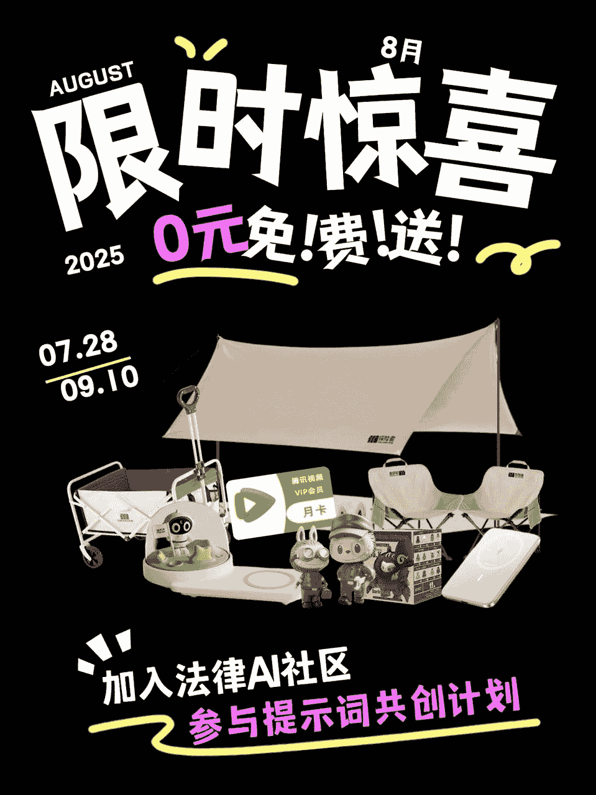
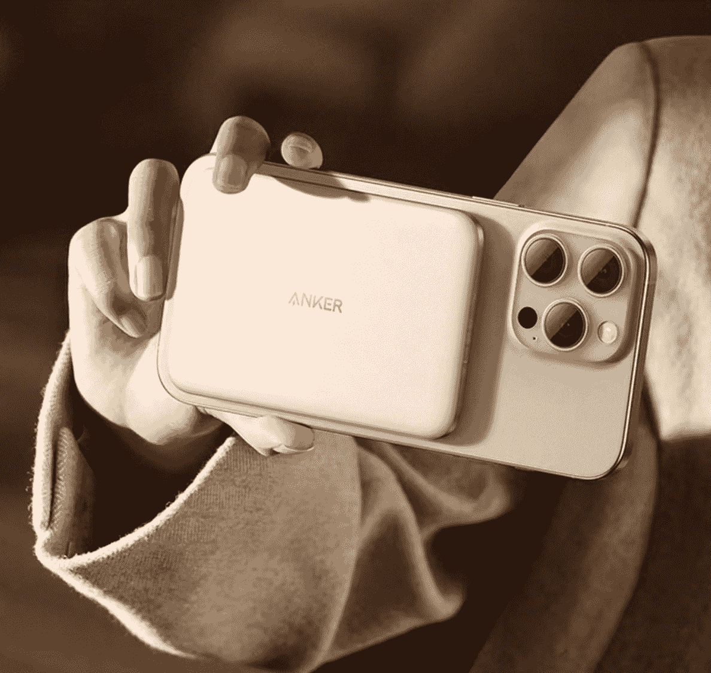
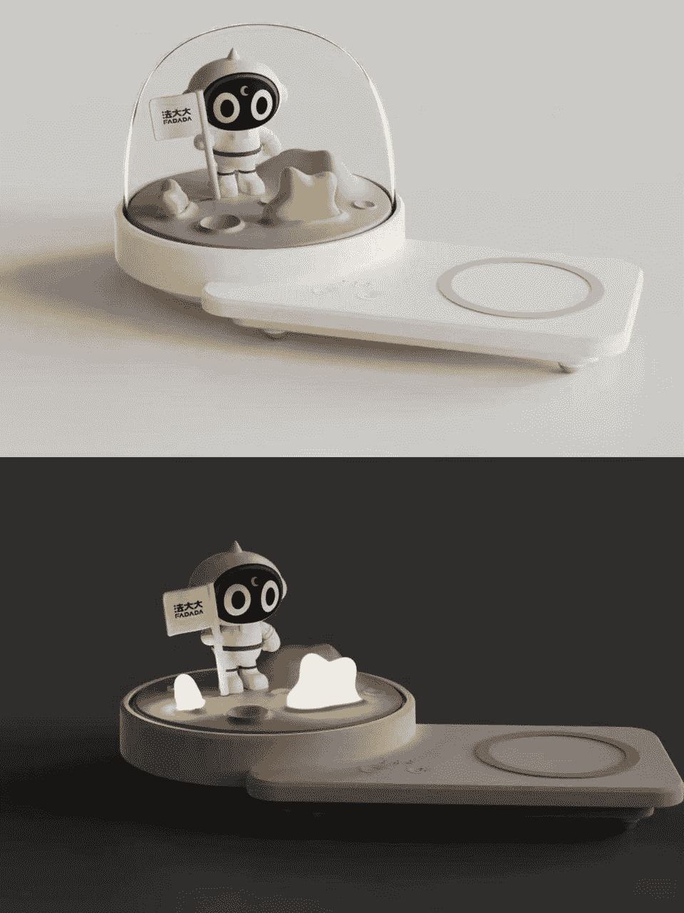
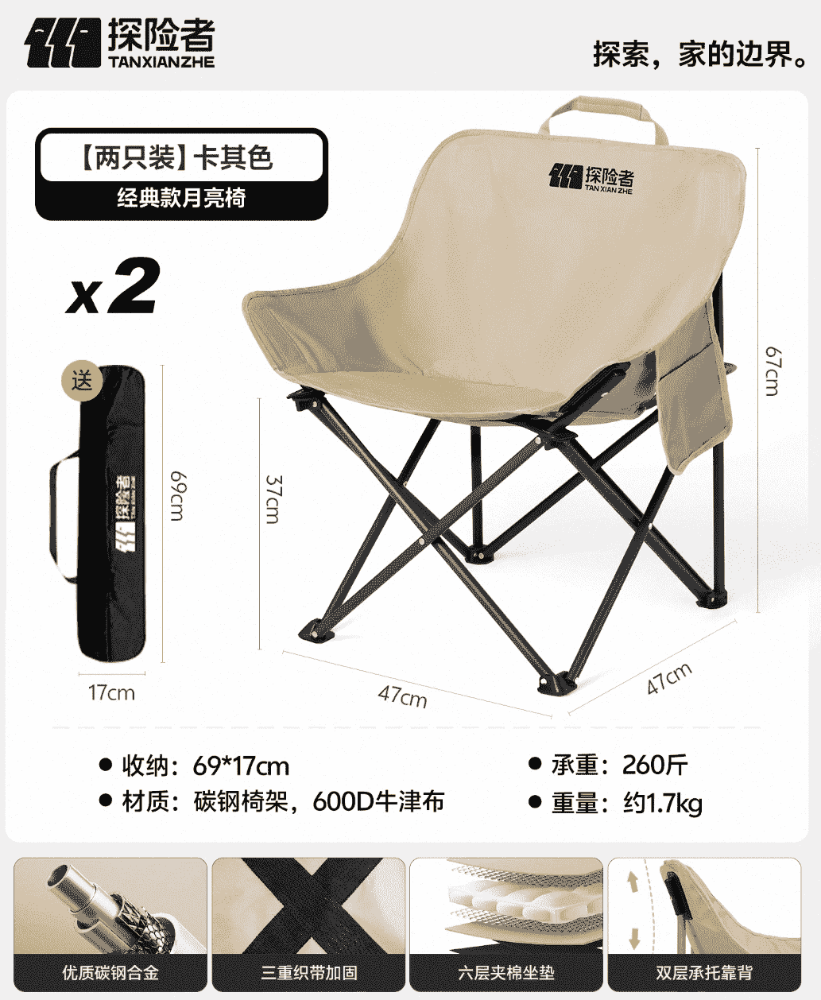
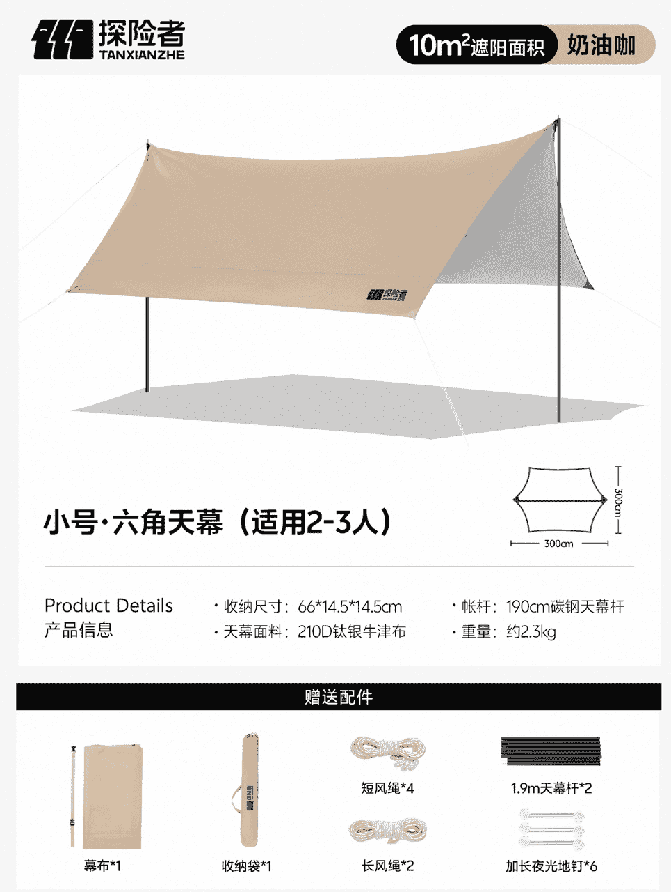
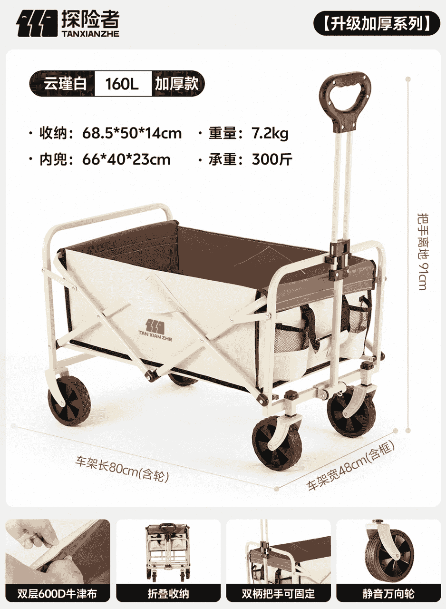

# 何者社区×iTerms｜AI 提示词共创计划

> 来源：[https://docs.feishu.cn/docx/GRvQdGjsaomvMCxlIPJcldsdncd](https://docs.feishu.cn/docx/GRvQdGjsaomvMCxlIPJcldsdncd)

---

> 欢迎参加「**参与 AI **提示词共创计划」！本次活动由「何者社区」与法大大旗下「iTerms 法律 AI 社区」联合发布，期待与大家共创覆盖法律全场景的 Prompt 库。本文档为活动细则，包括：活动时间轴、参与方式、奖励机制、提示词创作规定、提示词评选流程与评选维度，请您仔细阅读：

** **

# ⏰活动时间

+   Prompt 提交期：7 月 28 日至 8 月 18 日

+   Prompt 评测期：8 月 19 日至 8 月 26 日

+   奖励公布&发放：8 月 27 日至 9 月 10 日

** **

# 🌟活动参与方式

+   **STEP 1 ：**创作行业法律适用场景的 AI 提示词

+   **STEP 2 ：**提交 AI 提示词到收集表中（可重复提交/重复修改）：行业法律场景 Prompt 创作

** **

# 🎁活动奖励机制

## 参与 prompt 共创的创作者

+   **选出 3 个****社媒爆款王**获得【Anker 充电宝】+【iTerms 合同审查会员季卡】

+   评选规则：发布提示词效果到小红书平台，@iTerms法律AI 并带话题 #iTerms法律AI研究院 ，内容点赞量前三的创作者。

+   发布小红书帖子，头图图片参考如下图：（非必选）

+   **选出 2 个****AI 大魔王**获得【法大大 VIP 定制礼盒】+【iTerms 合同审查会员季卡】

+   评选规则：Prompt 提交期结束后，专家团队综合评选出超级优质的 AI 提示词（详细评选维度与流程详见：📈Prompt 评选流程与维度）

+   **选出 3 个****社群人气王**获得【Labubu 盲盒】+【iTerms 合同审查会员季卡】

+   评选规则：Prompt 提交期结束后在法律 AI 社群发起投票，票数量前二的创作者。

+   抽取 10 个超幸运创作者获得【腾讯视频 VIP 会员月卡】

+   **参与 AI 提示词创作的创作者即**可获得【iTerms 合同审查会员月卡】

| ## 奖品示例 |  |  |  |
| --- | --- | --- | --- |
| **Anker 充电宝** | **法大大VIP定制礼盒** | **Labubu盲盒** | **腾讯视频 VIP 会员月卡** |
|  |  |  |  |

## 加入社群的用户可参与社群抽奖活动

+   07/30 发起抽奖，抽取 1 名用户获得【探险者 10 平米钛黑胶户外遮阳天幕】一个

+   08/01 发起抽奖，抽取 1 名用户获得【探险者 10 平米钛黑胶户外遮阳天幕】一个

+   08/06 发起抽奖，抽取 1 名用户获得【探险者露营推车 160L】一个

+   08/08 发起抽奖，抽取 1 名用户获得【探险者露营推车 160L】一个

+   08/13 发起抽奖，抽取 1 名用户获得【探险者户外露营椅 2 张】一个

+   08/15 发起抽奖，抽取 1 名用户获得【探险者户外露营椅 2 张】一个

| ## **奖品图例** | ##  | ##  |
| --- | --- | --- |
| 07/30 与0 8/01 抽奖奖品 | 08/06 与 08/08 抽奖奖品 | 08/13 与 08/15 抽奖奖品 |
|  |  |  |

** **

# 📝Prompt创作规定

1.  明确 Prompt 适用的具体场景；

1.  根据下方示例 prompt，结构化产出 prompt，包括角色、概述、例子、初始语等；

| #### **行业** | #### **具体适用场景** | #### **Prompt** |
| --- | --- | --- |
| 建筑 | 城市住宅用地 | **- Role: **城市规划法规专家和环境政策研究员 |
| 法律 | 合同审查 | # 角色 |

** **

# 📈Prompt评选流程与维度

## AI 产品实战评测表（评估提示词是否可用）

实战测试的 AI 产品包括：豆包、腾讯元宝以及 Deepseek

## 专家团队评分表（评估提示词是否优质）

iTerms 将与何者社区团队共同组成评分专家团，公平、公正、公开地对每一个作品进行评测。评测维度与评分标准请看下方表格，其中，低于 3 分以及等于 5 分的评分项需要备注说明原因，评测结束后评分表将公布。

** **

# 💬活动说明

活动结束后，**活动方将在 2025 年 9 月 1 日 23:59 前在“iTerms法务AI”官方微**信公众号推文公示获奖名单，建议您加入社群与关注官方公众号，以及时获取活动最新动态。若 2025 年 9 月 10 日 18:00 点之前获奖者未回复奖品邮寄地址以及收货信息，则视为默认放弃奖品。所有奖品将于活动结束后的一个月之内以快递形式发出。由于奖品以邮寄方式进行配送，参与活动投稿则默认同意并接受活动方将您的姓名、联系电话、收件地址等个人信息同步至第三方快递公司，我司承诺您的个人信息仅在本次活动使用，不用作其他用途。

投稿作品一旦提交，即视为您授权深圳法大大网络科技有限公司对投稿作品可进行公开展示及宣传。您确认并授权，针对您提交的全部投稿作品，深圳法大大网络科技有限公司永久性享有一项免费、全世界范围内的、非独家、可转授权（含后续各层次再授权）的使用权，包括但不限于：发表权、修改权、复制权、信息网络传播权、改编权、汇编权、翻译权等著作权，以及相应的维权权利。因本授权引发的纠纷和责任由您全部承担。法大大有权在其运营经营的或者与其他方合作的所有平台或产品，以营利或非营利的方式使用、传播您的投稿作品以及以其他方式开发、利用您授予法大大的投稿作品（全部或部分）的权利和许可。所有投稿作品均为您原创，您保证投稿作品不存在任何侵犯第三方权益的内容、不违反法律法规的规定及公序良俗。您确认对投稿作品依法享有完全的权利，并有权将其用于本次活动，没有版权及其他权属争议。法大大不对投稿作品可能出现的肖像权、姓名权、名誉权、隐私权、著作权、商标权等纠纷承担任何责任，如出现上述纠纷，法大大保留取消您参与资格及追回激励的权利。

最终解释权归活动方（即深圳法大大网络科技有限公司）所有。