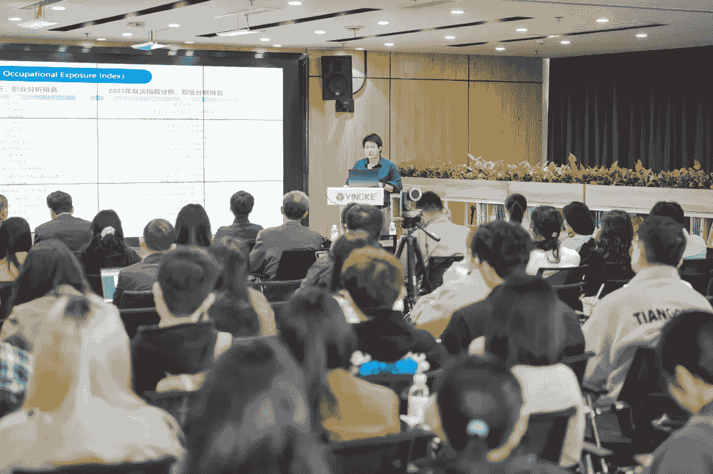
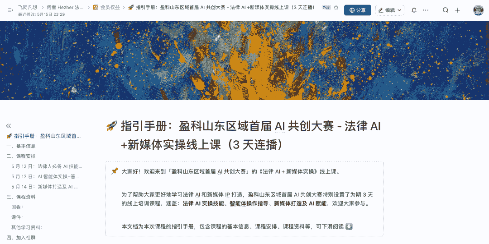
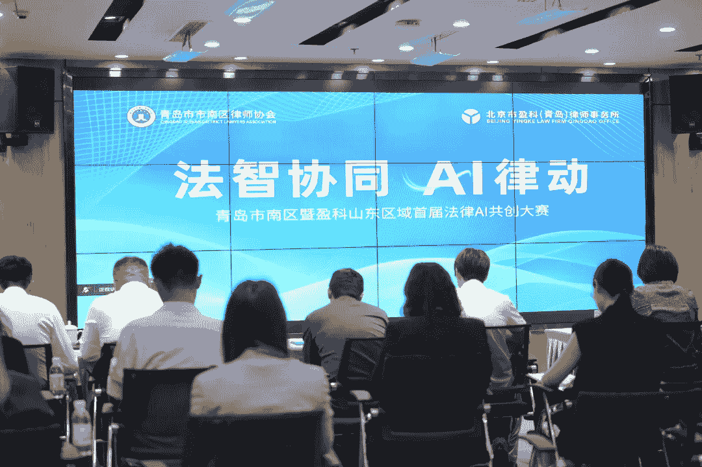
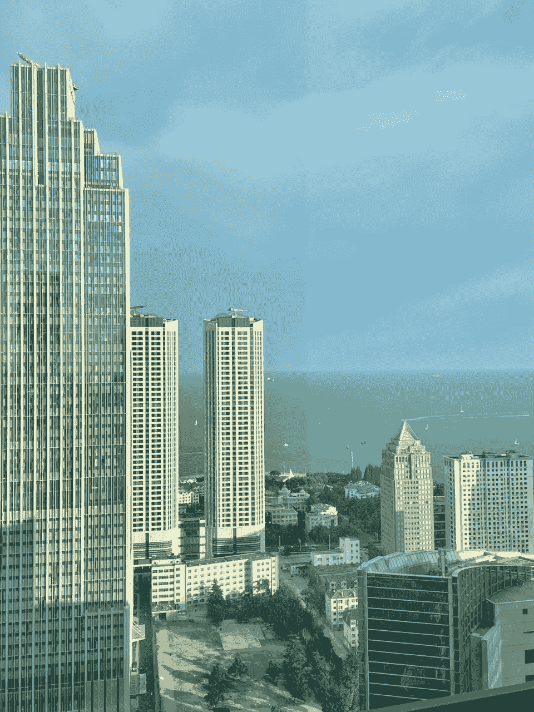

# 后记：盈科山东首届法律 AI 共创大赛

> 来源：[https://docs.feishu.cn/docx/LIZxdv9UloOTXUxkO3GcQeWbncb](https://docs.feishu.cn/docx/LIZxdv9UloOTXUxkO3GcQeWbncb)

---

6 月 12 日，由青岛市市南区律师协会、北京市盈科（青岛）律师事务所主办的 “法智协同・AI 律动 —— 青岛市南区暨盈科山东区域首届法律 AI 共创大赛”圆满举办。

来自山东多家律所、高校、公司的 12 组选手同台切磋，探讨「法律+AI」的无限可能。

关于本次大赛的共创成果，详见：盈科山东区域首届法律AI大赛获奖名单

何者作为本次大赛的合作方，从前期的培训：

到指引文档发放、线上培训和技术辅导：

再到最后的路演决赛：

何者社区深度参与了本次大赛的全程工作。

说起举办本次大赛的契机，缘起今年 3 月在青岛举办的盈科青训营，当时何者社区发起人当时分享了《法律 AI 通识课：10x 法律人的进阶之路》，与数百位盈科同仁分享近两年的一些探索，其中就包括法律 AI 共创大赛。

**法律 AI 共创大赛的价值不言而喻：AI 的发展离不开场景、数据、人才，而 AI 大赛就可以**通过以赛促学、以赛促用的方式，发掘找到高价值的场景、数据，以及更重要的“人才”。

青训营结束之后，盈科青岛的领导班子就觉得应该举办一期大赛，非常具有前瞻性。于是，4 月底敲定，5 月正式启动，执行力超高。

在本次大赛的过程中，有几个有意思的趋势：

1. AI 的普及度更高了，法律人是创新源头。

本次大赛，参与方除了律师，还有很多法学院学生和开发者参与，各方在一起交流、共创，这正是我们希望看到的行业合作模式。同时，AI 技术也在不断发展，已经可以通过提示词直接生成网页。这次比赛中，就有几位律师用 AI 生成了产品网页，只不过这些一键生成的网页还无法像成熟产品一样使用。

这背后反映出一个趋势：

**很**多法律从业者对自己想要什么产品已经有了清晰的想象，如果可以获得更多的技术支持，那么应该可以创造出非常好的产品。

1.  场景定义更清晰，聚焦「展业营销获客」和「业务流程改造」。

本地 AI 大赛中，很多作品都属于对话类 AI 机器人，其核心价值在于辅助解答客户的常见问题，辅助律师展业营销。

其中，对于律师如何使用智能体获客，律师与 AI 的服务边界如何界定，有个律师团队分享了他们根据自身业务做出的选择，比如把一些律师原来需要收费的服务，通过 AI 免费提供给客户，从而引流至更高价值的服务。

**这**样，律师自己拥有的数据或经验，其实并不是为了让智能体产生多大的差异性，而是把智能体作为一个营销物料，还挺有意思的。

**通过不断尝试人机协作，率先拥抱 AI 的律师**有望拓宽法律服务的范围，发掘新商业模式。

除了对话类智能体，还有一些改造业务流程的智能体，最典型的就是“开庭律师提醒”，虽然比较简单，但这才是真正落地的场景，在场的每个律师都觉得很好，尤其是盈科已经有强大的 OA，加上 AI 能力就能带来生产力。

此外，还有一些团队做了法律检索、合同起草审查等功能，但由于这些场景需要大量的数据和编程能力，不是一般法律从业者的机会。

有意思的是，当我问一位律师为什么要做这些功能时，他**的反馈是不想来**回切换不同平台，说明大家对“一站式平台”有很大需求。

总的来说，本次法律 AI 共创大赛成果显著，接下来何者社区还会持续提供技术支持，帮助这些参赛作品进一步提高产品能力，真正成为有价值的法律 AI 产品。借由本次大赛，我们也推动不同背景的各方深度链接，尤其是律师与技术专家，期待后续的更多可能。

青岛的啤酒、海风、烟火气。

期待下次再见～

