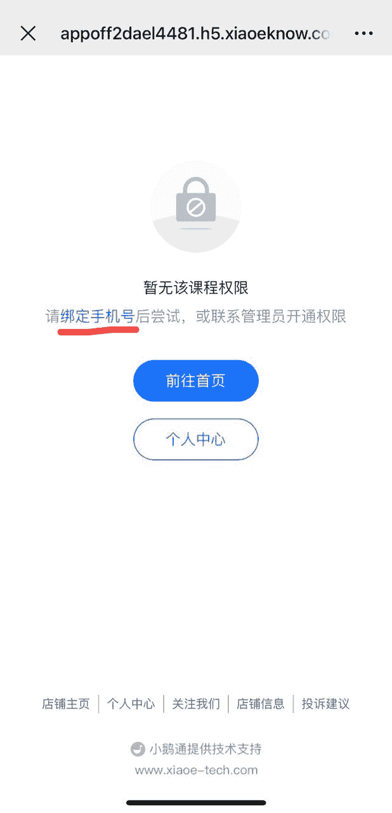
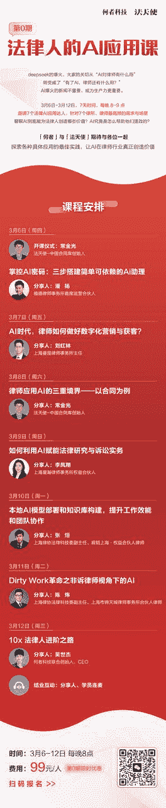
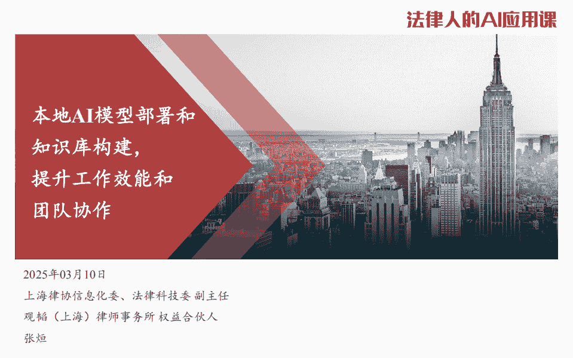
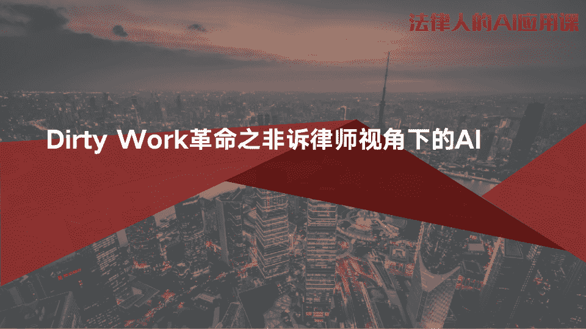
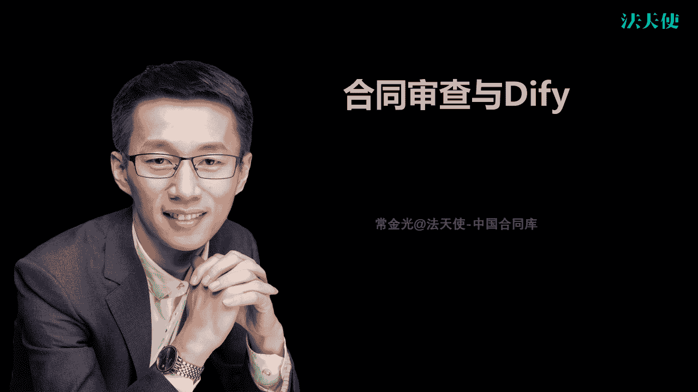

# 【线上课程】法律人的 AI 应用课

> 来源：[https://docs.feishu.cn/docx/DpfCdLHqboG6myxXKPpcj4Qpnog](https://docs.feishu.cn/docx/DpfCdLHqboG6myxXKPpcj4Qpnog)

> 本文档含本次课程的基本信息、课程安排、课程资料等，可下滑阅读 ⬇️

# **一、基本信息**

+   **课程周期**：3 月 6 日 - 3 月 12 日，共 7 天

+   **上课时间**：每天晚上 8 点 - 9 点左右，约 1~1.5 小时

+   **课程链接**：https://appoff2dael4481.h5.xiaoeknow.com/p/course/ecourse/course_2tsS2dohbb5fqf1KVHO6P4az6RU

+   登录方式：根据指引绑定【报名时预留的手机号】登录即可👇如果登录失败或需要帮助，请联系：@刘亚

+   **课程资料**：课程回放、课件、作[业习题等课程资料，将](https://legalstudio.feishu.cn/docx/DpfCdLHqboG6myxXKPpcj4Qpnog#XhsbdNrkZohKiix2jmHcs15mnsv)于每天课程结束后发送到【法律人的 AI 应用课 0 期】🛰️群，同时也会上传至本文档汇总 👉 课程资料（持续更新）

+   **提前准备**：

+   **电脑**：大屏看课件效果更好，同时可以一起动手实操

+   **文件**：准备多份可以用于测试 AI 工具的脱敏文件，比如：

+   法规库与案例：整理相关法律法规、司法解释、指导案例等资料

+   事务所内部制度：律所日常运营、案件管理、 客户关系维护等制度

+   律师专业知识：相关业务领域的专业知识、经验总结、百问百答

+   市场数据：相关市场调研的信息、市场分析等内容

+   品宣介绍：整理自己的律所介绍、产品介绍、合伙人介绍、法律服务产品介绍等素材

> 以上内容格式建议：word、pdf、ppt，文字内容建议多多益善

+   **学习资料**：

+   [何者 Hezher 法律科技社区](https://legalstudio.feishu.cn/wiki/NnAAw32YKiyitFkyBWqcPX2MnIE?from=from_copylink)

+   [法律 AI 应用学习手册 1.0](https://legalstudio.feishu.cn/docx/RQL0dXkrhoZmDsx2umrcZLqCnqf)

# **二、课程安排**

# **三、课程资料（持续更新）**

## 课程回看：

https://appoff2dael4481.h5.xiaoeknow.com/p/course/ecourse/course_2tsS2dohbb5fqf1KVHO6P4az6RU

## 课件资料：

+   掌控 AI 密码：三步搭建简单可依赖的 AI 助理：

+   https://alidocs.dingtalk.com/i/nodes/kDnRL6jAJMEX5ox6HkGgYAY1JyMoPYe1?utm_scene=person_space

+   AI 时代，律师如何做好数字化营销与获客？

+

[0307线上分享V4.0-刘红林.pptx](https://internal-api-drive-stream.feishu.cn/space/api/box/stream/download/all/ZP8Nb1sbUoiE0Vx264hck6pBnTe)

+   🛰️里的“无感”AI

+   [法律 AI 通识：10x 法律人进阶之路
—— 🛰️里的“无感”AI](https://legalstudio.feishu.cn/wiki/KgF1wMD0diQFXgkCdTRcPwBQnI3?from=from_copylink)

+   如何利用 AI 赋能法律研究与诉讼实务

+   [如何利用AI赋能法律调研与诉讼实务](https://w2s7qdyldk.feishu.cn/docx/Dhead9bTGou6qixH1Sjcylrpn3f?from=from_copylink)

+   本地 AI 模型部署和知识库构建，提升工作效能和团队协作

+

[20250310-本地AI模型部署和知识库构建-v1.0-GuanTao draft.pdf](https://internal-api-drive-stream.feishu.cn/space/api/box/stream/download/all/TAxIb0MJjoERpSx89FtcZQf9nsf)

+   Ditty work 革命之非诉律师视角下的 AI

+

[Dirty Work革命之非诉律师视角下的AI.pptx](https://internal-api-drive-stream.feishu.cn/space/api/box/stream/download/all/ZemTbsD2DoWMOGxnvG6crSomnBf)

+   律师应用 AI 的三重境界 —— 以合同为例

+

[合同审查与DIfy-应用课02分享.pdf](https://internal-api-drive-stream.feishu.cn/space/api/box/stream/download/all/V0esbIFh8oMggGxd4mhcg4eZnAf)

## 课程作业：

点击跳转：[课程作业：法律人的 AI 应用课](https://legalstudio.feishu.cn/wiki/Y6dXwq7SHiPlSokVEa1cSdeanqb)

# **四、其他**

## 发票开具

开具发票请访问下方链接，提交信息后，法天使于每周四统一开具。

【电脑端开票链接】建议用谷歌浏览器

https://www.fatianshi.cn/user/invoice

【手机端开票链接】:

https://m.fatianshi.cn/account/fapiao