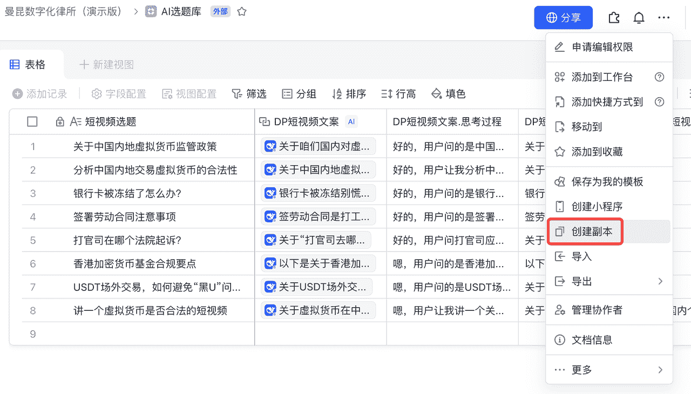

# 课程作业：法律人的 AI 应用课

> 来源：[https://docs.feishu.cn/docx/OldmdT4l4oIpnpxIVfBcwbXnnqc](https://docs.feishu.cn/docx/OldmdT4l4oIpnpxIVfBcwbXnnqc)

---

> **大家在写**作**业的**过程中，如果遇到不清楚的地方，可以查看本期课程回看和课件：或者在课程群提问：

> **所有课程回看链接**：https://appoff2dael4481.h5.xiaoeknow.com/p/course/ecourse/course_2tsS2dohbb5fqf1KVHO6P4az6RU

# 第一天：掌控 AI 密码：三步搭建简单可依赖的 AI 助理

> **本期课件**：https://alidocs.dingtalk.com/i/nodes/kDnRL6jAJMEX5ox6HkGgYAY1JyMoPYe1?utm_scene=person_space

## 使用 AI 工具提取判决书基础信息

1.  **打开一个 AI 工具**

+   DeepSeek：https://chat.deepseek.com

+   Kimi：https://kimi.moonshot.cn

+   豆包：https://www.doubao.com

1.  **上传 10 份判决书**

+   操作方法：点击「文件」按钮上传判决书，或者把判决书拖到对话框中

1.  **在对话框中输入以下提示词：**

> #任务1:提取以下判决书中的核心信息: -[案号] -[案由] -[审理法院] -[裁判日期]

> -[诉讼双方](原告/被告/上诉人/被上诉人)

> -[诉讼请求]

> -[判决结果] (支持/驳回的金额/事项)

> -[援引法条] (列出具体条款)

> #任务2:将上述信息用如下表格格式输出,方便我复制到excel:

> 案号、案由、法院、日期、原告诉求、被告抗辩、判决结果、核心法条

1.  点击发送

1.  AI 开始输出结果

1.  如需复制到本地：点击 AI 回答下方的「复制」按钮，然后新建一个 excel 表格，将 AI 输出的结果复制到表格里

## 根据自己工作场景，搭建一个可用的智能体

1.  扣子：https://www.coze.cn/open/docs/guides/quickstart

1.  腾讯元器：https://docs.qq.com/aio/p/scxmsn78nzsuj64?p=YBU3kfioRenbQK5eKCj4nbp

# 第二天：AI 时代下，律师如何进行营销获客？

## 使用 AI 工具生成一篇👸号文章/短视频脚本

> **AI 辅助生成文章多维表格**：[AI选题库](https://ccd68lpsqp.feishu.cn/wiki/WQDgwijl4iZQc2kqp0EcQY5bnbT?table=tblLd8PowN0Xhwhx&view=vewVqAdf90)

1.  点击打开多维表格：[AI选题库](https://ccd68lpsqp.feishu.cn/wiki/WQDgwijl4iZQc2kqp0EcQY5bnbT?table=tblLd8PowN0Xhwhx&view=vewVqAdf90)

1.  点击右上角“···”-“创建副本”，即可编辑表格

1.  在副本中的首列，即“短视频标题”中填写你想撰写的文章或短视频标题，AI 即可自动化生产内容