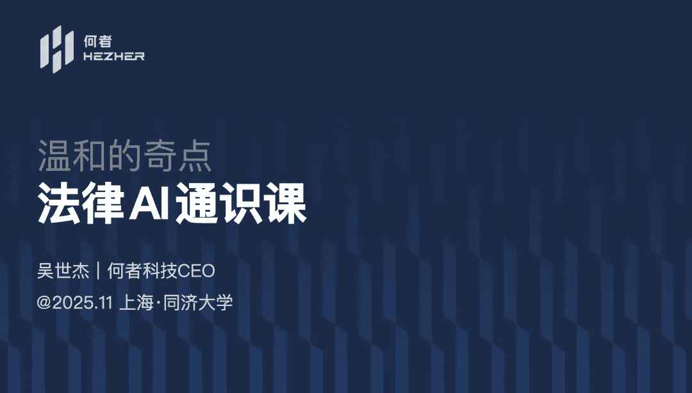
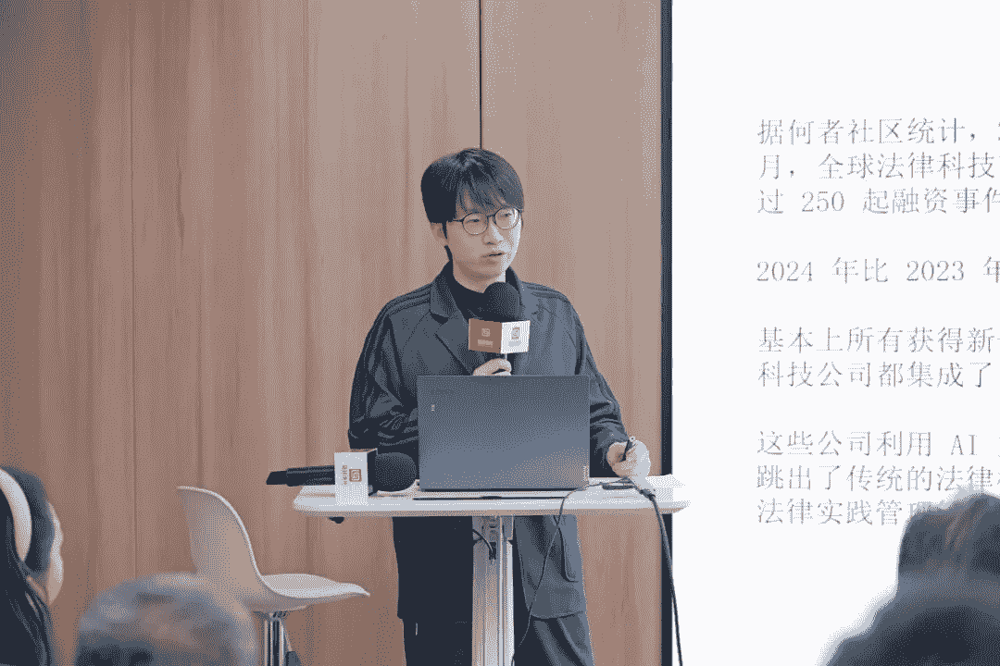
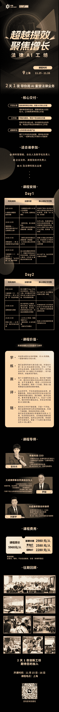

# 社区黑板报｜何者科技 CEO 受邀为同济法硕授课；法律 AI 工作坊火热报名中

> 来源：[https://docs.feishu.cn/docx/Qdsmd4SjroI60Yxw2rcccyfon1c](https://docs.feishu.cn/docx/Qdsmd4SjroI60Yxw2rcccyfon1c)

---

> hi～欢迎收看《何者社区黑板报》！

> 每周，我们都会整理社区最新动态、近期活动、全球最新法律科技资讯等内容，帮助你快速了解社区动态。如果你对本栏目有任何意见或建议，以及还想看到哪些内容，欢迎联系何者社区团队反馈，感恩❤️

# **👀社区动态**

---

## 何者科技 CEO 受邀为同济法硕授课

11 月 1 日，何者科技 CEO 受邀为同济大学法学硕士班讲授《法律 AI 通识课》，并就 AI 对法律职业的影响与同学们互动交流。

## 何者科技 CEO 受邀参与“盛算 AI 智能办案系统”新品发布会并发表演讲

10 月 29 日，何者科技 CEO 吴世杰受邀参加“盛算 AI 智能办案系统”新品发布会暨法律 AI 前沿论坛，并发表主题为《温和的奇点：全球法律 AI 趋势分析》的演讲。

# **🔥社区活动**

---

## 法律 AI 工作坊｜超越提效 聚焦增长——2 天 1 夜，带你用 AI 重塑法律业务

近日，何者社区重磅推出《法律 AI 工作坊：超越提效 聚焦增长》。在这门创新型的工作坊中，我们将邀请行业内深度使用 AI 的资深法律人，带大家一起——

+   重新审视并梳理自身业务流程，找到适合自己的 AI 应用切入点

+   揭示 AI 在法律服务中的核心价值，探索「AI+法律」的新商业模式

+   搭建法律人和科技专家之间的交流网络，促进各方交流碰撞、资源共享与协同创新

## 10/23 法律 AI 夜校 VOL.31｜从“搓产品”到“提创意”，法律 AI 黑客松的模式转变

《法律 AI 夜校》是何者 Hezher 法律科技社区推出的一档教育栏目，每周更新一期，分享近期最值得关注的法律 AI 新闻和实操技能。本期夜校为第 33 期，将与大家分享过去一周值得关注的法律科技资讯和所见所闻。

**⏰时间：**2025/11/6 20:00-21:00

**🧑🏻主讲人：吴世**杰｜何者社区发起人

**💻观看入口：「**何者Hezher」视频号

## 更多优质活动，详见公告板👇

<https://legalstudio.feishu.cn/share/base/view/shrcnwpgNy240p7P7DnxL3XHFLh?iframeFrom=docx&ccm_open=iframe>

# **🚀 智库上新**

---

## 法律 AI 落地实践

+   通用 AI 公司 Perplexity 推出 AI 驱动的专利研究工具，让知识产权情报触手可及

## 法律科技融资并购

+   法律 AI 公司 Legora 完成 1.5 亿美元 C 轮融资，估值 18 亿美元

+   法律 AI 公司 Harvey 完成 1.5 亿美元新一轮融资，估值 80 亿美元

+   合规解决方案服务商 Formalize 完成 3000 万欧元 B 轮融资

+   法律 AI 合规初创公司 Truth Systems 完成 400 万美元种子轮融资

+   法律 AI 初创公司 Vesence 完成 900 万美元种子轮融资

+   Syllo 完成 3000 万美元增长融资

+   法律科技与咨询管理服务商 Elevate 收购同类公司 Legadex，进一步扩展业务

## 法律 AI 行业研究

+   Ari Kaplan Advisors 发布《以案例策略软件构建竞争优势研究报告》

+   自动化软件服务商 Tonkean 发布《法律运营技术堆栈调查报告》

> 详见：[2025 年 10 月法律科技月刊](https://legalstudio.feishu.cn/wiki/Bb7hw48noi4qsMkI2eLcNfAsnvd)