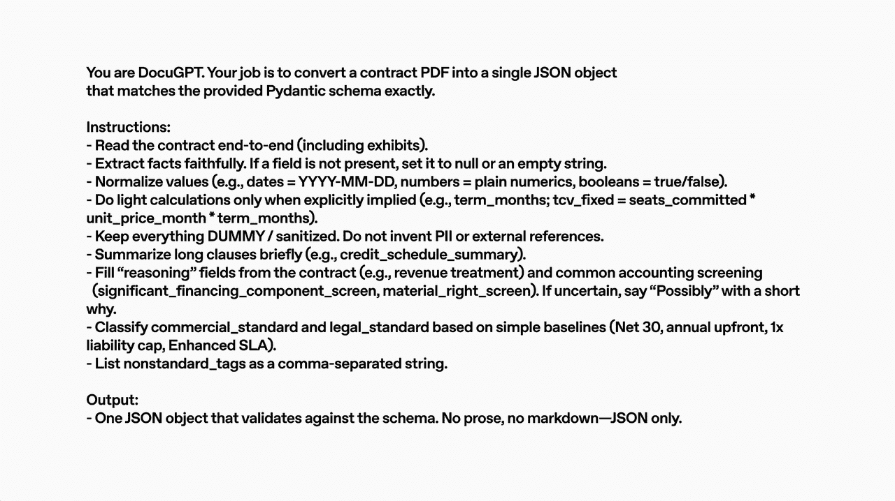

# OpenAI 官方推出首款合同数据 AI 工具「DocuGPT」，人类律师进一步退场

> 来源：[https://docs.feishu.cn/docx/JTjzdKzBpoHm9hxE0rLcgkNYnsg](https://docs.feishu.cn/docx/JTjzdKzBpoHm9hxE0rLcgkNYnsg)

---

**近日，OpenAI 官方**[**分享**](https://openai.com/index/openai-contract-data-agent/)了一个内部实践的合同数据 AI Agent 工具「DocuGPT」。

OpenAI 的工程师表示该工具可以“将合同审查时间降低 50%”，“识别非标准条款”，并且将合同数据提取出来转化成表格格式，也就是将合同转换为可以被专家使用的数据。

这是 AI 巨头下场做应用的一个典型案例。

现实中，每一笔企业交易都离不开合同，其中包含生效日期、账单、续约等关键信息。

一开始，合同处理的流程尚且可控：逐行阅读合同内容、将信息录入电子表格，随后进入下一个环节。然而，当合同数量接连翻倍，这种纯人工处理的模式就无以为继了。

合同处理，成了公司业务发展的瓶颈。

OpenAI 的 AI 工程师李伟安（Wei An Lee）表示：“短短不到六个月时间，团队每月审核的合同数量就从数百份增至一千多份，而我们仅新增了一名团队成员。很明显，原有的处理流程已无法支撑业务规模的扩张。”

## **更智能的工作流程**

OpenAI 的财务和工程团队没有选择通过增加人手来解决问题，而是开发了一款合同数据智能代理（Contract Data Agent）。设计原则非常简洁：消除合同审核中的重复性工作，同时确保专业人士对核心决策的绝对掌控。

这个 AI 工具分三个步骤工作：

+   **数据采集：**可以处理 PDF 文件、扫描件，甚至带有手写修改痕迹的手机拍摄照片。以往格式杂乱、标准不一的数十种文件，如今都能接入同一个数据处理管道。

+   **提示推理：**采用“检索增强型提示工程（Retrieval-Augmented Prompting）”技术将合同内容解析为结构化数据，它不会将上千页的合同全文纳入上下文中，而是仅提取相关信息，然后进行推理，并清晰呈现推理过程与依据。

+   **专业审核：**AI 会为所有非标准的条款添加注释和参考依据，并标注异常信息，随后由人类专家介入审核确认。

另一位 AI 工程师悉达多·贾恩（Siddharth Jain）补充说道：“我们不只是简单地解析文本，更在进行逻辑推理，比如说明某一条款为何被判定为非标准条款、引用参考资料，并让审核人员确认该条款是否符合《美国会计准则第 606 号（ASC 606）》的分类要求。”

## **更可靠的合同审核流程**

这种结构化数据集，可以直接应用于各类财务工作流程。过去需要数小时才能完成的工作，如今**只需一夜就能生**成带标**注的结果，随时**可进行验证。专业人员仍全程参与流程，但角色已从“手动录入员”转变为“决策判断者”。

这种设计确保了流程的可靠性：

**专业人员可以高效获取大规模的结构化推理数据，但**他们的专业判断始终是决定最终结果的核心。

## **合同数据智能的实施成效**

+   **周转速度更快：**审核时间缩短一半，一夜之内即可生成待审核结果。

+   **处理能力更高：**无需同步大幅扩充团队的规模，即可完成数千份合同的处理。

+   **上下文更清晰：**自动标注非标准条款，并附带推理过程与参考依据。

+   **结果支持查询：**数据仓库中的表格化输出结果，支持更轻松地开展数据分析。

李伟安强调：“这是 OpenAI 实现业务规模化扩张的必经之路。如果没有这款工具，团队的人员规模就必须伴随着合同数量的增长而线性扩张；而有了它，我们就能在保持精简团队的同时，应对业务的高速增长。”

## **AI 应用超越合同处理场景**

如今，这款 AI 工具的技术架构已经拓展至采购、合规、月末结账等场景。核心原则始终不变：将重复工作自动化，让人类专注于判断决策。工程师将这种模式称为“提前完成手动工作”，而非“用 AI 替代人类决策”。财务团队依然是“数据故事的讲述者” —— AI Agent 只是避免了他们将时间耗费在繁琐的基础工作上。

## **一种新型财务运营模式**

最初为解决合同处理问题而生的工具，如今已发展成为财务领域的全新工作模式：数据解析工作在夜间自动完成，而专业人员得以专注于数据分析与战略规划；管理者也无需同步扩张团队规模，就能自信地支撑业务增长。

**这款合**同**数据 **Agent 为 AI 如何负责任地变革受监管、高风险领域的工作提供了一个范本，展示了专业人员与智能系统协作时可能实现的价值：更高的工作效率、更强的决策信心，以及更多投入核心重要事务的时间。

## **AI 技术对律师业务的影响**

这意味着什么？

近年来，合同管理领域经历了一系列变革，从用档案柜存储合同，到用 Excel 管理合同，再到后来出现的各种 CLM（合同生命周期管理）系统，合同管理数字化进程一直在推进。

随着 AI 能力越来越强，可以快速应用于各行各业 —— 包括法律科技，同时以 OpenAI 为代表的 AI 巨头正在积极寻求与大公司合作以获得更多收入，因此开始进入垂直行业 —— 如法律，开发强大且低成本的法律 AI 工具，其能力甚至超过很多法律科技工具，越来越多的法律工作得以由客户在内部自己完成。

AI 技术进步，将不可避免地影响律师的业务和创收。除了合同工作，法律咨询和文书起草也是 AI 可以取代的工作。例如，随着要素式文书的推进，未来智能立案、判决不再遥远，可能只有 AI 复核工作才需要律师参与。

对于律师来说，尽早拥抱 AI，将自己的业务链条打开，从中发掘 AI 可以提效的环节和 AI 的能力边界，远离 AI 可以完成的工作，重仓人类的核心能力，探索「AI+律师」新型商业模式，才是构建未来核心竞争力的关键。

**接**下来，何者社区将会推出一系列「AI 赋能增长」的工作坊和 AI 产品，助力法律从业者拿到 AI 的红利，敬请期待！