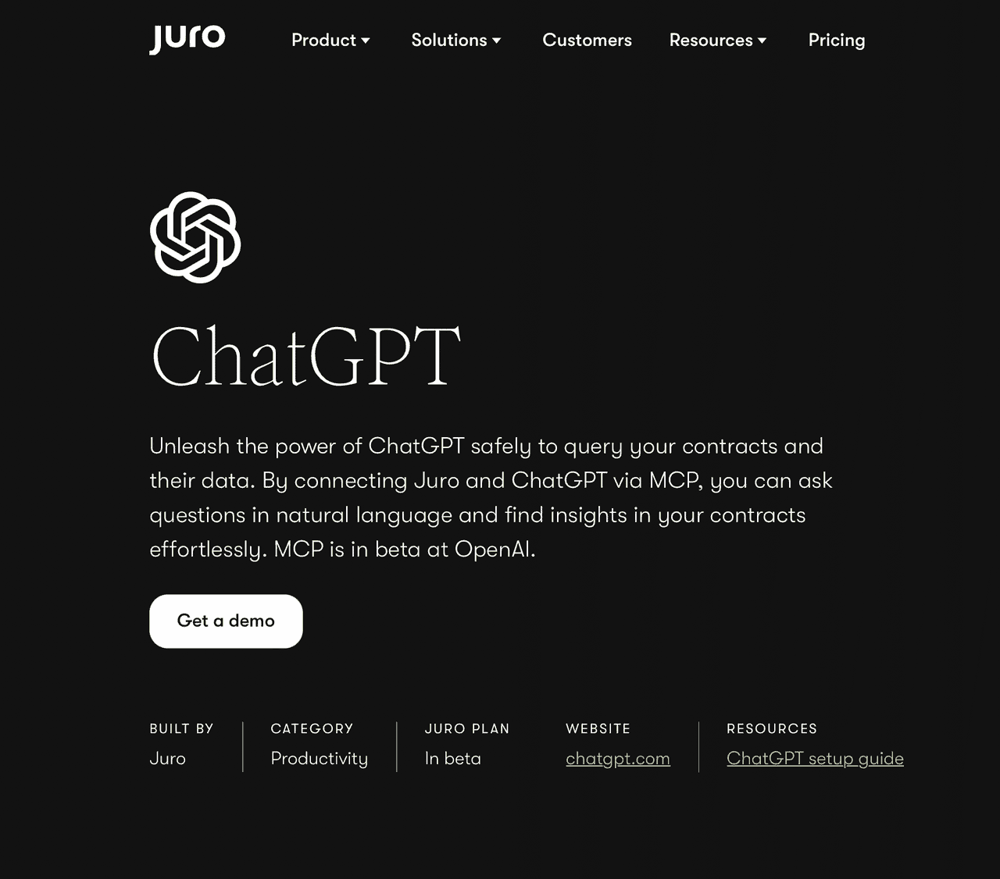
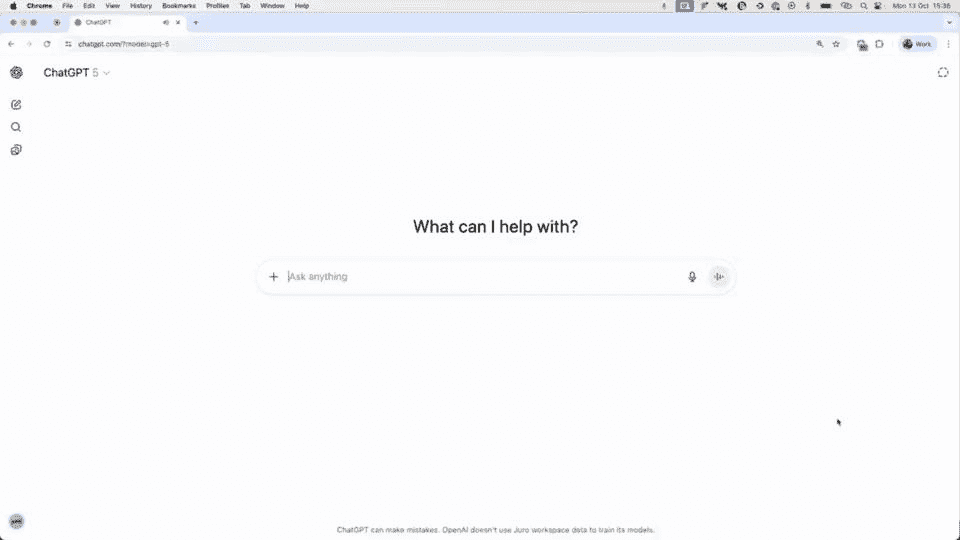

# 不装了！这家法律 AI 公司推出 MCP，还引导客户直接使用 ChatGPT

> 来源：[https://docs.feishu.cn/docx/WspZdLG5potowNx0N0WczrZenIf](https://docs.feishu.cn/docx/WspZdLG5potowNx0N0WczrZenIf)

---

**2025 年 10 月，智能合同平台 Juro 抛出了一则看似常规的产品新闻：正式推出 MCP（模型上**下文协议）接口，而且明确引导客户直接在 ChatGPT 中处理合同相关的问题 —— 而非打开 Juro 自家的产品界面。

在 ChatGPT 中调用 Juro MCP 效果如下：

[在 ChatGPT 中调用 Juro MCP.mov](https://internal-api-drive-stream.feishu.cn/space/api/box/stream/download/all/ATg1b0YpHoONWbxPqpKcPvB4nR3)

这一举动乍看平淡，却藏着一个反常识的行业信号：在“用户留存率”、“使用时长”被奉为 AI 产品核心指标的当下，Juro 为何要主动“推走”用户，放弃自家平台的流量？

要理解这背后的取舍，得先从那个关键的“MCP”说起。

## MCP 是什么？能帮用户解决什么问题？

对于法律从业者而言，“切换工具”是日常工作中的隐形效率损耗 —— 比如在 Juro 里上传合同、再到通用 AI 工具（如 ChatGPT）里提问分析、最后返回 Juro 修改，多平台跳转既浪费时间，又容易断联上下文。

而 MCP（Model Context Protocol，模型上下文协议）的核心作用，就是打通“工具墙”：它就像一套“数据翻译规则”，让 ChatGPT 能精准读取 Juro 的合同数据库与功能模块。

换句话说，用户不用再打开 Juro 的平台，就可以在 ChatGPT 访问 Juro 的产品能力和数据库，直接用自然语言提问即可查找合同信息或执行各种任务，比如总结特定条款、风险或截止日期，根据现有合同编写新模板等。

例如，输入“帮我提取这份与 A 公司签订合同的付款截止日期和违约责任”，然后 ChatGPT 会通过 MCP 连接 Juro 的合同数据，返回结构化的结果；如果需要生成新合同模板，只需补充“按照上次与 B 公司的合作协议框架，拟一份采购合同初稿”，系统就能基于 Juro 的合同模板库生成内容，无需二次复制粘贴。

这种“在熟悉的工具里搞定专业需求”的体验，恰恰击中了法律人对“高效”的核心诉求 —— 毕竟，没有人愿意为了一个简单的合同查询，在多个平台间反复切换，太割裂了。

## 反常识的选择：Juro 为何主动放弃“用户时长”？

在 AI 行业，「套壳」是不少垂类工具的常规操作：调用 OpenAI、DeepSeek 等基础模型的 API，或者加一层法律行业模板或数据库，又或者什么都不做，封装成“法律 AI 工具”。

此时，用户使用的是这个封装的产品，而不是直接用 ChatGPT、DeepSeek 等通用 AI。

但是，Juro 偏要反其道而行之，这背后藏着两层清醒的战略判断：

### 放弃套壳，承认基础模型的不可替代性

Juro 首席执行官 Richard Mabey 的一句话点破关键：“我们相信 ChatGPT 的发展速度与广度，将远超任何单一法律科技工具。”

这并非盲目推崇，而是基于行业现实：法律 AI 的核心能力，本质上依赖基础模型的迭代 —— 现阶段需要复杂的微调、工程优化才能实现的能力，随着 GPT-5 等大模型的升级，马上可以直接实现了。垂类工具的工程优化，在基础模型的代际突破面前，往往杯水车薪。

Juro 的选择，其实是放弃了**“假装自家有核心 AI 能力”**的套壳逻辑，转而做更务实的事，即主动与基础模型深度集成，把“合同数据”与“场景需求”打包，链接到最强大的基础模型上 —— 毕竟，用户要的是“快速搞定合同”，而不是“在 Juro 里搞定合同”。

### 用户要的是“一站式效率”，而不是“又多了一个工具”

当下，职场人的工具焦虑早已显现：🛰️用来沟通、飞书用来协作、各种垂类工具用来处理专业需求，多一个平台就多一层管理成本。

而 ChatGPT 等通用 AI 工具，正在逐渐成为新的“工作入口” —— 人们更愿意在一个熟悉的界面里，解决所有能解决的问题。

Juro 的 MCP 接口，正是顺应了这种“一站式需求”：既然用户已经习惯在 ChatGPT 处理文字、分析信息，那就把“合同能力”送过去，而非强迫用户再学习一个新工具，就像此前 LegalZoom 与 Perpexity 深度合作一样。

这种“以用户习惯为中心”的取舍，看似放弃了自家平台的使用时长，实则赢得了用户对于“Juro 能帮我高效解决问题”的认知 —— 这才是用户长期留存的关键。

### 事实上，法律人早已用脚投票“通用 AI”

这个趋势其实早有信号，多份行业报告显示：法律从业者最常用的 AI 工具，并非各个[法律垂类工具，而是 ](https://mp.weixin.qq.com/s?__biz=MzE5MTY1MjA5OA==&mid=2247492567&idx=1&sn=610db61313a19a1bd6d91d3a10af12ba&scene=21#wechat_redirect)ChatGPT、Gemini 等通用 AI。Vals 发布的法律 AI 基准研究更是直接指出，以 ChatGPT 为代表的通用 AI 工具，在多个法律任务上已远超不少垂直工具。

以合同场景举例，用户的一大需求，就是上传合同到 AI 工具，然后通过提问查找合同信息或执行各种任务。对于这些简单的法律任务，为什么不直接使用市场上最好的大模型处理，充分释放基础模型的潜力呢？

Juro 的选择，本质是“尊重用户习惯” —— 与其花精力说服用户“用我的 AI 产品”，不如把核心能力嵌入用户已经在用的工具里。

## 法律 AI 的竞争，早不是“谁有模型”

Juro 的 MCP 实践，其实给法律 AI 行业提了个醒：当基础模型的能力越来越普惠，“封装模型”的门槛会越来越低，而真正的竞争力将转向“数据与场景的链接能力”。

对于法律科技公司来说，未来的核心价值不再是“我有一个 AI 产品”，而是“我能帮用户把专业数据（如合同库、案例库）、工作场景（如合同审批流程、合规校验节点）等，无缝对接给最合适的 AI 工具” —— Juro 的 MCP，正是做了“合同数据 + ChatGPT” 的链接者，而非“AI 工具的替代者”。

看到这里，或许有的法律从业者会问：这与我有什么关系？答案很简单：与其等待“好用的法律垂类 AI 工具”，不如主动探索 ChatGPT 等通用 AI 的潜力 —— 毕竟，你的日常工作中 80% 的高频任务（如合同初稿撰写、法律文书排版、案例要点提取），都能通过通用 AI + 专业数据的组合高效完成。

但问题在于，很多律师虽然重视 AI，却不知道如何结合自身工作流程落地，而这，恰恰是拉开律师与律师之间差距的关键。法律 AI 的未来，从来不是“工具替代人”，而是“人用对工具，更加高效地创造价值” —— 主动迈出探索的第一步，才能在变化中抓住先机。