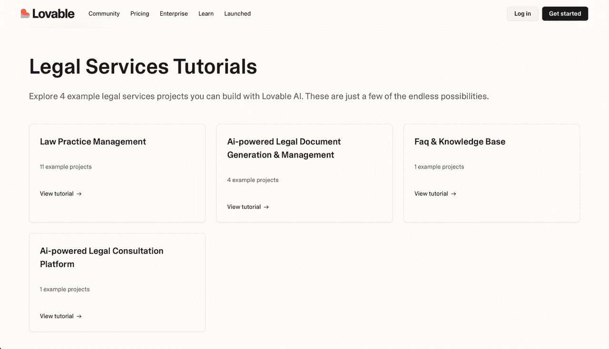

# 2025 年 7 月法律科技月刊

> 来源：[https://docs.feishu.cn/docx/KeDCdLtIRo1Gk8x8zEgcHHdvn1g](https://docs.feishu.cn/docx/KeDCdLtIRo1Gk8x8zEgcHHdvn1g)

---

> 你好，欢迎收看何者社区法律科技日报！

>

> **这是何者社**区**推出的一**个**资讯专**栏**，每天都会收**集、整理与 法律 AI、法律科技、大模型、生成式 AI 相关的前沿资讯，并在【法律 AI 交流群｜何者 Hezher】🛰️群集合发送。

>

> 💙 温馨提示：

1.  电脑端点击本文档左侧目录，或者移动端滑动右侧目录，即可快速跳转到不同内容的相应位置。

1.  由于信息搜集存在一定滞后性，同时何者社区将本日报视为一个迭代过程，我们将不定期将值得关注的资讯补充更新到文档中，随着时间推移，本文档就变成了法律科技周报、月报。

1.  受限于我们关注的范围，以及对一件事情是否「重要」的理解不同，可能还有值得记录的资讯没有被我们观察到，欢迎私信交流，也欢迎各界人士参与共建。

1.  [订阅会员](https://legalstudio.feishu.cn/wiki/DLtSwmrQYibygZklZ4NcuuASnJg)文档仅收录快讯，如需阅读完整内容：

# **📑 法律科技行业研究**

> 报告详情：[法律科技行业研究汇总](https://legalstudio.feishu.cn/wiki/Q3qmwkxpdiRdR5kZLo7cpwY8n3b?from=from_copylink)

## 美国法律就业协会：法学就业率创历史新高，薪资却呈下降趋势，行业转型拐点已至

7 月 31 日，美国法律就业协会（The National Association for Law Placement，简称“NALP”）发布《2024 届毕业生就业情况报告》。报告显示，2024 年美国法学毕业生经历了有史以来最高的就业率，达到 93.4% 的历史新高，较上一年增长了 0.8 个百分点，失业率（包括正在求职和未求职的毕业生）仅为 5.1%，创下历史新低。

这些数据表明，法律行业普遍担心的 AI 对就业市场的影响，似乎并没有出现，或者 AI 的采用还不够广泛，影响尚未出现，而至少在美国，法律服务的需求还在增加，导致对法律劳动力的需求也在增加。

有意思的是，所有就业领域的薪资待遇都有所增长，只有律师事务所除外，几乎没有律所降低起薪，但其薪资中位数下降了 3.0% —— 自 2009 年金融危机以来，律所岗位的工资中位数都没有下降过。

为什么律师事务所的薪资待遇下降了 3%？

这背后可能有多种因素，其中之一是律师的工作方式发生了变化。

很显然，法律行业雇用“人”提供服务的旧习惯还没有改变，市场仍然像以前一样在招聘，但人们开始意识到 AI 已经可以处理一些法律工作，反映在招聘需求上，就是工资正在下降。

总的来说，虽然我们还没有明确的数据证明法律行业薪资的下降是 AI 的影响，但考虑到 AI 对法律行业的长期影响，2025 可能是法律行业结构化转型具有历史性意义的一年。

## Questel 最新研究：大多数知识产权专业人士经常使用 AI

7 月 30 日，Questel 发布《IP Industry Outlook 2025 The Impact of AI on the IP Profession》报告，针对 500 多名在律师事务所和企业从事知识产权工作的专业人士进行调研，显示 58% 的人已经使用 AI 工具，其中 46% 的人每天都在使用，只有 5% 的人还在犹豫，大多数人的人都在拥抱技术。

## Embroker 发布《2025 年法律风险指数报告》：AI 的广泛使用带来日益严重的风险

7 月 23 日，数字保险公司 Embroker 发布《2025 年法律风险指数报告》，针对 200 多名法律专业人士进行调查。

报告显示，AI 的采用率从 2024 年的 22% 大幅跃升至 2025 年的 80%。与此同时，法律专业人士对于 AI 的风险和过度依赖技术表示担忧，这些风险和技术可能会因滥用而造成职业责任风险、数据泄露以及法律和道德问题。对此，45% 的法律专业人士正在升级保险范围。对于律所来说，制定内部 AI 使用指南至关重要。

## 加州司法委员通过新的 AI 规则

7 月 18 日，加州司法委员会通过一项新的《司法部门管理中生成式人工智能使用的规则和标准》，适用于法院工作人员和司法官员。新规则侧重于准确性、监督和透明度，以及 AI 带来的隐私、偏见和安全风险等，并要求所有不禁止法院工作人员或司法官员使用生成式 AI 的法院，必须制定 AI 使用政策。

值得注意的是，加州人工智能工作组在文件中充分考虑 AI 技术的好处、风险和发展速度，详细讨论了各项 AI 监管规则的必要性，最终在监管统一性和灵活性之间取得了平衡。

> 了解更多：[AI 伦理道德及监管政策（法律行业）](https://legalstudio.feishu.cn/wiki/TLlWwUIvhiO2m9kMIQEclLuinGb)

## Blickstein 集团发布《律师事务所首席运营官调查》，关注技术升级

7 月 17 日，Blickstein 集团发布《律师事务所首席运营官调查》，面向北美各地律师事务所的首席运营官和行政主管进行调研。报告显示，律所管理层今年优先考虑升级律所的技术设施，其中 20% 的受访者提到了技术升级。Blickstein 集团首席执行官 Brad Blickstein 表示，考虑到客户的压力，受访者可能希望实施技术升级，包括 AI。

## Legal IT Insider 发布《2025 年人工智能和法律实践报告》

7 月 10 日，Legal IT Insider 发布《2025 年 AI 和法律实践报告》，探讨了法律行业正在发生的技术和文化转变，以及将发生的变革。

报告显示，与以前的 OCR 或搜索平台等创新不同，生成式 AI 带来的不只是效率提升，还有“知识论层面的颠覆” —— 将会改变律师的角色，从法律内容的创作者转变为管理者，更侧重于对内容的筛选、整合、把控，强调组织从 AI 试点到企业级采用的转变，并敦促组织避免盲目授权，而是开发结构化的以人为本的协议和 AI 治理委员会（据报道，现在 80% 以上的 AmLaw 100 公司都建立了）。

在商业方面，报告详细分析了生成式 AI 如何影响律师事务所的商业模式，比如计时收费。一些组织可能会减少初级的招聘，将资源重新分配给技术专家和 AI 工作流程设计师。

## 投资银行 Raymond James 发布 2025 上半年《欧洲法律科技和服务洞察报告》

7 月 8 日，投资银行 Raymond James 发布《欧洲法律科技和服务洞察报告》，分析了 2025 上半年法律科技行业的投资和合并活动。报告显示，以法律科技为重点的风险投资同比增长了 100%。

## Legaltech Hub 发布合同审查产品分析报告

7 月 1 日，Legaltech Hub（LTH）发布合同审查产品的竞争分析报告。该报告分析了市场上合同审查产品的功能完整性、成熟度和市场渗透率、稳定性等维度，同时考虑了所在公司的资金、财务状况和安全状况。

# **🤖 法律 AI 应用最佳实践**

## 英国人工智能行业协会即将成立法律工作组

英国人工智能行业协会（UKAI）将于今年 8 月成立一个法律工作组，旨在满足 UKAI 成员日益增长的需求，包括 AI 可解释性、透明度、多方部署和治理中的责任等问题时。Ashurst 和 Shoosmiths 律师事务所将成为首届成员，同时还将汇集来自金融、媒体、基础设施、生命科学和 AI 原生等公司的总法律顾问。

UKAI 成立于 2024 年，代表 AI 领域的企业开展活动，并与政府进行对话，帮助英国处于变革的最前沿。例如，今年 6 月英国经济学会联合创始人 Ben Howlett 在威尔士劳工会议上会见了英国首相 Keir Starmer 爵士，讨论了该机构的一些关键事项。 同时，UKAI 法律工作组还将根据成员需求组织活动，包括但不限于圆桌会议、炉边讨论、共同撰写指导文件、案例研究、白皮书和深入工作会议等。

# 💰 法**律科技资本市场**

### 融资并购资讯详情

> [2025 年法律科技融资新闻汇总](https://legalstudio.feishu.cn/wiki/RwrTw2ohkiYBMSktAs6cxR4rn9F)

> [2025 年法律科技并购新闻汇总](https://legalstudio.feishu.cn/wiki/UQ6qwKd2Vijll6kc56JcpBmPnBb)

## 无代码法律流程管理平台 Streamline AI 完成 860 万美元 A 轮融资

7 月 30 日，无代码法律流程管理平台 Streamline AI 宣布完成 860 万美元 A 轮融资，Blumberg Capital 领投，Scribble Ventures、Acronym Venture Capital、Great Oaks Venture Capital 和 Tribeca Venture Partners 跟投。

Streamline AI 旨在为企业法务部门提供集中化的工作流程，在一个地方连接各种应用程序和软件。

## AI 营销初创公司 Caseflood.AI 完成 320 万美元新一轮融资

7 月 30 日，AI 营销初创公司 Caseflood.AI 宣布完成 320 万美元新一轮融资，投资方包括 Acquisition.com、Y Combinator、Rebel Fund、Four Cities Capital、Elevation Capital、Amino Capital、Valia Ventures、Pioneer Fund，以及著名的天使投资人 Kulveer Taggar、Will Drevno、Ben Bryant 和德国王室 Sayn-Wittgensteins。

Caseflood.AI 为律所提供「人工+AI」的营销解决方案，由法律接收专家和一个名为 Luna 的 AI 语音产品相结合处理客户电话，其中 Luna 可以自主处理超过 30 分钟的呼入和呼出电话，发送短信并安排付费咨询。

## AI 合同审查服务商 LegalOn 完成 5000 万美元 E 轮融资

7 月 24 日，AI 合同审查服务商 LegalOn 宣布完成 5000 万美元 E 轮融资，高盛增长基金领投，世界创新实验室（WiL）、日本律师事务所 Mori Hamada、Mizuho Bank 和 Shoko Chukin 跟投。同时，LegalOn 还宣布正在与 OpenAI 合作，以 LegalOn 的法律专业知识和内容为基础，建立尖端代理。

LegalOn 于 2017 年在日本成立，围绕合同相关领域提供 AI 驱动的产品，并于 2022 年底开始向美国扩张。

值得注意的是，投资 LegalOn 是高盛对法律科技领域的一笔罕见投资，该银行于 2024 年 7 月通过高盛资产管理投资了 Clio 的 9 亿美元 F 轮融资，以及于 2022 年参与了软银领投的 LegalOn 的 D 轮融资。

## AI 合规初创公司 Delve 完成 3200 万美元 A 轮融资

7 月 22 日，AI 合规初创公司 Delve 宣布完成 3200 万美元 A 轮融资，Insight Partners 领投。

Delve 提供一个 AI 原生的合规平台，通过 AI 技术自动化执行截屏、填写电子表格和编写文档等合规工作。

## 律师匹配平台 OpenLaw 完成 350 万美元种子轮融资

7 月 22 日，律师匹配平台 OpenLaw 宣布完成 350 万美元种子轮融资，Flint Capital 和 Slauson & Co. 共同领投，The LegalTech Fund、Mindful Venture Capital、Everywhere VC 等跟投。

OpenLaw 旨在帮助潜在客户选择律师。潜在客户向 OpenLaw 提交案件的简要描述，然后该公司通过专有 AI 模型，根据地点和执业领域等维度将案件与审查律师进行匹配。被选中的律师可以回复报价和提案，允许客户从提出的选项中进行选择。目前，已经 130 多名律师在 OpenLaw 平台上为客户提供服务。

## 全球首家「AI 律师」，IPO 了

7 月 17 日，日本法律科技公司“机器人咨询”（Robot Consulting）登录纳斯达克（NASDAQ）挂牌交易，股票代码为 LAWR。 该公司计划将 IPO 募资用于法律科技产品研发与元宇宙生态拓展，形成法律+元宇宙的差异化布局。

官网：https://robotconsulting.net

这是继 2021 年 LegalZoom 通过 SPAC 上市后，全球首家以法律科技为主营业务并通过传统 IPO 路径上市的公司。

Robot Consulting 成立于 2020 年，秉持着“法律民主化”的核心理念，提供各类 AI 驱动的法律科技产品，目标是通过科技消除金钱和信息差造成的诉诸司法的障碍，在全世界范围内实现免费、自动化的法律咨询，让每个人都能平等地利用法律，并期待在科技和专家共存的市场中，扩大法律服务的范围。

> 了解更多：[全球首家「AI 律师」，IPO 了](https://legalstudio.feishu.cn/wiki/LixYw8wjWiW23TkHiWRcADktnkf)

## AI 编程工具 Lovable 完成 2 亿美元 A 轮融资，支持构建法律科技工具

7 月 17 日，AI 编程工具 Lovable 宣布完成 2 亿美元 A 轮融资，Accel 领投，20VC、byFounders、Creandum、Hummingbird、Visionaries Club 和一些天使投资者跟投。Lovable 提供一个 AI 编程平台，用户可以通过与 AI 聊天来创建应用程序和网站。其中，Lovable 支持构建法律科技工具，以下是 4 个法律服务项目示例：

> 链接：https://lovable.dev/how-to/legal-services

## 法律 AI 流程自动化初创公司 Tavrn 完成 1500 万美元 A 轮融资

7 月 15 日，法律科技初创公司 Tavrn 宣布完成 1500 万美元 A 轮融资，Left Lane Capital 领投，A*、Hummingbird Ventures 和 Box Group 跟投。Tavrn 利用 AI 和自动化技术重塑律师事务所的工作流程，核心产品涵盖 AI 驱动的医疗时间安排、需求函件处理及病历检索服务，可以显著提升人身伤害律所的运营效率与案件成果。

## 法律研究初创公司 Callidus 完成 1000 万美元新一轮融资

7 月 15 日，法律研究初创公司 Callidus Legal AI 宣布完成 1000 万美元新一轮融资，Cervin Ventures 领投，AI Fund、Myriad Venture Partners、Tandem Ventures、Active Capital、Capital Factory，以及 Am Law 100 律师事务所 Foley & Lardner 和一家未公开的前 25 名律所的合伙人财团跟投。

Callidus 提供一个判例法数据库和 AI 驱动的诉讼平台，为律师研究、总结和起草工作提供了各种工具。有意思的是，Foley & Lardner 律所最初为 Callidus 本轮融资提供建议，并尝试了 Callidus 的平台，最后决定投资。

## 混合律所+法律科技初创公司 Covenant 完成 400 万美元种子轮融资

7 月 15 日，混合律所+法律科技初创公司 Covenant 宣布完成 400 万美元种子轮融资，Flybridge Capital 领投。

Cove[**na**](https://mp.weixin.qq.com/s?__biz=MzUzOTcwMTE5OQ==&mid=2247483905&idx=1&sn=f277110cbb5878f17d389bd9effd053b&scene=21#wechat_redirect)nt 由 Berrent 成立于 2021 年，涵盖一家律师事务所以及一家与该律所独家合作的法律科技公司，为投资者提供法律建议及 AI 产品，包括：最惠国（MFN）选择工具、有限合伙协议（LPA）审查工具、保密协议（NDA）标记工具、尽职调查工具。Covenant 的结构与 Atrium 相似，都是混合律所和软件公司，后者于 2020 年关闭。

## 婚前协议初创公司 HelloPrenup 完成新一轮融资

7 月 10 日，婚前协议初创公司 HelloPrenup 宣布获得新一轮融资，The LegalTech Fund 领投。HelloPrenup 提供一个平台，支持用户起草由律师审查的婚前协议，并且支持公证。

## 大规模仲裁平台 Chariot Claims 完成 360 万美元种子轮融资

7 月 9 日，法律 AI 初创公司 Chariot Claims（原名为“Claims”）宣布完成 360 万美元种子轮融资，Indicator Ventures 领投，Lightbank、Neon Ventures、Alumni Ventures、FJ Labs、Graph Ventures、Rosecliff Ventures、Chapter F 和 ZVC 跟投。Claims 成立于 2023 年，最初提供一个集体诉讼平台，利用 AI 技术在社交媒体和其他途径中识别集体诉讼原告，后来拓展到大规模仲裁。

## 法律 AI 初创公司 Eudia 收购 ALSP Johnson Hana

7 月 8 日，法律 AI 初创公司 Eudia 宣布收购替代性法律服务商（ALSP）Johnson Hana，旨在补充法律专业和行业知识，加强法律 AI Agent 产品，并拓展法律服务业务。

Eudia 成立于 2023 年 9 月，为财富 500 强公司的法务部提供 AI 平台，利用多个 AI Agent 工具，连接不同数据源，旨在帮助企业法务自动化实现各种工作任务。Johnson Hana 为企业法务部门提供数据保护和合规等领域的法律咨询服务，代表客户包括花旗银行、爱彼迎、抖音等公司。值得注意的是，今年 2 月 Eudia 完成 1.05 亿美元 A 轮融资，其中仅 3000 万美元是股权投资款，其余的 7500 万美元用于未来的潜在并购。

## Epiq 收购英国索赔管理服务商 Case Pilots

7 月 8 日，法律科技服务公司 Epiq 宣布收购英国索赔管理服务商 Case Pilots，扩展在英国和欧洲的集体诉讼产品。

Epiq 历史上进行过多次收购，2024 年收购初创公司 Laer AI，并推出 AI Discovery Assistant，2023 年收购专注于合同生命周期管理（CLM）数字化转型公司 Mainspring。