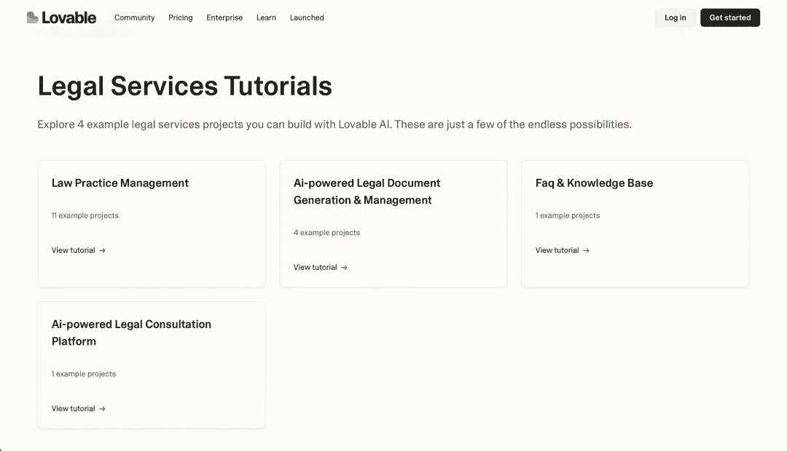

# 法律版「Cursor」，来了！

> 来源：[https://docs.feishu.cn/docx/OPJfdglIXoGnfIxqNGVcGCkDnUf](https://docs.feishu.cn/docx/OPJfdglIXoGnfIxqNGVcGCkDnUf)

---

法律行业存在大量重复性工作，从法律检索、合同起草审查，到各种业务工作流程，实践中有大量工作值得自动化提效。然而，由于成本问题，很少会有法律科技公司愿意研发产品，导致很多垂直细分的需求没有得到解决。

随着 AI 技术飞速发展，Cursor、Trae 等 AI 编程产品不断涌现，很多法律人开始期待法律行业也能出现这种低技术门槛的平台，让法律人也可以快速构建符合自身需求的法律科技产品。

这不，法律版「Cursor」，它来了！

**7 月 17 日，AI 编程平台 Lovable 宣布完成 2 亿美元 A 轮融资，Accel 领投，20VC、**byFounders、Hummingbird、Visionaries Club、Creandum 和一些天使投资者跟投。

> 链接：https://lovable.dev

**L**ovable 是一个类似于 Cursor、Trae 的 AI 编程平台，支持用户直接向 AI 提出产品设计需求来创建应用和网站。

与**很**多智能体平台只能手搓 AI 聊天机器人相比，AI 编程软件可以做出更接近应用级的软件工具，更加契合大众的使用习惯。其中，Lovable 还支持创建各类法律科技工具，并在官网上公布了 4 个 AI 生成的法律科技项目示例：

> 链接：https://lovable.dev/how-to/legal-services

简单来说，Lovable 提供几类法律科技产品的“样板间”，支持一键生成产品的主要功能和用户界面（UI/UX），并支持用户根据自己的需求进行修改，或者补充自己的数据集。

以前，要想打造一款法律科技工具，需要具备专业的编程知识，并投入大量的资金、时间，对于法律人来说是遥不可及的事情；现在，随着低代码和生成式 AI 技术的进步，即使是没有编程经验的法律专业人士，也可以通过低成本、简单的交互方式（如功能模块拖拉拽），快速搭建出满足基本需求的法律科技产品。

举例来说，法律人可以通过钉钉、飞书等在线办公平台，自主搭建出 OA（办公自动化）、ERP（企业资源计划）以及 CRM（客户关系管理）等日常办公软件。

同时，我们还能通过扣子、腾讯元器等智能体平台，手搓 AI 智能体来辅助自身业务开展（腾讯元器+公众号：每家律所，每个律师，都可以拥有自己的 AI）。例如，何者社区与盈科青岛律师事务所联合举办的[后记：盈科山东首届法律 AI 共创大赛](https://legalstudio.feishu.cn/wiki/KepCw6I5niRYcjkEy1JcJsvjnnv)首届盈科山东区域法律 AI 共创大赛》，就是引入技术专家和律师深度协作，经过前期辅导，律师提出希望自动化的工作场景并准备数据，然后自主创造出解决自身问题的 AI 智能体，最后技术专家提供支持来完善产品能力，各方一起共创出真正可以赋能律师的 AI 产品 👉

总的来说，随着 AI 不断发展、技术门槛不断降低、法律科技生态不断完善，法律人将可以低成本地构建法律科技工具，提高工作效率，加速工作方式转型，催生更多新型的法律服务模式，法律行业将迎来全新的变革。