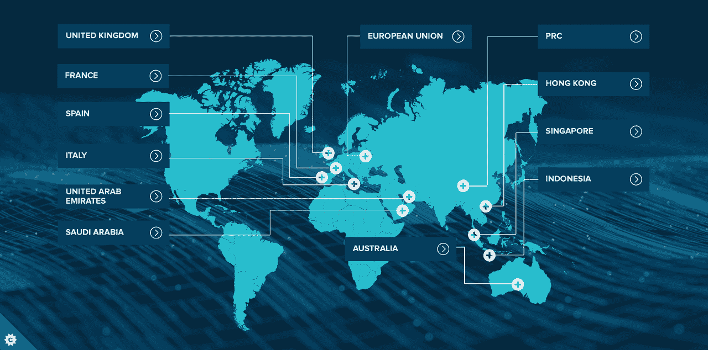
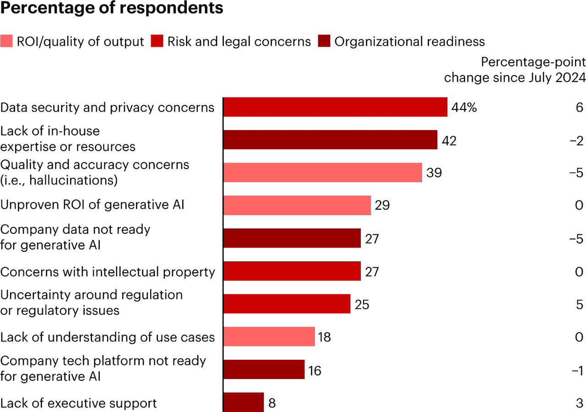
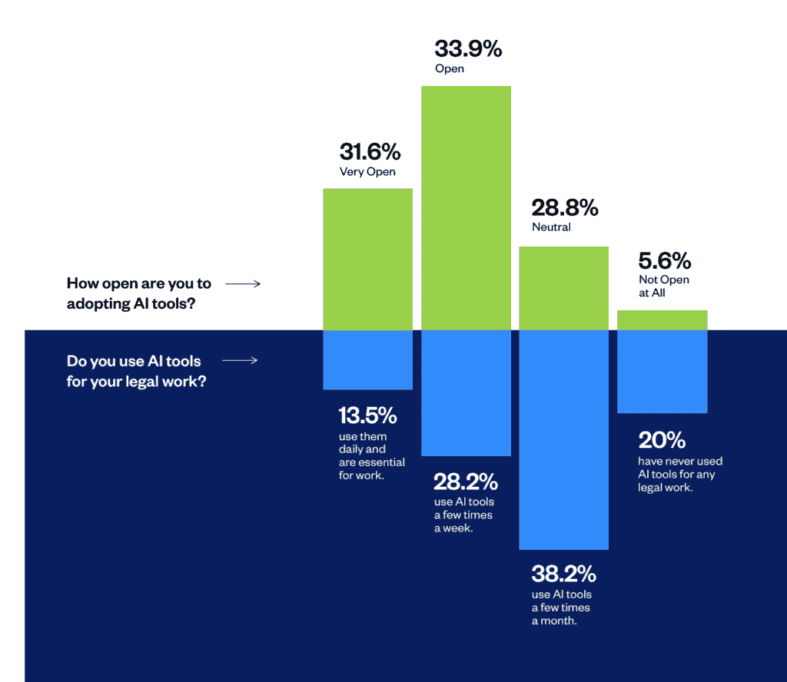

# 2025 年 5 月法律科技月刊

> 来源：[https://docs.feishu.cn/docx/HvKDd0sswo4YQxxiVD4cgM85n9t](https://docs.feishu.cn/docx/HvKDd0sswo4YQxxiVD4cgM85n9t)

---

> 你好，欢迎收看何者社区法律科技日报！
>
> 这是 Legal Studio 推出的一个专栏，每天都会收集、整理与 法律 AI、法律科技、大模型、生成式 AI 相关的前沿资讯，并在【法律 AI 交流群｜keep learning】🛰️群集合发送。
>
> 💙 温馨提示：

1. 电脑端点击本文档左侧目录，或者移动端滑动右侧目录，即可快速跳转到不同内容的相应位置。
2. 由于信息搜集存在一定滞后性，同时 Legal Studio 将本日报视为一个迭代过程，我们将不定期将值得关注的资讯补充更新到文档中（标绿部分），一周之后，本文档就变成了法律科技周报。
3. 受限于我们关注的范围，以及对一件事情是否「重要」的理解不同，可能还有值得记录的资讯没有被我们观察到，欢迎私信交流，也欢迎各界人士参与共建。
4. [订阅智库](https://legalstudio.feishu.cn/wiki/DLtSwmrQYibygZklZ4NcuuASnJg)文档仅收录快讯，如需阅读完整内容：

# 🤖 法律 AI 新产品及最佳实践

## A&O Shearman 律所旗下 Fuse 孵化器第九届项目官宣，12 家法律科技公司入选

5 月 29 日，A&O Shearman 律师事务所宣布 20 多家公司加入第九届 Fuse 孵化器，这也是该项目历史上数量最多的一届。其中，法律科技领域收到了 272 份申请，最终 12 家公司入选。

> 拓展阅读：[A&O Shearman 律所旗下 Fuse 孵化器第九届项目官宣，12 家法律科技公司入选](https://legalstudio.feishu.cn/wiki/W4oPwEAtii6Bn8kX5N7cYhtdnPg)

## Wolters Kluwer 和美国仲裁协会联合举办国际黑客马拉松

[5 月 29 日](https://www.law.com/legaltechnews/2025/05/29/wolters-kluwer-american-arbitration-association-team-up-to-host-international-hackathon/?slreturn=20250529110747)，法律信息服务头部厂商 Wolters Kluwer 宣布将与美国仲裁协会-国际争议解决中心（AAA-ICDR）合作，举办一场以国际仲裁为重点的黑客马拉松，于 2025 年 6 月 11 日在荷兰海牙举行。

这场黑客马拉松旨在将争议解决专业人士与技术人员聚集在一起，以开发 AI 驱动的仲裁工作流程。

## Herbert Smith 律所推出 AI 法规追踪器，利用 AI 技术跟踪 AI 法规

5 月 23 日，全球律师事务所 Herbert Smith Freehills 推出一个 AI 驱动的工具，名为“AI 法规追踪器”，帮助客户跟踪不断变化的 AI 监管政策动态，跨越全球各大洲的 12 个司法管辖区。

> 拓展阅读：[推出 AI 相关的法律服务和教育资源](https://legalstudio.feishu.cn/wiki/YxhfwO1jUisanVkGu6Sc0ep2ntc)

## 微软 Copilot 支持快速构建和微调合同 Agent

5 月 20 日，微软在 Build 2025 活动的上展示了如何创建多个 AI Agent 来执行任务，并举例说明了如何对 RFP 进行合规性检查，以及使用 Agent 编写合同，并展示了如何微调合同 Agent。

## 路德律师事务所即将在全所范围内私有化部署 Beamon AI 平台

5 月 9 日，德国第五大律师事务所路德（Luther Rechtsanwaltsgesellschaft）即将在全律所范围内推出布莱特公司（Bryter）的 AI 工具 Beamon，支持对话、起草、审查等能力，并实现各种工作流程的自动化。

其中，布莱特为路德律所搭建了专用的私有云，以满足德国严格的法规要求。

> 拓展阅读：[律所构建或采购 AI 工具资讯汇总](https://legalstudio.feishu.cn/wiki/Ah8KwZtI0i7nKjkkK9icSRBmn9e)

## 全球首家 AI 律所来了！英国律师监管局官方授权

5 月 4 日，英国律师监管局 (SRA) 授权 Garfield.Law，一家完全由 AI 而不是人类律师提供法律服务的机构，在英国和威尔士提供法律服务。Garfield.Law 由前律师 Philip Young 和技术专家 Daniel Long 创立，为中小企业和其他律师事务所提供 AI 驱动的诉讼助理，帮助他们通过英国和威尔士法院系统追回未付债务，指导完成小额索赔程序。

> 拓展阅读：[全球首家 AI 律所来了！英国律师监管局官方授权](https://legalstudio.feishu.cn/wiki/YKLbwAuxxibTYwk1WO2cMVL5nKe)

## 投资技术、拥抱新的工作方式，BCLP 律师事务所将裁员 8%

5 月 2 日消息，Bryan Cave Leighton Paisner 律师事务所希望采用新的工作方式、投资技术能力，即将裁减全球约 8% 的员工，以应对经济下行的市场环境。

> 拓展阅读：[招募高管职位负责落地 AI，并优化组织结构](https://legalstudio.feishu.cn/wiki/EMV4wR47hikXmKkoocbcpKSknqd)

## Cleary 律所全面推出法律 AI 工具 Legora，加速拥抱法律科技

5 月 1 日，Cleary Gottlieb Steen & Hamilton 律师事务所宣布在所有办公室，推出法律 AI 工具 Legora。

这是 Cleary 投资法律科技的最新举措。在此之前，Cleary 还收购了生成式 AI 初创公司 Springbok，推出 ClearyX，成立电子发现和诉讼技术集团，以及专注于定制 AI 工具的实践创新部门。可以看出，该律所正在加速拥抱 AI。

> 拓展阅读：[律所构建或采购 AI 工具资讯汇总](https://legalstudio.feishu.cn/wiki/Ah8KwZtI0i7nKjkkK9icSRBmn9e)

## Dentons 律所聘用前安永法律领袖，负责部署尖端技术

5 月 1 日，Dentons 律师事务所宣布聘请前安永法律实践的全球管理合伙人 Cornelius Grossmann 作为全球解决方案开发主管，负责领导一个新团队，该团队将专注于部署尖端技术，以提高律所的竞争优势。

> 拓展阅读：[招募高管职位负责落地 AI，并优化组织结构](https://legalstudio.feishu.cn/wiki/EMV4wR47hikXmKkoocbcpKSknqd)

# 🥸 法律科技行业研究

## Intapp 最新研究：50% 的专业人士使用未授权的 AI 工具，面临信息安全风险

5 月 20 日，Intapp 发布《2025 年技术感知调查报告》，以下是核心调研发现：

+ AI 的使用大幅增长，72% 的专业人士在工作中使用 AI，而 2024 年为 48%。
+ 50% 的专业人士使用未授权的 AI 工具，面临更高的信息安全风险。
+ 使用 AI 节省的时间被重新分配给更高级别的客户工作（42%）和战略规划（33%）。
+ 82% 的受访者表示，AI 生成的工作质量至少和他们自己一样好。
+ 获得 AI 工具将影响 Z 世代（57%）和千禧一代（52%）受访者寻找工作。

> 拓展阅读：[法律科技研究报告及学习资源](https://legalstudio.feishu.cn/wiki/A0xuw3CAgicjSakWVcMcPwQTnsb)

## 贝恩最新研究：数据安全、人才短缺和 AI 输出质量等问题，可能会减缓采用速度

5 月 15 日，贝恩公司发布《Survey: Generative AI’s Uptake Is Unprecedented Despite Roadblocks》调查报告。

报告显示，生成式 AI 的投资和采用正在激增，而且超过 80% 的 AI 用例符合或超出预期，大约 60% 对 AI 感到满意的公司表示业务得到改善。然而，对数据安全、人才短缺和 AI 输出质量等问题的担忧，可能会减缓采用速度。

> 拓展阅读：[法律科技研究报告及学习资源](https://legalstudio.feishu.cn/wiki/A0xuw3CAgicjSakWVcMcPwQTnsb)

## Legatics 最新研究：法律科技工具除了可以提高效率，还可以帮助律所收集大量数据

5 月 15 日，Legatics 发布《Unlock the hidden value of legal transaction data》白皮书，探讨了法律科技工具除了可以提高效率，还可以收集大量有用的数据，这些数据本身对律师事务所具有巨大的价值。

> 拓展阅读：[法律科技研究报告及学习资源](https://legalstudio.feishu.cn/wiki/A0xuw3CAgicjSakWVcMcPwQTnsb)

## 公司法律顾问协会推出 AI 工具包，为企业提供实用指导

5 月 1 日，公司法律顾问协会（ACC）推出一个 AI 工具包，为企业法务提供实用的 AI 策略。

+ 清单1：企业法务的 AI 基础知识
+ 清单2：更精通 AI 并提升职业生涯的技巧
+ 清单3：制定治理和合规策略
+ 清单4：在整个业务中整合 AI 治理
+ 清单5：将 AI 纳入法律团队的工作
+ 清单6：在使用生成式 AI 时履行道德义务
+ 清单7：使用生成式 AI 时保护知识产权
+ 清单8：评估 AI 功能、产品和服务
+ 清单9：解决与第三方合同中的 AI 问题

> 拓展阅读：[法律科技研究报告及学习资源](https://legalstudio.feishu.cn/wiki/A0xuw3CAgicjSakWVcMcPwQTnsb)

## Spotdraft：起草和实施 AI 政策、衡量 AI 的投资回报率，是企业拥抱 AI 的核心挑战

4 月 30 日，CLM 服务商 Spotdraft 发布《2025 年 AI 对内部法律团队的影响》，调研了 195 名法律专业人士采用 AI 的情况，包括内部法律顾问、总法律顾问、法律服务总监、法律运营经理和首席法律官等。

报告显示，越来越多的企业法务开始使用 AI，但起草和实施 AI 政策，以及衡量 AI 的投资回报率仍然存在挑战。

其中，42% 的人表示他们推出了 AI 政策，但尚未实施，37% 的人表示他们还在制定 AI 政策。这些 AI 治理政策的保障措施包括：建立定期的 AI 使用和合规审计，实施数据隐私和安全协议，为 AI 决策制定问责制政策。报告还发现，近 10% 的受访者使用 AI，但不相信建立正式的 AI 政策，这可能会导致律所的数据和隐私面临风险。

同时，32% 的人提到了投资回报的不确定性。

> 拓展阅读：[法律科技研究报告及学习资源](https://legalstudio.feishu.cn/wiki/A0xuw3CAgicjSakWVcMcPwQTnsb)

# 💰 法律科技融资并购

> 资讯详情：

> [2025 年法律科技融资新闻汇总](https://legalstudio.feishu.cn/wiki/RwrTw2ohkiYBMSktAs6cxR4rn9F)

> [2025 年法律科技并购新闻汇总](https://legalstudio.feishu.cn/wiki/UQ6qwKd2Vijll6kc56JcpBmPnBb)

> 详情页为付费内容，了解更多：[订阅会员](https://legalstudio.feishu.cn/wiki/DLtSwmrQYibygZklZ4NcuuASnJg)

## Wolters Kluwer 将以 4.25 亿欧元收购 ELM 服务商 Brightflag

5 月 29 日，法律信息服务头部厂商 Wolters Kluwer 宣布即将以 4.25 亿欧元的价格，收购电子账单和事项管理系统服务商 Brightflag，加强 Wolters Kluwer 在美国和欧洲中型公司中的法律和监管业务。

## AI 知识产权平台 Ankar 完成 300 万英镑种子轮融资

5 月 28 日，AI 知识产权平台 Ankar 宣布完成 300 万英镑种子轮融资，Index Ventures 领投，Hugging Face 的首席技术官 Julien Chaumond 跟投。Ankar 支持识别专利差距和评估发明的原创性，起草具有增强独特性和可辩护性的专利申请，识别新的许可机会，并支持检测大规模侵权行为，帮助发明家、企业和知识产权律师大幅提高工作效率。

## Pay-i 完成 490 万美元种子轮融资，衡量生成式 AI 的投资回报率

5 月 21 日，前微软高管成立的 Pay-i 宣布完成 490 万美元种子轮融资，Fuse Partners 和 Tola Capital 共同领投，Firestreak、Pear VC、Gaia Capital 和财富 100 强公司的天使投资者参与。

Pay-i 由两名前微软高管创立，旨在实时跟踪和预测生成式 AI 的投资回报。

## 专业服务 AI 初创公司 Ravical 完成 730 万欧元预种子轮融资

5 月 21 日，面向专业服务领域的 AI 初创公司 Ravical 宣布完成 730 万欧元（820 万美元）预种子轮融资，Lakestar 领投。Ravical 为会计、税务、法律、人力资源和保险公司等专业服务公司，提供经过领域训练的 AI Agent 平台。

## 企业网络安全公司 Proofpoint 收购合规厂商 Nuclei

5 月 21 日，企业网络安全公司 Proofpoint 宣布收购 Nuclei —— 专注于合规归档和工作场所通信生产力工具的公司。

## 法律 AI 初创公司 Legora 完成 8000 万美元 B 轮融资

5 月 21 日，法律 AI 初创公司 Legora 宣布完成 8000 万美元 B 轮融资，ICONIQ 和 General Catalyst 领投，Redpoint Ventures、Benchmark 和 Y Combinator 跟投。

## 法律 AI 初创公司 JUPUS 完成 650 万欧元种子轮融资

5 月 20 日，法律 AI 初创公司 JUPUS 宣布完成 650 万欧元种子轮融资，Acton Capital 和现有投资者领投。JUPUS 为律师事务所提供一个 AI 平台，可以自动化内部管理任务，还直接与客户沟通，从第一次电话到完成简报全流程。

## 法律招聘初创公司 Flo Recruit 披露了一笔新的融资

5 月 20 日，法律招聘初创公司 Flo Recruit 宣布在 2023 年完成的 A 轮融资中筹集了一笔未披露的金额，LiveOak Ventures 和 Moneta Ventures 领投，The LegalTech Fund、Y Combinator 和 Teamworthy Ventures 跟投。

## 私募股权机构支持的法律服务集团 Lawfront 收购 Trethowans 律师事务所

5 月 20 日，由布利克斯特投资集团（Blixt investment group）支持的法律服务集团 Lawfront 宣布收购 Trethowans 律师事务所 —— 这是一家成立于 1886 年的英国中大型律所，其年收入接近 3000 万英镑。

这是 Lawfront 迄今为止最大的一次收购，在此之前 Lawfront 进行了 13 次收购，包括五家中大型律所，集团总收入超过 1.3 亿英镑，稳步迈向“十大区域性法律服务机构”之列。

## AI 诉讼预测初创公司 Theo Ai 完成 420 万美元种子轮融资

5 月 19 日，AI 诉讼预测初创公司 Theo Ai 宣布完成 420 万美元种子轮融资，NextView Ventures 和 Collide Capital 共同领投，Ripple Ventures、nvp capital、Beat Ventures 以及多位天使投资人跟投。

## 遗嘱管理初创公司 Adeus 获得 50 万英镑赠款

5 月 19 日，英国创新机构 Innovate UK 向遗嘱管理初创公司 Adeus 提供 50 万英镑赠款，加快遗嘱规划软件开发。

## Anaqua 收购 IP 管理软件公司 RightHub

5 月 15 日，知识产权管理服务商 Anaqua 宣布收购同类公司 RightHub，扩展欧洲客户群，并开发更多技术方案。这是自 Nordic Capital 于 2 月完成收购 Anaqua 以来的首次收购。

## 法律 AI 自动化平台 Plexus 完成 600 万美元新一轮融资

5 月 14 日，AI 驱动的法律自动化平台 Plexus 宣布完成 600 万美元新一轮融资。

## Morae Global Corporation 收购信息治理平台 Gimmal

5 月 14 日，法律解决方案服务商 Morae Global Corporation 宣布收购信息治理软件平台 Gimmal。

## 诉讼支持服务商 Magna 与法院报告公司 EveryWord 合并

5 月 8 日，诉讼支持服务商 Magna Legal Services 宣布今年的第二次并购 —— 与法院报告公司 EveryWord 合并。

## 公司解散初创公司 SimpleClosure 完成 1500 万美元 A 轮融资

## SimpleClosure 完成 1500 万美元 A 轮融资

5 月 7 日，公司解散服务商 SimpleClosure 宣布完成 1500 万美元 A 轮融资，TTV Capital 领投，其他投资者包括 The LegalTech Fund、Infinity Ventures、Anthemis、Vera Equity、Carta 等。

SimpleClosure 成立于 2023 年 9 月，利用各种金融科技、法律科技和 AI 工具，通过自动化文书工作、法律备案、与监管机构和投资者沟通，帮助企业快速完成解散流程。

## AI 法律营销初创公司 FirmPilot 完成 470 万美元新一轮融资

5 月 7 日，AI 驱动的法律营销公司 FirmPilot 宣布获得一笔 470 万美元的新投资，投资方为汤森路透旗下的风险投资公司和 HubSpot 风险投资公司，以及部分老股东。FirmPilot 为律师事务所提供数据驱动的营销能力，一方面利用律所的营销材料训练 AI，从而制作更适合法律行业的营销内容，并针对搜索引擎进行优化；另一方面，FirmPilot 还可以分析律所竞争对手的营销内容及其效果，从而优化律所的营销策略。

## 资产管理公司 Arcapita 收购法律科技服务商 Trustpoint.One

5 月 7 日，全球资产管理公司 Arcapita Group Holdings Ltd. 宣布收购科技驱动的法律服务提供商 Trustpoint.One。

## 私募股权公司 Norvestor 收购法律科技公司 PSA Solutions AS

5 月 6 日，北欧私募股权公司 Norvestor 宣布收购挪威法律科技服务商和咨询公司 PSA Solutions AS。

## 律师管理平台 Persuit 收购 Apperio，建立“端到端”的解决方案

5 月 5 日，律师管理平台 Persuit 宣布收购法律支出分析和事务管理服务商 Apperio，以建立一个“端到端”的平台，涵盖从接收到发票审批和付款等全流程，旨在帮助企业法务做出更智能的外部律师聘用决策。

Persuit 的愿景和路线图的核心，是推动替代费用安排（AFA）和基于结果的定价成为企业法务部门的基础。为了实现这一目标，企业法务部的领导人需要对外部律师管理的整个生命周期有完全的控制和洞察力。

## 律师匹配初创公司 Justice Bid 完成 400 万美元种子轮融资

5 月 5 日，律师匹配初创公司 Justice Bid 宣布完成 400 万美元种子轮融资，投资人包括 Relativity 前首席执行官 Andrew Sieja 的家族办公室 OnDean Forward、前首席增长官 Marcin Wojtczak 和首席运营官 Nick Robertson。Justice Bid 是一个律师选择和分析平台，可以帮助企业法律部门在选择外部律师时能够做出更明智的决定。

## 尽职调查初创公司 Maveri 完成 350 万美元种子轮融资，Goodwin Partner 律所投资

5 月 5 日，尽调初创公司 Maveri 宣布完成 350 万美元种子轮融资，投资人包括 Alven、Day One Ventures、Tectonic Ventures、Lightscape Partners、K5 Global、Cadenza 和 Goodwin 律所的合伙人兼全球并购集团 Lawrence Chu 的联合主席，据说还有许多用户和律师也投资了该公司。Maveri 由前 Morrison & Foerster 律所的公司和并购律师 Connor Acle 创立，该公司利用 AI Agent 自动组织和分析公司文件，帮助律师简化尽职调查工作。
