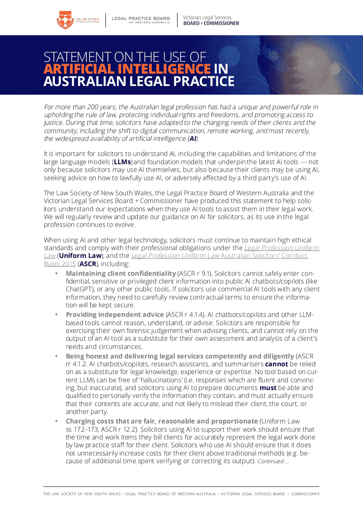

# 2024 年 12 月法律科技月刊

> 来源：[https://docs.feishu.cn/docx/KhKndpopIo6o3GxJiWtctjhZnBh](https://docs.feishu.cn/docx/KhKndpopIo6o3GxJiWtctjhZnBh)

---

# 一、法律科技 / AI 融资动态

## AI 专利软件初创公司 Lightbringer 完成 420 万欧元种子轮融资

12 月 18 日，AI 专利软件初创公司 Lightbringer 宣布完成 420 万欧元种子轮融资。

> 拓展阅读：https://www.law360.com/pulse/legal-tech/articles/2276162/lightbringer-raises-4-2m-for-ai-backed-patent-software

## 自动化计费软件公司 NQ Zebraworks 获得 700 万澳元投资

12 月 18 日，法律文件和计费工作流程软件公司 NQ Zebraworks 宣布获得其母公司 Reckon Ltd 的 700 万澳元投资，继续产品开发和云增长。

> 拓展阅读：https://www.law360.com/pulse/legal-tech/articles/2275751/legal-tech-co-nq-zebraworks-gets-4-5m-capital-injection

## 无代码法律自动化公司 Josef 完成新一轮融资

[12 月 ](https://joseflegal.com/)[6 日，澳大利亚无代码法](https://www.oifventures.com.au/)律自动化公司 Josef 宣布完成新一轮融[资，融资金额没](https://www.law.com/legaltechnews/2022/11/28/australian-no-code-automation-platform-josef-raises-3-45-million/)有披露，投资方为三家现有股东 OIF Ventures、Carthona Capital 和 The LegalTech Fund。Josef 在上一轮融资中筹集了约 345 万美元。

> 拓展阅读：https://www.lawnext.com/2024/12/responding-to-strong-market-interest-in-its-gen-ai-product-josef-closes-lightning-fast-funding-round.html

## 在线法律服务平台 Lawhive 完成 4000 万美元 A 轮融资，谷歌领投

[12 月 5 ](https://lawhive.co.uk)日，在线法律服务平台 Lawhive 宣布完成 4000 万美元 A 轮融资，Google Ventures 和 TQ Ventures 共同领投，Balderton、Episode 1、Jigsaw 以及英超足球运动员 Harry Maguire 和 Reece James 跟投。今年 4 月，Lawhive 完成了 1190 万美元种子轮融资。接下来，Lawhive 将进军美国市场。

Lawhive 由 Pierre Proner（首席执行官）、Jaime Van Oers（首席技术官）和 Flinn Dolman 于 2019 年创立，提供一个基于 AI 的 SaaS 平台，帮助中小律所经营业务，从而为更多客户提供服务。

目前[，大多数](https://www.srln.org/system/files/attachments/2016%20ABA%20Future%20of%20Legal%20Services%20-Report-Web.pdf)法律科技公司都专注于服务“大型律师事务所”，比如 Harvey、Robin AI 和 Spellbook。这些公司避开中小律所，原因也很简单，因为中小律所的预算要比大型律所小得多，因此更难商业化。但根据一份报告，80% 美国消费者的法律需求都没有得到满足，这相当于每年 1 万亿美元的价值，已经是一个很大的市场了。

具体来说，Lawhive 为律师提供了协助合规、付款和工作流程管理的工具，从而节省法律专业人士的时间。同时，律师还可以通过 Lawhive 平台与消费者和小企业进行匹配，或者使用该平台与自己的客户协作。此外，Lawhive 的 AI 工具“Lawrence”可以自动化执行部分法律任务，而且已经通过了律师资格考试（SQE）的第一部分。

> 拓展阅读：https://techcrunch.com/2024/12/04/lawhive-raises-40m-to-go-after-main-street-us-lawyers/?guccounter=1

## AI 诉讼预测平台 Wexler AI 完成 140 万美元预种子轮融资

12 月 3 日，AI 诉讼预测平台 Wexler AI 宣布完成 140 万美元预种子轮融资，Myriad Venture Partners 领投，Tractable、Credit Kudos、ComplyAdvantage 和 Moonpig 跟投。Wexler AI 可以分析各种法律文件，帮助法律专业人士为诉讼制定案件策略，还可以根据提供的文件，提取信息并回答法律问题。

> 了解更多：https://www.law.com/legaltechnews/2024/12/03/uk-startup-wexler-ai-announces-14m-preseed-funding/

## AI CLM 厂商 Pocketlaw 完成 500 万欧元新一轮融资

[12 月初，瑞典法](https://pocketlaw.com/)律 AI 自动化公司 Pocketlaw 宣布完成近 500 万欧元的新一轮融资，Atomico 等现有投资者和一些新投资者参与，包括瑞典科技企业家、Kobalt Music Group 的创始人 Willard Ahdritz。

Pocketlaw 利用 AI 技术，可以实现合同管理的自动化和扩展。本轮融资后，Pocketlaw 将加快其 AI 产品的开发和在欧洲的扩张。2022 年，Pocketlaw 获得了 1000 万欧元的 A 轮融资。

> 拓展阅读：https://www.artificiallawyer.com/2024/12/02/pocketlaw-bags-nearly-e5m-for-ai-development/

# **二、法律科技并购动态**

## Amicus Capital 收购客户接收服务软件服务商 Case Compass

12 月 3 日，投资机构 Amicus Capital Group 宣布收购客户接收服务软件服务商 Case Compass。

> 拓展阅读：https://www.law360.com/pulse/legal-tech/articles/2268584/law-firm-lender-amicus-capital-acquires-client-intake-co-

# **三、法律 AI 最新动态**

## 澳大利亚的监管机构表示，律师只应将 AI 用于低端任务

12 月 6 日，澳大利亚[新南威尔士州法律协会](https://www.lawsociety.com.au/publications-and-resources/ai-legal-professionals)、[西澳大利亚州法律实践委员会](https://www.lpbwa.org.au)、[维多利亚州法律服务委员会](https://lsbc.vic.gov.au)，联合发表一套共同原则，指导律师负责任和合乎道德地使用 AI。

> 拓展阅读：

>

[若干机构联合发布：关于在澳大利亚法律实践中使用 AI 的声明（2024）.pdf](https://internal-api-drive-stream.feishu.cn/space/api/box/stream/download/all/W1awbQc23oiyfuxJ8IWcERW7nvf)

> https://www.lpbwa.org.au/ai-guidance-to-safeguard-consumers-of-legal-services

## 西班牙要求披露在法律服务相关数字平台中使用 AI 的情况

12 月 4 日，西班牙关于辩护权的第 5/2024 号组织法正式生效。

这个法案根据《西班牙宪法》第 24 条，对作为基本法律保护措施的辩护权制定了全面规定，要求披露在法律服务相关数字平台中使用人工智能（AI）的情况，并强制公开 AI 系统如何提出建议或作出决策的信息。

> 拓展阅读：https://mp.weixin.qq.com/s/_2_C4JLXggSEbT8Xubmbpw

## [严监管态势下，企业合规经营都在关注四个问题｜免费获取法律体检报告](https://legalstudio.feishu.cn/wiki/Bi9Tw6Z4siYHEckSSegczchKnre?from=from_copylink)

当前监管日益严格，企业合规经营已成为发展的必然要求。众多企业因内部合规漏洞，在经营与声誉上遭受重创。据统计，我国民企数量庞大，但拥有法律风险防范能力的企业占比极低。高昂的传统法律服务成本，也让许多企业在合规之路上举步维艰。在此背景下，「如何有效建立企业合规体系」这一话题值得每一位企业管理者深思。

伴随 AI+大数据的迅猛发展，法律服务也应该以更低成本、更优服务的崭新面貌，惠及更广泛的企业群体。

法保网以「法务数字化 + 法律 AIGC」为核心技术支撑，采用“线上 + 线下”融合的创新服务模式，构建了标准化的企业风险识别机制，可以提供免费的法律风险体检报告。还能与企业协同确立合规建设目标，定制合规策略，比如针对制造业企业的专项方案。在合规制度建设上，可以依据企业需求提供定制化服务。其核心产品「法保通」，为企业战略决策与业务活动提供专业服务保障，涵盖法律咨询、合同审核定制、法律文书起草、劳动人事管理、知识产权管理等多项功能，确保企业合规经营，有效防范法律风险。

> 了解更多：[严监管态势下，企业合规经营都在关注四个问题｜免费获取法律体检报告](https://legalstudio.feishu.cn/wiki/Bi9Tw6Z4siYHEckSSegczchKnre?from=from_copylink)

# **四、法律 AI 市场教育**

## 华盛顿大学法学院与法律 AI 培训公司合作推出 AI 和法律实践新项目

[12 月 17 日](https://wickard.ai)，华盛顿大学法学院宣布与 WickardAI 合作推出一个专注于 AI 和法律实践的新项目。

> 拓展阅读：https://www.law360.com/pulse/legal-tech/articles/2275169/washu-law-school-teams-with-wickardai-on-legal-ai-program

## 最新调查：公司法律部门认为律所不够创新

近日，Bli[ckstein Group ](https://www.fticonsulting.com)和 FTI Consulting 发布第 17 次年度法律部运营调查，针对 85 名公司法务部的法律专业人士进行调研。报告发现，大多数受访者（约 62%）认为他们聘用的律所不够创新，特别是采用 AI 技术。

同时，过去一些公司内部的法律专业人士对 AI 感到担忧，但这个态度似乎已经发生了变化 —— 报告显示，鼓励律所使用 AI 的受访者人数，从 2023 年的 63% 上升到 2024 年的 78%，增长了 15 个百分点。

这个态度的转变，主要是因为客户看到了将 AI 融入法律工作的各种好处。71% 的受访者指出，律所提供的法律服务价值将随着生成式 AI 的整合而提高，65% 的受访者也认为，广泛地采用生成式 AI 将降低外部律师成本的支出。

在这种情况下，公司法律部门将更多地采购 AI 技术。报告显示，大多数受访者（约 86%）指出，他们期望生成式 AI 能够让他们在内部完成更多工作，而 2023 年这个数字大约是 66%。

> 拓展阅读：https://www.law.com/legaltechnews/2024/12/16/embracing-gen-ai-many-legal-departments-dont-see-their-firms-as-innovative/

## 佛罗里达大学法学院探讨 AI 在法律职业中的作用

在[佛罗里达州立大学](https://law.fsu.edu/)[法学院](https://law.fsu.edu/)**，**教师处于突破性研究的最前沿，探索 AI 和法律的交叉点，解决新兴技术带来的挑战和机遇。通过将 AI 研究整合到课程中，法学院使学生能够直面这些挑战，并帮助他们在不断发展的法律实践世界中茁壮成长。FSU 法学院院长 Erin O'Hara O'Connor 表示：“我们的教师进行的研究不仅有助于关于 AI 和法律的更广泛讨论，而且丰富了教育体验，为学生提供了在复杂、技术驱动的世界中茁壮成长所需的知识和技能。”

> 拓展阅读：https://law.fsu.edu/press-release/fsu-college-law-pioneering-ai-and-law-research

## 最新调查：偏见和不准确、缺乏培训教育，是人们采用 AI 技术的关键障碍

12 月 3 日，[Linklaters](https://www.linklaters.com)、She Breaks the Law 和 Next 100 Years 公布了关于法律行业女性如何使用 AI 的调查结果。这份报告针对在法律行业工作的女性进行了一次在线调查，共收到了 90 名女性的回复。

报告发现，人们在 AI 提高效率和生产力方面的潜力上达成了强烈的共识 —— 77% 的受访者表示，AI 正在对该行业产生“非常重大”的影响。然而，AI 技术在法律行业的落地上也存在着一些挑战。

其中，偏见和不准确是人们采用 AI 技术的关键障碍。尽管对 AI 充满热情，但人们还是对准确性和人类监督的必要性表示担忧 —— 37% 的受访者表示对 AI 的可靠性感到担忧。偏见似乎是这种不信任的核心驱动力 —— 43% 的人表示，他们在 AI 和法律科技中观察到了偏见，包括有偏见的工具、偏见结果的报告和定性影响。

同时，缺乏培训教育也是一个主要挑战。报告显示，31% 的受访者对 AI “有些知情”，另有 17% 的人指出他们存在知识差距，其中 26% 的受访者明确指出缺乏培训和资源是 AI 采用的障碍。受访者指出，实践经验（24%）、综合培训（20%）和指导机会（20%），有助于促进女性对 AI 的采用。

> 拓展阅读：https://www.artificiallawyer.com/2024/12/03/bias-inaccuracy-key-concerns-with-legal-ai-tools-survey/

## 芝加哥大学新法律课程深入挖掘负责任地使用 AI

今年冬天，芝加哥大学法学院将提供《法律实践中的生成式 AI》课程，由法律研究公司 vLex 的首席战略官 Ed Walters 授课。此前，Ed Walters 与 Tanina Rostain 教授共同教授了乔治敦大学法律中心的《生成式 AI 和大型律师事务所》的课程，该课程让学生接触到使用生成式 AI来执行法律任务及其影响。

> 拓展阅读：https://www.law.com/legaltechnews/2024/12/03/new-university-of-chicago-law-course-digs-deeper-into-using-gen-ai-responsibly-/