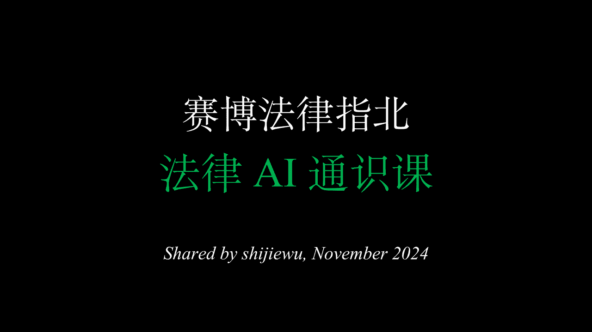
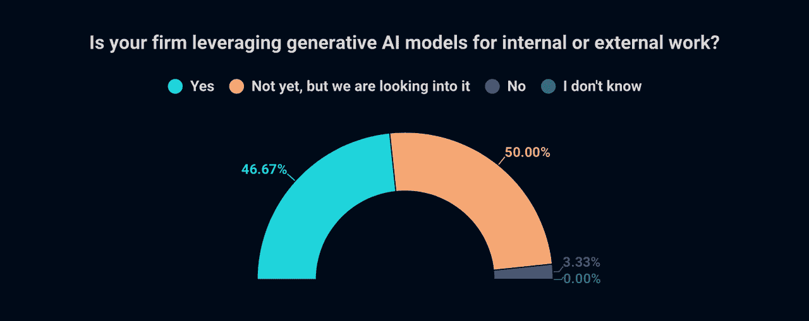
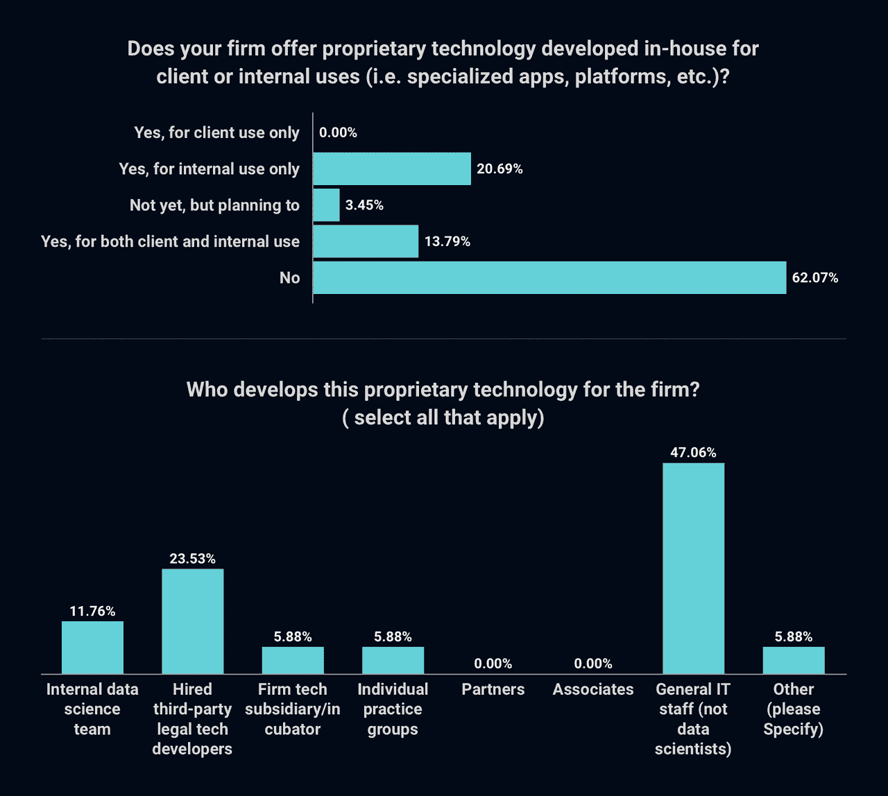
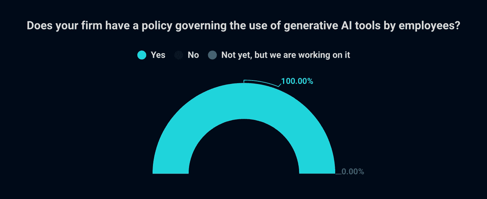
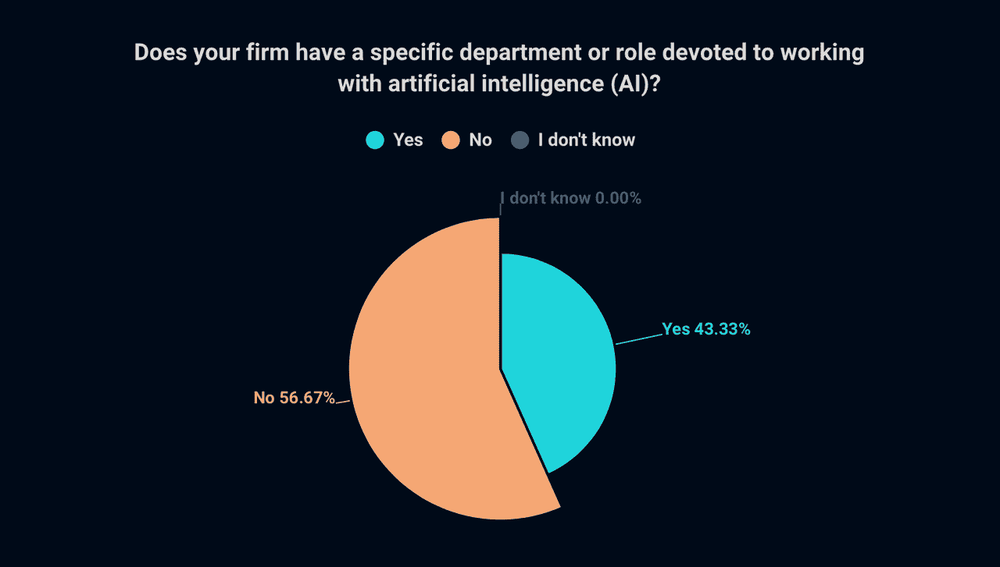
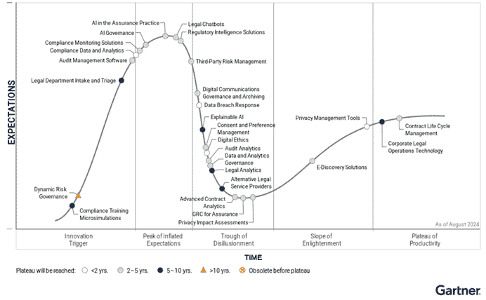
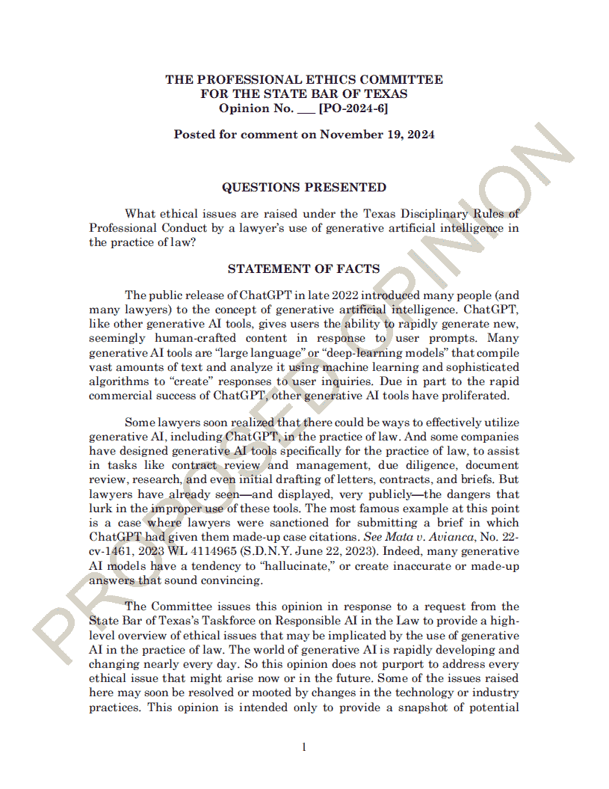

# 2024 年 11 月法律科技月刊

> 来源：https://docs.feishu.cn/docx/FCPddSizeoDVyZxNuaFczxrznjd

## 一、法律科技 / AI 融资动态

### AI 文档工具 Macro 完成 1200 万美元 A 轮融资

11 月 23 日，面向法律和其他专业人士的 AI 文档工具 Macro 宣布完成 1200 万美元 A 轮融资，Andreessen Horowitz（a16z）[领投](https://www.law.com/legaltechnews/2023/02/08/productivity-suite-macro-raises-9-3-million-from-cooley-andreessen-horowitz-others/)，老股东 [Crafft](https://www.law.com/legaltechnews/2018/12/14/startup-firm-atrium-hits-a-milestone-with-first-partner-promotions-397-14952/)、[BoxGroup](https://www.law.com/legaltechnews/2020/03/10/everlaw-raises-62-million-brings-in-alphabet-equity-fund-as-investor/) 和 3kVC 跟投。Macro 提供一个生产力套件，通过 AI 将 Office 众多套件进行整合，支持用户可以在一个地方处理各种文件格式。去年，Macro 获得由 Andreessen Horowitz 领投的 930 万美元，该机构此前还投资过其他法律科技公司，包括 Atrium 和 Everlaw。

> 了解更多：https://www.law.com/legaltechnews/2024/11/27/-productivity-suite-startup-macro-announces-12-million-funding-round-/

### Theo Ai 完成 220 万美元种子轮融资，提供诉讼预测分析

11 月 20 日，诉讼预测 AI 平台 [Theo Ai](https://theoai.ai/) 宣布获得 220 万美元预种子轮融资，NextView 和 nvp capital 共同领投，Ripple Ventures、Beat Ventures 和 SCVC Fund 参与。

Theo Ai 使用专有的数据模型和预测引擎，帮助法律专业人士就案件的可能结果做出明智的决定。

> 拓展阅读：https://theoai.ai/theo-ai-pre-seed-funding/

### CLM 厂商 Robin AI 披露 2500 万美元额外融资，Paypal、Willets、剑桥大学投资

11 月 12 日，AI 合同起草和审查服务商 [Robin AI](https://www.robinai.com) 宣布在 2024 年初，额外筹集了 2500 万美元，由一群客户和现有投资者参与，包括 Paypal Ventures、Willets（Michael Bloomberg 的家族办公室）和剑桥大学。

据了解，这是 Robin AI 基于今年 1 月完成的 2600 万美元 B 轮融资，以及推出 Robin Reports 产生的 [势头](https://www.robinai.com/case-studies/university-of-cambridge-im)，所开展的 [传统融资之外](https://www.robinai.com/post/incident-response-to-cyber-attacks) 的机会主义募资。注：Robin Reports 是一个法律 AI 产品，可以一次总结数千份法律文件，并根据分析为用户提供行动建议，适用于并购尽职调查和事件响应（如数据泄露）等关键业务用例。

Robin AI 总部位于伦敦，由前 Clifford Chance 和 Boies Schiller Flexner 助理 Richard Robinson 和机器学习研究科学家 James Clough 于 2019 年创立。该公司提供了一个“AI 副驾驶”，利用 Anthropic 的生成式 AI Claude 模型和专有 AI 系统，来自动化合同起草、审查和数据提取。

> 拓展阅读：https://www.robinai.com/newsroom/robin-ai-turns-customers-into-investors

### 法律数字支付平台 Talli 完成 400 万美元种子轮融资

11 月 11 日，法律数字支付平台 [Talli](https://www.talli.ai) 宣布完成 400 万美元种子轮融资，Vestigo Ventures 领投。Talli 是一个法律行业的数字支付平台，致力于改变法律服务商（如律所）的结算流程，以实现合法支付技术现代化。

> 拓展阅读：https://www.businesswire.com/news/home/20241111278904/en/Talli-Closes-4-Million-Seed-Round-to-Modernize-Legal-Payments-Technology?_gl=1*bx3p59*_gcl_au*MTQ0NTM4NjMyOC4xNzI3ODczMTQw*_ga*MTM4OTE4NDczOS4xNzI3ODczMTQw*_ga_ZQWF70T3FK*MTczMTM0MDM3NC4yMi4xLjE3MzEzNDY2OTkuNjAuMC4w&ref=blog.talli.ai

## 二、法律科技并购动态

### Litera 收购 AI 法律文件编辑平台 Office & Dragons

11 月 26 日，法律科技头部公司 Litera 宣布收购总部位于伦敦的 Office & Dragons，该公司提供一个法律文件编辑平台，包含生成式 AI 能力。

> 拓展阅读：https://www.law.com/international-edition/2024/11/26/litera-acquires-uk-document-automation-startup/

### 私募基金 Nordic Capital 计划收购 IP 管理服务商 Anaqua

11 月 18 日，私募股权投资者 Nordic Capital 宣布计划收购知识产权管理服务商 [Anaqua](https://www.law.com/legaltechnews/2024/06/28/legal-tech-rundown-thomson-reuters-partners-with-ncsc-ironclad-announces-alliance-with-kpmg-and-more/)，并将支持 Anaqua 未来的全球扩张。今年 6 月，Anaqua 推出一个 AI 驱动的知识产权管理平台 AQX 11，帮助律所和公司监督知识产权资产。

> 拓展阅读：https://www.law.com/legaltechnews/2024/11/18/nordic-capital-plans-to-acquire-ip-management-solutions-provider-anaqua/

### Kutana+Brochet 收购 AI 文档起草审查公司 Contract Genetica

11 月 7 日，[Kutana+Brochet](https://kutana-brochet.co.uk/) 宣布收购 AI 文档起草审查初创公司 Contract Genetica。

Kutana+Brochet 在 Microsoft 365 中为法律和企业客户开发用户生产力工具，管理从创建到编辑、存储、打印、签署和签发文档的文档生命周期。Contract Genetica 成立于 2019 年，是 Microsoft Word 界面中的 SaaS 解决方案，基于律所的知识库和文档管理系统，可以在律师工作时提出并完成条款，有助于推动合同标准化。

> 拓展阅读：https://legaltechnology.com/2024/11/07/exclusive-kutanabrochet-acquires-majority-share-in-contract-genetica/

## 三、法律 AI 最新动态

### Richard Susskind 教授：随着技术的发展，AI 有望对法律领域进行更大的变革

近日，Richard Susskind 教授在一个网络研讨会上表示，随着 AI 技术的发展，许多以前需要人类专业服务的任务（法律行业），预计将很快由 AI 系统承担。这意味着组织越来越需要开发新型系统来适应变化，而不是否定它。

> 拓展阅读：https://www.law.com/americanlawyer/2024/11/25/ai-expected-to-transform-legal-field-even-more-as-technologies-evolve-/

### 哥伦比亚大学法学教授：Lexis+ AI 是“不及格”的

近日，不列颠哥伦比亚大学（UBC）的法学教授 Benjamin Perrin 发表文章称，他对 Lexis+ AI 进行了几轮测试，发现该工具的输出“充斥着错误”，因此他不会向其学生推荐 Lexis+ AI，他也不会将其用于自己的法律研究。

> 拓展阅读：
> https://www.nationalmagazine.ca/en-ca/articles/law/opinion/2024/law-professor-gives-lexis-ai-a-failing-grade
> https://legaltechnology.com/2024/11/18/canadian-law-professor-gives-lexis-ai-a-failing-grade-lexisnexis-responds/

### 国家级 AI 基础设施正式发布！最高法发布「法信法律基座大模型」

11 月 15 日，最高人民法院举行新闻发布会，发布“法信法律基座大模型”研发成果，并回答记者提问。

据了解，自 2023 年起，人民法院出版社开始广泛调研，走访 19 家科研企业和单位，组织多轮专家论证和研讨。在清华大学科研成果转化的千亿参数通用大模型基座上，投入最高人民法院“法信”等多个法律大数据平台经过高质量专业标注的 3.2 亿篇共计 3.67 万亿字的法律文献、裁判、案例、观点等数据语料，融入人民法院电子音像出版社历时十余年搭建的包含 18 万法律知识体系编码的“法信大纲”，在各级法院、科研机构和科技企业的共同努力下，经过为期数月的预训练、优化训练、监督微调和多轮测评，最终形成研发成果 —— “法信法律基座大模型”。

“法信法律基座大模型”定位于法律行业基座模型，既是一个为法治领域提供生成式 AI 底层能力的基座模型；也是一套为保障法律 AI 安全发展，配套安全治理机制，提供数据资源、算力资源、评测资源的服务体系。

具体包括两个方面应用成果：一是以“法信法律基座大模型”作为底层支撑的深圳法院 AI 辅助审判系统 1.0 版上线全面运行后，有力提升了审判工作质效。二是以“法信法律基座大模型”对最高人民法院“法答网”、“人民法院案例库”数据预训练研发的“库网融合”智能检索系统将于近期试点应用，以数字化、智能化手段促进法律适用的统一。

下一步，经过对“法信法律基座大模型”底层能力进行更有针对性、场景性的开发后，一批数字化、智能化的“办案助理”、“普法助手”、“领域找法查案专家”、“个人法律知识管家”等将上线应用，成为法律从业者的智能助手。

> 拓展阅读：
> https://mp.weixin.qq.com/s/Dya3YvbZ9oKSTqaGoXUQSQ
> https://mp.weixin.qq.com/s/yEKu6z5d0JfDjOOKGnH1aA
> https://mp.weixin.qq.com/s/VRtGDXeyAKZCC5wKLC792w

### CLM 头部厂商 Ironclad 推出生成式 AI 法律助理 Jurist

11 月 14 日，CLM 头部厂商 Ironclad 宣布推出生成式 AI 法律助理 Jurist，支持自动起草、总结、编辑、翻译合同，从而简化 CLM 流程。同时，Jurist 也是 `doc.x` 原生的，这意味着用户还可以在使用 Jurist 时下载 Word 文档。

> 拓展阅读：
> https://ironcladapp.com/product/jurist/
> https://ironcladapp.com/blog/ai-legal-assistant-jurist/
> https://www.law.com/legaltechnews/2024/11/14/ironclad-officially-launches-new-gen-ai-assistant-jurist/

### 秘塔 AI 搜索+知识库：每家律所，每个律师，都可以拥有一个强大的 AI

随着 [AI 技术浪潮](https://mp.weixin.qq.com/mp/appmsgalbum?__biz=MzUzOTcwMTE5OQ==&action=getalbum&album_id=3527497267156107272#wechat_redirect)席卷各 [行各业](https://mp.weixin.qq.com/mp/appmsgalbum?__biz=MzUzOTcwMTE5OQ==&action=getalbum&album_id=3521007419251507205#wechat_redirect)，越来越多的 [律所和律师朋友](https://mp.weixin.qq.com/s?__biz=MzUzOTcwMTE5OQ==&mid=2247488789&idx=1&sn=cbe7c41732361616b383e2141bf2e33a&chksm=fac52fb5cdb2a6a3382ef0661150c79c458dc5d8571118f9f988ef75e32339f12d9ec380d0cf&token=865870229&lang=zh_CN&scene=21#wechat_redirect)希望了解如何 [拥抱 AI](https://mp.weixin.qq.com/s?__biz=MzUzOTcwMTE5OQ==&mid=2247488730&idx=1&sn=4bb2cd2422d18786c98c627ce5864b5a&chksm=fac52e7acdb2a76c92d9c7aa5f02669e5dc1cdd9e0662887aaac72758df8bf20f4660b6e88ad&token=865870229&lang=zh_CN&scene=21#wechat_redirect)。2023 年以来，我们通过组建法律科技社区、智库，组织法律 AI 共创培训和比赛、参访 AI 大厂等活动，和一部分法律人先 AI 起来了。

前段时间，腾讯 AI 智能体平台「元器」上线了一个新功能：支持授权使用👸号文章作为训练智能体的语料，打造专属 AI 助手，律师可以用于提高工作效率、拓展案源等。

了解更多：腾讯元器+👸号：每家律所，每个律师，都可以拥有自己的 AI

然而，一般智能体的原理还是 AI 智能问答，也就是理解用户问题，然后生成答案。虽然很多智能体平台也支持构建知识库，用户上传自己的文件和文章等，通过 RAG（检索增强）限定 AI 在知识库的范围内查找答案。

但是，用于训练大模型的数据太多太杂，相比之下用户自己的知识库数据量太少，即便构建了知识库，AI 的输出也不是每次都很准确，还需要针对性地做很多工程优化。例如，前段时间我把一本书上传到知识库中，让 AI 基于这个书稿的内容回答问题，但答案仍然会出错，不会完全来源于书稿。

因此，对于要求高严谨性的领域，比如法律，一般的智能体并不能达到预期的效果。同时，即便是专业级的法律 AI 工具，也并不一定在所有领域都表现出良好的性能。例如，这些法律 AI 工具不一定具备某些领域的数据，比如律师/法务审查特定领域合同的审查清单，那么 AI 自然也不能独立完成这一领域的合同审查，仍然需要律师主导。

也就是说，对于像法律这样的严肃领域，AI 搜索的效率和准确性，二者同样重要。

在 AI 搜索领域，「秘塔搜索」就是个扛把子选手，尤其是在学术研究领域好评颇高。最近，秘塔上线了一个新功能：在秘塔首页的左侧边栏，新增了一个「专题」入口。

> 秘塔地址：https://metaso.cn

> 拓展阅读：【秘塔】AI 搜索+知识库：每家律所，每个律师，都可以拥有一个强大的 AI（https://legalstudio.feishu.cn/wiki/TmyMw8HzRiQhrGkc4GucNtrinGe）

## 四、法律 AI 市场教育

### 《赛博法律指北｜法律 AI 通识课》最新版发布

法律修音机（Legal Studio）是一个具有全球视野的法律科技自媒体，也是个高质量的交流社区，致力于传播全球法律科技的前沿资讯和深度内容，让好产品和好内容被看见。

2023 年以来，我们通过组建[法律科技社区](https://mp.weixin.qq.com/mp/appmsgalbum?__biz=MzUzOTcwMTE5OQ==&action=getalbum&album_id=3527497267156107272#wechat_redirect)、[智库](https://mp.weixin.qq.com/mp/appmsgalbum?__biz=MzUzOTcwMTE5OQ==&action=getalbum&album_id=3521007419251507205#wechat_redirect)，组织[法律 AI 共创培训和比赛](https://mp.weixin.qq.com/s?__biz=MzUzOTcwMTE5OQ==&mid=2247488789&idx=1&sn=cbe7c41732361616b383e2141bf2e33a&chksm=fac52fb5cdb2a6a3382ef0661150c79c458dc5d8571118f9f988ef75e32339f12d9ec380d0cf&token=865870229&lang=zh_CN&scene=21#wechat_redirect)、[参访 AI 大厂](https://mp.weixin.qq.com/s?__biz=MzUzOTcwMTE5OQ==&mid=2247488730&idx=1&sn=4bb2cd2422d18786c98c627ce5864b5a&chksm=fac52e7acdb2a76c92d9c7aa5f02669e5dc1cdd9e0662887aaac72758df8bf20f4660b6e88ad&token=865870229&lang=zh_CN&scene=21#wechat_redirect)等活动，和一部分法律人先 AI 起来了。在这个过程中，我受很多机构的邀请，在多个场合分享「法律 AI」相关的课程。经过一年多的打磨和迭代，最终我把这个课程命名为：《赛博法律指北｜法律 AI 通识课》。

这门课程的课件超过 100 页，可以根据具体需求增减内容，时长可在 1 到 3 个小时灵活调整，覆盖大多数培训场景，不论是律师、法务等个体，律所、法律部门、法律 AI 创业公司、投资机构等组织，还是律师协会、司法局等产业政策制定机构，以及法学院，都可以提供相应的内容。同时，《赛博法律指北》也是我将出版的书籍名称，课件内容与本书是一脉相承的，基于我们对法律科技行业的研究，这里有着很多在别的地方看不到的洞察。

本着开放的社区精神，我们开源决定这个课件的最新版本——

> 点击下载：
>
> 
>
> [`赛博法律指北｜法律 AI 通识课-2024.11.pdf`](https://internal-api-drive-stream.feishu.cn/space/api/box/stream/download/all/CljcboY6GoWclVxJ0YTcMnCrnTg)

## 杨百翰大学法学院推出一个孵化器课程，帮助学生测试和实施司法创新

[11 月 20 日，杨百翰大学法学院](https://protect.checkpoint.com/v2/___https:/law.byu.edu/explore/resources/centers-clinics/legal-design-clinic___.YzJ1OmRlc2VyZXRtYW5hZ2VtY29ycG9yYXRpb246YzpvOjY5Yzc1ZDE2ZTI4MmM2YTg2NDE2YjdkZWIwN2Q4NDQ5OjY6ZWQ2Mjo0ZTIzY2MzM2NmNzFkNDNkNjk0NTRjYWY2YmY5MTI1NTdjYjNhOGE2NTEzMDNmN2ExNGQzZDZkMDRmYjkyNDU1OnA6VDpO#0)宣布在 LawX 法律设计实验室增加了一个孵化器课程，为法学院学生分配了额外的时间来进一步测试和实施司法创新。

> 拓展阅读：`https://www.utahbusiness.com/press-releases/2024/11/20/byu-law-expands-lawx-program-incubator/`

# 五、法律 AI 市场调研

## IDC 最新调研：律师助理和法律运营专业人员在使用 AI 方面处于领先地位

近日，研究分析公司 IDC 发布一项新的调查研究。这份报告调查了来自澳大利亚、加拿大、爱尔兰、新西兰、英国和美国等世界各国的法律专业人士，包括律师、律师助理、法律 IT 和法律运营专业人员等。报告显示，法律专业人士对生成式 AI 的使用将继续增长，69% 的研究受访者表示，他们预计未来两年的使用将增加。

有意思的是，律师助理和法律运营专业人员在使用 AI 方面处于领先地位，其中一半以上的人表示他们目前使用生成式 AI，其次是律师占 47%，法律 IT 专业人员占 41%。

> 拓展阅读：`https://www.law.com/legaltechnews/2024/11/26/new-research-study-predicts-continued-growth-for-generative-ai-in-legal/`

## LTN 最新调查：顶级律所正在安排特定的部门或角色，负责监督 AI 的应用

近日，Legaltech News 发布了《2024 年 LTN 律师事务所技术调查》。

这份报告采访了美国顶级律所的 30 名技术专家，以了解他们在过去一年中面临的技术问题、技术态势、政策和投资是如何变化的，以及他们对技术之于法律行业未来影响的看法。

报告显示，接近一半的受访者表示，已经在内部或外部工作中使用了生成式 AI。

部分律所正在开发自己的专有技术，其中大部分是内部使用的，并由其一般 IT 员工或第三方开发。

同时，考虑到生成式 AI 的潜在风险，所有受访者所在的律所，都颁布了管理其员工使用该技术的政策。

随着生成式 AI 渗透到法律行业，越来越多的律所正在以有针对性的方式利用该技术，并指定一个特定的部门或角色负责监督。

> 拓展阅读：`https://www.law.com/legaltechnews/2024/11/18/by-the-numbers-the-2024-ltn-law-firm-tech-survey-/`

## Gartner 最新预测：到 2027 年，法律、风险和合规职能部门在技术上的支出将翻一番

11 月 13 日，知名咨询公司 Gartner 发文称，基于审计领导者对于大批量、低价值任务自动化的潜力感兴趣，预测到 2027 年，其部门的技术支出将翻一番。目前，法律科技正在迅速发展，这主要是受到 AI 的影响。

然而，很多审计领导者过早地期望 AI 技术将大大提高生产力。虽然 AI 技术有这个潜力，但短期内很难出现很明显的效果，现阶段应该先尝试使用这项技术，并在实施时保持适当的怀疑态度。

因此，Gartner 专家认为在法律、风险、合规和审计技术的[炒作周期](https://www.gartner.com/en/research/methodologies/gartner-hype-cycle)中，2024 年 AI 技术正处于期望夸大的顶峰。

Gartner [的法律与合规实践高级总监](https://www.gartner.com/en/experts/weston-wicks)分析师 Weston Wicks 表示：“2024 年炒作周期的某些显著变动是由审计领导者推动的，他们坚信整合新技术和生成式 AI 工具，对于管理全球高管和企业施加的新规带来的、日益增长的负担是必要的。一些新兴创新，比如合规监控解决方案，已经受到生成式 AI 的影响，因此出现了实质性的进展。”

Gartner 专家认为，生成式 AI 将对分析的相关创新产生可预见的影响，因此，随着这些创新的平稳阶段越来越近（两到五年），某些创新（如数据和分析治理、审计分析、法律分析和高级合同分析），将进一步走向低谷。

[Wicks](https://www.gartner.com/en/research/methodologies/gartner-hype-cycle)表示：“审计领导者应该密切关注“生产力平稳期”较为成熟的创新，比如公司法律运营技术、合同生命周期管理和隐私管理工具，这些工具可能会带来更直接的生产力提升。”

虽然人们预计生成式 AI 的进步将给审计领域带来变革，但 Gartner 专家警告说，早期采用者必须承认这些新进步的风险及其对团队管理这些进步能力的影响。

Wicks 表示：“审计领导者早期学到的经验教训，包括认识到信息管理和数据治理的重要性，以及让人类参与其中以减轻偏见和其他风险的重要性。因此，Gartner 预计这些创新将在未来五年获得较高的收益。

> 拓展阅读：`https://www.gartner.com/en/newsroom/press-releases/2024-11-13-gartner-predicts-legal-risk-and-compliance-functions-to-double-technology-spend-by-2027`

# 六、法律 AI 监管治理

## 新泽西州最高法院公布与 AI 和网络安全等新兴技术相关的拟议要求

11 月 21 日，新泽西州最高法院公布了与 AI 和网络安全等新兴技术相关的两项拟议要求，并征求公众意见。

这两项要求旨在加强律师对网络安全、AI 和其他新兴技术以及这些技术带来的风险的认识并改善实践。具体提案：（1）要求新泽西州持牌律师获得与技术相关的法律科目 CLE 学分；（2）在专业行为规则（RPC）1.1（“能力”）中添加一项评论：为了保持能力，律师应及时了解法律及其实践的变化，包括与相关技术相关的好处和风险，参与继续学习和教育，并遵守律师应遵守的所有继续法律教育要求。

> 拓展阅读：`https://www.njcourts.gov/notices/notice-request-comments-a-proposed-cybersecurityaitechnology-cle-requirement-and-b-rpc`

## 德克萨斯州律协：围绕律师在法律实践中使用生成式 AI，发布拟议的道德意见

11 月 19 日，德克萨斯州律师协会职业道德委员会发布一份拟议的道德意见，根据德克萨斯州职业行为纪律规则，关于律师在法律实践中使用生成式 AI，会引发哪些道德问题？

> 拓展阅读：
>
> 
>
> [`德克萨斯州律协：与生成式 AI 相关的道德意见（2024）.pdf`](https://internal-api-drive-stream.feishu.cn/space/api/box/stream/download/all/Es8SbCXjdo7EzoxxOddcDq39n2D)

## 佐治亚州律师协会成立 AI 和技术特别委员会

11 月 4 日，美国佐治亚州律师协会成立了一个 AI 和技术特别委员会。该委员会将探索并向佐治亚州最高法院和理事会提出建议，了解佐治亚州职业行为规则（GRPC）如何涵盖技术，特别是 AI 和法律实践的发展。委员会将专门审查现行规则和律师政策是否足以处理律师与技术相关的行为、不作为或行为。

该委员会还将探讨佐治亚州律师协会如何帮助其成员将 AI 和技术进步融入法律实践，为律师确定 AI 工具，并研究向律师提供这些工具的教育、沟通、资源和援助的方法，以确保律师了解拥抱 AI 和技术进步的效用和便利性，同时保持其行使独立判断的义务。

> 拓展阅读：`https://www.gabar.org/news-events-publications/news-archive/view/2024/10/31/state-bar-of-georgia-forms-special-committee-on-artificial-intelligence-and-technology`

# 七、法律科技市场活动

## 首届法律科技市集在北京举办

11 月 23-24 日，法天使-中国合同库、李建伟商法工作室、云象法学院将联合主办「律所合伙人千人峰会」。本次峰会将在现场特别设置“首届法律科技市集”，市集将邀请国内领先的法律科技公司，展示前沿法律科技产品及应用解决方案。包括但不限于：智能合同审查、法律大数据分析、律所管理系统、AI营销获客等法律行业刚需场景。到场嘉宾可在活动期间自由参观和体验，直观感受最新的法律科技产品如何提升服务的效率和质量，并探索如何将这些产品应用到日常工作中。同时，市集将采取有趣的「集章打卡」玩法，各展台将设置互动游戏及发放特色周边，参会嘉宾到展位互动可获得专属盖章。集满所有印章，即可前往「市集总站」进行惊喜抽奖！欢迎参与~

> 拓展阅读：[首届法律科技市集｜参与机构介绍](https://mp.weixin.qq.com/s/E71Ou2owIP3okwIr0Zqh3Q)
