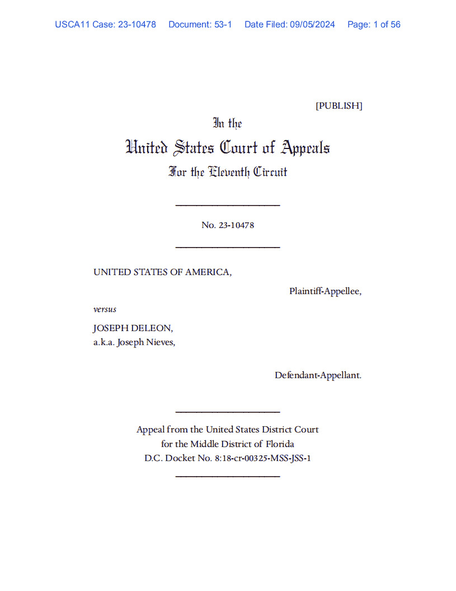
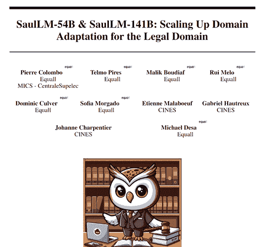
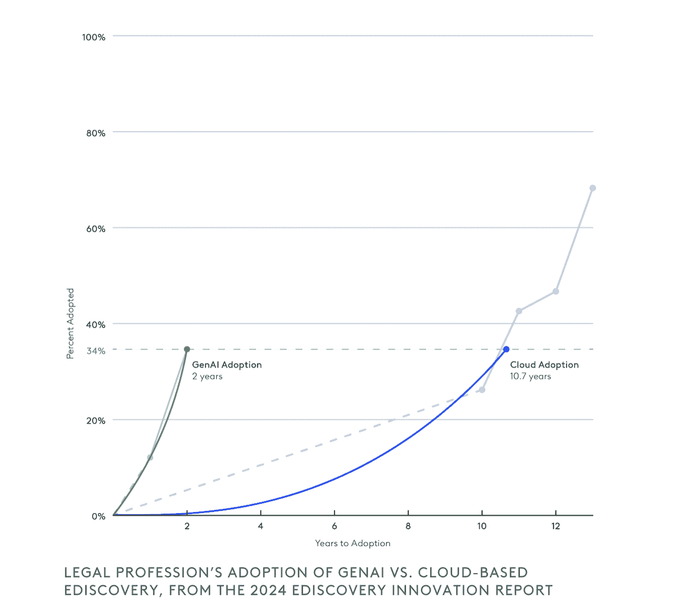
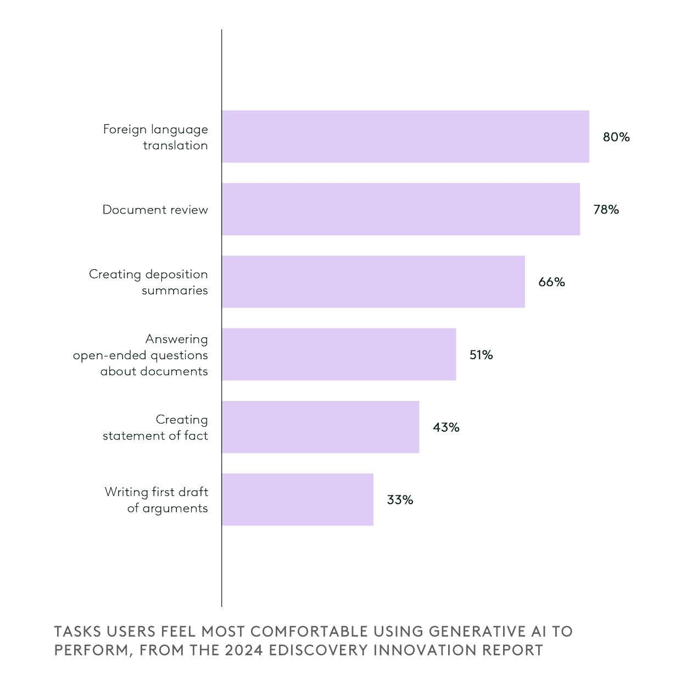
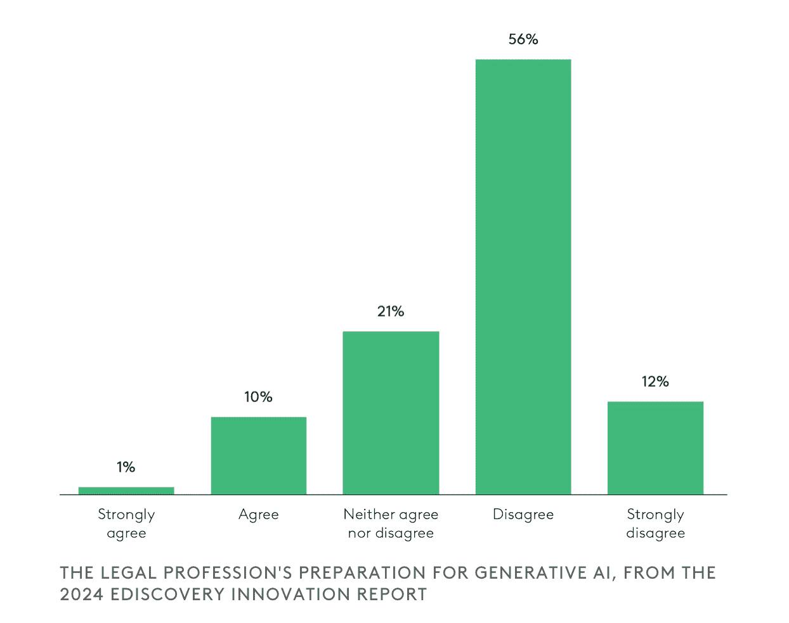

# 2024 年 9 月法律科技月刊

> 来源：[https://docs.feishu.cn/docx/WIkrdFIrkopK9ixM5CVccbHin19](https://docs.feishu.cn/docx/WIkrdFIrkopK9ixM5CVccbHin19)

---

# **一、法律科技融资动态**

## 法律合规公司 Sedric AI 完成 1850 万美元 A 轮融资

[9 月 5 日，法](https://www.sedric.ai)律科技初创公司 Sedric AI 宣布完成 1850 万美元 A 轮融资，Foundation Capital 领投，Amex Ventures、StageOne Ventures 和 The Garage 跟投。该公司利用 AI 实时监控、检测和分析多个渠道的客户触点，标记偏离既定合规政策和准则的情况，让公司能够快速采取纠正措施，而无需人工审查的成本和负担。

> 拓展阅读：https://www.sedric.ai/blog/sedric-ai-raises-18-5-million-series-a

## 法律 AI 初创公司 Anytime AI 完成 400 万美元种子轮融资

[9 月 5 日，法律](https://www.anytimeai.ai) AI 初创公司 Anytime AI 宣布完成 400 万美元种子轮融资，Gopher Asset Management 和 Kao Family Office 领投，还有一些律师事务所和天使投资者跟投。Anytime AI 开发了一个法律 AI 助理，帮助律师更高效地完成日常法律工作，比如法律研究和文件审查。

> Demo：[https://www.anytimeai](https://c212.net/c/link/?t=0&l=en&o=4247359-1&h=1682287176&u=https%3A%2F%2Fwww.anytimeai.ai%2Fbook-a-free-demo&a=https%3A%2F%2Fwww.anytimeai.ai%2Fbook-a-free-demo).ai/book-a-free-demo

> 拓展阅读：https://www.anytimeai.ai/resources/press/

## 法律 AI 初创公司 Dotyon.AI 完成 320 万美元天使轮融资

9 月 5 日，Dotyon.AI 宣布完成 320 万美元天使轮融资，投资方为百联资本，贵州国建集团。该公司利用 AI 技术使繁琐的法律工作自动化，从证词摘要到电子取证，让法律专业人士可以专心改善客户服务并发展业务。

## AI 尽职调查平台 Capsa AI 完成 170 万英镑种子轮融资

[9 月 5 日，](https://www.capsa.ai)AI 驱动的尽职调查平台 Capsa AI 宣布完成 170 万英镑种子轮融资，Outward VC 领投，Cornerstone VC、Antler 以及 Chris Adelsbach 等天使投资人跟投。

Capsa AI 支持私募股权基金的投资者“委托”手动、低技能的尽职调查任务，包括创建公司简介、提取信息等活动整合公司记录中的财务信息、分析财务业绩并审查客户合同，使私募股权投资者能够专注于有价值和关键的任务。

> 拓展阅读：https://www.uktech.news/ai/capsa-ai-funding-20240905

## AI 法律检索初创公司 Jus Mundi 完成 2200 万美元 B 轮投资

[9 月 11 日，](https://jusmundi.com/en)总部位于法国的法律 AI 搜索公司 Jus Mundi 宣布完成 2000 万欧元（2200 万美元）B 轮融资，Acton Capital 和 True Global Ventures 领投，老股东 C4 Ventures 和 FJ Labs 跟投。

同时，Jus Mundi 还将于 9 月 16 日举行的国际律师协会会[议上，](https://www.law.com/legaltechnews/2024/02/15/legal-tech-rundown-new-unitedlex-and-casepoint-hires-more-legal-ai-assistants-and-more/)正式推出面向法律专业人士的研究和生产力助理 Jus AI —— 该产品于 2 月首次公布，并在 Jus AI 加速计划中，面向 Jus Mundi 的客户试行了一段时间，包括 DLA Piper、Reed Smith、Clyde & Co、Greenberg Traurig、Yulchon 和 Bredin Prat 等。

今年 5 月，Jus Mundi 启动 Jus AI 加速计划。这是一个为期六个月的 AI 培训计划，项目参与者将接受相关培训，以了解法律场景下的生成式 AI，重点是安全风险管理以及减少 AI 偏见的最佳实践，并获得 AI 产品的访问权限。

此前，Jus Mundi 于 2021 年 9 月完成 1000 万美元 A 轮融资。

> 拓展阅读：https://dailyjus.com/news/2024/09/jus-mundi-launches-jus-ai-and-raises-22m-in-series-b

## 印度法律 AI 初创公司 Jhana.AI 完成 160 万美元新一轮融资

9 月 24 日，总部位于印度的法律科技初创公司 Jhana.AI 完成 160 万美元新一轮融资，Together Fund 领投，OpenAI 团队成员 Shyamal Anadkat 和云公司 VMware 的前首席技术官 Scott Davis 等人跟投。

Jhana.AI 提供一个 AI 律师助理，可以根据系统阅读和审查的消息，自动生成引文和备忘录，注释和建议修改法律文件等任务。该公司由前几位哈佛学生于 2022 年创立。

> 拓展阅读：https://www.law.com/legaltechnews/2024/09/25/india-based-startup-jhana-ai-which-offers-ai-paralegal-raises-1-6m/

## 瑞典法律研究初创公司 Qura 完成 210 万欧元新一轮融资

9 月 24 日，总部位于瑞典的法律研究初创公司 Qura 宣布获得 210 万欧元新一轮融资，Cherry Ventures 领投。

Qura 成立于 2023 年底，提供了一个 AI 驱动的搜索引擎，帮助法律专业人士更有效地解析大量法律法规。该公司的产品最初使用瑞典国家的数据启动，最近推出了欧盟全境版本。

> 拓展阅读：https://www.law.com/legaltechnews/2024/09/24/swedish-legal-research-startup-qura-raises-e2-1-million/

## 电子取证公司 TrueScreen 完成 240 万欧元新一轮融资

9 月 25 日，电子证据取证公司 TrueScreen 宣布完成 240 万欧元新一轮融资，CYSERO EuVECA 领投。

TrueScreen 是一家网络安全公司，成立于 2022 年，利用技术对数字资源进行采集、证据固定和管理，还可以防止数据操纵和深度造假生成，特别是 AI 生成的数据。

> 拓展阅读：https://truescreen.io/2024/09/25/truescreen-closes-seed-round/?_gl=1*5nvvrb*_up*MQ..*_ga*Mzk0MTUzMzY3LjE3Mjc1MDE5NjU.*_ga_DGMCHW25WS*MTcyNzUwMTk2NC4xLjEuMTcyNzUwMjAyNy4wLjAuMA..

## 波兰 CLM 初创公司 Pergamin 完成 1100 万兹罗提新一轮融资

9 月 23 日，波兰 CLM 初创公司 Pergamin 宣布完成 1100 万兹罗提（波兰货币单位）新一轮融资，OnDean Forward 领投。OnDean Forward 由美国电子发现领导者 Relativity 的创始人 Andrew Sieja 和首席增长官 Marcin Wojtczak 创立，本轮投资 Pergamin 将支持其成为区域领导者和全球合同管理平台。

> 拓展阅读：https://pergam.in/blog/ondean-forward-inwestuje-11-mln-zl-w-pergamin-pomoze-w-budowie-globalnej-platformy-do-zarzadzania-umowami/

## 法律 AI 初创公司 Mary Technology 完成 135 万美元种子轮融资

9 月 26 日，法律 AI 初创公司 Mary Technology 宣布完成 135 万美元种子轮融资，Empress Capital 领投，Gilbert + Tobin CEO Sam Nickless、抵押贷款交易平台 Lendi Group 联合创始人 Mark Kalajzich 和 Martin Lam 等跟投。

Mary Technology 利用 AI 技术，帮助律师将数千份客户文档转换为精确、量身定制的年表，使律师能够轻松审查和理解法律问题，同时保持精确的来源。

> 拓展阅读：https://www.lawyersweekly.com.au/newlaw/40657-legal-tech-startup-raises-1-35m-in-funding-round

# **二、法律科技并购动态**

## Workday 将收购 Evisort，为财务和人力资源带来 AI 文档智能

[9 月 17 ](https://www.workday.com/en-us/homepage.html)[日，企业管理云](https://www.evisort.com/company/about)提供商 Workday 宣布已签署一项最终协议，即将收购合同生命周期管理（CLM）服务商 Evisort，这笔收购预计将在 Worday 的 2024 财政年度第三季度完成，该财年将于 10 月结束。

新闻稿称：“通过 Evisort，Workday 将在其财务和人力资源套件中添加 AI 驱动的文档智能解决方案。”

[长期以来，Evisort ](https://www.law.com/legaltechnews/2023/10/09/evisorts-new-global-head-of-professional-services-discusses-the-unique-perspective-of-an-ai-native-clm-company/)[将自己定位为一家 ](https://www.law.com/legaltechnews/2023/10/10/clm-provider-evisort-announces-custom-large-language-model-built-specifically-for-contracts/)[AI 原生的 CLM 公司。](https://www.law.com/legaltechnews/2024/01/23/clm-provider-evisort-releases-gen-ai-data-extraction-capabilities-powered-by-custom-llm/)[2023 年](https://www.law.com/legaltechnews/2024/08/30/legaltech-rundown-harvey-partners-with-icertis-flo-recuirt-releases-legal-career-platform-and-more/) 10 月，Evisort 宣布推出专门为合同构建的自定义大型语言模型。2024 年 1 月，Evisort 推出一个名为 Document X-Ray 的生成式 AI 自定义模型构建器，并在 2024 年 8 月进一步完善了该模型。

Workday 集团总经理兼 CFO Terrance Wampler 表示：“组织坐在数据金矿上，但从未充分发挥其潜力，因为搜索和分析数据非常复杂和耗时。Evisort 将帮助我们实现我们的愿景，帮助客户释放关键数据的价值。借助 AI 驱动的文档智能，客户将能够更快、更有效地根据见解采取行动，使他们在当今快速变化的商业环境中保持领先地位。

Evisort 创始人兼 CEO Jerry Ting 表示：“AI 是一种强大的力量，它改变了组织如何将文档中的非结构化数据转换为战略业务决策。我们很高兴将 Evisort 的文档智能技术与 Workday 的财务和人力资源平台相结合，这将使客户能够在单一的系统中更有效地利用关键业务数据。”

新闻稿强调了 Workday 收购 Evisort 将如何通过将文档管理系统的非结构化数据引入 Workday，使用户能够更有效地管理人员和资金流程。比如文档智能能力，包括从业务文档中快速提取财务和运营细节，使用 AI 简化文档创建和合同分析，以及深入了解有利的条款和条件以及建议的行动，以做出更明智的业务决策。

Workday 打算在几个部门和用例中推出 Evisort 的 AI 文档智能功能，包括：

**会计**：更有效地阅读、转换、匹配和核算收入合同、供应商发票和资产协议等业务文件的交易，包括收到合同错误和即将续订的警报

**采购**：通过识别减少支出的机会、支持合规并协助降低风险，提升供应商合同谈判和合同风险管理活动

**员工知识库**：帮助员工轻松访问关键的人力资源和财务政策，包括通过 AI 聊天机器人，该聊天机器人将立即提供问题的答案，并参考支持文件

Workday 对 Evisort 的收购将是 2024 年企业软件公司对 CLM 公司的第二次重大收购。5 月，电子文档和电子签名公司 Docusign 宣布将以 1.65 亿美元的现金收购 CLM 服务商 Lexion。

> 拓展阅读：https://www.law.com/legaltechnews/2024/09/17/workday-to-acquire-evisort-bringing-ai-powered-document-intelligence-to-finance-and-hr/

## 电子发现公司 Proteus 收购竞品 Novitas Data

9 月 17 日，总部位于印第安纳波利斯的电子发现服务和咨询公司 Proteus Discovery Group 宣布收购总部位于波特兰的电子发现提供商 Novitas Data。

> 拓展阅读：https://www.law360.com/pulse/legal-tech/articles/1879415/e-discovery-services-co-proteus-makes-1st-acquisition

## 律师培训机构 Barbri 收购 SkillBurst，整合在线培训课程

9 月 18 日，律所培训机构 Barbri Global 宣布收购竞品 SkillBurst Interactive，进一步整合在线培训课程库，包括生成式 AI 相关培训。

> 拓展阅读：https://www.law360.com/pulse/legal-tech/articles/1879976/legal-education-co-barbri-acquires-skillburst-interactive

## CRM 厂商 Nexl 将收购收入运营初创公司 Databall

[9 月 ](https://nexl.cloud/)16 日，CRM（客户关系管[理）服务商 Ne](https://www.databall.io/)xl 宣布收购收入运营初创公司 Databall —— 该公司帮助客户弥补收入泄漏，并使用数据优化客户关系。据了解，这笔收购即将完成。

2023 年 12 月，Nexl 完成 660 万美元 A 轮融资。同时，Nexl 将自己的定位从“无数据输入的 CRM”改为律师事务所的“一体化协作平台”，致力于实现法律业务现代化。本轮投资的领投方 Shearwater 基金和 B2B 风险投资基金 EVP 表示，他们投资 Nexl 的决定是出于律师行业对更有效的客户关系管理的需求。

> 拓展阅读：https://legaltechnology.com/2024/09/16/exclusive-crm-vendor-nexl-to-acquire-revenue-operations-startup-databall/

## 数据治理公司 DiliTrust 收购企业法律管理公司 doeLegal

9 月 [25](https://www.oneragtime.com/stories/legal-scale-up-dilitrust-the-salesforce-of-legal-departments-acquires-french-efficient-meeting-startup-aster) 日，总部位于巴黎的法律科技和数据治理公司 DiliTrust 宣布收购电子发现和企业法律管理（ELM）技术服务商 doeLEGAL，以提供更全面的工具，并将业务扩展到美国市场。据了解，doeLEGAL 是一家已经成立 50 多年的组织，与法律专业人士合作，提供 ELM 和电子发现服务。今年 3 月，DiliTrust 收购了会议管理软件 Aster。2020年，该公司还获得 Cathay Capital、Eurazeo 和 Sagard 投资的 1.3 亿欧元融资。

> 拓展阅读：

> https://www.law.com/legaltechnews/2024/09/25/france-based-legal-tech-company-dilitrust-expands-to-u-s-market-with-doelegal-acquisition/

> https://www.oneragtime.com/stories/legal-scale-up-dilitrust-the-salesforce-of-legal-departments-acquires-french-efficient-meeting-startup-aster

## 替代性法律服务商 Elevate 收购电子发现公司 Redgrave Data

9 月 24 日，替代法律服务商 Elevate 宣布收购电子发现公司 Redgrave Data，这是该公司今年的第二次收购。

今年 5 月，Elevate 收购 CJK Group，一家专注于非英语审查的电子发现公司，专门审查、分类和分析中文、日语和韩语的多语种内容。通过收购 CJK，Elevate 可以提高自身在外语审查方面的专业知识，随着争议或尽职调查的文件审查越来越全球化，很多客户对此有很高的需求。此次收购是 Elevate 并购战略的延续，该战略旨在收购小型咨询、软件和服务公司，这些公司拥有客户所珍视的独特、特殊专业知识，随后我们可以扩大规模。

> 拓展阅读：https://www.law360.com/pulse/legal-tech/articles/1881934/legal-software-provider-elevate-buys-redgrave-data

# **三、律师行业如何拥抱法律科技**

## K&L Gates 律所与 AltaClaro 合作，联合推出生成式 AI 监督课程

目前，教育和培训在许多法律组织中占据了中心位置，因为生成式 AI 已经扎根于法律科技市场的大多数产品中。

其中，大部分初始培训都集中在[「提示工程」](https://www.law.com/legaltechnews/2023/04/25/as-ai-advances-is-prompt-engineering-the-next-crucial-legal-skill/)上，比[如法律培训公司 A](https://www.law.com/americanlawyer/2024/06/03/kl-gates-joins-orrick-in-offering-gen-ai-training-for-summer-associates/)ltaClaro 为 Orrick、Herrington & Sutcliffe 和 K&L Gates 律师事务所，以及 Mackrell International  的 90 多家成员律所的 4000 多名律师提供相关课程。

9 月 12 日，AltaClaro 宣布再次与 K&L Gates 律所合作，推出一个新的联合培训课程，名为《指导有效使用生成[式 AI](https://www.law.com/legaltechnews/2024/08/11/generative-ai-a-legal-ethics-roadmap-and-reference-guide/)：律师事务所合作伙伴的监督课程》，旨在为管理层提供监督团队使用生成式 AI 所需的技能和知识，包括遵守 ABA 最近发布的关于道德地使用生成式 AI 的正式意见，即如何履行监督职责、与客户就 AI 使用进行沟通的义务、一般能力和技能提升原则、生成式 AI 对计费和其他商业模式的潜在影响等。

### 监督 AI 的重要性

推[出这个 AI 监督课程的背后，](https://www.law.com/legaltechnews/2023/06/02/the-problem-with-the-bogus-chatgpt-legal-brief-its-not-the-tech/)反映了法律专业人士熟悉自身所使用的 AI 工具，并监督其产出的需求 —— 在 Mata v. Avianca 案件中，一名律师使用 ChatGPT 生成虚假的引文，给法律行业敲响了警钟。

与提示工程课程不同，监督课程的重点主要面向律所或公司法律部门的高级领导层，具体内容包括：

+   第一部分：强调生成式 AI 的基本概念，包括该技术如何运作及其构成的各种风险，特别是对法律风险。

+   第二部分：侧重于教授实用的监督技巧，包括如何对产出进行质量检查、如何纠正错误、如何通过培训与法律团队互动等。

+   第三部分：根据“学习-做-复习培训”的模式，课程参与者根据课程的学习，制定一份详细的清单，在未来工作中监督或管理 AI 时使用。然后，课程讲师对清单作业进行审查，并在互动复习环节中进行详细讨论。

K&L Gates 希望通过提示工程和监督课程，促进法律专业人士对 AI 的兴趣，以及管理者鼓励组织成员学习 AI。

### 对 AI 培训的广泛需求

K&L Gates 的实践创新总监 Carolyn Austin 表示，在组建律所的 AI 解决方案时，首先确定的需求之一是生成式 AI 的教育。她解释说：“这些工具将以闪电般的速度出现和消失，但不会改变的是，我们需要提高我们的所有律师和相关专业人士对生成式 AI 的理解，以现实地理解和参与风险，不要让这成为开辟潜在机会的障碍。”

因此，K&L Gates 制定了的多层次的 AI 教育战略，具体在五个方面开展培训：

+   风险管理

+   遵守专业责任示范规则

+   遵守各种全球 AI 法规和条例

+   如何有效地使用生成式 AI 工具，成为好的律师并得到正确的答案

+   通过避免错误来进行品牌管理

之所以这些美国律所会有意识地开展 AI 相关的监督，是因为美国法律行业非常重视法律道德教育，基本上每个州的律师协会都设置了负责监督使用新技术的人。

> 拓展阅读：https://www.law.com/legaltechnews/2024/09/12/kl-gates-partners-with-altaclaro-to-offer-gen-ai-supervisory-course-for-firm-partners-and-managers/

## 纽约市律协成立 AI 和数字技术工作组，帮助律师应对 AI 的挑战和机遇

9 月 9 日，[纽约市律师协会](https://nysba.org)宣布成立一个 AI 和数字技术工作组，该工作组有九个小组委员会，专注于 AI 与法律、法律道德、司法、诉诸司法、商业和金融、国际监管、医疗保健、责任和补救措施以及国家安全的关系。

据了解，该工作组由一系列专业人士，包括大学教授、计算机科学家以及内部、非营利和非从务律师，将通过创建播客、网络研讨会、研讨会、圆桌会议、报告和声明，帮助律师和其他人了解 AI 的“承诺和危险”。11 月 4 日，该小组还将与联合国和世界银行的代表，就 AI 的国际监管举办圆桌讨论。

> 拓展阅读：https://www.law.com/newyorklawjournal/2024/09/09/city-bar-task-force-offers-comprehensive-focus-on-promise-and-peril-of-ai/

## Dentons 推出 AI 合同起草工具，与汤森路透合同工具集成

9 月 23 日，Dentons 宣布推出一个生成式 AI 合同自动化机器人，与 Thomson Reuters 的 Contract Express 文档自动化产品集成，支持通过自然语言自动生成与 Contract Express 兼容的合同模板，然后 Contract Express 再生成格式化的初稿，并提供修改建议，最后输出需为 Word，由律师进行审查和质量控制。

目前，该机器人在欧洲试点。

> 拓展阅读：

> 「自研」还是「采购」？世界上最大的律所推出 AI 合同自动化试点项目

> https://www.dentons.com/en/about-dentons/news-events-and-awards/news/2024/september/dentons-launches-ai-powered-contract-automation-bot

# **四、法院和法学界如何拥抱 AI**

## 美国纽森法官再论述 AI 如何辅助法官解释工作

今年 5 月，美国第十一巡回上诉法院的凯文·纽森（Kevin Newsom）法官，在一个案件中使用 AI 工具辅助明确一个词语的普通含义。同时，纽森法官还特地在判决中写了一份协同意见，说明了他使用 ChatGPT 的具体方式，并鼓励法律行业考虑跟随他的脚步。

9 月 5 日，第十一巡回法院发布一份判决。在这起案中，纽森法官进一步探讨了 AI 辅助判决的问题：我们应该如何看待 AI 对于完全相同的问题，提供略微不同的答案？

纽森法官表示，AI 的这种不确定性最初让他感到不安，但经过分析，他认为这种不确定性其实不足为奇，而是意料之中的，并且从普通含义的角度看，这种不完全一样的特点，反而充分体现了现实中人们日常的语言模式。

> 拓展阅读：

> [【解释语言】美国法官使用 ChatGPT 辅助判案！这或许才是「AI+法律」的正确姿势](https://legalstudio.feishu.cn/wiki/HgxVwxy8ni4ECXkewCBcv0TUnPg)

>

[202310478.pdf](https://internal-api-drive-stream.feishu.cn/space/api/box/stream/download/all/F5TublKkuovjIVxolwQcDmdGnqe)

## 中国法研法律大模型评估指标和测评服务正式发布

中国司法大数据研究院（以下简称“中国法研”）长期致力于法律大模型的研发和应用，目前已基本搭建完成精准的数据模型产品库，构建智能化法律服务能力和法律模型产业生态。基于中国法研“万法”大模型底座研发的“法观”已成为首个通过中国法考的法律大模型产品；正在筹建的“法律大模型联盟”已收到近 100 家单位的加入申请。

近日，中国法研结合深耕司法大数据行业的多年经验，形成并发布了关于法律大模型测评的 5 大测试维度和 35 个测试指标，并积累了 10W+ 的法律大模型测试集，能够在记忆、理解、逻辑推理、生成和安全方面对法律大模型的质量进行全方位的评估。同时，依托中国合格评定国家认可委员会（CNAS）颁发的检测实验室资质，可出具专业的第三方测评报告，亦可对法律大模型做对比测评，为用户选型提供强有力的支撑。

> 拓展阅读：https://mp.weixin.qq.com/s/Pt5O43XoCl6QgUmg4_g_BA

# **五、政府机构如何拥抱 AI**

## 又一机构任命「首席 AI 官」：AI 在组织落地，技术到落地存在一道鸿沟

近日，美国劳资关系委员会任命了一名“首席人工智能官”（CAIO），这是美国政府机构任命 CAIO 的最新案例。

2023 年 3 月，美国总统拜登发布了一项行政命令，要求每个政府机构指定一名 CAIO，既要挖掘 AI 的潜力，也要管理其风险。今年 2 月，美国司法部也任命了首席 AI 官，该职位将就新兴技术相关问题向美国司法部长和部门领导层提供建议，包括如何负责任地将 AI 融入司法部的调查和刑事起诉中。

[亚马逊前高](https://chiefexecutive.net/a-plea-to-rethink-the-chief-ai-officer/)管 John Rossman 在《首席执行官》中写道：“2024 年最热门的工作是首席 AI 官。从科技公司到医疗保健服务商，再到大学和学院，各种组织都在雇用 CAIO。”研究公司 Foundry 的数据也显示，截至去年年底，15% 的受访企业雇用了 CAIO，还有 24% 的企业正在招聘人员担任该职位。

然而，行业对此存在不同观点。

例如，Rossman 补充说道，很多组织创造了 CAIO 如此高级的职位，但最后收效甚微。他敦促 CEO 不要急于雇用 CAIO。相反，他建议组建跨学科团队，负责探索 AI 可以更好地辅助经营业务的方法，并负责运营落地。

[国际](https://sloanreview.mit.edu/article/do-you-really-need-a-chief-ai-officer/#:~:text=Hiring%20a%20chief%20AI%20officer,via%20partnerships%20with%20external%20providers)管理发展研究所教授 Michael Wade 也认为：“聘请 CAIO 可能是当下流行的趋势，但并非所有组织都需要这样的角色。我们认为，适合大多数公司的做法，应该是在现有的组织架构内，通过组建跨部门的小组，或者与外部服务商合作来利用 AI。”Wade 表示，CAIO 和其他高管（如首席信息官和首席技术官）之间的角色需要非常明确地划分。在雇用 CAIO 之前，公司应该分配大量的时间和精力，来明确定义 CAIO 与其他高管职位相关的责任、预算和治理。同时，CAIO 还需要具备强大的沟通、政治和变革管理技能。由于这个角色是跨职能的，而且可能没有明确的权力支持，CAIO 可能需要通过建立影响力来领导 AI 落地。

以上看法和笔者的观察和思考类似：

大模型的产业化落地，要想拿到结果，其实在技术上没那么难，而是难在需要有「专人」去负责推动 AI 在组织内有效地落地。具体来说，客户和技术方之间需要有一个专门的人来承担需求翻译、需求梳理和推动落地等工作，这个人可能是客户内部自己的人，或者是技术方的产品经理、解决方案顾问等角色，负责“手把手”地帮助客户落地 AI，甚至可能需要入驻到客户内部工作一段时间。

就得这么干。这是因为，技术和落地之间，存在一道鸿沟。

但是，这种人才很少，客户内部基本没有这种人，技术方可能有，但这个投入的 ROI 比较低，现实中也很难实现，所以导致 AI 很难在组织内部有效落地，这和推动各种软件在企业落地的挑战是一样的，本质上就是组织问题。

怎么办呢？只能说，各方都要修炼好自己的基本功，没有很好的捷径可以走。

> 拓展阅读：

> [又一机构任命「首席 AI 官」：](https://mp.weixin.qq.com/s?__biz=MzUzOTcwMTE5OQ==&mid=2247488821&idx=1&sn=8b00e05809349847d71a057e96a8d82c&chksm=fac52f95cdb2a683210085aa7ac0b7bfd75c438c39fe4623cd815444c0fe9fcedf2d2b84b3c2&token=804809582&lang=zh_CN#rd)AI 在组织落地，技术到落地存在一道鸿沟

> https://www.nlrb.gov/news-outreach/news-story/david-k-gaston-named-as-nlrbs-first-chief-artificial-intelligence-officer

> https://www.law.com/corpcounsel/2024/09/04/nlrb-appoints-chief-ai-officer-embracing-hottest-job-of-2024/

# **六、法学院如何拥抱 AI**

## 新加坡法学院与微软合作开发 AI 教育资源

9 月 11 日，在 TechLaw.Fest 2024 会议上，新加坡法学院（SAL）宣布与微软、法律事务管理平台 Lupl 开展合作。

这项合作将策划和开发资源，以帮助法律专业人士在不同领域更有效、更合乎道德地使用生成式 AI。SAL 的网站上将免费提供指南和其他资源，比如通过提示工程来利用 AI 的指南和视频演示，以及相关的最佳实践和注意事项，以对抗生成式 AI 工具时的常见陷阱。除此之外，SAL 还计划为律师开设基础课程。

> 拓展阅读：https://legaltechnology.com/2024/09/11/techlaw-fest-in-singapore-new-collaborations-for-the-academy-and-ministry-of-law-with-microsoft-and-lupl/

## 乔治华盛顿大学法学院为联邦机构员工提供 AI 培训

近日，乔治华盛顿大学法学院宣布为联邦雇员提供 AI 培训。

据了解[，这是人工智能实](https://www.congress.gov/bill/117th-congress/senate-bill/2551)践社区（AI [CoP）教](https://www.whitehouse.gov/briefing-room/presidential-actions/2023/10/30/executive-order-on-the-safe-secure-and-trustworthy-development-and-use-of-artificial-intelligence/)育系[列的一部](https://www.whitehouse.gov/briefing-room/presidential-actions/2023/10/30/executive-order-on-the-safe-secure-and-trustworthy-development-and-use-of-artificial-intelligence/)分。该计划由美国联邦机构总务局（GSA）联合管理和预算办公室的联邦首席信息官办公室于 2020 年创立。AI CoP 为联邦、州和地方政府雇员网络提供关于 AI 技术和采用的指导和教育，致力于帮助满足《人工智能培训法》和拜登总统第 14110 号行政命令规定的要求。

注：U.S. General Services Administration（GSA）是美国的一个联邦机构，成立于 1949 年，负责管理联邦大楼和为美国政府采购产品、服务和办公空间。

根据课程描述，AI CoP 培训的重点是，指导政府雇员如何有效地采购 AI 产品，在公共服务中使用 AI 的潜力，以及采购 AI 带来的风险管理、道德和数据隐私考虑因素等主题。

乔治华盛顿大学法学院一直致力于推进 AI 教育，包括一整套关于智能自动化和 AI 的课程，而且建立了一种新型的法律和技术中心，还有关于法律 AI 的奖学金等等。

除了乔治华盛顿大学法学院，AI CoP 还邀请了一些组织其他来参与培训计划，包括斯坦福大学以人为本的 AI 研究所、普林斯顿大学信息技术政策中心、智囊团威尔逊中心、GSA 的全政府政策办公室和 OMB。

> 拓展阅读：https://www.law.com/legaltechnews/2024/09/19/the-george-washington-university-law-school-is-helping-train-federal-employees-on-ai/

# **七、法律 AI 新产品**

## 法国高等教育计算中心、巴黎萨克雷大学发布两个法律模型，最高 1410 亿参数

近日，法国高等教育计算中心、巴黎萨克雷大学的研究人员联合开源了专用于法律领域的大模型：SaulLM。

SaulLM 模型共有 540 亿、1410 亿两种参数，以及基础模型和指令微调两种版本。

SaulLM 的最大特色是使用了 5400 亿 token 的专业法律数据进行了预训练，包括美国、欧洲、澳大利亚等地的法律文本，输出内容的准确率高于很多同类模型。

> 拓展阅读：

> 5400 亿 token 专业法律数据！又双叒叕出现一个“法律大模型”

> https://mp.weixin.qq.com/s/tgNnk_REDBjmRwagTF8Uog

> 论文地址：https://arxiv.org/pdf/2407.19584

> 开源地址：https://huggingface.co/Equall/SaulLM-54-Base

> 指令微调：https://huggingface.co/Equall/SaulLM-141B-Instruct

# **八、法律 AI 市场调研**

## Everlaw 最新调研：律师们采用 AI 的速度，是云服务的五倍

9 月 10 日，[Everlaw](https://www.everlaw.com) 与认证电子发现专家协会联合发布 2024 年电子发现创新报告，对 267 名法律专业人士的调查，包括律师助理、IT、律师、合伙人、合伙人等。

报告显示，在过去两年内，34% 的受访者表示在实践中采用了生成式 AI，其中 17.5% 的人已经在日常工作中积极使用，16.6% 的人以某种形式的测试中使用它。

相比之下，法律人大约花了 [10 年的时间](https://www.everlaw.com/resources/reports/2021-ediscovery-cloud-adoption-report/)，才在同样程度上采用基于云的电子发现软件。也就是说，法律人采用生成式 AI 的速度，比其他变革性技术要快得多。

在过去一年里，生成式 AI 被更广泛地考虑。虽然 60% 的接受调查的法律专业人士表示，他们不打算在 2023 年使用生成式 AI，但到 2024 年这一比例下降到 10%。

法律行业更快地采用生成式 AI，可能会归因于法律专业人士专注于客户的需求。

Everlaw 的战略发现顾问 Chuck Kellner 表示：公司法律部门正在利用技术帮助降本增效，而管理增长和工作量的唯一方法是利用技术。其中，AI 是非常适合的一项技术，它非常容易使用，而且擅长处理文本，这是律师主要处理的问题。因此，律所采用 AI 可以满足客户希望以低成本尽快解决纠纷的需求。

法律行业对生成式 AI 的接受度越来越高，也导致了云服务得到更多的采用。调查显示，2023 到 2024 年云的使用增长了 21%。这是因为，如果律师事务所想要最佳存储空间来容纳生成式 AI 的大模型，他们必须过渡到云软件。

这一增长背后的另一个因素，是云公司持续提高安全性，并遵守法律法规，特别是在欧盟《通用数据保护条例》（GDPR）通过后。云软件公司在安全方面的透明度提高，使法律专业人士也更加信任云软件。

值得注意的是，与云不同，法律专业人士在采用 AI 技术之前，不会等待该技术进一步成熟。报告显示，56% 的人表示，他们计划在法律工作中使用生成式 AI。同时，在云上部署电子发现软件的人，在法律工作中积极使用生成式 AI 的数字是在本地部署的人的六倍以上，对生成式 AI 在法律行业中的扩散持积极态度的数字也要高五倍。

### 生成式 AI 可以显著提高生产力

随着法律科技越来越先进，律师正在利用这些技术来简化他们的工作。例如，外语翻译（80%）和文件审查（78%）是很多人觉得可以用生成式 AI 执行的两项主要任务，这些工作通常需要相当长的时间，但也是法律工作的重要组成部分。

从生成式 AI 的角度来看，这也是一致的，四分之三的人认为这将使苦差事的工作更容易，并让他们优先考虑更多高价值的工作（75%），类似的人认为效率的提高是生成式 AI 所能提供的最大好处之一（66%）。

### 法律行业仍然没有为生成式 AI 的影响做好准备

超过三分之二的人（68%）有这种感觉，这仅比前几年的结果（72%）略有改善。许多人还希望看到他们的组织（77%）就如何在工作中使用生成式 AI 进行更好的教育和培训。

> 拓展阅读：https://www.everlaw.com/blog/ai-and-law/lawyers-are-adopting-generative-ai-faster-than-other-technologies/

## 最新调研：GCs 预计在 2025 年将有更多的预算，并重点投资法律 AI 人才

根据替代性法律服务服务商 Axiom 发布的《2025 年内部法律预算报告》，55% 的总法律顾问预计法律部门的预算将在 2024 年增加，而且明年这一数字将更高。同时，越来越多的总法律顾问及其首席财务官正在将资源重新分配到法律科技工具和高素质、具有成本效益的法律人才，比如那些具有法律 AI 技能和技术经验的人才。

此外，与过去几年不同，公司法律部门领导人将律师事务所列为 2025 年最低优先级的支出事项。预算分配正在从传统的律所转向创新、价值驱动的律所、灵活的法律人才和技术，以提高公司法律部门的生产力。

> 报告原文：https://www.axiomlaw.com/resources/articles/2025-legal-budgeting-survey-report

## 国际律师协会发布 2024 年 AI 与法律行业报告：近半数律师支持对 AI 使用进行监管

国际律师协会（IBA）和人工智能与数字政策中心（CAIDP）近期发布的报告《未来即是现在:人工智能与法律职业（The Future is Now: Artificial Intelligence and the Legal Profession）》显示，48% 的律师支持对使用AI进行监管，57% 的律师呼吁全球范围内监管标准的一致性。

报告深入探讨了AI在律师事务所中的实施现状、治理结构、对法律行业职业道德的影响，以及 AI 技术如何塑造法律实践的未来。报告指出，AI 的采用在大型律师事务所中更为普遍，这些公司更有可能将 AI 集成到客户服务中。AI技术主要用于内部管理、业务发展、市场营销和组织管理。报告还强调了数据治理、安全性、知识产权和隐私保护在 AI 治理中的重要性，并提出了对小型和中型律师事务所在 AI 治理方面提供特别支持的建议。

> 报告全文：https://www.fasken.com/-/media/b313030dbd324877bb741e5b6d56e9b9.pdf

# **九、法律科技监管动态**

## 时代变了！Rocket Lawyer 获开创性许可，非律师也能提供法律服务了

9 月 25 日，[Rocket Lawyer](https://www.rocketlawyer.com) 宣布旗下的 Rocket Legal Professional Services（RLPS）律师事务所、全资子公司，正式被亚利桑那州最高法院批准为：替代性业务结构（ABS）。

Rocket Lawyer 是一家在线法律服务平台，通过律师、非律师和技术结合的形式，为人们提供价格实惠的法律服务。

简单来说，法律咨询公司。

据了解，亚利桑那州实施了一项突破性的监管改革：美国第一个，也是唯一一个，允许非律师对律所拥有所有权的永久性改革。

这项改革意义重大，因为很多个人和企业需要法律服务，但负担不起律师费。传统的律所和律师倾向于薪酬更高的客户和大型项目，导致许多消费者无法获得法律帮助。

Rocket Lawyer 的创始人兼 CEO Charley Moore 表示：“亚利桑那州开创的监管改革，为法律行业现代化设定了新的标准。允许持牌专业人士利用技术高效地提供法律服务，可以使高昂的司法成本更加实惠。我们的 ABS 许可证应该能让数百万人以他们负担得起的价格获得高质量的法律服务。”

ABS 许可，是 Rocket Lawyer 和美国各州探索替代性法律服务的最新探索。

2020 年 9 月，Rocket Lawyer 被批准加入美国犹他州“监管沙盒试点计划”，该计划允许非律师提供某些传统的法律服务，为缺少法律服务机会的企业和消费者提供低成本或无偿的法律服务，以改善传统律所的商业模式。

犹他州的这项改革，正值疫情带来冲击之时，是一项符合市场需求及时的创新性改革。

2023 年 12 月，Rocket Lawyer 推出一个名为“Rocket Copilot”的生成式 AI 工具，可以帮助客户快速完成各种文件，以及便捷地联系法律专业人士，进一步降低法律服务成本。

前所未有的时代需要创新的解决方案。

随着消费者认知逐渐提高、AI 等新技术不断发展、市场竞争日趋激烈，法律服务市场正在发生巨变，传统律师行业面临着巨大挑战。正如 Richard Susskind 教授所说：未来律所最大的竞争对手，是 AI 驱动的客户。

传统律师行业需要顺应时代的变化，拥抱新的市场需求，拥抱新技术、新流量，做好自身的知识管理，及时做出调整，这样才能在未来的法律服务市场中，构建新的竞争力。

> 拓展阅读：

> https://www.rocketlawyer.com/newsroom/rlps-approved-for-abs-license

> https://www.rocketlawyer.com/newsroom/rocket-lawyer-joins-utah-in-nations-first-program-to-transform-legal-services

> [时代变了！Rocket Lawyer](https://mp.weixin.qq.com/s/_hF7YUKWOuCGQav4se7gWA) 获开创性许可，非律师也能提供法律服务了

## 新泽西州最高法院：律师购买竞争对手姓名的搜索关键词并非不道德

9 月 24 日，新泽西州最高法院召开了一场口头辩论会议，关于律师是否可以购买另一名律师名字的搜索关键词，以希望在网上获得竞争优势。法院认为，这一行为并不违反《职业行为规则》。同时，首席大法官 Stuart Rabner 对此表示担忧：如果法院干预限制关键词购买做法，可能会干扰第一修正案。

今年 8 月，新泽西州律师协会向最高法院提交一项申请，敦促最高法院宣布一项规定：律师购买其他律师姓名用作关键词搜索，从而将网络流量导向到他们自己网站的做法，是不道德的，具有欺骗性和误导性。

> 拓展阅读：

> 法院意见：https://www.njcourts.gov/system/files/court-opinions/2020/a_61_62_19.pdf

> 律协意见：https://community.njsba.com/blogs/njsba-staff/2024/08/08/capitol-report-attorneys-who-purchase-other-attorn

# **十、法律科技市场活动**

## 律智未来·长宁 AI 法律思享会

📅 时间：9月26日（周四） 14:00 - 17:30

📍 地点：北京植德(上海)律师事务所

探索 AI、数据与律所数智化的未来，与行业专家共话法律科技新趋势，欢迎大家报名参加、共同交流！

## 幂律智能｜MeSpark 法律 AI 人才培养火种计划

幂律智能发起【MeSpark 法律 AI 人才培养火种计划】，通过「线下交流分享」&「长期实习体验」，号召并培养更多法律人共同参与法律科技发展浪潮。

> 拓展阅读：https://mp.weixin.qq.com/s/gLmlDspXthLr5frrMxcDiQ