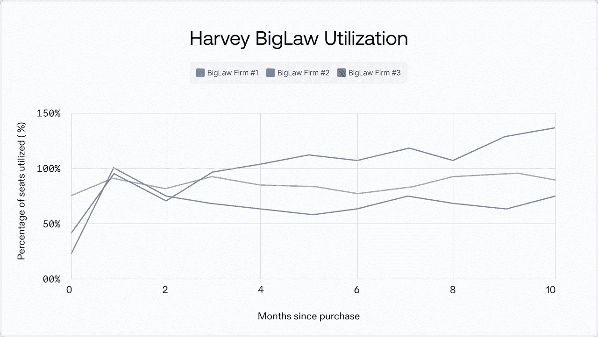

# 2024 年 8 月法律科技月刊

> 来源：[https://docs.feishu.cn/docx/Mr1yd6rssoWSH2x9xSyc7DhXntb](https://docs.feishu.cn/docx/Mr1yd6rssoWSH2x9xSyc7DhXntb)

---

# **一、法律科技融资动态**

## 法律 AI 监管合规工具 Graceview 完成 150 万美元新一轮融资

[8 月 5 日，澳](https://graceview.ai)大利亚 AI 监管合规平台 Graceview 宣布完成 150 万美元新一轮融资，新加坡企业家 Patrick Linton 领投，一群科技创始人和投资者跟投。Graceview 利用 AI、机器学习、法律知识集成和数据分析提供关于合规威胁的见解。该平台将生成式 AI 的速度和效率与高级律师监督相结合，以简化监管合规性，并保持持续合规的环境。

> 拓展阅读：

> https://graceview.ai/blog/graceview-raises-1-5m-to-fuel-growth

> https://www.thesaasnews.com/news/graceview-raises-1-5-million-in-funding

## 德勤内部孵化项目 Moonlit 宣布独立，提供 AI 加持的法律研究和监测

[8 月 20 日，德](https://www.moonlit.ai)勤内部开发自[用的法律研究和监测平台 ](https://www.linkedin.com/company/curiosityvc/)Moonlit.ai 宣布获得 Curiosity VC 的投资，并从德勤分拆，原因是非服务于公司的核心业务。该平台由荷兰德勤的 AI 负责人 Roderick Lucas 于 2018 年至 2024 年开发。

**项目简介**

Moonlit 提供直接从欧盟官方渠道获取的法律数据集，持续监控和跟踪欧洲国家的法律动态，并提供即时的翻译、摘要和见解，可以实现跨多个国家和语言的无缝搜索，旨在改变法律专业人士驾驭复杂的欧盟法律，提高跨境法律工作的效率和准确性。同时，借助生成式 AI 助理，用户可以询问任何法律问题，并获得有权威法律来源的答案。

**工作原理**

用户可以搜索想要的法律法规和案例，然后进行总结、翻译等操作。

**市场需求**

目前，整个欧盟的判例法还没有标准化，而在一个日益相互关联的欧洲，一个国家的法律先例可以显著影响另一个国家的决策，因此这样一个工具是需要的，以帮助律师找到关联的法律法规和案例。

**市场竞争**

目前，很多法律研究公司都支持跟踪和掌握欧盟法律，比如 vLex、Wolters Kluwer、LexisNexis 和汤森路透等，而 Moonlit 可能是唯一一家专门关注欧盟判例法的公司。

> Demo 视频：https://www.youtube.com/watch?v=oHB4ZzLRmn8

> 拓展阅读：https://www.curiosityvc.com/post/moonlit-secures-funding-from-curiosity-vc-to-transform-legal-research-in-europe

## 香港版“法天使”？法律文件模板服务商 DocPro 完成 50 万美元预种子轮融资

[8 月 19](https://docpro.com) 日，总部位于香港的法律文件模板服务商 DocPro 宣布完成 50 万美元预种子轮融资，用于 AI 产品开发、人员配备和营销等。

> 拓展阅读：https://www.law360.com/pulse/legal-tech/articles/1871216/legal-tech-co-docpro-raises-500k-in-pre-seed-funding

## 人身伤害法律 AI 工具 Supio 完成 2500 万美元 A 轮融资

[8 月 2](https://www.supio.com)7 日，法律 AI 初创公司 Supio 宣布完成 2500 万美元 A 轮融资，Sapphire Ventures 领投，现有投资者 Bonfire Ventures 和 Foothill Ventures 跟投。

Supio 是一款 AI 工具，专为律师事务所分析复杂记录、总结证词、深入研究证人证词或专家报告，为审判做准备。目前，Supio 提供一个专注于人身伤害和大规模侵权的法律 AI 工具，可以为律师提供关键洞察，并赢得更多案件。

以前，律师需要几天、几周或几个月的时间来处理信息，而且在需要的时候没有办法访问关键信息。对此，Supio 利用 AI 技术在一个安全的环境中训练数据，以降低幻觉，并为律师提供 AI 聊天机器人，可以在整个诉讼生命周期中使用，比如在法庭上提供实时、准确的见解，以帮助他们赢得案件。

其中，Supio 的 AI 技术可以理解并提取结构化的医疗数据和其他病例记录，并生成具有成本效益的法律文件、医疗年表和交互式的 AI 聊天机器人，帮助律所在几秒钟内获得病例洞察。

Supio 由前微软工程师 Jerry Zhou 和 Kyle Lam 于 2021 年创立，与领先的人身伤害和大规模侵权律师事务所合作构建解决方案，并提供这些律师所需的工具、资源和见解。在过去的一年里，Supio 帮助大中型律师事务所处理了 3000 多起案件。客户根据案例数量支付订阅费。许多客户表示，Supio 帮助他们消除了积压的案件，并认为他们在平台上发现事实或证据的能力，对赢得和提供客户应得的正义至关重要。

> 拓展阅读：https://www.supio.com/pressrelease-series-a

# **二、法律科技并购动态**

## 企业法律管理平台 Bre BriefBox 收购法律科技招聘公司 DealTechno

8 月 14 日，企业法律管理平台 Bre BriefBox 宣布收购法律科技招聘公司 DealTechno，以补充招聘资源、技术专业知识以及内部支持等人才获取能力，DealTechno 的创始人 Johnson 将加入 BreewBox，担任 CRO。

> 拓展阅读：https://briefbox.com/blog/briefbox-acquires-dealtechno-to-bolster-talent-led-legal-management-approach

## 汤森路透收购英国法律大模型公司 Safe Sign

8 月 20 日，汤森路透宣布收购总部位于英国的初创公司 Safe Sign，以“加速其 AI 战略”。这是汤森路透的第二次重大 AI 收购，该公司此前于 2023 年以 6.5 亿美元的现金收购了 Casetext。

Safe Sign 专注于开发法律大模型的公司，由 A&O Shearman 的见习律师 Alexander Kardos-Nyheim 和剑桥大学法学 AI 教授和研究员 Jonathan R. Schwart 于 2022 年 2 月创立，后者也是该公司的首席科学家。

自 2023 年以来，[垂直领域的大模型](https://www.law.com/legaltechnews/2023/04/19/codex-futurelaw-2023-focuses-on-fine-tuning-ai-for-legal-access-to-justice-and-more/)一直[收到很高的关注，Safe Sign 并](https://www.law.com/legaltechnews/2024/03/26/in-a-gen-ai-first-273-ventures-introduces-kl3m-a-built-from-scratch-legal-llm/)不是唯一一家专注于开发法律大模型的初创公司。2024 年 3 月，273 Ventures 也推出了一个完全由法律大数据训练的法律垂直大模型 Kelvin Legal Large Language Model（KL3M）。

> 拓展阅读：https://www.law.com/legaltechnews/2024/08/21/thomson-reuters-acquires-uk-startup-safe-sign-technologies-developer-of-legal-specific-llms/

# **三、律师行业如何拥抱法律科技**

## Akin 律所推出 AI 法律和法规信息跟踪器

8 月 1 日，Big Law 律师事务所 Akin Gump Strauss Hauer & Feld 宣布推出 AI Law & Regulation Tracker（AI 法律和法规信息跟踪器），可以监测各个领域与 AI 相关的政策，包括知识产权、数据隐私等。该跟踪器由一个跨学科团队领导，包括政策、国家安全、知识产权、数据隐私和健康领域的团队。

> 拓展阅读：https://www.akingump.com/en/insights/ai-law-and-regulation-tracker

## 英国 Tunbridge-Wells 律师事务所获得 53 万英镑资金，用于开发 AI 合同软件

8 月 5 日，英国 Tunbridge-Wells 律师事务所宣布获得 Reward Finance Group 53 万英镑的资金，用于开发新的 AI 合同软件，其功能涵盖创建、审查、管理和以电子方式签署合同。

> 拓展阅读：https://www.rewardfinancegroup.com/530000-cash-injection-helps-tunbridge-wells-law-firm-continue-ai-product-development/

## 新泽西州律协敦促最高法院：购买其他律师姓名作为搜索关键词，违反道德准则

8 月 9 日，美国新泽西州律师协会向最高法院提交一份简报，再次敦促最高法院与其他六个州的法院系统宣布一项规定：律师购买其他律师姓名用作关键词搜索，从而将网络流量导向到他们自己网站的做法，是不道德的。

> 拓展阅读：https://community.njsba.com/blogs/njsba-staff/2024/08/08/capitol-report-attorneys-who-purchase-other-attorn

## 欧华（DLA Piper）律师事务所推出最新版本欧盟 AI 法案 APP

近日，欧华（DLA Piper）律师事务所推出专为欧盟 AI 法案设计的最新版 App。最新版本的欧盟 AI 法案 App 汇总了欧盟议会和欧洲理事会批准的最终法案文本，不仅将每项条款与相关序言进行精准对接，同时也是所有关键 AI 工具和最新动态的一站式信息平台。

> 拓展阅读：https://mp.weixin.qq.com/s/bLu4O3ZB6Mft4FSBklOroQ

## ALSP Morae 推出一系列 AI 工具，并与 CLM 服务商 ContractPodAi 建立合作

近日，替代性法律服务商（ALSP）Morae Global Corporation 推出一系列 AI 功能，具体包括：

+   MorAI 评估：为组织提供量身定制的 AI 成功路线图，包括当前状态分析、机会识别、战略路线图、风险评估和 AI 解决方案建议。

+   MorAI 合同分析：将合同存储从单次存储转变为战略资产，可以利用这些存储库更深入地了解组织义务、风险和机会，进而改善决策，以推动更好的业务成果。

+   MorAI 合同起草：通过 AI 驱动的工作流改进合同流程，旨在提高效率、降低风险、提高价值、增加竞争优势，并在起草和审查期间通过有价值的合同见解促进决策。

+   MorAI 电子发现分析：通过智能集成、综合仪表板分析、预测案例管理和每个特定项目，甚至多个事项的卓越客户服务，来推动 eDiscovery 的卓越表现。

+   MorAI 成本洞察：提供关于法律部门支出的实时预测见解和趋势数据，帮助法律领导层能够更好地确定和证明由谁、如何、何时、何地、以何代价，进行法律工作是合理的。

同时，Morae 还与 CLM 服务商 ContractPodAi 合作，使用 ContractPodAi 的法律 AI 助手 Leah 加强其 AI 工具。

> 拓展阅读：

> https://www.moraeglobal.com/news/morae-and-contractpodai-announce-partnership-to-transform-legal-work-with-generative-ai-powered-by-leah/

> https://www.moraeglobal.com/news/morae-launches-morai-generative-ai-powered-legal-solutions/

# **四、法院和法学界如何拥抱 AI**

## 首尔国立大学与宾夕法尼亚大学合作，为安全地使用 AI 设定标准

8 月 7 日，首尔国立[大学（SNU）](https://www.upenn.edu)可信人工智能中心（CTAI）宣布选定宾夕法尼亚大学的技术、创新和竞争中心（CTIC）作为海外合作研究机构。CTIC 项目由韩国国家研究基金会资助，旨在为安全使用 AI 设定标准，即可信 AI 标准的情境驱动设计，去探索可转化为量化指标的实用和可操作标准，以在实际的 AI 应用中实施。

其中，CTIC 将领导一个子计划，最初专注于自动驾驶汽车、医疗保健和刑事司法领域的 AI 标准原则的研究。双方的合作，将有助于创建符合社会和法律要求的可信 AI 框架和标准。

首尔大学新闻信息学科教授兼 CTAI 中心主任 Eun - Ju Lee 表示：“AI 标准在国内外已经成为一个关键的战场，将影响 AI 的发展及其治理的未来，期待 CTIC 在创建符合社会和法律要求的可信 AI 框架和标准方面发挥重要作用。”

参加这次合作研究的 CTIC 的团队，由宾夕法尼亚大学凯里法学院的 Imasogie 法学与技术教授兼 CTIC 创始主任 Christopher Yoo 领导，其表示：“这次合作将把韩国和美国的学者聚集在一起，参与这个对全球各国的 AI 治理和标准具有重要意义的项目。”

其中，领导初期领域的人员是俄亥俄州立大学的 Bryan Choi（自动驾驶汽车）、密歇根大学法学院的 Nicholson Price（医疗保健）和加州大学伯克利分校法学院的 Rebecca Wexler（刑事司法），CTIC 的学术主任兼高级研究员 Gus Hurwitz 将专注于 AI 标准化原则的研究。首尔国立大学的 Yong Lim 将主导 CTAI 与 CTIC 的合作。

CTAI 的研究课题将分为三个阶段：

第一阶段：在 2024 年，定义 AI 标准的模块化方法和基础框架；

第二阶段：从 2024 年到 2026 年，在选定领域应用和测试模块化方法；

第三阶段：从 2026 年到 2027 年，根据第二阶段的结果创建指标和技术文档。

CTAI 计划通过这次全球研究合作，掌握特定领域和特定用例相关的社会危害，并建立适当的法律框架和指标，来衡量和解决这些危害。

> 拓展阅读：https://www.snu.ac.kr/snunow/press?md=v&bbsidx=148562

## 如无必要，勿增实体：又一家地方法院撤销 AI 披露命令，放弃额外监管

2023 年 5 月，纽约律师 Steven Schwartz 用 ChatGPT 写了一份法律简报并提交给纽约联邦法院，其中引用了不存在的案件。随后，纽约联邦法官制裁了这名律师，并发布一项规定，要求在该法庭上出庭的律师，明确披露是否使用了生成式 AI 工具。随后，越来越多的美国地方法官相继发布了类似规定，要求律师披露生成式 AI 的使用情况。

例[如，](https://www.ilnd.uscourts.gov/_assets/_documents/_forms/_judges/Fuentes/Standing%20Order%20For%20Civil%20Cases%20Before%20Judge%20Fuentes%20rev'd%205-31-23%20(002).pdf)2023 年 5 月 31 日，美国伊利诺伊州北区法院的治安法官 Gabriel A. Fuentes 也发布了一项规定，要求出庭的各方披露是否在文件中使用的如何使用生成式 AI 工具。同时，该法官还表示：“《联邦民事诉讼规则》第 11 条继续适用，而且法庭继续将所有文件解释为由签署提交文件的人在进行合理调查后对规则中所述事项的证明。各方不应假设仅仅使用 AI 工具就会被认为构成了合理的调查。”

然而，今年 6 月，美国第五巡回法院宣布，放弃推出一项要求律师披露是否在起草案情摘要时使用了生成式 AI 的规定。原因在于，现有的程序规则和律师道德规则，已经要求律师证明其引用的事实和法律是真实的，并负责支持其所提出的论点。如果违反这些规则，律师就将会面临足够的制裁，因此不需要额外的 AI 监管规则。

**最**近，伊利诺伊州的 Gabriel A. Fuentes 法官也表示撤销了此前的命令，认为该命令不再必要，而且略带负担。

这两个决定充分体现了「奥卡姆剃刀定律」，即如无必要，勿增实体。这个解决问题的哲学原则主张，在没有必要增加更多假设的情况下，应该采用最简单或最少的解释。

但是，鉴于生成式 AI 的数据安全和“幻觉”等风险，其在法律行业应用并非不需要监管，而第五巡回法院放弃要求律师披露 AI 使用，也反映出监管生成式 AI 的挑战。

**这是因为，监管一个事物的前提是对它进行清晰地定义，否则监管范**围就可能非常广泛，导致阻碍新事物的发展。

同时，除了以 ChatGPT 为代表的通用型 AI 工具，目前很多法律科技工具也纳入了生成式 AI 技术，传统意义上的 AI 工具和法律类 AI 工具之间的界限，正在变得越来越模糊。如果对需要监管的 AI 技术没有明确定义，实践中律师就很难知道何时会触发披露规则。因此，要想对 AI 在法律行业的应用施加合理的监管，司法监管系统就需要跟上「AI+法律」实践的最新进展，而这就要与市场充分合作了。

> 拓展阅读：https://www.law360.com/pulse/legal-tech/articles/1866059/ill-magistrate-judge-fuentes-talks-pulling-back-ai-order

## 荷兰法官使用 ChatGPT 辅助判决，引起了行业的质疑

近日，荷兰海尔德兰区法院的 René van Achter 法官，在一个案件中使用 ChatGPT 辅助判决，在两个邻国之间的争端中确定太阳能电池板的效率损失。这似乎是荷兰法官第一次使用生成式 AI 作为推理的一部分。

René van Achter 法官在裁决中写道：

> 5.7 区法院估计，部分在 ChatGPT 的帮助下，2009 年太阳能电池板的平均寿命为 25 至 30 年；因此，这里的使用寿命为 27.5 年。这些小组在 2022 年还有大约 15 年的时间。因此，在剩余时间内，大约是最大（因为可能会减少）7.5 mWh 的产量损失。假设同样基于 ChatGPT，当前平均千瓦时价格为 0.30 欧元（0.29 欧元至 0.34 欧元，取决于合同类型，但[公约中的索赔人]对此没有说），收益率损失，或多或少恒定千瓦时价格约为 2,250 欧元。为什么不与[公约中索赔方]提到的 13,963.20 欧元的金额无关，上述和注释 4 至 7 是充分合理的。

> 6.8 同样明显的是，[公约中的索赔方]在隔离退出时，还扔下了一些绝缘材料包，这些材料最终被水中，他因此被刑事定罪。合理地 —— 再次部分基于 ChatGPT —— 可以假设这些材料因此不再可用。因此，204.66 欧元的重置费用必须偿还[公约中的索赔方]。清理材料的费用估计为 300 欧元。结合当时[公约中索赔方]的威胁，还决定部分拆除脚手架，这样他就不能再依赖它了。这笔费用也估计为 300 欧元。

这份裁决在 7 月底公布后，荷兰的律师、学者甚至阿姆斯特丹上诉法官都对 van Achter 使用 AI 工具辅助判决进行了评论，其中许多人批评 van Achter 通过使用 ChatGPT，将不属于法律诉讼的事实元素带入案件中。

Eversheds Sutherland 律所的合伙人 Annieck van Eck 表示，根据 ECLI:NL:HR:2011:BR1654 第 19 Rv，该法官根据在互联网上发现的事实做出决定，但这些信息不属于案件档案的一部分，因此违反了陈述权和回应权的原则。其中的考虑是，AI 的回复不是完全准确的，而且该法官仅使用了单一的工具，没有寻求尽可能多的 AI 工具。

荷兰半导体设备制造商 ASML 的副总裁兼副总法律顾问 Douwe Groenevelt 在 LinkedIn 评论中赞扬了法官试用了 AI 工具，但他也补充说：“这不太适合 ChatGPT 的应用程序。”

**这与此前美国第十一巡回上诉法院的凯文·纽森法官用 AI 工具辅**助判决，受到行业普遍支持形成鲜明的对比。

这其中的区别在于，凯文·纽森法官没有用 AI 生成法律答案，只是用 AI 来确认他自己的分析倾向，而且这起案件最终的判决理由与 AI 无关，而是其他法律规定，但荷兰 René van Achter 法官则把 AI 的输出写到了判决里。

这是因为，荷兰还未发布规范法官使用 AI 的规则，那么在这种情况下，法官使用 AI 辅助判决应该遵循现有的法律法规，否则可能存在伦理道德的风险。

> 裁决原文：https://linkeddata.overheid.nl/front/portal/document-viewer?ext-id=ECLI:NL:RBGEL:2024:3636

> 拓展阅读：https://www.eversheds-sutherland.com/nl/netherlands/insights/chat-gpt-als-raadgever-van-de-rechter

## 引领潮流！伯克利法学院推出首个 AI 法律学位，将于 2025 年开启

8 月 13 日，[加州大学伯克利分校法学院](https://www.law.berkeley.edu/about-us/)宣布推出历史上第一个以 AI 为重点的法律学位，定于 2025 年夏天正式开启。目前，这个法学硕士（LL.M.）学位已经开放申请。

长期以来，伯克利法学院一直公认是美国领先的知识产权和技术法律项目，引入 AI 法律和法规学位，帮助法律人驾驭 AI 的复杂性，是伯克利法学院向前迈出的重要一步。

院长 Dean Erwin Chemerinsky 表示：“在伯克利法学院，我们致力于通过预测法律职业的未来需求来引领法律教育。我们以 AI 为重点的学位课程，证明了我们致力于让学生为应对新兴技术带来的挑战和机遇做好准备。该计划强调了我们对创新和卓越的承诺，确保我们的毕业生处于法律领域的前沿。”

助理院长 Adam Sterling 表示：“这个新学位课程非常适合那些，寻求面向未来的国际法律从业人员和美国律师。学生将从教师、从业者讲师和演讲嘉宾那里学习 AI 伦理、AI 技术的基础知识，以及当前和未来监管 AI 的努力等主题，包括关注欧盟 AI 法案。”

**这个新学位的课程，是与行业领导者**咨询小组协商设计的。这些行业领导者包括：

Wei Chen，Infoblox 政府事务执行副总裁兼首席法律官

Jennifer Dumas，艾伦 AI 研究所总法律顾问

Beth George，Freshfields 合伙人

Brian Israel，Anthropic 总法律顾问

Miriam Kim，Munger, Tolles & Olson 合伙人

Josh Lee Kok Thong，未来隐私论坛亚太地区董事总经理

Irene Liu，伯克利法学院高管兼加利福尼亚州参议院 AI 顾问

Nicole Ozer，北加州美国公民自由联盟技术和公民自由主任

Karen Silverman，Cantellus 集团 CEO 兼创始人

Dumitru Sliusarenco，Meta 监督委员会高级案例和政策官

Hanna Steinbach，Harness 总法律顾问

Duane Valz，Valz Legal 创始人

Nikki Vo，Meta 董事兼副总法律顾问

Jon Zieger，负责任创新实验室联合创始人兼主任

伯克利法学院靠近硅谷，为实时处理 AI 相关法律问题的从业者，提供了无与伦比的方便。这个学位将帮助学生在数据隐私、知识产权、许可和风险等领域，培养核心技能和知识。

这个学位未来的课程包括 AI 法律和治理，由 Colleen V. Chien —— 美国知识产权和网络法律被引用前 20 名的学者之一，负责教授。这个课程的重点是 AI 如何改变法律实践、AI 和自动化技术为改善或加剧法律实践中现有的不平等，包括诉诸司法差距，提供的机会。

Chien 表示：“学生将熟练掌握 AI 技术，并探索制定和应用法律和政策的方式，从而尽量减少危害，最大限度地发挥 AI 带来的好处。本课程将研究各种治理工具，包括法院裁决、立法、监管、行业标准和最佳实践，深入探讨 AI 和人权、公民自由、隐私、知识产权、消费者保护、就业和其他法律的交叉领域。”

Sterling 补充说：“该计划将使学生深入了解 AI 带来的道德、监管和政策挑战，旨在培养实践技能，帮助其为领先的律所、AI 公司、政府和非营利组织提供建议和代理。”

此外，伯克利法学院还推出专为在职专业人士设计的 LL.M. 兼职在线课程。

**当下**，随着 AI 加速在法律行业落地应用，全世界的法律生态系统都在积极拥抱 AI，开展「AI+法律」的市场教育和法学教育。法律修音机也在积极参与和推动这个时代进程，让我们一起参与进来，让一部分法律人先看到未来。

> 拓展阅读：

> 引领潮流！伯克利法学院推出首个 AI 法律学位，将于 2025 年开启

> 法律 AI 共创行·杭州站：走进蚂蚁和钉钉

> [与北上深 100 位先锋法律人碰](http://mp.weixin.qq.com/s?__biz=MzUzOTcwMTE5OQ==&mid=2247488569&idx=1&sn=fa5a621770ec609bc3badfda256c9823&chksm=fac52e99cdb2a78f8f35d9b46a60e55373aefc1d667ee1f028e9b985805b775e6954ebf61a5b&scene=21#wechat_redirect)撞后，我们辨明了法律 AI 的现状和未来

> 北京大学×法律修音机：法律 AI 的前沿探索

## 斯坦福法学院获得一笔赠款，以促进与洛杉矶高等法院的创新伙伴关系

8 月 19 日，[斯坦福法学院](https://law.stanford.edu)和洛杉矶县高等法院宣布，[De](https://clp.law.stanford.edu/)b[orah L.](https://www.legaltechdesign.com/) R[hode 法律专](https://impact.stanford.edu/)[业中心和法律设](https://www.lacourt.org/)计实验室获得斯坦福影响实验室（SIL）的资助，以支持该中心与洛杉矶高等法院（美国最大的审判法院）的一项新合作。

在斯坦福大学法学教授兼罗德中心联合主任 David Freeman Engstrom 和法律设计实验室创始人兼执行董事 [Margare](https://law.stanford.edu/press/nations-largest-trial-court-partners-with-stanford-law-schools-deborah-l-rhode-center-on-the-legal-profession-and-legal-design-lab-to-identify-innovative-ways-to-expand-and-improve/)t Hagan 的领导下，这个由法律、[政策和技术专家组](https://impact.stanford.edu/investments/stage-1-seed-partnerships)成的跨学科研究团队于 2024 年初与洛杉矶高等法院进行了创新合作，由主审法官 Samantha P. Jessner 主持。SIL 为期两年的第 1 阶段赠款，将进一步推动该中心的工作，实施创新的循证方法，以减少参与司法程序的障碍，并改善所有法院用户诉诸司法的机会。

SIL 支持的“[通过数字诉诸司法来加强家庭](https://impact.stanford.edu/fortifying-families-through-digital-access-justice)”项目，旨在部署证据的数字创新，旨在使法院程序对所有法院用户来说更加公平和可访问。研究团队将首先严格研究和确定法院用户参与的障碍，然后共同设计和实施新的数字流程，使面临潜在改变生活的法律问题（如驱逐和儿童抚养纠纷）的诉讼当事人，能够更轻松有效地驾驭复杂的法律程序。

Samantha P.Jessner 法官表示：“我们感谢斯坦福影响实验室的拨款，它进一步建立了我们与斯坦福法学院的伙伴关系，我们将以法院的使命为基础，通过公平、及时和有效地解决所有案件来提供平等的司法救助。我们期待共同努力，研究和实施数据知情的方法，以减少障碍，改善所有法院用户的诉诸司法机会。”

David Freeman Engstrom 表示：“我们很荣幸获得斯坦福影响实验室的资金支持，这将大大加强我们与洛杉矶高等法院所做的关键工作。美国民事司法系统正处于危机之中，数百万的个人和家庭在关键问题上缺乏法律代理。通过我们的伙伴关系，我们的目标是开发创新的解决方案，促进所有人诉诸司法。”

这个项目的目标是推动建立一个真正的现代法院系统，利用技术使人们能够有意义地参与法院程序。

执行官/法院书记员 David W. Slayton 表示：“我们法院法官、行政人员和斯坦福大学研究人员的合作伙伴关系，将使洛杉矶的所有居民都能够更轻松地处理复杂的法律诉讼。我们期待实施基于证据的最佳实践，包括新的数字自助工具和以人为本的客户服务方法，以进一步扩大法院对所有用户的可访问性。”

法律设计实验室创始人兼执行董事 Margaret Hagan 表示：“我们的团队致力于利用我们的集体专业知识，来产生可操作的见解，这些见解可以为洛杉矶社区的决策提供信息并推动积极变化。这项倡议旨在增加对驱逐和家庭法事务的有意义参与，加强住房和家庭稳定，同时提高法院程序的公平性、效率和准确性。”

共同领导罗德中心的 Nora Freeman Engstrom 教授补充说：“这个项目代表了斯坦福法学院最好的一面。David、Margaret 和他们的合作者将提出最严格的证据来解决一个具体而紧迫的问题。这非常令人兴奋。”

**关于斯坦福影响实验室**

斯坦福影响实验室是一个新的大学模式，与政府、企业和社区的领导人合作，为研究人员团队提供培训和赠款，以设计、测试和扩大干预措施，旨在在应对世界上一些最紧迫和持续的社[会挑](https://impact.stanford.edu/investments/investment-strategy)战方面取得进展。通过支持斯坦福法学院团队领导的以解决方案为重点的研究项目，斯坦福影响实验室提供赠款，期望回报 —— 不是金钱，而是改善人们生活的结果。有关斯坦福影响实验室赠款战略的更多信息，请参阅此处。

> 拓展阅读：https://law.stanford.edu/press/stanford-impact-labs-awards-grant-to-stanford-law-school-researchers-to-foster-innovative-partnership-with-superior-court-of-los-angeles-county/

## 中科院深圳先进院得理法律 AI 联合实验室发布首个 AI 模拟法庭，一周打完 1000 场官司

最近，中科院深圳先进研究院和深圳得理科技的研究团队联合开发了一个名为 Agent Court 的模拟智能法庭，这是一个基于大语言模型的法庭模拟系统，旨在通过 AI 驱动的虚拟法庭来革新法律教育、案例分析和法律研究。

> 拓展阅读：https://mp.weixin.qq.com/s/ZbanjLDt9k-2EgyTAPJ2WQ

# **五、法律 AI 新产品**

## 律师业务开发平台 Darrow，推出大规模仲裁案源服务

8 月 14 日，诉讼律师业务开发平台 Darrow 宣布推出大规模仲裁案源服务。

[Da](https://www.law.com/legaltechnews/2024/02/07/israeli-legal-tech-startup-darrow-launches-plaintifflink-ai-powered-plaintiff-finding-service/)rrow 于 2024 年 2 月推出 PlaintiffLink 平台，使用生成式 AI 分析和扫描公共数据，比如 SEC 文件和消费者投诉等，致力于找到诉讼尤其是集体诉讼机会。下一步，Darrow 还计划推出大规模侵权案源服务。

除了 Darrow，市场上还有一些公[司帮助律](https://www.law.com/legaltechnews/2024/07/11/as-class-action-settlement-fraud-explodes-legal-tech-sees-an-opportunity/)师解决[诉讼案源方面的痛点，](https://www.law.com/legaltechnews/2024/04/17/claimscore-ai-powered-claim-validation-software-provider-announces-3-15-million-in-funding/)比如 Epiq 和 Claimscore，帮助索赔管理员检测集体诉讼或和解中的欺诈行为，从而更有效地管理索赔。

> 拓展阅读：https://www.law.com/legaltechnews/2024/08/14/justice-intelligence-startup-darrow-expands-plaintiff-finding-service-to-mass-arbitrations/

## CLM 头部厂商 Icertis 集成 Harvey 法律模型，增强合同起草审查

8 月 27 日，Harvey 宣布[与 CLM（合](http://www.icertis.com/)同生命周期管理）头部公司 Icertis 合作，Harvey 的法律模型将集成到 Icertis 的合同管理系统中，辅助用户进行合同起草审查工作。

> 拓展阅读：https://www.harvey.ai/blog/harvey-and-icertis-partner-for-enterprise-contracting

# **六、法律科技市场教育**

## ILTACON 2024 会议闭幕，这里是三个法律 AI 的最新洞察

8 月 11 至 15 日，国际法律技术协会 2024 年会议（ILTACON）在田纳西州纳什维尔举行。

据了解，这是 ILTACON 迄今为止规模最大的会议，共有 4186 名注册者和 211 名演讲者，横跨 34 个国家，代表了近段时间的法律科技趋势。当然，会议并不只是关于学习，这也是一个法律科技和创新从业者的聚会。

在今年的会议中，生成式 AI 仍然占据了对话的主导地位，很多法律科技公司和律师事务所在这里布展，还有一些法律 AI 新产品在这里发布。然而，自 2023 年以来，法律行业讨论这项技术的方式发生了显著变化 —— 大家的关注点从 AI 能否改变法律行业，转变为各类 AI 创新是否有效、如何创造真实的价值。

ILTACON 2024 已结束，法律修音机整理了这场会议关于「AI+法律」的三个洞察：

**一、酷律师喜欢实验 AI。**

在技术使用上，律师通常是保守的，但在过去两年里，生成式 AI 的爆发让律所和律师渴望脱颖而出，使其比以往任何时候都更加开放地拥抱技术，开始购买和实验各类 AI 产品 —— 事实上，这也是成功部署新技术的关键。

**二、AI 的性能仍然有限。**

越来越多法律人表示，各类 AI 工具可以处理一些基础的法律工作，但对于复杂的工作表现不佳，这意味着需要人工干预

针对这个问题，一些法律 AI 公司开始强调更大的上下文窗口，以可以更好地处理法律工作中的长文本。同时，为了让 AI 工具有更好的输出，就需要更好的提示。但是，高质量提示对于用户来说有很高门槛，为此 AI 工具需要为用户提供高质量的提示说明和选项。

对于用户来说，当涉及复杂的法律工作时，也需要调整自己的预期，接受 AI 还不完美。

**三、AI 人才竞争即将打响。**

在理解和部署 AI 方面，律所的合伙人和 IT 负责人首当其冲。但是，有效地应用 AI 还需要解决组织、数据和推广等问题，这就需要合适的 AI 人才 —— 国外已经有一些大型律所招聘了相关人才，AI 人才竞争即将打响。

**ILTACON 2024 作为全球法律科技较为前沿的会议，以上观点在一定程度上代表了 **AI 在法律行业应用落地的现状，可以说有很长一段路要走，而现在加入的时机刚刚好。

> 拓展阅读：

> https://www.law.com/legaltechnews/2024/08/16/iltacon-day-4-data-scientists-are-in-demand-and-lawyers-are-daredevils/

> https://www.law.com/legaltechnews/2024/08/14/iltacon-2024-news-roundup-intapps-gen-ai-app-imanages-new-ai-services-and-more/

> https://www.law.com/legaltechnews/2024/08/13/iltacon-2024-day-1-gen-ai-chatbots-are-more-complex-than-they-look/

## 法律 AI 公司 Harvey 公布产品使用数据，并推出三个增强功能

8 月 22 日，法律 AI 独角兽公司「Harvey」宣布从法律行业，扩展到整个专业服务行业，包括但不限于法律、税务和金融等。与此同时，Harvey 还分享了自家产品的一些关键数据和使用趋势：

### 稳步攀升的用户使用率

自 2023 年 8 月以来，Harvey 在所有用户中的使用率持续且显著地提高。数据呈现了一个清晰的上升轨迹：

关键亮点：

+   **快速增长**：使用率翻了一番多，从 2023 年 8 月的 33% 增加到 2024 年 8 月的 69%。

+   **一致采用**：尽管有轻微波动，但总体趋势显示出采用的持续和加速。

+   **行业标准**：与典型的企业 SaaS 采用率相比，这些数字尤为显著，凸显了 Harvey 在满足法律专业人士复杂需求方面的有效性和相关性。

这种稳步上升的数据反映了两个趋势：

1.  对 Harvey 能力的信任和依赖不断增加，用户越来越多地将该平台集成到他们常规工作流程中，以简化流程，并提高生产力；

1.  Harvey 不断扩展的能力，支持用户在平台上实施更多工作流程。

### 卓越的用户留存率

用户留存，是平台价值和可用性的关键指标。过去 13 个月，Harvey 的用户留存率保持在一个很高的水平：

关键亮点：

+   **持续使用**：留存率保持强劲，一年之后还维持在 70% 左右或以上。

+   **成功的重新使用**：第 7、第 11 和 12 个月的显著增长，反映了重新吸引用户和加强平台价值主张的有效策略。

+   **比较卓越**：在企业 SaaS 的背景下，特别是在法律科技领域中，在较长时间内保持如此高的留存率是非常特殊的，表明用户满意度很高，产品具有持久的实用性。

这些数据表明，一旦客户将 Harvey 整合到其工作流程中，他们就会继续在这个平台上找到实质性和持续的价值。

### 大型律所的采用情况

此外，Harvey 还调查了三家将其产品整合到业务中的“BigLaw”大型律所的使用率数据。其中，BigLaw Firms #1 和 #2 代表数千名律师采用的律所，BigLaw Firm #3 是在律所内部分推出。

**BigLaw Firm #1**

关键亮点：

+   **高初始采用率**：从 71% 开始，表明 Harvey 的价值立即得到认可。

+   **持续增长**：到第 12 个月，使用率达到 93% 的峰值，表明了对平台的深度集成和依赖。

+   **运营转型**：持续的高使用率表明，通过 Harvey，律所的效率和服务交付有了显著提高。

**BigLaw Firm #2**

关键亮点：

+   **快速扩展**：在 0 个月到 1 个月之间，利用率从 19% 明显跃升到 97%，表明了快速上线和采用。

+   **稳定使用**：在接下来的几个月里，使用率保持在 63% 至 80% 之间，表明了产品使用稳定和可靠。

+   **高适应性**：这家律所快速扩大使用规模，表明 Harvey 友好的用户界面、易于采用和对各种法律工作流程的适应性。

**BigLaw Firm #3**

关键亮点：

+   **超额配置**：从第 4 个月开始，利用率超过 100%，表明使用率超过了初始席位分配，凸显 Harvey 在律所内部的病毒式传播。

+   **峰值性能**：到第 10 个月达到 128% 的使用率，显示了对 Harvey 能力的高度使用和依赖。

+   **创新应用**：如此高的使用率表明，该律所不仅将 Harvey 用于日常任务，还创新地使用，突破了法律科技的边界。

根据以上数据，Harvey 得出以下几个判断：

**关于生成式 AI**

+   **能力得到证明**：高使用率和留存率，证明了生成式 AI 在法律等复杂、专业领域的实用性。

+   **信任和可靠性**：持续的参与，表明法律人对 AI 在关键、高风险任务上的产出越来越信任。

**关于商业化 SaaS**

+   **快速地上线**：快速的采用率，表明 Harvey 在提供即时价值和易于集成到现有系统中的有效性。

+   **用户参与度**：随着时间推移，用户持续的使用突出了成功的用户体验设计和持续的支持。

**关于法律科技**

+   **行业转型**：Harvey 的成功标志着采用法律科技的转折点 —— 从辅助工具转向法律实践的核心组成部分。

+   **竞争优势**：使用 Harvey 的律所可能会获得效率和洞察力，在服务交付和客户满意度方面获得竞争优势。

同时，既然自家产品在法律行业表现优秀，而法律又属于典型的专业服务业，于是 Harvey 就把公司的叙事逻辑，从法律 AI 平台，转变为「专业服务行业的 AI 服务商」。

就在前两天，Harvey 还[推出](https://www.harvey.ai/blog/introducing-the-next-version-of-assistant)了三个 AI 增强功能，虽然是以法律场景举例，但其实也可以复用到其他专业服务业：

+   为不同的用例量身定制的专业模式

+   用于完善和扩展 AI 输出的优化功能

+   更快的处理，更高质量的输出以及增强的文档处理能力

> 拓展阅读：

> https://www.harvey.ai/blog/a-new-era-for-technology-adoption-in-professional-services

> https://www.harvey.ai/blog/introducing-the-next-version-of-assistant

## Harvey 发布 AI 基准评估报告，用于评估大模型的性能

8 月 29 日，法律 AI 公司 Harvey 发布一个 AI 基准评估报告，用于评估大模型的性能。报告显示，Harvey 的专有模型优于通用大模型，但对于复杂任务仍然有很大的优化空间。同时，这个基准评估方法是否科学，还有待讨论。

> 拓展阅读：https://www.harvey.ai/blog/introducing-biglaw-bench

## 法律运营先驱 Mary O'Carroll：律师事务所是行业颠覆的核心

[8 月初](https://www.law.com/corpcounsel/2024/08/12/legal-ops-trailblazer-mary-ocarroll-joins-goodwin-procter-as-coo/)，法律运营[先驱](https://www.law.com/legaltechnews/2021/04/22/googles-legal-ops-guru-leaves-tech-giant-and-top-role-at-cloc-397-45802/) Mary O'C[arroll 离开 C](https://www.law.com/legaltechnews/2021/04/22/googles-legal-ops-guru-leaves-tech-giant-and-top-role-at-cloc-397-45802/)LM（合同生命周期管理）公司 Ironclad，加入 Goodwin Proctor 律师事务所，担任首席运营官。Mary O'Carroll 于 2008 年成为谷歌有史以来第一位法律运营专业人士，在大衰退期间因有效降低公司在法律方面的支出而名声大噪。2019 年到 2021 年，她还担任公司法律运营联盟（CLOC）总裁，并于 2021 年离开谷歌和 CLOC 加入 Ironclad，担任首席社区官，致力于推动生成式 AI 等技术。

Mary O'Carroll 认为，法律生态系统转型的核心正在律师事务所内部发生。

这是因为，随着法律科技尤其是 AI 的出现，总法律顾问的角色已经发生了变化，公司法律部门正变得越来越具有战略性，与业务保持一致，加上替代性法律服务商的出现，律所面临的竞争越来越大。尤其是生成式 AI 的出现，未来提供法律服务的方式将会非常不同。律所如何招募或培训律师，未来的律师如何工作和合作？一切都在改变。

然而，律所变革并不容易，需要改变公司和合作伙伴的心态。律所必须不断发展，成为客户更好的战略顾问。

> 拓展阅读：https://www.law.com/legaltechnews/2024/08/27/mary-ocarroll-attracted-by-law-firm-disruption-embarks-on-a-coo-role-at-goodwin-proctor/

## 来自法律修音机的邀请：征集法律 AI 先锋案例，让好产品和好内容被看见

法律修音机（Legal Studio）是一个具有全球视野的法律科技自媒体，也是个高质量的交流社区，致力于传播全球法律科技的前沿资讯和深度内容，让好产品和好内容被看见。

自成立第一天起，法律修音机 Legal Studio 就致力于推出法律科技相关的教育资源。随着 AI 浪潮席卷法律行业，我们也希望帮助行业为 AI 即将随处可见的世界做好准备。

目前，我们打造的[【法律科技智库】](https://mp.weixin.qq.com/mp/appmsgalbum?__biz=MzUzOTcwMTE5OQ==&action=getalbum&album_id=3521007419251507205#wechat_redirect)和[【法律科技社区】](https://mp.weixin.qq.com/mp/appmsgalbum?__biz=MzUzOTcwMTE5OQ==&action=getalbum&album_id=3527497267156107272#wechat_redirect)获得了市场的广泛关注，已经成为法律科技领域优质的信息源和交流圈。在此，法律修音机向市场广泛征集【法律 AI 先锋案例】，希望让好产品和好内容被更多人看见，为法律科技的学习和实践提供参考。

> 拓展阅读：https://mp.weixin.qq.com/s/aOcvkw7OJ98PZAltTvMTjQ

## 法律 AI 共创行·杭州站：走进蚂蚁和钉钉

🧐 活动形式：线下参访+闭门交流

🧩 主办方：法天使、植德律所、法律修音机

🗓️ 时间：8 月 22 至 23 日（周四、周五）

📍 地点：杭州

💁🏻 适合对象：律所主任、管委会成员、团队负责人；数字化/信息化或 IT 负责人；以及对「AI+法律」和「法律科技」感兴趣的朋友

💰 费用：3999 元/人/场，2 人同行 3499 元/人/场，更多组团优惠，请咨询法律修音机主理人（🛰️：18825075686）

👉 了解更多：#[律所 AI 共创营、](https://mp.weixin.qq.com/mp/appmsgalbum?__biz=MzUzOTcwMTE5OQ==&action=getalbum&album_id=3422598826815406082&scene=142#wechat_redirect)#[活动后续](https://mp.weixin.qq.com/mp/appmsgalbum?__biz=MzUzOTcwMTE5OQ==&action=getalbum&album_id=3435805156338319364&scene=142#wechat_redirect)

> 拓展阅读：

> 🤗8 月底，杭州和厦门，两场前沿的法律 AI 活动，欢迎一起参与——

> [与北上深 100 位先锋法律人碰](https://mp.weixin.qq.com/s/uT3fZl8N4y2qdClH1-xncg)撞后，我们辨明了法律 AI 的现状和未来

> 法律 AI 共创行·杭州站：走进蚂蚁和钉钉

> 律所面对AI：不能不跟，也不可太激进

## 厦门律协：法律 AI 共创大赛

🧐 活动形式：行业分享+AI 比赛

🧩 主办方：厦门律协、法天使

🗓️ 时间：8 月 31 日（周六）

📍 地点：厦门

💁🏻 适合对象：对「AI+法律」/「法律科技」感兴趣的朋友，厦门本地律师可以参加 AI 智能体共创比赛，外地律师可以前来参会

💰 费用：本次活动不收取费用

👉 了解更多：活动报名｜2024第二届厦门青年法律人创新文化节——法律AI共创大赛