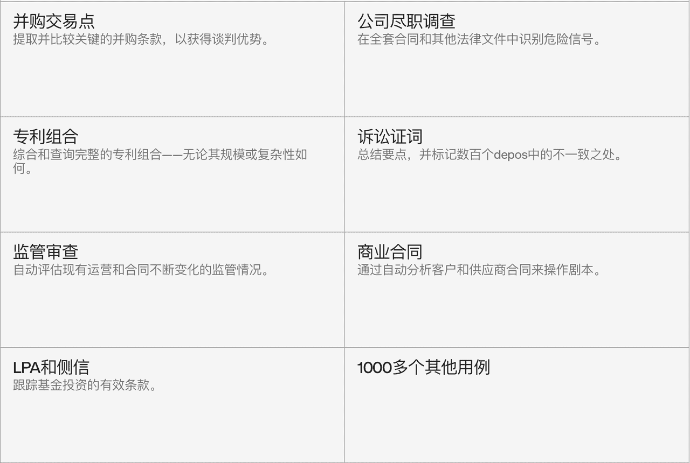
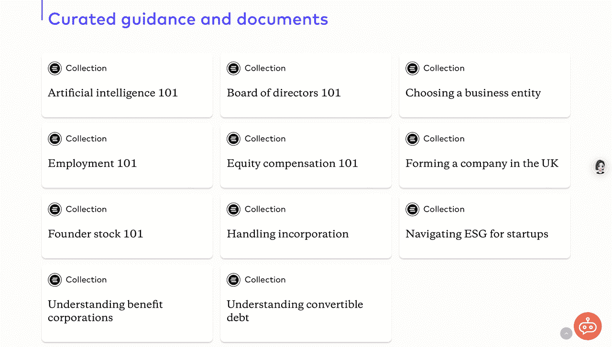
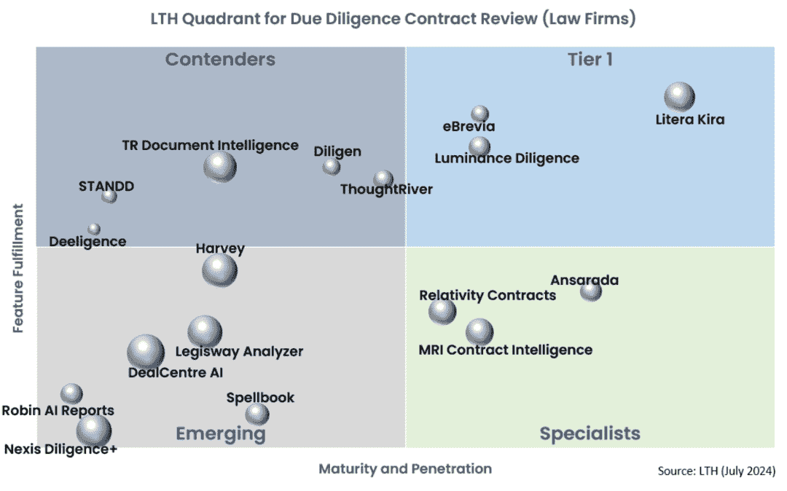

# 2024 年 7 月法律科技月刊

> 来源：[https://docs.feishu.cn/docx/Kh2udbknRoBc2nxAHmeccrIunXg](https://docs.feishu.cn/docx/Kh2udbknRoBc2nxAHmeccrIunXg)

---

# **一、法律科技融资动态**

## AI 知识平台 Hebbia 完成 1.3 亿美元 B 轮融资，包括大量法律领域用例

[7 月 8 ](https://www.hebbia.ai)日，AI 知识平台 Hebbia 宣布完成 1.3 亿美元 B 轮融资，投资人包括 Andreessen Horowitz、Index Ventures、Google Ventures 和亿万富翁 Peter Thiel。

Hebbia 成立于 2020 年，利用 AI 帮助企业筛选各种文件并回答问题。目前，Hebbia 已经服务一些全球领先的资产管理公司、律师事务所、银行和财富 100 强公司。Hebbia 在官网列举了以下“法律”相关用例：

> 拓展阅读：

> https://www.hebbia.ai/blog/hebbia-raises-usd130m-series-b

> https://www.chinaz.com/ainews/10123.shtml

> https://mp.weixin.qq.com/s/rAp0A8ZUqnVrkaDRvIPGZw

> https://mp.weixin.qq.com/s/rvm-3qRL9t3bAll4GdWi7Q

## 网络安全初创公司 Cytactic 完成 1600 万美元种子轮融资

7 月 9 日，网络危机管理平台 Cytactic 宣布完成 1600 万美元种子轮融资，Evolution Equity Partners 领投。

Cytactic 由以色列律师事务所 Herzog, Fox & Ne'eman 的前合伙人兼技术主管 Nimrod Kozlovski 于 2022 年创立，旨在集中和管理组织的网络事件响应，并与律所密切合作。这个业务通常可能会涉及多个利益相关者，包括法律和隐私团队，而且涉及各种任务，从恢复数据到遵守数据泄露法规。

Cytactic 不是唯一一家专注于帮助组织管理网络安全和数据隐私风险、遵[守相关法规，于今年](https://www.law.com/legaltechnews/2024/05/28/data-privacy-company-transcend-raises-40-million-in-series-b-funding-round/)披露新融资的科技公司。5 月下旬，数据隐私和合规解决方案公司 Transcend 也宣布完成 4000 万美元 B 轮融资。

> 拓展阅读：https://www.law.com/legaltechnews/2024/07/10/cybersecurity-startup-cytactic-founded-by-law-firm-partner-announces-16m-seed-round/

## 自动化计时计费工具 PointOne 完成 350 万美元种子轮融资

7 月 10 日，自动化计时计费工具 PointOne 宣布完成 350 万美元种子轮融资，投资方为 Bessemer Venture Partners、General Catalyst、Y Combinator 和隶属于 Cooley 律师事务所的投资基金等。

Poi[ntOne 于 20](https://www.law.com/legaltechnews/2024/03/22/compliance-startup-singlefile-raises-6-5m-with-investments-from-am-law-100-and-tltf/)23 年 10 月启动，并参加了 YC[ 去年的](https://www.law.com/legaltechnews/2021/01/19/open-access-matter-platform-lupl-announces-14m-funding-on-track-for-wide-2021-release/)冬季创业营。该公司除了提供自动计时计费功能，还训练了一个 AI 系统，支持搜索与客户账单时的常见问题。据悉，PointOne 是 Cooley 基金投资的法律科技公司之一，该机构此前曾投资合规服务商 SingleFile、合同协作平台 The Contract Network 和法律事务管理平台 Lupl。

> 拓展阅读：https://www.law.com/legaltechnews/2024/07/10/timekeeping-startup-pointone-secures-3-5m-seed-round-including-investment-from-cooley-fund/

## HerculesAI 完成 2600 万美元 B 轮融资，为律师提供 AI Agent 服务

近日，HerculesAI（原“Zero Systems）宣布完成 2600 万美元 B 轮融资，Streamlined Ventures、 Proof VC、汤森路透、Alumni Ventures 以及各种天使投资者参与投资。HerculesAI 开发了多种 AI Agent，帮助律师将繁琐、复杂、枯燥的业务流程自动化，包括智能数据提取、数据转换和数据验证三部分。其中，智能数据提取主要从非结构化的文档中提取数据；数据转换则是通过建立一套规则和结构，来处理提取的数据；数据验证是最重要的部分，将提取的信息与法规、政策、合同、法律等来源进行比较，如果发现问题将会提交给人类做人工审核。

> 拓展阅读：https://mp.weixin.qq.com/s/HymvjY258gyKHyI0t_2w8g

## 法律 AI 初创公司 LegalFly 完成 1500 万欧元，Notion Capital 领投

[7 月 15 日](https://www.legalfly.ai)，法律 AI 初创公司 LegalFly 宣布完成 1500 万欧元 A 轮融资，Notion Capital 领投，Redalpine 和 Fortino Capital 跟投。

LegalFly 成立于 2023 年，由 Tinder 公司的前产品专家团队 Ruben Miessen、Kasper Verbeeck、Dennis Montégnies和Gregory Vekemans 创立。去年 11 月，该公司完成 200 万欧元种子轮融资，Redalpine 领投，包括谷歌 Deepmind 产品总监 Mehdi Ghissassi 在内的行业领导者也参与其中。

LegalFly 为律师事务所和公司法务团队打造法律 AI 解决方案，旨在实现法律服务自动化并提高生产力，目前已经服务了数十家领先的欧洲律师事务所和企业，包括 Slaughter & May 和 Allianz 等行业头部机构。

LegalFly 将其产品的优势归为「安全性」，通过将数据进行本地匿名化实现，即微调模型在数据到达大模型之前保护数据，以确保敏感的客户数据不会离开公司场所。

> 拓展阅读：

> https://www.legalfly.ai/blog/legalfly-secures-15-million-to-set-security-standard-in-ai-legal-services

> https://www.legalfly.ai/blog/seed-funding

## CLM 服务商 netLex 完成 2270 万美元新一轮融资

7 月 17 日，巴西合同生命周期管理（CLM）服务商 netLex 宣布完成 2270 万美元（1.26 亿雷亚尔）新一轮融资，Riverwood Capital 领投，旨在把 AI 集成到 CLM 流程中。

> 拓展阅读：https://www.law.com/legaltechnews/2024/07/18/brazilian-clm-provider-netlex-raises-22-7-million-seeking-global-expansion/

## 法律 AI 初创公司 Leya 完成 2500 万美元 A 轮融资，两个月前刚完成种子轮融资

7 月[ 17 日，法律](https://www.law.com/legaltechnews/2024/05/16/swedish-gen-ai-assistant-leya-raises-10-5-million/) AI 初创公司 Leya 宣布完成 2500 万美元 A 轮融资，Redpoint Ventures 领投，Benchmark、Y Combinator、Wayfinder Ventures 和 Alt Capital 跟投。今年 5 月，Leya 刚完成 1050 万美元种子轮融资，Benchmark 领投，Hummingbird、SV Angel 和 Y Combinator 跟投。

> 拓展阅读：https://www.law.com/legaltechnews/2024/07/17/swedish-startup-leya-announces-25m-investment-two-months-after-10-5m-seed-round/

## AI 尽职调查平台 Xapien 完成 1000 万美元 A 轮融资

7 月 17 日，尽职调查平台 Xapien 宣布完成 1000 万美元 A 轮融资，YFM Equity Partners 领投。该公司利用 AI 从网上非结构化信息中提取关于公司和个人的关键信息。

> 拓展阅读：https://www.law.com/legaltechnews/2024/07/18/due-diligence-technology-provider-xapien-secures-10-million-series-a-investment/

## Clio 完成 9 亿美元 F 轮融资，多年来始终如一构建「法律操作系统」

[7 月 ](https://www.clio.com)23 日，法律实践管理平台 Clio 宣布完成 9 亿美元 F 轮融资，New Enterprise Associates（NEA）领投，Goldman Sachs、Sixth Street、CapitalG、Tidemark、TCV、JMI Equity 等跟投。

Clio 成立于 2008 年，是一家法律实践管理软件服务商。简单来说，就是开发辅助律所经营的各种软件的公司，致力于让律所经营更加容易，对于法律专业人士来说赚钱更加容易，对于客户来说也更加便利。

目前，Clio 获得了全球 [100](https://www.clio.com/partnerships/bar-associations/) 多个[律师协会和法律协会](https://www.clio.com/partnerships/bar-associations/)[的批准，包括美国所有](https://www.clio.com/app-directory/?cta=top-nav-na)[ 50 个州](https://www.clio.com/partnerships/certified-consultants/find-a-ccc/)。Clio 的应用目录有超过 250 个产品集成。同时，Clio 通过与参加 Clio 学术访问计划（CAAP）的法律诊所合作，为无数法学生提供支持。除此之外，Clio 还与许多渠道合作伙伴合作，将 Clio 带入一个不断增长的科技前瞻性律师事务所社区。

> 拓展阅读：

> [深度｜Clio 完成 9 亿美元 F 轮](https://mp.weixin.qq.com/s/y9qEJBHN2ZfadN0Ghv6lmA)融资，多年来始终如一构建「法律操作系统」

> https://www.clio.com/blog/series-f/

> https://www.law.com/legaltechnews/2024/07/23/clio-raises-900m-series-f-to-reach-3b-valuation-with-help-from-new-investors/

## 法律 AI 初创公司 Harvey 完成 1 亿美元 C 轮融资，谷歌领投

7 月 23 日，法律 AI 公司 Harvey 宣布完成 1 亿美元 C 轮融资，估值 15 亿美元，成为了独角兽（估值 10 亿美金）公司。本轮融资由谷歌旗下基金 Google Ventures 领投，OpenAI、Kleiner Perkins、Sequoia Capital、Elad Gil 和 SV Angel 跟投。Harvey 打算利用这笔新的资金，投资 AI 原生系统所需的工程、数据和领域的专业知识，并且扩大团队，为全球客户服务。明年，Harvey 还打算收集和策划提高该公司大模型效率所需的数据，同时推出新产品。

> 拓展阅读：https://www.harvey.ai/blog/harvey-raises-series-c

## 法律 AI 初创公司 Uncover Legal 完成新一轮融资

7 月 24 日，[Uncover Legal](https://www.uncoverlegal.com) 宣布完成新一轮融资，投资方为 Dutchyard。该公司计划利用这笔新的资金，根据律师和法务部门的需求定制解决方案，将服务扩展到公司法务部门，并为更多律师提供合适且负担得起的 AI 工具。

> 拓展阅读：https://www.uncoverlegal.com/blog/ai-driven-matter-analysis-tool-uncover-legal-secures-significant-growth-funding-from-dutchyard-to-maximize-lawyers-efficiency-with-ai

## 法律科技初创公司 DecoverAI 完成 200 万美元种子轮融资

7 月 30 日，[DecoverAI](https://www.decoverhq.com) 宣布完成 200 万美元种子轮融资，Leo Capital 领投。该公司正在开发一个 AI 系统，赋能法律任务的开展，比如证据发现、法律研究和战略制定等。

> 拓展阅读：https://economictimes.indiatimes.com/tech/funding/legal-tech-company-decoverai-raises-2-million-in-funding-round-led-by-leo-capital/articleshow/112141328.cms

## 法律科技初创公司 Definely 获得 Innovate UK 58.5 万英镑赠款

7 月 31 日，法律科技初创公司 Definely 宣布获得 Innovate UK 提供的 58.5 万英镑赠款，以支持开发新的生成式 AI 产品，从而简化法律文件中的信息访问和理解。据悉，Innovate UK是一家英国创新机构，通过新产品、流程和服务的开发和商业化帮助英国企业成长。

> 拓展阅读：

> https://www.definely.com/newsroom/definely-secures-ps585-000-innovate-uk-grant

> https://legaltechnology.com/2024/07/31/definely-secures-585000-innovate-uk-grant/

# **二、法律科技并购动态**

## 私募股权公司 Aurora Capital Partners 收购诉讼支持公司 First Legal

7 月 2 日，Aurora 宣布了以上消息。

> 拓展阅读：https://www.law360.com/pulse/legal-tech/articles/1854480/aurora-acquires-litigation-service-provider-first-legal

## Legaltech Hub 收购 Legal Tech Consultants，扩展法律科技咨询服务

[7 月 9 日，法律科技咨](https://www.legaltechnologyhub.com)询服务商 Legaltech Hub 宣布收购 Legal Tech Consultants，该公司的创始人兼 CEO Cheryl Wilson Griffin 将加入 Legaltech Hub，担任供应商咨询副总裁，发展公司的咨询和内容产品。

Legal Tech Consultants 至少是近几年来，Legaltech Hub[ 的第二次收购。2022 年](https://www.law.com/legaltechnews/2022/05/12/legaltech-hub-expands-into-job-listings-with-legaltech-jobs-acquisition/)，Legaltech Hub 收购一家招聘信息网站 Lega[lTech Jobs，](https://www.law.com/legaltechnews/2023/01/24/legaltech-hub-launches-subscription-content-site-lth-premium/)扩[展法律科](https://www.law.com/legaltechnews/2024/05/23/legaltech-hub-releases-in-depth-competitive-analysis-on-legal-techs-document-automation-providers/)技相关的招聘业务；2023 年 1 月，Legaltech Hub 又推出一个订阅网站 LTH Premium，提供教育资源、针对性的法律科技报告和见解。今年 5 月，Legaltech Hub 发布了法律科技市场服务商类别竞争分析系列报告中的第一个 —— 专门针对文档自动化服务商。

Legaltech Hub 是一家法律科技解决方案、工具和服务的全球目录平台，法律科技的买家可以在这里研究他们管理 21 世纪律所或法务部门所需的技术，供应商可以展示他们的解决方案，投资者则可以了解市场。

> 拓展阅读：

> https://hub.legaltechconsultants.com/deep-thoughts/ltc-and-lth

> https://www.law.com/legaltechnews/2024/07/09/legaltech-hub-acquires-legal-tech-consultants-expanding-to-full-service-consulting/

## 数据管理公司 Cellebrite 收购 CyTech

近日，数据管理公司 Cellebrite DI 宣布收购 Cyber Technology Services。

> 拓展阅读：https://www.law360.com/pulse/legal-tech/articles/1859225/data-management-co-cellebrite-acquires-cytech

## 诉讼支持公司 Magna Legal Services 收购竞争对手 Bosco Legal Services

近日，Magna 宣布了以上消息。

> 拓展阅读：https://www.law360.com/pulse/legal-tech/articles/1858540/litigation-support-provider-acquires-family-owned-company

## 替代性法律服务商 Execo 收购竞争对手 Cacti Legal，加强 AI 能力

7 月 17 日，Execo 宣布了以上消息。

> 拓展阅读：https://www.law360.com/pulse/legal-tech/articles/1859019/legal-services-provider-execo-acquires-india-based-co-cacti

## LexisNexis 完成对 Henchman 的收购

7[ 月](https://www.law.com/legaltechnews/2024/06/03/lexisnexis-announces-agreement-to-acquire-contract-drafting-startup-henchman) 22 日，LexisNexis 宣布完成对 CLM 公司 Henchman 的收购。该交易于今年 6 月宣布，旨在提高 AI 能力。

> 拓展阅读：https://www.law.com/legaltechnews/2024/07/22/lexisnexis-completes-acquisition-of-belgian-gen-ai-startup-henchman/

## Litera 收购 FileTrail，扩大信息治理能力

7 月 29 日，Litera 宣布收购信息治理和记录管理提供商 FileTrail，向信息治理领域扩张，并将添加一系列法律工具，提高律师事务所和公司的治理、风险和合规（GRC）能力。

这是 Litera 最新的并购交易，该公司在过去几年中进行了十几次收购。

[2023 年，Lite](https://www.law.com/legaltechnews/2023/04/24/litera-acquires-crm-provider-upper-sigma-expanding-its-marketing-business-development-capabilities/)ra 收购了 CRM 服务商 U[pper Si](https://www.law.com/legaltechnews/2022/01/11/litera-acquires-shipping-and-processing-specialist-psship-continuing-ma-drive-into-2022/)[gma，扩大其营销和业务](https://www.law.com/legaltechnews/2022/01/18/litera-acquires-collaboration-manager-prosperoware-continuing-ma-run/)[开发能力。2022 年，Li](https://www.law.com/legaltechnews/2022/08/16/litera-acquires-talent-micron-systems-adding-talent-management-capabilities/)t[er](https://www.law.com/legaltechnews/2021/11/05/hg-pours-additional-funds-into-litera-to-fuel-acquisitions-product-growth-and-hiring/)a 宣布三项新收购：PS/Ship，一个运输管理、包裹跟踪和发票处理系统；Prosperoware，提高系统的信息治理能力；以及 Micron Systems，该公司提供人才管理软件，旨在为律师和会计师事务所提供招聘和人力资源流程自动化。据了解，Litera 的此类收购可能得到私募股权公司 Hg 的投资支持，该公司于 2019 年收购了 Litera。

> 拓展阅读：https://www.law.com/legaltechnews/2024/07/29/litera-acquires-filetrail-seeking-expansion-into-the-governance-space/

# 三、律所 / ALSP 如何拥抱法律科技

## Bird & Bird 律所试验 AI 法律助理 Leya

7 月 2 日，Bird & Bird 律师事务所宣布对 AI 法律助理 Leya 进行为期半年的试验。

Leya 是一家法律 AI 初创公司，提供一款专为法律专业人士设计的 AI 助手，擅长回答复杂的法律问题，并优化工作流程。通过整合律所内部的知识库和外部的法规和案例库，Leya 可以提供可靠且有来源引证的答案。

今年 4 月，Leya 入选 Y Combinator W24 的项目路演，5 月宣布完成 1050 万美元种子轮融资，Benchmark 领投，Hummingbird、SV Angel 和 Y Combinator 跟投。Leya 提供一个法律 AI 助理，致力于简化法律任务，比如文件分析、尽职调查、数据提取、法律研究、起草备忘录等法律文件。

> 拓展阅读：https://www.law360.com/pulse/legal-tech/articles/1853482/bird-bird-partners-with-ai-assistant-leya

## Covington 律所设置 AI 高管岗位

近日，Covington & Burling 律师事务所设置了一个新的以人工智能为重点的岗位：AI 和电子发现解决方案总监，并聘请 Todd Itami 担任该职位，Itami 将带领 Covington 在律所内部整合 AI 和其他技术工具。

[Con](https://www.law.com/americanlawyer/2024/05/14/big-laws-ai-talent-war-aims-to-influence-software-development/?slreturn=20240602165220)vington 是最新一家为 AI 职位招募高级人才的律所。上个月，Latham & Watkins、Cleary Gottlieb Steen & Hamilton 和 DLA Piper 等律所也填补了专注于 AI 的岗位。

> 拓展阅读：https://www.law.com/nationallawjournal/2024/07/02/covington-creates-ai-director-role-focused-on-demystifying-tech-for-lawyers/

## Norton Rose 律所推出 AI 相关 IP 问题的全球指南

随着[ A](https://www.law.com/legaltechnews/2024/04/18/what-have-we-learned-from-20-ai-copyright-lawsuits/)I 在各行各业使用的增长，与生成式 AI 相关的知识产权问题，成为了全球法律诉讼的关键。目前，以 OpenAI 为代表的大模型公司们，正在世界各地面临几起与训练大模型相关的版权和专利侵权诉讼。

[对此](https://www.nortonrosefulbright.com/en-ca/knowledge/publications/acf01adf/generative-ai)，Norton Rose Fulbright 律所整理并推出一份指南，通过研究全球的法律规定，并分析侵犯版权、知识产权、信息和责任保密的规定，为客户和法律专业人士提供参考。

> 指南地址：https://www.nortonrosefulbright.com/en-ca/knowledge/publications/acf01adf/generative-ai

> 拓展阅读：https://www.law.com/legaltechnews/2024/07/26/norton-rose-launches-global-online-guide-on-the-ip-of-ai-397-88182/

## Cooley 推出生成式 AI 聊天机器人 Cooley GObot

[2014 年，国](https://www.cooleygo.com)际律师事务所 Cooley 推出一个名为 CooleyGO 的门户网站，并提供一系列知识资源，帮助企业家启动新业务。十年后，CooleyGO 的使命没有改变，但信息的传递方式发生了变化。

就在上周，Cooley 在庆祝 CooleyGO 十周年之际，推出一个名为 Cooley GObot 的生成式 AI 聊天机器人，旨在简化知识资源的搜索过程，帮助用户更好地从 Cooley GO 和 Cooley.com 的内容中找到所需的信息。

同时，Cooley 还推出一系列新的知识合集，帮助用户学习关键领域的知识👇

除此之外，Cooley GO 还免费提供时间跨度超过 10 年的风险投资数据，包括融资和估值的趋势变化，具体包括交互式图表、报告、对投资人的采访等。可以说，Cooley GO 一直致力于开放与社区相关和有帮助的东西。

经过十年运营，CooleyGO 已经成为众多企业家的学习渠道之一，也为 Cooley 带来了良好的品牌效应和客户，还有法学院将 Cooley GO 作为在公司生命周期内工作的基础，并为公司发展的不同阶段组织教育课程。

事实上，对律师事务所来说，面向客户推出知识资源，建立科技形象，运营自己的社区，一直是个不错的品牌营销手段。无独有偶，8 月 1 日，Akin Gump Strauss Hauer & Feld 律师事务所宣布推出 AI Law & Regulation Tracker（AI 法律和法规信息跟踪器），可监测各个领域与 AI 相关的法律法规，包括知识产权、数据隐私等。

7 月，Norton Rose Fulbright 律师事务所也推出一份指南，研究全球各个国家侵犯版权、知识产权以及信息和责任保密的规定，为客户和法律专业人士提供有价值的参考。

这两个产品的背景是，随着 AI 使用增长，生成式 AI 衍生的一系列问题成为全球法律诉讼问题的关键问题。目前，以 OpenAI 为代表的大模型公司，正在世界各地面临几起与训练大模型相关的版权和专利侵权等诉讼。

**但是，要想做出高质量和吸引人的知识资源，其实并不容易，往往需要熟悉知识管理**和组织协作的牵头人，组织跨部门的律师积极参与，而一旦跑起来，就能享受时间的复利。

> 拓展阅读：

> [Cooley 律所推生成式 AI 聊天机器人 Co](https://mp.weixin.qq.com/s/iAHx6Rn9DiJGnSpvl-yjag)oley GObot，简化知识的搜索难度

> https://www.cooleygo.com/welcome-to-the-new-cooley-go/

> https://store.law.com/Registration/Login.aspx?mode=silent&source=https%3A%2F%2Fwww.law.com%2Flegaltechnews%2F2024%2F08%2F05%2Fcooley-launches-cooley-gobot-new-collections-for-quicker-entrepreneurial-insights%2F

# 四、监管部门和学界如何拥抱 AI

## 英联邦秘书长任命 Richard Susskind 教授为司法和人工智能特使

7 月 1 日，英联邦秘书长 Patricia Scotland KC 任命法律科技专家兼未来学家 Richard Susskind 为司法和人工智能特使。Susskind 将负责支持 56 个英联邦国家实现可持续发展目标（SDG）16 —— 该目标旨在确保到 2030 年所有人平等地诉诸司法、使用 AI 。Patricia Scotland 表示：“我们知道，实现可持续发展目标 16 的进展没有步入正轨。如果 AI 利用得当，将可以成为让我们重回正轨的强大工具，而 Susskind 教授参与司法和 AI 的记录使他非常适合根据可持续发展目标 16，推动英联邦的《平等诉诸司法宣言》。”

> 拓展阅读：https://thecommonwealth.org/news/commonwealth-secretary-general-appoints-prof-richard-susskind-special-envoy-justice-and-ai

## 美国仲裁协会与萨福克法学院合作推出创新诊所

7 月 22 日，美国仲裁协会（AAA）宣布与萨福克大学法学院合作推出在线争议解决（ODR）创新诊所，该诊所旨在为马萨诸塞州的低争议离婚和家庭法案件中无代理诉讼当事人，开发一些数字工具。

这个诊所将运营三年，目的是将其工作扩展到新的司法管辖区和家庭法以外的其他法律主题领域。AAA 和萨福克大学法学院将开发一些数字工具，包括用于离婚和相关事项的 ODR 平台、虚拟调解资源、指导诉讼当事人通过家庭法程序的智能法院表格和互动访谈，以及 AI 驱动的公共指导等。

近年来，AAA 和萨福克大学法学院持续对 AI 技术及其影响进行投入。

例如，AAA 于今年 5 月[收购](https://www.law.com/legaltechnews/2024/05/30/american-arbitration-association-acquires-odr-com-parent-company-planning-ai-powered-expansion/)了在线争议解决平台 ODR.com 的母公司 Resourceful Internet Solutions 以及一些相关网站和在线资源，加快替代性争议解决（ADR）技术产品的开发，特别是[ AI 产品。该](https://www.law.com/legaltechnews/2023/12/06/the-american-arbitration-association-launches-new-ai-resource-aaai-lab/)收购几周后，AAA 及其国际部门争议解决中心（ICDR）推出了 ClauseBuilde[r ](https://www.law.com/legaltechnews/2024/06/06/suffolk-law-school-wolters-kluwer-partner-for-gen-ai-prompting-challenge/)AI，旨在简化跨行业的调解和仲裁条款的起草。2023 年 12 月，AAA 还推出 AAAi 实验室，这是一个门户网站，旨在为希望了解 AI 及其对其职业影响的仲裁员和其他法律专业人士提供教育资源。同样，今年 5 月，萨福克大学法学院与 Wolters Kluwer 合作举办了一场“生成式 AI 提示挑战赛”，让法学生在 Wolters Kluwer 的数据库上探索生成式 AI 的用例。

> 拓展阅读：https://www.law.com/legaltechnews/2024/07/22/american-arbitration-association-partners-with-suffolk-law-school-to-launch-innovation-clinic/

## 美国律师协会发布首个关于律师使用 AI 工具的指南

7 月 29 日，[美国律师协会](https://www.americanbar.org/en/)（ABA）的[道德和专业责任常设委员会](https://www.americanbar.org/groups/professional_responsibility/committees_commissions/ethicsandprofessionalresponsibility/)发布了一份关于使用 AI 的意见，敦促律师遵守 ABA《职业行为示范规则》的几项示范规则，包括与能力、通信、保密和费用有关的规则。这份意见确定了一些涉及使用生成式 AI 工具的伦理问题，为试图驾驭这一新兴格局的律师提供指导。

具体来说，这些示范规则包括：

+   **能力**：要求律师为客户提供称职的代理，并要求他们行使“合理代理必要的法律知识、技能、彻底性和准备”。

+   **信息保密**：根据该示范规则，使用生成式 AI 的律师必须认识到，除非客户表示知情同意，否则律师有责任对与客户代理有关的所有信息保密，无论其来源如何。

+   **沟通**：这解决了律师与客户沟通的义务，建立在律师作为受托人的法律义务之上，其中包括“律师有义务在客户需要提供任何重要信息时及时向客户提供建议。”

+   **费用**：如果律师使用生成式 AI 工具起草诉状，并花 15 分钟将相关信息输入到程序中，律师可能会收取该时间以及审查最终草案的准确性和完整性所需的时间，但不应该向客户收取了解该工具的费用。

> 拓展阅读：https://www.americanbar.org/news/abanews/aba-news-archives/2024/07/aba-issues-guidance-lawyers-use-ai-tools/

# **五、法律科技市场调研**

## Legaltech Hub 发布「尽职调查自动化」细分赛道竞争分析报告

7 月 30 日，Legaltech Hub（简称“LTH”）发布「尽职调查自动化」赛道服务商的竞争分析报告，对服务商的分类如下图所示👇

这份报告不包括将合同审查功能作为合同生命周期管理（CLM）或电子发现解决方案等，更广泛平台中的一部分的产品，早期初创企业（成立 18 个月内或更短）也被排除在外。具体来说，LTH 通过分析各家服务商的产品演示、与服务商进行对话等方式调研，并根据以下三个变量对相关产品进行评估：

+   **成熟度和市场渗透率（X 轴）**

+   **功能完整性（Y 轴）**

+   资金水平、财务状况以及安全状况（泡沫大小）的稳定性

评估后，各家服务商被分为以下四个类别：

**T1**：在功能和成熟度方面最强大的服务商

**竞争者**：竞争 T1 地位的服务商，功能丰富，但成熟度较低

**专家**：专注于特定功能或属性的成熟服务商

**新兴**：特定类别中新兴的初创公司

报告中，LTH 对于 T1、竞争者、专家和新兴类别中每个服务商进行完整描述，包括公司和产品历史、重要功能和需要考虑的关键利弊。

值得注意的是，LTH 还在这份报告中提到了 Leya —— 尽管 Leya 没有被划分到特定赛道，也没有出现在象限中，而且尚未推出尽职调查功能，但 LTH 表示，他们已经看到了该功能的预览，这让他们相信 Leya 属于此类服务商。

未来，LTH 计划将定期重新审视这些类别和竞争分析报告，并预计纳入更多服务商。

这份报告需要付费获取，有需要的朋友可前往 LTH 官网订阅👇

> 报告地址：https://www.legaltechnologyhub.com/contents/lth-competitive-analysis-due-diligence/

> 拓展阅读：https://www.law.com/legaltechnews/2024/07/30/legaltech-hub-releases-in-depth-competitive-analysis-on-due-diligence-automation-providers/

# 六、市场教育/创新孵化/生态联盟

## 一个法律 AI 社区在 HuggingFace 上推出，还开源了一些「法律数据集」

7 月初，法国数据分析师兼法学生 Louis Brulé Naudet 在 AI 开源平台 HuggingFace 上成立了一个法律人社区。

这个社区称为：[HF for Legal](https://huggingface.co/HFforLegal)，致力于为法律从业者、学者和研究人员，提供在法律领域中驾驭复杂的 AI 世界所需的知识和工具，共享法律 AI 相关的模型、代码、数据和建议等，目前已经吸引 50+ 成员，包括数据科学家、法律科技企业家、律师和知识管理人员等。HF for Legal 希望将这些人聚集在一起，打造一个开放的生态系统，让法律专业人士可以轻松地理解、访问和利用适合自己需求的 AI 模型。

> HF for Legal 地址：https://huggingface.co/HFforLegal

> 法律数据集地址：https://huggingface.co/datasets/HFforLegal/laws

> 拓展阅读：

> [一个法律 AI 社区在 HuggingFa](https://mp.weixin.qq.com/s/cHwW_BPQfiV7niID0w45jw)ce 上推出，还开源了一些「法律数据集」

> https://www.law.com/legaltechnews/2024/07/10/to-advance-ai-efforts-legal-professionals-launch-community-on-open-source-platform-huggingface/

## 政府培训服务商 Federal Publications Seminar 推出两个 AI 证书项目

**7** 月 17 日，联邦政府承包培训服务商 Federal Publications Seminar 推出两个 AI 证书项目。

其中，AI 证书面向专业人士提供与 AI 使用和影响相关的教育课程，涵盖欧盟 AI 法案、虚假信息和深度伪造、国家标准和技术研究所 AI 风险管理框架等主题。领导力研究证书则侧重于领导力培训，包括战略和批判性思维、冲突解决、演示技巧、合同管理等课程。FPS 的主席安迪·金表示：“AI 证书旨在帮助专业人士掌握驾驭日益复杂的 AI 世界所需的知识和技能。同样，我们的领导力研究证书也旨在培养政府合同中的下一代领导者。”

> 拓展阅读：https://www.fedpubseminars.com/Certificates/FPS-(AI)-Artificial-Intelligence-for-Government-Contractors-Certificate/?id=13

## 国际法律科技协会发布使用主动学习技术管理诉讼电子发现的最佳实践指南草案

7 月 18 日，[国际法律技术协会（ILTA）](https://www.iltanet.org/home)特别兴趣小组（SIG）发布了一份，使用主动学习技术管理诉讼电子发现或披露的最佳实践指南（草案）。这个草案由一些律师事务所的诉讼支持专业人员起草，这些律所包括 Norton Rose Fulbright、Eversheds Sutherland、Squ[ire Patt](https://www.law.com/legaltechnews/2023/05/26/hogan-lovells-launches-eltemate-a-tech-subsidiary-combining-lawyers-engineers-ai-specialists/)on Boggs、A&O Shearman、Linklaters、Ashurst、Fieldfisher、DLA Piper、Travers Smith、Reynolds Porter Chamberlain、CMS、Hogan Lovells 的法律科技子公司 ELTEMATE。

英格兰和威尔士的 eDisclosure（或 eDiscovery）行为主要由法院规则和实践指示管控，鼓励各方使用 eDiscovery 工具，通过关键词和其他传统技术来搜索文档。这些技术辅助审查方法已经使用了很多年。然而，最近在主动学习技术中使用 AI，不是受指导的主题，如果使用 AI 在各方之间或整个行业不一致，就可能对司法产生负面影响。

主动学习应用 AI 原则，使 eDiscovery 能够根据从案例中文档数据集的学习进行动态自我调整。虽然 AI 在有效性和效率方面有益处，但各方必须知道 AI 将会如何与何时被反对者应用，因为它可以塑造披露文件的性质。

该指南旨在通过律师可以遵循的一致流程，来鼓励合理地使用这项技术。然后，争议双方的法律团队可以确信遵循了已知和公平的程序，以满足他们和对手的披露义务。

> 拓展阅读：https://www.iltanet.org/blogs/ilta-news1/2024/07/17/press-release-e-discovery-consultation-launch-uk-l

## 法律 AI 初创公司 Paxton AI 推出 AI 置信度指标，提高透明度

7 月 30 日，法律 AI 初[创公司 Paxto](https://arxiv.org/abs/2401.01301)n AI 宣布其产品在斯坦福法律幻觉基准任务上实现了 93.82% 的平均准确率，并推出一个新的置信度指标，帮助用户评估 AI 输出的可靠性。

> 拓展阅读：

> https://www.paxton.ai/post/paxton-ai-achieves-93-accuracy-on-stanford-hallucination-benchmark-releases-new-confidence-indicator-feature

> https://www.law.com/legaltechnews/2024/07/30/paxton-ai-launches-a-confidence-indicator-which-is-what-it-sounds-like/