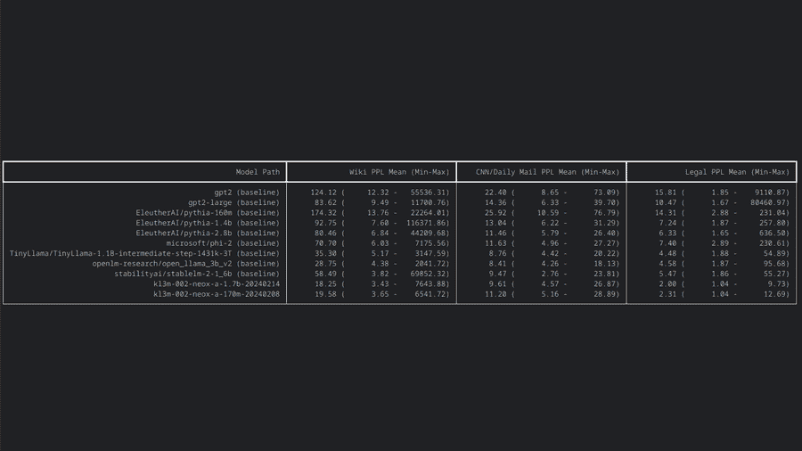
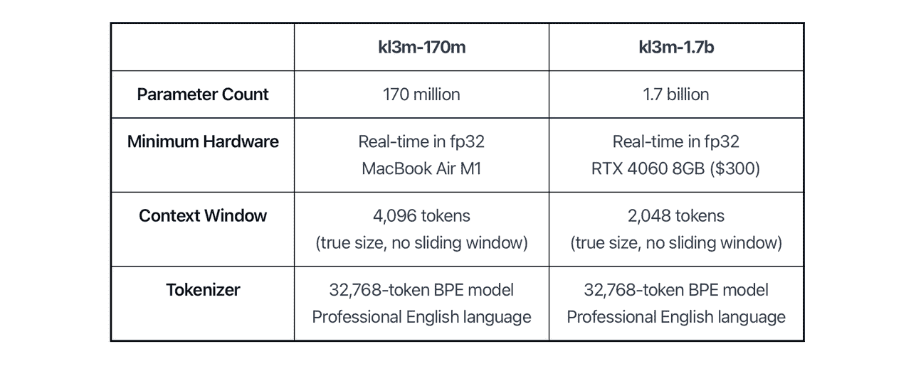
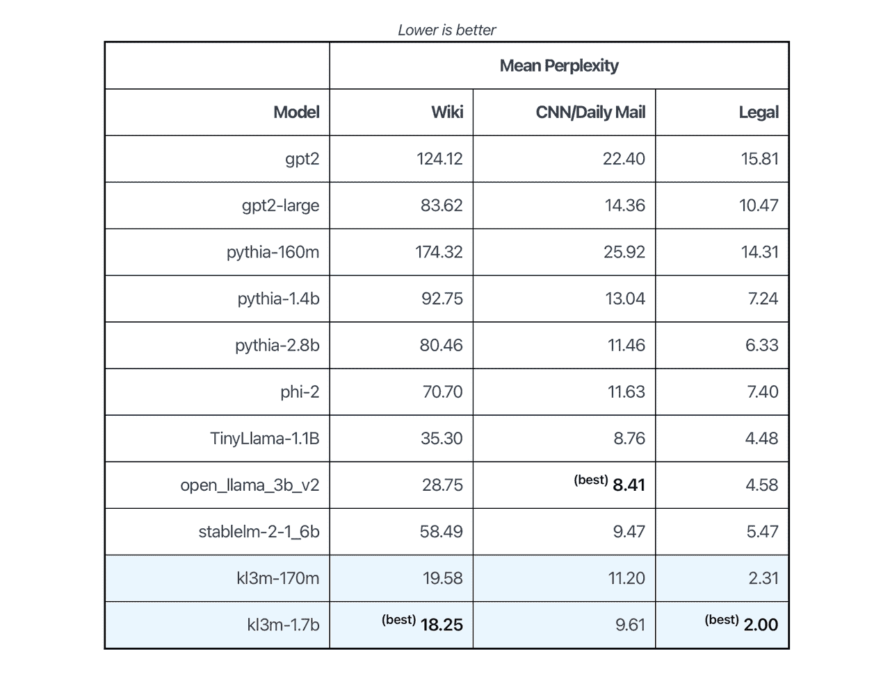
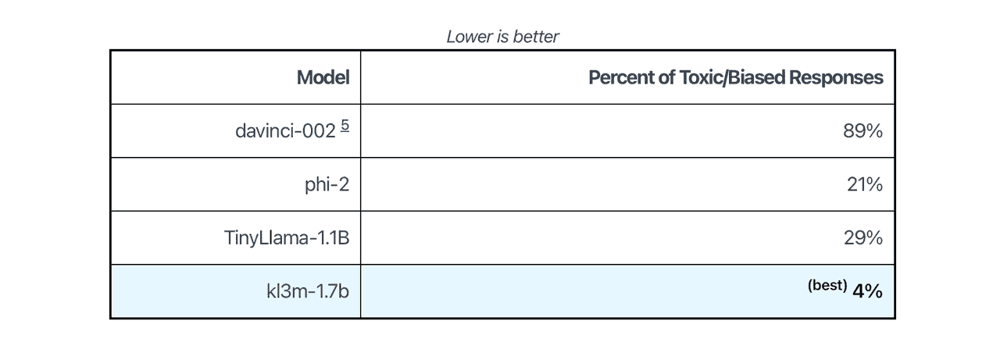

# 第一个真正意义上的法律大模型，来了！

> 来源：[https://docs.feishu.cn/docx/LiEMdAMQaoV3JmxAQmGcXZOKnKe](https://docs.feishu.cn/docx/LiEMdAMQaoV3JmxAQmGcXZOKnKe)

---

# Isaacus

2025 年 9 月[，澳大利亚法律](https://isaacus.com/) [AI](https://isaacus.com/blog/our-vision-for-the-future-of-legal-ai) 初创公司 Isaacus 宣布完成 70 万美元种子轮融资，澳大利亚领先的科技风险投资机构 Aura Ventures 和 Galileo Ventures 共同领投。这是全球首个由风险投资机构投资的基础法律 AI 项目。

Isaacus 成立于 2025 年，致力于解决法律科技行业中的 AI 和数据需求，从超越通用模型的法律检索能力，到提供对大量未开发的、高度专有的法律数据。目前，Isaacus 为法律科技公司构建法律 AI 基础模型和工具，同时开发了庞大的专有语料库，涵盖了美国、英国、加拿大、澳大利亚、新西兰、爱尔兰、欧盟和联合国的法律、法规、案例和其他法律数据。

[目前，Is](https://isaacus.com/blog/introducing-kanon/)aac[us 已经推出 Ka](https://isaacus.com/blog/introducing-kanon/)non 和 Kanon Mini 两个法律 AI 模型，分别适用于「提取」和「分类」两个任务，并声称为同类模型中速度最快、最准确的，平均比最接近的通用模型准确率高出 9%，且没有额外的延迟。

+   **Kanon**：一个高性能的 3.17 亿参数模型，具有 512 个 tokens 的上下文窗口，占用1.2千兆字节。

+   **Kanon Mini**：一个轻量级的 Kanon 变体，只有 1.36 亿个 tokens ，仅占用 441 兆字节，足以在 iPhone 上运行。

同时，Isaacus 还开源了第一个也是唯一一个澳大利亚法律和案例数据库 ，包含 229,122 份文本，总计超过 6000 万行和 14 亿个标记，涵盖联邦、新南威尔士州、昆士兰州、西澳大利亚州、南澳大利亚州、塔斯马尼亚州和诺福克岛的所有现行法规和规章，以及数千份法案和数十万份法院和法庭判决，可以用于预训练、微调和开发应用。

> 链接：https://huggingface.co/datasets/isaacus/open-australian-legal-corpus

与众多法律科技公司关注传统法律行业不同，Isaacus 选择将重心放在法律科技行业。这一战略定位经过深思熟虑，源于该公司对法律行业未来发展的宏观论断与愿景。

简而言之，Isaacus 将法律科技公司视为未来的律师事务所。

事实上，很多律所已经开始将一些法律服务外包给法律科技公司，比如合同起草、判例法研究以及风险管控与评估。在部分市场，法律科技公司已经向客户直接提供法律服务，与律所直接竞争。

这些服务或许尚未达到律所的专业水准，但对于无力聘请顶级律所的客户而言，这一点并不重要。随着客户越来越多地摒弃传统法律服务渠道，转而选择以 AI 为核心的法律科技公司，这一趋势大概率将持续下去。

因此，我们预计直接面向客户的法律科技公司，将保持稳健的增长与投资发展态势，甚至迎来更大规模爆发。

与此同时，我们预计会有一些具有前瞻性的律所，开始借助 AI 将其相对孤立但极具价值的法律专业知识，转化为商业化的法律知识库，与后来者和固守传统模式的现有律所形成鲜明对比。

我们确信，这个由新一代法律科技公司和前瞻性律所共同构成的新兴市场，虽然尚未被认可为一个独立的行业，但这个行业具有诸多独特的痛点，值得我们为其制定解决方案。

随着本轮投资的完成，Isaacus 声称将很快发布“全球首个法律嵌入模型基准、全球性能最优的法律嵌入模型、全球首个法律依据/事实锚定 API，以及更多尚未公布的开创性法律 AI 解决方案”。

联系方式：https://isaacus.com/contact

# 273 Ventures

[2024 年 2 月，法](https://273ventures.com)律科技公司 273 Ventures 推出一个名为“KL3**M”（Kelv**in Legal Large Language Model）的「法律大模型」。这是一个类似于 OpenAI 的 GPT 系列一样的模型家族，KL3M 将提供四个参数的型号，目前已经发布参数最小的两个：kl3m-170m 和 kl3m-1.7b，更大参数的型号即将推出。

此前，很多公司宣称推出的“法律大模型”，实际上都是用基础大模型作为底座，再通过提示工程、微调、检索增强生成（RAG）等技术，使用法律数据进行再训练，然后创建一个模型来处理法律工作，但这和从零开始构建一个法律大模型存在显著差异。

严格意义上的法律大模型，应该一开始就只使用特定的法律数据集进行训练。

据了解，目前市面上唯一一个从头开始构建的垂直模型，是彭博社去年推出的金融模型 BloombergGPT，但有业内人士认为该模型的表现并不好，因此 KL3M 模型的性能有待验证，本文仅分享这款产品背后的思考。

那么，为什么在常见的基础大模型已经可以解答基本法律问题的情况下，还要从零开始训练一个法律大模型呢？

首先，基础大模型处理法律问题性能不够。

[目前，大多数基础大模型都](https://commoncrawl.org/)使用了一个名为“Common Crawl”的免费数据库进行训练，这其中包括有害、有偏见、被污染的数据。这种训练方法的目标，是让模型可以使用户感觉自己在与真人交谈的方式聊天，但这不是法律人使用大模型的目的。与大模型是否可以与人们聊天相比，法律人有不同的需求和担忧。而且，如果模型一开始就是通过 Common Crawl 等方法训练的，那么模型的“毒性”是无法通过微调解决的。

[同时，过](https://www.law.com/legaltechnews/2024/01/05/inside-the-nyt-openai-legal-skirmish-the-proof-is-in-the-prompting-or-is-it/)去一年针对 OpenAI 和其他大模型厂商的版权诉讼激增，法律人担心，如果 AI 巨头受到禁令，自身业务的连续性可能会受影响，因为这些禁令会影响基于基础大模型构建的法律科技产品，从而造成连锁反应。

但是，从零开始构建一个法律大模型，最大的挑战就是缺少足够的法律数据。

**为**此，KL3M 使用合法获取、“干净”的数据（即不包含有害、有偏见、被污染的数据）来训练，从而提高模型的性能。

273 Ventures 非常关心训练数据。每一个 AI 模型都从训练数据开始，后续性能也取决于数据的广度和质量，在法律领域尤其如此，语言的语法和实质至关重要。自 2022 年底以来，该团队就一直在努力收集、策划以及丰富/注释行业可直接下载的法律数据。

去年 8 月，273 Ventures 正式推出一个名为 Kelvin Legal DataPack 的数据集，具体包括 150B token 的法律、金融和一般领域文本，可供组织用于训练模型。据称，这是第一个具有明确出处和可商用的大规模数据集，还包括相关注释，以支持各种用例。

随后，273 Ventures 继续收集和丰富该数据集。截至去年 12 月底，该数据集扩展到近 100TB 内容的超过 3000 亿 token 的法律和金融数据。现在，该数据集的参数量已超过两万亿，并通过构建持续评分和过滤内容的定制系统，进一步改进了这些数据的质量。

[为此](https://www.fairlytrained.org/blog/newly-certified-models-march-24)，KL3M 还成为了第一个获得 Fairly Trained L 认证的大模型 —— Fairly Trained 是一个非营利组织，旨在向愿意证明他们的 AI 模型是基于自己拥有、已获许可或者属于公共领域的数据进行训练的公司提供认证。该公司由 Stability AI 和 TikTok 的前高管 Ed Newton-Rex 创立，得到美国出版商协会和 UMG 等组织的支持，并推出一个认证项目，以帮助消费者和企业识别以尊重内容创作者权利的方式进行训练的 AI 模型。

同时，用户还可以用自己的法律数据和文档补充 KL3M 模型的数据库，或者在上面构建自己的机器人，这也可以提高模型的性能。

其次，使用大参数的基础大模型成本高昂。

例如，一些使用生成式 AI 起草合同的律师事务所，目前正在使用 700 亿甚至超过一万亿参数的大模型，但这些模型的大部分能力都与合同无关，而律所却需要 5 万美元的显卡或者更高的能源才能运行，成本非常高。

在过去六个月里，微软和谷歌等公司发布的小模型和随之而来的研究表明，在不同情况下，小模型也有发展空间，比如当用户想在手机或笔记本电脑上运行模型而不投资昂贵的基础设施和硬件时，小模型更加合适。

**据称，KL3M 最小的型号可以在 MacBook Air（1.7 亿**）或 300 美元的 Nvidia GPU（17 亿）等消费级硬件上精确地运行。

因此，如果给法律人一个他们可以在自己的设备上经济实惠地运行的模型，不需要购买 50 万美元的硬件来执行基础的法律事务（如起草合同条款），没有知识产权风险，因为该模型只使用明确来源和许可的数据训练，而且还是法律垂直领域的，那么就有市场。

此外，273 Ventures 还在针对一些特定任务微调模型，根据具体需求使用不同数据进行训练，以完成不同的任务。

目[前，](https://github.com/allthemusicllc/atp-tools)273 Ventures 在 SXSW 上发布了 KL3M 最小参数的微调版本，可以供用户在起草专利时使用。接下来，他们还将提供一系列新的功能：合同起草和修订、SEC 10-K/Q 起草和修订、证词和听证会风格的国会聊天机器人以及莎士比亚、奥斯汀和吐温等公共领域作家风格的法律和规则等。

需要注意的是，虽然 KL3M 是主要使用法律数据进行训练的，但并不意味着 KL3M 只能输出无聊、枯燥的法律内容。例如，虽然它不能很快背诵《无政府主义者的食谱》，但你也可以通过《联邦法规》学习化学方程，或者获得美国农业部提供的 turducken 配方和安全指南（英语或西班牙语）。

由于法律规范了地球上几乎每个主题，所以该模型的知识库其实也是巨大的。

目前，KL3M 仅开放给 Kelvin Legal Data OS 的客户，用户也可以写邮件申请注册。

关于 KL3M 的技术细节，可点击下文阅读。

---

## **数据收集和筛选**

KL3M 是基于该公司 [Kelvin 法律数据包](https://kelvin.legal/why-kelvin-legal-datapack/)的高质量、经过筛选的英文子集进行训练的。通过使用我们的定制嵌入模型和对超过 10000 份文件的人工审核，我们创建了一个筛选流程，该流程能够根据文件的相关性和质量自动为来自 30 个不同数据源的文件进行打分和过滤。

这个筛选流程及其随后的去重工作产生了一个大约包含 3500 亿个 tokens 的数据集。这些内容中大约有 50% 是传统的法律和监管材料，而其余的 50% 代表了相关的一般信息。

我们还收集或生成了超过 100 万个 SFT 任务，这些任务涵盖了各种一般的自然语言处理任务和特定的法律任务，包括抽取式和抽象式总结、问答、聊天和结构化数据操作。这些任务的一个子集已经被纳入我们小模型的训练体系中。

## **模型架构和训练**

我们的第一批 KL3M 模型专为[可靠且易于使用而设计](https://www.eleuther.ai/)。因此，我们选择了 EleutherAI 实现的原始 GPT-3 架构，即  GPT NeoX；该架构可以被非常良好地理解，并且许多组织在修改和实施该模型方面拥有丰富的经验。

虽然目前很多模型都采用了旨在扩展上下文窗口的替代注意力机制，但这些方法大多会导致显著的权衡和可靠性的降低。我们选择维持传统的、固定的注意力机制，而不是使用像滑动窗口这样的技术。

我们还实现了一个定制的训练框架，该框架采用了一些尖端技术，包括混合 NTP 和 SFT 共同训练以及动态的、文档感知的分割和随机填充，这些技术已被证明可以提高召回和指令跟随等下游任务的可靠性和性能。

目前有两个生成模型可供使用：

## **模型评估**

### 困惑度

困惑度是一个简单的衡量标准，有助于了解模型如何从样本中预测下一个 token 的能力。然而，尽管困惑度很简单，但它是衡量效率的一个关键指标，并且允许对各种类型的模型进行比较。虽然低困惑度本身并不足以保证模型的性能良好，但它通常被视为高质量模型的必要条件之一。

### 有害性

我们从文献中收集了 14 个旨在引发文本完成模型输出有害或有偏见回应的提示，然后为三个最接近的文本完成模型：davinci-002、phi-2 和 TinyLlama-1.1B，生成并评分了三个回应。结果显示，两个 kl3m-1.7b 生成的回应被编码为轻微有偏见，所有其他模型的输出都是高度有害和有偏见的。具体结果如下所示：

我们认为我们的研究结果表明，构建负责任的 AI 的最佳方式，是首先在基础模型使用更好的训练数据。内容审核层是一个昂贵且无效的手段，无法解决真正的问题。

### **人类偏好**

最后，我们将 KL3M 的生成结果与 davinci-002、phi-2 和 TinyLlama-1.1B 进行比较，来评估人类偏好。我们测试了两种类型的任务：

+   **起草合同和文件**：设计用于生成合同、合同条款或 SEC 文件的文本完成提示。

+   **监管问答**：设计用于产生监管答案或解释的文本完成提示。

对于起草任务，我们测试了 kl3m-1.7b，没有进行任何额外的调整或修改。对于监管问答任务，我们对 kl3m-1.7b 进行了一次 DPO 对齐，使用 300 个样本来引导其输出类似于同行模型训练的解释性回应。结果总结如下：

+   **起草**：kl3m-1.7b 以显著的优势成为首选模型，它的回应更详细，风格上也更真实。

+   **监管问答**：kl3m-1.7b（DPO）略微超过了 davinci-002 和 phi-2，尽管这些问题涉及与铁矿石尾矿和车辆等主题相关的一般知识。

这些结果还表明，即使是小规模的 DPO，在改变 kl3m-1.7b 模型回应的特征和风格方面也非常有效。

示例文本生成如下：

**kl3m-1.7b**：医疗设备由美国食品药品监督管理局（FDA）根据《联邦食品、药品和化妆品法》（FDCA）和《公共卫生服务法》（PHS 法）监管。FDA 监管在美国制造的、分销的和销售的医疗设备，以及进口和出口到美国和世界其他国家的医疗设备。

**davinci-002**：医疗设备受FDA监管。FDA 有一份免[于](http://www.accessdata.fda.gov/scripts/cdrh/cfdocs/cfPMN/pmn.cfm)[上](http://www.accessdata.fda.gov/scripts/cdrh/cfdocs/cfPMN/pmn.cfm)[市前通知的医疗设备列表。该列表可在：http:/](http://www.accessdata.fda.gov/scripts/cdrh/c)/www.accessdata.fda.gov/scripts/cdrh/cfdocs/cfPMN/pmn.cfm上查阅。FDA 还有一份需要上市前通知的医疗设备列表。该列表可在：http://www.accessdata.fda.gov/scripts/cdrh/cfdocs/cfPMN/pmn.cfm上查阅。FDA 还有一份需要上市前批准的医疗设备清单，该列表可在：http://www.accessdata.fda.gov/scripts/cdrh/c上查阅。

**phi-2**：医疗设备受 FDA 监管，要求它们必须安全且有效。FDA 还要求在医疗设备贴上明确的使用说明和潜在风险的标签。总之，在治疗癌症中使用医疗设备是一个复杂且不断发展的领域。虽然这些设备可能挽救生命，但它们也存在风险和潜在的并发症。重要的是，要让患者了解这些设备的风险和益处，并与他们的医疗保健提供者紧密合作，就他们的治疗做出明智的决定。

**TinyLlama-1.1B**：医疗设备由 FDA 监管，FDA 已经发布了一系列指导文件来帮助医疗设备的研发。FDA 已经发布了一系列指导文件来帮助医疗设备的研发。FDA 已经发布了一系列指导文件来帮助医疗设备的研发。FDA 已经发布了一系列指导文件来帮助医疗设备的研发。FDA 已经发布了一系列指导文件来帮助医疗设备的研发。FDA 已经发布了一系列指导文件来帮助医疗设备的研发。

总之，尽管在没有“受到污染”的数据 —— 甚至没有维基百科的情况下训练了这么小的模型，与同行模型相比，我们的第一代 kl3m-1.7b 模型已经表现出了令人难以置信的性能。高效、无害且合法合规的模型是我们所有人应得的企业级 AI 的未来，我们为在法律、监管和金融领域引领这一潮流而感到自豪。

---

拓展阅读：

https://273ventures.com/kl3m-is-first-fairly-trained-llm/

https://kelvin.legal/why-kelvin-legal-datapack/

https://273ventures.com/300-billion-tokens-and-counting-path-kelvin-legal-gpt-model/

https://273ventures.com/kl3m-the-first-legal-large-language-model/