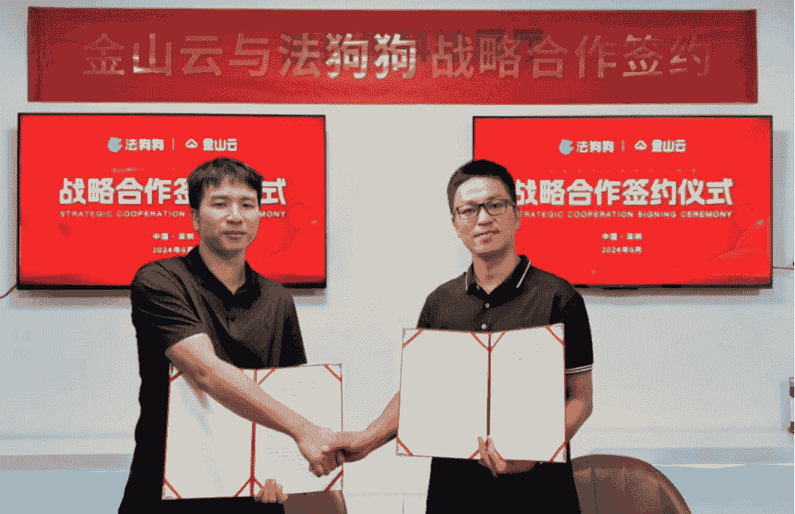
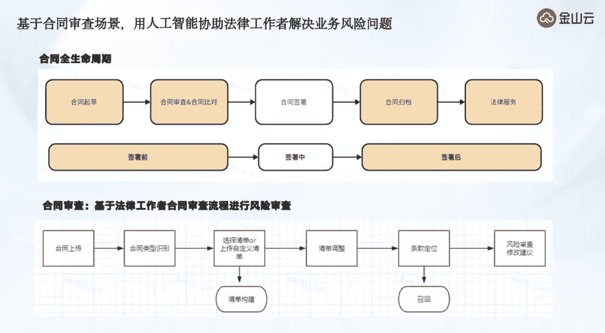
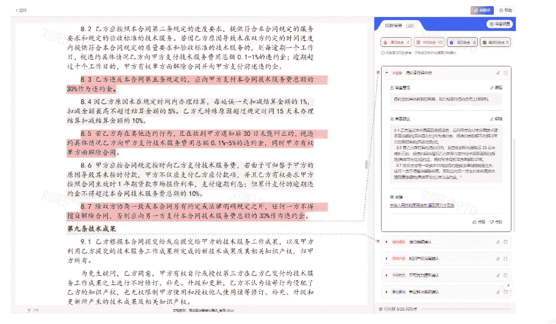
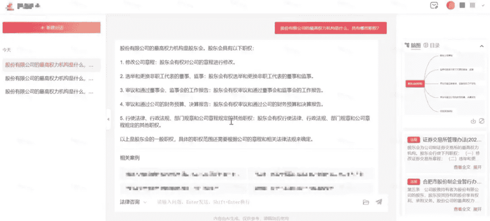
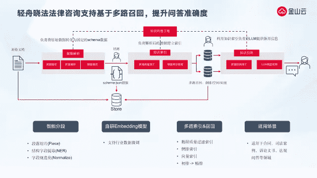
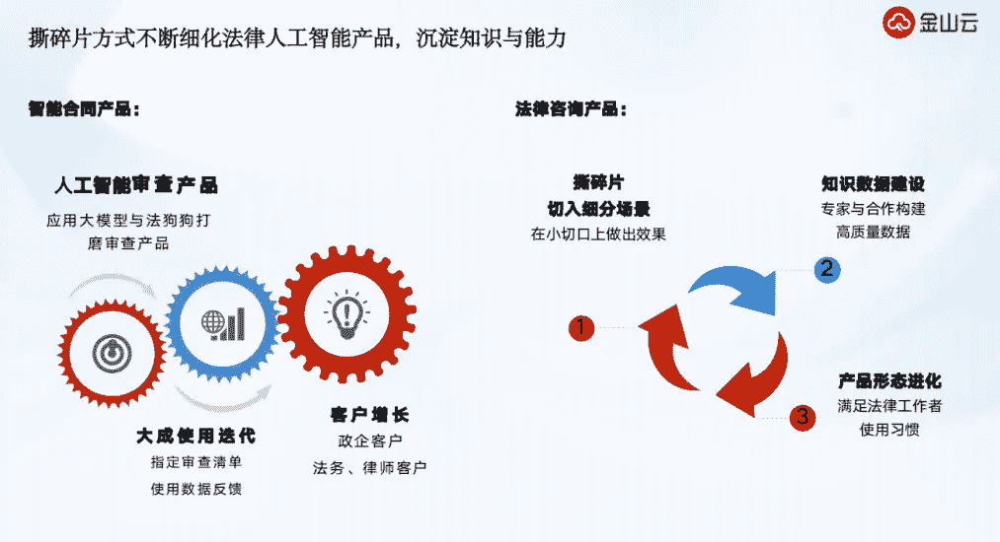
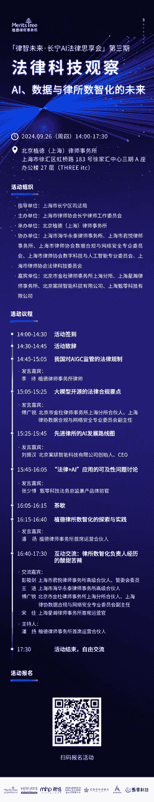
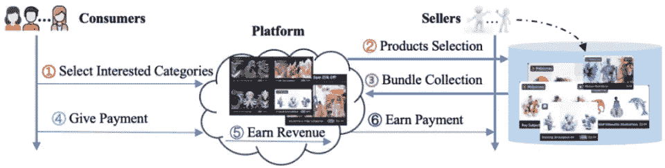

# 第三周｜September

> 来源：[https://docs.feishu.cn/docx/ObOLdPUE9ofOwDxdVdlcZfDPnWe](https://docs.feishu.cn/docx/ObOLdPUE9ofOwDxdVdlcZfDPnWe)

<https://legalstudio.feishu.cn/sync/Lk2tdJ9y6slPw3bGbFEcuRzvnpg>

# **一、法律科技资讯**

> 由于法律科技产品 + AI 能力已经成为主流，日报将减少同质化产品的动态推送，重点关注头部公司和创新产品。

> 本日报仅推送新闻简讯，如需阅读更详细的内[会员体系](https://e9w56z965d.feishu.cn/wiki/DLtSwmrQYibygZklZ4NcuuASnJg)，可订阅高级版知识库。了解更多 👉

## **法律 AI 前沿资讯**

### 乔治华盛顿大学法学院为联邦机构员工提供 AI 培训

近日，乔治华盛顿大学法学院宣布为联邦雇员提供 AI 培训。

据了解，这是人工智能实践社区（AI CoP）教育系列的一部分。该计划由美国联邦机构总务局（GSA）联合管理和预算办公室的联邦首席信息官办公室于 2020 年创立。AI CoP 为联邦、州和地方政府雇员网络提供关于 AI 技术和采用的指导和教育，致力于帮助满足《人工智能培训法》和拜登总统第 14110 号行政命令规定的要求。

### 最新调研：GCs 预计在 2025 年将有更多的预算，并重点投资法律 AI 人才

根据替代性法律服务服务商 Axiom 发布的《2025 年内部法律预算报告》，55% 的总法律顾问预计法律部门的预算将在 2024 年增加，而且明年这一数字将更高。同时，越来越多的总法律顾问及其首席财务官正在将资源重新分配到法律科技工具和高素质、具有成本效益的法律人才，比如那些具有法律 AI 技能和技术经验的人才。

此外，与过去几年不同，公司法律部门领导人将律师事务所列为 2025 年最低优先级的支出事项。预算分配正在从传统的律所转向创新、价值驱动的律所、灵活的法律人才和技术，以提高公司法律部门的生产力。

### 强强联合！金山云与法狗狗科技达成战略合作 共拓法律+人工智能新边界

日前，「金山云」与「法狗狗科技」达成战略合作，双方将围绕企业级服务市场，共同探索和打磨法律智能化服务应用，以推动法律实务与人工智能的深度融合。

作为业界知名的“人工智能+法律”高新技术企业，法狗狗科技已服务超过 300 家政府客户，各行业企业客户超过 100 家，旗下包括两大业务板块，其中智慧司法着力于为政府打造普惠的公共法律服务体系，智能文档专注于为客户提供智能可信的文档工作平台。

在本次战略合作中，金山云旗下「轻舟晓法」系列行业模型将为法狗狗()提供行业前沿的模型服务和算力支持。聚焦「智能合同审查」和「法律咨询」场景，金山云将为法狗狗提供法律大模型能力支持，为其新一代智能合同审查和法律咨询产品赋能。基于多年的技术积累和强大的技术能力，金山云将助力法狗狗科技解决法律与人工智能融合落地的“最后一公里”。

此外，金山云将依托金山集团 36 年的企业服务经验，在相关产品中深度集成法狗狗的文档智能产品和咨询产品，实现“让 AI 触手可及，解放企业生产力”的目标。

作为中国知名的独立云服务商，金山云严守中立定位，专注垂直领域探索行业模型落地，并携手行业伙伴、专家团队、数据厂商一起解决人工智能在行业落地过程中的难题，助力政府机构和企业的数智化转型。目前，金山云自研行业模型已经成功获得算法备案。

在数字化浪潮的推动下，法律服务行业正迎来前所未有的变革。金山云将与法狗狗一起推动法律服务效率和质量的提升，为整个社会的法治进程做出更大贡献。

金山云轻舟晓法产品优势

+   基于合同审查场景，用人工智能协助法律工作者解决业务风险问题

+   轻舟晓法-合同审查示意图

+   轻舟晓法-法律咨询产品，法律专业人士的知识沉淀、咨询与检索工具

+   轻舟晓法-法律咨询支持多路召回，可提升问答精准度

+   采用撕片式的方法不断细化法律人工智能产品，沉淀知识与能力

关于金山云轻舟晓法产品，可通过以下方式了解更多：📩 邮箱：chenmeng4@kingsoft.com

### Workday 将收购 Evisort，为财务和人力资源带来 AI 文档智能

9 月 17 日，企业管理云服务商 Workday 宣布已签署一项最终协议，即将收购合同生命周期管理（CLM）服务商 Evisort，这笔收购预计将在 Worday 的 2024 财政年度第三季度完成，该财年将于 10 月结束。

新闻稿称：“通过 Evisort，Workday 将在其财务和人力资源套件中添加 AI 驱动的文档智能解决方案。”

### 电子发现公司 Proteus 收购竞品 Novitas Data

9 月 17 日，总部位于印第安纳波利斯的电子发现服务和咨询公司 Proteus Discovery Group 宣布收购总部位于波特兰的电子发现提供商 Novitas Data。

## **传统法律科技资讯**

### 律师培训机构 Barbri 收购 SkillBurst，整合在线培训课程

9 月 18 日，律所培训机构 Barbri Global 宣布收购竞品 SkillBurst Interactive，进一步整合在线培训课程库，包括生成式 AI 相关培训。

### CRM 厂商 Nexl 将收购收入运营初创公司 Databall

9 月 16 日，CRM（客户关系管理）服务商 Nexl 宣布收购收入运营初创公司 Databall —— 该公司帮助客户弥补收入泄漏，并使用数据优化客户关系。据了解，这笔收购即将完成。

## **法律科技活动推荐**

### 律智未来·长宁 AI 法律思享会

📅 时间：9 月 26 日（周四）14:00 - 17:30

📍 地点：北京植德（上海）律师事务所

探索 AI、数据与律所数智化的未来，与行业专家共话法律科技新趋势，欢迎大家报名参加、共同交流！

### 幂律智能｜MeSpark 法律 AI 人才培养火种计划

幂律智能发起【MeSpark 法律 AI 人才培养火种计划】，通过「线下交流分享」&「长期实习体验」，号召并培养更多法律人共同参与法律科技发展浪潮。

> 拓展阅读：https://mp.weixin.qq.com/s/gLmlDspXthLr5frrMxcDiQ

# **二、大模型资讯**

## Around the World

### OpenAI ChatGPT 新增自动模式，基于提示词复杂度灵活选择合适 AI 模型

据报道，OpenAI 面向所有用户在多种设备上，为 ChatGPT 推出了“Auto”自动模式，用户切换选择 Auto 之后，会自动根据用户输入的提示词复杂程度，自动选择最合适的 AI 模型：对于复杂的提示，它会选用最先进的模型，而对于较简单的提示，则采用更快的模型以节省时间。许多用户反馈表示，在大多数情况下，他们更倾向于与最先进的模型进行交互。然而，在某些特定场景下，能够选择优化速度被视为一项有价值的功能。

> 来源：IT之家

## **东八区**

### 复旦大学针对提示词买方市场，提出一种新型提示词交易模式

近日，复旦大学多媒体与智能安全团队提出了一种创新的提示词交易（PBT）场景和在线定价机制，致力于实现消费者、平台和卖家的利润最大化。

### 阿里大规模开源，API 打一折

9 月 19 日，阿里巴巴开源基础模型 Qwen2.5、专用于编码的 Qwen2.5-Coder 和专注于数学的 Qwen2.5-Math。

这三大类模型一共有 10 多个版本，包括 0.5B、1.5B、3B、7B、14B、32B 和 72B，适用于个人、企业以及移动端、PC 等不同人群不同业务场景的模型。如果不想进行繁琐的部署，阿里还开放了旗舰模型 Qwen-Plus 和 Qwen-Turbo 的 API，帮助你快速开发或集成生成式 AI 功能。

> 拓展阅读：

> https://mp.weixin.qq.com/s/TAr-xZhsUqI4sI9JLo56hQ

> https://mp.weixin.qq.com/s/b5E34Z-6Jgp7mc1DZ8cM0Q

# **三、监管与观点**

## **AI 监管****/政策****动态**

暂无。

## **AI 观点/资讯**

### 比尔盖茨：如果不得不重新创业，会创办一家“以 AI 为中心”的初创公司，但可能不会像微软那样成功

近日，微软联合创始人比尔·盖茨在接受外媒专访时表示，如果不得不重新创业，他会以一个“以 AI 为中心”的初创公司加入 AI 竞赛。盖茨指出，他设想的初创公司可能不会像微软那样成功。

> 来源：腾讯科技

# **四、优质文章分享**

【法律 AI 交流群】每天都会分享法律 AI、法律科技相关的前沿信息，以下为群友分享的优质文章：

+   2024 年全球法律科技一手资讯，持续更新中：■■■■■■■□□□

+   2024 年第三十七期法律科技周报（9.9-9.15）

+   腾讯把我的公众号，变成了一个巨大的"数字生命"。

+   [月亮的事，问问@微信输入法](https://mp.weixin.qq.com/s/mDaLbytufz9cROq8jNxpJA)

+   [中秋佳节，AI与你共绘团圆画卷](https://mp.weixin.qq.com/s/mS-5irCg1MKZ3YwlNmnljg)

+   人类离AGI时代，又近了18个月

+   [o1 发布后，信息量最大的圆桌对话](https://mp.weixin.qq.com/s/FSiCYyc1W6CFCT_eCwVSsw)：杨植麟、姜大昕、朱军探讨大模型技术路径

+   [喝](https://mp.weixin.qq.com/s/_axu7EvsR66Unyt6CYX_rg)点VC｜a16z发布未来十年最容易被AI取代的50个职位：白领职位都将先拥有AI Copilot，再是AI Agent

+   [喝](https://mp.weixin.qq.com/s/J0ozP7nXn5yjSgKiOAMUKg)点VC | YC内部对话：人们尚未完全认识AI的深远影响，AI将首先投入于常见的简单用例，更多AI用例有待发掘

+   8月份AI应用月活盘点，离超级应用有多远？ChatGPT还有机会吗？

+   Claude Prompt：说文解字

+   [Claude工程师聊prompt：不要](https://mp.weixin.qq.com/s/3GbkY87snrj5ih1rXW2WUg)把模型当小孩子、不需要角色扮演、实话实说

+   [充分发挥司法的预防修复治理功能](https://mp.weixin.qq.com/s/8PiTLf0eUgmYlQTB2jMB2A)

> 注：与本周重要资讯相关的文章已整合到以上特定资讯下方，不在此处再次列出。

# **五、更多内容**

## 飞书×法律修音机：Legal Studio 法律科技智库，认识一下

近日，法律修音机正式推出 Legal Studio 法律科技智库，并上线「飞书官方社区」。

> 拓展阅读：

> 飞书×法律修音机：Legal Studio 法律科技智库，认识一下

> [Legal Studio 法律科技智库上线](https://mp.weixin.qq.com/s/dK2H3a7n2KxTa_w0Exbn6Q)「飞书官方社区」，免费订阅抽抖音文创🥳

> [法律科技公司项目库（持续更新）](https://legalstudio.feishu.cn/wiki/IsMrwljO5iLOn5kF2xUcBosonog)

> [法律科技活动事件库（持续更新）](https://legalstudio.feishu.cn/wiki/PoGWwXN39ieFSTkglXxcJx6Znub)

## 欢迎加入 Legal Studio 法律科技社区，跟上「AI+法律」最新趋势🪐

Legal Studio 法律科技社区，是法律修音机运营的一个社群，平时会分享交流 Al+法律、法律科技、大模型相关的前沿资讯和话题，欢迎感兴趣的朋友加入！

> 拓展阅读：

> [欢迎加入：Legal Studio 法律](https://mp.weixin.qq.com/s/8oaIE6pQFJkZ6rCakPVtQg)科技社区，跟上「AI+法律」最新趋势🪐

> 法律科技社区持续纳新中：飞书群正式组建，AI Agent 即将上线🤗