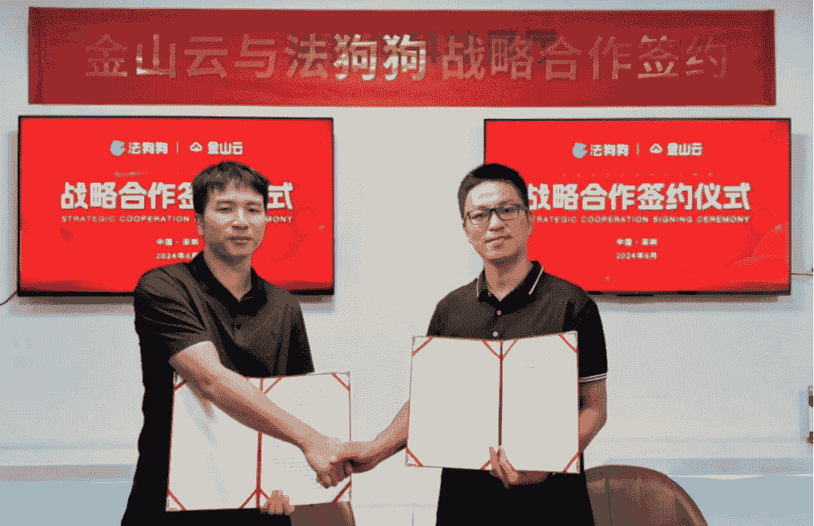
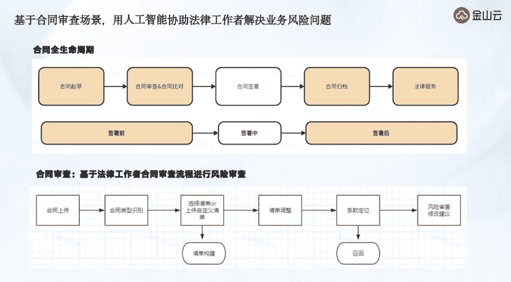
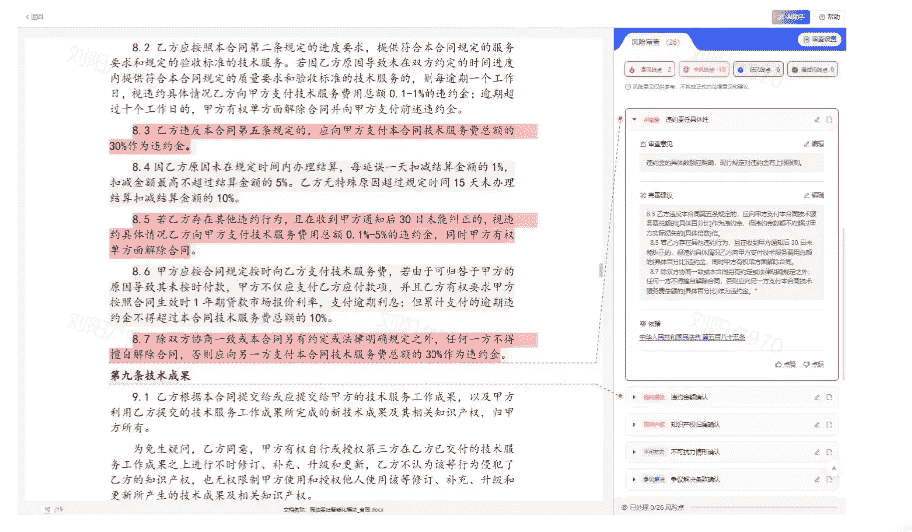
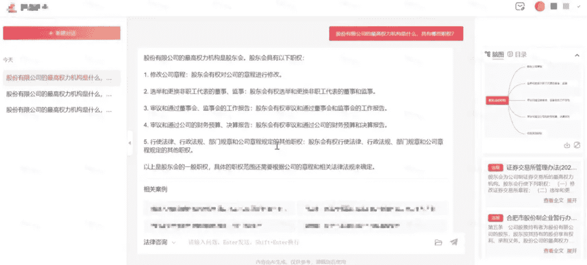
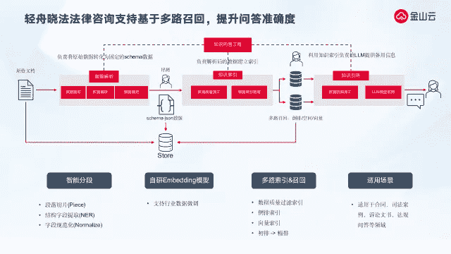
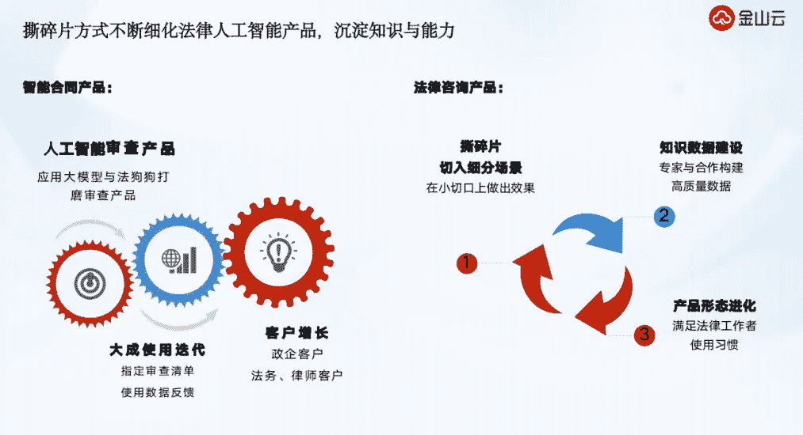

# 强强联合！金山云与法狗狗科技达成战略合作 共拓法律+人工智能新边界

> 来源：[https://docs.feishu.cn/docx/K9dhdKROJoOk7PxsMkVcqDxlnvd](https://docs.feishu.cn/docx/K9dhdKROJoOk7PxsMkVcqDxlnvd)

日前，「金山云」与「法狗狗科技」达成战略合作，双方将围绕企业级服务市场，共同探索和打磨法律智能化服务应用，以推动法律实务与人工智能的深度融合。

作为业界知名的“人工智能+法律”高新技术企业，法狗狗科技已服务超过 300 家政府客户，各行业企业客户超过 100 家，旗下包括两大业务板块，其中智慧司法着力于为政府打造普惠的公共法律服务体系，智能文档专注于为客户提供智能可信的文档工作平台。

在本次战略合作中，金山云旗下「轻舟晓法」系列行业模型将为法狗狗()提供行业前沿的模型服务和算力支持。聚焦「智能合同审查」和「法律咨询」场景，金山云将为法狗狗提供法律大模型能力支持，为其新一代智能合同审查和法律咨询产品赋能。基于多年的技术积累和强大的技术能力，金山云将助力法狗狗科技解决法律与人工智能融合落地的“最后一公里”。

此外，金山云将依托金山集团 36 年的企业服务经验，在相关产品中深度集成法狗狗的文档智能产品和咨询产品，实现“让 AI 触手可及，解放企业生产力”的目标。

作为中国知名的独立云服务商，金山云严守中立定位，专注垂直领域探索行业模型落地，并携手行业伙伴、专家团队、数据厂商一起解决人工智能在行业落地过程中的难题，助力政府机构和企业的数智化转型。目前，金山云自研行业模型已经成功获得算法备案。

在数字化浪潮的推动下，法律服务行业正迎来前所未有的变革。金山云将与法狗狗一起推动法律服务效率和质量的提升，为整个社会的法治进程做出更大贡献。

## **金山云轻舟晓法产品优势**

### 基于合同审查场景，用人工智能协助法律工作者解决业务风险问题

### 轻舟晓法-合同审查示意图

### 轻舟晓法-法律咨询产品，法律专业人士的知识沉淀、咨询与检索工具

### 轻舟晓法-法律咨询支持多路召回，可提升问答精准度

### 采用撕片式的方法不断细化法律人工智能产品，沉淀知识与能力

关于金山云轻舟晓法产品，可通过以下方式了解更多：📩 邮箱：chenmeng4@kingsoft.com