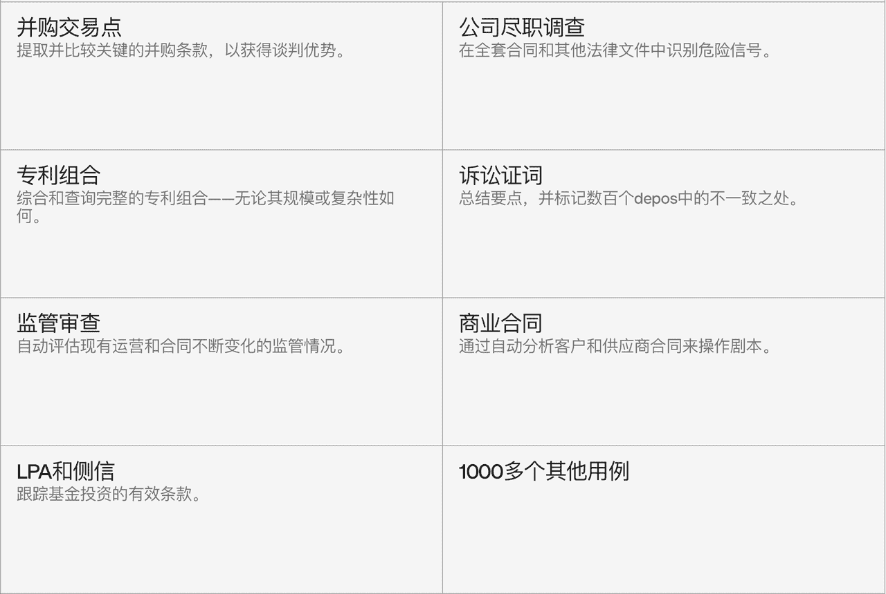
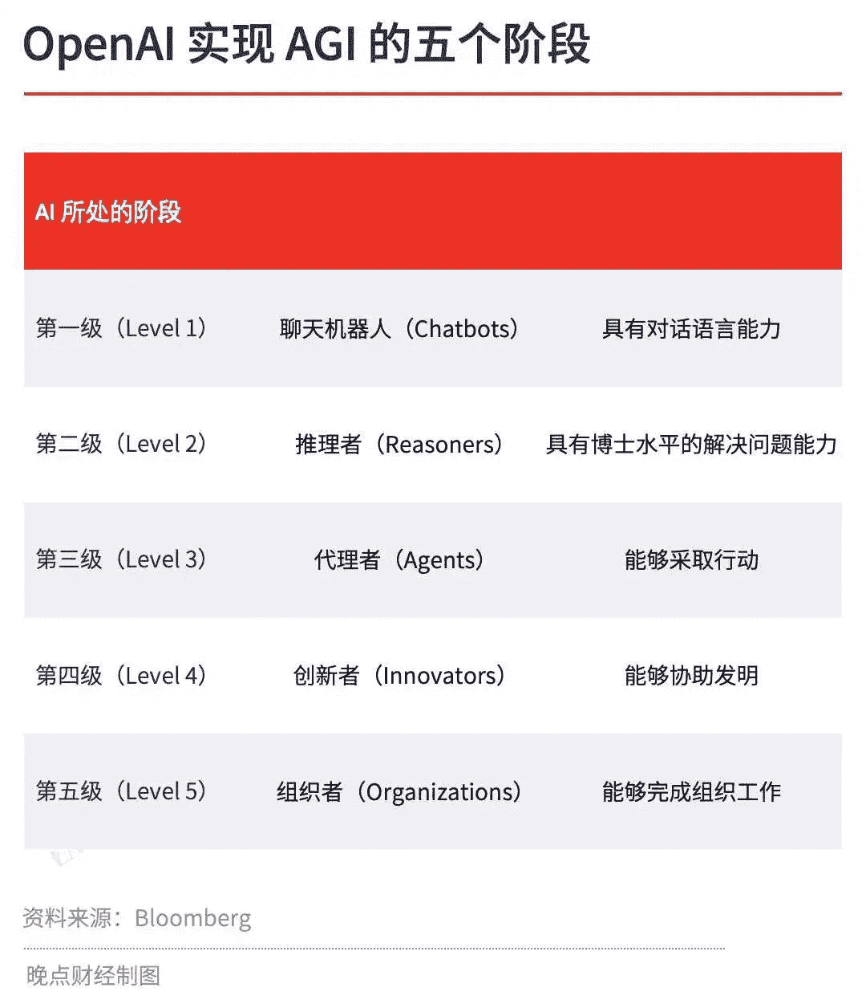

# 第二周｜July

> 来源：[https://docs.feishu.cn/docx/KwUqdiFcWoMhoCxzDAycBZYrnHf](https://docs.feishu.cn/docx/KwUqdiFcWoMhoCxzDAycBZYrnHf)

<https://legalstudio.feishu.cn/sync/Lk2tdJ9y6slPw3bGbFEcuRzvnpg>

# **一、法律科技资讯**

> 由于法律科技产品 + AI 能力已经成为主流，日报将减少同质化产品的动态推送，重点关注头部公司和创新产品。

> 本日报仅推送新闻简讯，如需阅读更详细的内[会员体系](https://e9w56z965d.feishu.cn/wiki/DLtSwmrQYibygZklZ4NcuuASnJg)，可订阅高级版知识库。了解更多 👉

## **法律 AI 前沿资讯**

### 贝恩最新调研：AI 没有达到法律行业的预期

6 月 20 日，Bain Research 发布了 2024 一季度的 AI 调查报告。调查显示，公司正在迅速采取行动，探索通过生成式 AI 来增强业务，其中大多数已经在开发或部署了相关工具。然而，许多受访者表示，AI 没有达到预期。

报告显示，只有 53% 的受访者表示，生成式 AI 用例“达到或超出了预期”，满意度自去年 10 月以来下降了 18%。其中，43% 的受访者表示，生成式 AI “无法以足够的性能完成必要的任务”，42% 的人表示“输出质量差”，38% 的受访者表示，他们无法理解如何使用生成式 AI 工具，29% 的人将他们认为供应商及其产品的“低质量”。

相反，AI 在销售、软件开发、营销和客户服务等领域表现得更好，这些业务部门都表示对 AI 的满意度有所提高。

### 一个法律 AI 社区在 HuggingFace 上推出，还开源了一些「法律数据集」

7 月初，法国数据分析师兼法学生 Louis Brulé Naudet 在开源平台 HuggingFace 上成立了一个法律专业人士社区。

这个社区称为 HF for Legal，任务副标题为“打破法律专业人士语言模式的不透明度”，目前已经吸引了 51 名成员 —— 从数据科学家到法律技术企业家，再到律师和律师事务所知识官员。

事实上，随着生成式 AI 在法律科技市场上变得无处不在，以及律师事务所使用它来创新，人们对了解这项技术是如何工作的越来越感兴趣。例如，工具训练的数据集是什么？它的基准是什么？哪种模型最适合哪项任务？HF for Legal 旨在帮助回答其中一些问题，甚至可能促使法律专家合作构建技术。

> HF for Legal 地址：https://huggingface.co/HFforLegal

> 法律数据集地址：https://huggingface.co/datasets/HFforLegal/laws

> 拓展阅读：[一个法律 AI 社区在 HuggingFa](https://mp.weixin.qq.com/s/cHwW_BPQfiV7niID0w45jw)ce 上推出，还开源了一些「法律数据集」

### 自动化计时工具 PointOne 完成 350 万美元种子轮融资

7 月 10 日，自动化法律计时计费工具 PointOne 宣布完成 350 万美元种子轮融资，Bessemer Venture Partners、General Catalyst、Y Combinator 和隶属于 Cooley 律师事务所的投资基金等参与其中。

PointOne 于 2023 年 10 月正式启动，并参加了 Y Combinator 今年的冬季创业营。该公司除了提供自动计时计费功能，还训练了一个 AI 系统，支持搜索与客户账单时相关的所有常见问题。

### 网络安全初创公司 Cytactic 完成 1600 万美元种子轮融资

7 月 9 日，网络危机管理平台 Cytactic 宣布完成 1600 万美元种子轮融资，Evolution Equity Partners 领投。

Cytactic 总部位于以色列，由以色列律师事务所 Herzog, Fox & Ne'eman 的前合伙人兼技术监管主管 Nimrod Kozlovski 于 2022 年创立，专注于集中和管理组织的网络事件响应，并与律师事务所密切合作。这个业务通常可能涉及多个利益相关者，包括法律和隐私团队，以及各种任务，从恢复数据到遵守数据泄露法规。

### Legaltech Hub 收购 Legal Tech Consultants，扩展法律科技咨询服务

7 月 9 日，法律科技咨询服务商 Legaltech Hub 宣布收购了 Legal Tech Consultants，一家帮助早期法律科技初创公司的公司。作为收购的一部分，Legal Tech Consultants 的创始人兼首席执行官 Cheryl Wilson Griffin 将加入 Legaltech Hub，担任新的供应商咨询副总裁，发展公司的咨询和内容产品。

### AI 知识工作平台 Hebbia 完成 1.3 亿美元 B 轮融资，包括大量法律领域用例

7 月 8 日，AI 知识搜索公司 Hebbia 宣布完成 1.3 亿美元 B 轮融资，投资人包括 Andreessen Horowitz、Index Ventures、Google Ventures 和亿万富翁 Peter Thiel。

Hebbia 成立于 2020 年，利用 AI 技术帮助企业筛选各种文件以回答复杂问题。目前，Hebbia 经在全球领先的资产管理公司、律师事务所、银行和财富 100 强公司进行了大规模部署。

其中，Hebbia 在官网列举了以下“法律”相关的用例：

### 300000000$！2024 年 Q2，31 家法律科技公司融资 22 个小目标

2024 年第二季度（4-6 月），风险投资继续涌入法律科技赛道。据不完全统计，二季度至少有 31 家法律科技公司获得新一轮融资，加上一季度 17 家，2024 上半年的融资数据已经追平 2023 全年（48 家）。

从融资金额上看，二季度 31 家法律科技公司共完成超过 3 亿美元融资，加上一季度 2 亿美元，2024 上半年法律科技赛道共完成 5 亿美元融资，大约 36 个“小目标”。

> 拓展阅读：

> [300000000$！2024 年 Q2，](https://mp.weixin.qq.com/s/8Kv1lG3BP-BzaiZZ2dscbw)31 家法律科技公司融资 22 个小目标

> 【融资】2024 年 Q2 法律科技融资新闻汇总

## **传统法律科技资讯**

暂无。

## **法律科技活动推荐**

### 植德律所：“智能时代下的法律服务与数智化律所建设”论坛

科技飞速发展，AI 在法律服务中的应用愈发重要。植德律师事务所诚挚邀请您参加 7 月 19 日下午于上海举办的“智能时代下的法律服务与数智化律所建设”论坛。

**活动时间：**7 月 19 日（周五）13:30-17:30

**活动地点：**植德上海办公室 （上海市徐汇区虹桥路 183 号徐家汇中心三期 A 座办公楼）

> 拓展阅读：https://mp.weixin.qq.com/s/2MVj-Kimro65bwoR4YLWRg

### 法律修音机：在「新流量」和「AI 浪潮」之下，想开一家新型律师事务所

在新流量和 AI 浪潮下，我们打算开一家新型的律所：前端拥抱新流量获客，中端优化谈案效率，后端律师交付，并通过法律科技工具提效，用技术全面改造。

> 拓展阅读：https://mp.weixin.qq.com/s/7CbW0CG0Qxx-x21pMdLGJA

### 飞书×法律修音机：Legal Studio 法律科技智库，认识一下

近日，法律修音机正式推出 Legal Studio 法律科技智库，并上线「飞书官方社区」。

> 拓展阅读：

> 飞书×法律修音机：Legal Studio 法律科技智库，认识一下

> [Legal Studio 法律科技智库上线](https://mp.weixin.qq.com/s/dK2H3a7n2KxTa_w0Exbn6Q)「飞书官方社区」，免费订阅抽抖音文创🥳

> [法律科技公司项目库（持续更新）](https://legalstudio.feishu.cn/wiki/IsMrwljO5iLOn5kF2xUcBosonog)

> [法律科技活动事件库（持续更新）](https://legalstudio.feishu.cn/wiki/PoGWwXN39ieFSTkglXxcJx6Znub)

### 欢迎加入 Legal Studio 法律科技社区，跟上「AI+法律」最新趋势🪐

Legal Studio 法律科技社区，是法律修音机运营的一个社群，平时会分享交流 Al+法律、法律科技、大模型相关的前沿资讯和话题，欢迎感兴趣的朋友加入！

> 拓展阅读：

> [欢迎加入：Legal Studio 法律](https://mp.weixin.qq.com/s/8oaIE6pQFJkZ6rCakPVtQg)科技社区，跟上「AI+法律」最新趋势🪐

> 法律科技社区持续纳新中：飞书群正式组建，AI Agent 即将上线🤗

# **二、大模型资讯**

## Around the World

### OpenAI 把 AGI 分为 5 个阶段，称自己还在第一阶段

OpenAI 近期向媒体透露，公司内部已制定实现 AGI 的路线图，分为 5 个阶段，从基础的聊天机器人开始，发展到能够执行复杂组织工作的智能体。在有了情感更丰富的 GPT-4o 后，OpenAI 仍认为公司处于 AGI 初级阶段，即仅实现可以与人类进行语言互动的 AI。

不过在一次内部会议上，OpenAI 展示了一项 GPT-4 模型的研究，认为其[已](https://mp.weixin.qq.com/s?__biz=MzU0OTAwNjE4Nw==&mid=2247509862&idx=1&sn=f19067e2aedcdb984dff4ee53fa214b1&scene=21#wechat_redirect)具备一些接近人类水平的推理能力，并接近第二阶段，即具有博士水平的解决问题能力。这与 CTO 米拉·穆拉蒂（Mira Murati）  6 月底对 GPT-5 的能力描述相似。她当时预计，达到这一水平还需要 18 个月。

OpenAI 以实现 AGI 为目标。它曾以实用性的角度理解 AGI ，即“在最具经济价值的工作中，表现优于人类的高度自主系统”。在 CEO 阿尔特曼看来，AGI 是一位中等水平的人类雇员，能够学习和掌握新技能。但这样的定义始终较为模糊，也无法给出实现 AGI 的具体时间表。

通过五个阶段的划分，可以更准确地预测 AI 追赶人类的进程。OpenAI 曾承诺，一旦发现其他项目更有前景，而且在未来两年内实现 AGI 的成功概率过半，将停止与其竞争并转而支持该项目。如今，OpenAI 可以测试自己和竞争对手所处的阶段，以便更清楚地确定何时实现 AGI。

去年底，阿尔特曼曾预计 AGI 将会在四五年内实现。但一种看法是，AI 达到人类水平的推理能力是最关键的一步，代理、创新和组织能力则是在此基础之上的加成。此前，黄仁勋在介绍英伟达旗下 NIM 软件平台时表示，平台上运行着多种预训练的 AI 模型，可以将其作为代理执行任务，也可以将不同代理组合成团队共同解决问题。

此外，随着参数量增加，实现 AGI 的训练成本将大幅上升。GPT-3 一次训练成本约为 130 万美元，而 GPT-4 一次训练成本已高达约 6300 万美元。对于尚未发布的 GPT-5，有消息称其耗资将在 20 亿美元至 25 亿美元之间。

> 拓展阅读：https://mp.weixin.qq.com/s/zbmDdaokEQ6RP3f5VqnDcQ

### 亚马逊云深夜放大招：几分钟，纯靠 Prompt 打造一个 App！

现在开发一个 APP 需要多久？“云计算一哥”亚马逊云科技，深夜给出了一个新标准 ——

只需三步，几分钟，纯靠自然语言和鼠标“点点点”即可。

> 拓展阅读：https://mp.weixin.qq.com/s/kRxGmKCP_P0XE6SN6B58kg

### 人人可做提示工程师！Claude 上新：一键生成、测试和评估 prompt

在构建 AI 应用时，prompt（提示词）的质量对结果有着重大影响，但制作高质量的 prompt 具有很大的挑战性，需要研究者深入了解应用需求，并具备大模型方面的专业知识。

为了加快开发速度并改善结果，Anthropic 简化了此流程，可以让用户更轻松地制作高质量的 prompt。具体来说，研究者为 Anthropic Console 添加了新功能，可以生成、测试和评估 prompt。

Anthropic 提示工程师 Alex Albert 表示：这是他们过去几周投入了大量工作才得到的成果，现在 Claud 在提示工程（Prompt Engineering）方面表现得非常好。

> 拓展阅读：

> https://mp.weixin.qq.com/s/KL40M1bR3EPlAGWYYEghCg

> https://mp.weixin.qq.com/s/_D52RECvwuZnSgwvyo0j5w

## **东八区**

### 腾讯智影小程序上线 AI 视频功能，限时免费一键生成风格化视频

此功能限时免费（未公布收费价格）。视频风格化就是在原视频的基础上进行风格化处理，只需导入视频并一键“变身”，就能快速生成风格化视频（支持 10s 视频），智影 AI 提供了多种模板。

> 拓展阅读：https://mp.weixin.qq.com/s/CMFrKvv3wbF-GvYtMMXWJw

### 金山办公发布WPS AI 2.0，为个人用户新增四个 AI 办公助手

7 月 5 日，金山办公在上海世博中心“探索 AI 办公最佳实践”主题论坛现场发布 WPS AI 2.0，并推出政务自研模型 —— 金山政务办公模型 1.0。WPS AI 是金山办公旗下基于大模型的人工智能办公助手，在 2023 年 11 月开启公测，锚定 AIGC（内容创作）、Copilot（智慧助理）、Insight（知识洞察）三个方向发展。

此次大会上，WPS AI 演示了升级后为个人用户新增的 4 个 AI 办公助手，分别是：AI 写作助手、AI 阅读助手、AI 数据助手、AI 设计助手。同时，金山办公首次公开了 13B 级别的政务自研模型 —— 金山政务办公模型 1.0。

今年六月，WPS AI 政务版已协助浦东地区完成电子公文库的搭建，部分单位已进入使用阶段。

> 拓展阅读：

> https://mp.weixin.qq.com/s/furd1BWlHcAqs9QNaohnGw

> https://mp.weixin.qq.com/s/cqoq0UuSK1pZkl1sZCLGcw

# **三、监管与观点**

## **AI 监管****/政策****动态**

暂无。

## **AI 观点/资讯**

### Gartner 报告称，64% 受访者不希望客服系统部署 AI

7 月 9 日，市场调查机构 Gartner 发布的一份调查报告表示，64% 的受访客户不希望客服使用 AI，53% 的客户则表示，如果发现某家公司的客服使用 AI，会考虑转向竞争对手。其中的原因是，客户认为客服系统引入 AI 之后，联系到人工客服变得更加困难，另一方面的担忧是 AI 提供错误答案。

> 拓展阅读：https://www.gartner.com/en/newsroom/press-releases/2024-07-09-gartner-survey-finds-64-percent-of-customers-would-prefer-that-companies-didnt-use-ai-for-customer-service

### 中科院院士领衔推出大模型的第 3 种记忆

近日，中科院院士鄂维南领导的上海算法创新研究院团队，提出了一种新型大模型记忆格式 Memory， 更加高效和成本更低。该模型受人脑记忆机制启发，区分显式记忆、隐式记忆和外部信息三种记忆形式，并应用于大模型中。

实验结果表明，Memory 模型在推理速度、减少 “幻觉” 问题以及在专业领域任务上的表现均优于传统 RAG 方法。此外，Memory 模型在 HuggingFace 排行榜上的评测结果显示，显式记忆的引入提高了平均分数 2.51%，有效地提升了模型的性能。

> 论文：https://arxiv.org/abs/2407.01178

### 中国工程院院士邬贺铨：原有互联网业务值得用 AI 再造

在 2024 中国互联网大会上，中国工程院院士邬贺铨强调了 AI 在互联网业态创新中的重要性。他认为，随着“5G-A+IPv6”和 AI 大模型的发展，互联网业务值得用 AI 重新塑造，以促进产业数字化和数字产业化。AI 将为平台经济带来新动能，互联网平台成为 AI 赋能消费和行业应用的关键。

> 来源：财联社

### AIGC 对新闻业最大的意义，是生产边角料

2023 年 8 月，针对生成式 AI 对新闻业的冲击与影响，本条资讯的作者发布了《拐点时刻？AIGC 时代的新闻业》报告，引起了一些关注，许多传统媒体的负责人找来交流，有纸媒，也有电视台。

对此，作者提出一个观点：AIGC 对新闻业最大的意义，就是生产边角料。很多人看到这个观点会有所质疑，觉得是矮化了 AIGC 的作用。大模型、生成式 AI 这么高端的概念，这么前沿的技术，竟然只能用来生产边角料？而作者的第二个观点就是：不要小看边角料，边角料可能才是未来新闻业在全媒体时代竞争的核心。

> 拓展阅读：https://mp.weixin.qq.com/s/z1Tr2Gd4VFDfKnScyizkZw

### AI 罗永浩评 10 年前与王自如“约架”

有媒体向智谱的数字员工 AI 老罗提问还记得王自如吗？AI 老罗表示：“可别提了，让我想起的都是些不愉快的事，我们俩在直播辩论的时候，他那个所谓的客观独立第三方的评测，简直让人笑掉大牙。我可是为了真理和正义而战，他只会躲在数据后面，不敢正面回应，这种对手不提也罢。”

> 来源：雷峰网

# **四、优质文章分享**

【法律 AI 交流群】每天都会分享法律 AI、法律科技相关的前沿信息，以下为群友分享的优质文章：

+   离职半年，我参与的一些法律科技项目，同时也看看新的机会

+   2024 年第二十七期法律科技周报（7.1-7.7）

+   观韬视点 | 迎接AI时代到来，法律AI合同审查操作指南（第一版）

+   省律协在珠海召开法律AI探索大会

+   【AI另类派】训练营成GTM利器，AI新平台驱动业绩和股价大涨

+   我在AI教育前沿的旅程 | 盖茨笔记

+   大模型真实速度一览（附：测试脚本）

> 注：与本周重要资讯相关的文章已整合到以上特定资讯下方，不在此处再次列出。