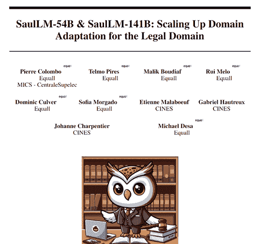

# 第五周｜July

> 来源：[https://docs.feishu.cn/docx/Ln0HdCNPTolW8Sxrq76cijsbn4f](https://docs.feishu.cn/docx/Ln0HdCNPTolW8Sxrq76cijsbn4f)

<https://legalstudio.feishu.cn/sync/Lk2tdJ9y6slPw3bGbFEcuRzvnpg>

# **一、法律科技资讯**

> 由于法律科技产品 + AI 能力已经成为主流，日报将减少同质化产品的动态推送，重点关注头部公司和创新产品。

> 本日报仅推送新闻简讯，如需阅读更详细的内[会员体系](https://e9w56z965d.feishu.cn/wiki/DLtSwmrQYibygZklZ4NcuuASnJg)，可订阅高级版知识库。了解更多 👉

## **法律 AI 前沿资讯**

### 法国高等教育计算中心、巴黎萨克雷大学发布两个法律模型，最高 1410 亿参数

7 月，法国高等教育计算中心、巴黎萨克雷大学的研究人员联合开源了专用于法律领域的大模型：SaulLM。

SaulLM 模型共有 540 亿、1410 亿两种参数，以及基础模型和指令微调两种版本。

SaulLM 的最大特色是使用了 5400 亿 token 的专业法律数据进行了预训练，包括美国、欧洲、澳大利亚等地的法律文本，输出内容的准确率高于很多同类模型。

> 拓展阅读：5400 亿 token 专业法律数据！又双叒叕出现一个“法律大模型”

> 论文地址：https://arxiv.org/pdf/2407.19584

> 开源地址：https://huggingface.co/Equall/SaulLM-54-Base

> 指令微调：https://huggingface.co/Equall/SaulLM-141B-Instruct

### 法律科技初创公司 Definely 获得 Innovate UK 58.5 万英镑赠款

7 月 31 日，法律科技初创公司 Definely 宣布获得英国创新机构 Innovate UK 的 58.5 万英镑赠款，支持开发新的生成式 AI 产品，旨在简化法律文件中的信息访问和理解。据了解，Innovate UK 是英国研究和创新的一部分，是英国的创新机构。他们通过新产品、流程和服务的开发和商业化帮助英国企业成长。

### Legaltech Hub 发布「尽职调查自动化」细分赛道竞争分析报告

7 月 30 日，法律科技解决方案、工具和服务全球目录服务商 Legaltech Hub（LTH）发布法律科技服务商类别竞争分析系列中的第二个。本期分析「尽职调查自动化服务商」。

> 拓展阅读：[🫵Harvey 上榜！Legaltech Hu](https://mp.weixin.qq.com/s/yv5aMasn5ADzyuNz_mcG0g)b 发布「尽调自动化」赛道竞争分析报告

### 法律 AI 初创公司 Paxton AI 推出 AI 置信度指标，提高透明度

7 月 30 日，法律 AI 初创公司 Paxton AI 宣布其产品在斯坦福法律幻觉基准任务上实现了 93.82% 的平均准确率，并推出一个新的置信度指标，旨在帮助用户评估 AI 输出的可靠性。

### 法律科技初创公司 DecoverAI 完成 200 万美元种子轮融资

7 月 30 日，法律科技初创公司 DecoverAI 宣布完成 200 万美元种子轮融资，Leo Capital 领投。据悉，该公司正在开发一个 AI 系统，旨在支持现实世界的法律任务，比如证据发现、法律研究和战略制定等。

### 美国律师协会发布首个关于律师使用 AI 工具的指南

7 月 29 日，美国律师协会（ABA）的道德和专业责任常设委员会发布了一份关于使用人工智能的正式意见，敦促律师注意几项示范规则，包括与能力、通信、保密和费用有关的规则。该意见确定了一些涉及使用生成式 AI 工具的伦理问题，并为试图驾驭这一新兴格局的律师提供指导。

## **传统法律科技资讯**

### 合规隐私平台 SafeGuard Privacy 完成 360 万美元新一轮融资

7 月 31 日，合规隐私平台 SafeGuard Privacy 宣布完成 360 万美元新一轮融资，为公司法务和其他团队服务。

### Litera 收购 FileTrail，扩大 GRC 治理能力

7 月 29 日，法律科技公司 Litera 宣布收购信息治理和记录管理提供商 FileTrail，向信息治理领域的扩张，并将为 Litera 的产品套件添加一系列法律工具，为律师事务所和公司构建治理、风险和合规（GRC）能力。

## **法律科技活动推荐**

无。

# **二、大模型资讯**

## Around the World

### Midjourney 大更新，细节最强文本生图片模型来啦

近日，著名文生图平台 Midjourney 正式发布了 V6.1 版本，本次对生成内容的细节、连贯性、图片质量、个性化等进行了大量更新，再一次成为行业标杆。其中，细节成为本次的重点，对之前经常出现问题的眼睛、睫毛、瞳孔、腿、手臂、手指关节、表情神态等进行了纠正，在生成质量和文本语义还原方面更好。

> 拓展阅读：https://mp.weixin.qq.com/s/56owp9ZmCH9AIGhnIOH7Yw

### 微软 AI 产品最新数据，15 年甚至更久才能回收 AI 投资受质疑

微软 2024 财年收官，尽管披露了 AI 产品用户量的增速，但大多数收入并未披露，显然没有达到投资人的预期。

其中，微软最新财季营收同比+15%，但在资本开支大幅走高的趋势下，净利润增速放缓至同比+10%（上个季度是 20%）。2024 财年的 4 个季度，资本开支分别为 120/115/140/190 亿美元，云和 AI 相关支出构成了资本支出的全部。微软同时给出了 25 财年资本开支将继续走高的指引，加大基础设施投资，而这些投入将在 15 年甚至更长时间才能收到回报，这成为华尔街质疑的核心：

+   生成式 AI 在高期望和现实之间历经起伏，Azure 和 Office365 的增长尚未完全显现

+   如果放缓资本支出，云和 AI 还能保持与现在一致的增长率吗

+   AI 领域所有投资对利润率短期和长期的影响

> 拓展阅读：https://mp.weixin.qq.com/s/eU6V7voje8ysVtugMxhZKQ

### OpenAI 推出 ChatGPT 高级语音模式，Plus 用户率先体验 GPT-4o 超逼真语音交互

7 月 30 日，OpenAI 推出了 ChatGPT 高级语音模式，用户首次能够体验 GPT-4o 超逼真语音交互。目前，Alpha 版本面向于小部分 ChatGPT Plus 用户，秋季之后将逐步推广至所有 Plus 用户。

> 拓展阅读：

> https://mp.weixin.qq.com/s/3RTtiYtbc4Jza0kwjJpa9w

> https://mp.weixin.qq.com/s/DPeiAA9AqSg8VwBkC-qtPg

> https://mp.weixin.qq.com/s/6xBKw6l6kEMi7_9TlbOOHg

## **东八区**

### 360 牵头推出 CoE 混合模型架构

近日，360 牵头推出 CoE 混合模型架构，该架构通过整合多个大模型的优势，针对不同任务调用合适的模型进行回答。360 已将该架构应用于其 AI 搜索服务，并提供了一个 AI 助手，使用户能够使用多个国产大模型。

> 拓展阅读：https://mp.weixin.qq.com/s/sVwuzRvfXvZhG1tutal1fQ

### 阿里巴巴免费开放通义奥运 AI 大模型

近日，阿里通义宣布免费开放奥运 AI 大模型。

该模型具备奥运专业知识与翻译功能。即日起用户可以在通义 App 免费使用。今年，巴黎奥运会是 AI 应用最广泛的一届奥运会。阿里巴巴的云计算和 AI 技术，正在全面支撑奥运转播和赛事运营。

> 来源：雷峰网

### Kimi 推出 AI 做 PPT 能力

7 月 30 日，Kimi 智能助手联合 AIPPT.cn 推出 AIPPT 功能。

> 拓展阅读：https://mp.weixin.qq.com/s/nco2ZpYA50OgnhTetI-fFA

### 智谱华章获得浙江华策投资战略投资

近日，智谱华章宣布获得浙江华策投资有限公司的战略投资。华策影视全资子公司华策投资拟与海南智桥共同设立盐城智华创业投资基金，华策投资以自有资金出资 1 亿元，占比 99.99%，盐城智华将直接或间接投资于北京智谱华章科技有限公司股权。双方将在本次投资的基础上，联合开发影视内容生成智能体以及影视内容审查垂直模型；联合打造国内影视领域 AI 领军研究平台，共同推动双方联合推出的文生视频标准成为行业应用的标准。

> 来源：雷峰网

# **三、监管与观点**

## **AI 监管****/政策****动态**

无。

## **AI 观点/资讯**

### 最新研究：AI 或导致拉丁美洲多达 5% 工作岗位流失

国际劳工组织和世界银行最新发布的报告显示，拉丁美洲和加勒比地区的就业市场可能面临人工智能（AI）的双重挑战与机遇。报告指出，该地区 2% 至 5% 的工作岗位面临着被 AI 完全自动化的风险，尤其是正规部门的女性和年轻工人，他们的工作被 AI 取代的风险更大。这一发现凸显了该地区作为世界上最不平等之一地区的潜在负担，由于非正规经济中普遍存在的低薪工作，该地区的工人可能更加脆弱。然而，报告同时指出，数字基础设施的差距和其他不平等现象也可能会限制 AI 在该地区的潜在影响。

> 来源：集微网

### Perplexity 联合创始人兼产品负责人 Johnny Ho，揭秘如何用 AI 建立公司

Perplexity 是一家成立不到两年的 AI 公司，员工不到 50 人，用户数已达到数千万，且年收入超过 2000 万美元。最近，Perplexity 完成了 6300 万美元的融资，估值超过 10 亿美元，Nvidia、Jeff Bezos 等知名投资者入局。

Perplexity 的产品开发方法，包括利用 AI 进行产品管理、类似黏菌霉菌的组织结构、小团队、少量管理人员以及对产品经理未来价值的预测。鼓励员工先通过 AI 解决问题。Perplexity 的团队通常只有两到三个人，甚至有些项目如播客由一人独立完成。公司倾向于聘请自我驱动的个人，而不是强调管理能力的人选。

Perplexity 使用 AI 工具来构建其产品，尽管在编码方面的应用有限，但在产品管理和决策方面非常有效。公司只有两名全职产品经理，项目通常由一到两人完成，最多不超过四人。产品经理的主要工作，是对使用案例进行判断和优先级排序，以及根据数据和用户研究做出决策。

Perplexity 的团队结构旨在最小化协调成本，通过共享可重用的指南和流程来并行化项目。公司使用 AI 进行 “橡皮鸭调试”，以减少对完美一致和共识的依赖。Perplexity 制定了季度计划，并在产品路线图中保持灵活性，以适应 AI 领域的快速变化。公司的决策过程相对去中心化，项目由单一的责任人驱动，并尽可能并行化执行步骤。Perplexity 的产品开发成功依赖于将反馈 distill 成直观的产品，并赋予团队成员控制决策的权力，以便快速迭代。

> 来源：https://www.lennysnewsletter.com/p/how-perplexity-builds-product

# **四、优质文章分享**

【法律 AI 交流群】每天都会分享法律 AI、法律科技相关的前沿信息，以下为群友分享的优质文章：

+   2024 年第三十期法律科技周报（7.22-7.28）

+   [风起云涌！2024 上半年全球法律](https://mp.weixin.qq.com/s/3h3sTdJlDJOa5kUtGyLZnw)科技融资和并购数据，已超 2023 全年

+   [参加完 B 站法律 UP 主交流](https://mp.weixin.qq.com/s/7dqsTCDToC51OM7w2vxi-A)活动，我确信很多法律 MCN 真的没啥用

+   真正通过 AI 和新媒体赚到钱的，是 85 后的律师

+   [AI Assist成史上增长最快新品，S](https://mp.weixin.qq.com/s/10BysFSzn90soyIa9Vh4XA)aaS巨头新定位"企业业务转型AI平台"

+   [Kimi上线了做PPT的功能，于](https://mp.weixin.qq.com/s/hTJ_vJycmg7F0WRfluY1GA)是我又连夜测了18款AI做PPT的产品。

> 注：与本周重要资讯相关的文章已整合到以上特定资讯下方，不在此处再次列出。

# **五、更多内容**

## 飞书×法律修音机：Legal Studio 法律科技智库，认识一下

近日，法律修音机正式推出 Legal Studio 法律科技智库，并上线「飞书官方社区」。

> 拓展阅读：

> 飞书×法律修音机：Legal Studio 法律科技智库，认识一下

> [Legal Studio 法律科技智库上线](https://mp.weixin.qq.com/s/dK2H3a7n2KxTa_w0Exbn6Q)「飞书官方社区」，免费订阅抽抖音文创🥳

> [法律科技公司项目库（持续更新）](https://legalstudio.feishu.cn/wiki/IsMrwljO5iLOn5kF2xUcBosonog)

> [法律科技活动事件库（持续更新）](https://legalstudio.feishu.cn/wiki/PoGWwXN39ieFSTkglXxcJx6Znub)

## 欢迎加入 Legal Studio 法律科技社区，跟上「AI+法律」最新趋势🪐

Legal Studio 法律科技社区，是法律修音机运营的一个社群，平时会分享交流 Al+法律、法律科技、大模型相关的前沿资讯和话题，欢迎感兴趣的朋友加入！

> 拓展阅读：

> [欢迎加入：Legal Studio 法律](https://mp.weixin.qq.com/s/8oaIE6pQFJkZ6rCakPVtQg)科技社区，跟上「AI+法律」最新趋势🪐

> 法律科技社区持续纳新中：飞书群正式组建，AI Agent 即将上线🤗