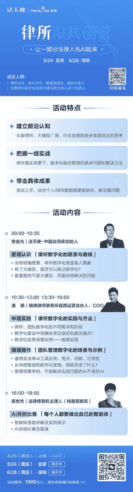

# 第一周｜June

> 来源：[https://docs.feishu.cn/docx/TcwxdIPPyojZGPxIkIBcGX66nBb](https://docs.feishu.cn/docx/TcwxdIPPyojZGPxIkIBcGX66nBb)

<https://legalstudio.feishu.cn/sync/Lk2tdJ9y6slPw3bGbFEcuRzvnpg>

# **一、法律科技资讯**

> 由于法律科技产品 + AI 能力已经成为主流，日报将减少同质化产品的动态推送，重点关注头部公司和创新产品。

> 本日报仅推送新闻简讯，如需阅读更详细的内[会员体系](https://e9w56z965d.feishu.cn/wiki/DLtSwmrQYibygZklZ4NcuuASnJg)，可订阅高级版知识库。了解更多 👉

## **法律 AI 前沿资讯**

### AI 赋能合同管理：CLM 头部厂商 Sirion 收购 Eigen，扩展智能边界

6 月 6 日，合同生命周期管理（CLM）服务商 Sirion（前身为“SirionLabs”）宣布收购能文档处理（IDP）服务商 Eigen Technologies。这笔收购将扩大 Sirion 的 AI 和产品能力，使其可以处理更多文档类型。

> 拓展阅读：[AI 赋能合同管理：CLM 头部厂商 Sirion 收购 Eigen，扩展智能边界](https://legalstudio.feishu.cn/wiki/H0BxwOcydiFMvRkoC41cJOEynve)

### CaseMark 完成 170 万美元种子轮融资，谷歌基金领投

6 月 4 日，CaseMark 宣布完成 170 万美元种子轮融资，Gradient Ventures 领投。

CaseMark 是一家 A驱动的法律科技公司，致力于构建效率工具，帮助律师能够更高效地工作。目前，CaseMark 正在研发一个基于 GPT-4o 的证词摘要功能，可以快速将冗长的证词记录转换为简洁、融资理解的摘要，并提供叙述性和逐页逐行的格式，帮助律师在法律诉讼分析中提高效率和清晰度。

> 拓展阅读：[今年第三家！谷歌又投了一家法律科技公司](https://legalstudio.feishu.cn/wiki/VYiQwxzm1i4NFgkKfHhcnEAfnVd?from=from_copylink)

### Thompson Hine 律师事务所成立 AI 团队

6 月 4 日，Thompson Hine 律师事务所宣布成立 AI 团队，将律所资源整合为一个多学科团队，为考虑在业务中使用 AI 技术或开发 AI 产品的公司提供指导，同时帮助客户解决与使用 AI 相关的法律和业务问题。

### LexisNexis 收购合同起草初创公司 Henchman，持续增强 AI 能力

6 月 3 日消息，全球领先的信息和分析服务商 LexisNexis 宣布即将收购智能合同起草平台 Henchman，旨在丰富旗下的文档管理系统（DMS），并加快文档起草速度。

> 拓展阅读：[突发！LexisNexis 收购合同起草初创公司 Henchman，持续增强 AI 能力](https://legalstudio.feishu.cn/wiki/UoaUwTQ3fiFcSpkC9P3chcGgn6e?from=from_copylink)

### 新泽西州律师协会 AI 工作组发布一份新报告，强调 AI 的实用性

6 月 3 日，新泽西州律师协会 AI 工作组发布一份报告，并提出第一批发现和建议，包括 AI 相关的继续教育课程、选择法律 AI 供应商的指南以及 AI 资源的“枢纽”等。

## **传统法律科技资讯**

### 替代性法律服务商“法保网”完成数千万元 A+ 轮融资

近日，替代性法律服务商“法保网”宣布成功完成数千万元 A+ 轮融资，两山国控集团、安吉数智新经济基金领投。

此次融资将用于深化法保网在法律服务大模型领域的深度学习及训练，加速企业级场景化的 legal agent 产品推出，为法保网的持续发展注入强大动力，进一步巩固其在市场中的优势地位并持续提升品牌影响力。

### 数字取证服务商 ArcherHall 收购数字取证和网络安全服务商 Vestige

6 月 3 日，ArcherHall 宣布了以上消息，这是该公司今年的第二次收购。

### 日本 CLM 服务商 MNTSQ 完成 640 万美元新一轮融资

6 月 3 日，CLM 服务商 MNTSQ 宣布完成约 10 亿日元（约 640 万美元）新一轮融资。

## **法律科技活动推荐**

### 法天使：618 优惠活动进行中

6 月 4 日至 6 月 21 日，法天使面向法律人推出了一系列产品和课程的优惠👏👏👏

其中，经过数年如一日的建设，法天使-中国合同库内目前已有 2000 类交易场景、近万份优质合同模板，在线编辑或者下载到本地使用均可，可以极大地提高合同起草效率。

**今年 **61**8，法天使**合同助手全新升级，除了合同库及 9 大功能（条款**组、填空项、自动编号、合同**套**装、批量生成**、条**款库、法规库、**工商信息库、工具箱），还新增了 2 个 AI 功能：AI 搜合同和 AI 搜审查点。

> 拓展阅读：[法天使合同库 618 优惠：新增 2 个 AI 功能，低至 1.3元/天，限时加赠一个月！](https://legalstudio.feishu.cn/wiki/Oqm0wYqTciKeqUkFjklc1GXGnob?from=from_copylink)

### 上海律协：“法律+科技”系列沙龙暨法律与科技联谊社启动仪式

为了深入贯彻落实市委办公厅、市政府办公厅《关于推动上海法律科技应用和发展的工作方案》、市政府办公厅《关于印发<发挥城市功能优势 做强律师事务所品牌 加快推动上海国际法律服务中心建设的若干措施>的通知》的相关工作要求，上海律协在 2024 年度启动了一系列活动与项目，包括：

+   1 月 26 日启动“2024年度最受上海律师欢迎的法律科技产品大赛”；

+   4 月 26 日，优中选优的 30 家法律科技企业的产品进入试用环节，上海律师已经可以通过“上海律师”APP、东方律师网陆续进行试用；

+   上海律协“法律与科技联谊社”的成员招募工作自 4 月 30 日启动，吸引报名人员数百名；

+   围绕法律科技话题展开的各类交流、共创活动持续进行。

为**进一步提升上海律师在法律科技领域的探索热情，促进法律**科技产品在律师实务中的广泛应用，探讨和推动法律科技产品在法律领域的创新与发展，上海律协特别策划“法律+科技”系列沙龙活动暨上海市律师协会法律与科技联谊社启动仪式，期待大家的报名！

> 拓展阅读：https://mp.weixin.qq.com/s/mWJSRJSHwaUv204bFU4tQw

### 北大法宝：招募生态合作伙伴，入驻法宝智云平台

法宝发出交个朋友邀请，欢迎大家入驻法宝智云平台，可以在法宝智云平台上架自己的产品，共享法宝线上流量、销售渠道、宣发传播，也支持共创共建新产品或产品组合，互带商机。

加入法宝生态朋友圈，共享法宝庞大的法律垂直流量，好产品也要让用户看得见。

> 拓展阅读：https://mp.weixin.qq.com/s/TdoSwcvewYGZWITRwUubfw

### 中国政法大学研究生会：AI 浪潮下法律职业发展圆桌分享会

活动时间：2024 年 6 月 12 日（星期三）16:00-18:00

线下参会：海淀校区教学图书综合楼 0211

线上参会：**腾讯会议**

> 拓展阅读：https://mp.weixin.qq.com/s/vZ9zUEOEuon6Wz9wORcTJA

### 法天使 X 植德 X 法律修音机：律所 AI 共创营 —— 深圳站

> 拓展阅读：

> [法天使 X 植德 X 法律修音机｜律所 AI](https://mp.weixin.qq.com/s/MNNm9LGfzLVTyPPnpjr6oQ) 共创营——让一部分法律人先 AI 起来

> 🔥顶级律所帝都共话法律科技！律所 AI 共创营，下一站深圳

## **AGI 活动推荐**

### 极客公园：AGI PLAYGROUNND 大会

> 拓展阅读：日程官宣！和王小川、杨植麟一起，加入这场最热情的AGI盛会

### 奇绩创业公开课：给年轻人的创业实操入门课

> 拓展阅读：给年轻人的创业实操入门课｜奇绩创业公开课正式启动！

# **二、大模型资讯**

## Around the World

### OpenAI：我们初步破解了 GPT-4 的大脑

6 月 7 日，OpenAI 发文分享了在理解大语言模型的神经活动方面取得重要成果，这是 OpenAI 首次发布破解 GPT-4 级别 AI 大脑的文章。OpenAI 通过改进了大规模训练稀疏自动编码器的方法，将 GPT-4 的内部表征分解为 1600 万个特征 —— 这些特征往往对应于可理解的概念。

> 拓展阅读：https://mp.weixin.qq.com/s/dlZ06YsujbWTmUA6nN9w7Q

### 英伟达市值突破 3 万亿美元，超越苹果距全球第一仅一步之遥

美东时间 6 月 5 日，人工智能龙头股英伟达股价大涨 5%，刷新历史新高，市值突破 3 万亿美元，超越苹果，成为全球市值第二高的公司，仅次于微软（市值约 3.15 万亿美元）。

这是英伟达首次突破 3 万亿美元大关，它也成为继苹果和微软之后，第三家实现这一里程碑的公司。

凭借在 AI 芯片领域的垄断地位，英伟达股价今年以来上涨了逾 147%，去年累计上涨了近 240%。该公司还宣布了「1 拆 10」的拆股计划，将于当地时间 6 月 7 日实施。

近年来，苹果和微软轮番成为全球最有价值的公司，但英伟达有望打破「二人转」的局面。早在今年年初就有分析师预测称，苹果和微软之间的竞争可能会变成围绕第二名的争夺，而搅局者正是 AI 潮流最大的受益者英伟达。

> 来源：财联社

### OpenAI 把 GPT-4 原始版给了瑞士洛桑联邦理工团队，探索只靠提示词能走多远

近日，瑞士洛桑联邦理工团队申请到了 GPT-4-Base 版的访问权限，用于研究“上下文学习是否足以让大模型跟随指令”。也就是不用监督微调、也不用 RHLF 或其他强化学习对齐方法，只靠提示词能走多远？

> 来源：雷峰网

## **东八区**

### 阿里巴巴开源 Qwen2 模型

6 月 7 日，阿里巴巴开源 Qwen2 模型，包括 0.5B, 1.5B, 7B, 57B-A14B 和 72B，其训练集除中英文外，额外包括 27 种语言，最多支持 128K（72B 完美支持），较擅长代码&数学（72B）。

> **GitHub 地址：**https://github.com/QwenLM/Qwen2

> **Hugging Face：**https://huggingface.co/Qwen

> **在线体验（72B）：**https://huggingface.co/spaces/Qwen/Qwen2-72B-Instruct

> 拓展阅读：https://mp.weixin.qq.com/s/aeFwWYZuFo-kncRYn0XF7A

# **三、监管与观点**

## **AI 监管****/政策****动态**

无。

## **AI 观点/资讯**

### a16z 最新调研文章：AI 如何改变营销和销售

近日，知名投资机构 a16z 发布一篇调研文章，指出 AI 在营销领域的发展可以分为三个阶段。

首先是**营销协同工具**阶段，AI 辅助营销人员快速创建内容。随着技术的进步，AI 将更好地利用第一方、第二方和第三方数据来生成与品牌一致的资产。

然后是**营销代理**阶段，AI 完成从 A/B 测试到广告投放优化的全套任务，使营销策略更加精准和高效。

最后是**自动化营销团队**阶段，AI 代理将能够完全取代或补充营销团队的功能，从市场研究到绩效营销和品牌活动的全方位策略和执行都能胜任。

随着 AI 技术的发展，营销团队的角色将会转变，更多地专注于战略规划和目标设定，而执行性工作则由 AI Agent 来完成。此外，文章还强调了 AI 在营销领域的财务影响，比如 McKinsey 报告指出，生成式 AI 在营销和销售领域可能会带来 3.3 万亿美元的全球年产值增长。从生成文本、图像和视频内容，到提供高度个性化的服务，再到自动化的营销团队，AI 在营销领域的应用前景广阔，不仅能提高效率和效果，还能带来显著的财务效益和生产力提升。

> 拓展阅读：https://a16z.com/ai-marketer-how-gen-ai-based-software-is-advancing-marketing-and-sales/

### 奇绩创坛 2024 春季创业营路演日， 53 个创业项目，81% 大模型相关

本届项目概览：

+   申请人越来越年轻，创始人平均年龄 28.7 岁，70.5% 硕士及以上学历，53.6% 有海外工作及教育背景。

+   前沿信号越来越强，8 家具身智能主题公司，11 家机器人主题公司，9 家科研驱动公司，11 家出海主题公司，10 家空间计算主题公司，21 家多模态主题公司。

+   申请质量越来越高，录取率低于 1%。

> 拓展阅读：https://mp.weixin.qq.com/s/S0bUfB9cLTgkzxNYZ5hAZA

### Sam Altman 预测中国大模型：中国会诞生有自身特色的大模型

当地时间 5 月 30 日，在 2024 年人工智能向善全球峰会（AI for Good Global Summit）上，OpenAI 首席执行官 Sam Altman 通过视频连线的方式，与主持人深入讨论了 AI 的影响及未来前景等问题。在讨论 AI 全球化时，Altman 特别指出，中国会诞生有自身特色的大模型，预计会有 10 到 20 个大模型“存活”下来。

> 来源：每日经济新闻

# **四、优质文章分享**

【法律 AI 交流群】每天都会分享法律 AI、法律科技相关的前沿信息，以下为群友分享的优质文章：

+   2024 年第二十二期法律科技周报（5.27-6.2）

+   关于AI的颠覆性效应，三位企业家的预言

+   大模型的几个关键认识——成本、网络效应、用户、竞争、基准、产品

+   The Batch：692 | 知识工作者拥抱人工智能

+   SaaS财报季普跌背后，留给国内市场的启发还剩什么

+   SaaS财报季：巨头暴跌20%，AI对传统软件有挤出效应？

+   SaaS财报季：海外AI项目也卷到亏本上线？RPA成跌幅最大概念股

+   拆解50个大模型大单：0元中标，头破血流！华为成隐形赢家

+   体验完字节所有的 AI 产品，杀手级 AI 应用可能比想象中更远

+   [Copilot入口级机会在哪](https://mp.weixin.qq.com/s/1EiQ74HlnMcUIG6-3_mLmw)

+   黄仁勋最新2万字演讲实录：将打破摩尔定律发布新产品，机器人时代已经到来

+   [大湾区首个大模型AI生态社区来了！华为](https://mp.weixin.qq.com/s/z2Mwg2AoSdONwmfH6FaB_Q)腾讯智谱AI等大佬齐聚，沈向洋谈五大思考

+   [法律人驯服野生AI纪实（一）：利用AI辅助法](https://mp.weixin.qq.com/s/pqmL2cMMnlrKfsUL8QknrQ)律检索可行吗？｜象星XSTARLEGAL

> 注：与本周重要资讯相关的文章已整合到以上特定资讯下方，不在此处再次列出。