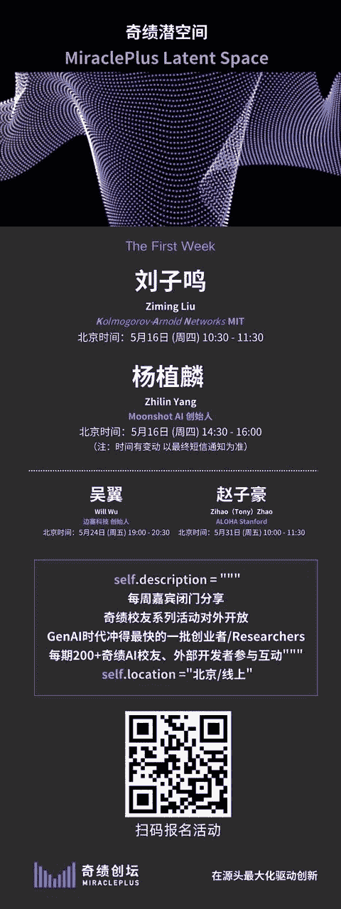

# 第二周｜May

> 来源：[https://docs.feishu.cn/docx/ZhHydKJaoobyaXx1U2TcTxzmnee](https://docs.feishu.cn/docx/ZhHydKJaoobyaXx1U2TcTxzmnee)

<https://legalstudio.feishu.cn/sync/Lk2tdJ9y6slPw3bGbFEcuRzvnpg>

# **一、法律科技资讯**

> 本文档仅推送新闻简讯，如需阅读更详细的内[会员体系](https://e9w56z965d.feishu.cn/wiki/DLtSwmrQYibygZklZ4NcuuASnJg)，可订阅高级版知识库。了解更多 👉

## **法律 AI 前沿资讯**

### CLM 头部厂商 Ironclad 推出无代码功能，简化 AI 在 B 端落地的定制能力

5 月 9 日，CLM 服务商 Ironclad 宣布推出自定义的 AI 功能，允许用户提高 AI 生成结果的质量，并提高模型吸收独特数据、领域知识和上下文的能力。自定义的 AI 功能使训练 AI 变得简单快速 —— 不需要任何技术经验。

据了解，该功能围绕“微调”的概念构建，允许用户根据独特的用例（自定义条款、行业特定数据要求等）定制 Ironclad 的 AI 模型，方法是向模型提供在原始训练过程中未使用到的合同数据，以进行额外的训练。

### 法律文件起草审查服务商 Definely 完成 700 万美元 A 轮融资

5 月 8 日，法律文件起草审查服务商 Definely 宣布完成 700 万美元 A 轮融资，通过 AI 驱动法律文件起草审查。

### Taft Stettinius & Hollister 律所成立技术和 AI 实践小组

5 月 8 日，Am Law 100 律师事务所 Taft Stettinius & Hollister 宣布成立一个技术和 AI 实践小组，以提供战略咨询服务，帮助客户利用新兴技术，同时确保遵守法律、监管和道德标准。

据了解，该小组由具有不同专业知识的律师组成，包括知识产权、就业法、金融科技、隐私和数据安全、技术交易和监管合规性，旨在提供适合每个客户独特需求的整体解决方案。

### eBrevia 推出 AI 合同起草审查平台

5 月 6 日，合同分析和审查服务商 eBrevia 宣布推出一个名为 eBrevia DraftPro 的合同起草、管理和分析平台，并与 Microsoft Word 集成。

## **传统法律科技资讯**

### 邓迪大学获英国政府 110 万英镑投资，推动法律和科技的教育和创新

5 月 10 日，英国邓迪大学宣布获得一笔 110 万英镑的政府投资，以推动法律和科技的教育和创新，并与苏格兰 Thorntons 律师事务所联合运营。

### 法律实践管理服务商 Access Legal 收购移动应用程序服务商 inCase

5 月 9 日，法律实践管理服务商 Access Legal 宣布收购一家面向法律专业人士和客户的移动通信平台 inCase。

### 解决法律数据挑战的新范式！CLOC 全球研究所 2024 会议启动 Legal Data Intelligence

5 月 8 日，在拉斯维加斯举行的公司法律运营联盟（CLOC）全球研究所 2024 会议上，近 20 名来自公司法律部门和律师事务所的行业专家，启动了一个名为「Legal Data Intelligence」（简称“LDI”）的网站。

这个网站提供了一个统一的完成法律任务的流程指南，并提供一系列用例，旨在解决法律工作中「流程缺失」和「数据孤岛」的问题，从而帮助法律人更高效和有效地完成法律工作。

### 电子发现巨头 Reveal 收购数据管理工具 Onna，增强 AI 能力

5 月 7 日，电子发现（e-Discovery）、审查和调查平台 Reveal 宣布收购数据收集、分析和管理平台 Onna。

目前，很多公司在“应对现代通信和协作工具产生的大量非结构化数据”上面临巨大挑战困难，而 Onna 支持用户从 Slack 和 Microsoft Teams 等工具中收集协作数据以用于法律案件，可以帮助公司法律团队以更低的成本和风险、更高的效率收集这些数据。同时，Onna 还将带来生成式 AI 功能。今年 3 月，Onna 宣布在开发一个名为 AI Data Pipeline 的新产品，这是其数据管理功能的扩展，旨在帮助公司法律团队使他们利用的大模型更加准确和可靠。

### Elevate 收购电子发现服务商 CJK Group，发展外语专业知识

5 月 7 日，替代法律服务商（ALSP）Elevate 宣布收购 CJK Group，一家专注于非英语审查的电子发现公司，专门审查、分类和分析中文、日语和韩语的多语种内容。

Elevate CEO Liam Brown 表示：“我们收购 CJK 是因为他们在外语审查方面拥有非常具体的专业知识，随着争议或尽职调查的文件审查越来越全球化，我们很多客户要求这样做。此次收购是 Elevate 并购战略的延续，该战略旨在收购小型咨询、软件和服务公司，这些公司拥有客户所珍视的独特、特殊专业知识，随后我们可以扩大规模。”

### RegTech 整合商 Corlytics 收购德勤英国 RegTech 平台

5 月 7 日，监管情报、内容和自动化政策合规服务商 Corlytics 宣布收购英国德勤的数字 RegTech 平台。据了解，该平台及其独特的能力，将为 Corlytics 的能力增加相当大的广度和领域专业知识，从解释监管变化到映射政策，再到现在的控制，从而帮助用户寻找、解释、理解并准确实施监管变化。

### 电子签名巨头 Docusign 收购 CLM 厂商 Lexion

5 月 6 日，电子签名巨头 Docusign 宣布以 1.65 亿美元的价格收购合同生命周期管理提供商 Lexion，以增强该公司的 AI 能力，从而巩固其在新兴的智能协议管理 SaaS 类别中的市场地位。

在 2022 年底 ChatGPT 推出后，Lexion 就是首批公开宣布使用生成式 AI 的法律科技公司之一。在被收购之前，Lexion 一直处于稳定的融资轨道上 —— 2023 年 4 月，Lexion 完成 2000 万美元 B 轮融资，2021 年完成 1100 万美元 A 轮融资，2019 年完成 420 万美元种子轮融资。

## **法律科技活动推荐**

### 法天使 X 植德 X 法律修音机：律所 AI 共创营 —— 让一部分法律人先 AI 起来（北京、深圳站）

## **AGI 活动推荐**

### 奇绩潜空间每周系列活动

# **二、大模型资讯**

## Around the World

### OpenAI 重磅更新定档下周一，Altman 暗示会有「魔法」

5 月 11 日，OpenAI 官宣预告即将在 13 日，下周一上午 10 点（太平洋时间）开启线上直播。届时，会有全新的ChatGPT demo 演示，以及 GPT-4 升级更新。

> 拓展阅读：

> https://mp.weixin.qq.com/s/3k8CvKl20bzbTMWp6KI73w

> https://mp.weixin.qq.com/s/zMoRMyWLqrOlLLiw33hLeg

> https://mp.weixin.qq.com/s/iNuFljAd2bQfTyBR1EW_pg

> https://mp.weixin.qq.com/s/Rm3ZoVjjY9BhJyQGH25KIQ

> https://mp.weixin.qq.com/s/Y4fPPS_7E_4tjuRHF6qd1Q

## **东八区**

### 智谱 GLM-3-Turbo 模型现在 100 万 tokens 只需 1 元

5 月 11 日，智谱 AI 宣布 GLM-3-Turbo 调整价格：

+   之前：0.005 元 / 千 tokens

+   现在：0.001 元 / 千 tokens

换算一下，就是 1 元 = 1000000 tokens，相当于花 1 元钱就能写 1 万条📕（以 350 字计算）。

这个大动作，一下子就让智谱 AI 成为入门级里最便宜的那一个；而且它还特别提供用户 tokens 优惠计划：送！

开放平台新注册用户获赠从 500 万 tokens 提升至 2500 万 tokens（含 2000 万 GLM3-Turbo 和 500 万 GLM4）。

除此之外，GLM-3 Turbo Batch 批处理 API 进一步便宜50% —— 0.0005/千 tokens。

> 拓展阅读：

> https://mp.weixin.qq.com/s/YjFpVe_6MOxIztpU6F1AFg

> https://mp.weixin.qq.com/s/lqBySSrIOYpX0SCpXaq3vg

> https://mp.weixin.qq.com/s/UJ1XaSUnKjgwONXnKrIT_g

### 阿里云发布通义千问 2.5，性能全面赶超 GPT-4 Turbo

近日，阿里云发布通义千问 2.5，模型性能全面赶超 GPT-4 Turbo。同时，通义千问最新开源的 1100 亿参数模型在多个基准测评收获最佳成绩。另据了解，通义大模型品牌升级，“通义千问 App”更名为“通义 App”，集成通义大模型全栈能力，免费为所有用户提供服务。

> 拓展阅读：https://mp.weixin.qq.com/s/lwv7OTirD7IoTN8RNWCc5A

### 混元大模型接入🛰️读书，AI 问书功能正式上线

5 月 10 日，🛰️读书的 AI 问书功能正式全量上线。

具体来说，🛰️读书会根据用户输入的问题或提交的搜索指令，利用大模型引用、整理书中相关观点生成答案回复用户提问，并生成与用户提问相关的问题供用户进一步提问。简单来说就是内嵌了个 AI 搜索功能，基于🛰️读书生态海量的内容资源，给予回答，基于 RAG 技术，将内容的分发和呈现做了重塑。

而实现此功能，使用的是腾讯混元助手大模型。

> 拓展阅读：https://mp.weixin.qq.com/s/prftVeWtKw918t-wpz71kA

# **三、监管与观点**

## **AI 监管****/政策****动态**

暂无。

## **AI 观点/资讯**

### 麻省理工分享 ChatGPT 在教育的 5 个实际应用案例

麻省理工学院（MIT）官网消息，多位高级讲师、教职员工、学生在 MIT 举办的“2024 年学习节”上，分享了生成式 AI 在教学、学习领域中的实际案例和对教育的重要性。

OpenAI 的 ChatGPT 成为本次活动中的分享重点并一致认为，ChatGPT 等生成式 AI 是可以作为辅助工具提升教学和学习效率的，而不是一味的排斥它们。教育专家们还表示，生成式 AI 对于培养学生的批判性思维非常有帮助。

> 拓展阅读：https://mp.weixin.qq.com/s/WwPgf6IV90B0x59a4Hbh4g

### 谷歌 CEO 最新访谈：AI 浪潮仍处于早期阶段，公司未来最大威胁是执行力不足

近日，谷歌及其母公司 Alphabet 首席执行官桑达尔·皮查伊接受了《The Circuit With Emily Chang》主持人兼执行制片人艾米丽·张的独家专访。在这场对话中，他们探讨了搜索的未来、谷歌如何从头开始重新构建其 AI 模型 Gemini、与微软和 OpenAI 的竞争、谷歌在企业文化方面的挑战。

> 拓展阅读：https://mp.weixin.qq.com/s/FMrFhosAb9zRYC0eRJAgMg

### 马斯克最新访谈完整版：追求最大真实性的人工智能极其关键，AI不应被教导说谎

5 月 7 日消息，据国外媒体报道，美国当地时间周一，特斯拉和 SpaceX CEO 埃隆·马斯克（Elon Musk）出席了 2024 年米尔肯研究院全球峰会，并与著名投资者、米尔肯研究院主席迈克尔·米尔肯（Michael Milken）进行了对话。在这次持续大约半个小时的对话中，马斯克回避了所有关于特斯拉的话题，但他聊了自己最喜欢的话题，包括殖民火星、反对监管、在太空中使用人工智能以及担心人类文明消失等。

> 拓展阅读：https://mp.weixin.qq.com/s/r6y_-6g7KRvvwixyxnV8uQ

### OpenAI 掌门人最新访谈：“末日概率”不恰当，面对AI技术革命既乐观又悲观

5 月 6 日消息，据国外媒体报道，继 OpenAI CEO Sam Altman 在斯坦福大学进行演讲后，随后又从硅谷横跨美国来到麻省理工学院，与该校校长莎莉·科恩布鲁斯（Sally Kornbluth）共同探讨了 AI 的未来发展。

Altman 在访谈中谈到，OpenAI 在做的是“人类用的工具”，不是在创造生物；而人类充满偏见却往往不自知。AI 是人类科技树上的新工具，人类没必要害怕超级智能的 AI，每个新模型的缺点也是它们持续迭代的动力。

双方还从 AI 监管的角度对创业、就业的影响进行了讨论，Altman 认为在接下来很长一段时间里，都是初创公司的最好时机。就具体行业而言，Altman 表示自己最关注 AI 对健康和教育领域的影响，对金融领域的思考并不多。

> 拓展阅读：https://mp.weixin.qq.com/s/iFlnL90ou97Yep3ZAu3vmg

# **四、优质文章分享**

【法律 AI 交流群】每天都会分享法律 AI、法律科技相关的前沿信息，以下为群友分享的优质文章：

+   2024 年第十八期法律科技周报（4.29-5.5）

+   [200000000$！2024 年 ](https://mp.weixin.qq.com/s/Qdlb864mrrYwCgYMS662Ig)Q1，17 家法律科技公司融资 15 亿

+   [🔥30+ 先锋法律人共创 AI 应](https://mp.weixin.qq.com/s/-fFoqLqHrlpfzYm-VSLMDA)用！首届「法律 AI 创造营」成功举办

+   政策驱动+科技融合，法律服务行业的数智化转型

+   OpenAI，为什么没敢推 AI 搜索

+   The Batch： 679 | 深度AI趋势

+   [越过《沙丘》，撞见另一种未来](https://mp.weixin.qq.com/s/Jb0telmGNsUw6AW4zgC7ow)

+   AI概念股年报透露的AI落地事实和趋势（一）

+   AI概念股年报透露的AI落地现状（二）

+   写好评得返现，AI正在这个场景里大杀特杀

+   揭秘智慧芽专利大模型为何能在知产领域超越GPT-4？

+   [商汤如影](http://senseavatar.sensetime.com/?utm_source=baidu-sem-mob&utm_medium=cpc&utm_campaign=mob-%E5%A6%82%E5%BD%B1-%E5%93%81%E7%89%8C%E8%AF%8D-%E5%A6%82%E5%BD%B1&utm_content=%E5%A6%82%E5%BD%B1&utm_term=%E5%A6%82%E5%BD%B1)

> 注：与本周重要资讯相关的文章已整合到以上特定资讯下方，不在此处再次列出。