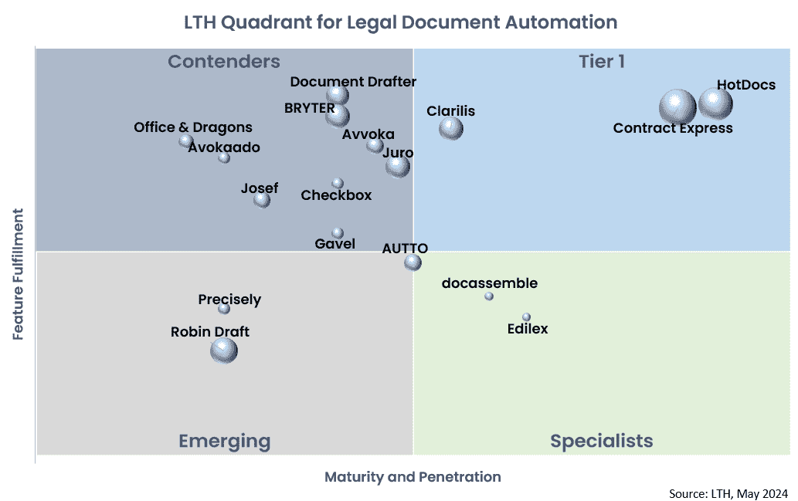

# 第四周｜May

> 来源：[https://docs.feishu.cn/docx/K3WHdlIlLo2uMQxwtRGcjAqinhe](https://docs.feishu.cn/docx/K3WHdlIlLo2uMQxwtRGcjAqinhe)

<https://legalstudio.feishu.cn/sync/Lk2tdJ9y6slPw3bGbFEcuRzvnpg>

## 一、法律科技资讯

> 由于法律科技产品 + AI 能力已经成为主流，日报将减少同质化产品的动态推送，重点关注头部公司和创新产品。

> 本日报仅推送新闻简讯，如需阅读更详细的内[会员体系](https://e9w56z965d.feishu.cn/wiki/DLtSwmrQYibygZklZ4NcuuASnJg)，可订阅高级版知识库。了解更多 👉

### 法律 AI 前沿资讯

#### A&O Shearman 律师事务所宣布纳入新一批法律科技孵化项目

5 月 24 日，近日完成合并的 A&O Shearman 律师事务所宣布旗下的 Fuse 孵化器纳入第八批初创企业，包括各个领域的法律科技初创公司，以及一些基于区块链技术创新的公司。

#### Clio 最新调研：中型律所对 AI 的态度，明显与客户预期不符

5 月 23 日，法律实践管理服务商 Clio 发布《2024 Legal Trends for Solo and Small Law Firms》，探讨了中型律所（超过 20 名员工）和小型律所（少于 20 名员工）拥抱法律科技的趋势。

报告显示，中小律所的受访律师认为 AI 有潜力成为法律行业的变革力量，但仍然持谨慎态度，而最核心的担忧，主要体现在「版权风险」和「律协态度」两个问题。

其中，中型律所的律师对以上两个问题的担忧，普遍高于小型律所的律师。这意味着，中型律所的律师比小型律所的律师，对 AI 最终是否会在法律行业中发挥作用更加怀疑，或者说他们更倾向于将 AI 工具视为潜在风险，选择将确定其使用的责任推给律师协会，而这一态度与客户期望不符。随着 AI 被更广泛地使用，中型律所将处于被动。

#### AI 合同审查平台 Superlegal 完成 500 万美元种子轮融资

5 月 22 日，AI 合同审查初创公司 Superlegal 宣布完成 500 万美元种子轮融资，本轮融资由以色列风险投资基金 Aleph 和 Disruptive AI 领投，Alicorn Venture Capital 和汤森路透前 CEO Tom Glocer 跟投。

在此之前，该公司还获得了谷歌人工智能初创公司基金的资助。

#### 法院报告初创公司 Skribe.AI 完成 350 万美元种子轮融资

5 月 22 日，法律科技初创公司 Skribe.AI 宣布完成 350 万美元种子轮融资。该公司希望通过 AI 制作法律证词记录来简化法院报告流程。

#### 普华永道最新调研：懂 AI 的律师可以多赚 49%

5 月 21 日，普华永道基于以上调研结果发布了一份报告：《2024 AI 工作晴雨表》。

普华永道追踪了那些需要「AI 专家技能」（专业技术层面的 AI 技能，比如深度学习）的工作，在各个国家和行业的增长情况，并作为 AI 渗透情况的一个指标 —— 更高的渗透水平意味着 AI 更容易被用于某些任务。

报告发现，AI 的渗透正在加速。其中，AI 渗透率较高，或者说更有可能将 AI 融入业务的行业，正在获得更高的劳动生产率增长。特别是专业服务（如“律师”）、信息和通信以及金融服务领域，增长率几乎达到了行业平均水平的五倍。同时，那些生产率显著提高的行业，在招聘职位中更多地强调了 AI 技能的重要性，并且直接反映在薪资上 —— 要求 AI 专家技能工作岗位的平均薪资溢价高达 25%，而要求 AI 技能的律师岗位，薪资溢价可以高达 49%。

> 拓展阅读：[普华永道：懂 AI 的律师可以多赚 49%](https://legalstudio.feishu.cn/wiki/ZMFNwh1ytiH4hjkrl1mcNiFAnAS?from=from_copylink)

### 传统法律科技资讯

#### Legaltech Hub 发布「文档自动化服务商」竞争分析报告

5 月 23 日，法律科技工具/服务全球名录公司 Legaltech Hub（LTH）发布「文档自动化服务商」类别的竞争分析报告，包括各个服务商的公司和产品历史、重要功能以及需要考虑的关键利弊等。

这份报告分析了 150 多家独立产品的供应商，不包括那些将文档自动化功能作为更大平台一部分的服务商，比如 CLM 平台或 DMS 系统，以及智能起草服务商 —— 该类别将成为后续研究主题，早期初创企业（定义为 18 个月或更短）也被排除在外。此外，LTH 对在律所或公司法务部门中市场渗透率最高的供应商进行了更深入的分析。

#### 数据治理公司 ActiveNav 和 Actfore 完成 630 万英镑新一轮融资

5 月 23 日，发现、隐私合规和数据治理服务商 ActiveNav、数据挖掘和取证公司 Actfore 的母公司 Data Discovery Solutions 宣布完成 630 万英镑新一轮融资。

#### 数据泄露解决方案服务商 CyEx 收购集体诉讼和解管理公司 Simpluris

5 月 20 日，数据泄露解决方案服务商 CyEx 宣布收购集体诉讼和解管理服务商 Simpluris。

### 法律科技活动推荐

#### 法天使 X 植德 X 法律修音机：律所 AI 共创营 —— 深圳站

> 拓展阅读：

> [法天使 X 植德 X 法律修音机｜律所 AI](https://mp.weixin.qq.com/s/MNNm9LGfzLVTyPPnpjr6oQ) 共创营——让一部分法律人先 AI 起来

> 🔥顶级律所帝都共话法律科技！律所 AI 共创营，下一站深圳

### AGI 活动推荐

#### 奇绩潜空间每周系列活动

## 二、大模型资讯

### Around the World

#### 微软大会一夜推出 60 个新发布，Altman 闪现爆料下个重要模型

一夜之间，微软的 AI 全宇宙已经成型。

5 月 22 日，在一年一度的 2024 微软 Build 大会上，微软 CEO 萨蒂亚·纳德拉（Satya Nadella）一口气宣布了 50 多项 AI 能力更新，覆盖 GPT-4o 上云、自研 Cobalt 芯片、团队版 Copilot、SOTA 小模型等多个方面。

> 拓展阅读：https://mp.weixin.qq.com/s/1U9qKqzyjBj6bYovPqpnug

#### 微软推出 Copilot+ PCs，力邀 Adobe 带来「全家桶」原生支持

5 月 21 日，微软 Build 开发者前瞻大会上，微软 CEO 萨蒂亚・纳德拉上台演讲，提出了「Copilot+ PCs」的宣传名称，并将其描述为「新一类 Windows PC」。

其中，Copilot+ PCs 的一项硬件要求是不依赖云，可以在本地处理生成式 AI Copilot 进程，这就需要配备神经处理单元（NPU）的芯片组。微软正在采取合作伙伴优先的方式制造 Copilot+ PC。除了 AMD、英特尔和高通等芯片制造商，宏碁、华硕、戴尔、惠普和联想等主要原始设备制造商也加入了进来。

微软表示已经重构 Windows 11 系统，Copilot+ PC 相比配备 M3 处理器的最先进 MacBook Air 快 58%，而且续航时间超过 1 天时间。微软还透露，它的 Copilot+个人电脑现在将在 OpenAI 的 gpt - 40 模型上运行，允许助手通过文本、视频和语音与电脑互动。用户还可以与 Copilot 共享他们的屏幕，并与该应用程序进行自然对话。

微软牵头扩充硬件产品的同时，在本次活动中还和 Adobe 公司合作，进一步丰满 Windows on ARM 的羽翼。微软在本次活动中表示 Adobe 全套应用即将出现在「Copilot + PC」设备中，Photoshop、Lightroom、Firefly 和 Express 现在都已可用，Adobe 还表示 6 月开始推出 Illustrator 和 Premiere Pro。

> 拓展阅读：https://mp.weixin.qq.com/s/_BJ7u035vVeaC3MfiTqxIw

#### 在推出 GPT-4o 后，ChatGPT 移动应用的收入出现了迄今为止最大的飙升

5 月 20 日，根据应用智能公司 Appfigures 的最新数据，OpenAI 最新大模型 GPT-4o 在网络上免费提供，其推出使该公司在移动领域的收入达到了有史以来最大的峰值 —— 用户想体验 OpenAI 的 ChatGPT Plus，就必须升级到 19.99 美元的包月套餐，这一战略决策增加了移动用户的订阅需求。

Appfigures 指出，ChatGPT 移动应用程序的净收入在 GPT-4o 发布当天首次跃升 22%，并在随后几天持续增长。本周二，净收入达到 90 万美元，接近该应用日均收入 49.1 万美元的两倍。

> 拓展阅读：https://mp.weixin.qq.com/s/iXm02XNSkJwYxATL5YzPLA

### 东八区

#### 中国移动发布千亿多模态大模型，风趣畅聊堪比 GPT-4o

5 月 24 日，在第七届数字中国建设峰会中国移动人工智能生态大会「AI 赋能，智筑国基」主旨论坛上，中国移动发布了最新自研的「九天」千亿多模态基座大模型。

凭借自主研发与行业积累，「九天」基座大模型堪称「国内最值得信赖、最懂行业」的全栈大模型。和其他企业不同，央企做大模型，是面向国民经济骨干行业，目的是给国家基建转型赋能，「为产业注智，为国家筑基」。

> 拓展阅读：https://mp.weixin.qq.com/s/XrsmPeXMMpQuNh4jhIUi4Q

#### 淘宝推出「天猫 AI 讲价小助手」，帮用户讲价

日前，淘宝宣布推出「天猫 AI 讲价小助手」，并开启征名活动。用户打开天猫 App，在购物车界面点击右下方「找优惠」，并可以看到「帮讲价」入口，进入后用户可以自行选择讲价商品。这款 AI 助手在砍价时通常会使用「我在其他店铺看到同款商品价格比较便宜，是否能考虑给一个更好的价格（或赠品）」，「如果能优惠，会给五星好评」，「这个商品看起来很不错，我很感兴趣」等话术，实际体验方面还有待改善。

> 来源：IT之家

#### 百川智能发布 Baichuan 4 及首款 AI 智能助手百小应

5 月 22 日，百川智能发布最新一代基座大模型 Baichuan 4，并推出成立后的首款 AI 助手“百小应”。Baichuan 4 相较 Baichuan 3 在各项能力上均有极大提升，通用能力提升超过 10%。此外，Baichuan 4 还具备行业领先的多模态能力，在各大评测基准上表现优异，领先 Gemini Pro、Claude3-sonnet 等多模态模型。

在 Baichuan 4 的基础上，百川智能将搜索技术与大模型深度融合，推出懂搜索、会提问的 AI 助手“百小应”。百小应不仅可以随时回答用户提出的各种问题，速读文件、整理资料、辅助创作等，还具备多轮搜索、定向搜索等搜索能力，能更精准地理解用户搜索需求，为用户提供专业、丰富的知识和资源，此外还会在用户问题的基础上通过一系列提问来帮助用户明确自身需求，给出更精准的答案。

> 百小应地址：`ying.ai`

> 拓展阅读：https://mp.weixin.qq.com/s/iOl4T7UhfG6KlZDBTP3Fnw

#### 太卷了！阿里云主力模型降价 97%，百度两大模型免费

5 月 21 日，阿里突然放出大招，官宣 9 款通义大模型全面降价。

其中，性能对标 GPT-4 的主力模型 Qwen-Long，API 输入价格从 0.02 元/千 tokens 降至 0.0005 元/千tokens，也就是 1 块钱能买 200 万 tokens，相当于 5 本《新华字典》的文字量，堪称全球大模型的性价比之王。

随后，百度也发文宣布旗下 ERNIE Speed（8K、128K）、ERNIE Lite（8K、128K）模型免费提供。腾讯云、讯飞大模型也宣布免费。

> 拓展阅读：

> https://mp.weixin.qq.com/s/xn5Lq9ZuriC1XCyDr4dhIw

> https://mp.weixin.qq.com/s/HA4RtjXvUhOY-sdHXYvUpg

> https://mp.weixin.qq.com/s/OvnWglEp7vSEIEZadQxrog

> https://mp.weixin.qq.com/s/m1RDEWTx9icOPFvaZFHAmg

> https://mp.weixin.qq.com/s/IDc8v1oqpo8t4n0aaZzbcg

> https://mp.weixin.qq.com/s/dwcWSK6Bi8efIcoDsqiXvQ

> https://mp.weixin.qq.com/s/t3ujJCrBDe7XpJ3YHDMFrg

## 三、监管与观点

### AI 监管/政策动态

#### 欧盟批准人工智能法案

5 月 21 日，欧盟最终批准去年 12 月达成的一项政治协议，该协议为广泛应用于各行各业和日常生活中的 AI 制定了具有里程碑意义的规则。今年 3 月，欧洲议会议员已经对欧盟委员会提出的一份修改后的提案草案表示了支持。欧盟的 AI 法案可能会为其他国家设定基准，因为人们担心该技术会产生错误信息或侵害版权。

> 来源：新浪财经

#### 日本法院也驳回 AI “发明”专利申请：发明人仅限于人类

5 月 19 日消息，日本东京地方法院裁定 AI “发明”的设备不能获得专利，理由是发明人必须是人类。该法院认为，根据《知识产权基本法》，发明是“人类活动创造的产物”，而且全球多地对 AI 作为发明人的法律持谨慎态度。据报道，居住在美国的原告为 AI 自主发明的设备申请专利，发明人的名字却是“自主发明本产品的 AI DABUS”。早在三年前，专利局就已经驳回了该申请，明确表示“发明人必须是人类”。原告不服并提起诉讼，要求撤销该决定。

> 来源：IT之家

### AI 观点/资讯

#### 摩根大通高管：新员工都将接受 AI 培训

目前，摩根大通正在对每一位新入职的员工进行 AI 培训，让他们做好准备迎接这项被 CEO 杰米·戴蒙比作将带来印刷机和蒸汽机一般影响的技术。摩根大通资产和财富管理主管Mary Erdoes周一在投资者日上表示， AI 在两个方面为其部门提供帮助：节省时间和增加收入。她表示，这项技术可以让银行家在与客户通话时就能调出有关潜在投资的某些信息，从而减少“逐个查找和敲击”的时间。还通过消除重复、死板的任务来摆脱“无趣的工作”。

> 来源：新浪财经

#### IBM 发布 2024 年 CEO 调研报告：生成式 AI 的成功更大程度上取决于员工采用的情况

IBM 商业价值研究院的一项调研发现，许多 CEO 在其组织实施和扩展生成式 AI 的过程中，面临着员工队伍、企业文化和治理方面的挑战。来自 30 多个国家或地区、26 个行业的 3000 位 CEO 参加了该年度全球调研。

其中，64% 的全球受访 CEO 、61% 的中国受访 CEO 表示，生成式 AI 的成功更大程度上取决于员工采用的情况，而非技术本身。此外，61% 的全球受访CEO、56% 的中国受访 CEO 认为，他们推动组织采用生成式 AI 的速度，超出了一些员工所能适应的范围。

> 来源：36氪

#### 中国工程院院士谭建荣：生成式 AI、元宇宙、拟人化机器人交叉融合将产生“人类 2.0”

近日，中国工程院院士谭建荣在 2024 搜狐科技年度论坛上表示，学界预测生成式 AI、元宇宙数字空间、拟人化机器人三项技术交叉融合，将会产生“人类 2.0”版本。“一旦控制失效，故障将是灾难性的。”但其亦认为，人类可“驯服”机器人：一是通过安全规范和法规进行 AI 风险防范；二是通过大样本训练使机器人服从人的指挥；三是划出一些安全警戒线，使机器人在外源时空条件下防范其“做坏事”。

> 来源：36氪

#### AI 教父呼吁实施普遍基本收入，马斯克称未来将普遍高收入

最近，“AI 教父”杰弗里·辛顿在采访中表达了对 AI 对就业安全的影响的担忧，建议政府考虑实施普遍基本收入，以解决失业导致的潜在不平等。辛顿还强调了不受监管的人工智能的潜在风险，他指出，目前的发展轨迹可能会导致人类面临“灭绝级别的威胁”。一位 𝕏 平台用户分享了辛顿的言论，马斯克回应称：“将会有普遍高收入（不是基本收入）。”去年 11 月，马斯克在与英国首相苏纳克的对话中表示，AI 最终可能会让所有人类都无需工作，未来人们面临的挑战将是如何找到生活的意义。

> 来源：环球市场播报

## 四、优质文章分享

【法律 AI 交流群】每天都会分享法律 AI、法律科技相关的前沿信息，以下为群友分享的优质文章：

+   2024 年第二十期法律科技周报（5.13-5.19）

+   司法部出手整治法律咨询公司，律师反而更应该担心了

+   重磅！美国律师协会批准替代性律师许可制度｜附政策原文

+   【新职业】法律数据智能负责人/分析师

+   Legaltech Hub 发布「文档自动化」细分赛道的竞争分析报告

+   [大模型的扑克牌：独家内幕故事](https://mp.weixin.qq.com/s/UbG-ABet0Np_MBkbbVLK3A)

+   [世界顶级风投a16z创始人对谈AI与创](https://mp.weixin.qq.com/s/z1pfzaln9gfHYU_yqakNrA)业，信息量爆炸！（两万字长文，建议收藏）

+   月之暗面杨植麟：互联网研发是“种树”，大模型研发是“承包森林”

+   十四届全国人大常委会专题讲座第十讲讲稿:人工智能与智能计算的发展

+   The Batch：684 | ChatGPT为何那样做

+   OpenAI全部的秘密，藏在200份简历中

+   如何靠AI变身“六边形战士”｜得到快刀青衣&中国AIGC产业峰会

# 创始人如何做好IP？ |【经纬低调出品】

> 注：与本周重要资讯相关的文章已整合到以上特定资讯下方，不在此处再次列出。
