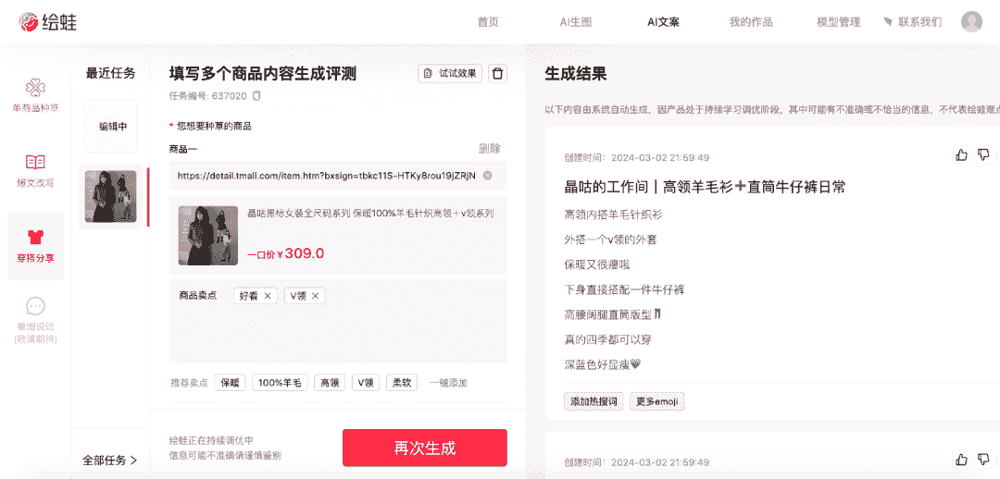

# 第一周｜March

> 来源：`https://docs.feishu.cn/docx/IHGCdrTe2osExfxEzskcYbwbnQe`

`https://legalstudio.feishu.cn/sync/Lk2tdJ9y6slPw3bGbFEcuRzvnpg`

## 一、法律 AI 资讯

### 合同起草提供商 Henchman 与 Microsoft Copilot 集成

3 月 6 日，合同起草和谈判技术服务商 Henchman 宣布与微软的生成式 AI 聊天机器人 Microsoft Copilot 集成，当用户向 Copilot 询问与合同相关的问题时，Copilot 将决定何时调用 Henchman 来提供答案。如果用户提出的问题不在 Henchman 的数据库之内，Copilot 将接管并像往常一样回答。

### Epiq Service Cloud 与 Microsoft Copilot 集成，并推出新的产品和服务

3 月 5 日，替代性法律服务商 Epiq 宣布扩大其云服务，并推出几种生成式 AI 工具和服务，具体包括：

**专业服务咨询**

Epiq 的 AI 集成将提供两类咨询服务：一种是“副驾驶就绪”指南，专注于分析公司的保护措施、数据安全以及隐私和合规流程，从而考虑使用生成式 AI 助手（称为副驾驶）来创造收入。另一种是“通用 AI 咨询”，包括面向律师事务所提供关于如何使用他们的数据，在其组织内高效部署 AI 工具的建议。

OpenAI Azure 解决方案

通过 Microsoft Azure OpenAI 服务，Epiq 可以为客户构建一系列解决方案。例如，Epiq 已经为律师事务所构建了一个知识管理解决方案，支持通过生成式 AI 进行搜索，并链接到相关引用来源。该公司还为电子发现客户构建了一个 AI 文本摘要工具，以减少耗时的分析时间。

**Azure OpenAI 平台**

Epiq 的性能管理解决方案 Metrics that Matter 于 2022 年 5 月推出，已与 Microsoft Azure OpenAI 服务集成，可为用户提供更易于访问和对话式的方式与数据进行交互。例如，用户可能会在聊天机器人中输入提示，比如“我在外部法律顾问上花费最多的事项是哪里？”或者“我面临最大合规风险的地方在哪里？”，并从系统中得到答案。

### 天津推出全国首款网络普法大模型

近日，由天津市委网信办与360集团合作打造的全国首个网络普法领域垂直大模型——“獬豸”发布，同步发布的还有法宣大使数字人——“獬小豸”。该模型通过数据共建、共训、共享，实现各地的普法资源集成，共享各地的优质普法成果，有效提升普法领域的智能化水平与服务质效。

在法律咨询方面，该模型拥有多模态交互能力与专业、全面、庞大的法律知识库，可为用户提供更容易理解的法律解释与更精准的法律指导。在网信服务方面，该模型实现了政务服务智能化，能够帮助企业及机构在处理跨境数据时保持合法合规，规避风险。该模型的众训共享模块能有效实现资源的共享与集中管理。此外，该模型还能够担当网信工作人员的“普法助理”，数字人视频生成功能可以利用人工智能技术创建虚拟形象，24 小时宣讲法律知识，实现质效双收。

### 法律销售平台 Propense.ai 完成 300 万美元种子轮融资

近日，Propense.ai 宣布完成 300 万美元的种子轮融资，该公司为专业服务公司提供识别交叉销售机会的软件，即通过将机器学习、AI 和客户数据训练，准确识别客户的需求。

## 二、法律科技资讯

### 在线公证初创公司 Legitify 完成 150 万欧元种子轮融资

3 月 8 日，在线公证初创公司 Legitify 宣布完成 150 万欧元（约 164 万美元）的种子轮融资。Legitify 于 2020 年成立，提供在线认证和公证文件服务。随着新一轮资金的引入，Legitify 计划引入 AI 能力。

### 合规公司 Whistleblower Software 完成 1500 万欧元新一轮融资

3 月 5 日，总部位于丹麦的合规解决方案服务商 Whistleblower Software 宣布完成 1500 万欧元（约 1630 万美元）的 A 轮融资，并改名为 Formalize。

### FTI Consulting Inc. 收购精算咨询公司 Madison Consulting

3 月 4 日，商业咨询公司 FTI Consulting Inc. 宣布收购精算咨询公司 Madison Consulting，以扩大该公司在法证和诉讼咨询领域的全球保险服务业务中的财产和意外伤害精算和合规产品。

### 汤森路透收购电子发票和间接税解决方案服务商 Pagero

近日，全球内容和技术公司汤森路透宣布收购电子发票和间接税解决方案服务商 Pagero Group AB（Pagero），其收购总价值约 21 亿美元。本次收购将加速实现两家公司的共同愿景，建立更强大、战略一致的组合，为全球客户提供更优质的互联电子发票和间接税解决方案套件，并带来令人兴奋的增长前景。

## 三、大模型资讯

### Around the World

#### 英伟达推出”生成式 AI 专业认证“，帮你成为大模型开发专家

3 月 8 日，英伟达（NVIDIA）推出了生成式 AI（AIGC）专业认证，通过考试可获得行业认可的权威证书。

同时，英伟达也推出了相应的培训课程，包括生成式 AI 解释，深度学习入门/基础知识，基于 Transformer 的自然语言处理，使用大语言模型进行定制应用开发，大语言模型的部署、定制、微调等，帮助学员顺利通过考试。

该认证支持远程报名和考试，适合软件工程师、数据工程师、云解决方案架构师、AI DevOps 工程师等，可以增加就业竞争力成为大模型领域的专家。

> 认证详情地址：`https://www.nvidia.com/en-us/learn/certification/generative-ai-llm-associate/`

> 拓展阅读：`https://mp.weixin.qq.com/s/2U31Sj1kkFLN7u6nMds2xA`

#### OpenAI 劲敌重磅发布 Inflection-2.5！性能媲美 GPT-4 但计算量仅为 40%

3 月 7 日，AI 创企 Inflection AI 发布了其最新 AI 大模型 Inflection-2.5，并将其用在了自家聊天机器人产品 Pi 中。Inflection AI 称该模型为“最好的个人 AI”。Inflection-2.5 在基准测试中的性能与 GPT-4 接近，但训练计算量只有 GPT-4 的 40%。目前，Inflection-2.5 已向所有 Pi 用户开放，用户可通过 `pi.ai`、iOS、Android 或新的桌面端应用程序使用该模型。

> 试用直通车：`https://pi.ai/talk`

> 拓展阅读：

> `https://mp.weixin.qq.com/s/RJCWiEzjsGwe21a6_lxM4Q`

> `https://mp.weixin.qq.com/s/6aerUs3quIWwSC_0BG41AA`

> `https://mp.weixin.qq.com/s/a70To3S26Lgp3UmvlOB7uQ`

#### OpenAI 竞争对手 Anthropic 推出 Claude 3 大模型，或超越 GPT-4

北京时间 3 月 4 日消息，当地时间周一，人工智能初创公司 Anthropic 推出了 Claude 3 大模型，能够更好地执行复杂的指令。该公司声称，Claude 3 对复杂任务表现出接近人类的理解能力，是当前最强大的大模型之一。

Claude 3 又分为三个版本，分别为 Claude 3 Opus、Sonnet 和 Haiku，名称暗示了每种型号的能力，其中 Opus 是最强大的，Haiku 是市场上最快、最具成本效益的模型。据 Anthropic 声称，其中最强大的 Opus 在行业基准测试中表现优于 OpenAI 的 GPT-4 和谷歌的 Gemini Ultra，比如在知识水平、演绎推理和基础数学等方面。

> 拓展阅读：

> `https://mp.weixin.qq.com/s/WqQWS-hiQ1i1Ve6IPH3djw`

> `https://mp.weixin.qq.com/s/wZApA2MpnymBQ22Gqs93lQ`

> `https://mp.weixin.qq.com/s/PCGnLQx-cJ1Y0GKX1sjLPw`

> `https://mp.weixin.qq.com/s/XLi75yIaD-HmqstiRatAag`

> `https://mp.weixin.qq.com/s/zNX_7JoE9XRyAg_GCy85nA`

> `https://mp.weixin.qq.com/s/UOx_ooKXZkHtPV9rpY3_4w`

> `https://mp.weixin.qq.com/s/LXzJnhe6MhjGSoPw9dfRbQ`

> `https://mp.weixin.qq.com/s/PCGnLQx-cJ1Y0GKX1sjLPw`

> `https://mp.weixin.qq.com/s/29EEQRxvCCyq_Ch-9UBGYg`

> `https://mp.weixin.qq.com/s/Z6VCwsy_TPpKJJK1PL6o5A`

> `https://mp.weixin.qq.com/s/F4ZAA1ntQeRqJkROEE8k2g`

> `https://mp.weixin.qq.com/s/kwkFTk6lrBc1oA9sSSs_HA`

> `https://mp.weixin.qq.com/s/6Y7rL5sOTt49qtN34si3ZQ`

### 东八区

#### 阿里云成立物流智能联盟，专注大模型应用实践

3 月 7 日，阿里云宣布成立物流行业首个专注于大模型应用研究与实践的联盟“物流智能联盟”，旨在加速大模型在物流领域落地，用 AI 助力物流行业增效降本和业务创新。

据了解，该联盟由阿里云、菜鸟、高德地图、中远海运、东航物流、圆通速递、申通快递、中通快递、德邦快递、G7易流、地上铁、浙江大学智能交通研究所等在 2024 数智物流峰会上共同成立。

> 拓展阅读：`https://mp.weixin.qq.com/s/sDkcY5du01yBPsthlgYO9A`

#### 零一万物宣布开源 Yi-9B 模型，号称同系列代码、数学能力最强

3 月 6 日，零一万物宣布开源 Yi-9B 模型，官方称其为 Yi 系列模型中的「理科状元」——Yi-9B 是目前 Yi 系列模型中代码和数学能力最强的模型，实际参数为 8.8B，默认上下文长度为 4K tokens。该模型是在 Yi-6B（使用了 3.1T tokens 训练）的基础上，使用了 0.8T tokens 进行继续训练，数据截至 2023 年 6 月。

据介绍，在综合能力方面（`Mean-All`），Yi-9B 的性能「在尺寸相近的开源模型中最好」，超越了 DeepSeek-Coder、DeepSeek-Math、Mistral-7B、SOLAR-10.7B 和 Gemma-7B。

代码能力方面（`Mean-Code`），Yi-9B 的性能仅次于 DeepSeek-Coder-7B，超越了 Yi-34B、SOLAR-10.7B、Mistral-7B 和 Gemma-7B。

在数学能力方面（`Mean-Math`），Yi-9B 的性能仅次于 DeepSeek-Math-7B，超越了 SOLAR-10.7B、Mistral-7B 和 Gemma-7B。

在常识和推理能力方面（`Mean-Text`），Yi-9B 的性能与 Mistral-7B、SOLAR-10.7B 和 Gemma-7B 不相上下。

此外，Yi-9B（`BF 16`）和其量化版 Yi-9B（`Int8`）都能在消费级显卡上轻松部署，使用成本较低，开发者友好。

零一万物由李开复创新工场董事长兼 CEO 带队创办，此前已已推出 Yi-34B 和 Yi-6B 两个开源大模型，号称对学术研究完全开放，同步开放免费商用申请。

拓展阅读：`https://mp.weixin.qq.com/s/0CXIBlCZ7DJ2XjYT6Rm8tw`

#### 🐧 测试 AI 对话功能，名为「AI 聊天搭子」

近日，🐧 的 AI 对话功能已开启测试，名为「AI 聊天搭子」，由 🐧 联合筑梦岛、混元助手合作的一项 AI 对话服务。而抖音则是上线了一款名为「话炉」的 AI 社交 APP，由字节的 Flow 部门打造。

Tech 星球体验发现，🐧 内测的 AI 聊天搭子智能服务，实际上也是一个 AI 角色互动聊天产品，目前包含有陪伴、故事、挑战、MBTI、名人等不同类型的虚拟角色。用户可以选择符合自己类型的虚拟角色，像平常与好友那样进行实时聊天。值得注意的是，由于虚拟角色每次回复会产生算力成本，普通 🐧 用户每天可以与这些虚拟角色聊 100 条消息，超级会员用户每天则可以聊 400 条消息。

Tech 星球在不少 🐧 群里，看到了用户对该功能的讨论和使用心得，每日都有玩家为自己喜欢的虚拟角色打榜。新出的 🐧 AI 聊天搭子智能体，逐渐成为年轻用户的一种新聊天和娱乐方式。

> 拓展阅读：`https://mp.weixin.qq.com/s/ouu4ad52uD7gzql1dxt-FQ`

#### 宝宝树全面推进 AI-inBabytree，逐步开放智能平台商业合作

近日，国家互联网信息办公室发布第四批深度合成服务算法备案，宝宝树母婴家庭领域大模型名列其中。据了解，宝宝树较早入局了“AI＋母婴”。2023 年，宝宝树正式发布了母婴行业垂域模型 Mika-Brain。2024 年，宝宝树背靠 AI-MIKA 为底层技术支撑，全面推进 `AI-inBabytree` 的进程。值得一提的是，宝宝树当前正逐步开放如品牌知识大数据、搜索增强、智能语音记录等商业合作，以满足用户在育儿过程中的多样化需求。

> 来源：36氪

#### 阿里国际站面向新商家推出 AI 极简出海计划

近日，阿里国际站面向外贸新商家推出“AI 极简出海”计划。据了解，新入驻的商家可以借助 AI 能力快速开店，只要 7 天就能上手外贸生意。同时，阿里国际站还将为新商家保商机：每 2 个月获得 50 条优质商机。据测算，新入驻的商家全年平均可获得 600 条左右的商机。

> 来源：36氪

#### 商汤用 AI “复活”了汤老师，网友：他复活了他自己

“大家好，我们又见面了。”

在商汤 2024 年年会上，商汤创始人汤晓鸥的数字人现身，来了一场跨越时空的重逢。通过商汤的「如影」数字人技术，汤教授的脱口秀得以重现，让与会者感动落泪。

真实世界的汤晓鸥老师已经与我们告别。这一次特殊演讲的开篇，就提到让汤老师“跨越次元”的，是商汤如影数字人技术。最早在去年四月，商汤发布“日日新”大模型体系，如影（SenseAvatar）首次亮相。

有网友评论道：“某种程度来说，他复活了他自己。”

事实上，用 AI 复活亲人已形成产业链。

据《一条》报道，2022 年起，从事 AI 行业的 90 后张泽伟，就已经开始为普通人定制“AI 数字人”，因需求火爆，他在一年内完成 653 个订单，平均一单几千到 1 万元不等，有年轻人希望拥有偶像的数字分身，也有母亲找他“复活”癌症去世的孩子。目前张泽伟制作的 AI 数字人，大致有两种类型。一种是智能驱动的形式，也就是收集人的形象、声音等数据，制作出虚拟的数字人形象，可以与之对话。另一种是人为驱动的，也就是给真人换上逝者的形象和声音，在线上实时互动。因为更加逼真，目前大部分人都选择这种真人扮演的形式。

> 拓展阅读：

> `https://mp.weixin.qq.com/s/BbLI_3VLuW9SxtLPXVesRg`

> `https://mp.weixin.qq.com/s/U0XA5tDgl-XG-H6kiAfw5A`

> `https://mp.weixin.qq.com/s/6L4TJRsR_AJU77H-FEuTjw`

> `https://mp.weixin.qq.com/s/9mDlBsj0VrsK8Ts0QsD4TQ`

#### 腾讯搜索业务架构调整，🛰️整合 PCG 部分搜索业务

3 月 1 日，腾讯内部发文，搜索业务迎来架构调整。信中提到了腾讯平台与内容事业群（PCG）信息平台与服务线下的部分搜索业务，会划转至🛰️事业群（WXG）的搜索部门，包括原来部分搜狗的业务，其中部分技术团队和搜索产品团队也会整合进来。同时，继续为 🐧 浏览器搜索提供底层技术支撑和内容服务。

> 来源：电商报

#### 百川智能商业化进程加速，前中关村科金副总裁邓江加入

据媒体报道，前中关村科金副总裁邓江作为商业合伙人，担任大模型创业公司百川智能金融事业群总裁职务，负责金融行业解决方案的打造以及合作生态的建立。

当下，无论是国外的 OpenAI、Meta，还是国内百度、百川智能等大模型企业，从锤炼技术到产品更迭，如何实现商业化落地成为各家厂商绕不开的话题。百川智能由前搜狗公司 CEO 王小川在 2023 年 4 月 10 日创立。成立以来，百川智能已先后发布了四款开源可免费商用大模型和六款闭源大模型。

> 来源：IT之家

#### 消息称阿里正打造 AI 电商产品绘蛙，大厂开卷 AI 电商

据报道，阿里成立了一支AI电商团队，目前正在打造一款针对商家和达人的 AI 电商产品“绘蛙”，目前已经开展了对少了部分淘宝商家的邀请测试。绘蛙官网显示，其开发主体为杭州连凡信息技术有限公司，根据工商信息显示，该公司由阿里巴巴（中国）有限公司 100% 持股。

据悉，“绘蛙”将为淘宝、天猫商家和达人在生成营销文案、训练专属 AI 模特等方面提升创作效率，使商品快速被种草。这是阿里在 AI 电商上的一次实质化的布局。

> 拓展阅读：`https://mp.weixin.qq.com/s/CrEeBLxzpjd6NQjm9BozcQ`

#### 消息称 MiniMax 正在进行新一轮大规模融资，阿里再出手

从知情人士处独家获悉，通用大模型初创项目MiniMax正在进行新一轮大规模融资，阿里巴巴集团为核心领投方。此前不久，另一家大模型创业公司月之暗面也传出了完成10亿美元规模融资的消息，投资方中也有阿里的身影。

据悉，在月之暗面这轮大额融资中，大部分资金都来自于阿里，这也让阿里在这轮融资之后成为了月之暗面团队之外的机构大股东。而更值得关注的是，阿里这笔投资中有一部分属于算力支付。可以看到，开年后阿里对国产大模型的投资策略正变得更为激进，无论是出手频率还是金额规模都明显抬升。在此之前，阿里已对百川智能、智谱 AI 以及零一万物进行了投资。至此，阿里已对头部几家国产大模型完成投资覆盖。阿里对国产大模型的投入，除了持股等考虑外，更关键的策略点，或是为阿里云在 AGI 时代的竞争奠定先发优势。

> 拓展阅读：
> https://mp.weixin.qq.com/s/v3Hl8iPNwPaBikmmMl53tQ
> https://mp.weixin.qq.com/s/Eb7T6DJKvaXgiPpy6aCavQ

### 腾讯云 AI 系列产品促销，AI 绘画 19.9 元 1000 次

3 月 4 日，腾讯云推出了一系列 AI 产品促销活动，包括语音识别、语音合成、AI 绘画、数智人、人脸核身等多个领域。在首单专区，新用户购买最低 0.4 折，包括 AI 绘画服务 19.9 元 1000 次，人脸融合 14.9 元 1000 次，录音文件识别 14.9 元 60 小时等；在特惠专区，所有用户最低 1.5 折，包括人脸核身全场 7 折，语音识别全场 6 折，AI 绘画 5 折起，数智人全场 5 折等。

> 来源：腾讯云

# 四、监管与观点

## AI 监管/政策动态

### 联合国教科文组织报告称生成式 AI 加剧性别偏见，呼吁各国政府制定监管框架

3 月 7 日，据联合国教科文组织发布研究报告称，大模型存在性别偏见、种族刻板印象等倾向。报告指出，女性在大模型的描述中，从事家务劳动的频率是男性的 4 倍，且常常与「家」、「家庭」和「孩子」等词汇联系在一起，而男性名字则与「商业」、「管理层」、「薪水」和「职业」等词汇联系在一起。

此次联合国教科文组织发起了「大语言模型中对妇女和女童的偏见」的研究，对大模型中的「刻板印象」进行深入分析。研究的部分内容是测量 AI 生成文本的多样性，内容涉及不同性别、文化背景的人群，测试对象包含 OpenAI 的 GPT-3.5、GPT-2 以及 META 的 Llama 2 等。

例如，研究人员会要求平台为每个人「编写一则故事」。其中，开源大模型尤其倾向于将工程师、教师和医生等更多元、地位更高的工作分配给男性，而经常将女性与传统上被低估或被社会污名化的角色挂钩。

> 来源：IT之家

### 欧洲议会本月对《人工智能法案》进行投票，将成全球首部全面监管 AI 法规

欧洲议会计划于 3 月 13 日对《人工智能法案》进行投票，这将是全球首部全面监管AI的法规。法案将根据风险等级对AI用途进行监管。违规者可能面临高达全球收入 7% 或 3500 万欧元的罚款。

法案预计将在 2026 年生效，部分条款可能提前实施。

> 来源：腾讯科技

### “两会”代表委员群策 AI 大模型落地

在今年的全国两会上，代表委员们就 AI 大模型的趋势、应用、监管等话题积极建言献策。提出相关建言的科技产业代表有全国政协委员、中国移动党组书记、董事长杨杰，全国人大代表、小米集团董事长雷军，全国政协委员、360集团创始人周鸿祎，全国人大代表、科大讯飞董事长刘庆峰，全国政协委员、天娱数科副总经理贺晗，全国政协委员、知乎创始人周源等。

> 拓展阅读：
> https://mp.weixin.qq.com/s/62usfmJGORAmxfwXtUxtrw
> https://mp.weixin.qq.com/s/sMx59zuNCN7cgbd8-dqFCw

### 重磅！TC260-003《生成式人工智能服务安全基本要求》发布

2 月 29 日，全国网络安全标准化技术委员会联合多家人工智能企业、高校，发布《生成式人工智能服务安全基本要求》，对涉及生成式 AI 技术的训练语料、模型安全、安全措施等提出了要求。

> 拓展阅读：https://mp.weixin.qq.com/s/dLyn5VL8WExfx5NXlznKzg

### 印度要求科技公司发布生成式 AI 工具之前，需获政府许可

3 月 4 日消息，据路透社报道，印度信息技术部于当地时间 3 月 1 日发布公告，要求各家科技公司在发布生成式 AI 相关工具、新的模型之前，需获得印度政府的明确许可。

据报道，这份文件要求科技公司确保自己的服务或产品「不允许任何偏见或歧视」。尽管该文件目前在法律上并不具有强制约束力，但印度信息技术部副部长拉吉夫·钱德拉塞卡尔表示，该通知「在示意这是未来的监管方向」。他补充道：「我们今天只是作为一个建议，要求你们遵守它。」与此同时，钱德拉塞卡尔也在 X 上的帖子中表示，该建议针对的是「在印度互联网上部署的、未经测试的人工智能平台」，而非初创公司。此前，摩根大通分析师曾表示，生成式人工智能将压低 IT 行业的成本。「颠覆」印度 IT 公司。

> 来源：凤凰科技

## AI 观点/资讯

### 周鸿祎：不拥抱 AI 的公司员工会被淘汰

3 月 8 日，据媒体报道，360 集团创始人周鸿祎表示，人工智能将引领一场新工业革命，并且深刻影响各行各业。

周鸿祎称，企业应当抓住机遇 All in AI，这其中包括三大心法，从而做好准备。

一是建立 AI 信仰，相信大模型是真智能，相信大模型是一场工业革命，相信所有业务都会被重塑，相信不拥抱 AI 的公司，员工会被淘汰，相信人工智能正朝着 AGI 快速前进。

二是 All in AI，需要思考企业对上、对下，员工、高管是否都了解和学习、使用大模型，内部业务流程如何用 AI 改造和优化，哪些环节可以被改造和优化？对外产品、服务哪些功能可以被 AI 赋能？

三是含 AI 量，企业需要提前思考员工和产品的含 AI 量，企业对 AI 的利用程度。

最近 Sora 爆火，可以通过 AI 技术生成视频，对于 Sora 会不会取代传统影视行业，周鸿祎表示，Sora 并不会冲击传统影视行业，大家掌握这一工具后，影视行业的供给会更加丰富。

> 来源：快科技

### IBM：Adobe 的 AI 工具可助设计师提效10倍

3 月 6 日，IBM 发文称对 Adobe 的 AI 生成工具进行了初步测试，证明工具可将设计师的生产力提高 10 倍。

IBM 咨询部门的全球首席设计官比利·西布鲁克（Billy Seabrook）表示，他所在部门的 1600 名设计师使用 Adobe 的工具，快速生成灵感，并将其用于营销活动的不同环节。“通常我们需要两周的时间来完成一个周期，现在我们已经缩短到了两天。”

> 来源：路透社

### 北京海淀区与清华大学合作共建 AI 产业高地

3 月 2 日，北京海淀区与清华大学举行共建 AI 产业高地战略合作的签约仪式。根据协议，双方将围绕打造 AI 创新平台、开展关键核心技术攻关、推动重大科技成果转化、建设人工智能人才特区、厚植人工智能产业生态等五大方面开展合作，形成新质生产力。双方协同建设人工智能产业高地，对于学校提升人工智能科技创新与成果转化、服务海淀推动智能产业升级与经济发展、助力北京市加快建设具有全球影响力的人工智能创新策源地具有重要意义。

> 拓展阅读：https://mp.weixin.qq.com/s/sJib1BF2FEJZHNwrmEzzqg

### 清华将为新生配备 AI 成长助手，并建设 100 门 AI 赋能教学试点课程

2 月 29 日，清华大学举行 2024 年全校教职工大会暨全校党员集中培训，校长李路明作学校工作报告，着重介绍了学校在 AI 深度融入教育教学方面的探索与布局，表示学校将建设 100 门 AI 赋能教学试点课程，并为每一位 2024 级新生配备“AI 成长助手”。他强调，学校高度重视新型人工智能技术的影响，积极采取行动应对变革，未来将在资源、规划、标准等方面持续发力，不断促进人工智能深度融入教育教学、人才培养和管理服务等各方面工作，为加快推进我国教育现代化发挥先行先试作用。

> 拓展阅读：https://mp.weixin.qq.com/s/KVcJqhJQXZe57sjDDzl8Hg

### 媒体称摩根大通 AI 辅助现金流模型可减少 90% 人工工作

3 月 4 日，根媒体报道，美国最大金融服务机构之一摩根大通集团通过其基于AI的现金流管理工具，帮助其一些企业客户在分类和可视化支付流程方面减少了 90% 的人工工作，不过管理流动性的决策仍需由人类做出。

自大约一年前推出至今，该公司现在有大约 2500 名客户使用该产品。摩根大通 CEO Jamie Dimon 称，这项技术最终可以让客户将每周工作时间缩短到 3.5 天。

> 来源：彭博社

### AI 报税聊天机器人翻车：测试题答错一半

据媒体报道，经测试，TurboTax 和 H&R Block 的 AI 报税聊天机器人 AI Tax Assist 很不靠谱，在 16 道测试题中答错了一半，回答出无用或出错的信息。

这些表现释放了一个危险信号，对于准确性至关重要的产品来说，绝不能轻信 AI 工具给出的回答。

> 来源：华盛顿邮报

### 国家数据局局长刘烈宏：让数据成为人工智能发展的催化剂

2 月 29 日，第二届北京人工智能产业创新发展大会召开，国家发展改革委党组成员，国家数据局党组书记、局长刘烈宏表示：“将数据作为生产要素，是我国首次提出的重大理论创新，这也为我们抢抓人工智能战略机遇奠定了坚实的基础。”同时，刘烈宏还分享了基于数据和算力等角度对人工智能高质量发展的一些思考，并表示下一步，国家数据局将把握数字化、网络化、智能化发展的趋势，大力推进数据资源的整合共享和开发利用。

> 拓展阅读：https://mp.weixin.qq.com/s/CBHNQ8ROuXNnPc4Sl6ccbg

### 周鸿祎：企业用大模型不能冒进，而是要与业务相结合

3 月 3 日消息，2024 年全国两会召开在即，围绕炙手可热的人工智能和大模型领域，全国政协委员、360集团创始人兼董事长周鸿祎建议深化人工智能多场景应用，支持大模型向垂直化、产业化方向发展。“大模型在垂直领域大有可为，建议政府、央国企率先提供更多应用场景，聚焦‘小切口，大纵深’，推动大模型垂直化、产业化落地。”周鸿祎认为，企业用大模型不能冒进，而是要用AI逐步改造业务，循序渐进，积小胜为大胜。在周鸿祎看来，企业在定制 AI 前，要做好知识管理，将企业大数据平台升级为企业知识平台，将“暗知识”汇总起来，打造企业专属知识库，做好管理。在此基础上，通过垂直训练，深入企业级场景，满足企业需求。

> 来源：财联社

### 雷军：建议将 AI 素养纳入九年义务教育，大力推进高校人工智能相关专业建设

“建议将人工智能素养教育纳入九年义务教育内容，设置人工智能通识课程，同时将相关内容纳入中小学社会实践活动。从基础理念到简单应用，全面激发中小学生的兴趣，培养中小学生对人工智能的认知能力和应用能力。”在《关于加强培养人工智能人才满足科技变革需求的建议》中，雷军作出上述表述。此外，他建议，要大力推进高校人工智能相关专业的建设。根据教育部公布的数据，目前，中国 498 所高校开设了“人工智能”本科专业，209 所高校成功备案或申报“智能科学与技术”本科专业，在全国 3000 多所高校中占比仍然较低。

> 拓展阅读：https://mp.weixin.qq.com/s/04J18G6x_VzOonQ-FBK50A

### MIT：“AI 威胁工作论”被夸大，影响不会那么快、那么广

近日，MIT 计算机科学与人工智能实验室发布研究报告，表示现阶段人类并不需要担心 AI 会抢走其饭碗，两者之间并不存在严重冲突和影响。报告指出在媒体的广泛报道、用户的深入交流下，夸大了“AI 威胁论”，实际上由于企业实施成本过高，在短期内并不会威胁到大部分工作。

> 来源：IT之家

### 日本 ATM 机引入 AI 识别系统，帮助老年人远离电信诈骗

3 月 3 日，据央视新闻，日本警方为此在部分 ATM 机中安装 AI 识别系统，向潜在受害者发出警示。由于日本人口老龄化日趋严重，老年人已经成为电信诈骗主要受害群体之一，经常会有不法分子假扮成老人亲属，以遇到麻烦且不方便出面为由，通过电话指挥老人使用 ATM 机完成转账。

简单来说就是：当 AI 识别到用户边打电话边使用 ATM 机时就会自动播放警示视频，其中歌手橘庆太扮演的警官会用被放大数倍的手指指向用户说：「警告！这个电话是诈骗电话！现在就挂掉电话！」

这项技术是日本警察厅与日本邮政银行合作进行的一项示范实验，利用人工智能检测在使用 ATM 机时打电话的人并显示警告，相比一般识别方案减少了银行账户误冻结的可能。

> 来源：IT之家

# 五、优质文章分享

【法律 AI 交流群】每天都会分享法律 AI、法律科技相关的前沿信息，以下为群友分享的优质文章：

+ 2024 年第九期法律科技周报（2.26-3.3）
+ 2024，中国乐观派们如何投 AI？
+ [大模型可以改变内容平台生态吗？](https://mp.weixin.qq.com/s/5kszyqExu3wigchVBP57Qg)
+ 朱啸虎讲了一个中国现实主义AIGC故事
+ 吴恩达来信：AI智能体的黎明时刻
+ [AI短剧出海，一部成本两千？](https://mp.weixin.qq.com/s/YrzSDLSPEgvp9Rh4Zv0kRA)

> 注：与本周重要资讯相关的文章已整合到以上特定资讯下方，不在此处再次列出。
