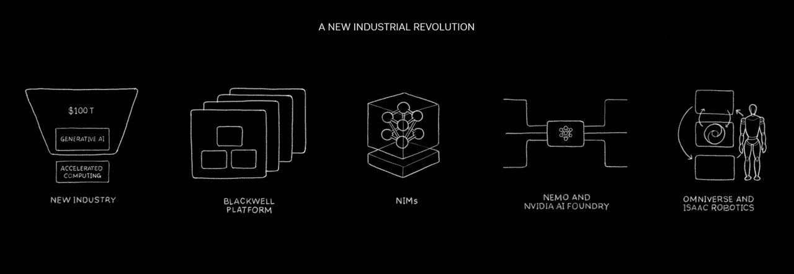

# 第三周｜March

> 来源：[https://docs.feishu.cn/docx/OuNNdVtKgo8JtHxzWnvc4pTPnVf](https://docs.feishu.cn/docx/OuNNdVtKgo8JtHxzWnvc4pTPnVf)

<https://legalstudio.feishu.cn/sync/Lk2tdJ9y6slPw3bGbFEcuRzvnpg>

# **一、法律 AI 资讯**

## 加利福尼亚州发布关于使用生成式 AI 的临时指南

3 月 21 日，加利福尼亚州发布了针对州领导层采购、使用和培训生成式 AI 的临时指南，以备所有州机构考虑试点做准备。

## **AI 初创公司 Borderless A**I 融资 2700 万美元，加速全球招聘

**3** 月 21 日，人力资源技术初创公司 Borderless AI 宣布完成 2700 万美元种子轮融资。该公司提供一个名为 Alberni 的 AI 助手，具有起草雇佣合同、分析法律协议和解决税务查询的能力，自动化员工入职和国际薪资处理等工作，可以帮助人力资源团队削减成本，并加快运营效率。

## 普华永道基于 ContractPodAI 提供新的咨询服务

3 月 19 日，四大会计师事务所之一的普华永道基于 ContractPodAI 的生成式 AI 法律助理“Leah”，推出了一项新的咨询服务，利用 Leah 扩大其交付和实施能力。此前，普华永道与 ContractPodAI 结成联盟。

# **二、法律科技资讯**

## 美国专利商标局扩大允许的电子签名类型

3 月 22 日，美国专利和商标局宣布将允许申报人使用第三方电子签名平台签署专利文件，比如 DocuSign 和 Acrobat Sign 等。

## **替代性法律服务商 Kalexiu**s 收购 Lexoo，增强 CLM 能力

3 月 22 日，替代性法律服务提供商 Kalexius 宣布收购另一家总部位于英国的 ALSP Lexoo，该收购将有助于发展 Kalexius 的合同生命周期管理（CLM）产品。

## **LexisNexis 推出 Litigation Foo**tprint，将法律分析覆盖范围扩大两倍

3 月 20 日，LexisNexis 的法律分析服务商之一的 Lex Machina 宣布推出 Litigation Footprint，这是该公司诉讼分析功能的重大扩展，使其平台上的案件总数增加了两倍。

## 法律科技核心能力认证联盟推出新的供应商联盟

近日，法律科技核心能力认证联盟（LTC4）发起了一个新的供应商联盟，联合四家法律科技培训公司（Intellek、iTrainLegal、Savvy Training 和 Harbor），帮助律师事务所采购法律科技产品，并提高使用这些产品的熟练程度。

## 合规初创公司 SingleFile 增加 650 万美元的种子轮融资

3 月中旬，合规初创公司 SingeFile 完成了 650 万美元的扩展种子轮融资，本轮融资由 Foundry Group 领投，The Legaltech Fund、Underdog Labs 跟投。参与本轮融资的还有多家律师事务所，包括 Wilson Sonsini、Cooley、Fenwick & West、DLA Piper 和 Perkins Coie，以及 K&L Gates 的个人合伙人，这些律师事务所与 Foundry Group 一起，也参加了 SingeFile 之前的种子轮融资，总额为 860 万美元。

SingleFile 由风险投资公司 Pioneer Square Labs 于 2019 年推出，提供一个合规流程自动化平台，可以简化组织对州和地方文件的管理，还支持自动填充合规表、自动付款、状态监控和截止日期警报等功能。

# **三、大模型资讯**

## Around the World

### 微软深夜首推 AI PC，而且 Windows 可以一键召唤 GPT-4 了

美东时间 3 月 21 日周四，生成式 AI 领军的微软又为我们带来了一点小小的震撼。

如果你的 Windows 11 电脑最近更新过系统补丁，就会看到一个新增的 Copilot 预览版按钮。现在，OpenAI 大模型加持的 Copilot 功能也登陆 Windows 了。微软将 Copilot 功能引入整个产品组合，从 Microsoft 365 到 Microsoft Teams、Edge，现在是 100% 整合进了 Windows 系统本身。同时，Copilot 也可以帮助你整理 Teams 在线会议的要点。你的 Email、聊天内容、文件以及互联网上的信息，都可以被大模型处理帮你提升效率。

此外，微软还首次将 AI 融入个人电脑（PC），发布 Surface Pro 10 和 Surface Laptop 6 两款产品，这是首款配备了专用 Copilot AI 按钮的 Surface PC。

> 拓展阅读：

> https://mp.weixin.qq.com/s/Qq0uLKhr8QkghiWVF7mJBg

> https://mp.weixin.qq.com/s/_cXhMMa0enfcaaExE_mcfg

> https://mp.weixin.qq.com/s/n1c2wSK5foWsiy4eacM3pg

### OpenAI 上门推荐 Sora，将密集拜会好莱坞大咖、电影工作室

在短短一个多月时间里，OpenAI 高管们与好莱坞话事人们频频展开接触，而且这种趋势还在延续。有媒体报道称 OpenAI 将在下周前往洛杉矶，与一众好莱坞电影公司、媒体行业高管和经纪公司展开会面。主要目的有二：首先是在娱乐行业建立合作关系，同时鼓励电影制片人将 Sora 工具融入到他们的创作流程中。

OpenAI 在今年 2 月中旬推出新的文本到视频生成模型 Sora。令市场感到震惊的是，虽然这个模型对一些物理关系吃得还不是很透，但光是一句话生成一分钟视频，同时人物形象栩栩如生，又令整个市场经历了一次「ChatGPT 时刻」。事实上，在爆出消息前 OpenAI 已经热切展开接触电影行业的行动。知情人士称，其实在 Sora 发布后的 2 月底，由 OpenAI 首席运营官布拉德·莱特卡普领头，公司已经与好莱坞展开初步对话，并演示了 Sora 的功能。接下来奥尔特曼也跑去参加奥斯卡颁奖典礼的周末派对，试图建立关系。

> 来源：财联社

### 音乐 ChatGPT 时刻来临！Suno V3 秒生爆款歌曲，12 人团队创现象级 AI

最近，AI 初创公司 Suno AI 推出了第一款可制作「广播级」的音乐生成模型——V3，一时间在网上掀起轩然大波。仅用几秒的时间，V3 便可以创作出 2 分钟的完整歌曲。为了激发人们的创作灵感，Suno V3 还新增了丰富的音乐风格和流派选项，比如古典音乐、爵士乐、Hiphop、电子等新潮曲风。现在，Suno V3 已经向所有用户免费开放！

此前，就连好莱坞大导 Tyler Perry 直言，自己在看完 Sora 制作的视频后，直接搁置了自己影视工作室 8 亿美元的扩建计划。现在，除了电影制作领域，音乐行业也即将被 AI 攻陷了。

> 体验地址：https://app.suno.ai

> 拓展阅读：

> https://mp.weixin.qq.com/s/BRzmlw-uE2C6ROF2O2_-nw

> https://mp.weixin.qq.com/s/OBZpjCTXkek8W2w-bzWmmw

### 黄仁勋对话 Transformer 八子：大模型的起源、现在和未来

随着新一波 AI 浪潮席卷而来，英伟达突破 2 万亿美元市值成为最炙手可热的科技公司，今年的 GTC 大会俨然成为年度最受关注的科技行业盛会。四天的数百场主题分享中，英伟达创始人黄仁勋和 Transformer 八子的对谈，无疑是最受关注的场次之一。因为某种意义上，双方正是这波 AI 浪潮的奠基人。

谷歌大脑团队 2017 年发表了一篇名为《注意力就是你所需要的一切（Attention is all you need）》的论文，主要目的是解决自然语言处理领域，使用传统的 RNN（循环神经网络）模型不能解决并行计算，从而导致算法效率低下的问题。这篇文章提出的新的处理架构就是 Transformer 模型，也是今天大模型的基石，而当时这篇文章的八位联名作者今天也被称为 Transformer 八子。几年后八子陆续离开谷歌，今天已经成为 Essential AI、Character.AI 等硅谷重要 AI 公司的创始人或技术核心。

八子在文章中提出了可以解决并行计算问题的新架构，并预言了随着训练规模的提升 AI 会展现出更强大的智能。但这一切需要更庞大的算力支持，而过去十年一直投入研发 GPU 和加速计算的英伟达，则为八子的构想提供了「算力」这个最关键的燃料。于是，就有了 GPT 的诞生以及今天日新月异加速发展的 AGI 浪潮。

在这样的一个时间节点上，黄仁勋和八子这些时代开拓者再次对话，也就有了更多看点。以下是黄仁勋的开场独白和他与八子的对话原文，由极客公园整理编译。

> 拓展阅读：

> https://mp.weixin.qq.com/s/RZtjor1qRjwjI72oDriSrQ

> https://mp.weixin.qq.com/s/Vxmlgh_ldJNa5RNwFSHmUA

### GTC 对话黄仁勋：我眼中的 GPU，和别人有很大差别

当地时间 3 月 19 日，以堪比流行巨星的热度完成了 GTC 2024 开场演讲后第二天，黄仁勋接受了全球媒体采访。

无论是宏大问题如「AGI 何时到来」、「英伟达如何看待中国市场」，或者是具体到新推出的 NIM 软件如何应用，这位全球市值第三公司的掌舵人，都能将问题分解并抽象成更容易理解的层次，用简单的比喻回答出来，虽然其中可能不乏「太极」的嫌疑，但至少令人难以怀疑回答者的诚恳。

两万亿的市值新高度下，老黄认为，GPU 芯片市场，不是英伟达的追求 ——「英伟达不造芯片，英伟达造数据中心」，为此，英伟达搭建了所有：硬件、软件、服务，让客户决定怎么购买自己的数据中心。

GTC 2024 Keynote 演讲中，老黄展示的 5 个要点：新工业革命（加速计算和生成式 AI）下，英伟达的新基建包括：Blackwell 平台；NIMS；NEMO 和 NVIDIA AI Foundry；Omniverse 和 ISAAC 机器人。

> 拓展阅读：

> https://mp.weixin.qq.com/s/jDYy0Cjm0d7DUZi9v7xs_w

> https://mp.weixin.qq.com/s/4Gj0cC4P67seAxw7eVAgvg

### Pika 全面开放 AI 配音和口型同步功能

3 月 19 日，AI 视频生成创企 Pika 宣布现在所有用户都可以使用声音效果，为AI生成的视频配音，口型同步功能也可供所有用户使用。

> 体验地址：http://pika.art

> 来源：X

### OpenAI GPT 商店发展缓慢：多数 GPT 没有用户，开发者信心受损

OpenAI 推出 GPT 商店 4 个月之后，一些通过该商店提供聊天机器人的开发者表示，他们对自己的产品缺少用户感到失望。开发者还表示，在用户分析方面，他们几乎没有得到 OpenAI 的支持。

> 拓展阅读：https://mp.weixin.qq.com/s/FP9zysp6yuRYZlgmwe3TMg

### 英伟达推万亿参数 GPU，继续加速 AGI 时代

3 月 19 日消息，英伟达备受期待的 GTC 大会周一在美国圣何塞会议中心正式开幕。为巩固其作为 AI 公司首选供应商的市场地位，英伟达在 GTC 大会上发布了运行人工智能模型的新一代 Blackwell GPU 架构及 B100 GPU。

英伟达推出的新一代 AI GPU 被命名为 Blackwell，首款 Blackwell 芯片名为 GB200，将于今年晚些时候上市。英伟达正在用更强大的芯片吸引客户、刺激新订单。黄仁勋对此表示：“Blackwell 不是一款芯片，它是平台的名称。”

英伟达还推出名为 NIM 的创新软件，可以让企业“简单粗暴”地部署并利用使用自己数据打造的专属模型，为客户在竞争日益激烈的领域中坚持使用英伟达芯片提供了又一个理由。

与此同时，英伟达还宣布了一个用于制造类人机器人的硬件和软件平台，该平台包括生成式 AI 功能。这个新平台将包括一个为机器人和 AI 提供动力的计算机系统，以及一套包括生成式 AI 和其他工具在内的软件，以制造类人机器人。这个被称为「GR00T 项目」的生成式 AI 组件将添加到英伟达现有的机器人硬件和软件平台上。这套工具被称为「艾萨克」（Isaac）平台，新的 GR00T 生成式 AI 功能被设计用于「任何环境下的任何机器人化身」。

> 拓展阅读：

> https://mp.weixin.qq.com/s/a6D9OgiJuUjHtBQCVgo7mg

> https://mp.weixin.qq.com/s/oYPJqIkLMXwIN-5ts3i33w

> https://mp.weixin.qq.com/s/X7W7OvNgLbBmT2q--dtsEQ

> https://mp.weixin.qq.com/s/wFSw9_6JjcihZLrVYSTIWA

> https://mp.weixin.qq.com/s/jVPBOnC4qbnaEkqq-aGX3A

> https://mp.weixin.qq.com/s/26_wh18ivdCWXSqkvegAsg

> https://mp.weixin.qq.com/s/hrl1uHXewywLVQdfrjp59w

> https://mp.weixin.qq.com/s/qgyB1nxo32JPJzAy8V9tuw

> https://mp.weixin.qq.com/s/EsFkd_isPz2J5wap6KaF5A

> https://mp.weixin.qq.com/s/CKv0u1iqD8Eu_na0Cv9Y-Q

> https://mp.weixin.qq.com/s/OYpC0DE_QLXzyU5mE7-hZQ

> https://mp.weixin.qq.com/s/PQUvzm-dqN-lttDchgyk_A

> https://mp.weixin.qq.com/s/XYAx6iOUPBZPzYxkAHiuCQ

### Sam Altman 专访：关于 GPT-5、Sora、Ilya、Q*、AGI、外星人等一切

Altman 在 3月14 日韩国最新演讲时表示：“虽然 GPT-5 的发布日期尚未确定，但它将作为在高级推理功能方面更进一步的模型取得重大进展。”他还补充道：“很多人质疑 GPT 模型是否存在局限性，但我可以自信地说‘没有’。”这意味着，GPT 模型没有局限性，只要投入足够的计算资源，构建超越人类的 AGI 也并非不可能。

Sam Altman 表示，GPT-5 的性能提升幅度将超出预期，并警告称，忽视这一点会导致“创新的延迟”。

他强调，随着 GPT 下一代模型的开发，企业和日常生活中的各个领域都将不可避免地被取代和消失，因此需要更具创新性的思维方式。这是 Altman 首次对 GPT-5 的性能表现出如此强烈的自信。他还明确表示，他和 OpenAI 的目标是构建“通用人工智能 (AGI)”，并乐观地认为，如果投入大量计算资源来加速 AGI 的到来，那么人工智能 (AI) 计算所需的电力短缺等现实问题将迎刃而解。

> 拓展阅读：

> https://mp.weixin.qq.com/s/Bgu8zxtz7EmZEbMk9kFamQ

> https://mp.weixin.qq.com/s/sgpoVKu5KmFRgjEW-mrZHg

> https://mp.weixin.qq.com/s/kAT052KByU4HN_n4Ks4i8w

> https://mp.weixin.qq.com/s/OsRKcnm9MF2YoWIkklqHMA

> https://mp.weixin.qq.com/s/ycB-gkmQlGQlTXwBYgwCWQ

> https://mp.weixin.qq.com/s/13ETDEBUWc4dLKGJCuJrwg

### iPhone 内置 Gemini？传苹果与谷歌谈判合作

据媒体报道，为了在今年的 iOS 18 中增强 AI 功能，苹果正在与 Google 探讨将 Gemini 整合到 iPhone 中。

这将是两者近二十年来少见的大合作。

2005 年，苹果和 Google 签署了一项当时看上去没什么的协议 —— 让 Google 成为 Mac Safari 浏览器的默认搜索引擎。两年后，苹果将合作范围扩大到初代 iPhone。虽然之后因为与 Android 的竞争，双方关系不再那么友好，但也始终维系着一种微妙的联盟，各取所需。根据美国司法部提供的数据，Google 有近一半流量来自苹果，代价是每年向苹果支付 80 亿至 120 亿美元（成为其默认搜索引擎），相当于苹果近两成净利润。2020 年，美国司法部向 Google 发起了自 2000 年以来最大的反垄断诉讼，核心指控是 Google 通过与苹果等巨头的独家协议限制了竞争。司法部认为类似的不公正交易帮助 Google 排除了竞争对手，使其成为了市占率超过九成的搜索寡头。

现在轮到了苹果出钱找 Google 合作了。

在收入连续数季没有增长和迟迟未交出明显的 AI 进展之后，苹果如今的估值（市盈率 PE = 每股价格 / 每股盈利）已经跌到了和沃尔玛相当的水平（26 倍），远低于微软（37 倍）和英伟达（74 倍）。资产管理公司 Ladenburg Thalmann 首席执行官 Phil Blancato 表示，没有 AI 的苹果变得 “更像可口可乐了”。它变成了巴菲特喜欢的样子 —— 但这不一定是苹果董事会或者投资者希望看到的。

压力之下的库克已经承诺今年将公布 AI 领域的开创性成果。苹果依靠多年的收购和研发积累了一些移动端运行 AI 的优势，但大模型方面还是需要与 Google、OpenAI 等领先公司合作。

> 拓展阅读：https://mp.weixin.qq.com/s/1YQn5dgu2O5gFXGfSaUJ8A

## **东八区**

### 阶跃星辰发布 Step 通用大模型：多模态、MoE、万亿模型参数

3 月 23 日，国内通用大模型创业公司阶跃星辰在 2024 全球开发者先锋大会上发布了公司的通用大模型产品。

阶跃星辰创始人、CEO 姜大昕博士在大会开幕式上对外发布了 Step 系列通用大模型，包括 Step-1 千亿参数语言大模型、Step-1V 千亿参数多模态大模型()以及 Step-2 万亿参数 MoE 语言大模型预览版。

> 拓展阅读：https://mp.weixin.qq.com/s/J1XHChomd-uhydNzpa40-w

### 阿里通义千问重磅升级：免费开放 1000 万字长文档处理

3 月 22 日消息，阿里通义千问重磅升级，向所有人免费开放 1000 万字长文档处理能力，成为全球文档处理容量第一的 AI 应用。即日起，所有金融、法律、科研、医疗、教育等领域的专业人士，都可通过通义千问网站和 APP 快速读研报、分析财报、读科研论文、研判案情、读医疗报告、解读法律条文、分析考试成绩、总结深度文章。

> 来源：快科技

### 消息称百度文心一言下月将免费开放 200 万-500 万长文本能力

3 月 22 日消息，百度文心一言下个月将进行版本升级，届时也将开放长文本能力，文字范围会在 200 万-500 万。目前，文心一言的文本上限大致在 2.8 万字。此前，百度创始人、董事长兼 CEO 李彦宏在财报会议上指出：“2023 年第四季度，大模型为云业务带来约 6.6 亿元收入”。这意味着，在文心一言发布后的首个财年，与智能云业务结合的 AI 大模型，为百度带来了不错的增量收入。

> 来源：IT 之家

### 淘宝“星辰”大模型上线，用于电商场景

近日，淘宝天猫集团自研大模型“淘宝星辰”已经上线官网，这也是淘天集团公开的首个自研大模型。官网除了显示该大模型的介绍外，还设置有“立即体验”和“登录/注册”入口，或将在不久对外开放。

据了解，星辰大模型基于 Transformer 架构，采用半自研的 Megatron-ama 框架进行训练，从海量电商消费数据和公开数据中持续学习，提供电商和生活服务场景增强的文案生成、多轮会话、知识问答、智能决策等能力。

> 拓展阅读：https://mp.weixin.qq.com/s/PD4hXJlwKTtxmvn4A40UhQ

### 猎聘推出 HR 数字助理“多面·Dori”

3 月 21 日，同道猎聘集团董事会主席兼首席执行官戴科彬分享了 AI 时代下的组织审美和人才评鉴的演变趋势，并推出了 HR 数字助理多面·Doris。多面·Doris 是一个数字面试官、组织诊断官，未来还能够进行人才陪练，同时也是员工自助服务伙伴。在 AI 面试方面，多面·Doris 能够对企业岗位胜任力模型进行解构并产生客观的评价标准，还可以对求职者进行自适应提问以挖掘候选人潜能。

据称，目前多面·Doris 可以做到与资深面试官评分的一致性大于 90%，通过全方位智能防作弊系统，作弊检测的准确率可以达到 95% 以上。戴科彬称，和传统线下面试成本相比，多面·Doris 可以节省 5-8 倍的成本，极大降低了招聘成本。此外，多面·Doris 在企业人才评鉴中亦能发挥重要作用，可帮助企业进行人才盘点、晋升评估等。

> 来源：猎聘

### 循环智能与月之暗面合作行业大模型

3 月 22 日，行业大模型解决方案提供商循环智能（Recurrent AI）宣布与研发“Kimi 智能助手”的通用大模型公司月之暗面（Moonshot AI）达成深度战略合作。循环智能将基于月之暗面的通用大模型，为业界提供更优质的针对各种业务场景的行业大模型解决方案及应用。

> 拓展阅读：https://mp.weixin.qq.com/s/flpLYWV5cTMpvbCkJtGBLw

### 360 AI 浏览器 APP 即将上线，支持 500 万字长文本处理

3 月 23 日，360 智脑宣布正式内测 500 万字长文本处理功能，该功能即将入驻 360 AI 浏览器，同时 360 AI 浏览器 APP 也即将上线。

此前 2 月 29 日，360 AI 浏览器已向用户免费开放 100 万字长文本阅读功能，可一分钟读完《三体》，并就文本外的“超纲”问题进行问答和延展学习，此次长文本处理能力进一步提升，将大幅提升用户使用体验。此外，360 AI 浏览器也支持处理视频、音频、网页和论文等常用文档类型，可以帮助用户自动总结要点、生成思维导图等。

> 来源：全天候科技

### 百度智能云千帆 AppBuilder 升级

近日，百度智能云召开千帆产品发布会，宣布升级产业级 AI 原生应用开发平台千帆 AppBuilder，大幅降低 AI 原生应用开发门槛，提升开发效率。据了解，升级后的 AppBuilder 底层由基础组件和高级组件构成，总数多达 55 个。全新发布的百度向量数据库 VDB1.0 可以帮助企业轻松管理数以千万计的文档知识，最大支持百亿向量存储规模、秒级的向量检索速度，VDB1.0 性能最高提升 10 倍。

> 拓展阅读：

> https://mp.weixin.qq.com/s/5q6vhF0h5x-FOdUNA985wA

> https://mp.weixin.qq.com/s/XVbzeCL4dKXIanZMaVG-Ow

### 腾讯四季度研发投入 164.33 亿，AI 大模型助力多业务升级

3 月 20 日，腾讯发布 2023 年第四季度及全年业绩报告，全年研发投入达到 640.78 亿元。自 2018 年以来，腾讯累计研发投入超过 2696.54 亿元。在全球范围内，腾讯专利申请总数超过 7.5 万件，授权专利数量超过 3.7 万件。

技术驱动带来的业务增长在腾讯最新财报中得到体现。腾讯混元大模型自去年 9 月推出后，目前已发展成为领先的基础模型，具备文生图、文生视频等能力，在内部 400 多个业务及场景中接入内测，并已在腾讯会议和腾讯文档推出 AI 助手服务。腾讯云联合生态伙伴，将大模型技术与 20 多个行业结合，提供超 50 个行业大模型解决方案。同时，广告业务依托 AI 技术显著提升广告定向能力，Q4 收入同比增长 21% 至 297.94 亿元。

另外，腾讯还在首度披露腾讯混元采用混合专家模型结构，已扩展为万亿参数规模。

> 来源：腾讯

### 知乎发布 AI 功能“发现·AI 搜索”

3 月 20 日，在“2024 知乎发现大会”上，知乎发布了全新的 AI 功能“发现·AI 搜索”。据介绍，该功能以社区可信的内容为来源，给用户带来集搜索、实时问答和追问功能于一体的全新体验。

> 来源：36氪

### 360 安全大模型 3.0 发布

3 月 20 日，360集团发布了360安全大模型3.0。360安全大模型3.0 框架在构建时充分参考人类大脑的运行逻辑，基于数据、知识、算力优势，训练语言、规划、判别、道德、记忆五大功能中枢。360集团首席科学家兼数字安全集团 CTO 潘剑锋称，360安全大模型3.0不仅实现安全基础知识问答、初级脚本分析等基础能力，且锚定安全行业痛点、革新安全能力体系、引领未来安全实战。

> 来源：中国网报道

### 阿里通义听悟发布音视频问答助手等新功能

3 月19 日，阿里大模型产品「通义听悟」发布多项新功能，上线音视频问答助手“小悟”、一键 AI 改写、思维导图生成等六大功能。其中，音视频问答助手「小悟」支持对单个最长 6 小时、一次性上百条音视频的内容理解问答。

> 拓展阅读：https://mp.weixin.qq.com/s/oKSKjjMFPJnwGKFjgUuTxQ

### 百川智能与北京大学成立“通用人工智能联合实验室”，共同推动大模型技术创新

日前，百川智能与北京大学，在由中国产学研合作促进会主办的第十五届中国产学研合作创新大会上共同签署了“北大 —— 百川通用人工智能联合实验室”的共建协议。双方希望通过项目化运作，实现产学研合作，将北京大学一流的科研团队与百川智能前沿的创新能力形成合力，积极探索大模型在可解释性、安全性、稳定性等层面的创新，解决企业在大模型对齐领域的技术需求，同时为大模型的基础科学研究提供支持。

双方的合作将聚焦于研究和开发先进的大模型对齐技术，确保 AI 系统的行为与人类意图目标相一致。在技术创新和研究方面，将致力于在机器学习、自然语言处理、强化学习等领域进行技术创新；在大模型对齐研究方面，将专注于大模型的通用能力提升，确保AI系统的安全使用。

> 拓展阅读：https://mp.weixin.qq.com/s/sjpUQnJGrn9jbNs31FeRfA

### Longer than long，Kimi 智能助手启动 200 万字无损上下文内测

3 月 18 日，月之暗面（Moonshot AI）宣布在大模型长上下文窗口技术上取得新的突破，Kimi 智能助手已支持 200 万字超长无损上下文。即日开启产品「内测」，感兴趣的用户可以直接在官网 kimi.ai 申请抢先体验。

> 拓展阅读：

> https://mp.weixin.qq.com/s/UjXKic9IAaf55ARqbnJ3Pg

> https://mp.weixin.qq.com/s/agyf3rLCfWoX_7-T8_w5kQ

> https://mp.weixin.qq.com/s/FYtpS0h3ldaLQGggTDk8FQ

> https://mp.weixin.qq.com/s/G8IEYh61bf8rnsDqX8TGOg

### 智慧芽发布 AI 助手，基于垂直领域大模型

3 月 19 日，知识产权创新平台智慧芽发布 AI 助手，支持：AI 问答探索技术方案、自动撰写技术交底书、一键生成技术预研报告、药物/靶点调研报告等功能。

> 拓展阅读：https://mp.weixin.qq.com/s/ZhhlEzxFfsNckmhNDrgGVA

# **四、监管与观点**

## **AI 监管****/政策****动态**

### 联合国大会通过首个关于 AI 的决议草案

当地时间 3 月 21 日，联合国大会投票通过了第一个有关人工智能（AI）的决议草案，以确保这项新技术能够惠及所有国家、尊重人权并且是“安全、可靠和值得信赖的”技术。据了解，这项决议草案旨在消除发达国家和发展中国家之间的数字鸿沟，确保它们在 AI 讨论中处于同等地位，还旨在确保发展中国家拥有利用 AI 的技术和能力。决议草案承认了 AI 发展和使用的加速进程，并强调“迫切需要就安全、可靠和值得信赖的 AI 系统达成全球共识”。决议还承认“AI 系统的治理是一个不断发展的领域”，需要进一步讨论可能的治理方法。

> 来源：央视新闻

### 国家网信办发布《促进和规范数据跨境流动规定》

3 月 22 日，国家互联网信息办公室公布了《促进和规范数据跨境流动规定》。规定明确了重要数据出境安全评估申报标准、免予申报数据出境安全评估、订立个人信息出境标准合同、通过个人信息保护认证的数据出境活动条件以及设立自由贸易试验区负面清单制度等。

其中，规定明确了应当申报数据出境安全评估的两类数据出境活动条件：一是关键信息基础设施运营者向境外提供个人信息或者重要数据；二是关键信息基础设施运营者以外的数据处理者向境外提供重要数据，或者自当年 1 月 1 日起累计向境外提供 100 万人以上个人信息（不含敏感个人信息）或者 1 万人以上敏感个人信息。

规定自公布之日起施行。

> 拓展阅读：

> https://mp.weixin.qq.com/s/9ZTg9lXV🐧BffiJqhR15AQ

> https://mp.weixin.qq.com/s/R15yODGUTUx8XKHJaemlBQ

> https://mp.weixin.qq.com/s/sM4bUkhfSzrXwMZXs1QBmg

### 李飞飞对话英伟达首席科学家：不管那些技术词汇多陌生，我恳求你在 AI 时代中有一个角色

如果说去年的 GTC 炉边谈话，黄仁勋与 OpenAI 首席科学家 Illya 进行的是一场对技术未来的漫谈，那么今年这场炉边谈话就是李飞飞对人类未来的呼吁。

在这次访谈中，李飞飞直接回答关于 AI 的技术发展路径和未来应用这些具体的行业问题，只占了全部讨论的不到 1/4。但这并不是对谈者，英伟达的首席科学家 Bill Dally 没问这些问题。他问了 Sora 的发展会如何影响影视行业，李飞飞的回答却是宫崎骏动画的无可替代，以此证明“只有人能利用 AI 创作那些能触动他人、启发他人或服务他人的内容，而 AI 做不到”。他问了 AI 科学未来的影响，李飞飞的答案是 AI 在医疗领域的应用可能是最深远的。答案很中规中矩，但她的理由是那些在这个领域工作的女性和有色人种可以借由 AI 摆脱艰苦的，被忽视的照护工作；老年人可以通过技术获得更有尊严的暮年。

在其他的时间里，她都在聊公共部门在 AI 发展中面对的困境，聊 AI 的监管模式。这些看似离人们非常远的话题。但她还是站在每个人的角度思考着。公共部门意味着公共利益，意味着与每个人相关，所以只有公共部门得到足够的支持，才能推动科学发现创新、为公众提供客观解释、培养负责任的人才，让 AI 的繁荣落在每一个人头上。

在她那里，所有 AI 的发展都是关于人，具体的人的。

在整场对谈的最后一分钟半，Bill Dally 的问题已经问完。他请李飞飞讲讲她想传递给所有人的话。

李飞飞先讲了自己的故事，一个住在美国乡镇里爱跳舞的女孩的故事 —— 她不是计算机科学家，不是理科毕业的，甚至家里连电脑都没有，但她还是和 AI 产生了如此多的联系，在 AI 的发展中扮演了一个角色。

所以我们不要被那些时髦的术语吓到，不要迷茫于 AI 时代自己的角色。只要把 AI 当成一个工具，人类不仅是工具的创造者，我们也是如何使用工具的决策者。去拥抱它，去做那个决策者，做那个让它被正确使用，变得更好的人。我们在 AI 时代的未来一定会像马丁路德想的那样，让人类文明的弧线朝着正义、希望、仁爱的方向发展。

这就是我们每个人，每个普通人，而非硅谷精英应该在这个 AI 时代里的角色。

这也是这位“AI 教母”对每个人的恳求：在 AI 发展中有一个角色。

> 拓展阅读：https://mp.weixin.qq.com/s/uvvjP4XPLRCk6XQXtl25Jg

### 辛顿、姚期智等中外专家签署“北京共识”：禁止 AI 自行复制

未来生命研究所发起的 “暂停 GPT-4 及以上 AI 系统至少 6 个月研发”公开信发布近一年后，又一则关于 AI 安全与治理相关行业共识达成。3 月 18 日，包括图灵奖得主约书亚·本吉奥、杰弗里·辛顿、姚期智等在内的数十位的中外专家在北京联合签署了由智源研究院发起的《北京 AI 安全国际共识》，涉及 AI 的“风险红线”和“路线”两大块，其中“风险红线包含自主复制、改进”，“权力寻求”、“协助不良行为者”和“欺骗”四个部分。

> 拓展阅读：

> https://mp.weixin.qq.com/s/6adv4IbGGEYTVnVIkHfjmg

> https://mp.weixin.qq.com/s/jm12G_aazzVJnY6hWa6WaQ

## **AI 观点/资讯**

### 谷歌借助 AI 突破：提前 7 天预测洪灾，全球 80 国将受益

近日，谷歌在权威科学期刊《Nature》上公布了一项令人瞩目的科研成果：利用 AI 技术，他们现在能够提前最多 7 天精确预测洪灾的发生。这一技术的推出有望为全球超过 80 个国家和地区的居民提供及时、可靠的洪灾预警，助力减轻自然灾害带来的损失。

> 来源：ITBEAR 科技

### 2024 全球开发者先锋大会开幕，探讨 AGI 与前沿技术

3 月 23 日，上海市人工智能行业协会（SAIA）主办的 2024 全球开发者先锋大会（GDC）在上海举办。

这个活动缘起总理在达沃斯世界经济论坛提出的世界人工智能大会（WAIC），作为 WAIC 聚焦科技和人才力量的重要板块，GDC 已经成为了全球开发者的重要节日，也是技术趋势的风向标。

此前，科技界出现了一股热潮——Sora 火爆全球、苹果发布了 Vision Pro 眼镜、人形机器人开始走向大众……新一轮的技术革命正在酝酿，新的科技范式正在悄然改变。这样的背景下，此次全球开发者先锋大会以「模速空间——开发者的模力之源」为主题，将开发者们聚集在一起，让上海成为全球开发者的欢聚之地。这次大会邀请了 100 多家大模型公司前来展示产品，还有 100 多家国内外知名投资机构前来寻找投资机会。此外，包括 HuggingFace、智源社区在内的国内外 100 多个开发者社区也加入了这场大会。

> 拓展阅读：

> https://mp.weixin.qq.com/s/EBCaqy2dZBA6r_EXdeXtdw

> https://mp.weixin.qq.com/s/Zui6x4vIDJcejOwVZad_lg

### 中国首部 AI 全流程微短剧《中国神话》启播

在中央广播电视总台成立 6 周年之际，3 月 22 日，央视频 AI 微短剧启播暨 AI 频道正式上线，中国首部 AI 全流程微短剧《中国神话》与受众见面。

> 来源：央视新闻

### BBC 考虑训练内部 AI 模型

据媒体报道，英国国家广播公司 BBC 正计划建立自己的 AI 模型，同时就向开发尖端技术的大型科技集团出售广播公司庞大档案的访问权进行谈判。据知情人士透露，BBC 正在寻求利用其数十年的新闻经验来训练大模型。此外，BBC 还与亚马逊等科技公司进行了单独会谈，讨论允许其内容用于构建新应用程序的通用基础模型。

> 来源：金融时报

### 快手 CEO 程一笑放出豪言：自研大模型有信心在半年内达 GPT-4.0 水平

3 月 20 日消息，在快手业绩电话会上，快手创始人兼 CEO 程一笑披露了公司在生成式 AI 领域的新进展。程一笑表示，公司在去年启动 AI 战略后，一步步扎实推进自研大模型的研发训练。

程一笑还放出豪言，声称有信心在未来半年内，使大模型的综合性能达到 GPT-4.0 的水平。同时，他还称快手文生图大模型「可图」综合性能已超过 Midjourney V5 的水平。至于目前大热的文生视频领域，程一笑透露称公司已于去年底推进专项研发。“这对短视频生态来说，是巨大的机会。未来，快手会把生成模型和生产者工具结合起来，不断帮助创作者降低创作门槛，提升短视频制作质量和效率。”

> 来源：IT 之家

### 利物浦用 DeepMind 的 AI 制定战术已有三年了

目前，足球界最炙手可热的年轻教练既不是勒沃库森的阿隆索、兰斯的斯蒂尔，也不是博洛尼亚的莫塔，它可能是个 AI，来自谷歌 DeepMind。

球迷朋友们可能还记得，利物浦在 2019 年 5 月 8 日欧洲冠军联赛半决赛中实现的历史性翻盘。其中最具标志性的时刻是下半场阿诺德出其不意的角球，奥里吉打进了利物浦可能是历史上最伟大的进球。在那场比赛，利物浦上演了不可思议的大逆转，人们称之为“安菲尔德奇迹之夜”，当时克洛普的战术哲学也让很多球迷津津乐道。

赛后的球员访谈中有人提到，利物浦教练组观察到巴塞罗那队定位球防守时习惯于花时间安排站位，所以特意提醒球员可以尝试定位球快发。这不知是看完多少盘录像带才得出的结论。

而现在，AI 已经可以提供不逊于人类专家的战术指导了。在3 月 19 日的《自然》杂志子刊 Nature Communications 中，我们看到了谷歌 DeepMind 与利物浦足球俱乐部合作的一项成果：TacticAI。这是一个通过预测和生成式 AI 为专家提供战术见解的 AI 系统，特别是角球方面的见解。但其实，谷歌 DeepMind 与利物浦足球俱乐部的合作已经持续三年了。某种意义上，TacticAI 可以看作是二者推进 AI 体育分析层面应用的集大成者。

> 论文地址：https://www.nature.com/articles/s41467-024-45965-x

> 拓展阅读：https://mp.weixin.qq.com/s/AO_OY9vHYb3aZS_pbyIrXA

### 让 AI 赋予教师“超能力”，华裔 CEO 获 OpenAI、Index 首轮投资

Class Companion 利用生成式 AI 为 K12 教育阶段的教师和学生提供支持，能即时提供反馈，识别学生进步，致力于提升教育体验，通过 AI 技术减轻教师负担，促进学生学习效率。该平台由华裔 CEO Avery Pan 创立，已获 OpenAI、Index Ventures 等知名机构和天使投资人 400 万美元投资，在美国 10000+ 学校使用，

> 来源：Z Potentials

### 湖南广电集团 AI 导演上岗

3 月 15 日，湖南广电集团首个 AI 导演爱芒（英文名“AIM”）正式以助理导演的身份和观众、网友们见面。这也是国内首个正式上岗的 AI 导演。3 月 17 日午间，该综艺超前企划播出，爱芒正式亮相。《声生不息》系列制片人洪啸说：“AI 导演会倒逼着我们不断地去创新。”

> 拓展阅读：上海证券报

# **五、优质文章分享**

【法律 AI 交流群】每天都会分享法律 AI、法律科技相关的前沿信息，以下为群友分享的优质文章：

+   2024 年第十一期法律科技周报（3.11-3.17）

> 注：与本周重要资讯相关的文章已整合到以上特定资讯下方，不在此处再次列出。