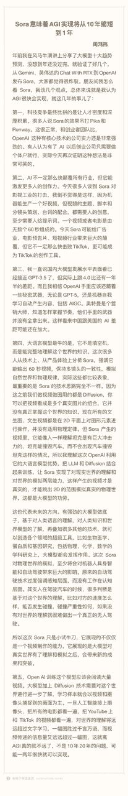

# 第三周｜February

> 来源：[https://docs.feishu.cn/docx/L5RadltfcoglcnxMeAVcx8aTn8b](https://docs.feishu.cn/docx/L5RadltfcoglcnxMeAVcx8aTn8b)

<https://legalstudio.feishu.cn/sync/Lk2tdJ9y6slPw3bGbFEcuRzvnpg>

# **一、法律 AI 资讯**

## **美国伊利诺伊州最高法院组建特别工**作组，调研生成式 AI 的使用和监管方法

近日，美国伊利诺伊州最高法院成立了一个特别工作组，旨在调研生成式 AI 的使用方法，就伊利诺伊州司法部门应如何监管和利用该技术提出建议，并建议将 AI 作为加强运营和客户服务的手段的机会。

## CLM 服务商 Lexion 推出独立生成式 AI 工具

2 月 15 日，合同生命周期管理平台 Lexion 宣布推出一个名为 AI Contract Assist 的生成式 AI 工具。该产品包括 Lexion CLM 平台原有的 AI 合同辅助功能，现在将作为一个独立产品推出，提供合同审查、类聊天机器人的“询问”功能、红线建议和条款生成等功能。

## 法律科技公司 Jus Mundi 推出生成式 AI 法律助手

2 月 13 日，法律科技公司 Jus Mundi 宣布推出一个名为 Jus AI Assistant 的生成式 AI 法律助手。该工具旨在帮助用户进行多种语言的法律研究、分析、起草和翻译，并特别关注仲裁和国际法。

## 美国专利商标局：AI 辅助发明的专利取决于人类作出的「重大贡献」

为了激励、保护和鼓励对通过使用人工智能（AI）实现的创新进行投资，并向公众和美国专利商标局（USPTO）的员工提供 AI 辅助发明之可专利性的清晰度，美国专利商标局于 2 月 12 日发布了一份《AI 辅助发明指南》及示例，旨在明确在 AI 辅助下开发的发明是否可以获得专利，并就指南征求公众意见。

该指南明确指出，**AI 辅助发明并非绝对不可申请专利，但发明应侧重于人类的贡献，因为专利的作用是激**励和奖励人类的聪明才智。对于自然人为此做出“重大贡献”的发明，可以寻求专利保护。

## 美国专利商标局宣布签订价值 7000 万美元的 AI 专利搜索工具合同

2 月 12 日，美国国专利商标局发布了一项采购来源的公告 —— 计划向埃森哲联邦服务公司（Accenture Federal Services）授予价值约 7000 万美元的合同，以采购其 AI 专利搜索功能。

## 美国司法部启动新的人工智能计划，探讨 AI 技术在司法部门的应用

近日，美国司法部正在启动一项人工智能计划，将在未来半年内，邀请多位跨学科专家探讨 AI 技术在司法部门的应用，并向向拜登总统提交一份关于人工智能和刑事司法系统的报告。

# **二、法律科技资讯**

## **诉讼服务公司 Lexitas 收购记录检索公司 Medical** Legal Reproductions

2 月 13 日，诉讼服务公司 Lexitas 宣布收购总部位于美国费城的记录检索公司Medical Legal Reproductions。

## **建筑合同软件公司 Document Cru**nch 完成 900 万美元 A 轮融资

2 月 13 日，为建筑业提供服务的合同软件公司 Document Crunch 宣布完成 900 万美元的 A 轮融资，这笔资金将用于扩大其产品规模及团队。

## **法律实践管理提供商 CARET 与法**律云平台 NetDocuments 集成

2 月 13 日，法律实践管理提供商 CARET 宣布与法律云平台 NetDocuments 集成，旨在加快访问和管理存储在 NetDocuments DMS 中的与法律工作事项相关文件的过程。

## **州**和地方政府技术公司 Avenu Insights & Analytics 收购法院与支付工具服务商 Judicial Innovations

2 月 12 日，州和地方政府技术公司 Avenu Insights & Analytics 宣布收购基于云的法院和支付工具服务商 Judicial Innovations。

# **三、大模型资讯**

## Around the World

### OpenAI 取消 GPT-4 Turbo 所有每日限制

2 月 17 日，OpenAI 在社交平台宣布取消 GPT-4 Turbo 的所有每日限制，并将速率限制提升1倍。现在，每分钟可处理高达 150 万 TPM 的数据。OpenAI 这一周的连续王炸组合拳，从 ChatGPT 增加 “记忆存储”，到视频模型 Sora 再到 GPT-4 Turbo 全面取消每日限制，打的谷歌、Meta 有点晕头转向抢尽风头。对于用户来说，只希望巨头之间撕的更凶一些，这样咱们看到的、得到的、用到的也就更多。

> 拓展阅读：https://mp.weixin.qq.com/s/u3Bm3bMSLMuqJrSFZ_egZw

### OpenAI 发布文生视频模型 Sora，震撼科技圈

2 月 16 日凌晨，OpenAI 在官网博客中介绍了其最新的 AI 模型——**文**生视频模型 Sora，可以根据人们的文本描述生成原始视频。在放出的演示视频中，Sora 可以生成清晰准确的角色，远景、近景交错但主题一致的视频，并且可以一次性生成最长 60s 的视频。看着这些视频，AI 根据剧本自动生成好莱坞电影，似乎已经向我们走来。

> 拓展阅读：

> https://mp.weixin.qq.com/s/93z4Ta91yLv7PB1pnBM9mg

> https://mp.weixin.qq.com/s/m-Ege3_APDIZzV8vzeKdJw

> https://mp.weixin.qq.com/s/H2SDgcm08edUHXn4ETFzKA

> https://mp.weixin.qq.com/s/iSmnnjQl84HHWKgtTRZ4iw

> https://mp.weixin.qq.com/s/kKzUUnVJzGm3Ke6fR7cI4g

> https://mp.weixin.qq.com/s/_ckq6uZyvRgZvJJKVeZZ2w

> https://mp.weixin.qq.com/s/VfYX1xxYxprk42zzUVknfw

> https://mp.weixin.qq.com/s/ODsebK3fEc-adRDwRVDhQA

> https://mp.weixin.qq.com/s/gSvxvOVqYtGcKw0ueDGbFA

> https://mp.weixin.qq.com/s/2CokvKcRFt79b_73DZlLMw

> https://mp.weixin.qq.com/s/Mez7DpXi2zsJDEXBfQ7yEg

> https://mp.weixin.qq.com/s/m8DtOLmn_JkqZ5D5NYLIhA

> https://mp.weixin.qq.com/s/g-DZU9RKMRyQObp0q3m8wA

> https://mp.weixin.qq.com/s/f-gWdiwWPvV5PX-dFIUXaA

> https://mp.weixin.qq.com/s/U5_Wvo9rdDUjAH0SG748rQ

> https://mp.weixin.qq.com/s/FqO2OgM2VaDCkKaoJAzZGQ

### OpenAI 测试新功能，让 ChatGPT「长记性」

美东时间 2 月 13 日，OpenAI 发布官方博客文章，披露本周将面向一小批 ChatGPT 免费版的用户和 Plus 付费版的用户测试一项新功能 —— 让 ChatGPT 未来可以记得用户之前和它对话时说过的重要信息，并将很快公布向更大众群体用户推出新功能的计划。据 OpenAI 介绍，在与 ChatGPT 聊天时，用户可以要求它记住特定的内容，或是让它自行获取详细信息。用得越多，ChatGPT 的记忆力就会越好。

> 拓展阅读：

> https://mp.weixin.qq.com/s/RNQIGVh5ymXpZ9KMCpNXfQ

> https://mp.weixin.qq.com/s/SINusNr9K6g4R7bY8Qea7g

> https://mp.weixin.qq.com/s/tJX4wveF1XjmM-2W0FaSRQ

> https://mp.weixin.qq.com/s/RmfPLVMArfC6HcAZaOJDbw

## **东八区**

🈚️。

# **四、监管与观点**

## **AI 监管****/政策****动态**

暂无。

## **AI 观点/资讯**

### YC 发布了 2024 年关注的 20 个创业方向，覆盖 AI、机器人、空间计算、企业服务、开源软件、自动化....

Y Combinator (YC) 的“初创公司要求”（Request for Startups，RFS）是鼓励创业者关注并探索特定领域或问题的一种方式。发布 RFS 的传统已经在 YC 持续了十多年，目的在于识别和促进对社会、技术或经济具有潜在重大影响的创新解决方案。通过 RFS，YC 希望能够吸引对这些领域充满热情和有能力的创业者，进而推动相关行业的发展和创新，以下是 YC 在本周最新发布的 20 个 RFS 2024 创业方向👇

> 拓展阅读：https://mp.weixin.qq.com/s/JKeCzuXSbLCXgQJiJNIpDA

### 周鸿祎谈视频模型 Sora：未必短期能击败 TikTok

近日，360 董事长周鸿祎谈到了 OpenAI 发布的文字转视频模型 Sora。周鸿祎表示，AI 不一定会那么快颠覆所有行业，但它能激发更多人的创作力。很多人谈到 Sora 对影视工业的打击，周鸿祎倒不觉得是这样，因为机器虽然能生产一个好视频，但视频的主题、脚本和分镜头策划、台词的配合，都需要人的创意至少需要人给提示词。

周鸿祎表示，一个视频或者电影是由无数个 60 秒组成的。今天 Sora 可能会给广告业、电影预告片、短视频行业带来巨大的颠覆，但它不一定那么快击败 TikTok，更可能成为 TikTok 的创作工具。

# **五、优质文章分享**

【法律 AI 交流群】每天都会分享法律 AI、法律科技相关的前沿信息，以下为群友分享的优质文章：

+   2024 年第五期法律科技周报（1.29-2.4）

> 注：与本周重要资讯相关的文章已整合到以上特定资讯下方，不在此处再次列出。