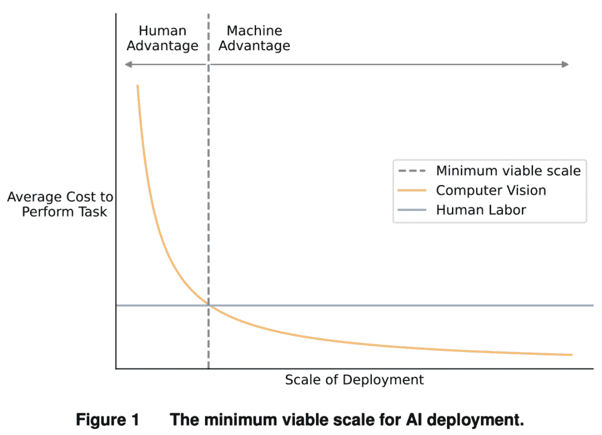

# 第四周｜January

> 来源：[https://docs.feishu.cn/docx/EyQGd57PcoF34fxd0y4cM695ncf](https://docs.feishu.cn/docx/EyQGd57PcoF34fxd0y4cM695ncf)

<https://legalstudio.feishu.cn/sync/Lk2tdJ9y6slPw3bGbFEcuRzvnpg>

# **一、法律 AI 资讯**

## 美国新泽西州最高法院就在法律实践中使用 AI 提出初步指导方针

近日，新泽西州最高法院就在法律实践中使用 AI 提出一项初步指导方针，强调对 AI 工具的谨慎使用，并提出避免潜在陷阱的重要性。具体来说，法院告诫律师们要注意避免诸如“假判例法”这样的问题。

## **生成式 AI 合同 Spellboo**k 完成 2000 万美元的 A 轮融资

1 月 24 日，生成式 AI 合同起草和谈判服务商 Spellbook 宣布完成 2000 万美元的 A 轮融资，本轮融资由 Inovia Capital 领投，现有投资者 Thomson Reuters Ventures、The LegalTech Fund 和 Moxxie Ventures 等跟投。

## **流程服务、电子归档技术服务商 Proof Technologi**es 完成 3040 万美元 B 轮融资

1 月 25 日，流程服务、电子归档技术服务商 Proof Technologies 宣布人完成 3040 万美元的 B 轮融资，本轮融资由 Long Ridge Equity Partners 领投，Blue Heron Capital 和 The LegalTech Fund 跟投。

## 汤森路透推出一系列新的生成式 AI 功能

1 月 24 日，汤森路透宣布在其法律起草和法律研究平台 Practical Law 中发布两个生成式 AI 功能，同时扩展其独立产品 CoCounsel Core。这是汤森路透在近三个月内实现的第二和第三次生成式 AI 集成。

## 金融和法律科技公司 AffiniPay 推出生成式 AI 文档功能

1 月 24 日，金融和法律科技公司 AffiniPay 推出一个名为 AffiniPay IQ 的生成式 AI 功能，目前包括两个功能：文档摘要和文本编辑。AffiniPay IQ 目前在其 MyCase 平台内提供测试版，预计于第二季度正式发布，届时这些功能也将扩展到 CASEpeer 和 LawPay 等产品。

## Winston & Strawn 律师事务所成立 AI 战略小组

1 月 24 日，Winston & Strawn  律师事务所宣布成立一个 AI 战略小组。该小组将负责协调各行业在采纳和规范 AI 方面，全方位的交易、诉讼、监管和咨询服务，并特别关注生成式 AI。

## **德勤推出生成式 AI 解决方案**

1 月 23 日，专业服务公司德勤宣布在电子发现平台 Relativity 上推出一个名为 NavigAite 的生成式 AI 产品，提供 AI 增强的文档审查功能，包括文档总结、响应性、特权和个人身份信息（PII）呼叫以及初始合同审查等功能，帮助用户更快、更准确地访问大量的结构化和非结构化数据。

## **ELM 和 CLM 服务商 Onit **为法务部门推出生成式 AI 法律运营助理

1 月 23 日，企业法律管理（ELM）和合同生命周期管理（CLM）提供商 Onit 推出一个名为 Catalyst Virtual Assistant for Legal Operations 的 AI 律师助手，支持自动填充法律服务或合同相关需求；根据存储在 OnitX 平台中的法律服务请求、事项和合同数据回答问题；起草后续的电子邮件并总结传入的电子邮件；翻译不同语言等。

## 生成式 AI 法律初创公司 CallidusAI 完成新一轮融资

1 月 23 日，生成式 AI 法律初创公司 CallidusAI 宣布完成新一轮融资，本轮融资的领投方是由斯坦福大学教授、Google Brain、Landing AI 和 DeepLearning.AI 创始人 Andrew Ng 创立的人工智能（AI）基金。

## CLM 服务商 Evisort 推出自定义生成式 AI 模型构建工具

1 月 23 日，合同生命周期管理（CLM）提供商 Evisort 推出一个名为 Document X-Ray 的合同分析解决方案，支持用户通过自然语言对话从其合同中提取数据，并将用户关于其合同的问题转化为自定义/定制的人工智能模型。

## 佛罗里达州律师协会发布生成式 AI 道德指南

近日，美国佛罗里达州律师协会针对 AI 技术在法律实践中的应用，发布了一份《生成式人工智能在法律实践中的实用指南》，以帮助律师遵循他们的职业道德责任。

## **20 家**律师事务所或企业领导人被尊为人工智能有远见者

1 月 22 日，来自 DLA Piper、Morrison Foerster LLP、Microsoft Corp.和 Salesforce.com Inc. 等律所或公司的领导人被法律科技公司 Relativity ODA LLC 评为 2024 年人工智能愿景家年度名单。

# **二、法律科技资讯**

## 替代性法律服务提供商 Harbor 推出创新实验室

1 月 25 日，替代性法律服务提供商 Harbor Global LLC 推出一个名为 Harbor Labs 的创新实验室，专注于用先进的技术和流程为律师事务所和公司法律部门开发解决方案。

## **电子发现服务商 Complete Legal **收购 Frontline 的电子发现业务

1 月 24 日，电子发现服务商 Complete Legal 宣布收购替代性法律服务商 Frontline Managed Services 的电子发现业务。几周前，Complete Legal 还与另外两家电子发现和法律支持公司合并 —— L2 Services 和 Precise Legal。

## 拥抱数智时代，最受上海律师欢迎的法律科技产品大赛正式启动

为深入贯彻落实市委办公厅、市政府办公厅《关于推动上海法律科技应用和发展的工作方案》（沪委办发〔2023〕20号）、市政府办公厅《关于印发<发挥城市功能优势 做强律师事务所品牌 加快推动上海国际法律服务中心建设的若干措施>的通知》（沪府办规〔2023〕32号）的相关工作要求，鼓励律师运用信息技术工具，借助智能化应用，高效开展法律服务活动，上海市律师协会将于 2024 年 1 月至 8 月，举办“2024 年度最受上海律师欢迎的法律科技产品大赛”，于 1 月 23 日（周二）举办启动仪式。

# **三、大模型资讯**

## Around the World

### ChatGPT 惊艳更新！一个 @ 让三百万 GPTs 为你打工

ChatGPT**悄悄更新**个大功能！看起来要把插件系统迭代掉了。部分(灰度)用户已经收到这样的提示：

现在可以**在对话中 @ 任意 GPT Store **里的 GPTs，就像在群聊中 @ 一个人。

**体验到的博主 Dan **Shipper 第一时间录视频激动地分享：一个改变游戏规则的功能。

更多网友体验后发现，这还意味着不**同的 GPTs 之间从此可以**共享上下文。目前整个 GPT Store 中 GPTs 的数量已经超过 300 万，结合多款 GPTs 打造和执行工作流程，也就是让去 AI 打工，自己当老板。

> 拓展阅读：

> https://mp.weixin.qq.com/s/mnvuteSe8cC41lAqU4lVzA

> https://mp.weixin.qq.com/s/sGUA4LXojSicpVFea3u8jg

### ChatGPT 模型大更新！全新大、小文本嵌入模型，API 价格大降价！

1 月 26 日凌晨，OpenAI 在官网对 ChatGPT 模型进行了大更新，发布了两款全新大、小文本嵌入模型，全新的 GPT-4 Turbo 模型（修复懒惰行为），免费的审核模型，并对新的 GPT-3.5 Turbo 模型 API 进行了大幅度降价。

OpenAI 还将推出全新的 API 秘钥和可视化管理方法，帮助开发人员更简单、直观**地**观察 API 使用情况，并对 API 密钥设置更详细的使用权限。值得一提的是，全新的嵌入模型可以为 ChatGPT 、Assistants API 中的知识检索以及很多检索增强生成式开发工具提供技术支持。

> 拓展阅读：

> https://mp.weixin.qq.com/s/7AUnXfJR5WOLnjHtyVYpGw

> https://mp.weixin.qq.com/s/n7z2yYRQ0-eWZ75FHTo32Q

> https://mp.weixin.qq.com/s/6deJkhCniZPCMdZdy1T2Yg

> https://mp.weixin.qq.com/s/EUYSXkdd8xYUxFz8JUTC_g

> https://mp.weixin.qq.com/s/FMKIFzC9SCbtA9NuQHhAWw

### 彭博社推出 AI 驱动的财报电话会议摘要

1 月 23 日，彭博社宣布在其终端上推出 AI 驱动的财报电话会议摘要应用，助力分析师的研究过程。

这个新工具结合了彭博的专业领域知识和 AI 技术，专业分析师对模型进行了训练，使模型能更好地理解金融语言和投资者的优先事项，可以帮助用户解读复杂的财务信息，并快速提取涉及公司管理团队所关切主题的重要见解，例如业绩指引、资本配置、招聘和人力计划、宏观环境、新产品、供应链问题和消费需求等。

> 来源：彭博社

### IBM 用生成式 AI 工具帮足球队招募新球员

1 月 23 日，IBM 和塞维利亚足球俱乐部推出一个名为 Scout Advisor 的生成式 AI 工具，该工具可以搜索和分析俱乐部现有数据库中的信息，以评估新球员。

> 拓展阅读：https://mp.weixin.qq.com/s/TX3zpidhedyWm2owuseV0w

### OpenAI 筹划自制芯片

1 月 22 日消息，“担忧人工智能芯片短缺，（美国人工智能研究公司）OpenAI 正在讨论解决方案。”21 日，印度《铸币报》汇总多家外媒的报道称，OpenAI 给出的解决方案是成立一家芯片制造公司，OpenAI 的 CEO Sam Altman 正在说服潜在投资者加入这一计划。随着企业和消费者对人工智能（AI）应用兴趣的日益浓厚，对人工智能芯片的需求也在强势上涨。然而，目前这些需求几乎都集中在业内顶尖的那一两家公司身上，相关芯片供不应求，这促使以 OpenAI 为代表的AI研发企业开始考虑走上自己生产AI芯片的道路。

> 来源：财联社

### OpenAI CEO 本周访韩，或与 SK 集团会长讨论 AI 芯片合作

1 月 21 日消息，知情人士透露，OpenAI 的 CEO Sam Altman 本周访问韩国首尔，期间可能同 SK 集团会长崔泰源会面，或讨论人工智能芯片合作事宜。还有猜测称，奥特曼可能会与三星电子讨论代工和 HBM 合作事宜。

> 来源：界面新闻

## **东八区**

### 腾讯文档智能助手开启公测

1 月 26 日，腾讯文档智能助手正式开启公测，全面应用于 Word、Excel、PPT、PDF、智能文档、收集表、思维导图等文档类型。此次公测腾讯文档 AI 能力带来全新升级，涵盖了文本内容秒级处理、函数公式运算应用、表格数据精准呈现、PPT 快速生成美化、收集结果自动分析、思维导图一键生成等多项能力，并支持跨品类文档内容畅通流转。即日起，智能助手将面向全体用户陆续开放体验。

> 拓展阅读：https://mp.weixin.qq.com/s/9WkcnFf6ttt23-Ycjut0DA

### 每期 100,000 元，史上最“豪”AI 原生应用开发挑战赛正式启动

近日，百度智能云推出千帆杯·AI 原生应用开发挑战赛，旨在激发广大开发者的创意潜能，推动 AI 原生应用在中国市场的蓬勃发展。大赛以“创意无限·生成未来”为主题，紧密围绕当前 AI 技术的前沿动态和应用趋势，借助百度智能云千帆 AppBuilder 和 ModelBuilder 两大智能开发助手，鼓励参赛者打造出更多具有创新性、实用性和社会价值的 AI 原生应用。我们期待这些应用为用户带来更加智能、便捷和个性化的交互体验，共同开启 AI 原生应用的新篇章。诚挚邀请广大开发者积极参与，共同见证 AI 技术的无限可能。

> 拓展阅读：https://mp.weixin.qq.com/s/xopN5J-9fi8YEWK1p8D1aA

### 中文性能反超 VLM 顶流 GPT-4V，阿里 Qwen-VL 超大杯限免！解决看图秒写编程视觉难题

最近，通义千问实火。前段时间被网友玩疯的全民舞王，让「AI 科目三」频频登上热搜。让甄嬛、慈禧、马斯克、猫主子和兵马俑能跳舞那款 AI，就藏在通义千问 APP 背后。就在这几天，通义千问团队又对多模态大模型下手了 —— 再一次升级通义千问视觉语言模型 Qwen-VL，继 Plus 版本之后，又推出 Max 版本。

Qwen-VL 是阿里在 2023 年 8 月推出的具备图文理解能力的大模型，基于通义千问语言模型开发。升级后的 Qwen-VL 视觉水平大幅提升，对很多图片的理解水平接近人类。并且，还能够支持百万像素以上的高清分辨率图，以及各种极端长宽比的图片。升级版模型限时免费，在通义千问官网和 APP 都可体验，API 也可免费调用。

> 拓展阅读：

> https://mp.weixin.qq.com/s/G2RKGBXkUI6btwgbhJziKw

> https://mp.weixin.qq.com/s/G4iOu0E5yYvGkO0QjQFMAQ

### 剪映小规模测试 AI 克隆音色功能

近日，字节跳动旗下剪辑软件剪映开启克隆音色功能的小规模测试，大约 10% 的用户获得了体验资格，月底可能会全量上线。该功能只支持即时朗读随机文本录音输入，不支持上传音频用于克隆音色，大约需要 5-10 秒的录制即可生成。

> 拓展阅读：https://mp.weixin.qq.com/s/nHIPaq4evPbvSQS1ctYZrA

### 夸克上线大模型新产品“AI PPT”

日前，依托自研大模型，夸克App推出全新产品“AI PPT”。用户仅需输入 PPT 主题，就能在几十秒内生成一份精美专业的 PPT 文档。“AI PPT”可以根据用户输入的主题或按照内容分类生成 PPT 模板，还可以根据用户提供的主题生成平均页数在 25 页以上的智能大纲，还能够在每页中在线调整结构、文字、图片。夸克“AI PPT”依托千亿参数的自研大模型和数据精调，把制作PPT的过程进行了结构化处理，提供了更加智能的使用体验。与市场上同类产品相比，夸克文档推出的“AI PPT”具有更智能、更专业、更易操作三大特点，让用户在手机端就能完成PPT创作，并联合iSlide等行业头部平台，提供海量和专业的各类模板。

> 来源：夸克App

### 澜舟科技孟子大模型开放公众服务

1 月** 25 **日**，据澜舟**科**技微信公众**号**今日发文**表**示，**澜舟科技孟子 GPT 大模型近日正式通过网信办生成式 AI 备案，正式面向公众开放服务。孟子 GPT 大模型是澜舟科技研发的生成式可控大语言模型，能够通过多轮对话帮助用户在特定场景中完成各种工作任务，包括知识问答、通用写作、多语言翻译、金融场景和编程等任务。

澜舟科技本次对外开放将上线四款大模型产品，包括：

1.  **孟子大模型-轻量 **：提供语言理解、多轮对话等基本能力，适用于对调用成本和生成速度比较敏感且任务较为简单的场景，如聊天对话、常识性问答、总结摘要等任务。

1.  **孟子大模型-标准** ：拥有强大的自然语言处理能力，能更好地支持角色扮演、阅读理解、文案写作、多轮对话等多种复杂任务，助力企业及开发者加快实现数字化转型。

1.  **孟子大模型-金融** ：针对金融领域进行了深度训练和优化。它擅长解答用户在金融市场、投资理财等相关主题的问题，还可以编写市场分析文章、研究报告，完成金融信息的深度加工。

1.  **孟子大模型-编程** ：支持 100 多种编程语言。专为金融编程任务优化，保持通用编程能力的同时，在数据分析、金融指标计算、Text2SQL 等任务中也有卓越表现。同时新增加了软件开发需求文档写作能力，涵盖软件生命周期各阶段的文档编写。

> 体验地址：https://www.langboat.com/product/mchat

> 拓展阅读：https://mp.weixin.qq.com/s/XkJTvo4kx1wC3MNcnebkXQ

### 微信 AI 官宣对话开放平台新进展

微信 AI 官方发文表示，在 2024 微信公开课上，微信 AI 团队展示了微信对话开放平台的新进展，以及全新的桌面效率工具小微助手。微信对话开放平台能够帮助开发者和商家快速搭建一个零成本、低门槛，满足自身业务需要的对话机器人；“小微助手”是桌面助手工具，用户可通过对话的形式实现与 PC 端的交互。

> 拓展阅读：https://mp.weixin.qq.com/s/r7iMeloRXzHveklP_SGzkQ

### 第四范式“式说”大模型通过国家备案

近日，第四范式「式说」大模型正式通过国家《生成式人工智能服务管理暂行办法》备案许可。

「式说」大模型于 2023 年 2 月发布并经过不断迭代，致力于用生成式 AI 改造企业软件（AIGS），先后与金融、零售、制造、物流、教育、医疗等行业客户开展大模型合作。后续，式说将继续深化与企业客户在大模型侧的联合探索，提供更加可靠的服务。

> 拓展阅读：https://mp.weixin.qq.com/s/Mj0iUtiwNNUDqR2BoySjnA

### 大模型应用 GPT-BI 在中国一汽上线

1 月 22 日，阿里云宣布由中国一汽联合阿里云通义千问打造的大模型应用 GPT-BI 率先落地。该应用可以通过自然语言查询，结合企业数据自动生成分析图表，目前可达到近 90% 的准确率。相比传统 BI（Business Intelligence）的“固定问答”，它能实现问答任意组合，数据随时穿透，做到“问答即洞察”。

据介绍，中国一汽正在积极探索“GPT+”的大模型创新范式，GPT-BI 不仅是中国一汽的首个大模型落地案例，也是汽车行业的首个大模型 BI 应用。基于 GPT-BI 等真实业务场景的探索，中国一汽将利用大量高质量数据资产，在“阿里云百炼”一站式大模型应用开发平台上打造面向研发、制造、售后服务等多领域的垂直大模型。同时，阿里云正在推动通义千问大模型在航空、汽车等不同行业的落地应用。

> 拓展阅读：https://mp.weixin.qq.com/s/AurWd9GVESKd9d9wdzKqqw

### “哄女友挑战”上线即爆火，两天烧掉 10 亿 token，AI 已通关

上周末，一款名为**「哄哄模拟器」**的产品迅速走红，这款产品由 AI 扮演生气的男/女朋友，限定对话次数训练，以帮助你提高获得原谅的水平。以下是这款产品的开发者王登科的自述文章，这篇文章记录了他开发「哄哄模拟器」以及经历其走红的过程。

> 拓展阅读：

> https://mp.weixin.qq.com/s/UKtwt9Ni6tJ643ay9B5w1A

> https://mp.weixin.qq.com/s/dwMfX5oapdvXmEQmLbQIiw

> https://mp.weixin.qq.com/s/RAy9USdZwl1Ko5LgwQpzAg

### 零一万物 Yi-VL 多模态大模型开源，MMMU、CMMMU 两大权威榜单领先

**1 月 22 日，零一万物 Yi 系列**模型家族**迎来新成员：Yi Vision Language（Yi-V**L）多模态语言大模型面向全球开源。据悉，Yi-VL 模型基于 Yi 语言模型开发，包括 Yi-VL-34B 和 Yi-VL-6B 两个版本。据悉，在全新多模态基准测试 MMMU 中，Yi-VL-34B 以 41.6% 的准确率，成功超越了一系列多模态大模型，仅次于 GPT-4V（55.7%），具有较强的跨学科知识理解和应用能力。

> Yi-VL 模型开源地址：

> https://huggingface.co/01-ai

> https://www.modelscope.cn/organization/01ai

> 拓展阅读：

> https://mp.weixin.qq.com/s/LXrEFN7chMGas7yTytC52w

> https://mp.weixin.qq.com/s/msAg51bIySqvhZT3MrJXKg

### 腾讯云智能推出 2024 年合作伙伴扶持计划

1 月 18 日，在 2024 腾讯**产业合作伙伴大会上，腾讯云智**能正式推出 2024 年合作伙伴扶持计划。通过品牌认证和丰富资源，助力伙伴抓住大模型时代新机遇，携手共赢。

> 拓展阅读：https://mp.weixin.qq.com/s/1nvT7u3sZB2E0agbJQ0WMA

### 美图真靠大模型获利了

原先做美颜软件、自拍相机的美图预计，2023 年调整净利润 3.3 亿元至 3.7 亿元，同比增长 2 倍至 2.3 倍，部分得益于增加了 AI 视觉创作等生成式 AI 工具，用户付费意愿提升。早前数据显示，截至去年 6 月，美图影像设计产品付费用户同比增加了 44%。

> 来源：晚点财经

# **四、监管与观点**

## **AI 监管****/政策****动态**

### 美国国家 AI 研究资源试点项目上线，NASA、英伟达、OpenAI 等捐赠关键基础资源

为确保美国在 AI 技术领域的领先地位，拜登政府在几个月**前**发布 AI 行政命令。该行政命令指出，将通过国家人工智能研究资源试点（National AI Research Resource，NAIRR）促进美国各地的 AI 研究。

2024** 年 **1** 月 24** **日，美国国家**科学基金会（ NSF ）正式启动这个庞大的试点项目，让更多美国研究人员和学校（而不仅仅是财力雄厚的科技公司或精英大学及其研究人员）获得计算资源。NSF 联合了 10 个联邦机构以及多家私营企业、非盈利组织等机构组成联盟，为有抱负的 AI 科学家和工程师提供各种 AI 相关基础设施资源，包括数据集、AI 模型、软件和培训资源等。

NAIRR 官网介绍：“国家人工智能研究资源（NAIRR）是一个共享国家研究基础设施的概念，旨在确保广泛的研究和教育界都能公平获取到关键的 AI 基础资源和工具。政府称，该计划将使研究资源获取民主化，保持美国的国际竞争力。” 未来三年内，整个项目每年有 8 亿美元预算。当然，顺利拿到这笔资助的前提是 CREATE AI ACT 能够在国会通过，该法案主要敦促国会充分授权和资助 NAIRR。NSF 表示，研究人员可以通过网站申请访问 NAIRR 的试点项目。如果被授予访问权限，研究人员就可以使用昂贵、能力强劲的基础服务，比如微软 Azure 或 Amazon Bedrock，通常这些服务都要花费不菲的研究资金才能获得。

除了 NSF，与 NAIRR 合作的政府机构还包括国防高级研究计划局、美国宇航局、美国国立卫生研究院、美国国家标准与技术研究院、美国国家海洋和大气管理局、农业部、国防部、能源部、退伍军人事务部以及美国专利商标局。这些政府机构既提供资源（如数据集和咨询），又在各自的专业领域与申请人合作。比如，NASA 将向研究人员提供数据集和实践教程。五角大楼将帮助管理和分配计算资源，而美国国立卫生研究院将帮助重点关注医疗保健相关项目。除了政府机构，OpenAI、Anthropic、英伟达、Meta、亚马逊、微软等二十多家科技公司也以某种方式为试点项目提供资源，做出贡献。

> 参考链接：https://nairrpilot.org/

> https://new.nsf.gov/news/democratizing-future-ai-rd-nsf-launch-national-ai

> 拓展阅读：https://mp.weixin.qq.com/s/g23pXGxU3Lrr4VYmImX29w

### 欧盟委员会将设立人工智能办公室

1** **月 24 日，欧盟委员会推出了一系列措施，支持欧洲初创企业和中小企业开发尊重欧盟价值观和规则的值得信赖的人工智能，其中包括设立欧洲人工智能办公室（European Artificial Intelligence Office）。

人工智能办公室将在《人工智能法》的执行架构中发挥关键作用，该法案是欧盟监管人工智能的里程碑式法律，该法案预计在未来几周内根据 12 月达成的合意安排而最终通过。

设立人工智能办公室来统一执行《人工智能法》项下系列规则的想法来自欧洲议会。在谈判期间，它从一个与机构稍有出入的组织被缩减到被纳入欧盟委员会。但是，人工智能办公室将获得多少自主权仍然在欧洲委员会内部存在不确定性，尤其是目前尚不清楚它是否会成为拥有自己政治目标的实体，还是成为 AI 法案主管单位的一个延伸。

> 拓展阅读：https://mp.weixin.qq.com/s/6AGP9Q1Ai6fEHVqwiyko0Q

### 工信部等：建设适用于生成式 AI 的行业数据集

1 月 25 日，工业和信息化部等九部门发布关于印发《原材料工业数字化转型工作方案（2024—2026年）》的通知。方案提出，建设适用于生成式 AI 的行业数据集，基于现有通用大模型技术底座进行定制化开发训练，构建细分行业大模型，面向新材料研发、供应链优化、大宗商品价格预测等应用需求，加快大模型技术深度创新。强化 AI 驱动，探索建立原材料企业与 AI 企业之间的需求匹配和创新协同机制，加快推进 AI 技术赋能原材料工业。建设 1 个新材料大数据中心、4 个重点行业数字化转型推进中心、4 个重点行业制造业创新中心、5 个以上工业互联网标识解析二级节点、6 个以上行业级工业互联网平台。

> 《原材料工业数字化转型工作方案（2024—2026年）》原文地址：https://wap.miit.gov.cn/zwgk/zcwj/wjfb/tz/art/2024/art_dd08e0bf4c50452fab4961c9fced4da6.html

## **AI 观点/资讯**

### OpenAI 联创 Karpathy 发文：用自动驾驶诠释 AGI！原贴已删速收藏

对于「通用人工智能」，OpenAI 科学家 Karpathy 下场做出了解释。前几天，Karpathy 在个人 blog 发表了一篇文章「将自动驾驶作为 AGI 的一个案例来研究」。不知是何原因，他却删除了这篇文章，幸而，还有网络备份。

众所周知，Karpathy 不仅是 OpenAI 的创始成员之一，还曾是特斯拉前 AI 高级总监、自动驾驶 Autopilot 负责人。他将自动驾驶作为案例，研究 AGI，这篇文章的观点确实值得一看。

> 拓展阅读：https://mp.weixin.qq.com/s/g2qttJTorappxwDFK9rYiQ

### MIT 最新研究：在绝大多数工作中，人类比 AI 性价比高

近日，麻省理工学院（MIT）和 IBM 的研究人员发表一篇论文，提出目前 AI 还无法以具有成本效益的方式取代大多数工作，AI 取代人类工作将是渐进的。研究结果表明，以当前成本，只有 23% 的视觉任务的工人工资可以被 AI 有效取代；在其他情况下，由于AI辅助视觉识别的安装和操作成本高昂，人类完成这项工作更加经济。

该研究团队还提出一种新型的端到端 AI 任务自动化模型，能够评估完成任务所需的技术性能水平、可实现该性能的 AI 系统的特征，以及是否构建和部署这样一个系统的经济选择。

> 论文地址：https://futuretech-site.s3.us-east-2.amazonaws.com/2024-01-18+Beyond_AI_Exposure.pdf

> 拓展阅读：

> https://mp.weixin.qq.com/s/ewFzFxJ74tk5iD6TO09Z_A

> https://mp.weixin.qq.com/s/XxWbHAe6NHtAB52vK_FHQg

### 德国 ERP 巨头 SAP 想转型 AI，裁员或转岗 8000 名员工

1 月 23 日，德国 ERP（企业资源管理）巨头 SAP 宣布，公司将花费 20 亿欧元（154.23 亿元人民币），对 8000 名员工进行人工智能技能培训后转岗或者裁员，目的是转型 AI。消息发出后，公司股价上涨 5.8%，创下 2020 年 7 月以来的最大盘中涨幅。

> 来源：晚点财经

### 北京获准向公众开放的生成式人工智能大模型产品占全国近半

在 1 月 21 日北京市第十六届人民代表大会第二次会议上，北京市长殷勇作政府工作报告。报告指出，北京市巩固提升高精尖产业发展优势，出台通用人工智能、人形机器人等 30 余项细分产业支持政策……获准向公众开放的生成式人工智能（生成式 AI）大模型产品占全国近一半。今年，北京将推动人工智能模型对标国际先进水平，加快在政务、医疗、工业、生活服务等领域应用。

> 来源：北京日报

### 用 ChatGPT 教学、科研！亚利桑那州立大学与 OpenAI 合作

近日，亚利桑那州立大学（简称“ASU”）在官网宣布与 OpenAI 达成技术合作。从 2024 年 2 月份开始为所有学生提供 ChatGPT 企业版访问权限，主要用于学习、课程作业和学术研究等。

**为**了帮助学生更好地学习 ChatGPT 和大模型产品，ASU 开设了一门名叫“Prompt engineering”（提示工程）的课程。学生全部学习完毕后将获得证书，可用于简历、LinkedIn 个人资料，增加就业竞争力。

据悉，为了此次合作，ASU 大约准备了 6 个月的时间，从数据安全、功能、场景化落地等多个方面，对 ChatGPT 进行了全方位审核。最终在确定安全、可靠的情况下，开始为学生提供服务。ASU 也是全球为数不多在教育领域，大面积应用 ChatGPT 的高校之一。此外，ASU 将邀请教师职工提供更多的意见，来扩大 ChatGPT 的应用案例和业务范围，以提升学习效率和颠覆教育模式。

> 拓展阅读：https://mp.weixin.qq.com/s/UqfuCxhZ7cbpCh234Gob6w

# **五、优质文章分享**

【法律 AI 交流群】每天都会分享法律 AI、法律科技相关的前沿信息，以下为群友分享的优质文章：

+   2024 年第三期法律科技周报（1.15-1.21）

> 注：与本周重要资讯相关的文章已整合到以上特定资讯下方，不在此处再次列出。